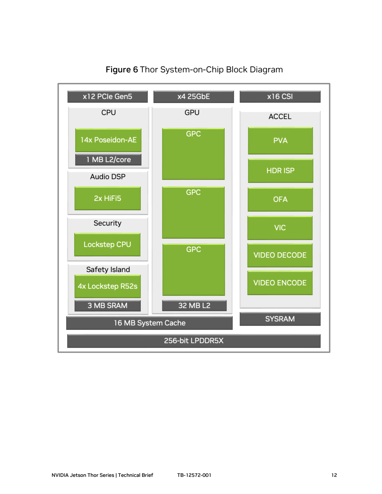
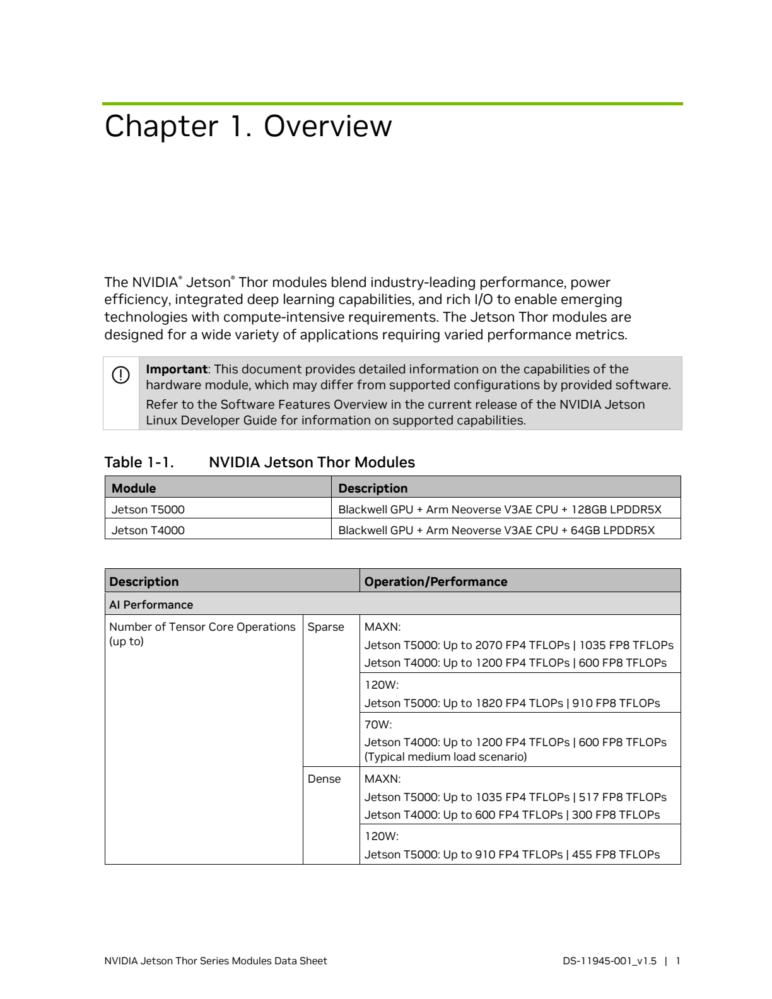

# NVIDIA 具身智能硬件平台：产品规格、工程约束与选型依据

## 1. 选型结论与本报告覆盖范围

**NVIDIA 的具身硬件应分为机器人端侧模组、工业边缘系统、开发与训练工作站三层选型。** Jetson Thor 提供 Blackwell GPU、较大统一内存和高速传感器通道，适合把多模态推理集中部署在机器人本体；Orin 覆盖更低的功率、尺寸和采购成本，适合已有模型与传感器方案的工程落地；IGX 在计算之外增加独立安全处理、系统管理及企业支持。DGX Spark 与 RTX PRO 则服务开发、微调和仿真主机，不能用它们的整机/板卡功率替代机器人模组功率。对应定位来自 [Thor官方产品页](https://www.nvidia.com/en-us/autonomous-machines/embedded-systems/jetson-thor/)、[Orin官方规格表](https://www.nvidia.com/en-us/autonomous-machines/embedded-systems/jetson-orin/)、[IGX官方规格表](https://www.nvidia.com/en-us/edge-computing/products/igx/)、[DGX Spark官方产品页](https://www.nvidia.com/en-us/products/workstations/dgx-spark/) 和 [RTX PRO6000 Workstation产品页](https://www.nvidia.com/en-us/products/workstations/professional-desktop-gpus/rtx-pro-6000/)；具体场景建议是本报告依据这些规格作出的工程分析。

本次以 **2026-11-03 取得的官方公开资料**为依据：完整覆盖现行 Jetson T5000/T4000、AGX Orin 三种模组、Orin NX 两种模组、Orin Nano 两种生产模组及主要开发套件；单列已宣布的 T3000/T2000、Orin Nano 2；补充 IGX Thor/Orin 和 DGX Spark、RTX PRO 6000 两种工作站卡。旧 Jetson 用生命周期表覆盖存量迁移需求。数据中心训练集群、全部消费显卡和车规 DRIVE SKU 不属于本文件“机器人主力 SoC/模组”的逐型号范围；不能把本报告理解成 NVIDIA 全部芯片目录。

**首先决定模型能否在可用内存中运行，再决定可持续功率、传感器通道和实时控制分工，最后比较同精度算力。** Thor 的 FP4 稀疏 TFLOPS 与 Orin 的 INT8 稀疏 TOPS 不代表同一模型的速度；Orin 总算力还包含 GPU 与 DLA，而模型未必能利用全部引擎。本报告没有实机测量，官方峰值、宣传性能和分析建议分别标明，不给出未经测量的 VLA 控制频率或机器人续航数字。

## 2. 机器人端侧：现行生产模组对比

### 2.1 Jetson Thor：计算、内存与功率

下表算力均为 Tensor Core 理论峰值；CPU/GPU 频率为最高值，不能理解为全部资源可在任意功率模式下同时持续达到。完整手册已把 MAXN 与默认功率模式分开。[Thor完整数据手册v1.5，第1–5页](https://developer.nvidia.com/downloads/assets/embedded/secure/jetson/thor/docs/jetson-thor-series-modules-datasheet_ds-11945-001.pdf)

| 生产模组 | GPU / CUDA 核 | CPU / 最高频率 | FP4 稀疏 / 稠密 TFLOPS | 统一内存 / 带宽 | 功率口径 | 官方来源 |
|---|---|---|---|---|---|---|
| Jetson T5000 | Blackwell，第五代 Tensor Core；2560 核，最高 1.575GHz | 14 核 Neoverse V3AE，2.6GHz | MAXN：2070 / 1035 | 128GB LPDDR5X，256bit；273GB/s | 产品页 40–130W；手册默认 120W，最大 TMP 130W | [Thor官方产品页](https://www.nvidia.com/en-us/autonomous-machines/embedded-systems/jetson-thor/)；[Thor完整数据手册v1.5，第1–5页](https://developer.nvidia.com/downloads/assets/embedded/secure/jetson/thor/docs/jetson-thor-series-modules-datasheet_ds-11945-001.pdf) |
| Jetson T4000 | Blackwell，第五代 Tensor Core；1536 核，最高 1.53GHz | 12 核 Neoverse V3AE，2.6GHz | MAXN：1200 / 600 | 64GB LPDDR5X，256bit；273GB/s | 产品页 40–70W；手册默认 70W，最大 TMP 90W，需区分 | [Thor官方产品页](https://www.nvidia.com/en-us/autonomous-machines/embedded-systems/jetson-thor/)；[Thor完整数据手册v1.5，第1–5页](https://developer.nvidia.com/downloads/assets/embedded/secure/jetson/thor/docs/jetson-thor-series-modules-datasheet_ds-11945-001.pdf)；[Thor热设计指南v1.3，第6页](https://developer.nvidia.com/downloads/assets/embedded/secure/jetson/thor/docs/jetson_thor_thermal_dg_tdg12271001.pdf) |

T5000 与 T4000 的主要差异是计算资源、内存容量、CPU 核数和允许的功率；**两者内存带宽相同，不能把容量减半理解为带宽减半。** 在带宽受限的单流解码任务上，峰值算力比值不直接等于推理加速比；在并行感知、规划和生成任务中，T5000 较多的计算与内存资源才更有机会发挥。以上是选型分析，具体结论需要相同模型和输入下实测。

两款都是 100×87×15.29mm、699-pin B2B 的 SOM，带热传导板与热管。完整手册披露 64MB NOR Flash；它是启动相关存储，不能作为应用磁盘。系统存储需通过 PCIe NVMe 或 USB SSD 实现。因此开发套件自带的 1TB SSD不能写成所有量产模组的内置存储。T5000 手册还注明 Alt-link ECC，T4000 对应内存条目没有同样标注，不能笼统声称全系列具有相同 ECC。[Thor完整数据手册v1.5，第1–5页](https://developer.nvidia.com/downloads/assets/embedded/secure/jetson/thor/docs/jetson-thor-series-modules-datasheet_ds-11945-001.pdf)

### 2.2 Jetson Orin：全部七种现行生产模组

Orin 使用 Ampere GPU、Cortex-A78AE CPU、LPDDR5。下表统一采用当前官方 Super/最高性能配置；NX 的 157/117 TOPS 已由 v1.7 完整手册确认。AGX Orin 32GB 的官方矛盾保留在表内。[Orin官方规格表](https://www.nvidia.com/en-us/autonomous-machines/embedded-systems/jetson-orin/)；[Orin NX完整手册v1.7，第1–4页](https://developer.nvidia.com/downloads/jetson-orin-nx-module-series-data-sheet)

| 生产模组 | INT8 稀疏 TOPS | CUDA / Tensor 核 | CPU 核数 / 最高频率 | 内存 / 带宽 GB/s | 功率模式 W | 官方来源 |
|---|---|---|---|---|---|---|
| AGX Orin 64GB | 275 | 2048 / 64 | 12 / 2.2GHz | 64GB、256bit；204.8 | 15–60 | [Orin官方规格表](https://www.nvidia.com/en-us/autonomous-machines/embedded-systems/jetson-orin/) |
| AGX Orin Industrial | 248 | 2048 / 64 | 12 / 2.0GHz | 64GB、256bit、ECC；204.8 | 15–75 | [Orin官方规格表](https://www.nvidia.com/en-us/autonomous-machines/embedded-systems/jetson-orin/)；[NVIDIA Jetson FAQ](https://developer.nvidia.com/embedded/faq) |
| AGX Orin 32GB | 总览 241；详细性能表 200，尚不能统一 | 1792 / 56 | 8 / 2.2GHz | 32GB、256bit；204.8 | 15–60 | [Orin官方规格表](https://www.nvidia.com/en-us/autonomous-machines/embedded-systems/jetson-orin/) |
| Orin NX 16GB | 157（MAXN_SUPER）；旧配置 100 | 1024 / 32 | 8 / 2.0GHz | 16GB、128bit；网页 102.4，手册约 102 | 10 / 15 / 25 / 40 | [Orin官方规格表](https://www.nvidia.com/en-us/autonomous-machines/embedded-systems/jetson-orin/)；[Orin NX完整手册v1.7，第1–4页](https://developer.nvidia.com/downloads/jetson-orin-nx-module-series-data-sheet) |
| Orin NX 8GB | 117（MAXN_SUPER）；旧配置 70 | 1024 / 32 | 6 / 2.0GHz | 8GB、128bit；网页 102.4，手册约 102 | 手册 10 / 15 / 20 / 40；网页第三档 25 | [Orin官方规格表](https://www.nvidia.com/en-us/autonomous-machines/embedded-systems/jetson-orin/)；[Orin NX完整手册v1.7，第1–4页](https://developer.nvidia.com/downloads/jetson-orin-nx-module-series-data-sheet) |
| Orin Nano 8GB | 67（Super） | 1024 / 32 | 6 / 1.7GHz | 8GB、128bit；102 | 7 / 15 / 25 | [Orin官方规格表](https://www.nvidia.com/en-us/autonomous-machines/embedded-systems/jetson-orin/)；[Orin Super官方开发者说明](https://developer.nvidia.com/blog/nvidia-jetson-orin-nano-developer-kit-gets-a-super-boost/) |
| Orin Nano 4GB | 34（Super） | 512 / 16 | 6 / 1.7GHz | 4GB、64bit；51 | 7 / 10 / 25 | [Orin官方规格表](https://www.nvidia.com/en-us/autonomous-machines/embedded-systems/jetson-orin/)；[Orin Super官方开发者说明](https://developer.nvidia.com/blog/nvidia-jetson-orin-nano-developer-kit-gets-a-super-boost/) |

容量相同也不代表部署能力相同。NX 8GB 具有 DLA 与 PVA；Nano 8GB 没有这些专用加速器，感知和模型更集中占用 GPU。Nano 4GB 又减少了 GPU 核数和内存带宽。AGX 的较大内存、较宽带宽和较丰富 I/O，主要解决多模型并行、图像缓存、地图和推理工作区的容量约束。[Orin官方规格表](https://www.nvidia.com/en-us/autonomous-machines/embedded-systems/jetson-orin/)

| 系列 / 型号差异 | DLA / PVA | 系统存储 | 形态 | 摄像头与高速 I/O 上限 | 低速控制接口 | 官方来源 |
|---|---|---|---|---|---|---|
| AGX Orin 64GB / 32GB / Industrial | 2×NVDLA v2；1×PVA v2 | 64GB eMMC 5.1；可扩展存储 | 100×87mm；699-pin；TTP | 16-lane CSI；PCIe Gen4，最高 2×x8+1×x4+2×x1；1GbE+10GbE | 2×CAN；4×UART、3×SPI、8×I2C | [Orin官方规格表](https://www.nvidia.com/en-us/autonomous-machines/embedded-systems/jetson-orin/) |
| Orin NX 16GB / 8GB | 16GB：2×DLA；8GB：1×DLA；都有 PVA v2 | 外接 NVMe / USB SSD | 69.6×45mm；260-pin SO-DIMM | 8-lane CSI；Gen4 x4 及其他 x1/x2 配置；1GbE | 1×CAN；3×UART、2×SPI、4×I2C | [Orin官方规格表](https://www.nvidia.com/en-us/autonomous-machines/embedded-systems/jetson-orin/)；[Orin NX完整手册v1.7，第1–4页](https://developer.nvidia.com/downloads/jetson-orin-nx-module-series-data-sheet) |
| Orin Nano 8GB / 4GB | 无 DLA / PVA | 生产模组需外接 NVMe 等；开发版本 SD 属另一形态 | 69.6×45mm；260-pin SO-DIMM | 8-lane CSI；Gen3 x4+3×x1；1GbE | 1×CAN；3×UART、2×SPI、4×I2C | [Orin官方规格表](https://www.nvidia.com/en-us/autonomous-machines/embedded-systems/jetson-orin/) |
| Thor T5000 / T4000 | 1×PVA v3；算力表按 GPU Tensor Core，不把 Orin DLA 沿用到 Thor | 64MB NOR；外接 NVMe / USB SSD | 100×87×15.29mm；699-pin；TTP+热管 | 16-lane CSI；Gen5 最大 x8 链路；T5000 4×25GbE、T4000 3×25GbE | T5000 4×CAN；T4000 未列同样 CAN；13×I2C、4×UART、3×SPI | [Thor完整数据手册v1.5，第1–5页](https://developer.nvidia.com/downloads/assets/embedded/secure/jetson/thor/docs/jetson-thor-series-modules-datasheet_ds-11945-001.pdf) |

这些是模组信号/控制器能力，**不是载板上现成插座的数量，也不是所有接口可同时满速启用的承诺。** USB、PCIe、MGBE 使用共享 UPHY 资源，应按引脚复用配置设计载板。NX/Nano 完整设计指南提供可用配置；Thor 完整指南说明 Gen5、MGBE、电气与布线要求。CAN 仍需合适收发器与接插件，GMSL/FPD-Link 相机仍需桥接/解串器及驱动。不能从“具有 CAN/以太网”直接推导原生 EtherCAT 主站、硬实时闭环或安全通信认证。[Orin NX/Nano设计指南v1.5](https://developer.nvidia.com/downloads/jetson-orin-nx-series-nano-series-design-guide)；[Thor接口设计指南v1.5](https://developer.nvidia.com/downloads/jetson/thor/docs/jetson-thor-series-modules-designguide-dg12084001.pdf)；[NVIDIA Jetson FAQ](https://developer.nvidia.com/embedded/faq)

### 2.3 峰值算力如何还原到模型实际可用资源

| 配置 | GPU / Tensor Core 峰值 | DLA 贡献 | 对选型的意义 | 官方来源 |
|---|---|---|---|---|
| T5000 MAXN | FP4 稀疏 2070，稠密 1035；FP8 稀疏 1035，稠密 517 TFLOPS | 不按 Orin DLA 合并口径 | 非稀疏模型不能直接使用 2070；量化精度也须验证任务精度 | [Thor完整数据手册v1.5，第1–5页](https://developer.nvidia.com/downloads/assets/embedded/secure/jetson/thor/docs/jetson-thor-series-modules-datasheet_ds-11945-001.pdf) |
| T5000 默认 120W | FP4 稀疏 1820，稠密 910；FP8 稠密 455 TFLOPS | 同上 | 默认模式的峰值已经低于 MAXN，不能按 120W 宣称 2070 | [Thor完整数据手册v1.5，第1–5页](https://developer.nvidia.com/downloads/assets/embedded/secure/jetson/thor/docs/jetson-thor-series-modules-datasheet_ds-11945-001.pdf) |
| T4000 70W / MAXN 计算表 | FP4 稀疏 1200，稠密 600；FP8 稠密 300 TFLOPS | 同上 | 计算表与最大模组功率分别读取；70W算力不取消90W热设计约束 | [Thor完整数据手册v1.5，第1–5页](https://developer.nvidia.com/downloads/assets/embedded/secure/jetson/thor/docs/jetson-thor-series-modules-datasheet_ds-11945-001.pdf)；[Thor热设计指南v1.3，第6页](https://developer.nvidia.com/downloads/assets/embedded/secure/jetson/thor/docs/jetson_thor_thermal_dg_tdg12271001.pdf) |
| NX 16GB MAXN_SUPER | 总 INT8 稀疏 157；稠密 78 TOPS | 两个 DLA 合计稀疏 80 TOPS | 157不是一个 GPU 可独占的吞吐；DLA模型覆盖影响收益 | [Orin NX完整手册v1.7，第1–4页](https://developer.nvidia.com/downloads/jetson-orin-nx-module-series-data-sheet) |
| NX 8GB MAXN_SUPER | 总 INT8 稀疏 117；稠密 58 TOPS | 一个 DLA 稀疏 40 TOPS | 即使 GPU 资源相同，总值仍因 DLA 数量不同而变化 | [Orin NX完整手册v1.7，第1–4页](https://developer.nvidia.com/downloads/jetson-orin-nx-module-series-data-sheet) |

稀疏加速要求模型满足支持的结构和运行路径，低精度也要求权重/激活量化可接受。不能仅将 2070 除以 275，称 Thor 对任意 VLA 比 Orin 快约 7.5 倍。官方发布博客的“最高 7.5 倍 AI 算力”属于厂商比较口径；此处的表格说明它与单一工作负载延迟并非同一指标。[Thor首发官方博客，2025-08-25](https://blogs.nvidia.com/blog/jetson-thor-physical-ai-edge/)

工程验证应固定模型版本、量化方式、输入分辨率、相机数量、上下文长度、batch、功率模式和散热条件，分别记录预处理、视觉编码、语言/动作生成、总时延及峰值内存。把相机缓存、CPU处理和 GPU 推理共同压力下的持续结果作为验收依据。本轮没有进行上述测试；各型号对具体 VLA 的 P95 时延、动作输出频率和能耗为 **[公开资料未披露]**，原因是未取得可覆盖这些固定条件的官方逐 SKU 对照结果。

## 3. 已宣布的新型号：与现货产品分开评估

| 产品 | 已公开计算与 CPU | 内存 / 带宽 | 功率、I/O 与价格 | 公告与计划供货 | 当前可用开发方式 | 官方来源 |
|---|---|---|---|---|---|---|
| Jetson T3000 | Blackwell；865 FP4 TFLOPS；8核 Neoverse Arm CPU。公告未明确该值稀疏/稠密条件 | 32GB LPDDR5X；273GB/s | 已提25GbE；准确功率、尺寸、CUDA核数、售价：[公开资料未披露]，没有完整SKU手册 | 2026-07-15公告；计划2027 Q1 | 公告称AGX Thor套件将提供模拟，JetPack7.2.1；不能等同量产硬件验证 | [T3000/T2000官方公告，2026-07-15](https://blogs.nvidia.com/blog/jetson-thor-robotics-edge-ai-agent/) |
| Jetson T2000 | Thor架构；400 FP4 TFLOPS；CPU/GPU核数：[公开资料未披露] | 16GB；带宽：[公开资料未披露] | 具体功率、接口、尺寸与售价：[公开资料未披露]，公告未给 | 同次公告；计划2027 Q1 | 模拟模式计划在后续版本支持；本轮未核实实际交付版本 | [T3000/T2000官方公告，2026-07-15](https://blogs.nvidia.com/blog/jetson-thor-robotics-edge-ai-agent/) |
| IGX T3000 | 公告称同档865 FP4 TFLOPS并集成功能安全 | 公告未提供独立完整规格：[公开资料未披露] | 安全配置、整机功率、认证包和价格：[公开资料未披露] | 已宣布；该公告明确的2027 Q1供货句仅指Jetson T3000/T2000，不能扩展到IGX | 未取得独立交付清单 | [T3000/T2000官方公告，2026-07-15](https://blogs.nvidia.com/blog/jetson-thor-robotics-edge-ai-agent/) |
| Jetson Orin Nano 2 | 78 TOPS；8核 Arm；精度/稀疏条件和GPU核数：[公开资料未披露] | 8GB；具体带宽：[公开资料未披露] | 新闻稿说明15W模式能效；产品页提40W envelope；完整模式表、价格未披露 | 2026-08-25公告；模组与套件预计2027上半年 | 公告与伙伴评估阶段，不能写成现货量产 | [Orin Nano2官方新闻稿，2026-08-25](https://nvidianews.nvidia.com/news/nvidia-announces-jetson-orin-nano-2-robotics-computer-to-redefine-entry-level-edge-ai)；[Orin官方规格表](https://www.nvidia.com/en-us/autonomous-machines/embedded-systems/jetson-orin/) |

新型号应进入下一代规划清单，不能作为当前交付项目的已确认替代。T3000 官方称部分多模态负载接近 T5000，并描述约一半尺寸/功率；没有完整参数和测试条件时，不把该描述换算成精确尺寸、W数或普遍性能保证。Nano 2 的“2倍推理性能、同性能低40%功耗”同样是厂商宣称，78 TOPS 与 Nano Super 的67 TOPS不能直接推出2倍所有模型速度。[T3000/T2000官方公告，2026-07-15](https://blogs.nvidia.com/blog/jetson-thor-robotics-edge-ai-agent/)；[Orin Nano2官方新闻稿，2026-08-25](https://nvidianews.nvidia.com/news/nvidia-announces-jetson-orin-nano-2-robotics-computer-to-redefine-entry-level-edge-ai)

## 4. 开发套件、生产形态和兼容性

| 开发套件 | 计算与内存 | 存储 | 主要已引出接口 | 外形尺寸 mm | 适合用途 / 注意点 | 官方来源 |
|---|---|---|---|---|---|---|
| Jetson AGX Thor Developer Kit | T5000；128GB；2070 FP4稀疏 TFLOPS | 随附1TB NVMe | 5GbE RJ45；QSFP28 4×25GbE；M.2 M/E；USB；CAN排针 | 243.19×112.40×56.88 | 端侧原型；摄像头表明确QSFP HSB/USB，不能把模组16-lane CSI写成现成套件MIPI插座 | [AGX Thor开发套件手册，JAN26](https://dam-cdn.nvd.orangelogic.com/AssetLink/2gxa66a03084177dss0h1c168r7x2qcd.pdf)；[Thor官方产品页](https://www.nvidia.com/en-us/autonomous-machines/embedded-systems/jetson-thor/) |
| Jetson AGX Orin Developer Kit | 当前64GB版本；275稀疏INT8 TOPS；可模拟Orin各档 | 模组eMMC及NVMe扩展能力，不能默认含同Thor的1TB SSD | 10GbE RJ45；Gen4 PCIe/M.2；16-lane CSI接口；USB、40-pin扩展 | 110×110×71.65 | 验证AGX/NX/Nano软件负载；模拟不替代目标生产载板电气测试 | [Orin官方规格表](https://www.nvidia.com/en-us/autonomous-machines/embedded-systems/jetson-orin/)；[NVIDIA Jetson FAQ](https://developer.nvidia.com/embedded/faq) |
| Jetson Orin Nano Super Developer Kit | Nano 8GB开发模组；67稀疏INT8 TOPS | microSD或NVMe；存储介质按具体包装另核 | 1GbE RJ45；2个22-pin CSI插座；4×USB-A；M.2、40-pin扩展 | 100×79×21 | 小型原型；参考载板兼容NX/Nano，但启用NX Super须重新核供电散热 | [Orin官方规格表](https://www.nvidia.com/en-us/autonomous-machines/embedded-systems/jetson-orin/)；[Nano Super开发套件官方页](https://www.nvidia.com/en-us/autonomous-machines/embedded-systems/jetson-orin/nano-super-developer-kit/)；[NVIDIA Jetson FAQ](https://developer.nvidia.com/embedded/faq) |

官方 FAQ 明确开发套件用于开发与预生产测试：开发用途保修1年，没有开发套件供货保证或EOL提前通知承诺；生产模组通常保修3年，采用量产器件，并通过PCN通知BOM变更。**量产报价应以生产模组+载板+电源+散热+存储+传感器桥接为完整BOM，不能以套件价格替代量产成本。** [NVIDIA Jetson FAQ](https://developer.nvidia.com/embedded/faq)

机械兼容也不能替代电气兼容。FAQ 将 Thor 与 AGX Orin 标为形态兼容，未标引脚兼容；NX/Nano 同族可按官方差异设计兼容载板，但与旧 Xavier NX 不是直接引脚兼容。已有产品升级时应核对连接器、电源轨、UPHY、相机、启动介质及驱动，再判断能否复用载板。[NVIDIA Jetson FAQ](https://developer.nvidia.com/embedded/faq)；[Thor接口设计指南v1.5](https://developer.nvidia.com/downloads/jetson/thor/docs/jetson-thor-series-modules-designguide-dg12084001.pdf)；[Orin NX/Nano设计指南v1.5](https://developer.nvidia.com/downloads/jetson-orin-nx-series-nano-series-design-guide)

## 5. 功率、散热、制程与安全边界

### 5.1 功率预算必须包含功率模式、供电瞬态和热传导条件

Thor v1.5手册给T5000默认120W、MAXN最大TMP130W；T4000默认70W、最大TMP90W。v1.3热设计指南独立重复130/90W的MAXN热设计条件，并要求T5000的TTP最高80°C、T4000最高75°C；推荐SoC工作温度90°C、最大工作115°C、关机阈值118°C。**TTP、结温、环境温度是不同测量点，不能把TTP限值写成整机环境宽温规格。** [Thor完整数据手册v1.5，第1–5页](https://developer.nvidia.com/downloads/assets/embedded/secure/jetson/thor/docs/jetson-thor-series-modules-datasheet_ds-11945-001.pdf)；[Thor热设计指南v1.3，第6页](https://developer.nvidia.com/downloads/assets/embedded/secure/jetson/thor/docs/jetson_thor_thermal_dg_tdg12271001.pdf)

散热器应贴合TTP，通过合适TIM和机械固定设计降低热阻，随后在最高环境温度、整机封闭程度、实际风道和连续模型负载下验证。官方热指南要求客户对具体用例持续最大热负载作验证，并讨论功率/电流设计条件；“带TTP”本身不是无需散热器的承诺。[Thor热设计指南v1.3，第6页](https://developer.nvidia.com/downloads/assets/embedded/secure/jetson/thor/docs/jetson_thor_thermal_dg_tdg12271001.pdf)

NX v1.7手册给出普通输入5–20V、MAXN_SUPER输入8–20V；FAQ要求NX启用Super时载板具有HV rail并支持40W热设计。旧载板上升级软件并不自动满足此要求。NX手册的结温范围为-25–105°C、SoC降频阈值99°C，应按其测量与限制定义使用。AGX Orin Industrial的FAQ披露TTP工作-40–85°C、DRAM ECC和运行冲击/振动验证；普通AGX对应TTP为-25–80°C。工业版的加固数据不能推广到所有Orin或所有伙伴整机。[Orin NX完整手册v1.7，第1–4页](https://developer.nvidia.com/downloads/jetson-orin-nx-module-series-data-sheet)；[NVIDIA Jetson FAQ](https://developer.nvidia.com/embedded/faq)；[Orin NX/Nano热设计指南v1.5](https://developer.nvidia.com/downloads/jetson-orin-nx-orin-nano-series-thermal-design-guide)

电池预算需要把模组TMP、载板稳压损耗、SSD、摄像头/解串器、网口、风扇和无线模块计入，并和电机驱动用电分开。没有实机能耗曲线，本文不估算“可续航几小时”；载板瞬态供电和散热余量应按手册及实际负载确定，而不是给每个项目套用固定余量百分比。

### 5.2 制程信息及功能安全

| 平台 | 已核实的架构 / 制程 | 安全相关硬件与证据界限 | 官方来源 |
|---|---|---|---|
| Jetson Thor | Blackwell + Neoverse V3AE；具体制造节点：[公开资料未披露]，本轮公开模组手册/白皮书未明确提供可引用节点 | SoC架构图存在安全岛；不代表普通Jetson获得IGX安全软件、载板sMCU或整机认证 | [Thor完整数据手册v1.5，第1–5页](https://developer.nvidia.com/downloads/assets/embedded/secure/jetson/thor/docs/jetson-thor-series-modules-datasheet_ds-11945-001.pdf)；[Thor技术白皮书，TB-12572-001](https://dam-cdn.nvd.orangelogic.com/AssetLink/v686u306w26ftuk863xjeimilimtx55e.pdf)；[IGX安全方案简报，第1–2页](https://developer.download.nvidia.com/assets/igx/robotics-product-brief-igx-thor-safety-4473375.pdf) |
| Jetson Orin | Ampere + Cortex-A78AE；具体制造节点：[公开资料未披露]，所取官方模组页/手册未给可核对节点 | Industrial公开DRAM ECC和环境验证；产品页安全簇条目不能作为整机SIL/PL证书 | [Orin官方规格表](https://www.nvidia.com/en-us/autonomous-machines/embedded-systems/jetson-orin/)；[NVIDIA Jetson FAQ](https://developer.nvidia.com/embedded/faq) |
| DGX Spark / GB10 | Grace Blackwell；GB10 S-die/G-die采用TSMC 3nm、2.5D封装和C2C一致性互联 | 开发工作站定位；没有本轮可引用机器人整机安全认证 | [GB10白皮书，第3、7–8页](https://www.nvidia.com/content/dam/en-zz/Solutions/dgx-spark/nvidia-gb10-superchip-whitepaper.pdf) |
| RTX PRO 6000 Blackwell两种卡 | Blackwell；96GB ECC GDDR7；GPU制造节点：[公开资料未披露]，已下载板卡手册未写 | ECC不等于机器人安全认证，需评估整机与任务隔离 | [RTX PRO6000 Workstation手册，JUN26](https://www.nvidia.com/content/dam/en-zz/Solutions/data-center/rtx-pro-6000-blackwell-workstation-edition/workstation-blackwell-rtx-pro-6000-workstation-edition-nvidia-us-3519208-web.pdf)；[RTX PRO6000 Max-Q手册，JUN26](https://www.nvidia.com/content/dam/en-zz/Solutions/products/workstations/professional-desktop-gpus/rtx-pro-6000-max-q/workstation-datasheet-blackwell-rtx-pro-6000-max-q-nvidia-us-5349650-web.pdf) |

以下为NVIDIA官方技术白皮书第12页的Thor SoC框图。**它描绘SoC内部资源，不等于每个模组引出/软件开放的能力**：例如图中x12 PCIe Gen5不能替代模组手册的可用配置；安全岛也不能直接算作用户可用运动控制MCU。图中的早期名称保留原样，SKU和工程参数以本报告所列具体手册为准。[Thor技术白皮书，TB-12572-001](https://dam-cdn.nvd.orangelogic.com/AssetLink/v686u306w26ftuk863xjeimilimtx55e.pdf)；[Thor完整数据手册v1.5，第1–5页](https://developer.nvidia.com/downloads/assets/embedded/secure/jetson/thor/docs/jetson-thor-series-modules-datasheet_ds-11945-001.pdf)

IGX安全简报说明FSI具有独立电源/时钟，载板sMCU是独立微控制器，且位于载板而非Jetson Thor SOM上；这些能力通过Safety Extension Package使用。简报还提供Linux+FSI/sMCU RTOS及Hypervisor+Linux/QNX VM两种架构。它描述的是构建安全系统的基础和检查资料，最终机器人认证仍需具体硬件、软件、安全功能与认证机构流程。不得将“设计满足标准”写成已取得机器人整机SIL/PL等级。[IGX安全方案简报，第1–2页](https://developer.download.nvidia.com/assets/igx/robotics-product-brief-igx-thor-safety-4473375.pdf)

## 6. 工业边缘平台：IGX

IGX官网现已写明Thor一般可用，并列出量产系统、开发套件和Mini套件；早期发布博客的预计供货月份仅作为历史信息。下面保留现行规格表中的主要配置，避免与同名Jetson混淆。[IGX官方规格表](https://www.nvidia.com/en-us/edge-computing/products/igx/)；[IGX Thor官方发布博客](https://blogs.nvidia.com/blog/igx-thor-processor-physical-ai-industrial-medical-edge/)

| 工业配置 | 算力峰值与精度 | CPU / 内存 | 独立GPU及显存 | 功率口径 | I/O与系统特征 | 官方来源 |
|---|---|---|---|---|---|---|
| IGX T5000 SOM | 2070 FP4稀疏 TFLOPS | 14核V3AE；128GB LPDDR5X，273GB/s | 无 | 模组40–130W | 4×25GbE；可自定义载板；安全功能按方案选择 | [IGX官方规格表](https://www.nvidia.com/en-us/edge-computing/products/igx/) |
| IGX T7000 + RTX PRO6000 Max-Q | 系统合计5581 FP4稀疏 TFLOPS | 同T5000；128GB统一内存 | 96GB GDDR7；1792GB/s | 模组40–130W，加dGPU最高300W；不是整机输入上限 | 2×200GbE ConnectX-7；BMC；FSI与载板sMCU | [IGX官方规格表](https://www.nvidia.com/en-us/edge-computing/products/igx/) |
| IGX T7000 + RTX PRO5000 | 系统合计4293 FP4稀疏 TFLOPS | 同T5000；128GB统一内存 | 官网此配置48GB GDDR7；1344GB/s | dGPU功率须按交付配置核验；整机输入[公开资料未披露] | ConnectX-7/BMC等，依OEM配置 | [IGX官方规格表](https://www.nvidia.com/en-us/edge-computing/products/igx/) |
| IGX Thor Developer Kit / Mini | 完整套件5581，Mini2070 FP4稀疏 TFLOPS | 14核V3AE；128GB | 完整套件预装Max-Q；Mini无 | iGPU模组40–130W；完整套件另加最高300W dGPU | 完整套件2×200GbE/BMC；Mini5GbE+QSFP28，非同一载板 | [IGX官方规格表](https://www.nvidia.com/en-us/edge-computing/products/igx/) |
| IGX Orin 700生产板套件 | 最高1705稀疏TOPS，含可选RTX6000 Ada；不能当作Orin单GPU值 | 12核A78AE；64GB LPDDR5 ECC；64GB eMMC | 可选独立GPU | 无dGPU最高125W；含dGPU400W，官网系统配置口径 | 双100GbE ConnectX-7；BMC；功能安全；支持期限官网写至2033 | [IGX官方规格表](https://www.nvidia.com/en-us/edge-computing/products/igx/) |
| IGX Orin Developer Kit | 最高1705稀疏TOPS，需可选GPU | 12核A78AE；64GB；204.8GB/s | 可选RTX A6000或RTX6000 Ada | 页面给交流输入电气额定值；实测耗电[公开资料未披露] | 500GB NVMe；TC397 sMCU；AST2600 BMC；2×100GbE | [IGX官方规格表](https://www.nvidia.com/en-us/edge-computing/products/igx/) |

IGX的优势是系统级安全与企业维护资源，以及比Jetson载板更强的离散GPU、网络和管理扩展；代价是体积、系统功率及认证/软件采购复杂度。T7000的128GB统一内存和96GB显存属于两个内存域，不能相加后当作单GPU224GB可直接分配池；5581也是多个引擎的合计峰值。最终应取得OEM整机散热、总输入功率、安全包/维护范围和长期报价。[IGX官方规格表](https://www.nvidia.com/en-us/edge-computing/products/igx/)；[IGX安全方案简报，第1–2页](https://developer.download.nvidia.com/assets/igx/robotics-product-brief-igx-thor-safety-4473375.pdf)

## 7. 开发、微调和仿真主机

| 硬件 | CPU / GPU | 内存 / 带宽 | 理论计算指标 | 功率 | 接口与形态 | 官方来源 |
|---|---|---|---|---|---|---|
| DGX Spark（128GB规格） | GB10；20核Arm：10×X925+10×A725；Blackwell GPU，6144 CUDA核 | 128GB一致性LPDDR5X；256bit；273GB/s | 最高1PFLOP，FP4稀疏理论值 | 网页GB10 TDP140W、电源240W；SEP26手册Power Consumption240W，非实测 | 4TB NVMe；ConnectX-7 200Gbps、10GbE；150×150×50.5mm，1.2kg | [DGX Spark官方产品页](https://www.nvidia.com/en-us/products/workstations/dgx-spark/)；[DGX Spark手册，SEP26](https://dam-cdn.nvd.orangelogic.com/AssetLink/es6d60li4v5hybk461p65is6os33c48h.pdf)；[GB10白皮书，第3、7–8页](https://www.nvidia.com/content/dam/en-zz/Solutions/dgx-spark/nvidia-gb10-superchip-whitepaper.pdf) |
| DGX Spark 64GB（OEM选项） | 官网列为同一GB10平台；非Jetson模组 | 64GB一致性LPDDR5X；官网系列带宽273GB/s | 官网系列最高1PFLOP，FP4稀疏；逐OEM配置需核验 | 系列网页给GB10 TDP140W、电源240W；逐OEM系统额定值需确认 | 仅参与OEM供货；SSD、包装和整机尺寸按OEM SKU核验，不套用128GB套件 | [DGX Spark官方产品页](https://www.nvidia.com/en-us/products/workstations/dgx-spark/) |
| RTX PRO6000 Blackwell Workstation Edition | 需另配主机CPU；24064 CUDA核；第五代Tensor / 第四代RT | 96GB ECC GDDR7；512bit；1792GB/s | FP32 126 TFLOPS；AI4000 TOPS为FP4稀疏 | 板卡TBP600W | PCIe5 x16；双槽加高；4×DP2.1b；双贯通散热 | [RTX PRO6000 Workstation手册，JUN26](https://www.nvidia.com/content/dam/en-zz/Solutions/data-center/rtx-pro-6000-blackwell-workstation-edition/workstation-blackwell-rtx-pro-6000-workstation-edition-nvidia-us-3519208-web.pdf) |
| RTX PRO6000 Blackwell Max-Q Workstation Edition | 需另配主机CPU；24064 CUDA核；同代Tensor/RT | 96GB ECC GDDR7；512bit；1792GB/s | FP32 110 TFLOPS；AI3511 TOPS为FP4稀疏 | 板卡TBP300W | PCIe5 x16；全高双槽；4×DP2.1b；主动散热 | [RTX PRO6000 Max-Q手册，JUN26](https://www.nvidia.com/content/dam/en-zz/Solutions/products/workstations/professional-desktop-gpus/rtx-pro-6000-max-q/workstation-datasheet-blackwell-rtx-pro-6000-max-q-nvidia-us-5349650-web.pdf) |

Spark的当前网页还出现64GB选项，但已下载SEP26手册完整参数是128GB版本；64GB仅由参与OEM提供，不能将128GB包装规格与任何64GB SKU价格混拼成同一配置。GB10白皮书确认统一内存以及Arm架构。**当前Isaac Sim官方要求页明确：aarch64构建仅支持DGX Spark、系统为DGX OS7；所列测试驱动为580.159.03。该页对Isaac Sim6.0列出cuRobo、cuMotion不支持的限制。** 因此Spark可以进入仿真主机评估，但不能宣称所有机器人规划/训练扩展均已兼容；本轮没有在指定场景、传感器数量下实测帧率。[DGX Spark官方产品页](https://www.nvidia.com/en-us/products/workstations/dgx-spark/)；[DGX Spark手册，SEP26](https://dam-cdn.nvd.orangelogic.com/AssetLink/es6d60li4v5hybk461p65is6os33c48h.pdf)；[GB10白皮书，第3、7–8页](https://www.nvidia.com/content/dam/en-zz/Solutions/dgx-spark/nvidia-gb10-superchip-whitepaper.pdf)；[Isaac Sim官方系统要求与Spark限制](https://docs.isaacsim.omniverse.nvidia.com/latest/installation/requirements.html)

同一要求页为x86_64主机列出最低32GB系统RAM、16GB显存、RTX4080，较佳GPU为RTX5080，理想GPU为RTX PRO6000 Blackwell；理想栏的48GB是显存需求门槛，不是把96GB板卡改写为48GB。页面说明无RT Core的A100/H100不受支持，训练和复杂传感器场景需要更多RAM/显存。因此即使某训练卡算力更高，也不能直接替代RTX视觉仿真配置。此处4080/5080只作为应用软件要求页的参考档位，非追加全部消费显卡的硬件目录。[Isaac Sim官方系统要求与Spark限制](https://docs.isaacsim.omniverse.nvidia.com/latest/installation/requirements.html)

两种RTX PRO6000提供相同显存与带宽，但功率、频率及FP32/FP4峰值不同。适合需要较大场景、视觉渲染和GPU训练工作区的主机评估；显卡只包含GPU显存，主机RAM、CPU和存储另算。MIG规格列最多4×24GB、2×48GB或1×96GB，但分区可用性及仿真任务兼容性仍需按驱动和应用验证；不能把分区数量直接当成可并行训练机器人数。[RTX PRO6000 Workstation手册，JUN26](https://www.nvidia.com/content/dam/en-zz/Solutions/data-center/rtx-pro-6000-blackwell-workstation-edition/workstation-blackwell-rtx-pro-6000-workstation-edition-nvidia-us-3519208-web.pdf)；[RTX PRO6000 Max-Q手册，JUN26](https://www.nvidia.com/content/dam/en-zz/Solutions/products/workstations/professional-desktop-gpus/rtx-pro-6000-max-q/workstation-datasheet-blackwell-rtx-pro-6000-max-q-nvidia-us-5349650-web.pdf)

强相关开源验证入口为 [Isaac Lab官方仓库](https://github.com/isaac-sim/IsaacLab)：本次公开网页快照 **8,556 Stars**；main最近可见提交时间 **2026-11-03 05:08:05 UTC**，这是默认分支提交时间，不等同所有分支最后推送时间。主框架 **BSD-3-Clause**，`isaaclab_mimic`扩展为Apache-2.0，部分Isaac Sim组件与资产有另外的专有许可。README、LICENSE和提交API响应均已归档，Stars是抓取时快照。该项目适合构建可复现的训练/仿真验证流程，本报告不声称对上述全部硬件已完成实测。[Isaac Lab默认分支最近提交（官方API）](https://api.github.com/repos/isaac-sim/IsaacLab/commits?sha=main&per_page=1)；[Isaac Lab README](https://raw.githubusercontent.com/isaac-sim/IsaacLab/main/README.md)；[Isaac Lab LICENSE](https://raw.githubusercontent.com/isaac-sim/IsaacLab/main/LICENSE)

[Isaac Sim官方仓库](https://github.com/isaac-sim/IsaacSim)的本次快照为 **4,419 Stars**，main最近可见提交时间 **2026-09-10 10:15:24 +08:00**；仓库代码为 **Apache-2.0**。其LICENSE明确构建/使用还需要采用其他许可的Omniverse Kit SDK、模型和纹理等附加组件，不能将整个部署包都称为Apache-2.0。仓库、README、LICENSE、提交API响应与系统要求文档均已下载。[Isaac Sim默认分支最近提交（官方API）](https://api.github.com/repos/isaac-sim/IsaacSim/commits?sha=main&per_page=1)；[Isaac Sim README](https://raw.githubusercontent.com/isaac-sim/IsaacSim/main/README.md)；[Isaac Sim LICENSE](https://raw.githubusercontent.com/isaac-sim/IsaacSim/main/LICENSE)

## 8. 价格、发布日期与供货生命周期

### 8.1 当前价格必须与历史首发价格分开

以下为抓取时NVIDIA FAQ公开的美元建议价；模组为 **1KU+（至少1000件）**口径，套件为所列MSRP。它们不是中国含税到货价、单件采购报价或可锁定的合约价。[NVIDIA Jetson FAQ](https://developer.nvidia.com/embedded/faq)

| 产品 | 当前FAQ建议价 USD | 采购口径 | 供货/生命周期 | 官方来源 |
|---|---|---|---|---|
| T5000 / T4000生产模组 | 4999 / 2999 | 1KU+ | T5000至2035-08；T4000至2036-01 | [NVIDIA Jetson FAQ](https://developer.nvidia.com/embedded/faq)；[Jetson官方生命周期](https://developer.nvidia.com/embedded/lifecycle) |
| AGX Orin 64GB / Industrial / 32GB | 2999 / 3199 / 1799 | 1KU+ | 普通两款至2032-01；Industrial至2033-07 | [NVIDIA Jetson FAQ](https://developer.nvidia.com/embedded/faq)；[Jetson官方生命周期](https://developer.nvidia.com/embedded/lifecycle) |
| Orin NX 16GB / 8GB | 999 / 649 | 1KU+ | 至2032-01 | [NVIDIA Jetson FAQ](https://developer.nvidia.com/embedded/faq)；[Jetson官方生命周期](https://developer.nvidia.com/embedded/lifecycle) |
| Orin Nano 8GB / 4GB生产模组 | 399 / 349 | 1KU+ | 至2032-01 | [NVIDIA Jetson FAQ](https://developer.nvidia.com/embedded/faq)；[Jetson官方生命周期](https://developer.nvidia.com/embedded/lifecycle) |
| AGX Thor / AGX Orin开发套件 | 5499 / 3499 | 套件MSRP | 不适用生产模组供货保证 | [NVIDIA Jetson FAQ](https://developer.nvidia.com/embedded/faq) |
| Orin Nano Super开发套件 | 399 | 套件MSRP | 开发用途，无供货保证 | [NVIDIA Jetson FAQ](https://developer.nvidia.com/embedded/faq) |
| T3000 / T2000 / Nano2 | [公开资料未披露]：所取新产品公告没有价格 | 不按同族型号推算 | 计划供货见第3节 | [T3000/T2000官方公告，2026-07-15](https://blogs.nvidia.com/blog/jetson-thor-robotics-edge-ai-agent/)；[Orin Nano2官方新闻稿，2026-08-25](https://nvidianews.nvidia.com/news/nvidia-announces-jetson-orin-nano-2-robotics-computer-to-redefine-entry-level-edge-ai) |
| IGX / Spark / RTX PRO本表配置 | [公开资料未披露]：本轮所取技术资料没有统一、可匹配交付配置的当前价格 | 需OEM/渠道逐配置询价 | 软件、存储、GPU和支持包改变报价 | [IGX官方规格表](https://www.nvidia.com/en-us/edge-computing/products/igx/)；[DGX Spark官方产品页](https://www.nvidia.com/en-us/products/workstations/dgx-spark/)；[RTX PRO6000 Workstation产品页](https://www.nvidia.com/en-us/products/workstations/professional-desktop-gpus/rtx-pro-6000/)；[RTX PRO6000 Max-Q产品页](https://www.nvidia.com/en-us/products/workstations/professional-desktop-gpus/rtx-pro-6000-max-q/) |

2025-08-25 Thor发布博客曾给AGX Thor套件起价3499美元、T5000模组在1000件采购时起价2999美元；2024-12-17 Nano Super发布博客曾给套件249美元。**这些历史价格与当前FAQ的5499/4999/399美元不同。** 本报告采用当前FAQ作预算基线，同时保存首发来源；没有依据将差异自行解释为涨价原因、地区差别或渠道溢价。下单应带准确P/N、数量、交期、税费和质保向渠道锁价。[Thor首发官方博客，2025-08-25](https://blogs.nvidia.com/blog/jetson-thor-physical-ai-edge/)；[Nano Super首发博客，2024-12-17](https://blogs.nvidia.com/blog/jetson-generative-ai-supercomputer/)；[NVIDIA Jetson FAQ](https://developer.nvidia.com/embedded/faq)

### 8.2 旧代产品与仍供货产品不能混写“退市”

Orin不是2025后才出现的新系列：官方历史公告已确认AGX Orin 32GB生产模组于2022-08-03可用，Orin Nano模组于2022-09-20发布；Nano Super是2024-12-17的软件/套件性能升级。对未逐一取得独立首发页的其他容量SKU，**精确首发日为[公开资料未披露]**，本轮不把系列日期伪装成各SKU首发日。规格采用2026现行产品页与可得手册，发布日期只用于区分代际。[AGX Orin32GB供货博客，2022-08-03](https://blogs.nvidia.com/blog/2022/08/03/nvidia-jetson-agx-orin-32gb-production-modules/)；[Orin Nano首发新闻稿，2022-09-20](https://nvidianews.nvidia.com/news/nvidia-jetson-orin-nano-sets-new-standard-for-entry-level-edge-ai-and-robotics-with-80x-performance-leap)；[Nano Super首发博客，2024-12-17](https://blogs.nvidia.com/blog/jetson-generative-ai-supercomputer/)

**“2025年前发布”不等于“已退市”。** 对追求最新生成式能力的新增高端项目，旧代不再作为默认首选；对功率/成本受限且现有模型已验证的项目，Orin仍有合理选择价值。供货判断以生命周期页为依据，避免将仍有供应承诺的Orin错误剔除。

| 产品/代际 | 本轮确认的官方状态 | 新项目建议（分析） | 官方来源 |
|---|---|---|---|
| AGX Orin / NX / Nano | 现行模组，普通SKU供货至2032-01；Industrial至2033-07 | 新项目依模型与工程条件选择；不能标已退市 | [Jetson官方生命周期](https://developer.nvidia.com/embedded/lifecycle) |
| AGX Xavier 32GB；Xavier NX 16GB/8GB；TX2 NX | 生命周期页至2027-07；属于2025前旧代。精确逐SKU首发日[公开资料未披露]，本轮未补齐历史页 | 不再推荐新增具身项目，存量维护或迁移使用 | [Jetson官方生命周期](https://developer.nvidia.com/embedded/lifecycle) |
| AGX Xavier Industrial；TX2i | 生命周期页至2027-07；2025前旧代，精确首发日[公开资料未披露] | 不再推荐新项目；要尽早规划替代与最后采购 | [Jetson官方生命周期](https://developer.nvidia.com/embedded/lifecycle) |
| 原Jetson Nano生产模组 | 生命周期页至2027-01；不能与Orin Nano混名 | 不再推荐新增项目 | [Jetson官方生命周期](https://developer.nvidia.com/embedded/lifecycle) |
| TX2 4GB/8GB；AGX Xavier 64GB | 官方EOL：2025-01 | 已退市，不推荐新项目 | [Jetson官方生命周期](https://developer.nvidia.com/embedded/lifecycle) |
| TX1 | 官方EOL：2021-01 | 已退市 | [Jetson官方生命周期](https://developer.nvidia.com/embedded/lifecycle) |
| AGX Xavier、Xavier NX、TX2、TX1、原Nano/Nano2GB、TK1开发套件 | 官方已列EOL；套件和同名生产模组状态不同 | 不作为现行开发采购基线 | [Jetson官方生命周期](https://developer.nvidia.com/embedded/lifecycle) |

生命周期页与FAQ存在旧Xavier日期不一致：FAQ仍写AGX/Xavier NX到2028-01、Xavier Industrial到2031-07，生命周期页分别列2027-07。此处以专门生命周期页作为规划基线，**最终最后采购/最后交付日期应取得渠道和PCN/EOL通知书确认**。官方生命周期页说明EOL通知至少在最后出货前8个月发出；供货截止、开发保修、模组保修和工作寿命分别是不同概念。[Jetson官方生命周期](https://developer.nvidia.com/embedded/lifecycle)；[NVIDIA Jetson FAQ](https://developer.nvidia.com/embedded/faq)

## 9. 官方冲突、缺口与本报告处理方法

| 问题 | 官方资料的不同口径 | 本报告如何使用 | 下单/验收前需要确认 |
|---|---|---|---|
| T4000功率 | JAN26简表/现产品页40–70W；2025白皮书40–90W；v1.5完整手册和v1.3热指南最大TMP90W | 性能表保留默认70W；电源/散热考虑手册MAXN90W，不称冲突已完全解决。[Thor官方产品页](https://www.nvidia.com/en-us/autonomous-machines/embedded-systems/jetson-thor/)；[Thor技术白皮书，TB-12572-001](https://dam-cdn.nvd.orangelogic.com/AssetLink/v686u306w26ftuk863xjeimilimtx55e.pdf)；[Thor完整数据手册v1.5，第1–5页](https://developer.nvidia.com/downloads/assets/embedded/secure/jetson/thor/docs/jetson-thor-series-modules-datasheet_ds-11945-001.pdf)；[Thor热设计指南v1.3，第6页](https://developer.nvidia.com/downloads/assets/embedded/secure/jetson/thor/docs/jetson_thor_thermal_dg_tdg12271001.pdf) | 实际JetPack功率配置、供电限制和连续负载 |
| T5000算力模式 | 产品页2070FP4稀疏；完整手册默认120W为1820、MAXN为2070 | 明确模式后才引用峰值。[Thor官方产品页](https://www.nvidia.com/en-us/autonomous-machines/embedded-systems/jetson-thor/)；[Thor完整数据手册v1.5，第1–5页](https://developer.nvidia.com/downloads/assets/embedded/secure/jetson/thor/docs/jetson-thor-series-modules-datasheet_ds-11945-001.pdf) | 目标固件、nvpmodel和热限制 |
| Thor I2C / 显示 | JAN26简表T5000列12×I2C、HBR2；v1.5手册及网页13×I2C、HBR3 | 接口按完整手册；简表保留历史证据。[Thor模组简表，JAN26](https://dam-cdn.nvd.orangelogic.com/AssetLink/x20v2h2y15uh0ne54rpb73xh4x7s0m1s.pdf)；[Thor完整数据手册v1.5，第1–5页](https://developer.nvidia.com/downloads/assets/embedded/secure/jetson/thor/docs/jetson-thor-series-modules-datasheet_ds-11945-001.pdf) | 软件支持、引脚复用与载板实际引出 |
| Orin32GB算力 | 同产品页总览241TOPS，详细表200TOPS（GPU108+DLA92） | 不选一个值伪装一致；不进入无条件性能排名。[Orin官方规格表](https://www.nvidia.com/en-us/autonomous-machines/embedded-systems/jetson-orin/) | NVIDIA/渠道确认对应SKU、固件和算力构成 |
| NX8GB功率档 | 网页10/15/25/40W；v1.7手册10/15/20/40W | 采用手册工程档位，并公开网页差异。[Orin官方规格表](https://www.nvidia.com/en-us/autonomous-machines/embedded-systems/jetson-orin/)；[Orin NX完整手册v1.7，第1–4页](https://developer.nvidia.com/downloads/jetson-orin-nx-module-series-data-sheet) | 实际nvpmodel定义与板卡供电 |
| 新型号算力 | T3000/T2000公告给FP4值未完整说明稀疏条件；Nano2公告未给TOPS精度定义 | 不沿用邻近产品精度脚注。[T3000/T2000官方公告，2026-07-15](https://blogs.nvidia.com/blog/jetson-thor-robotics-edge-ai-agent/)；[Orin Nano2官方新闻稿，2026-08-25](https://nvidianews.nvidia.com/news/nvidia-announces-jetson-orin-nano-2-robotics-computer-to-redefine-entry-level-edge-ai) | 完整数据手册及测量条件 |
| Spark功率/容量 | 网页区分GB10 TDP140W与电源240W，PDF列240W Power Consumption；网页新增64GB选项 | 以128GB完整规格为表格主体，分别标功率口径。[DGX Spark官方产品页](https://www.nvidia.com/en-us/products/workstations/dgx-spark/)；[DGX Spark手册，SEP26](https://dam-cdn.nvd.orangelogic.com/AssetLink/es6d60li4v5hybk461p65is6os33c48h.pdf) | 确切SKU、整机持续/峰值输入和环境温度 |
| 部分手册访问 | 官网目录的部分AGX Orin/Nano完整资料标访问限制；AGX热指南下载入口返回网页而非PDF | 不把登录入口/返回网页当作已下载手册，不绕过登录。[NVIDIA官方公开下载目录](https://developer.nvidia.com/embedded/downloads.json) | 向授权渠道取得可用手册和适用修订版 |

Thor白皮书不同页的SM/Tensor Core数量表述还存在内部不一致，本报告不填写未经消歧的确切Tensor Core数量，仅使用各SKU明确的CUDA核数、代际和性能表。相机最大路数与虚拟通道数量也不是完成ISP、解码和模型推理后的保证吞吐，必须按分辨率、帧率与软件实际支持测试。[Thor技术白皮书，TB-12572-001](https://dam-cdn.nvd.orangelogic.com/AssetLink/v686u306w26ftuk863xjeimilimtx55e.pdf)；[Thor完整数据手册v1.5，第1–5页](https://developer.nvidia.com/downloads/assets/embedded/secure/jetson/thor/docs/jetson-thor-series-modules-datasheet_ds-11945-001.pdf)

## 10. 面向具身项目的选择与验收建议

| 项目条件 | 优先评估硬件 | 选择理由（基于本报告规格的分析） | 最先验证的约束 |
|---|---|---|---|
| 多模态/VLA和多路感知集中在本体，模型工作区较大 | T5000；若容量与并发够用再评估T4000 | 128/64GB与273GB/s统一带宽；Blackwell低精度路径 | 指定模型量化精度、峰值内存和130/90W工程散热。[Thor完整数据手册v1.5，第1–5页](https://developer.nvidia.com/downloads/assets/embedded/secure/jetson/thor/docs/jetson-thor-series-modules-datasheet_ds-11945-001.pdf) |
| 已验证感知+策略、重视成熟接口和成本 | AGX Orin 64GB/32GB；恶劣环境评估Industrial | 32/64GB、eMMC和较多I/O；Industrial环境与ECC证据 | 32GB算力冲突、目标模型DLA适配及TTP温度。[Orin官方规格表](https://www.nvidia.com/en-us/autonomous-machines/embedded-systems/jetson-orin/)；[NVIDIA Jetson FAQ](https://developer.nvidia.com/embedded/faq) |
| 小型AMR/无人机/紧凑机械臂，功率空间受限 | NX16GB/8GB；简单任务评估Nano8GB | 69.6×45mm；NX有DLA/PVA；Nano成本较低 | Super HV供电、40/25W持续散热、相机/地图/模型内存竞争。[Orin NX完整手册v1.7，第1–4页](https://developer.nvidia.com/downloads/jetson-orin-nx-module-series-data-sheet)；[Orin官方规格表](https://www.nvidia.com/en-us/autonomous-machines/embedded-systems/jetson-orin/) |
| 极低成本教学或轻量单任务原型 | Nano Super套件；量产改生产模组/载板 | 原型接口现成，避免首期自研载板 | 8GB实际可用内存、软件编码CPU负载和套件量产限制。[Orin官方规格表](https://www.nvidia.com/en-us/autonomous-machines/embedded-systems/jetson-orin/)；[NVIDIA Jetson FAQ](https://developer.nvidia.com/embedded/faq) |
| 人机共域、工业/医疗边缘，需独立安全处理与维护 | IGX Thor；存量IGX Orin按交付周期评估 | FSI/sMCU、管理、企业支持与系统扩展 | 整机安全目标、SEP及软件范围、总功率/OEM长期供货。[IGX官方规格表](https://www.nvidia.com/en-us/edge-computing/products/igx/)；[IGX安全方案简报，第1–2页](https://developer.download.nvidia.com/assets/igx/robotics-product-brief-igx-thor-safety-4473375.pdf) |
| 本地模型实验、微调与数据处理 | DGX Spark | 128GB统一内存和桌面形态 | Arm软件兼容、实际训练工作区与带宽，不能只按1PFLOP选。[GB10白皮书，第3、7–8页](https://www.nvidia.com/content/dam/en-zz/Solutions/dgx-spark/nvidia-gb10-superchip-whitepaper.pdf) |
| 高保真视觉仿真和较大GPU训练工作区 | 配RTX PRO6000的工作站 | 96GB独立显存、RT单元和1792GB/s带宽 | Isaac版本/驱动、场景占用、主机RAM与300/600W供电。[RTX PRO6000 Workstation手册，JUN26](https://www.nvidia.com/content/dam/en-zz/Solutions/data-center/rtx-pro-6000-blackwell-workstation-edition/workstation-blackwell-rtx-pro-6000-workstation-edition-nvidia-us-3519208-web.pdf)；[RTX PRO6000 Max-Q手册，JUN26](https://www.nvidia.com/content/dam/en-zz/Solutions/products/workstations/professional-desktop-gpus/rtx-pro-6000-max-q/workstation-datasheet-blackwell-rtx-pro-6000-max-q-nvidia-us-5349650-web.pdf) |

对本轮未公开的数据——机器人闭环P95时延、实机动作频率、每动作能耗、具体散热器性能、全部SKU首发日、中国含税成交价、渠道库存/锁定交期、完整BOM良率——均不能从峰值规格代算。**下一步应先选固定模型和工况形成测试记录，而非继续堆叠厂商宣传数字。** 本报告交付审阅；通过后才开展其他报告。

## 11. 参考资料与本地证据

本轮按新目录重新联网归档；GitHub提交历史网页因访问规则禁止抓取，改用官方公开API的main最近提交响应。Isaac Sim Stars随本轮仓库快照更新为4,419，硬件PDF原件哈希与前版一致。

以下资料统一保存到本项目的`reference_metrial`，由`toolkit/download_materials.py`重新联网下载。网页保留本地HTML及样式、图片等依赖，每个网页独立保存在`webpages/名称--URL哈希/`，HTML与`assets/`样式、图片、字体位于同一子目录，原始响应为`original.response`；本地化前后静态可见文本一致性已校验。采集时间、最终URL、原始/本地SHA256、资源缺失与归档状态保存在资料子目录的`metadata.json`；项目URL索引位于`_registry/materials.json`，多个维度可共用同一资料目录。`partial_static`表示部分依赖未取得，不代表完整离线呈现；动态API、交互和嵌入媒体也不保证离线可用。HTML另有正文抽取文件，PDF另有逐页文本；抽取文本用于检索，原PDF为版式/脚注核对依据。以下链接均直接指向实际官方URL或仓库内相对路径，没有跨报告相对链接或锚点引用。图像是官方PDF原页渲染，不是自行绘制。

Thor完整数据手册的原始计算表页如下；它直接显示Sparse/Dense、MAXN/120W条件，便于核对第2节：[Thor完整数据手册v1.5，第1–5页](https://developer.nvidia.com/downloads/assets/embedded/secure/jetson/thor/docs/jetson-thor-series-modules-datasheet_ds-11945-001.pdf)

| 下载资料 | 原始官方 URL | 本地文件 | 归档状态 |
|---|---|---|---|
| NVIDIA_Product_Page_Jetson_Thor | [官方原文](https://www.nvidia.com/en-us/autonomous-machines/embedded-systems/jetson-thor/) | [index.html](REFERENCES.md#ref-91025a9bef10dc0b) | 呈现依赖部分缺失，见资料目录内metadata.json |
| NVIDIA_Product_Page_Jetson_Orin | [官方原文](https://www.nvidia.com/en-us/autonomous-machines/embedded-systems/jetson-orin/) | [index.html](REFERENCES.md#ref-822deacef0f6253c) | 呈现依赖部分缺失，见资料目录内metadata.json |
| NVIDIA_Product_Page_IGX | [官方原文](https://www.nvidia.com/en-us/edge-computing/products/igx/) | [index.html](REFERENCES.md#ref-1bf36659d6ccb38d) | 呈现依赖部分缺失，见资料目录内metadata.json |
| NVIDIA_Product_Page_DGX_Spark | [官方原文](https://www.nvidia.com/en-us/products/workstations/dgx-spark/) | [index.html](REFERENCES.md#ref-c83432178f2104df) | 呈现依赖部分缺失，见资料目录内metadata.json |
| NVIDIA_Product_Page_RTX_PRO_6000_Workstation | [官方原文](https://www.nvidia.com/en-us/products/workstations/professional-desktop-gpus/rtx-pro-6000/) | [index.html](REFERENCES.md#ref-a4ce66b7cede5ee7) | 呈现依赖部分缺失，见资料目录内metadata.json |
| NVIDIA_Product_Page_RTX_PRO_6000_MaxQ | [官方原文](https://www.nvidia.com/en-us/products/workstations/professional-desktop-gpus/rtx-pro-6000-max-q/) | [index.html](REFERENCES.md#ref-6a7855865a097146) | 呈现依赖部分缺失，见资料目录内metadata.json |
| NVIDIA_Datasheet_Thor_Full_v1_5 | [官方原文](https://developer.nvidia.com/downloads/assets/embedded/secure/jetson/thor/docs/jetson-thor-series-modules-datasheet_ds-11945-001.pdf) | [document.pdf](REFERENCES.md#ref-e0ae09b175a34eac) | 原件已归档 |
| NVIDIA_Thermal_Guide_Thor_v1_3 | [官方原文](https://developer.nvidia.com/downloads/assets/embedded/secure/jetson/thor/docs/jetson_thor_thermal_dg_tdg12271001.pdf) | [document.pdf](REFERENCES.md#ref-b908a3b7e6425904) | 原件已归档 |
| NVIDIA_Datasheet_Orin_NX_v1_7 | [官方原文](https://developer.nvidia.com/downloads/jetson-orin-nx-module-series-data-sheet) | [document.pdf](REFERENCES.md#ref-104be2a8e64528e0) | 原件已归档 |
| NVIDIA_Developer_Page_Jetson_FAQ | [官方原文](https://developer.nvidia.com/embedded/faq) | [index.html](REFERENCES.md#ref-7c29d52f2f676227) | 呈现依赖部分缺失，见资料目录内metadata.json |
| NVIDIA_Design_Guide_Thor_v1_5 | [官方原文](https://developer.nvidia.com/downloads/jetson/thor/docs/jetson-thor-series-modules-designguide-dg12084001.pdf) | [document.pdf](REFERENCES.md#ref-d211bd87106ef275) | 原件已归档 |
| NVIDIA_Design_Guide_Orin_NX_Nano_v1_5 | [官方原文](https://developer.nvidia.com/downloads/jetson-orin-nx-series-nano-series-design-guide) | [document.pdf](REFERENCES.md#ref-01f7ce54ba9bd4d1) | 原件已归档 |
| NVIDIA_Blog_Jetson_Thor_Physical_AI | [官方原文](https://blogs.nvidia.com/blog/jetson-thor-physical-ai-edge/) | [index.html](REFERENCES.md#ref-697d5e2aae5520ad) | 呈现依赖部分缺失，见资料目录内metadata.json |
| NVIDIA_Blog_Jetson_Thor_New_Modules | [官方原文](https://blogs.nvidia.com/blog/jetson-thor-robotics-edge-ai-agent/) | [index.html](REFERENCES.md#ref-95300e42c1581465) | 呈现依赖部分缺失，见资料目录内metadata.json |
| NVIDIA_Announcement_Orin_Nano_2 | [官方原文](https://nvidianews.nvidia.com/news/nvidia-announces-jetson-orin-nano-2-robotics-computer-to-redefine-entry-level-edge-ai) | [index.html](REFERENCES.md#ref-f1d5f7a3d06ef525) | 呈现依赖部分缺失，见资料目录内metadata.json |
| NVIDIA_Datasheet_Jetson_AGX_Thor_Developer_Kit | [官方原文](https://dam-cdn.nvd.orangelogic.com/AssetLink/2gxa66a03084177dss0h1c168r7x2qcd.pdf) | [document.pdf](REFERENCES.md#ref-a221666c6d1ed81f) | 原件已归档 |
| NVIDIA_Product_Page_Orin_Nano_Super | [官方原文](https://www.nvidia.com/en-us/autonomous-machines/embedded-systems/jetson-orin/nano-super-developer-kit/) | [index.html](REFERENCES.md#ref-b48be8d6e61d9873) | 呈现依赖部分缺失，见资料目录内metadata.json |
| NVIDIA_Developer_Blog_Orin_Nano_Super | [官方原文](https://developer.nvidia.com/blog/nvidia-jetson-orin-nano-developer-kit-gets-a-super-boost/) | [index.html](REFERENCES.md#ref-e6508771fcc48a39) | 呈现依赖部分缺失，见资料目录内metadata.json |
| NVIDIA_Thermal_Guide_Orin_NX_Nano_v1_5 | [官方原文](https://developer.nvidia.com/downloads/jetson-orin-nx-orin-nano-series-thermal-design-guide) | [document.pdf](REFERENCES.md#ref-871603eb473d6f2b) | 原件已归档 |
| NVIDIA_Technical_Brief_Robotics_Edge_AI | [官方原文](https://dam-cdn.nvd.orangelogic.com/AssetLink/v686u306w26ftuk863xjeimilimtx55e.pdf) | [document.pdf](REFERENCES.md#ref-a741ad086dbfeef0) | 原件已归档 |
| NVIDIA_Product_Brief_IGX_Thor_Safety | [官方原文](https://developer.download.nvidia.com/assets/igx/robotics-product-brief-igx-thor-safety-4473375.pdf) | [document.pdf](REFERENCES.md#ref-b71ae712d56c26cb) | 原件已归档 |
| NVIDIA_Whitepaper_GB10_Superchip | [官方原文](https://www.nvidia.com/content/dam/en-zz/Solutions/dgx-spark/nvidia-gb10-superchip-whitepaper.pdf) | [document.pdf](REFERENCES.md#ref-047ceac2c4c7b18f) | 原件已归档 |
| NVIDIA_Datasheet_RTX_PRO_6000_Workstation | [官方原文](https://www.nvidia.com/content/dam/en-zz/Solutions/data-center/rtx-pro-6000-blackwell-workstation-edition/workstation-blackwell-rtx-pro-6000-workstation-edition-nvidia-us-3519208-web.pdf) | [document.pdf](REFERENCES.md#ref-6fb0ba9a318084b1) | 原件已归档 |
| NVIDIA_Datasheet_RTX_PRO_6000_MaxQ | [官方原文](https://www.nvidia.com/content/dam/en-zz/Solutions/products/workstations/professional-desktop-gpus/rtx-pro-6000-max-q/workstation-datasheet-blackwell-rtx-pro-6000-max-q-nvidia-us-5349650-web.pdf) | [document.pdf](REFERENCES.md#ref-3e20a91eba0b2d9b) | 原件已归档 |
| NVIDIA_Blog_IGX_Thor | [官方原文](https://blogs.nvidia.com/blog/igx-thor-processor-physical-ai-industrial-medical-edge/) | [index.html](REFERENCES.md#ref-02532b0d240230f7) | 呈现依赖部分缺失，见资料目录内metadata.json |
| NVIDIA_Datasheet_DGX_Spark | [官方原文](https://dam-cdn.nvd.orangelogic.com/AssetLink/es6d60li4v5hybk461p65is6os33c48h.pdf) | [document.pdf](REFERENCES.md#ref-ae607abf18208492) | 原件已归档 |
| NVIDIA_Developer_Page_Isaac_Sim | [官方原文](https://developer.nvidia.com/isaac/sim) | [index.html](REFERENCES.md#ref-f8d1ffe2c26c7317) | 呈现依赖部分缺失，见资料目录内metadata.json |
| NVIDIA_GitHub_IsaacLab_Page | [官方原文](https://github.com/isaac-sim/IsaacLab) | [index.html](REFERENCES.md#ref-00204ffe01e0db3d) | 呈现依赖部分缺失，见资料目录内metadata.json |
| NVIDIA_GitHub_IsaacLab_Commits_API | [官方原文](https://api.github.com/repos/isaac-sim/IsaacLab/commits?sha=main&per_page=1) | [content.json](REFERENCES.md#ref-7ab71dffbb97e5c3) | 原件已归档 |
| NVIDIA_GitHub_IsaacLab_README | [官方原文](https://raw.githubusercontent.com/isaac-sim/IsaacLab/main/README.md) | [content.md](REFERENCES.md#ref-5af037b6c4754936) | 原件已归档 |
| NVIDIA_GitHub_IsaacLab_License | [官方原文](https://raw.githubusercontent.com/isaac-sim/IsaacLab/main/LICENSE) | [content.txt](REFERENCES.md#ref-8d3916d73175f044) | 原件已归档 |
| NVIDIA_Developer_Page_Jetson_Lifecycle | [官方原文](https://developer.nvidia.com/embedded/lifecycle) | [index.html](REFERENCES.md#ref-782c8ca091275c8c) | 呈现依赖部分缺失，见资料目录内metadata.json |
| NVIDIA_Blog_Orin_Nano_Super_Launch | [官方原文](https://blogs.nvidia.com/blog/jetson-generative-ai-supercomputer/) | [index.html](REFERENCES.md#ref-8b7641fcd091cae8) | 呈现依赖部分缺失，见资料目录内metadata.json |
| NVIDIA_Blog_AGX_Orin_32GB_Availability | [官方原文](https://blogs.nvidia.com/blog/2022/08/03/nvidia-jetson-agx-orin-32gb-production-modules/) | [index.html](REFERENCES.md#ref-c1082fd98cf5bc04) | 呈现依赖部分缺失，见资料目录内metadata.json |
| NVIDIA_Announcement_Orin_Nano_2022 | [官方原文](https://nvidianews.nvidia.com/news/nvidia-jetson-orin-nano-sets-new-standard-for-entry-level-edge-ai-and-robotics-with-80x-performance-leap) | [index.html](REFERENCES.md#ref-a7546f919af2dbd8) | 呈现依赖部分缺失，见资料目录内metadata.json |
| NVIDIA_Datasheet_Jetson_Thor_Modules | [官方原文](https://dam-cdn.nvd.orangelogic.com/AssetLink/x20v2h2y15uh0ne54rpb73xh4x7s0m1s.pdf) | [document.pdf](REFERENCES.md#ref-1ef1c9aacccbd3ea) | 原件已归档 |
| NVIDIA_Official_Download_Catalog | [官方原文](https://developer.nvidia.com/embedded/downloads.json) | [content.json](REFERENCES.md#ref-8dee99988df8a65a) | 原件已归档 |
| NVIDIA_Documentation_IsaacSim_Requirements | [官方原文](https://docs.isaacsim.omniverse.nvidia.com/latest/installation/requirements.html) | [index.html](REFERENCES.md#ref-d77cc67f2e43f0b3) | 静态HTML依赖完整，交互限制见metadata.json |
| NVIDIA_GitHub_IsaacSim_Page | [官方原文](https://github.com/isaac-sim/IsaacSim) | [index.html](REFERENCES.md#ref-e7af47084679a807) | 呈现依赖部分缺失，见资料目录内metadata.json |
| NVIDIA_GitHub_IsaacSim_Commits_API | [官方原文](https://api.github.com/repos/isaac-sim/IsaacSim/commits?sha=main&per_page=1) | [content.json](REFERENCES.md#ref-6169640d2c84df4a) | 原件已归档 |
| NVIDIA_GitHub_IsaacSim_README | [官方原文](https://raw.githubusercontent.com/isaac-sim/IsaacSim/main/README.md) | [content.md](REFERENCES.md#ref-f83a41d58eaa5fc9) | 原件已归档 |
| NVIDIA_GitHub_IsaacSim_License | [官方原文](https://raw.githubusercontent.com/isaac-sim/IsaacSim/main/LICENSE) | [content.txt](REFERENCES.md#ref-1c21a8f4920bb953) | 原件已归档 |
| NVIDIA_Developer_Page_Jetson_Modules | [官方原文](https://developer.nvidia.com/embedded/jetson-modules) | [index.html](REFERENCES.md#ref-957e7f65fddc9f80) | 呈现依赖部分缺失，见资料目录内metadata.json |
| NVIDIA_Developer_Page_Jetson_Downloads | [官方原文](https://developer.nvidia.com/embedded/downloads) | [index.html](REFERENCES.md#ref-e53d8cd9fa380597) | 呈现依赖部分缺失，见资料目录内metadata.json |
| NVIDIA_Product_Page_Professional_GPUs | [官方原文](https://www.nvidia.com/en-us/products/workstations/professional-desktop-gpus/) | [index.html](REFERENCES.md#ref-4ca25e2a61fb7356) | 呈现依赖部分缺失，见资料目录内metadata.json |

官方PDF图像衍生文件（对应原始URL与原件已列上表）：

- [NVIDIA_Official_Figure_Thor_SoC.png](REFERENCES.md)：PDF第12页渲染；[原始官方PDF](https://dam-cdn.nvd.orangelogic.com/AssetLink/v686u306w26ftuk863xjeimilimtx55e.pdf)。
- [NVIDIA_Official_Table_Thor_Compute.png](REFERENCES.md)：PDF第8页渲染；[原始官方PDF](https://developer.nvidia.com/downloads/assets/embedded/secure/jetson/thor/docs/jetson-thor-series-modules-datasheet_ds-11945-001.pdf)。
- [NVIDIA_Official_Table_Orin_NX.png](REFERENCES.md)：PDF第7页渲染；[原始官方PDF](https://developer.nvidia.com/downloads/jetson-orin-nx-module-series-data-sheet)。
