# NVIDIA — 软件栈

**NVIDIA 的软件价值在于把 BSP、GPU 推理、机器人中间件和开发诊断连成工程链路，但它没有提供一个可以忽略版本、载板和许可的统一机器人操作系统。** 本报告以2026年11月3日取得的官方快照为依据，优先区分当前可下载软件、历史维护基线和其他文档描述的新版本条件。硬件范围延续已审阅的《NVIDIA—硬件平台》；下文聚焦软件依赖与落地流程。

本报告按软件组件分别展开：第2至18章覆盖发行/BSP、GPU基础库、视觉与传感器SDK、机器人中间件、模型训练/部署、模型服务、诊断与仿真软件。每章区分组件职责、数据与执行架构、接口/工作流和具体版本条件；总览图的产品名称不自动等于当前镜像交付清单。

## 1. 当前版本与操作系统支持

### 1.1 可执行的版本基线

| 软件基线 | 对应平台 | BSP与操作系统 | 核心计算组件 | 状态与使用边界 | 官方依据 |
|---|---|---|---|---|---|
| JetPack 7.2.1 | 下载页列Thor T5000/T4000、AGX Thor开发套件和Orin家族 | Jetson Linux 39.2.1；Kernel 6.8；Ubuntu 24.04 | CUDA 13.2.2；cuDNN 9.20.0；TensorRT 10.16.2 | 本轮官方下载页的明确版本；具体模组仍按刷机配置和载板验证 | [JetPack官方下载与版本矩阵](https://developer.nvidia.com/embedded/jetpack/downloads) |
| JetPack 6.2.1 | Orin模块与开发套件 | Jetson Linux 36.4.4 | CUDA 12.6.10；TensorRT 10.3.0；cuDNN 9.3.0；VPI 3.2 | 2025年6月26日发布说明，作为既有Orin项目维护基线，不代表当前最新软件 | [JetPack 6.2.1官方发布说明](https://docs.nvidia.com/jetson/jetpack/release-notes/index.html) |
| Isaac ROS当前安装文档 | Thor T5000/T4000、Orin；另有x86与DGX Spark路径 | Jetson要求JetPack 7.2；x86要求Ubuntu 24.04 | 测试依赖CUDA 13.2、TensorRT 10.16系列；ROS 2 Lyrical | 安装页提供固定release-5.0仓库和跟随release-5更新两种选择；应固定前者 | [Isaac ROS官方安装与支持矩阵](https://nvidia-isaac-ros.github.io/getting_started/index.html) |
| TensorRT 11.4.1支持矩阵 | Jetson AGX Orin及Thor的Linux SBSA路径等 | 其中AGX Orin DLA要求JetPack 7.2.2或更高；其他平台/CUDA组合逐项查矩阵 | AGX Orin的DLA支持恢复；Thor没有DLA | 属于另一文档的条件性兼容声明，不能覆盖7.2.1的默认TensorRT安装 | [TensorRT官方支持矩阵](https://docs.nvidia.com/deeplearning/tensorrt/latest/getting-started/support-matrix.html)；[TensorRT官方DLA指南](https://docs.nvidia.com/deeplearning/tensorrt/latest/inference-library/work-with-dla.html) |

官方下载页明确列出7.2.1，却在“支持SDK”中把Isaac ROS写为“Coming soon”；Isaac ROS安装页又列JetPack 7.2及TensorRT 10.16。这是官方页面之间的粒度和更新时点差异。本报告不把两句话拼成“所有7.2.1组合已完成Isaac ROS认证”。项目应记录BSP完整补丁号、ROS仓库分支、TensorRT包版本、GPU驱动和测试用例，向供应商确认该组合的支持责任。[JetPack官方下载与版本矩阵](https://developer.nvidia.com/embedded/jetpack/downloads)；[Isaac ROS官方安装与支持矩阵](https://nvidia-isaac-ros.github.io/getting_started/index.html)

另一个容易误判的入口是无版本号的JetPack release-notes URL：本轮它返回6.2.1而非7.x。因此，引用版本号应以页面正文为准，不能依据URL中的“latest”或归档名称推断。TensorRT支持矩阵中的11.4.1也不意味着JetPack当前发行包已经包含11.4.1。[JetPack 6.2.1官方发布说明](https://docs.nvidia.com/jetson/jetpack/release-notes/index.html)；[TensorRT官方支持矩阵](https://docs.nvidia.com/deeplearning/tensorrt/latest/getting-started/support-matrix.html)

## 2. JetPack与Jetson Linux：发行套件、BSP和设备生命周期

### 2.1 软件架构及职责划分

JetPack是Jetson的软件发行套件，将Jetson Linux BSP与CUDA、推理、视觉及开发工具组织成可安装组合。Jetson Linux负责启动固件、内核、设备驱动和系统镜像；Ubuntu提供用户态发行环境；CUDA/TensorRT等SDK在这个基线上运行。三者不是可以任意互换的独立安装包：相机驱动、内核模块、GPU驱动与用户态库之间存在版本依赖。[JetPack官方下载与版本矩阵](https://developer.nvidia.com/embedded/jetpack/downloads)；[Jetson Linux 39 2 1 Guide](https://docs.nvidia.com/jetson/archives/r39.2.1/DeveloperGuide/)

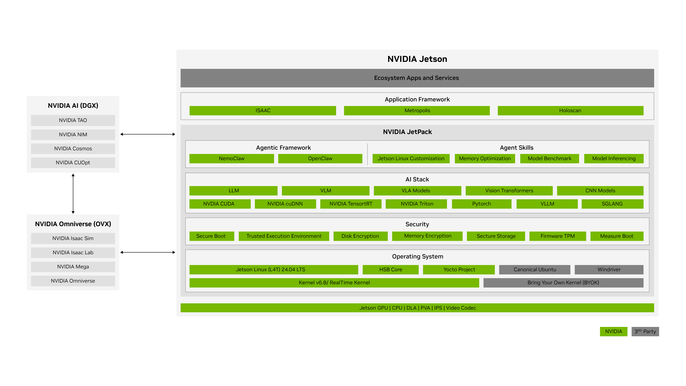

**图1：NVIDIA官方JetPack 7.2软件架构。** 原图出处：[JetPack官方软件架构](https://developer.nvidia.com/embedded/jetpack)。

图中从下向上依次展示硬件计算引擎、内核/操作系统、安全及AI基础库、应用框架和生态服务；左侧DGX与Omniverse说明训练、仿真与端侧部署的协作关系。图是产品架构总览，不能据此认定每个框内组件都已包含在7.2.1默认镜像中。例如下载页将JPS列为N/A、Isaac ROS列为Coming soon，各SDK还需独立核对发行版本。[JetPack官方软件架构](https://developer.nvidia.com/embedded/jetpack)；[JetPack官方下载与版本矩阵](https://developer.nvidia.com/embedded/jetpack/downloads)

| 系统组成 | 实际作用 | 集成时必须保存的配置 |
|---|---|---|
| 启动与固件 | UEFI、QSPI固件和启动配置建立板级启动环境 | 模组/载板型号、固件版本、启动介质与刷机参数 |
| Linux BSP | 内核、设备树、驱动与板级支持让外设和GPU工作 | BSP完整版本、源码tag、设备树修改和内核配置 |
| 用户态发行环境 | Ubuntu及系统库承载应用、容器与SDK | 系统包清单、证书、时间同步和服务配置 |
| SDK层 | CUDA、cuDNN、TensorRT、VPI等提供计算API | 实际安装包版本与ABI，不能只写JetPack大版本 |
| 软件更新 | 包更新和镜像更新机制维护运行设备 | 更新类型、签名、分区设计、回滚及恢复流程 |

表格按官方下载与BSP文档归纳。对具身系统，BSP层失配通常体现为传感器无法枚举、DMA路径异常或内核模块不兼容，而不是模型本身精度下降。因此集成的第一步是使设备可重复启动、采集和记录，再优化模型。[Jetson Linux 39 2 1 Guide](https://docs.nvidia.com/jetson/archives/r39.2.1/DeveloperGuide/)；[Jetson Linux软件包与镜像OTA指南](https://docs.nvidia.com/jetson/archives/r39.2.1/DeveloperGuide/SD/SoftwarePackagesAndTheUpdateMechanism.html)

### 2.2 原生开发、交叉编译与Yocto

39.2.1发布说明明确交叉编译工具链为GCC 13.2，源码tag为`jetson_39.2.1_GA`。原生编译适合开发套件快速验证；交叉编译需要目标sysroot、匹配的内核头文件和ARM架构选项；CUDA设备代码还需选择目标GPU架构。源码可取得不意味着所有固件和SDK二进制都采用开源许可。[Jetson Linux 39 2 1 Release PDF](https://docs.nvidia.com/jetson/archives/r39.2.1/ReleaseNotes/Jetson_Linux_Release_Notes_r39.2.1.pdf)；[Jetson Linux 39 2 1 License](https://developer.nvidia.com/downloads/embedded/L4T/r39_Release_v2.1/release/Tegra_Software_License_Agreement-Tegra-Linux.txt)

官方下载页提供AGX Thor、AGX Orin、Orin Nano的Yocto参考镜像及SBOM入口。发布说明称39.2起提供与BSP源码对应的官方OpenEmbedded/Yocto配方。Yocto的价值是裁剪和重建发行环境，代价是必须重新验证被裁剪的服务、驱动依赖、容器运行时和更新机制。相机厂商的Ubuntu安装说明不能直接当成Yocto适配承诺。[JetPack官方下载与版本矩阵](https://developer.nvidia.com/embedded/jetpack/downloads)；[Jetson Linux 39 2 1 Release PDF](https://docs.nvidia.com/jetson/archives/r39.2.1/ReleaseNotes/Jetson_Linux_Release_Notes_r39.2.1.pdf)

### 2.3 刷机、升级与机器人现场维护

官方更新文档区分软件包OTA与镜像OTA，两者的适用范围、前置BSP和支持设备应按版本文档核对。机器人项目需要将根文件系统、QSPI固件、载板配置和外设固件作为同一发布单元管理；容器只能封装一部分用户态依赖。建议为每次发行保存镜像摘要、软件清单、刷机日志与恢复介质，并实际验证更新中断后的恢复。[Jetson Linux软件包与镜像OTA指南](https://docs.nvidia.com/jetson/archives/r39.2.1/DeveloperGuide/SD/SoftwarePackagesAndTheUpdateMechanism.html)

R39.2.1发布说明中的具体问题进一步说明这一点：旧QSPI Orin装新ISO时跳过Capsule更新可造成不兼容；TPM HWRNG线程可能引入数百微秒实时延迟；AGX Orin连接显示器刷RT内核存在已知崩溃路径；Thor极大CUDA内存分配可能引起重启。这些均是发行版相关事项，缓解办法应结合目标系统配置复测。本报告不把实时内核、SBSA或OTA功能直接等同于量产可靠性结论。[Jetson Linux 39 2 1 Release PDF](https://docs.nvidia.com/jetson/archives/r39.2.1/ReleaseNotes/Jetson_Linux_Release_Notes_r39.2.1.pdf)

## 3. CUDA Toolkit：GPU执行、内存和编译基础

### 3.1 CUDA在软件栈中的位置

CUDA是GPU并行计算平台与编程模型。官方Programming Guide强调，即使应用主要使用框架、库或DSL，理解GPU执行方式仍有助于解释抽象层下的行为。CUDA Toolkit提供编译、运行时和开发工具；CUDA Runtime/Driver API负责设备、内存和任务提交；cuDNN、TensorRT、Warp及自定义视觉算子在这一基础上执行。GPU驱动与Toolkit是相互兼容但职责不同的层，Toolkit版本号不能代替驱动版本。[CUDA Programming Guide](https://docs.nvidia.com/cuda/cuda-c-programming-guide/index.html)；[CUDA编程模型与线程层级](https://docs.nvidia.com/cuda/cuda-programming-guide/01-introduction/programming-model.html)

### 3.2 线程层级与GPU执行

CUDA kernel由大量线程并行执行，线程组成block，block组成grid。block内可通过共享内存和同步协作；block需要能够独立调度，不能把普通跨block执行顺序当成既定串行顺序。GPU将线程按warp执行；分支发散、非连续访存及寄存器/共享内存占用都会改变吞吐。因此模型TOPS或SM数量并不能预测自定义点云处理、图像重排等算子的实际速度。[CUDA编程模型与线程层级](https://docs.nvidia.com/cuda/cuda-programming-guide/01-introduction/programming-model.html)

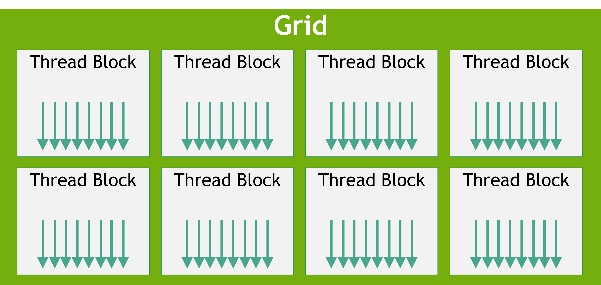

**图2：NVIDIA官方CUDA grid与thread block层级。** 原图出处：[CUDA编程模型与线程层级](https://docs.nvidia.com/cuda/cuda-programming-guide/01-introduction/programming-model.html)。

图中grid包含多个block，每个block包含线程阵列。图是编程模型层级，block不与某个SM永久一一绑定；应将工作划分、资源占用和实际调度分别理解。[CUDA编程模型与线程层级](https://docs.nvidia.com/cuda/cuda-programming-guide/01-introduction/programming-model.html)

| 开发概念 | 实际解决的问题 | 对具身工作负载的意义 |
|---|---|---|
| kernel/grid/block/thread | 把大量相似计算映射到并行执行单元 | 图像像素、点云和张量操作可并行；小任务也可能受launch开销主导 |
| Device/global memory | 保存设备端大规模数据 | 减少图像/张量在CPU与GPU之间往返 |
| Shared memory与同步 | block内数据复用和协作 | 可降低重复访存，但增加资源占用与同步成本 |
| Streams与events | 排列异步工作、表达依赖及完成时刻 | 在合法依赖下重叠采集、复制、预处理与推理 |
| CUDA Graphs | 记录可复用执行图以减少重复提交开销 | 固定形状、反复执行的策略pipeline可评估；不等同于ROS节点图 |

表格依据官方编程模型、异步执行及Graphs文档归纳。所谓“异步”是相对CPU提交行为而言，不保证任意两个stream中的kernel同时运行；资源、数据依赖和显式/隐式同步仍决定实际调度。用events连接依赖，比全设备同步更容易保留合法并发。[CUDA编程模型与线程层级](https://docs.nvidia.com/cuda/cuda-programming-guide/01-introduction/programming-model.html)；[CUDA异步执行文档](https://docs.nvidia.com/cuda/cuda-programming-guide/02-basics/asynchronous-execution.html)；[CUDA Graphs官方文档](https://docs.nvidia.com/cuda/cuda-programming-guide/04-special-topics/cuda-graphs.html)

### 3.3 内存一致性与跨引擎数据流

统一虚拟寻址、Unified Memory、共享物理内存和零复制是不同概念。Jetson CPU与GPU共享系统内存并不消除缓存一致性、布局转换、同步及带宽竞争；开发者必须确认数据所在内存域、分配方式、读写所有权及何时可复用。官方内存与异步章节说明的访问条件，应作为相机/推理/ROS buffer交接的基础。[CUDA内存模型文档](https://docs.nvidia.com/cuda/cuda-programming-guide/02-basics/understanding-memory.html)；[CUDA异步执行文档](https://docs.nvidia.com/cuda/cuda-programming-guide/02-basics/asynchronous-execution.html)

典型机器人链路可让图像数据先进入适合GPU访问的buffer，再做预处理、推理和后处理，只有控制器需要的小型结果才转给CPU。是否减少复制必须用时间线与实际buffer路径验证：把CPU数组包装成对象并不等于没有复制，把多个kernel放到stream也不等于已经消除等待。建议同时记录传输字节、内存峰值、同步点和kernel占用。该路线是分析建议，具体API条件依据官方文档。[CUDA内存模型文档](https://docs.nvidia.com/cuda/cuda-programming-guide/02-basics/understanding-memory.html)；[CUDA异步执行文档](https://docs.nvidia.com/cuda/cuda-programming-guide/02-basics/asynchronous-execution.html)

### 3.4 编译工具链与部署产物

`nvcc`协调CUDA源代码编译和宿主编译器处理；目标GPU架构与生成的设备代码形式影响可移植性。自定义算子应保存CUDA版本、宿主编译器、目标架构、编译参数和框架ABI。工作站开发并不自动生成可部署于ARM Jetson的宿主二进制；CPU架构和GPU代码兼容需要分别处理。JetPack 7.2.1的CUDA发行组件为13.2.2，当前在线Programming Guide可能覆盖后续功能，采用功能前仍需核对发行包。[CUDA nvcc编译器手册](https://docs.nvidia.com/cuda/cuda-programming-guide/02-basics/nvcc.html)；[JetPack官方下载与版本矩阵](https://developer.nvidia.com/embedded/jetpack/downloads)

CUDA适合需要自定义GPU算子和控制数据流的团队；若已有TensorRT/VPI算子覆盖需求，先使用库级接口通常更容易维护。主要工程代价在内存、同步、编译兼容和错误诊断，而非仅仅重写成GPU代码。官方编程手册及相关章节均在参考目录归档，未执行本轮CUDA性能测试。

官方完整Programming Guide PDF已归档，可与分章节HTML一起检索。[CUDA完整编程手册PDF](https://docs.nvidia.com/cuda/cuda-programming-guide/pdf/cuda-programming-guide.pdf)

## 4. cuDNN：深度学习算子、计算图和融合执行

### 4.1 与CUDA、框架和TensorRT的关系

cuDNN是GPU深度学习基础算子库，提供卷积前向/反向、attention、matmul、pooling及normalization等实现。CUDA提供设备执行和内存基础，cuDNN提供经过优化的神经网络计算原语，PyTorch等框架可在适用算子上调用它；TensorRT则面向部署阶段的网络编译。安装cuDNN并不会自动让所有模型走同一实现，实际路径取决于框架、算子、shape、dtype及GPU。[cuDNN官方产品及Graph API示例](https://developer.nvidia.com/cudnn)

官方产品页以三项机制解释性能来源：为计算问题选择kernel的heuristics、计算/访存算子的融合、可表达张量计算关系的Op Graph API。融合能减少中间张量读写和kernel提交，但只针对受支持模式，不能把“有attention实现”泛化为所有VLA骨干已使用最快attention kernel。[cuDNN官方产品及Graph API示例](https://developer.nvidia.com/cudnn)；[cuDNN Graph API与融合模式](https://docs.nvidia.com/deeplearning/cudnn/backend/latest/developer/graph-api.html)

### 4.2 API层次与图构建

| API/组件 | 官方定位 | 开发者需要做的工作 |
|---|---|---|
| Frontend C++/Python API | 简化图编程，官方称足以覆盖多数用例 | 定义tensor属性和operation graph、构建执行plan并关联实际buffer |
| Backend Graph API | 底层图描述与engine配置 | 明确操作描述、engine/plan、workspace和执行数据 |
| Legacy fixed-function API | 不通过图表达的历史固定功能例程 | 核对弃用与兼容政策，避免新项目继续扩大旧API依赖 |
| cuDNN kernels/fusion engines | 根据受支持图与平台执行实际计算 | 核对shape、layout、精度和workspace条件 |

表格据当前Frontend/Backend官方文档。Backend主页特别建议多数用例优先选择frontend，而不是直接管理全部低层描述对象；固定功能历史接口与图API不是同一开发路线。[cuDNN Backend文档及版本入口](https://docs.nvidia.com/deeplearning/cudnn/backend/latest/index.html)；[cuDNN Frontend官方文档](https://docs.nvidia.com/deeplearning/cudnn/frontend/latest/index.html)；[cuDNN Graph API与融合模式](https://docs.nvidia.com/deeplearning/cudnn/backend/latest/developer/graph-api.html)

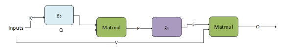

**图3：NVIDIA官方cuDNN attention前向Operation Graph。** 原图出处：[cuDNN Graph API与融合模式](https://docs.nvidia.com/deeplearning/cudnn/backend/latest/developer/graph-api.html)。

原图展示Q/K/V相关矩阵运算、变换及融合子图；它是官方Graph API中的特定attention模式，说明如何用operation graph表达计算及融合范围，不能据此推断任意模型/shape都走同一路径。[cuDNN Graph API与融合模式](https://docs.nvidia.com/deeplearning/cudnn/backend/latest/developer/graph-api.html)

该图对应文档的Mha-fprop融合模式：Q/K经第一个matmul形成P，`g₄`可按规定顺序组合mask、softmax和dropout，再与V经第二个matmul得到O；`g₃`可以为空或单个scale。该模式的限制表要求matmul输入FP16/BF16、compute为float，I/O tensor为rank-4，首个matmul的contracting dimension为64，并给出序列长度、stride及中间S张量专用reordering条件。这些是图示特定融合的条件，不能当作整个cuDNN attention能力的统一上限；其他attention路线应查各自支持规则。[cuDNN Graph API与融合模式](https://docs.nvidia.com/deeplearning/cudnn/backend/latest/developer/graph-api.html)

产品页给出的matmul加bias示例可以帮助理解生命周期：先把PyTorch tensor表达为图tensor，创建matmul/bias operation，调用graph.build选择算法，再分配workspace并绑定输入输出执行。图结构、执行plan与实际数据buffer分别管理，使同一计算图可用于重复执行；这与每一帧都重新做算法选择不同。示例是接口演示，未提供机器人端性能保证。[cuDNN官方产品及Graph API示例](https://developer.nvidia.com/cudnn)

### 4.3 算子性能、显存和数值行为

在具身视觉中，连续多帧CNN特征、Transformer attention及图像embedding可能消耗大量GPU时间。优化时应检查张量layout、dtype和可融合模式，也要观察workspace需求、临时buffer以及多模型并发峰值。选择更快实现并不必然降低系统延迟：额外转换、过大的workspace或CPU同步可抵消收益。官方Graph API/Developer Guide应作为实现条件的核验入口。[cuDNN Graph API与融合模式](https://docs.nvidia.com/deeplearning/cudnn/backend/latest/developer/graph-api.html)；[cuDNN开发者指南](https://docs.nvidia.com/deeplearning/cudnn/backend/latest/developer/overview.html)

JetPack 7.2.1下载页列cuDNN9.20.0；本轮backend/latest目录已列9.27.0等后续发布。本文用当前文档解释接口层次，但不把后续版本新增的算子、精度或兼容能力自动赋予9.20.0。框架wheel可能携带自己的cuDNN依赖，也必须与实际加载库及CUDA版本核对。[JetPack官方下载与版本矩阵](https://developer.nvidia.com/embedded/jetpack/downloads)；[cuDNN Backend文档及版本入口](https://docs.nvidia.com/deeplearning/cudnn/backend/latest/index.html)

### 4.4 商业使用与开源frontend

cuDNN库与cuDNN frontend不是相同许可对象：库按NVIDIA许可交付，frontend代码的许可需以官方仓库LICENSE为准。[cuDNN frontend官方仓库](https://github.com/NVIDIA/cudnn-frontend)官方仓库本轮为987 Stars，默认分支`develop`，最近可见提交2026-11-03 07:51:54 UTC；项目主要为Apache-2.0，部分文件保留MIT，依据文件SPDX及LICENSING清单核对。[cuDNN frontend仓库元数据快照](https://api.github.com/repos/NVIDIA/cudnn-frontend)；[cuDNN frontend最近提交快照](https://api.github.com/repos/NVIDIA/cudnn-frontend/commits?per_page=1)；[cuDNN frontend Apache-2.0许可](https://raw.githubusercontent.com/NVIDIA/cudnn-frontend/develop/LICENSE.txt)；[cuDNN frontend保留MIT许可](https://raw.githubusercontent.com/NVIDIA/cudnn-frontend/develop/LICENSE-MIT.txt)；[cuDNN frontend第三方许可](https://raw.githubusercontent.com/NVIDIA/cudnn-frontend/develop/THIRD_PARTY_LICENSES.txt)；[cuDNN frontend逐文件许可清单](https://raw.githubusercontent.com/NVIDIA/cudnn-frontend/develop/LICENSING.md)。对一般机器人应用，优先通过成熟框架或推理SDK使用cuDNN；直接图API更适合需要定制融合、控制workspace且具备底层GPU工程能力的团队。[cuDNN官方产品及Graph API示例](https://developer.nvidia.com/cudnn)；[cuDNN Frontend官方文档](https://docs.nvidia.com/deeplearning/cudnn/frontend/latest/index.html)

## 5. TensorRT：网络编译器与高性能推理运行时

### 5.1 构建阶段和运行阶段

官方How TensorRT Works将软件分成两个阶段：builder把训练后的网络编译成目标GPU专用engine，runtime加载engine并执行推理。构建阶段处理网络、输入shape、精度和内存限制，并选择可用kernel/tactic；运行阶段管理engine、execution context、输入输出buffer和stream。这解释了为什么engine不只是权重文件，而是与目标平台及构建条件关联的可执行产物。[TensorRT构建、运行与对象生命周期](https://docs.nvidia.com/deeplearning/tensorrt/latest/architecture/how-trt-works.html)

| 对象或产物 | 生命周期与职责 | 需要记录的条件 |
|---|---|---|
| NetworkDefinition/Parser | 表达或导入网络及输入输出 | ONNX版本、算子、动态维度与插件 |
| Builder/BuilderConfig | 编译网络、设置构建约束并选择实现 | GPU、精度、优化profile、workspace/内存限制及timing cache |
| Serialized engine/plan | 保存构建后的推理程序 | TensorRT/驱动/CUDA、GPU架构、构建配置及文件摘要 |
| Runtime/Engine | 反序列化并持有可执行网络 | 兼容模式、插件依赖和受支持平台 |
| ExecutionContext | 保存一次执行实例的shape和运行状态 | 多线程并发使用独立context，明确buffer及stream所有权 |

表格据官方架构与运行时文档整理。一个engine可创建多个执行context以组织并发；context相关激活内存与应用I/O内存不应混为“模型权重占用”。logger等基础对象也有生命周期要求。部署代码若提前释放对象或复用正在执行的buffer，即使模型正确也可能出现崩溃或错误结果。[TensorRT官方架构说明](https://docs.nvidia.com/deeplearning/tensorrt/latest/architecture/architecture-overview.html)；[TensorRT构建、运行与对象生命周期](https://docs.nvidia.com/deeplearning/tensorrt/latest/architecture/how-trt-works.html)

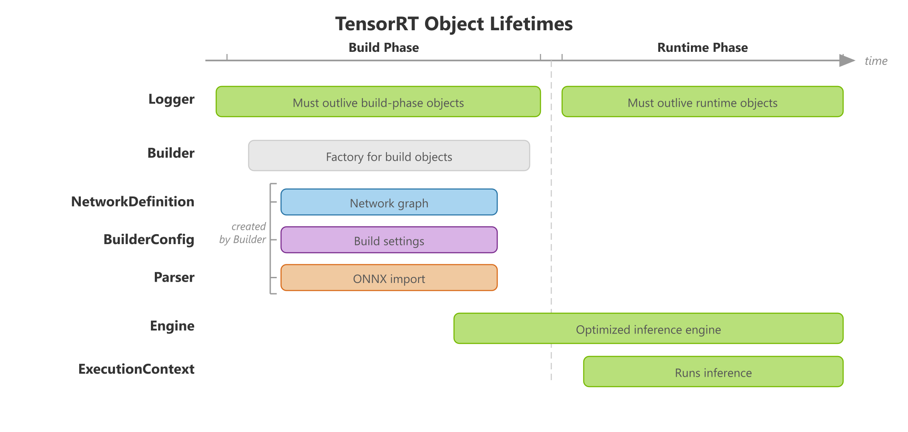

**图4：NVIDIA官方TensorRT构建与运行对象生命周期。** 原图出处：[TensorRT构建、运行与对象生命周期](https://docs.nvidia.com/deeplearning/tensorrt/latest/architecture/how-trt-works.html)。

原图沿时间轴区分build和runtime阶段，engine跨越两阶段，execution context用于运行，logger需要覆盖相应对象生命周期。它帮助判断哪些对象可以在构建结束后释放、哪些必须随推理保持有效。[TensorRT构建、运行与对象生命周期](https://docs.nvidia.com/deeplearning/tensorrt/latest/architecture/how-trt-works.html)

### 5.2 优化的来源及约束

TensorRT优化主要来自算子/层融合、目标GPU实现选择、精度与内存策略及执行调度。动态图形输入需要优化profile覆盖合法shape范围；多个尺寸的输入不是“任意尺寸都可直接运行”。插件可扩展不支持的计算，但也引入额外二进制、序列化和版本依赖。构建时测量选择的tactic会受环境和配置影响，复现应保存构建日志及缓存，而不只保存一条命令。[TensorRT官方架构说明](https://docs.nvidia.com/deeplearning/tensorrt/latest/architecture/architecture-overview.html)；[TensorRT构建、运行与对象生命周期](https://docs.nvidia.com/deeplearning/tensorrt/latest/architecture/how-trt-works.html)

低精度需分清硬件支持、SDK支持、实际网络张量类型和精度验证。当前11.x文档包含强类型网络行为，不能把历史FP16/INT8 builder选项的使用方式直接套入全部新版本。对VLA，动作误差、任务成功率与语言响应不能由一个平均cosine similarity完全替代；应按具体checkpoint和目标本体建立回归集。[TensorRT官方支持矩阵](https://docs.nvidia.com/deeplearning/tensorrt/latest/getting-started/support-matrix.html)；[TensorRT官方DLA指南](https://docs.nvidia.com/deeplearning/tensorrt/latest/inference-library/work-with-dla.html)；[GR00T官方部署与基准](https://raw.githubusercontent.com/NVIDIA/Isaac-GR00T/main/scripts/deployment/README.md)

### 5.3 engine可移植性与DLA

序列化engine默认不跨OS/GPU架构移植。版本兼容和硬件兼容模式需显式启用并满足限制；官方矩阵列出10兼容engine运行于11、8兼容engine运行于10的路径，明确8直接到11不支持。即使版本兼容成立，也必须核对插件、输入shape和精度配置。[TensorRT官方支持矩阵](https://docs.nvidia.com/deeplearning/tensorrt/latest/getting-started/support-matrix.html)

JetPack下载页当前安装组合是7.2.1/TensorRT 10.16.2。另一份11.4.1支持矩阵说明AGX Orin DLA要求JetPack 7.2.2或更高及Linux SBSA包，Thor没有DLA；11.0–11.3的DLA缺口、11.4.0仅Windows ARM beta等条件不能省略。Orin Nano本身无DLA，NX/AGX配置也应按SKU核对。DLA并非给任意Transformer换一个执行目标的通用GPU替代物。[JetPack官方下载与版本矩阵](https://developer.nvidia.com/embedded/jetpack/downloads)；[TensorRT官方支持矩阵](https://docs.nvidia.com/deeplearning/tensorrt/latest/getting-started/support-matrix.html)；[TensorRT官方DLA指南](https://docs.nvidia.com/deeplearning/tensorrt/latest/inference-library/work-with-dla.html)；[Jetson Orin官方规格](https://www.nvidia.com/en-us/autonomous-machines/embedded-systems/jetson-orin/)

### 5.4 部署验证及适用项目

建议以框架输出作基线，依次验证ONNX、目标设备构建engine、不同shape及精度、长时间运行，再进入机器人闭环；测量应涵盖预处理、输入复制、推理、后处理和排队，而非只取GPU kernel时间。GR00T官方pipeline提供导出、构建、verify、benchmark的明确步骤，可作为实际部署方法的参考。[GR00T官方部署与基准](https://raw.githubusercontent.com/NVIDIA/Isaac-GR00T/main/scripts/deployment/README.md)

TensorRT适合已有模型且需要目标NVIDIA平台推理优化的团队。TensorRT-LLM、Triton和GR00T是围绕不同模型/服务需求的上层方案，不能认为基础TensorRT自动提供LLM请求调度、机器人动作适配或模型生命周期管理。准确的责任划分应是：TensorRT负责网络执行效率，应用负责输入语义和动作结果，服务层负责并发和发布。

## 6. VPI：跨CPU、GPU和专用视觉引擎的算法接口

### 6.1 统一API怎样覆盖异构后端

Vision Programming Interface（VPI）提供计算机视觉与图像处理算法，并让同类算法在可用CPU、CUDA GPU及PVA/VIC/OFA后端执行。它解决的是不同计算引擎API各异、数据表示不同造成的集成成本；使用者选择算法和backend，而不必为每个引擎从零编写相同功能。当前文档为4.1，具体算法与后端组合必须逐项核对。[VPI 4.1算法与平台说明](https://docs.nvidia.com/vpi/index.html)

VPI首页举出的异构pipeline例子是：GPU对一帧执行推理，PVA/VIC同时预处理后一帧，CPU执行界面或结果处理。它说明加速不仅来自单算子更快，也来自把不同阶段分布到适合的引擎，减少竞争。这个示例是软件组织思路，不是任意算法或格式都可以自动这样调度。[VPI 4.1算法与平台说明](https://docs.nvidia.com/vpi/index.html)

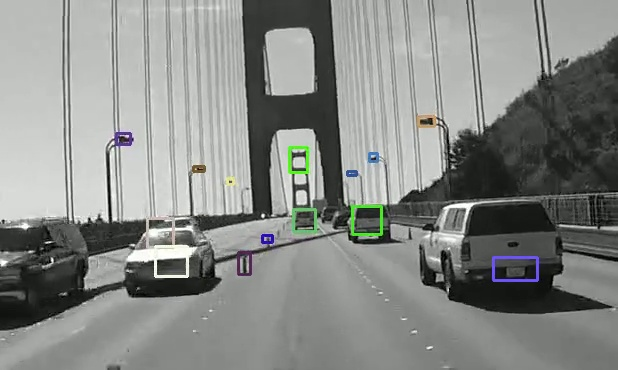

**图5：NVIDIA官方VPI KLT跟踪效果示例。** 原图出处：[VPI KLT跟踪官方示例](https://docs.nvidia.com/vpi/algo_klt_tracker.html)。

这是官方算法输出示例，帮助理解图像特征跟踪任务；它不是VPI总体架构图，也不是本项目准确率测试。软件架构由下方stream、buffer、payload和backend表解释，后端/格式条件以算法页为准。[VPI KLT跟踪官方示例](https://docs.nvidia.com/vpi/algo_klt_tracker.html)

| 主要抽象 | 作用 | 使用时需要明确的条件 |
|---|---|---|
| VPIImage/VPIArray等buffer | 表达图像或算法数据 | 格式、尺寸、内存布局及可访问后端 |
| Stream | 排列提交给不同后端的异步工作 | 算法依赖、完成同步和外部CUDA阶段的交接 |
| Payload | 保存需要预先创建的算法状态/资源 | 与输入尺寸、算法参数和backend匹配 |
| Backend | 选择CPU、CUDA或专用视觉引擎 | 算法、图像格式与硬件必须共同受支持 |
| 数据锁定/外部handle | 与CUDA、OpenCV、多媒体等协作 | 访问所有权、同步及是否触发内部复制 |

表格按官方Basic Concepts归纳。backend名称相同不表示不同Jetson SKU具备同一硬件能力；首页列PVA可用于AGX Orin、Orin NX、AGX Thor，没有将Orin Nano列为PVA平台。[VPI基本概念与数据接口](https://docs.nvidia.com/vpi/basic_concepts.html)；[VPI 4.1算法与平台说明](https://docs.nvidia.com/vpi/index.html)

### 6.2 数据共享为何有条件

当前首页明确建议混合VPI/CUDA/Multimedia/NvSci pipeline用`vpiImageCreate`及所需backend flags创建共享图像，再通过`vpiImageLockData`取得CUDA、NvBufSurface或NvSciBuf handle。VPI可据此选择受支持的共享内存映射。相反，包装外部CUDA/NvBufSurface内存后再启用更多backend，可能由于映射不兼容而产生内部复制。[VPI 4.1算法与平台说明](https://docs.nvidia.com/vpi/index.html)；[VPI基本概念与数据接口](https://docs.nvidia.com/vpi/basic_concepts.html)

这对多路相机尤为重要：色彩转换、去畸变和网络预处理很容易在格式交接处发生复制。应先确定采集格式和推理输入布局，选择所有消费者都能访问的buffer，再检查锁定/解锁与stream依赖。官方“seamless zero-copy memory mapping”本身带内存条件，不能去掉条件作为全系统承诺。[VPI 4.1算法与平台说明](https://docs.nvidia.com/vpi/index.html)

### 6.3 算法选择和落地路线

官方算法目录包含立体视差、KLT特征跟踪、Harris角点、透视变换、Remap、金字塔LK光流、畸变校正、Dense Optical Flow和背景减除等。机器人可以用它处理定位前的视觉特征、相机几何校正与视频跟踪；VPI本身不定义ROS坐标系、全局地图或动作规划。KLT等具体算法页给出接口、输入和backend条件，应作为实际选型入口。[VPI 4.1算法与平台说明](https://docs.nvidia.com/vpi/index.html)；[VPI KLT跟踪官方示例](https://docs.nvidia.com/vpi/algo_klt_tracker.html)

建议保留原OpenCV结果作为正确性基线，逐段替换为VPI算子，分别测算子时间与数据交接时间。C/C++和Python接口适合原型与工程集成，但还需核对所需算法是否具有同等接口覆盖。VPI可用库和样例代码不等于所有后端实现均开源；量产需保存许可和实际SDK版本。

## 7. PVA SDK与cuPVA：自定义低功耗视觉处理

### 7.1 与VPI的区别

PVA是可编程VLIW SIMD DSP视觉加速器，面向图像、视觉和其他传感器处理。VPI提供现成算法的PVA后端；PVA SDK允许开发者为PVA编写、调试和优化自定义算法。官方产品页将其价值定位为把非AI预处理、特征提取和跟踪等任务移出GPU，为主要AI模型留出GPU资源并改善功耗/热预算。[PVA SDK官方产品说明](https://developer.nvidia.com/embedded/pva)

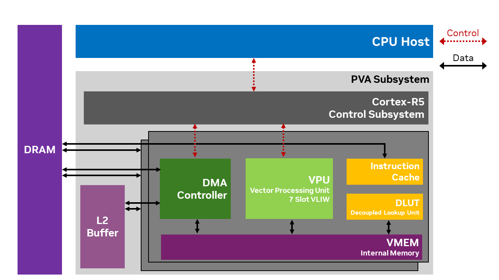

**图6：NVIDIA官方PVA处理器简化架构。** 原图出处：[PVA SDK 2.10.1处理器与编程架构](https://docs.nvidia.com/pva/sdk/2.10.1/architecture.html)。

官方Architecture图中，PVA包含两个可分别编程的Vector Processing Subsystem，以及负责调度的Cortex-R5控制子系统；R5不作为cuPVA应用的用户编程对象。每个VPS由VPU、VMEM、查表单元和DMA等组成。VPU主要访问本地VMEM，外部内存数据由DMA按tile搬运；VPU计算与DMA可重叠，tile大小受本地存储和算法需求约束。这解释了为什么PVA适合规则、半稠密/稠密且需要低功耗的计算，也解释了为什么算法数据布局与搬运设计会影响结果。此处描述是2.10.1文档中的简化架构，不扩展为每个SoC的完整参数表。[PVA SDK 2.10.1处理器与编程架构](https://docs.nvidia.com/pva/sdk/2.10.1/architecture.html)

| SDK层次 | 开发与执行任务 | 需要核对的条件 |
|---|---|---|
| PVA设备程序 | 在VLIW SIMD DSP上组织运算和数据搬运 | 指令/向量化、局部资源及平台支持 |
| 编译工具与EMU | 交叉编译、主机仿真和算法调试 | EMU用于开发验证，不替代目标设备性能测量 |
| cuPVA runtime | 由主机提交PVA程序并管理执行 | CUDA指针、stream与实际buffer的兼容和同步 |
| PVA Solutions | 可定制算法、operators、primitives及samples | 样例对应的硬件、许可和SDK版本 |

表格按官方产品页与SDK Architecture整理。当前架构入口经HTML refresh指向2.10.1，JetPack7.2.1下载页列PVA2.9.1；本文将版本差异明确保留，不把2.10.1能力自动写为2.9.1标配。[PVA SDK 2.10.1处理器与编程架构](https://docs.nvidia.com/pva/sdk/2.10.1/architecture.html)；[JetPack官方下载与版本矩阵](https://developer.nvidia.com/embedded/jetpack/downloads)

### 7.2 cuPVA怎样接入CUDA流水线

PVA应用分为host code与device code：host在SoC CPU上用DataFlow抽象配置DMA、分配资源并协调其他引擎；device在VPU上触发搬运和计算，两者通过cuPVA runtime交互。当前架构文档进一步区分DataFlow head与串联DataFlow：`addDataFlowHead()`在程序生命周期占用DMA channel，`addDataFlow()`在已有head后串联；请求head超过目标VPS通道数时，`compileDataFlows()`会拒绝。因而“更多分块/更多通路”不一定能无限增加并行，资源编译检查与tile搬运设计应一起考虑。[PVA SDK 2.10.1处理器与编程架构](https://docs.nvidia.com/pva/sdk/2.10.1/architecture.html)

产品页明确cuPVA runtime扩展CUDA编程模型：PVA程序可直接操作CUDA device pointers，并提交到CUDA streams，使CPU、GPU和PVA组成多引擎pipeline。其工程意义是共享数据和依赖表达，而非让PVA执行任意CUDA kernel；目标程序仍由PVA工具链构建，硬件资源和算法约束不同。[PVA SDK官方产品说明](https://developer.nvidia.com/embedded/pva)；[PVA SDK 2.10.1处理器与编程架构](https://docs.nvidia.com/pva/sdk/2.10.1/architecture.html)

一个合理的候选路线是GPU运行大型视觉语言模型，PVA承担可覆盖的视觉前处理/跟踪。应比较“GPU单独处理”与“PVA分担”的整链路时间、共享内存带宽和功耗，而不是只比较某个PVA算子速度；额外格式转换或等待可能降低收益。官方列举DeepStream NvDCF跟踪卸载与多模态传感器处理作为应用方向，具体参数与算法支持以对应文档为准。[PVA SDK官方产品说明](https://developer.nvidia.com/embedded/pva)

### 7.3 硬件、学习成本和商业条件

PVA SDK适用于具备PVA的Jetson/DRIVE平台；Orin Nano没有PVA，不能通过软件安装补出硬件引擎。AGX Orin、NX和Thor的实际PVA/SDK适配应按版本矩阵核对。SDK提供编译、EMU、debug与profiling路线，但使用者需要具备向量DSP算法和数据搬运优化能力；已有VPI算法能满足需求时，直接使用VPI后端通常更容易维护。[PVA SDK官方产品说明](https://developer.nvidia.com/embedded/pva)；[VPI 4.1算法与平台说明](https://docs.nvidia.com/vpi/index.html)；[Jetson Orin官方规格](https://www.nvidia.com/en-us/autonomous-machines/embedded-systems/jetson-orin/)

PVA Solutions源码的可定制性与SDK二进制许可分别管理。对于厂商未公开的目标算法最坏执行时间及机器人整机实时认证，本轮没有取得统一矩阵，标为[公开资料未披露]；定制实现的性能和正确性需要目标设备验证。[PVA SDK官方产品说明](https://developer.nvidia.com/embedded/pva)

[PVA Solutions官方仓库](https://github.com/NVIDIA/pva-solutions)官方仓库本轮为5 Stars，默认分支`main`，最近可见提交2026-10-21 06:47:55 UTC；PVA Solutions代码Apache-2.0。[PVA Solutions仓库元数据快照](https://api.github.com/repos/NVIDIA/pva-solutions)；[PVA Solutions最近提交快照](https://api.github.com/repos/NVIDIA/pva-solutions/commits?per_page=1)；[PVA Solutions代码许可](https://raw.githubusercontent.com/NVIDIA/pva-solutions/main/LICENSE)

## 8. Jetson Multimedia API、Argus与SIPL：相机和媒体处理基础

### 8.1 多媒体API与相机框架的分工

Jetson Multimedia层提供相机采集、编解码和相关图像处理接口及示例；GStreamer将这些能力组成媒体pipeline。Argus和SIPL则负责不同相机框架的采集、控制与处理接口。原始图像输入、压缩视频解码、ISP和模型预处理是不同步骤，不能因为都有图像输出就混用接口和性能指标。[Jetson加速GStreamer指南](https://docs.nvidia.com/jetson/archives/r39.2.1/DeveloperGuide/SD/Multimedia.html)；[Jetson Multimedia API参考](https://docs.nvidia.com/jetson/archives/r39.2.1/DeveloperGuide/SD/Multimedia/MultimediaApis.html)；[Jetson Camera 39 2 1](https://docs.nvidia.com/jetson/archives/r39.2.1/DeveloperGuide/SD/CameraDevelopment.html)

| 接口/框架 | 官方定位 | 典型工程使用 |
|---|---|---|
| Jetson Multimedia API | C++多媒体接口和样例 | 控制采集、编码/解码与buffer流转，适合需要精确管理媒体路径的应用 |
| GStreamer加速插件 | 以source、filter、sink等元素连接媒体处理 | 快速搭建采集/转换/编解码，或作为DeepStream基础 |
| Argus | 以request/capture-session为中心的相机框架 | 维护既有CSI/GMSL与ISP流程，核对当前支持矩阵 |
| SIPL | 流式callback、统一Query/Control与driver model | Thor起主要相机路径；GMSL/CoE、JSON/UDDF配置 |

表格据BSP39.2.1文档。相同摄像头是否支持Argus、SIPL或V4L2路径，由驱动、传输方式和所需ISP功能共同决定；外部USB相机有自己的采集/驱动方式，不能统称为SIPL相机。[Jetson Multimedia API参考](https://docs.nvidia.com/jetson/archives/r39.2.1/DeveloperGuide/SD/Multimedia/MultimediaApis.html)；[Jetson Camera 39 2 1](https://docs.nvidia.com/jetson/archives/r39.2.1/DeveloperGuide/SD/CameraDevelopment.html)；[Jetson SIPL介绍与架构](https://docs.nvidia.com/jetson/archives/r39.2.1/DeveloperGuide/SD/CameraDevelopment/SIPLFramework/Introduction-to-SIPL.html)

### 8.2 SIPL架构和设备集成

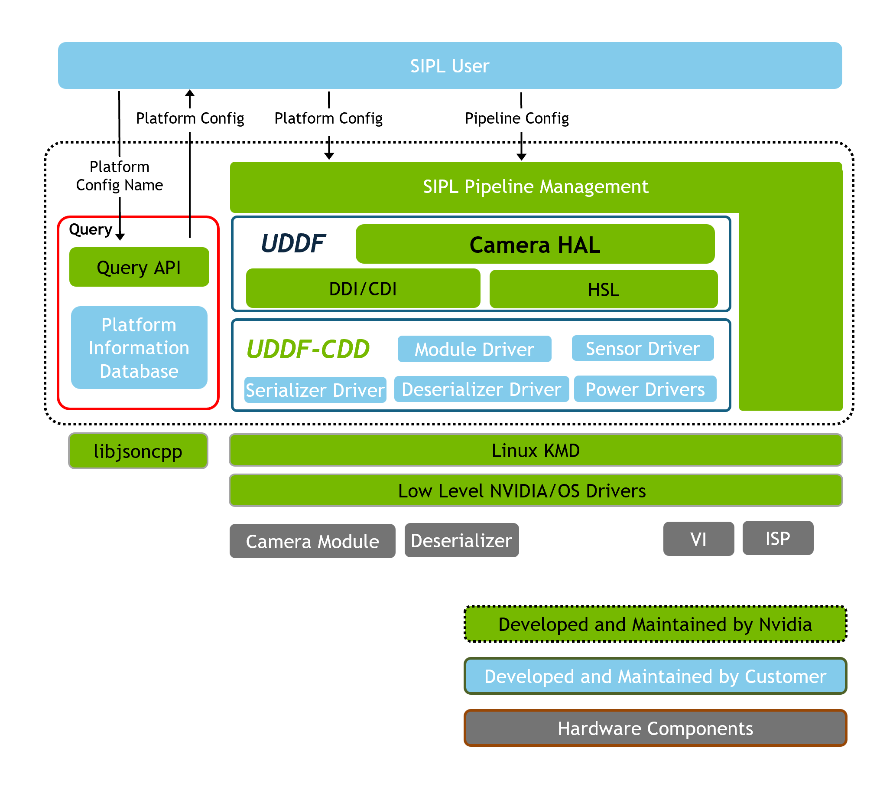

**图7：NVIDIA官方SIPL框架架构。** 原图出处：[Jetson SIPL介绍与架构](https://docs.nvidia.com/jetson/archives/r39.2.1/DeveloperGuide/SD/CameraDevelopment/SIPLFramework/Introduction-to-SIPL.html)。

官方介绍将SIPL描述为可扩展相机集成、图像处理与控制框架。核心pipeline、Query/Control APIs和UDDF模型在受支持GMSL及CoE路径之间共用；Camera HAL负责硬件抽象，配置查询与驱动发现使应用与具体传感器/传输实现解耦。统一应用API不等于统一的底层电气接口，实际仍需相机驱动、serializer/deserializer或桥接设备。[Jetson SIPL介绍与架构](https://docs.nvidia.com/jetson/archives/r39.2.1/DeveloperGuide/SD/CameraDevelopment/SIPLFramework/Introduction-to-SIPL.html)；[Jetson SIPL GMSL相机架构](https://docs.nvidia.com/jetson/archives/r39.2.1/DeveloperGuide/SD/CameraDevelopment/SIPLFramework/SIPL-for-L4T/GMSL/GMSL-Architecture-Overview.html)

GMSL路径在SoC侧放置deserializer，远端camera module含serializer及传感器，控制信息与视频可沿同一线缆传输。CoE路径利用以太网接收及HSB传感器桥接，而非把传统VI/NVCSI链路当作唯一采集通路。官方CoE/GMSL架构图能帮助区分传输层与统一SIPL应用层。[Jetson SIPL GMSL相机架构](https://docs.nvidia.com/jetson/archives/r39.2.1/DeveloperGuide/SD/CameraDevelopment/SIPLFramework/SIPL-for-L4T/GMSL/GMSL-Architecture-Overview.html)；[Jetson SIPL Camera over Ethernet架构](https://docs.nvidia.com/jetson/archives/r39.2.1/DeveloperGuide/SD/CameraDevelopment/SIPLFramework/SIPL-for-L4T/CoE/CoE-Solution-Overview.html)

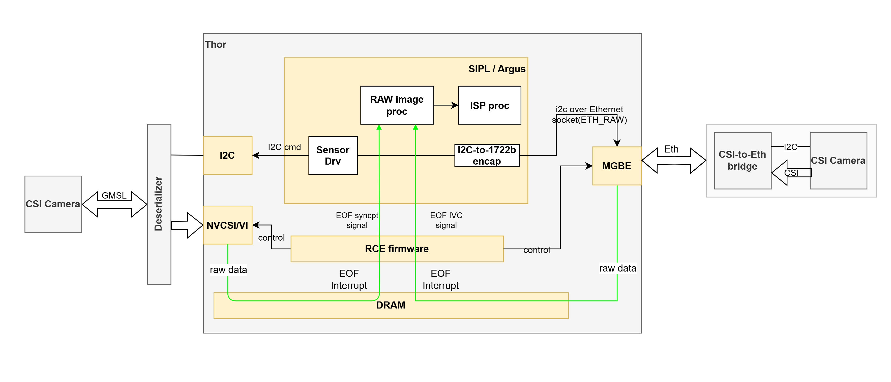

**图8：NVIDIA官方CoE与GMSL相机接入架构对照。** 原图出处：[Jetson SIPL Camera over Ethernet架构](https://docs.nvidia.com/jetson/archives/r39.2.1/DeveloperGuide/SD/CameraDevelopment/SIPLFramework/SIPL-for-L4T/CoE/CoE-Solution-Overview.html)。

这两种路径的差异会改变线缆、同步、网络接收及故障恢复设计。模组有CSI lanes不意味着开发套件已有相应插座或任意相机即插即用；报告《NVIDIA—硬件平台》的模组/载板区别仍适用。

### 8.3 当前功能与迁移条件

39.2.1相机总览明确SIPL在JP7.2支持GMSL/CoE，MIPI支持列为未来计划；SIPL支持Thor两个硬件ISP，双目在7.2加入，多相机同步按阶段补齐。Argus保留支持但不再增加新功能，长期迁移方向是SIPL。应以当前camera support matrix判断已有Argus应用所需功能是否达到迁移条件，不能仅因“新框架”就立即替换。[Jetson Camera 39 2 1](https://docs.nvidia.com/jetson/archives/r39.2.1/DeveloperGuide/SD/CameraDevelopment.html)

部署时需要固化相机型号/固件、驱动、JSON/UDDF配置、图像格式、ISP标定和曝光/触发方式，分别验证RAW采集、ISP输出与模型输入。GStreamer或SDK样例成功显示图像，只能证明该路径基本工作；时间戳语义、多相机同步、长时间丢帧与恢复需独立测量。SIPL的Drive OS架构渊源不等于Jetson机器人相机链已完成整机功能安全认证。[Jetson SIPL介绍与架构](https://docs.nvidia.com/jetson/archives/r39.2.1/DeveloperGuide/SD/CameraDevelopment/SIPLFramework/Introduction-to-SIPL.html)；[Jetson Camera 39 2 1](https://docs.nvidia.com/jetson/archives/r39.2.1/DeveloperGuide/SD/CameraDevelopment.html)

## 9. DeepStream：多路视频分析与GStreamer插件栈

### 9.1 架构：从视频帧到结构化结果

DeepStream是建立在GStreamer之上的流式分析SDK，把CUDA、TensorRT、Triton和多媒体加速能力封装为可连接的插件。输入可以是USB/CSI相机、文件或RTSP；输出可以是显示、录像、视频流或结构化事件。与直接调用TensorRT相比，它同时管理视频解码、批处理、跟踪、可视化和消息输出；与ROS相比，它更侧重连续媒体流和分析结果，而非机器人通用消息语义。[DeepStream 9.2官方架构与开发指南](https://docs.nvidia.com/metropolis/deepstream/dev-guide/text/DS_Overview.html)

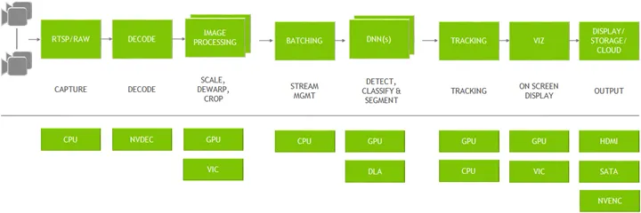

**图9：NVIDIA官方DeepStream视频分析图与硬件执行引擎。** 原图出处：[DeepStream 9.2官方架构与开发指南](https://docs.nvidia.com/metropolis/deepstream/dev-guide/text/DS_Overview.html)。

原图按采集、解码、图像处理、批处理、DNN、跟踪、可视化与输出排序，下面列出CPU、NVDEC、GPU、VIC、DLA和编码/显示等硬件路径。它说明一条视频pipeline并不全部运行在GPU上。图中DLA是通用架构选项，不能据此认定Thor或Orin Nano具有DLA，具体执行目标依硬件和SDK支持矩阵选择。[DeepStream 9.2官方架构与开发指南](https://docs.nvidia.com/metropolis/deepstream/dev-guide/text/DS_Overview.html)；[Jetson Thor官方规格](https://www.nvidia.com/en-us/autonomous-machines/embedded-systems/jetson-thor/)；[Jetson Orin官方规格](https://www.nvidia.com/en-us/autonomous-machines/embedded-systems/jetson-orin/)

| pipeline阶段 | 官方插件/模块 | 数据和配置要点 |
|---|---|---|
| 解码及格式转换 | Gst-nvvideo4linux2、Gst-nvvideoconvert | 编码格式、分辨率、色彩格式与目标内存类型 |
| 几何预处理 | Gst-nvdewarper等 | 去畸变、裁剪和模型预处理应保持与训练一致 |
| 合批 | Gst-nvstreammux | 多源帧合批；batch和超时影响延迟与资源利用 |
| 推理 | Gst-nvinfer或Gst-nvinferserver | 分别接TensorRT或Triton；模型、预处理和后处理需完整配置 |
| 多目标跟踪 | Gst-nvtracker | 将检测关联为轨迹；遮挡、ID切换与检测间隔需评估 |
| 显示与消息 | Gst-nvdsosd、nvmsgconv、nvmsgbroker | 可视化叠加、schema转换与消息broker输出 |

表格据官方Overview的插件说明整理。机器人视觉常需要把跟踪目标转成带坐标系和时间戳的任务观测；DeepStream object metadata不是现成的机器人关节指令。若同时送ROS、录像及云端消息，应检查是否引入复制或阻塞，及结果时间戳代表采集还是处理完成。[DeepStream 9.2官方架构与开发指南](https://docs.nvidia.com/metropolis/deepstream/dev-guide/text/DS_Overview.html)

### 9.2 应用开发和版本变化

官方`deepstream-app`参考应用以配置文件组织源、推理、跟踪和输出；test1从文件解码、合批、检测和渲染开始，test2加入级联推理，test3多源，test4消息输出。它们提供由简单到复杂的学习路径，适合先复现本地视频再接入真实摄像头。当前文档把Python Sample Apps/Bindings列为Deprecated，并介绍新的开发路线；既有Python绑定项目应核对迁移指南，不能将旧示例可运行视为长期维护承诺。[DeepStream 9.2官方架构与开发指南](https://docs.nvidia.com/metropolis/deepstream/dev-guide/text/DS_Overview.html)

本轮Overview已重定向至DeepStream9.2文档，称9.2在x86和Jetson可生产使用、Jetson基于JP7.2.1 GA，且NVAIE客户支持范围仅x86；JetPack下载页仍列9.1。报告据实保留这一区别：架构分析按当前文档，安装组合按目标版本release notes/容器核验。当前文档称容器分发使用GHCR的`ghcr.io/nvidia/deepstream`命名空间，不能沿用历史NGC路径作为本版统一安装命令。[DeepStream 9.2官方架构与开发指南](https://docs.nvidia.com/metropolis/deepstream/dev-guide/text/DS_Overview.html)；[JetPack官方下载与版本矩阵](https://developer.nvidia.com/embedded/jetpack/downloads)

### 9.3 适用场景与评估方法

DeepStream适合移动机器人多路视频检测、工作空间人员/物体跟踪及事件上传，也适合固定场景视频分析。其收益来自硬件解码、插件间内存管理与批处理；必须比较总帧率、单流延迟、丢帧、检测精度、跟踪稳定性及功耗。官方的“zero-memory copy between plugins”描述的是可兼容插件/内存路径的优化设计，不能外推到第三方插件、所有相机驱动或跨ROS进程。[DeepStream 9.2官方架构与开发指南](https://docs.nvidia.com/metropolis/deepstream/dev-guide/text/DS_Overview.html)

SDK插件、样例源码和各依赖的许可不同；参考应用源代码可查看不表示整个发行包采用统一开源许可。量产应保存插件列表、模型配置、容器摘要、驱动/BSP版本和样例修改记录，保证问题可复现。

## 10. Holoscan SDK：传感器计算图、时序语义与运行时

### 10.1 先区分发行版本与架构代际

Holoscan面向流式传感器处理和AI应用，把I/O、计算、推理及可视化组织成图。官方下载页随JetPack7.2.1列Holoscan3.9.0；本轮无版本文档入口已经转到5.0，且仍提供4.4等归档。5.x与4.x的公开API/时序架构不同，因此下文分别解释4.x工程方式和5.x当前文档，不把5.x的新接口或保证写为3.9.0既有能力。[JetPack官方下载与版本矩阵](https://developer.nvidia.com/embedded/jetpack/downloads)；[Holoscan 5.0官方Overview](https://docs.nvidia.com/holoscan/sdk-user-guide/index.html)；[Holoscan 4.4官方Overview](https://docs.nvidia.com/holoscan/sdk-user-guide/4-4/introduction/overview)

| 公开基线 | 文档中的应用结构 | 使用时的主要问题 |
|---|---|---|
| JetPack下载页3.9.0 | 下载页仅说明SDK发行版本 | 需要取得该版本实际接口/依赖矩阵；不能直接套最新示例 |
| Holoscan4.4归档 | C++/Python pipeline，operator承担IO、推理、处理和可视化 | 选择安装策略、operators、调度与Data Flow Tracking |
| Holoscan5.0当前文档 | Graph、typed ports、temporal contracts及compose/compile/run | 新模型强调多采样率、输入新鲜度和编译时验证，迁移需核对API |

表格来自指定版本官方文档。对既有项目，应先锁定版本再阅读相应教程；对新项目，最新架构可作为评估对象，但设备、SDK、receiver和算法operator是否组合可用仍需明确验证。[Holoscan 5.0官方Overview](https://docs.nvidia.com/holoscan/sdk-user-guide/index.html)；[Holoscan 4.4官方Overview](https://docs.nvidia.com/holoscan/sdk-user-guide/4-4/introduction/overview)

### 10.2 4.x：可组合operator与流式应用

4.4 Overview提供容器、Python wheel和源码等安装策略，推荐C++/Python API构建应用pipeline；内建operators负责IO、机器学习推理、处理和可视化。operator是算法或I/O的工作单元，图连接表达数据流。Data Flow Tracking记录operator之间的数据流以分析应用性能，不能只以一个推理算子耗时解释整条pipeline。[Holoscan 4.4官方Overview](https://docs.nvidia.com/holoscan/sdk-user-guide/4-4/introduction/overview)

这种组织方式适合相机输入、GPU前处理、TensorRT推理和可视化等串联，也允许自定义operator包裹已有算法。算法代码能封装为operator不代表内存和同步已经优化；buffer所有权、队列深度、CUDA stream和跨进程传输需按该版本接口处理。官方最小示例用于理解单项能力，真实多传感器应用仍需建立时钟和失效策略。[Holoscan 4.4官方Overview](https://docs.nvidia.com/holoscan/sdk-user-guide/4-4/introduction/overview)

### 10.3 5.x：图结构、时间契约和执行计划

5.0文档把底层HoloMQ共享内存publish/subscribe传输与上层传感器运行时分开。上层operator通过typed ports连接，采用三个声明：`setup()`定义结构，`contract()`定义何时触发、哪些输入参与及缺失数据策略，`compute()`执行计算。应用依次compose图、compile成ExecutionPlan、run；编译可拒绝结构/资源不可行的图，运行启动仍需验证实际binding。[Holoscan 5.0官方Overview](https://docs.nvidia.com/holoscan/sdk-user-guide/index.html)；[Holoscan 5.0 Core Concepts](https://docs.nvidia.com/holoscan/sdk-user-guide/holoscan_core.html)

| 5.x关键抽象 | 官方职责 | 多传感器应用的实际意义 |
|---|---|---|
| Graph与Input/Output端口 | 定义operator及静态类型连接 | 提前发现接口/结构错误，区别于任意字节消息 |
| Temporal contract | trigger、input selector和missing-data policy | 明确选择最新、窗口或精确样本，避免默默使用过期观测 |
| ExecutionPlan | 保存编译后的不可变执行方案和诊断 | plan被接受与run成功启动是不同状态 |
| HoloMQ/ChannelRuntime | GPU感知的共享内存进程间通道 | 独立采集、录制或UI进程可以接入通道；跨机器不直接等同于此机制 |
| 模块化operators | 当前列Inference、Vision和Visualization核心模块 | 区分已交付模块与后续领域规划 |

表格直接整理当前Core Concepts与Overview。文档中的typed ports、preallocated pools和bounded queues旨在把时序/资源约束显式化；它们不能替代实际传感器时间语义、目标operator执行预算及整机最坏情况测试。旧版本代码中的Application/运行方式也不能机械改名成5.x Graph。[Holoscan 5.0官方Overview](https://docs.nvidia.com/holoscan/sdk-user-guide/index.html)；[Holoscan 5.0 Core Concepts](https://docs.nvidia.com/holoscan/sdk-user-guide/holoscan_core.html)

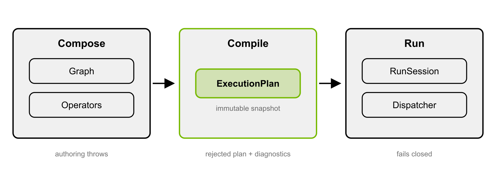

**图10：NVIDIA官方Holoscan5 compose、compile、run生命周期。** 原图出处：[Holoscan 5.0 Core Concepts](https://docs.nvidia.com/holoscan/sdk-user-guide/holoscan_core.html)。

图中Graph/Operators属于组合阶段，ExecutionPlan是编译后不可变快照，RunSession/Dispatcher负责运行；失败语义在三个阶段分别处理。这是当前5.x官方图，不当作3.9.0 API示意。[Holoscan 5.0 Core Concepts](https://docs.nvidia.com/holoscan/sdk-user-guide/holoscan_core.html)

### 10.4 适用范围、许可与维护

Holoscan适合多个传感器流、GPU算法和推理需要在同一数据流中组织的应用；ROS提供机器人消息生态，DeepStream提供视频分析插件，HSB提供特定传感器接入，四者可协作但职责不同。建议选择一条最小可复现链，保存每个operator输入输出、队列与时钟配置，再引入多源和多进程。[Holoscan SDK官方仓库](https://github.com/nvidia-holoscan/holoscan-sdk)官方仓库本轮为241 Stars，默认分支`main`，最近可见提交2026-10-20 23:43:24 UTC；代码Apache-2.0。[Holoscan SDK仓库元数据快照](https://api.github.com/repos/nvidia-holoscan/holoscan-sdk)；[Holoscan SDK最近提交快照](https://api.github.com/repos/nvidia-holoscan/holoscan-sdk/commits?per_page=1)；[Holoscan SDK代码许可](https://raw.githubusercontent.com/nvidia-holoscan/holoscan-sdk/main/LICENSE.txt)。SDK代码、外部operators、模型及设备驱动分别核查许可，公共文档的设计目标不当作本项目验收结果。

## 11. Holoscan Sensor Bridge：传感器控制面、数据面与GPU接收

### 11.1 与Holoscan SDK的关系

Holoscan Sensor Bridge（HSB）处理传感器到计算设备的高速接入，Holoscan SDK处理接入后的计算图。桥接板上的FPGA收集传感器数据并通过UDP转发；主机软件用控制消息访问I2C、SPI或local bus，用receiver operator接收帧。这个控制面/数据面划分允许同一网络既传帧又控制曝光、模式和设备寄存器，但两类消息的可靠性和时序需求不同。[Holoscan Sensor Bridge 2.7架构与示例](https://docs.nvidia.com/holoscan/sensor-bridge/2-7-latest/applications/architecture)

| HSB组成 | 软件/硬件职责 | 对机器人集成的含义 |
|---|---|---|
| FPGA桥接设备 | 汇集传感器数据，生成数据面网络包 | 匹配传感器电气接口、固件和网络配置 |
| Hololink对象 | 访问I2C/SPI/local bus及设备控制 | 曝光/模式等按传感器寄存器与状态机执行 |
| DataChannel | 将枚举数据通道与主机接收buffer关联 | 通道、IP和实际传感器之间需要稳定映射 |
| RoceReceiverOp | 配合ConnectX路径将数据直接写入GPU内存 | RDMA能力取决于网卡/GPU/平台配置 |
| LinuxReceiverOperator | Linux Sockets接收路径 | 提供通用接入，但没有网卡卸载接收的同等性能 |
| 格式转换/ISP operators | 将RAW数据组织为后续计算输入 | 硬件采集、软件ISP和模型预处理需分开验证 |

表格依据2.7官方Architecture。文档明确：有ConnectX SmartNIC时，接收数据面流量可通过RDMA直接写入GPU内存；没有ConnectX时可用Linux socket receiver，性能不同。这比笼统的“以太网直达GPU”更准确，也避免把任何Jetson网口都视为GPUDirect接收路径。[Holoscan Sensor Bridge 2.7架构与示例](https://docs.nvidia.com/holoscan/sensor-bridge/2-7-latest/applications/architecture)

### 11.2 官方示例揭示的应用生命周期

官方`imx274_player.py`示例先枚举设备、生成channel metadata、创建DataChannel与传感器对象，再复位Hololink、配置相机时钟/模式并运行HoloscanApplication。receiver的start启动相机发送，compute等待完整帧到达。设备reset会影响同板的多个DataChannel；双目共享时钟时也不能在一路工作中随意重新初始化时钟。[Holoscan Sensor Bridge 2.7架构与示例](https://docs.nvidia.com/holoscan/sensor-bridge/2-7-latest/applications/architecture)

设备枚举使用本地广播UDP消息，主机必须与桥接设备位于能接收这些枚举消息的同一网络；路由器不会转发这些广播。复位后IP可能回到默认值，因此文档建议用持续运行的地址配置服务处理重新枚举。启动顺序、设备复位、网络变更和多通道状态需要作为故障恢复流程验证，而不只是测试一次正常取流。[Holoscan Sensor Bridge 2.7架构与示例](https://docs.nvidia.com/holoscan/sensor-bridge/2-7-latest/applications/architecture)

### 11.3 参考硬件、软件许可与选型

README给出Lattice桥接板配IMX274以及Microchip桥接板配IMX477等示例，具体主机/NIC/GPU组合以2.7用户指南为准。HSB适用于高带宽相机及可由桥接固件支持的其他传感器，尤其是需要减少主机收包与复制开销的场景；它不自动提供所有LiDAR、IMU或相机的即插即用驱动。[Holoscan Sensor Bridge README](https://raw.githubusercontent.com/nvidia-holoscan/holoscan-sensor-bridge/main/README.md)；[Holoscan Sensor Bridge 2.7官方用户指南](https://docs.nvidia.com/holoscan/sensor-bridge/latest/index.html)

官方仓库Apache-2.0，66 Stars，main最新可见提交2026-10-29 20:35:06 UTC。代码许可不覆盖第三方桥接硬件、传感器固件和所有依赖。性能应按同一分辨率、帧率、数据格式、接收路径及主机负载比较，并拆分曝光到帧完成、网络接收和GPU处理时延。本报告未测量HSB实机时延。[Holoscan Bridge Project Page](https://github.com/nvidia-holoscan/holoscan-sensor-bridge)；[Holoscan Bridge Repo Metadata](https://api.github.com/repos/nvidia-holoscan/holoscan-sensor-bridge)；[Holoscan Bridge Recent Commit](https://api.github.com/repos/nvidia-holoscan/holoscan-sensor-bridge/commits?per_page=1)；[Holoscan Sensor Bridge README](https://raw.githubusercontent.com/nvidia-holoscan/holoscan-sensor-bridge/main/README.md)

## 12. Isaac ROS：加速节点、ROS数据通路与策略部署

### 12.1 应用架构与模块关系

Isaac ROS建立在ROS 2之上，提供面向图像处理、DNN感知、定位、操作及机器人部署的硬件加速包。ROS负责消息接口、发现、QoS与节点图；Isaac ROS节点调用GPU算法和推理库；传感器驱动和机器人hardware interface连接实际设备。使用Isaac ROS并不要求把所有节点替换为NVIDIA实现，关键是确定哪些瓶颈值得加速，以及标准消息和GPU存储在何处转换。[Isaac ROS Repositories](https://nvidia-isaac-ros.github.io/repositories_and_packages/index.html)；[Isaac ROS官方安装与支持矩阵](https://nvidia-isaac-ros.github.io/getting_started/index.html)

| 模块类别 | 在机器人数据流中的任务 | 主要输入输出及集成点 |
|---|---|---|
| 相机与图像处理 | 接收图像、几何变换、立体视觉与预处理 | 图像、相机内参、时间戳；与实际相机驱动及标定相接 |
| 推理与感知 | 检测、分割、姿态估计等 | 图像/张量输入，结构化感知结果；对接TensorRT或服务后端 |
| 定位与建图 | 视觉惯性里程计、地图或占据空间处理 | 双目、IMU、位姿、点云/地图；坐标系与时间一致性不可省略 |
| 操作与规划 | 结合机器人模型与场景生成运动计划 | 机器人描述、关节状态、目标和碰撞几何；对接规划接口 |
| 部署与控制接入 | 承载策略运行时并接到ROS 2 Control | 观测、动作与关节接口；实际驱动及限幅配置由系统提供 |

表格按官方仓库索引与Deploy概念文档归纳，算法能力随包版本变化。工程收益不是“整张ROS图自动变快”，而是缩短特定热点并减少不必要的数据往返；CPU执行的第三方节点、跨机器DDS和日志录制仍可能改变瓶颈位置。[Isaac ROS Repositories](https://nvidia-isaac-ros.github.io/repositories_and_packages/index.html)；[Isaac ROS Deploy Concept](https://nvidia-isaac-ros.github.io/repositories_and_packages/isaac_ros_deploy/concepts/how_it_works.html)

### 12.2 ROS原生Buffer：当前迁移方向

官方迁移说明写明：

> “Isaac ROS is deprecating NITROS, including CUDA with NITROS and PyNITROS.” [Isaac ROS Buffer Migration](https://nvidia-isaac-ros.github.io/concepts/rosidl_buffer/nitros_migration.html)

当前迁移后的节点使用带`rosidl::Buffer`字段的标准ROS消息及CUDA buffer backend。Lyrical提供原生容器与后端插件，原始数组数据可由CPU、CUDA或其他后端存储；消息定义与加速存储机制由此分离。普通节点可沿标准消息接口集成，实际数据读取是否触发复制取决于所用后端、转换包和中间件路径。[Isaac ROS原生Buffer概念文档](https://nvidia-isaac-ros.github.io/concepts/rosidl_buffer/index.html)；[Isaac ROS Buffer Migration](https://nvidia-isaac-ros.github.io/concepts/rosidl_buffer/nitros_migration.html)

| 旧集成方式 | 官方迁移方向 | 源码与运行时变化 |
|---|---|---|
| Managed NITROS发布/订阅 | 标准ROS发布/订阅与buffer-backed消息 | 优先使用图像、张量、点云等领域conversion package |
| Builders/views及adapted types | 转换对象或CUDA读写handles | 验证所有权、可变性、buffer生命周期和stream同步 |
| NITROS类型协商 | 中间件buffer backend选择和fallback | 新抽象不与旧协商API一一对应 |
| PyNITROS或直接设备指针访问 | 受支持框架转换包；必要时直接CUDA backend | 自定义旧API代码需要源码级迁移，不能只换包名 |

官方保留已迁移节点的节点级兼容，直接依赖NITROS接口的代码不在该兼容范围。部署前应同时测试GPU路径与CPU fallback，确认发生跨进程或跨机器传输时的行为；没有公开文档证明任意第三方ROS图均具有全链路零复制。[Isaac ROS Buffer Migration](https://nvidia-isaac-ros.github.io/concepts/rosidl_buffer/nitros_migration.html)

### 12.3 GPU分区、节点调度与部署控制

Isaac ROS Common README记录2026年9月加入使用CUDA MPS的静态SM分区工具。分区用于为共享GPU的工作负载配置计算资源；它不等同于MIG硬件实例，也不会消除CPU调度、共享内存带宽和热降频影响。项目应先测单图基线，再引入多进程、录制、显示和模型服务，观察关键节点尾延迟与丢帧。[Isaac ROS Common README](https://raw.githubusercontent.com/NVIDIA-ISAAC-ROS/isaac_ros_common/main/README.md)；[Isaac ROS CUDA MPS静态GPU分区](https://nvidia-isaac-ros.github.io/concepts/gpu_partitioning/index.html)

具体配置按MPS chunks分配，SM数量等于chunk数乘以服务器报告的每chunk SM数，后者受GPU架构与驱动影响。工具要求`nvidia-cuda-mps-control`版本13010或更高及pynvml，先创建GpuPartition，再给相应进程设置`CUDA_MPS_SM_PARTITION`；结果保存到`/tmp/nvidia-mps/gpu_partitions.yaml`供后续launch复用。当前每份配置使用单个GPU，default分区的`chunks: 0`取得剩余资源。官方明确这种分配不分割GPU memory，也不提供完全工作负载隔离；`clear_partitions=True`会移除已有静态分区，运行系统需谨慎管理配置变更。[Isaac ROS CUDA MPS静态GPU分区](https://nvidia-isaac-ros.github.io/concepts/gpu_partitioning/index.html)

Deploy中的SafetyController以ROS 2 Control链式插件接在策略/上游控制器与硬件之间，提供渐进命令混合和基于关节速度阈值的异常检测。速度检测只有在配置非空emergency_controller及正阈值时才启用；未匹配速度限幅配置的关节可能不受限。官方明确它不是功能安全认证架构，实际限幅、独立停机和驱动状态处理仍需完成。[Isaac ROS Deploy Safety](https://nvidia-isaac-ros.github.io/repositories_and_packages/isaac_ros_deploy/concepts/safety.html)

### 12.4 版本、许可与适用项目

当前安装页采用ROS 2 Lyrical，Jetson路径要求JetPack 7.2，测试依赖为CUDA 13.2及TensorRT 10.16系列；提供固定release-5.0和浮动release-5仓库。它与JetPack下载页“Coming soon”的差异，以及同页Sim桥接中仍出现Jazzy示例的情况，均应在项目版本矩阵中保留，不合并成全组合认证。[Isaac ROS官方安装与支持矩阵](https://nvidia-isaac-ros.github.io/getting_started/index.html)；[JetPack官方下载与版本矩阵](https://developer.nvidia.com/embedded/jetpack/downloads)

Isaac ROS Common根许可为NVIDIA ISAAC ROS SOFTWARE LICENSE，API识别为NOASSERTION，包含NVIDIA GPU系统使用等限制；不能宣称全部Isaac ROS包统一Apache-2.0。当前Common仓库322 Stars、main最新可见提交2026-09-22 02:16:15 UTC，只表示采集时点的社区记录。适用项目是需要ROS接口且有明确GPU感知/规划瓶颈的机器人；已有自定义NITROS集成则需把迁移工作计入升级成本。[Isaac ROS Common Project Page](https://github.com/NVIDIA-ISAAC-ROS/isaac_ros_common)；[Isaac ROS当前软件许可](https://raw.githubusercontent.com/NVIDIA-ISAAC-ROS/isaac_ros_common/main/LICENSE)；[Isaac ROS Repo Metadata](https://api.github.com/repos/NVIDIA-ISAAC-ROS/isaac_ros_common)；[Isaac ROS Recent Commit](https://api.github.com/repos/NVIDIA-ISAAC-ROS/isaac_ros_common/commits?per_page=1)

## 13. Isaac GR00T：VLA模型、后训练与端侧策略运行时

### 13.1 模型和工程软件的关系

GR00T既包含机器人基础模型，也包含数据准备、微调、评估、模型导出与策略接口代码。当前README为N1.7 GA，视觉语言骨干采用Cosmos-Reason2-2B/Qwen3-VL，动作头通过flow-matching diffusion transformer对连续动作去噪。它读取视觉、语言和机器人状态，输出动作块；本体驱动、动作执行器和安全控制不属于这个神经网络本身。[GR00T N1.7官方README](https://raw.githubusercontent.com/NVIDIA/Isaac-GR00T/main/README.md)

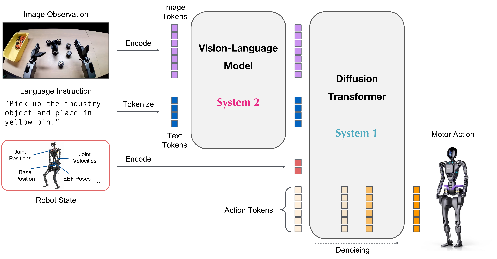

**图11：NVIDIA官方GR00T N1.7模型架构。** 原图出处：[GR00T Architecture Image](https://raw.githubusercontent.com/NVIDIA/Isaac-GR00T/main/media/model-architecture.png)。

阅读图时应区分视觉语言编码、状态/动作条件和动作去噪三部分。视觉/语言骨干理解当前观测及指令；状态编码把本体状态纳入条件；动作头输出经过归一化和解码的连续动作。动作含义由embodiment tag、模态配置和训练数据决定，不能因为模型输出维度一致就直接接到另一本体关节。[GR00T N1.7官方README](https://raw.githubusercontent.com/NVIDIA/Isaac-GR00T/main/README.md)；[GR00T New Embodiment](https://raw.githubusercontent.com/NVIDIA/Isaac-GR00T/main/getting_started/finetune_new_embodiment.md)

### 13.2 数据到部署的完整工作流

| 阶段 | 官方提供的工程入口 | 需要理解的输入输出 |
|---|---|---|
| 数据准备 | LeRobot格式、模态配置与样例数据 | 视频、state、action、任务说明及统计量；必须保持时间和坐标语义 |
| 新本体微调 | embodiment配置、微调脚本及数据混合 | 将本体的状态/动作映射到模型输入输出；微调参数范围决定显存需求 |
| 评估 | 开环动作误差与仿真/机器人评估接口 | 预测动作接近示教不等于闭环任务必定成功 |
| 导出优化 | ONNX及TensorRT pipeline构建器 | 导出、构建、输出校验、benchmark分别有日志和产物 |
| 策略运行 | Gr00tPolicy与Policy API | 接收观测并返回动作块；机器人控制器决定执行和超时策略 |

表格依据README、新本体及部署指南。N1.7采用相对末端执行器动作表示，并扩展状态/动作容量与预测长度；容量上限不是每个本体都必须填满的实际控制维度。checkpoint、processor配置、统计量和embodiment配置应一起发布，单独替换权重可能改变动作解释。[GR00T N1.7官方README](https://raw.githubusercontent.com/NVIDIA/Isaac-GR00T/main/README.md)；[GR00T New Embodiment](https://raw.githubusercontent.com/NVIDIA/Isaac-GR00T/main/getting_started/finetune_new_embodiment.md)；[GR00T官方部署与基准](https://raw.githubusercontent.com/NVIDIA/Isaac-GR00T/main/scripts/deployment/README.md)

### 13.3 TensorRT拆分及平台安装

当前导出模式分为`dit_only`、`action_head`和`full_pipeline`。完整pipeline加速视觉Transformer、语言模型、状态/动作编码、DiT及动作解码，少量连接操作仍在PyTorch执行。与只加速DiT相比，完整pipeline能覆盖骨干开销，但意味着更多engine、动态token长度和输出一致性检查。batch size在ONNX/TRT中为静态维度，变更batch必须重新导出与构建。[GR00T官方部署与基准](https://raw.githubusercontent.com/NVIDIA/Isaac-GR00T/main/scripts/deployment/README.md)

Jetson Thor/Orin安装路径使用JetPack 7.2、CUDA 13.2、Python 3.12；dGPU README基线为CUDA 12.8，Spark为CUDA 13.0。aarch64应激活平台脚本后使用普通python，部署指南提醒`uv run`可能重新按根目录x86配置同步依赖。这里的Triton GPU编译工具与Triton Inference Server是不同软件。[GR00T N1.7官方README](https://raw.githubusercontent.com/NVIDIA/Isaac-GR00T/main/README.md)；[GR00T官方部署与基准](https://raw.githubusercontent.com/NVIDIA/Isaac-GR00T/main/scripts/deployment/README.md)

### 13.4 官方测量与动作块执行

下表摘录官方部署指南中的完整策略调用**中位时延**，单位ms；不是实机控制周期。统一模型为GR00T-N1.7-LIBERO的`libero_10` checkpoint，batch=1、动作预测长度40、4次去噪、两路256×256图像；计入预处理与动作解码，不计RPC。[GR00T官方部署与基准](https://raw.githubusercontent.com/NVIDIA/Isaac-GR00T/main/scripts/deployment/README.md)

| 官方测试设备 | PyTorch eager | torch.compile | TensorRT full pipeline | TensorRT优化执行＋mixed NVFP4 | 条件与来源 |
|---|---|---|---|---|---|
| H100 80GB HBM3 | 101.5 | 53.4 | 22.9 | 未测量 | 同上固定输入；[GR00T官方部署与基准](https://raw.githubusercontent.com/NVIDIA/Isaac-GR00T/main/scripts/deployment/README.md) |
| RTX Pro 6000 Blackwell Server Edition 96GB | 75.7 | 52.1 | 24.7 | 未测量 | 明确为Server Edition；[GR00T官方部署与基准](https://raw.githubusercontent.com/NVIDIA/Isaac-GR00T/main/scripts/deployment/README.md) |
| L40 | 123.7 | 66.8 | 35.0 | 未测量 | 同上固定输入；[GR00T官方部署与基准](https://raw.githubusercontent.com/NVIDIA/Isaac-GR00T/main/scripts/deployment/README.md) |
| DGX Spark | 200.8 | 183.1 | 116.6 | 未测量 | 平台使用各自运行库；[GR00T官方部署与基准](https://raw.githubusercontent.com/NVIDIA/Isaac-GR00T/main/scripts/deployment/README.md) |
| AGX Thor MAXN | 106.8 | 100.5 | 76.8 | 35.6 | MAXN并启用jetson_clocks；[GR00T官方部署与基准](https://raw.githubusercontent.com/NVIDIA/Isaac-GR00T/main/scripts/deployment/README.md) |
| Jetson Orin MAXN | 357.9 | 224.3 | 149.0 | 未测量 | 本表未明确细分SKU，不外推NX/Nano；[GR00T官方部署与基准](https://raw.githubusercontent.com/NVIDIA/Isaac-GR00T/main/scripts/deployment/README.md) |

官方每个backend测三轮，每轮预热10次、计时20次，汇总60个计时样本取中位数；PyTorch使用8个CPU线程和1个interop线程。Thor的76.8ms和35.6ms分别来自基础TensorRT与优化执行加混合NVFP4，不能把约28Hz写成未量化的默认部署结果。优化配置包含缓存、投影融合与CUDA graphs，并要求使用目标本体的代表性校准观测；量化后仍应验证动作误差与闭环成功率。[GR00T官方部署与基准](https://raw.githubusercontent.com/NVIDIA/Isaac-GR00T/main/scripts/deployment/README.md)

官方硬件推荐页另列“一路相机、4次去噪”的推理频率，与本表双相机、指定checkpoint和完整调用计时范围不同，不能拼成统一排行榜。策略推理更新的是动作块；`execution_horizon`决定取多少步执行，不能把预测长度40理解为必须连续执行40步，也不能把策略调用率当成电机伺服频率。选型应先固定checkpoint、相机输入、精度和测量范围，再比较完整时延分布与任务结果。[GR00T Hardware Guide](https://raw.githubusercontent.com/NVIDIA/Isaac-GR00T/main/getting_started/hardware_recommendation.md)；[GR00T官方部署与基准](https://raw.githubusercontent.com/NVIDIA/Isaac-GR00T/main/scripts/deployment/README.md)

### 13.5 商业边界

仓库代码Apache-2.0，README称N1.7可商用；骨干访问、模型权重和第三方依赖仍需单独核对，gated下载不能由公开README替代授权。官方仓库8,307 Stars、main最新可见提交2026-10-28 21:46:01 UTC。对项目而言，GR00T的价值是复用视觉语言与动作表示并利用本体数据后训练；只有在目标本体、目标任务和失效处理均经闭环验证后，才能形成交付结论。本报告未下载受限权重或执行训练。[NVIDIA Isaac GR00T官方仓库](https://github.com/NVIDIA/Isaac-GR00T)；[GR00T Repo Metadata](https://api.github.com/repos/NVIDIA/Isaac-GR00T)；[GR00T Recent Commit](https://api.github.com/repos/NVIDIA/Isaac-GR00T/commits?per_page=1)；[GR00T License](https://raw.githubusercontent.com/NVIDIA/Isaac-GR00T/main/LICENSE)；[GR00T N1.7官方README](https://raw.githubusercontent.com/NVIDIA/Isaac-GR00T/main/README.md)

## 14. Triton Inference Server：模型服务、调度与生命周期

### 14.1 服务器架构

Triton把模型推理封装成可管理服务：客户端通过HTTP/REST或gRPC发出请求；服务器按模型名称、版本及配置把请求送到调度器与模型实例；backend执行TensorRT、PyTorch、ONNX或Python等实际推理，结果经协议返回。它还提供进程内C API。TensorRT是其中一种执行后端，Triton则负责服务与调度，两者不是互相替代的软件。[Triton官方README](https://raw.githubusercontent.com/triton-inference-server/server/main/README.md)；[Triton Inference Server官方架构](https://raw.githubusercontent.com/triton-inference-server/server/main/docs/user_guide/architecture.md)

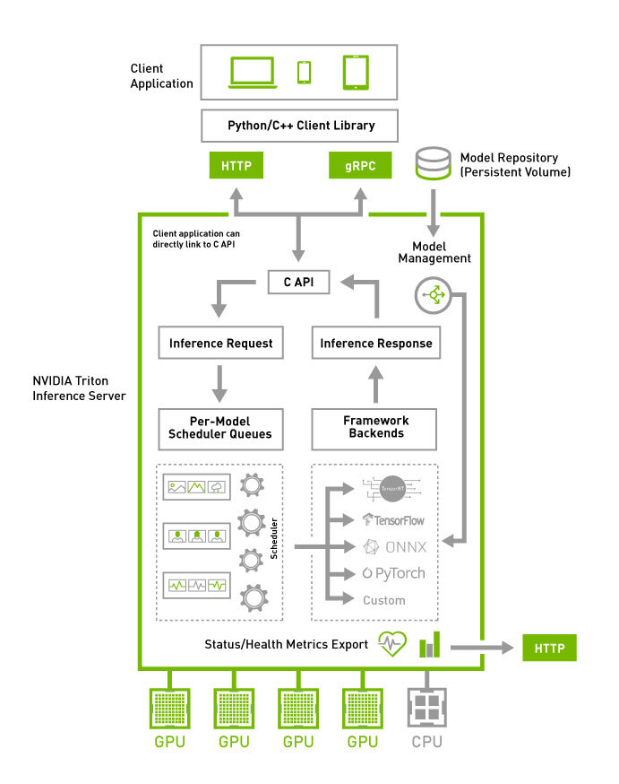

**图12：NVIDIA官方Triton Inference Server高层架构。** 原图出处：[Triton官方架构原图](https://raw.githubusercontent.com/triton-inference-server/server/main/docs/user_guide/images/arch.jpg)。

图将客户端协议、按模型调度和backend执行分开。请求到服务器后并非立即启动GPU；模型实例、批处理和队列决定执行时机，模型管理与指标则是旁路运维接口。[Triton Inference Server官方架构](https://raw.githubusercontent.com/triton-inference-server/server/main/docs/user_guide/architecture.md)

| 服务器模块 | 作用 | 与机器人部署的关系 |
|---|---|---|
| 协议前端 | HTTP/REST、gRPC及进程内接口 | 便于云边/进程间服务调用；网络序列化和超时必须另测 |
| Model Repository | 模型目录、数字版本目录与配置 | 保存多版本；模型版本不等于整个机器人软件版本 |
| Scheduler与实例 | 将请求分配给一个或多个模型实例 | 控制并发与排队；实例增多可能提高吞吐也增加显存峰值 |
| Backend | 实际执行模型及自定义前后处理 | 后端与模型依赖应逐项锁定，ARM镜像不保证后端完全相同 |
| Ensemble/BLS | 连接多模型与条件业务流程 | 可组合视觉流水线，但不替代ROS本体控制图 |
| 指标和模型管理 | 暴露服务状态、加载/卸载及性能指标 | 支撑运维；任务成功率、动作过期和安全事件需应用侧记录 |

表格按官方架构与README整理。对多机器人共享服务，真正需要区分的是独立请求还是带历史状态的请求，及任务是否允许排队；这会影响选用dynamic batcher、sequence batcher或应用自身调度。[Triton Inference Server官方架构](https://raw.githubusercontent.com/triton-inference-server/server/main/docs/user_guide/architecture.md)；[Triton官方README](https://raw.githubusercontent.com/triton-inference-server/server/main/README.md)

### 14.2 批处理与状态语义

dynamic batcher适用于无状态模型，合并请求以改善GPU利用率；可配置preferred batch、最大批等待、队列长度和超时策略。sequence batcher用于有状态模型，把同一序列路由到相同实例并管理序列起止等控制信息。sequence ID不能替代机器人观测时间戳和动作有效期。[Triton Batching](https://raw.githubusercontent.com/triton-inference-server/server/main/docs/user_guide/batcher.md)

机器人交互服务可先采用batch=1、不人为增加批等待的基线，然后观察吞吐、P95/P99延迟、超时和过期动作比例。多个本体能否合批，还取决于模型配置、动作归一化和历史上下文；shape一致并不足够。对伺服闭环，不宜把远程服务队列直接作为周期控制器。以上调度选型属于工程建议，未执行实测。[Triton Batching](https://raw.githubusercontent.com/triton-inference-server/server/main/docs/user_guide/batcher.md)

### 14.3 模型管理与上线流程

| 模式 | 官方行为 | 发布含义 |
|---|---|---|
| NONE，默认 | 启动加载仓库模型；运行中忽略仓库变化 | 适合固定服务镜像；修改文件不会自动生效 |
| EXPLICIT | 通过参数/API明确加载或卸载模型 | 可把加载、ready检查及切换纳入明确发布步骤 |
| POLL | 定时发现文件变化并尝试重载 | 官方不推荐生产使用：可能观察到尚未完成的修改 |

表格来自模型管理文档。对序列模型，重载前应完成在途序列；官方不保证剩余序列请求在重载后仍路由到原实例。更新backend共享库也应先卸载依赖模型，避免替换正在使用的二进制。建议模型目录保持不可变，灰度切换、客户端版本选择及失败回退由发布流程明确控制。[Triton Model Management](https://raw.githubusercontent.com/triton-inference-server/server/main/docs/user_guide/model_management.md)

### 14.4 版本和适用范围

当前README为release 2.74.0、NGC 26.10容器，main跟踪下一版本开发。固定容器摘要、backend、模型文件和config后才能复现；该版本不自动等同于已验证的JetPack/GR00T组合。仓库BSD-3-Clause，11,127 Stars，main最新可见提交2026-11-03 02:40:51 UTC；后端、模型和AI Enterprise支持合同另核。适合多模型服务、共享推理与可观测部署；单机短链路也可使用直接TensorRT API减少服务封装。[Triton Project Page](https://github.com/triton-inference-server/server)；[Triton官方README](https://raw.githubusercontent.com/triton-inference-server/server/main/README.md)；[Triton License](https://raw.githubusercontent.com/triton-inference-server/server/main/LICENSE)；[Triton Repo Metadata](https://api.github.com/repos/triton-inference-server/server)；[Triton Recent Commit](https://api.github.com/repos/triton-inference-server/server/commits?per_page=1)

## 15. Nsight工具族：系统时间线、GPU算子与图形诊断

### 15.1 各工具解决不同层级的问题

Nsight Systems从系统层观察CPU线程、CUDA API、GPU工作和相关事件之间的时间关系；Nsight Compute深入单个CUDA kernel的性能；Nsight Graphics分析图形渲染和GPU图形工作负载。JetPack下载页列Nsight Systems2026.3，但其他工具和文档有独立版本/平台要求。三者的报告不能相互替代，尤其不能把某个kernel优化等同于机器人整链路延迟已经改善。[Nsight Systems官方User Guide](https://docs.nvidia.com/nsight-systems/UserGuide/index.html)；[Nsight Compute官方Profiling Guide](https://docs.nvidia.com/nsight-compute/ProfilingGuide/index.html)；[Nsight Graphics官方产品页](https://developer.nvidia.com/nsight-graphics)；[JetPack官方下载与版本矩阵](https://developer.nvidia.com/embedded/jetpack/downloads)

| 工具 | 分析视角 | 在机器人软件中的具体问题 |
|---|---|---|
| Nsight Systems | CPU/GPU时间线、API、线程活动、内存与系统指标 | CPU提交不足、隐式同步、复制等待、多个模型争用、录制/显示干扰 |
| Nsight Compute | kernel资源、访存、计算吞吐、占用和Roofline等 | 自定义点云/视觉算子受访存还是计算限制，是否有资源占用瓶颈 |
| Nsight Graphics | 图形帧与渲染调试/profiling | 仿真可视化、机器人UI或渲染与推理竞争；不直接替代模型精度验证 |

表格按三个工具的官方文档/产品页归纳。建议先用Systems确定最重要的耗时阶段，再用Compute分析值得优化的kernel；只有存在实际渲染问题时才进入Graphics。否则可能优化一个占比很小的算子，却遗漏CPU队列或数据转换主瓶颈。[Nsight Systems官方User Guide](https://docs.nvidia.com/nsight-systems/UserGuide/index.html)；[Nsight Compute官方Profiling Guide](https://docs.nvidia.com/nsight-compute/ProfilingGuide/index.html)；[Nsight Graphics官方产品页](https://developer.nvidia.com/nsight-graphics)

### 15.2 用时间线解释端到端延迟

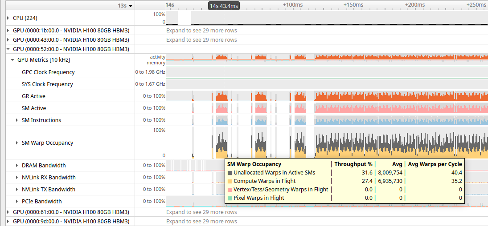

**图13：NVIDIA官方Nsight Systems GPU metrics时间线示例。** 原图出处：[Nsight Systems官方User Guide](https://docs.nvidia.com/nsight-systems/UserGuide/index.html)。

图是官方工具界面示例，并非本项目实测。它展示GPU指标与执行时间线可以在同一视图中关联；使用者应把观测接收、预处理、模型调用、动作解码和控制提交标记到相同时间轴上，区分“GPU忙”与“关键任务被等待”。GPU利用率高不等于动作新鲜度好，GPU利用率低也可能是CPU或同步在限制提交。[Nsight Systems官方User Guide](https://docs.nvidia.com/nsight-systems/UserGuide/index.html)

官方User Guide建议把采集范围聚焦于性能关键区域，避免无关启动阶段和过大数据量；NVTX可以增加应用区间标记，帮助把代码/阶段与GPU工作对应。对于GR00T，建议分别标记骨干、动作头和后处理，但完整调用时延仍应按部署指南的统一范围测量。对ROS/媒体链路还需把帧ID与采集时间关联，避免把处理完成时间误当传感器时间。[Nsight Systems官方User Guide](https://docs.nvidia.com/nsight-systems/UserGuide/index.html)；[GR00T官方部署与基准](https://raw.githubusercontent.com/NVIDIA/Isaac-GR00T/main/scripts/deployment/README.md)

### 15.3 kernel诊断与测量代价

Compute的指标采集可能通过replay多次执行kernel或应用以取得完整计数器，并会改变执行环境；它适合找GPU算子瓶颈，不应直接用profiling运行的时间代替正常闭环时延。访存、缓存、占用率与Roofline应结合kernel本身分析，高占用率并不必然代表最高性能。[Nsight Compute官方Profiling Guide](https://docs.nvidia.com/nsight-compute/ProfilingGuide/index.html)

Systems的trace和sampling同样存在采集开销，记录应保存工具版本、启用的trace/指标、采样与捕获范围。官方指南还要求导入GUI版本与CLI报告兼容。优化结束后应关闭高开销采集，在相同功耗模式、温度与输入负载下验证收益；报告中同时保留优化前后配置与原始样本，而不只保存一张截图。[Nsight Systems官方User Guide](https://docs.nvidia.com/nsight-systems/UserGuide/index.html)

### 15.4 建议交付物

性能分析应交付可打开的报告、采集命令/配置、输入与模型版本、功耗模式、瓶颈解释及优化前后结果。Nsight能解释计算行为，但不测任务成功率、动作安全性或外部总线认证。其价值是把“推理慢”细分成可定位原因，帮助决定优化kernel、修改数据布局、调整调度还是换平台。本轮只引用官方工具说明，未采集设备profiling报告。

## 16. TAO Toolkit：视觉模型后训练与优化工作流

### 16.1 训练工具与端侧SDK的关系

TAO负责训练、微调和优化视觉模型，端侧TensorRT/DeepStream等负责部署执行。当前Overview将TAO描述为基于TensorFlow和PyTorch的agent-based toolkit：模型、数据变换、平台与工作流发布为skill bank，由agent读取任务约定，通过TAO Execution SDK派发训练/评估工作。文档仍保留视觉任务和训练方法说明，不能把它简化成只运行一条历史CLI命令的旧工具。本文仅分析官方工作流，没有安装或运行TAO agent/skills。[TAO Toolkit 7.0.1官方Overview](https://docs.nvidia.com/tao/tao-toolkit/text/overview.html)

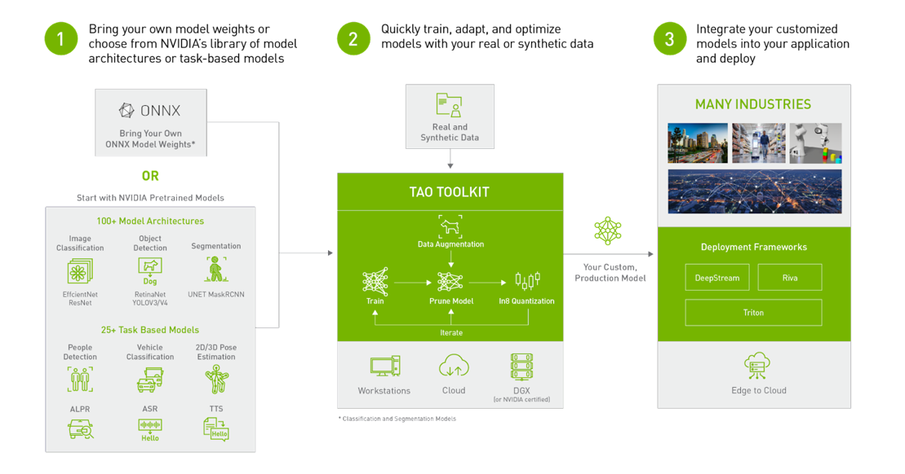

**图14：NVIDIA官方TAO模型训练、优化与部署工作流。** 原图出处：[TAO Toolkit 7.0.1官方Overview](https://docs.nvidia.com/tao/tao-toolkit/text/overview.html)。

原图展示预训练模型/自有模型与真实/合成数据进入TAO，训练、剪枝、量化后交给部署框架。图中的具体模型名和数量保留官方原图，部分为历史示例；当前模型能力以7.0.1正文目录为准。图的核心价值是分清训练优化与部署执行，而不是据旧图认定所有示例模型仍为本版推荐方案。[TAO Toolkit 7.0.1官方Overview](https://docs.nvidia.com/tao/tao-toolkit/text/overview.html)

### 16.2 支持任务与优化方法

| TAO能力 | 官方工作流 | 对具身感知的用途 |
|---|---|---|
| 任务微调 | 分类、检测、实例/语义分割、OCR、关键点、动作识别等 | 针对机器人相机与实际工作空间训练专用感知模型 |
| Foundation model适配 | 自监督预训练、域适配、embedding及视觉模型微调 | 将通用视觉特征适配到特定场景/目标分布 |
| 蒸馏与剪枝 | 将较大模型能力压缩到更小模型 | 在显存、功耗与任务精度之间选择部署模型 |
| 量化与导出 | QAT、QDQ ONNX及特定网络engine生成支持 | 保留精度验证，向TensorRT/DeepStream等部署层交付 |
| 执行与搜索 | Execution SDK、多后端及AutoML | 管理训练/评估任务，不替代数据标注和机器人闭环验证 |

表格依据当前Overview。7.0.1正文列Cosmos-Reason2.0 VLM的SFT/PEFT/AutoML及强化学习微调、额外CV网络的QDQ ONNX和INT8/FP8校准支持；具体模型支持按清单核对，不能推断任意网络均可同样优化。通用LLM训练另指向NeMo，TAO的VLM能力不代表取代所有语言模型训练工具。[TAO Toolkit 7.0.1官方Overview](https://docs.nvidia.com/tao/tao-toolkit/text/overview.html)

### 16.3 从数据集到端侧应用

典型路线是确定感知任务与目标指标，整理真实相机数据及标注，再选模型/训练方法、评估、导出ONNX，最后在目标设备构建与验证推理产物。训练和验证集应区分场景、光照、相机与目标分布；公开模型benchmark不能直接当成机器人工作空间的误检率。框架输出与ONNX/TensorRT输出比较只是第一步，最终还应测姿态/检测误差对定位、抓取或避障的影响。官方导出与部署能力支持这条路线，数据拆分及验收门槛属于分析建议。[TAO Toolkit 7.0.1官方Overview](https://docs.nvidia.com/tao/tao-toolkit/text/overview.html)

官方称6.0起TAO容器可在x86及ARM64配离散GPU平台运行，这不等于所有Jetson集成GPU都已获训练支持。量产项目通常将训练端与端侧部署端分开固定环境；多机调度、数据版本和实验记录由所用Execution SDK后端及工程流程管理。[TAO Toolkit 7.0.1官方Overview](https://docs.nvidia.com/tao/tao-toolkit/text/overview.html)

### 16.4 源码与商业使用

[TAO PyTorch官方仓库](https://github.com/NVIDIA/tao_pytorch_backend)官方仓库本轮为132 Stars，默认分支`main`，最近可见提交2026-10-16 22:17:12 UTC；代码Apache-2.0；原NVIDIA/tao_pytorch_backend入口已迁移至NVIDIA-TAO/tao-pytorch。[TAO PyTorch仓库元数据快照](https://api.github.com/repos/NVIDIA/tao_pytorch_backend)；[TAO PyTorch最近提交快照](https://api.github.com/repos/NVIDIA/tao_pytorch_backend/commits?per_page=1)；[TAO PyTorch代码许可](https://raw.githubusercontent.com/NVIDIA/tao_pytorch_backend/main/LICENSE)。TAO代码、容器、预训练权重及依赖分别核查许可。TAO更适合已能定义视觉任务且需要复用训练/优化方法的团队；它不会自动解决示教质量、本体动作映射或机器人功能安全问题。对于VLA动作模型，应同时评估GR00T的数据及策略工作流，避免把视觉检测模型微调当作全机器人技能训练。

## 17. NIM：模型专用推理微服务与云边接口

### 17.1 NIM和Triton的区别

NVIDIA NIM把模型、推理运行时与API包装成可部署微服务，官方定位为AI Enterprise体系的一部分。Triton是通用多后端模型服务器；NIM则提供面向模型的预配置组件和部署接口。本轮最新LLM/VLM Architecture明确：每个容器镜像只捆绑vLLM或SGLang其中一个引擎，拉取的镜像决定backend。当前Profile文档明确移除1.x的“TensorRT-LLM > vLLM > SGLang”自动后端优先链，不能继续把旧版机制当作当前默认。选择NIM可减少环境与服务配置工作，模型资源和通信成本仍需评估。[NVIDIA NIM文档入口](https://docs.nvidia.com/nim/index.html)；[NVIDIA NIM官方产品页](https://www.nvidia.com/en-us/ai-data-science/products/nim-microservices/)；[NIM LLM/VLM容器架构](https://docs.nvidia.com/nim/large-language-models/latest/reference/architecture.html)；[NIM模型profile选择与显存条件](https://docs.nvidia.com/nim/large-language-models/latest/deployment/model-profiles-and-selection.html)

| 服务组成 | 解决的问题 | 机器人侧需要补齐的接口 |
|---|---|---|
| 模型与配置 | 将模型及所需运行参数组织为服务 | 精确模型版本、任务能力与权重使用权限 |
| 优化运行时 | 选择适合GPU/模型的执行方案 | 明确GPU支持矩阵、显存和并发配置 |
| 标准服务API | 提供请求/响应式推理调用 | 任务context、观测时间、超时与返回结果解析 |
| 容器与缓存 | 分发应用及运行依赖，保存模型缓存 | 容器摘要、持久化空间、离线/重启流程 |
| 商业维护 | 产品页描述安全更新、API稳定性与支持 | 实际合同范围、SLA和目标平台支持责任 |

表格依据官方NIM产品页、文档入口和LLM Getting Started。NIM是一个产品集合，不能给所有模型列一个统一版本、显存下限或端点行为；部署应以对应模型手册和系统要求为准。[NVIDIA NIM文档入口](https://docs.nvidia.com/nim/index.html)；[NIM LLM官方部署指南](https://docs.nvidia.com/nim/large-language-models/latest/get-started/index.html)

### 17.2 容器架构、请求路径与健康状态

官方Architecture将容器划为两个受监控进程：nginx薄代理和推理backend。代理对外默认监听8000；引擎默认在loopback 8001运行，不对容器外暴露。代理处理路由、TLS和CORS，并区分容器活着与模型就绪。任一进程退出会关闭容器，由编排器重新调度；收到SIGTERM时先平稳停止引擎，再关闭代理。[NIM LLM/VLM容器架构](https://docs.nvidia.com/nim/large-language-models/latest/reference/architecture.html)

以下Mermaid代码摘录自已归档的官方Architecture“Components”图，保留原始节点、路由和连接；渲染样式可能随Markdown阅读器变化。

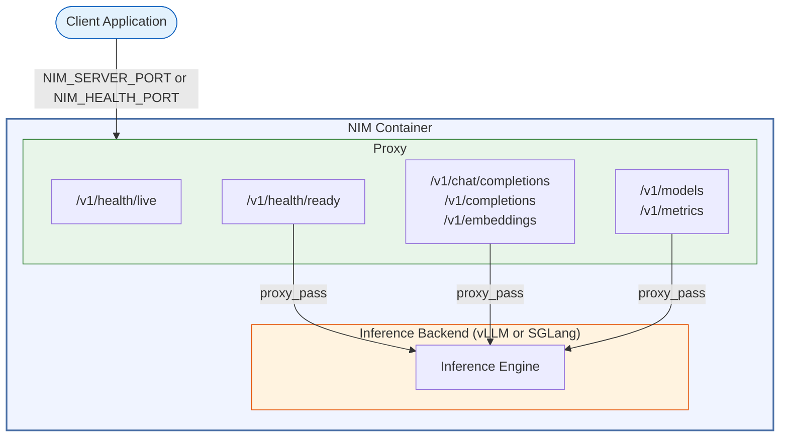

**官方图解：NIM容器组件与请求流。** 出处：[NIM LLM/VLM容器架构](https://docs.nvidia.com/nim/large-language-models/latest/reference/architecture.html)。`live`由代理直接回应；`ready`需要backend健康检查，模型加载期间可返回503，完成后才返回200。机器人应用不能以端口可连接或live成功作为模型可服务的判据。

| 服务面 | 官方接口/机制 | 集成时的用途 |
|---|---|---|
| 推理 | `/v1/chat/completions`、`/v1/completions`、`/v1/embeddings` | OpenAI兼容请求；具体模型仍需核对输入模态和API支持 |
| 生命周期 | `/v1/health/live`与`/v1/health/ready` | 分别判断容器存活与模型可服务；可用NIM_HEALTH_PORT另设健康监听 |
| 监控 | `/v1/metrics`、结构化日志、X-Request-Id/Traceparent转发 | 跟踪请求时延、吞吐和GPU使用，关联跨服务调用 |
| 外部访问 | 代理配置TLS/mTLS和CORS，其余未配置路径返回404 | 部署系统确定证书、允许路径和客户端访问策略 |

表格依据官方Architecture。该架构提供服务运维机制，仍需应用定义推理deadline、任务取消和动作授权；通用文本服务返回不能直接作为执行器命令。[NIM LLM/VLM容器架构](https://docs.nvidia.com/nim/large-language-models/latest/reference/architecture.html)

### 17.3 profile选择、缓存与可复现部署

model-specific容器携带model manifest，model-free容器在运行时生成通用profiles。profile标签包括引擎、精度、TP/PP及LoRA；启动只选择一个profile，它决定下载文件和backend启动配置。通过`list-model-profiles`取得完整64字符ID或完整描述，用`NIM_MODEL_PROFILE`固定选择；镜像版本改变后应重新核对ID。不能凭`vllm-bf16-tp1-pp1`的拼接规则猜出每个镜像的实际选择器。[NIM模型profile选择与显存条件](https://docs.nvidia.com/nim/large-language-models/latest/deployment/model-profiles-and-selection.html)

官方按weights、KV cache、activations与overhead估计VRAM，将profile分为compatible、low memory、incompatible。low memory表示权重能放下但完整上下文超预算，可尝试缩小`--max-model-len`，代价是限制输入加输出总token长度；incompatible可能连权重都无法放入。文档中的18/22/45 GB属于示例输出，不能作为全部NIM的统一显存要求。命令行、passthrough和环境配置还可覆盖profile参数，最终配置在模型下载前解析，因此应同时保存镜像摘要、profile ID、全部启动参数和硬件清单。[NIM模型profile选择与显存条件](https://docs.nvidia.com/nim/large-language-models/latest/deployment/model-profiles-and-selection.html)

启动顺序是代理监听、检测硬件并选profile、下载模型到`NIM_CACHE_PATH`、启动backend、模型加载完成后报告ready；已有缓存则跳过相应下载。持久化缓存可减少重启下载，但不等于所有权重、许可证和离线依赖已经齐备。Installation举例使用2.1.4镜像，并说明多数当前公共目录镜像支持免登录；PB、2.0.10之前版本及private/gated镜像或模型仍需认证，不能统一要求全部访问使用NGC凭据。本文只归档公开文档，未拉取容器或受限权重。[NIM LLM/VLM容器架构](https://docs.nvidia.com/nim/large-language-models/latest/reference/architecture.html)；[NIM LLM/VLM安装与镜像认证](https://docs.nvidia.com/nim/large-language-models/latest/get-started/installation.html)

### 17.4 云边协同、许可与适用边界

端点可部署在数据中心、云或受支持的本地平台；官方泛称cloud/data center不能转述为所有Jetson SKU均可本地运行。应以具体模型、镜像和GPU支持矩阵选择部署位置。[NVIDIA NIM官方产品页](https://www.nvidia.com/en-us/ai-data-science/products/nim-microservices/)；[NIM LLM官方部署指南](https://docs.nvidia.com/nim/large-language-models/latest/get-started/index.html)

在具身系统中，NIM可以承担语言理解、视觉语义查询或较慢的任务级推理，机器人端继续执行感知与动作闭环。请求应附带可追踪任务ID和观测上下文；网络中断、超时和过期响应需要机器人应用定义处理方式。云边分工的目标是匹配模型资源和时间预算，是否适用取决于带宽、隐私、延迟与任务容错，不应只依据服务API可调用作结论。

NIM服务接口与开放模型权重是不同层面的开放性，AI Enterprise支持与各模型许可也分别管理。公开API试用、下载容器、读取私有权重和生产商业支持的授权可能不同，本轮未登录、下载受限模型或调用收费API。报价、特定模型在目标Jetson上的支持与生产SLA若未取得相应公开文件，标为[公开资料未披露]，不据通用产品页推定。[NVIDIA NIM文档入口](https://docs.nvidia.com/nim/index.html)；[NVIDIA NIM官方产品页](https://www.nvidia.com/en-us/ai-data-science/products/nim-microservices/)

NIM适合希望将模型能力作为可维护服务接入的团队；若需求是低时延单机VLA策略，直接使用GR00T/TensorRT路径可能更直接；若需托管多个自有模型并管理调度，则应比较Triton的控制粒度。三者可以协作，选型应围绕模型、接口和部署责任划分。

## 18. Isaac Sim与Isaac Lab：开发、训练和真实机器人软件对接

### 18.1 两个软件项目的分工

Isaac Sim提供机器人仿真、场景、传感器与ROS接入环境；Isaac Lab提供机器人学习环境及强化/模仿学习等工作流。它们属于开发/训练侧软件，部署策略时仍需GR00T/推理运行时、ROS接口和本体驱动。仿真详细物理精度与Sim-to-Real评估放在后续《NVIDIA—仿真环境》报告，本节先明确软件接口和版本关系。[Isaac Sim官方文档首页](https://docs.isaacsim.omniverse.nvidia.com/latest/index.html)；[GitHub IsaacLab README](https://raw.githubusercontent.com/isaac-sim/IsaacLab/main/README.md)

| 软件/接口 | 软件栈职责 | 需要固定的兼容条件 |
|---|---|---|
| Isaac Sim | 构建场景、本体、虚拟传感器和仿真应用 | Sim版本、扩展、USD资产、GPU/驱动与系统要求 |
| Isaac Lab | 组织学习任务、观测、奖励及训练/评估流程 | Lab版本、选定backend和训练库；并非所有工作流强制依赖Sim |
| ROS 2 Bridge | 连接仿真消息与ROS应用 | ROS发行版、bridge支持、消息/QoS、仿真时间与坐标系 |
| 策略/模型交付 | 将训练产物接入真实机器人执行层 | 观测/动作配置、归一化、模型版本和控制频率 |

表格按官方Sim文档、ROS桥接与Lab README归纳。模拟相机输出和真实相机应保持格式、坐标、时间语义及前处理一致；仿真时钟和wall clock不同，不能把模拟消息直接拿去与实机系统时间相减。[Isaac Sim ROS2 Bridge](https://docs.isaacsim.omniverse.nvidia.com/latest/ros2_tutorials/index.html)；[GitHub IsaacLab README](https://raw.githubusercontent.com/isaac-sim/IsaacLab/main/README.md)

### 18.2 当前Lab多后端与版本关系

当前Lab README为3.0.0，支持Newton、OVRTX、OVPhysX和Isaac Sim等backend；main/release3.0.0对应Sim6.2，3.0.0EA对应6.1，beta2对应6.0，较早2.3X支持4.5/5.0/5.1。这里的对应关系用于需要Sim的工作流，不代表全部backend具有完全相同的传感器、渲染或任务支持。不同backend应按官方安装路线选择并保存配置。[GitHub IsaacLab README](https://raw.githubusercontent.com/isaac-sim/IsaacLab/main/README.md)；[Isaac Lab当前安装与后端选择指南](https://isaac-sim.github.io/IsaacLab/main/source/isaaclab/installation.html)

Isaac ROS当前Getting Started中的若干Sim示例说明最后验证为Sim6.0，并兼容5.0/5.1；这与Lab3.0的6.2组合是不同文档/工作流范围。项目应选择一组具体教程和版本验证，避免把最新Lab、最新Sim和任意ROS桥接拼成未经验证的组合。[Isaac ROS官方安装与支持矩阵](https://nvidia-isaac-ros.github.io/getting_started/index.html)；[GitHub IsaacLab README](https://raw.githubusercontent.com/isaac-sim/IsaacLab/main/README.md)

### 18.3 安装结构、容器与执行环境

当前安装指南提供uv、Python package、源码和容器等路线，容器的base与kitless是两种实质不同的依赖组合。base继承Isaac Sim容器、Kit、RTX渲染及资产pipeline；kitless基于Ubuntu24.04/Python3.12，带Newton、OVPhysX、OVRTX和RL库，明确不包含Isaac Sim。物理backend、可视化器、Python环境和资产依赖因此必须分别记录，不能仅用“安装Isaac Lab”表达完整环境。[Isaac Lab当前安装与后端选择指南](https://isaac-sim.github.io/IsaacLab/main/source/isaaclab/installation.html)

| 官方安装组合 | 执行/渲染依赖 | 需要注意的条件 |
|---|---|---|
| base容器 | Isaac Sim、Kit、RTX及Sim资产pipeline | 固定ISAACSIM_VERSION及uv.lock；缓存和结果卷随生命周期管理 |
| kitless容器 | Newton/OVPhysX、OVRTX及RL Games、RSL-RL、SB3、SKRL | 无Kit visualizer，可选择GL、RTX或浏览器可视化；并非无GPU需求 |
| 直接容器运行 | 3.0.0或3.0.0-kitless等明确tag | uid/gid1000的写权限、GPU/graphics能力、checkpoint和日志持久化 |

表格整理官方安装指南。当前容器Python环境位于`/opt/isaaclab-venv`；基于Sim的镜像仍通过`_isaac_sim`连接外部Sim安装。无visualizer时训练可headless；需要GL/RTX时还要提供graphics driver能力，不能以CUDA计算可用推定显示/渲染可用。官方已将旧安装路径声明迁移到新安装页，本报告引用取得正文的新路径。[Isaac Lab当前安装与后端选择指南](https://isaac-sim.github.io/IsaacLab/main/source/isaaclab/installation.html)

### 18.4 本体学习与软件交付

Lab的观测、动作和环境配置应随策略发布：关节顺序、动作缩放、执行步长与传感器输入一旦改变，即使权重相同也可能产生不同本体行为。学习任务可使用虚拟图像/深度、IMU、contact或raycaster等数据，但真实机器人观测的噪声、延迟和缺失必须在部署侧处理。软件接口一致是迁移前提，不能单独证明仿真训练已达到实机交付要求。[GitHub IsaacLab README](https://raw.githubusercontent.com/isaac-sim/IsaacLab/main/README.md)

官方仓库入口为[GitHub IsaacLab Page](https://github.com/isaac-sim/IsaacLab)和[GitHub IsaacSim Page](https://github.com/isaac-sim/IsaacSim)；本轮复用已核验的仓库记录，Lab为8,556 Stars，Sim为4,419 Stars，main分支最近提交分别为2026-11-03 05:08:05 UTC和2026-09-10 02:15:24 UTC。Lab主框架BSD-3-Clause，isaaclab_mimic采用Apache-2.0；Sim仓库代码为Apache-2.0，LICENSE明确构建/使用所需Omniverse Kit SDK、3D模型与纹理等附加组件使用其他条款，开源依赖也分别许可。不能把仓库开放解释为全部依赖可任意再分发。[GitHub IsaacLab README](https://raw.githubusercontent.com/isaac-sim/IsaacLab/main/README.md)；[Isaac Lab官方代码许可](https://raw.githubusercontent.com/isaac-sim/IsaacLab/main/LICENSE)；[Isaac Sim官方代码及附加组件许可](https://raw.githubusercontent.com/isaac-sim/IsaacSim/main/LICENSE)；[GitHub IsaacSim README](https://raw.githubusercontent.com/isaac-sim/IsaacSim/main/README.md)

## 19. 集成路线：从原型到可维护部署

| 阶段 | 应形成的交付物 | 建议验收项目 | 失败后的处理 |
|---|---|---|---|
| 版本冻结 | 模组/载板编号、BSP、SDK、ROS分支、容器摘要、依赖锁文件 | 能从空白设备重复安装；版本差异可解释 | 回到已验证组合，不追随浮动latest |
| 驱动与时间链 | 设备树/配置、相机标定、总线配置、时间源说明 | 所有传感器可录制、回放、对齐；故障可诊断 | 先分离驱动和同步问题，再调整模型 |
| 推理验证 | ONNX与engine、预处理、精度回归集、构建日志 | 输出一致性、显存峰值、冷热启动与长时间稳定性 | 重新构建或回退精度，不用峰值TOPS解释失败 |
| 机器人集成 | ROS图、动作适配、看门狗、超时与回滚流程 | 全链路延迟分布、丢帧、过期动作拒绝和热稳定性 | 降级动作能力并进入可定义的安全状态 |
| 现场维护 | 日志/指标、软件清单、更新与回滚包 | 断网、更新中断、模型失败、配置错误可恢复 | 保留上一已验证版本和恢复介质 |

以上是本报告建议的验证顺序，未宣称已经执行。Triton提供模型管理和指标，Jetson Linux提供刷机、安全与OTA工具；现场日志口径、数据治理、灰度策略、回滚触发和责任边界仍由系统工程补齐。容器只是部分用户态软件的封装，无法替代宿主BSP、相机固件和电机控制器版本管理。[Triton官方README](https://raw.githubusercontent.com/triton-inference-server/server/main/README.md)；[JetPack官方软件架构](https://developer.nvidia.com/embedded/jetpack)

### 19.1 工业总线与底层驱动的责任边界

| 接口或路径 | 平台公开支持的内容 | 集成商仍需完成的工作 | 主要错误推断 | 依据 |
|---|---|---|---|---|
| MIPI CSI/GMSL/CoE | R39.2.1相机指南将SIPL列为从Thor开始的主要软件路径；Argus仍维护 | 对照相机支持矩阵选择框架，完成解串器、传感器驱动、配置、ISP标定和触发验证 | 有CSI硬件就等于SIPL已支持MIPI或任意GMSL相机即插即用 | [Jetson Camera 39 2 1](https://docs.nvidia.com/jetson/archives/r39.2.1/DeveloperGuide/SD/CameraDevelopment.html) |
| PCIe | 模组提供高速扩展能力 | 载板走线、供电、链路训练、驱动、DMA与IOMMU验证 | 插入PCIe卡就自动具备低时延和零复制 | [Jetson Thor官方规格](https://www.nvidia.com/en-us/autonomous-machines/embedded-systems/jetson-thor/) |
| CAN/CAN-FD | Jetson文档提供控制器、驱动与配置路径 | 收发器、终端电阻、线束、速率、仲裁负载和故障恢复 | 有CAN控制器就完成电机闭环与安全协议 | [Jetson CAN R38 2](https://docs.nvidia.com/jetson/archives/r38.2/DeveloperGuide/HR/ControllerAreaNetworkCan.html) |
| 以太网/EtherCAT | 可提供网络传输和扩展网卡基础 | 主站软件、网卡适配、实时调度、从站状态机和周期抖动测试 | 标准以太网口等于已认证EtherCAT主站 | [Jetson Thor官方规格](https://www.nvidia.com/en-us/autonomous-machines/embedded-systems/jetson-thor/)；[Jetson Real Time R38 2](https://docs.nvidia.com/jetson/archives/r38.2/DeveloperGuide/SD/Kernel/RealTimeKernel.html) |
| GPU传感器桥接 | Holoscan Sensor Bridge以FPGA、UDP及特定接收设备组成低时延路径 | 选择兼容桥接板、NIC/GPU路径与对应软件配置 | 所有以太网口都能直接写GPU显存 | [Holoscan Sensor Bridge README](https://raw.githubusercontent.com/nvidia-holoscan/holoscan-sensor-bridge/main/README.md) |

EtherCAT具体主站授权、可用网卡组合、工业网络最坏情况抖动和安全现场总线认证，[公开资料未披露]：本轮没有取得覆盖全部Jetson载板的NVIDIA统一认证矩阵。可以论证接入路径，但不能把第三方产品的承诺移植成芯片厂商保证。实时内核文档可以作为配置依据，其适用BSP版本必须与部署版本核对。[Jetson Real Time R38 2](https://docs.nvidia.com/jetson/archives/r38.2/DeveloperGuide/SD/Kernel/RealTimeKernel.html)

## 20. 软件采购与许可汇总

| 对象 | 本轮可核验许可 | 工程含义 | 原文 |
|---|---|---|---|
| Isaac ROS Common当前根LICENSE | NVIDIA ISAAC ROS SOFTWARE LICENSE；GitHub API标识NOASSERTION | 非Apache-2.0；条款限定NVIDIA GPU系统等使用与分发条件；各组件需逐项核查 | [Isaac ROS当前软件许可](https://raw.githubusercontent.com/NVIDIA-ISAAC-ROS/isaac_ros_common/main/LICENSE)；[Isaac ROS Repo Metadata](https://api.github.com/repos/NVIDIA-ISAAC-ROS/isaac_ros_common) |
| GR00T当前仓库 | 代码Apache-2.0；README称N1.7可商用 | 仍需核对Cosmos-Reason2骨干、模型访问许可和第三方依赖 | [GR00T License](https://raw.githubusercontent.com/NVIDIA/Isaac-GR00T/main/LICENSE)；[GR00T N1.7官方README](https://raw.githubusercontent.com/NVIDIA/Isaac-GR00T/main/README.md) |
| Triton Inference Server | BSD-3-Clause | 开源服务器许可不自动覆盖其所有后端、模型或AI Enterprise支持合同 | [Triton License](https://raw.githubusercontent.com/triton-inference-server/server/main/LICENSE)；[Triton官方README](https://raw.githubusercontent.com/triton-inference-server/server/main/README.md) |
| Holoscan SDK仓库 | Apache-2.0代码许可 | 外部operators、模型及运行依赖另核 | [Holoscan SDK代码许可](https://raw.githubusercontent.com/nvidia-holoscan/holoscan-sdk/main/LICENSE.txt) |
| cuDNN frontend | 主要Apache-2.0，部分MIT | 不等同于cuDNN库二进制许可 | [cuDNN frontend Apache-2.0许可](https://raw.githubusercontent.com/NVIDIA/cudnn-frontend/develop/LICENSE.txt)；[cuDNN frontend保留MIT许可](https://raw.githubusercontent.com/NVIDIA/cudnn-frontend/develop/LICENSE-MIT.txt)；[cuDNN frontend逐文件许可清单](https://raw.githubusercontent.com/NVIDIA/cudnn-frontend/develop/LICENSING.md) |
| PVA Solutions | Apache-2.0代码许可 | 不覆盖PVA SDK二进制及硬件 | [PVA Solutions代码许可](https://raw.githubusercontent.com/NVIDIA/pva-solutions/main/LICENSE) |
| TAO PyTorch仓库 | Apache-2.0代码许可 | 权重、容器、第三方组件另核 | [TAO PyTorch代码许可](https://raw.githubusercontent.com/NVIDIA/tao_pytorch_backend/main/LICENSE) |
| JetPack/BSP及SDK二进制 | 下载页及BSP官方许可条款 | 固件、驱动、SDK、样例和第三方库不能统一假定为开源 | [JetPack官方下载与版本矩阵](https://developer.nvidia.com/embedded/jetpack/downloads)；[Jetson Linux 39 2 1 License](https://developer.nvidia.com/downloads/embedded/L4T/r39_Release_v2.1/release/Tegra_Software_License_Agreement-Tegra-Linux.txt) |

软件采购不能只比较“是否能免费下载”。对于量产系统，应把再分发权限、可取得的源代码、第三方组件、更新承诺、商业支持SLA和故障责任写入物料及软件清单。Isaac ROS LICENSE还提示软件并非面向所有危险系统用途经过测试或认证；它和实机安全设计之间存在明确边界。[Isaac ROS当前软件许可](https://raw.githubusercontent.com/NVIDIA-ISAAC-ROS/isaac_ros_common/main/LICENSE)

## 参考资料与本地原文

本报告依据截至2026年11月3日取得的官方网页、代码仓库、API和文档。资料由统一下载工具归档到本项目的reference_metrial；多个方向共享同一URL的已校验文件。网页保留HTML和依赖，部分资源受robots规则、失效链接或动态交互限制影响时，按metadata如实标明。采集时点、版本和原始响应哈希可在各资料目录内核对。

| 官方资料 | 原始URL | 本地原文 | 归档情况 |
|---|---|---|---|
| NVIDIA_JetPack_Downloads | [官方原文](https://developer.nvidia.com/embedded/jetpack/downloads) | [index.html](REFERENCES.md#ref-a226cd46c59f27f9) | 静态呈现依赖部分缺失；见metadata |
| NVIDIA_JetPack_6_2_1_Release_Notes | [官方原文](https://docs.nvidia.com/jetson/jetpack/release-notes/index.html) | [index.html](REFERENCES.md#ref-f5175eac6bc8c035) | 静态HTML依赖完整；动态功能另验 |
| NVIDIA_Isaac_ROS_Getting_Started | [官方原文](https://nvidia-isaac-ros.github.io/getting_started/index.html) | [index.html](REFERENCES.md#ref-c092d317bfdef4e3) | 静态呈现依赖部分缺失；见metadata |
| NVIDIA_TensorRT_Support_Matrix | [官方原文](https://docs.nvidia.com/deeplearning/tensorrt/latest/getting-started/support-matrix.html) | [index.html](REFERENCES.md#ref-3b68f26af8646cbc) | 静态HTML依赖完整；动态功能另验 |
| NVIDIA_TensorRT_DLA_Guide | [官方原文](https://docs.nvidia.com/deeplearning/tensorrt/latest/inference-library/work-with-dla.html) | [index.html](REFERENCES.md#ref-d4687ea524938508) | 静态HTML依赖完整；动态功能另验 |
| NVIDIA_Jetson_Linux_39_2_1_Guide | [官方原文](https://docs.nvidia.com/jetson/archives/r39.2.1/DeveloperGuide/) | [index.html](REFERENCES.md#ref-a211d76fdfabf28d) | 静态HTML依赖完整；动态功能另验 |
| NVIDIA_JetPack_Page | [官方原文](https://developer.nvidia.com/embedded/jetpack) | [index.html](REFERENCES.md#ref-c9b618c904201b47) | 静态呈现依赖部分缺失；见metadata |
| NVIDIA_02_BSP_UPDATE | [官方原文](https://docs.nvidia.com/jetson/archives/r39.2.1/DeveloperGuide/SD/SoftwarePackagesAndTheUpdateMechanism.html) | [index.html](REFERENCES.md#ref-fe91dd3e519be888) | 静态HTML依赖完整；动态功能另验 |
| NVIDIA_Jetson_Linux_39_2_1_Release_PDF | [官方原文](https://docs.nvidia.com/jetson/archives/r39.2.1/ReleaseNotes/Jetson_Linux_Release_Notes_r39.2.1.pdf) | [document.pdf](REFERENCES.md#ref-d5e88c873a53986f) | 原件已归档 |
| NVIDIA_Jetson_Linux_39_2_1_License | [官方原文](https://developer.nvidia.com/downloads/embedded/L4T/r39_Release_v2.1/release/Tegra_Software_License_Agreement-Tegra-Linux.txt) | [content.txt](REFERENCES.md#ref-5394e70b58c257fd) | 原件已归档 |
| NVIDIA_02_CUDA_DOC | [官方原文](https://docs.nvidia.com/cuda/cuda-c-programming-guide/index.html) | [index.html](REFERENCES.md#ref-7eeb08d065fc6ce9) | 静态HTML依赖完整；动态功能另验 |
| NVIDIA_02_CUDA_MODEL | [官方原文](https://docs.nvidia.com/cuda/cuda-programming-guide/01-introduction/programming-model.html) | [index.html](REFERENCES.md#ref-ff852ad994d3a602) | 静态HTML依赖完整；动态功能另验 |
| NVIDIA_02_CUDA_ASYNC | [官方原文](https://docs.nvidia.com/cuda/cuda-programming-guide/02-basics/asynchronous-execution.html) | [index.html](REFERENCES.md#ref-106fd52933b5f86f) | 静态HTML依赖完整；动态功能另验 |
| NVIDIA_02_CUDA_GRAPH | [官方原文](https://docs.nvidia.com/cuda/cuda-programming-guide/04-special-topics/cuda-graphs.html) | [index.html](REFERENCES.md#ref-64fc09301027cc35) | 静态HTML依赖完整；动态功能另验 |
| NVIDIA_02_CUDA_MEMORY | [官方原文](https://docs.nvidia.com/cuda/cuda-programming-guide/02-basics/understanding-memory.html) | [index.html](REFERENCES.md#ref-453cf4bfa7cf193e) | 静态HTML依赖完整；动态功能另验 |
| NVIDIA_02_CUDA_NVCC | [官方原文](https://docs.nvidia.com/cuda/cuda-programming-guide/02-basics/nvcc.html) | [index.html](REFERENCES.md#ref-2f7a1c7ecbe30210) | 静态HTML依赖完整；动态功能另验 |
| NVIDIA_02_CUDA_PDF | [官方原文](https://docs.nvidia.com/cuda/cuda-programming-guide/pdf/cuda-programming-guide.pdf) | [document.pdf](REFERENCES.md#ref-1a61af1ce592884e) | 原件已归档 |
| NVIDIA_02_CUDNN_PAGE | [官方原文](https://developer.nvidia.com/cudnn) | [index.html](REFERENCES.md#ref-7625f316aa980e4e) | 静态呈现依赖部分缺失；见metadata |
| NVIDIA_02_CUDNN_GRAPH | [官方原文](https://docs.nvidia.com/deeplearning/cudnn/backend/latest/developer/graph-api.html) | [index.html](REFERENCES.md#ref-e8f79ff0d7d9f726) | 静态HTML依赖完整；动态功能另验 |
| NVIDIA_02_CUDNN_ROOT | [官方原文](https://docs.nvidia.com/deeplearning/cudnn/backend/latest/index.html) | [index.html](REFERENCES.md#ref-c78062cc8790e7e5) | 静态HTML依赖完整；动态功能另验 |
| NVIDIA_02_CUDNN_FRONT | [官方原文](https://docs.nvidia.com/deeplearning/cudnn/frontend/latest/index.html) | [index.html](REFERENCES.md#ref-7a341bb6802befa9) | 静态呈现依赖部分缺失；见metadata |
| NVIDIA_02_CUDNN_OVERVIEW | [官方原文](https://docs.nvidia.com/deeplearning/cudnn/backend/latest/developer/overview.html) | [index.html](REFERENCES.md#ref-bd9ad2eb6ef1d8a4) | 静态HTML依赖完整；动态功能另验 |
| NVIDIA_02_CUDNN_REPO_PAGE | [官方原文](https://github.com/NVIDIA/cudnn-frontend) | [index.html](REFERENCES.md#ref-a0e3a8b3f89d5c03) | 静态呈现依赖部分缺失；见metadata |
| NVIDIA_02_CUDNN_REPO_META | [官方原文](https://api.github.com/repos/NVIDIA/cudnn-frontend) | [content.json](REFERENCES.md#ref-01f720feb6426cea) | 原件已归档 |
| NVIDIA_02_CUDNN_REPO_COMMIT | [官方原文](https://api.github.com/repos/NVIDIA/cudnn-frontend/commits?per_page=1) | [content.json](REFERENCES.md#ref-4d40fd5b2dcb778d) | 原件已归档 |
| NVIDIA_02_CUDNN_LICENSE2 | [官方原文](https://raw.githubusercontent.com/NVIDIA/cudnn-frontend/develop/LICENSE.txt) | [content.txt](REFERENCES.md#ref-605a4792fe4a04ce) | 原件已归档 |
| NVIDIA_02_CUDNN_LICENSE_MIT | [官方原文](https://raw.githubusercontent.com/NVIDIA/cudnn-frontend/develop/LICENSE-MIT.txt) | [content.txt](REFERENCES.md#ref-32e5217c69e21b3e) | 原件已归档 |
| NVIDIA_02_CUDNN_LICENSE_THIRD | [官方原文](https://raw.githubusercontent.com/NVIDIA/cudnn-frontend/develop/THIRD_PARTY_LICENSES.txt) | [content.txt](REFERENCES.md#ref-8f4155d91fce8318) | 原件已归档 |
| NVIDIA_02_CUDNN_LICENSING | [官方原文](https://raw.githubusercontent.com/NVIDIA/cudnn-frontend/develop/LICENSING.md) | [content.md](REFERENCES.md#ref-7f592dcd10398b0a) | 原件已归档 |
| NVIDIA_02_TRT_WORK | [官方原文](https://docs.nvidia.com/deeplearning/tensorrt/latest/architecture/how-trt-works.html) | [index.html](REFERENCES.md#ref-9df325c2c44e3de5) | 静态HTML依赖完整；动态功能另验 |
| NVIDIA_02_TRT_ARCH | [官方原文](https://docs.nvidia.com/deeplearning/tensorrt/latest/architecture/architecture-overview.html) | [index.html](REFERENCES.md#ref-d4c513c2460d0b2a) | 静态HTML依赖完整；动态功能另验 |
| NVIDIA_GR00T_Deployment_Guide | [官方原文](https://raw.githubusercontent.com/NVIDIA/Isaac-GR00T/main/scripts/deployment/README.md) | [content.md](REFERENCES.md#ref-af6435cdb176784f) | 原件已归档 |
| NVIDIA_Product_Page_Jetson_Orin | [官方原文](https://www.nvidia.com/en-us/autonomous-machines/embedded-systems/jetson-orin/) | [index.html](REFERENCES.md#ref-822deacef0f6253c) | 静态呈现依赖部分缺失；见metadata |
| NVIDIA_02_VPI_ROOT | [官方原文](https://docs.nvidia.com/vpi/index.html) | [index.html](REFERENCES.md#ref-eaae6e470379dc47) | 静态呈现依赖部分缺失；见metadata |
| NVIDIA_02_VPI_KLT | [官方原文](https://docs.nvidia.com/vpi/algo_klt_tracker.html) | [index.html](REFERENCES.md#ref-602ab2cc034ea771) | 静态呈现依赖部分缺失；见metadata |
| NVIDIA_02_VPI_CONCEPT | [官方原文](https://docs.nvidia.com/vpi/basic_concepts.html) | [index.html](REFERENCES.md#ref-72830911d3af4db9) | 静态呈现依赖部分缺失；见metadata |
| NVIDIA_02_PVA_PAGE | [官方原文](https://developer.nvidia.com/embedded/pva) | [index.html](REFERENCES.md#ref-3b984e4088803392) | 静态呈现依赖部分缺失；见metadata |
| NVIDIA_02_PVA_ARCH2 | [官方原文](https://docs.nvidia.com/pva/sdk/2.10.1/architecture.html) | [index.html](REFERENCES.md#ref-782050b23c55b756) | 静态HTML依赖完整；动态功能另验 |
| NVIDIA_02_PVA_REPO_PAGE | [官方原文](https://github.com/NVIDIA/pva-solutions) | [index.html](REFERENCES.md#ref-9809be08f7688b89) | 静态呈现依赖部分缺失；见metadata |
| NVIDIA_02_PVA_REPO_META | [官方原文](https://api.github.com/repos/NVIDIA/pva-solutions) | [content.json](REFERENCES.md#ref-e98dd1ffe1d8229e) | 原件已归档 |
| NVIDIA_02_PVA_REPO_COMMIT | [官方原文](https://api.github.com/repos/NVIDIA/pva-solutions/commits?per_page=1) | [content.json](REFERENCES.md#ref-991400ac2671bab3) | 原件已归档 |
| NVIDIA_02_PVA_REPO_LICENSE | [官方原文](https://raw.githubusercontent.com/NVIDIA/pva-solutions/main/LICENSE) | [content.txt](REFERENCES.md#ref-78d42f8f27b4b50d) | 原件已归档 |
| NVIDIA_02_MEDIA_DOC | [官方原文](https://docs.nvidia.com/jetson/archives/r39.2.1/DeveloperGuide/SD/Multimedia.html) | [index.html](REFERENCES.md#ref-9fff2d0a0e856f14) | 静态HTML依赖完整；动态功能另验 |
| NVIDIA_02_MEDIA_API | [官方原文](https://docs.nvidia.com/jetson/archives/r39.2.1/DeveloperGuide/SD/Multimedia/MultimediaApis.html) | [index.html](REFERENCES.md#ref-e50854c0a2744931) | 静态HTML依赖完整；动态功能另验 |
| NVIDIA_Jetson_Camera_39_2_1 | [官方原文](https://docs.nvidia.com/jetson/archives/r39.2.1/DeveloperGuide/SD/CameraDevelopment.html) | [index.html](REFERENCES.md#ref-13c18032443e1bc6) | 静态HTML依赖完整；动态功能另验 |
| NVIDIA_02_SIPL_INTRO | [官方原文](https://docs.nvidia.com/jetson/archives/r39.2.1/DeveloperGuide/SD/CameraDevelopment/SIPLFramework/Introduction-to-SIPL.html) | [index.html](REFERENCES.md#ref-2f382526ca7c9874) | 静态HTML依赖完整；动态功能另验 |
| NVIDIA_02_SIPL_GMSL | [官方原文](https://docs.nvidia.com/jetson/archives/r39.2.1/DeveloperGuide/SD/CameraDevelopment/SIPLFramework/SIPL-for-L4T/GMSL/GMSL-Architecture-Overview.html) | [index.html](REFERENCES.md#ref-80e532a3b27ad850) | 静态HTML依赖完整；动态功能另验 |
| NVIDIA_02_SIPL_COE | [官方原文](https://docs.nvidia.com/jetson/archives/r39.2.1/DeveloperGuide/SD/CameraDevelopment/SIPLFramework/SIPL-for-L4T/CoE/CoE-Solution-Overview.html) | [index.html](REFERENCES.md#ref-acc0a9a82b614a53) | 静态HTML依赖完整；动态功能另验 |
| NVIDIA_02_DEEP_DOC | [官方原文](https://docs.nvidia.com/metropolis/deepstream/dev-guide/text/DS_Overview.html) | [index.html](REFERENCES.md#ref-67e9bd6641c6aed0) | 静态呈现依赖部分缺失；见metadata |
| NVIDIA_Product_Page_Jetson_Thor | [官方原文](https://www.nvidia.com/en-us/autonomous-machines/embedded-systems/jetson-thor/) | [index.html](REFERENCES.md#ref-91025a9bef10dc0b) | 静态呈现依赖部分缺失；见metadata |
| NVIDIA_02_HOLO_ROOT | [官方原文](https://docs.nvidia.com/holoscan/sdk-user-guide/index.html) | [index.html](REFERENCES.md#ref-7e4643ecc971487d) | 静态呈现依赖部分缺失；见metadata |
| NVIDIA_02_HOLO4_OVERVIEW | [官方原文](https://docs.nvidia.com/holoscan/sdk-user-guide/4-4/introduction/overview) | [index.html](REFERENCES.md#ref-aa022f9792ee3578) | 静态呈现依赖部分缺失；见metadata |
| NVIDIA_02_HOLO_CORE2 | [官方原文](https://docs.nvidia.com/holoscan/sdk-user-guide/holoscan_core.html) | [index.html](REFERENCES.md#ref-ddb5a3e25ad9990f) | 静态呈现依赖部分缺失；见metadata |
| NVIDIA_02_HOLO_REPO | [官方原文](https://github.com/nvidia-holoscan/holoscan-sdk) | [index.html](REFERENCES.md#ref-665940ea12ae5ce0) | 静态呈现依赖部分缺失；见metadata |
| NVIDIA_02_HOLO_META | [官方原文](https://api.github.com/repos/nvidia-holoscan/holoscan-sdk) | [content.json](REFERENCES.md#ref-83df88b19e98342b) | 原件已归档 |
| NVIDIA_02_HOLO_COMMIT | [官方原文](https://api.github.com/repos/nvidia-holoscan/holoscan-sdk/commits?per_page=1) | [content.json](REFERENCES.md#ref-42a864a56b782146) | 原件已归档 |
| NVIDIA_02_HOLO_LICENSE | [官方原文](https://raw.githubusercontent.com/nvidia-holoscan/holoscan-sdk/main/LICENSE.txt) | [content.txt](REFERENCES.md#ref-58765625b3ab6946) | 原件已归档 |
| NVIDIA_02_HSB_ARCH | [官方原文](https://docs.nvidia.com/holoscan/sensor-bridge/2-7-latest/applications/architecture) | [index.html](REFERENCES.md#ref-766974539088b048) | 静态呈现依赖部分缺失；见metadata |
| NVIDIA_Holoscan_Sensor_Bridge_README | [官方原文](https://raw.githubusercontent.com/nvidia-holoscan/holoscan-sensor-bridge/main/README.md) | [content.md](REFERENCES.md#ref-3d0745b7083598e8) | 原件已归档 |
| NVIDIA_Holoscan_Bridge_Documentation | [官方原文](https://docs.nvidia.com/holoscan/sensor-bridge/latest/index.html) | [index.html](REFERENCES.md#ref-fdb0db44e147be8d) | 静态呈现依赖部分缺失；见metadata |
| NVIDIA_Holoscan_Bridge_Project_Page | [官方原文](https://github.com/nvidia-holoscan/holoscan-sensor-bridge) | [index.html](REFERENCES.md#ref-515abb6e30e693e2) | 静态呈现依赖部分缺失；见metadata |
| NVIDIA_Holoscan_Bridge_Repo_Metadata | [官方原文](https://api.github.com/repos/nvidia-holoscan/holoscan-sensor-bridge) | [content.json](REFERENCES.md#ref-af81eafcba2067f9) | 原件已归档 |
| NVIDIA_Holoscan_Bridge_Recent_Commit | [官方原文](https://api.github.com/repos/nvidia-holoscan/holoscan-sensor-bridge/commits?per_page=1) | [content.json](REFERENCES.md#ref-5a55651853b14522) | 原件已归档 |
| NVIDIA_Isaac_ROS_Repositories | [官方原文](https://nvidia-isaac-ros.github.io/repositories_and_packages/index.html) | [index.html](REFERENCES.md#ref-d5ea3ee4bf4f18d3) | 静态呈现依赖部分缺失；见metadata |
| NVIDIA_Isaac_ROS_Deploy_Concept | [官方原文](https://nvidia-isaac-ros.github.io/repositories_and_packages/isaac_ros_deploy/concepts/how_it_works.html) | [index.html](REFERENCES.md#ref-48a6c8b0b3bbace0) | 静态呈现依赖部分缺失；见metadata |
| NVIDIA_Isaac_ROS_Buffer_Migration | [官方原文](https://nvidia-isaac-ros.github.io/concepts/rosidl_buffer/nitros_migration.html) | [index.html](REFERENCES.md#ref-a74b452c91c23559) | 静态呈现依赖部分缺失；见metadata |
| NVIDIA_02_BUFFER_DOC | [官方原文](https://nvidia-isaac-ros.github.io/concepts/rosidl_buffer/index.html) | [index.html](REFERENCES.md#ref-e9167f78686d3ef7) | 静态呈现依赖部分缺失；见metadata |
| NVIDIA_Isaac_ROS_Common_README | [官方原文](https://raw.githubusercontent.com/NVIDIA-ISAAC-ROS/isaac_ros_common/main/README.md) | [content.md](REFERENCES.md#ref-db847f8cd96b74e7) | 原件已归档 |
| NVIDIA_02_MPS_DOC | [官方原文](https://nvidia-isaac-ros.github.io/concepts/gpu_partitioning/index.html) | [index.html](REFERENCES.md#ref-1fd266641b8a8d14) | 静态呈现依赖部分缺失；见metadata |
| NVIDIA_Isaac_ROS_Deploy_Safety | [官方原文](https://nvidia-isaac-ros.github.io/repositories_and_packages/isaac_ros_deploy/concepts/safety.html) | [index.html](REFERENCES.md#ref-029d4bca29febcf3) | 静态呈现依赖部分缺失；见metadata |
| NVIDIA_Isaac_ROS_Common_Project_Page | [官方原文](https://github.com/NVIDIA-ISAAC-ROS/isaac_ros_common) | [index.html](REFERENCES.md#ref-f48dd619bb3ed73e) | 静态呈现依赖部分缺失；见metadata |
| NVIDIA_Isaac_ROS_Common_License | [官方原文](https://raw.githubusercontent.com/NVIDIA-ISAAC-ROS/isaac_ros_common/main/LICENSE) | [content.txt](REFERENCES.md#ref-0353d0b67009c6aa) | 原件已归档 |
| NVIDIA_Isaac_ROS_Repo_Metadata | [官方原文](https://api.github.com/repos/NVIDIA-ISAAC-ROS/isaac_ros_common) | [content.json](REFERENCES.md#ref-743710982275e714) | 原件已归档 |
| NVIDIA_Isaac_ROS_Recent_Commit | [官方原文](https://api.github.com/repos/NVIDIA-ISAAC-ROS/isaac_ros_common/commits?per_page=1) | [content.json](REFERENCES.md#ref-d1dc669e2c09ba89) | 原件已归档 |
| NVIDIA_GR00T_README | [官方原文](https://raw.githubusercontent.com/NVIDIA/Isaac-GR00T/main/README.md) | [content.md](REFERENCES.md#ref-5d29c835c8afd8af) | 原件已归档 |
| NVIDIA_GR00T_New_Embodiment | [官方原文](https://raw.githubusercontent.com/NVIDIA/Isaac-GR00T/main/getting_started/finetune_new_embodiment.md) | [content.md](REFERENCES.md#ref-ac8632ec897dadd4) | 原件已归档 |
| NVIDIA_GR00T_Hardware_Guide | [官方原文](https://raw.githubusercontent.com/NVIDIA/Isaac-GR00T/main/getting_started/hardware_recommendation.md) | [content.md](REFERENCES.md#ref-162330cafc692010) | 原件已归档 |
| NVIDIA_GR00T_Project_Page | [官方原文](https://github.com/NVIDIA/Isaac-GR00T) | [index.html](REFERENCES.md#ref-6710c43ad408be3c) | 静态呈现依赖部分缺失；见metadata |
| NVIDIA_GR00T_Repo_Metadata | [官方原文](https://api.github.com/repos/NVIDIA/Isaac-GR00T) | [content.json](REFERENCES.md#ref-32f40fba80381d43) | 原件已归档 |
| NVIDIA_GR00T_Recent_Commit | [官方原文](https://api.github.com/repos/NVIDIA/Isaac-GR00T/commits?per_page=1) | [content.json](REFERENCES.md#ref-c27df6a41be14701) | 原件已归档 |
| NVIDIA_GR00T_License | [官方原文](https://raw.githubusercontent.com/NVIDIA/Isaac-GR00T/main/LICENSE) | [content.txt](REFERENCES.md#ref-9d9946c66ea15cdb) | 原件已归档 |
| NVIDIA_Triton_README | [官方原文](https://raw.githubusercontent.com/triton-inference-server/server/main/README.md) | [content.md](REFERENCES.md#ref-75f0dc62c9a209fd) | 原件已归档 |
| NVIDIA_02_TRITON_ARCH | [官方原文](https://raw.githubusercontent.com/triton-inference-server/server/main/docs/user_guide/architecture.md) | [content.md](REFERENCES.md#ref-f54b53199df65acb) | 原件已归档 |
| NVIDIA_Triton_Batching | [官方原文](https://raw.githubusercontent.com/triton-inference-server/server/main/docs/user_guide/batcher.md) | [content.md](REFERENCES.md#ref-de549fd37788912e) | 原件已归档 |
| NVIDIA_Triton_Model_Management | [官方原文](https://raw.githubusercontent.com/triton-inference-server/server/main/docs/user_guide/model_management.md) | [content.md](REFERENCES.md#ref-c537a4e0db6e70b8) | 原件已归档 |
| NVIDIA_Triton_Project_Page | [官方原文](https://github.com/triton-inference-server/server) | [index.html](REFERENCES.md#ref-15ea9623387014d4) | 静态呈现依赖部分缺失；见metadata |
| NVIDIA_Triton_License | [官方原文](https://raw.githubusercontent.com/triton-inference-server/server/main/LICENSE) | [content.txt](REFERENCES.md#ref-eae927c4b685e115) | 原件已归档 |
| NVIDIA_Triton_Repo_Metadata | [官方原文](https://api.github.com/repos/triton-inference-server/server) | [content.json](REFERENCES.md#ref-9c26b3882332c0b5) | 原件已归档 |
| NVIDIA_Triton_Recent_Commit | [官方原文](https://api.github.com/repos/triton-inference-server/server/commits?per_page=1) | [content.json](REFERENCES.md#ref-ff0c2f24e6020822) | 原件已归档 |
| NVIDIA_02_NSIGHT_DOC | [官方原文](https://docs.nvidia.com/nsight-systems/UserGuide/index.html) | [index.html](REFERENCES.md#ref-be8e5fe0447d1f1a) | 静态HTML依赖完整；动态功能另验 |
| NVIDIA_02_NSIGHT_COMPUTE | [官方原文](https://docs.nvidia.com/nsight-compute/ProfilingGuide/index.html) | [index.html](REFERENCES.md#ref-42c7027826cfd6e0) | 静态HTML依赖完整；动态功能另验 |
| NVIDIA_02_NSIGHT_GRAPHICS | [官方原文](https://developer.nvidia.com/nsight-graphics) | [index.html](REFERENCES.md#ref-bd245abe1194ffee) | 静态呈现依赖部分缺失；见metadata |
| NVIDIA_02_TAO_DOC | [官方原文](https://docs.nvidia.com/tao/tao-toolkit/text/overview.html) | [index.html](REFERENCES.md#ref-b218d6fada6ed5c0) | 静态HTML依赖完整；动态功能另验 |
| NVIDIA_02_TAO_REPO_PAGE | [官方原文](https://github.com/NVIDIA/tao_pytorch_backend) | [index.html](REFERENCES.md#ref-a88e9e6662094b58) | 静态呈现依赖部分缺失；见metadata |
| NVIDIA_02_TAO_REPO_META | [官方原文](https://api.github.com/repos/NVIDIA/tao_pytorch_backend) | [content.json](REFERENCES.md#ref-84abbfbe563eb626) | 原件已归档 |
| NVIDIA_02_TAO_REPO_COMMIT | [官方原文](https://api.github.com/repos/NVIDIA/tao_pytorch_backend/commits?per_page=1) | [content.json](REFERENCES.md#ref-7bc61a3f5ffd11f0) | 原件已归档 |
| NVIDIA_02_TAO_REPO_LICENSE | [官方原文](https://raw.githubusercontent.com/NVIDIA/tao_pytorch_backend/main/LICENSE) | [content.txt](REFERENCES.md#ref-9ad164d27c050af9) | 原件已归档 |
| NVIDIA_02_NIM_ROOT | [官方原文](https://docs.nvidia.com/nim/index.html) | [index.html](REFERENCES.md#ref-f9a88249221a90a8) | 静态呈现依赖部分缺失；见metadata |
| NVIDIA_02_NIM_PAGE | [官方原文](https://www.nvidia.com/en-us/ai-data-science/products/nim-microservices/) | [index.html](REFERENCES.md#ref-1e574a397837bec3) | 静态呈现依赖部分缺失；见metadata |
| NVIDIA_02_NIM_ARCH | [官方原文](https://docs.nvidia.com/nim/large-language-models/latest/reference/architecture.html) | [index.html](REFERENCES.md#ref-fefc0f5c92c214a5) | 静态HTML依赖完整；动态功能另验 |
| NVIDIA_02_NIM_PROFILE | [官方原文](https://docs.nvidia.com/nim/large-language-models/latest/deployment/model-profiles-and-selection.html) | [index.html](REFERENCES.md#ref-46669f77276cb8bf) | 静态HTML依赖完整；动态功能另验 |
| NVIDIA_02_NIM_LLM_CURRENT | [官方原文](https://docs.nvidia.com/nim/large-language-models/latest/get-started/index.html) | [index.html](REFERENCES.md#ref-409acbdaa6ddab82) | 静态HTML依赖完整；动态功能另验 |
| NVIDIA_02_NIM_INSTALL | [官方原文](https://docs.nvidia.com/nim/large-language-models/latest/get-started/installation.html) | [index.html](REFERENCES.md#ref-f0ae8717cad66880) | 静态HTML依赖完整；动态功能另验 |
| NVIDIA_Isaac_Sim_Docs_Index | [官方原文](https://docs.isaacsim.omniverse.nvidia.com/latest/index.html) | [index.html](REFERENCES.md#ref-f52db1c47c90954b) | 静态HTML依赖完整；动态功能另验 |
| NVIDIA_GitHub_IsaacLab_README | [官方原文](https://raw.githubusercontent.com/isaac-sim/IsaacLab/main/README.md) | [content.md](REFERENCES.md#ref-5af037b6c4754936) | 原件已归档 |
| NVIDIA_Isaac_Sim_ROS2_Bridge | [官方原文](https://docs.isaacsim.omniverse.nvidia.com/latest/ros2_tutorials/index.html) | [index.html](REFERENCES.md#ref-a537c0a95b145a1a) | 静态HTML依赖完整；动态功能另验 |
| NVIDIA_02_LAB_INSTALL_CURRENT | [官方原文](https://isaac-sim.github.io/IsaacLab/main/source/isaaclab/installation.html) | [index.html](REFERENCES.md#ref-80fe4c913dbac380) | 静态呈现依赖部分缺失；见metadata |
| NVIDIA_GitHub_IsaacLab_Page | [官方原文](https://github.com/isaac-sim/IsaacLab) | [index.html](REFERENCES.md#ref-00204ffe01e0db3d) | 静态呈现依赖部分缺失；见metadata |
| NVIDIA_GitHub_IsaacSim_Page | [官方原文](https://github.com/isaac-sim/IsaacSim) | [index.html](REFERENCES.md#ref-e7af47084679a807) | 静态呈现依赖部分缺失；见metadata |
| NVIDIA_GitHub_IsaacLab_License | [官方原文](https://raw.githubusercontent.com/isaac-sim/IsaacLab/main/LICENSE) | [content.txt](REFERENCES.md#ref-8d3916d73175f044) | 原件已归档 |
| NVIDIA_GitHub_IsaacSim_License | [官方原文](https://raw.githubusercontent.com/isaac-sim/IsaacSim/main/LICENSE) | [content.txt](REFERENCES.md#ref-1c21a8f4920bb953) | 原件已归档 |
| NVIDIA_GitHub_IsaacSim_README | [官方原文](https://raw.githubusercontent.com/isaac-sim/IsaacSim/main/README.md) | [content.md](REFERENCES.md#ref-f83a41d58eaa5fc9) | 原件已归档 |
| NVIDIA_Jetson_CAN_R38_2 | [官方原文](https://docs.nvidia.com/jetson/archives/r38.2/DeveloperGuide/HR/ControllerAreaNetworkCan.html) | [index.html](REFERENCES.md#ref-d11d494efea30673) | 静态HTML依赖完整；动态功能另验 |
| NVIDIA_Jetson_Real_Time_R38_2 | [官方原文](https://docs.nvidia.com/jetson/archives/r38.2/DeveloperGuide/SD/Kernel/RealTimeKernel.html) | [index.html](REFERENCES.md#ref-4f7d74882e07d4d8) | 静态HTML依赖完整；动态功能另验 |
| NVIDIA_GR00T_Architecture_Image | [官方原文](https://raw.githubusercontent.com/NVIDIA/Isaac-GR00T/main/media/model-architecture.png) | [content.png](REFERENCES.md#ref-7717413c25d7a056) | 原件已归档 |
| NVIDIA_02_TRITON_FIG | [官方原文](https://raw.githubusercontent.com/triton-inference-server/server/main/docs/user_guide/images/arch.jpg) | [content.jpg](REFERENCES.md#ref-002e850121ce1d07) | 原件已归档 |

以上技术事实与官方测量保持条件和版本边界。本调研未执行设备安装、模型训练、机器人实机测试或客户验收；文中的集成路线和选型门槛属于分析建议。公开资料未披露的交期、报价、最坏情况时延与认证结果不作推断。
