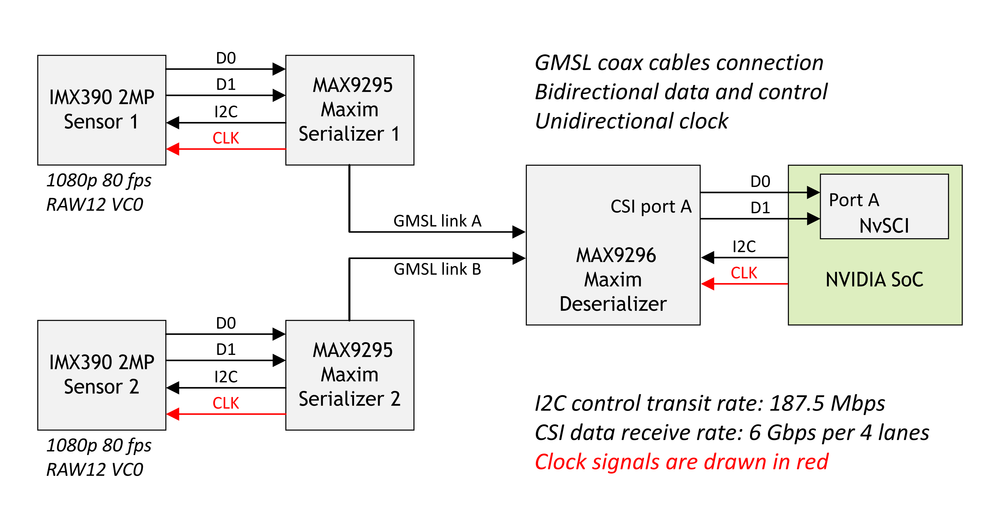
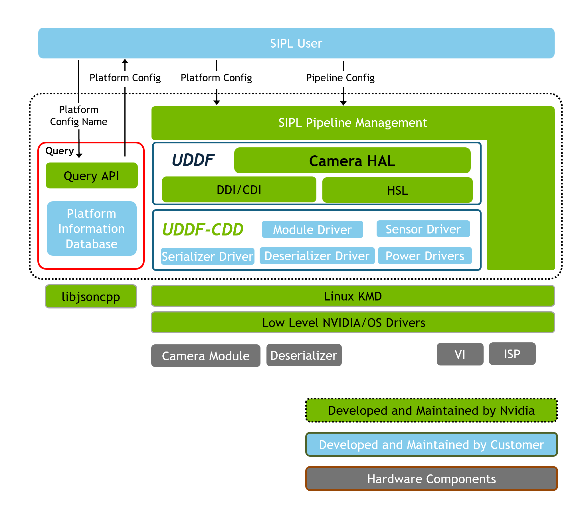
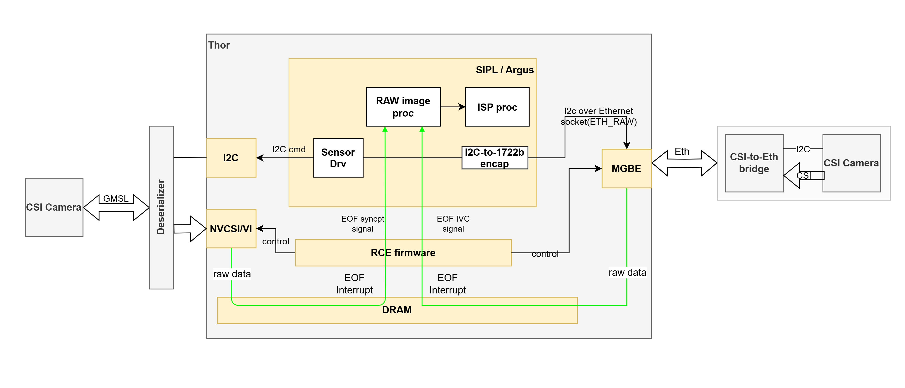
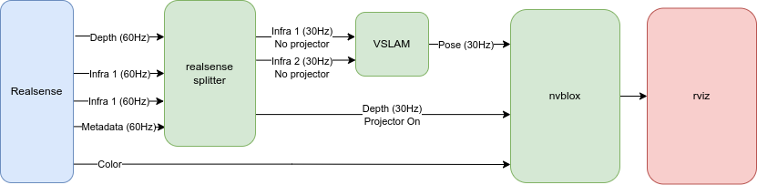
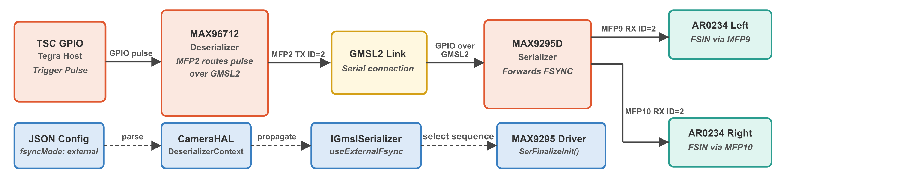
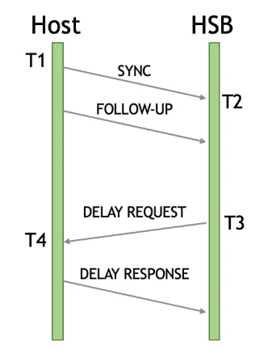
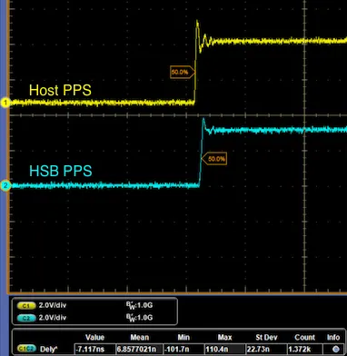
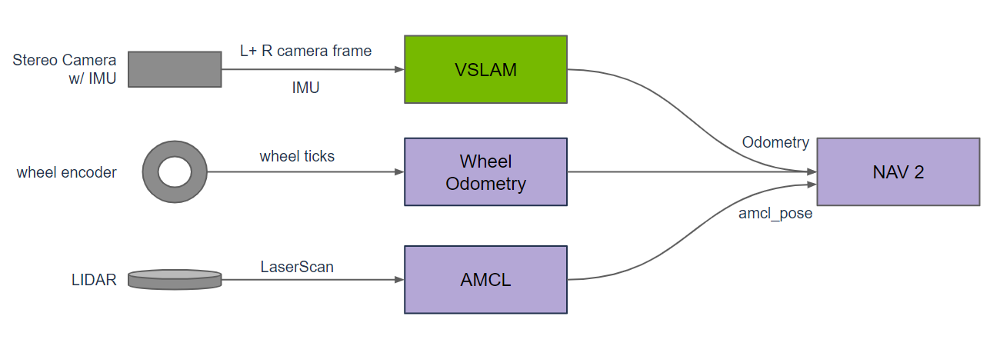
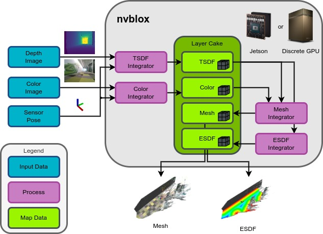

# NVIDIA — 传感器接入

**NVIDIA提供多种传感器采集、时间戳和GPU处理路径，选型必须落实到传感器、载板、传输协议、驱动与时钟配置的具体组合。** 本报告以2026年11月3日取得的官方文档为依据，覆盖Jetson Orin与Thor的相机、深度、LiDAR及IMU接入，展开同步、ISP、内存交接和融合。硬件指标延续已审阅的《NVIDIA—硬件平台》，软件版本管理延续《NVIDIA—软件栈》；本篇重点是原始测量如何成为时间与空间语义可靠的机器人观测。

## 1. 接口全景与已经验证的组合

### 1.1 模组能力、载板连接与传感器支持

| 平台 | 原生相机信号 | 网络/外设资源 | 对传感器接入的实际含义 | 官方依据 |
|---|---|---|---|---|
| AGX Orin家族 | 16-lane MIPI CSI-2 | 模组1GbE及10GbE；USB、PCIe；3×SPI、8×I2C | GMSL需外接SerDes及载板；IMU中断与I2C按板级配置 | [Jetson Orin官方规格](https://www.nvidia.com/en-us/autonomous-machines/embedded-systems/jetson-orin/) |
| Orin NX家族 | 8-lane MIPI CSI-2 | 1GbE；USB、PCIe；2×SPI、4×I2C | 小型多相机/深度方案；相机数量与lane分配、聚合器有关 | [Jetson Orin官方规格](https://www.nvidia.com/en-us/autonomous-machines/embedded-systems/jetson-orin/)；[Datasheet Orin NX v1 7](https://developer.nvidia.com/downloads/jetson-orin-nx-module-series-data-sheet) |
| Orin Nano家族 | 8-lane MIPI CSI-2 | 1GbE；USB、PCIe；2×SPI、4×I2C | 无PVA；专用视觉卸载能力与NX/AGX不同 | [Jetson Orin官方规格](https://www.nvidia.com/en-us/autonomous-machines/embedded-systems/jetson-orin/) |
| Thor T5000/T4000 | 16-lane MIPI CSI-2 | T5000 4×25GbE、T4000 3×25GbE；13×I2C、3×SPI | 高带宽CoE及GMSL候选；接口复用和实际载板仍需核对 | [Datasheet Thor Full v1 5](https://developer.nvidia.com/downloads/assets/embedded/secure/jetson/thor/docs/jetson-thor-series-modules-datasheet_ds-11945-001.pdf) |

这些是模组信号与控制器能力，不能直接算成开发套件相机插座数。Thor开发套件相机路径重点是QSFP/HSB与USB；Orin Nano开发载板的两个CSI插座也不能说明所有模组lane均以任意方式同时可用。以太网控制器数量、QSFP cage、收发器和PoE供电是不同层面的配置。没有解串器、对应驱动和相机供电，GMSL相机不能直接接到MIPI信号上工作。[Jetson Thor官方规格](https://www.nvidia.com/en-us/autonomous-machines/embedded-systems/jetson-thor/)；[Jetson Orin官方规格](https://www.nvidia.com/en-us/autonomous-machines/embedded-systems/jetson-orin/)；[Jetson官方FAQ](https://developer.nvidia.com/embedded/faq)；[Datasheet Thor Full v1 5](https://developer.nvidia.com/downloads/assets/embedded/secure/jetson/thor/docs/jetson-thor-series-modules-datasheet_ds-11945-001.pdf)

### 1.2 官方参考相机与验证范围

| 路线/对象 | 当前官方描述 | 已明确的组合或限制 | 官方依据 |
|---|---|---|---|
| SIPL GMSL参考传感器 | AR0234 stereo、SmartLead IMX728/IMX623 | JP7.2支持清单；不等于任意厂商同型号模组均已验证 | [Jetson R39.2.1相机支持矩阵](https://docs.nvidia.com/jetson/archives/r39.2.1/DeveloperGuide/SD/CameraDevelopment/CameraDevelopmentSupportMatrix.html) |
| Hawk GMSL双目 | 两个1920×1200 AR0234 global-shutter传感器 | Isaac ROS教程只验证AGX Orin开发套件、JP7.2.0/R39.2.0与P3762_A03；旧P3762和E3653不支持 | [Isaac ROS Hawk GMSL相机配置与验证范围](https://nvidia-isaac-ros.github.io/getting_started/sensors/hawk_setup.html) |
| Eagle VB1940 CoE双目 | HSB/以太网相机与SIPL ROS接入 | 教程只验证AGX Thor、JP7.2.0/R39.2.0；固件至少0x2510，10Gbps链路，PoE型号需外部供电 | [Isaac ROS Eagle CoE相机配置与验证范围](https://nvidia-isaac-ros.github.io/getting_started/sensors/eagle_setup.html) |
| Argus/V4L2 MIPI参考 | IMX274、OV5693、IMX185、IMX390、IMX219/477（NX）、IMX318、AR1335、AR0234 | 按平台、驱动和BSP核查；清单不是即插即用承诺 | [Jetson R39.2.1相机支持矩阵](https://docs.nvidia.com/jetson/archives/r39.2.1/DeveloperGuide/SD/CameraDevelopment/CameraDevelopmentSupportMatrix.html) |
| RealSense | D455、D435i支持，D415不在当前支持清单 | 固件5.16.0.1、librealsense2.56.3、ROS驱动r/4.56.3；高分辨率/帧率要求USB3 | [Isaac ROS RealSense相机及版本支持](https://nvidia-isaac-ros.github.io/getting_started/sensors/realsense_setup.html) |
| Orbbec SDK v2 | 厂商ARM64测试列表包括AGX Orin、NX/Nano、Thor | SDK测试对象与NVIDIA原生SIPL/ISP支持是不同证据；传感器型号、固件和功能还需核对 | [Orbbec SDK README](https://raw.githubusercontent.com/orbbec/OrbbecSDK_v2/main/README.md) |

验证范围应原样保留：下载页当前为JP7.2.1，而Hawk/Eagle教程明确测过7.2.0。本文不会把补丁升级推定为已经测试，也不会把“其他平台可能兼容”改写成厂家支持矩阵。Hawk载板需要独立12V供电；Eagle的Thor MGBE端口不提供PoE，教程要求PoE型号使用PoE++ injector。线缆接通、网络link up与相机供电完成是三个分别检查的环节。[JetPack官方下载与版本矩阵](https://developer.nvidia.com/embedded/jetpack/downloads)；[Isaac ROS Hawk GMSL相机配置与验证范围](https://nvidia-isaac-ros.github.io/getting_started/sensors/hawk_setup.html)；[Isaac ROS Eagle CoE相机配置与验证范围](https://nvidia-isaac-ros.github.io/getting_started/sensors/eagle_setup.html)

### 1.3 软件框架迁移影响

R39.2.1相机总览将SIPL作为长期主线：JP7.2支持GMSL/CoE，原生MIPI支持仍列为后续计划；Argus维持支持、不增加新功能。不能因Thor具有CSI信号而宣称其全部MIPI相机已经走SIPL，也不能因产品计划包含LiDAR/radar聚合而把它们列为当前统一SIPL驱动能力。相机功能清单、驱动清单与路线图应分别记录。[Jetson Camera 39 2 1](https://docs.nvidia.com/jetson/archives/r39.2.1/DeveloperGuide/SD/CameraDevelopment.html)；[Jetson R39.2.1相机支持矩阵](https://docs.nvidia.com/jetson/archives/r39.2.1/DeveloperGuide/SD/CameraDevelopment/CameraDevelopmentSupportMatrix.html)

## 2. MIPI CSI与GMSL：物理链路、虚拟通道和驱动

### 2.1 从相机到VI/NVCSI的链路

MIPI CSI-2是相机像素流进入SoC的接口；GMSL把远端相机的视频与双向控制沿同轴或屏蔽双绞线传送，再由解串器转为CSI-2。官方参考方案中，每个传感器连接一个serializer，多个serializer连接共用deserializer，后者连接Jetson CSI端口。I2C控制可沿SerDes链路隧道传送。GMSL的长线连接与MIPI的板级接入是前后相连的两层，并非互斥的两种SoC相机接口。[Jetson GMSL参考拓扑、虚拟通道和驱动](https://docs.nvidia.com/jetson/archives/r39.2.1/DeveloperGuide/SD/CameraDevelopment/ArgusFramework/JetsonVirtualChannelWithGmslCameraFramework.html)；[Jetson SIPL GMSL相机架构](https://docs.nvidia.com/jetson/archives/r39.2.1/DeveloperGuide/SD/CameraDevelopment/SIPLFramework/SIPL-for-L4T/GMSL/GMSL-Architecture-Overview.html)

**图1：NVIDIA官方GMSL双传感器、SerDes与Jetson连接。** 原图出处：[Jetson GMSL参考拓扑、虚拟通道和驱动](https://docs.nvidia.com/jetson/archives/r39.2.1/DeveloperGuide/SD/CameraDevelopment/ArgusFramework/JetsonVirtualChannelWithGmslCameraFramework.html)。

图中两个传感器共享解串器和下游CSI端口，但各自保留控制与像素流标识。原图对应MAX9295/MAX9296及IMX390参考方案；它帮助理解拓扑，不能替代Hawk当前载板与MAX96712驱动组合。该页正文参考输入为双IMX390、RAW12、1080p/30fps、CSI-A x2 lanes，原图却保留1080p/80fps标注，两者口径不一致。本篇按正文说明记录参考模式，不据图中的80fps推断该参考链路已完成验证。[Jetson GMSL参考拓扑、虚拟通道和驱动](https://docs.nvidia.com/jetson/archives/r39.2.1/DeveloperGuide/SD/CameraDevelopment/ArgusFramework/JetsonVirtualChannelWithGmslCameraFramework.html)；[Isaac ROS Hawk GMSL相机配置与验证范围](https://nvidia-isaac-ros.github.io/getting_started/sensors/hawk_setup.html)

### 2.2 虚拟通道与I2C地址管理

| 配置对象 | 官方机制 | 常见集成错误 |
|---|---|---|
| CSI虚拟通道ID | 解串器对各像素流分配不同VC ID，接收端配置必须一致 | 传感器能锁链路，但VI接收错误流或没有图像 |
| Physical/proxy I2C地址 | 同型号传感器及serializer地址相同，通过不同proxy地址区分 | 复制设备树而未修改地址，造成共用I2C链路冲突 |
| SerDes与sensor driver | sensor driver协调SerDes启动、控制与stream顺序 | 直接独立操作共享解串器，破坏其他传感器状态 |
| 共享电源/解串器 | 共享deserializer承担协调，不能只看单个sensor状态 | 一路复位、断电或重配置影响其他路 |
| 设备树及链路描述 | gmsl-link、CSI端口、lane、格式、VC及板级连接共同定义 | 配置看似相同但载板走线或serializer版本不同 |

表格依据官方GMSL驱动说明。参考方案两颗sensor的physical I2C地址同为0x1a，默认proxy为0x1b/0x1c；serializer physical为0x62，proxy为0x40/0x60。它们是参考地址，不能直接复制给任意相机。驱动在启动时按固定顺序写入映射，必须同时保存硬件拓扑、设备树与驱动版本。[Jetson GMSL参考拓扑、虚拟通道和驱动](https://docs.nvidia.com/jetson/archives/r39.2.1/DeveloperGuide/SD/CameraDevelopment/ArgusFramework/JetsonVirtualChannelWithGmslCameraFramework.html)

### 2.3 通道上限与带宽预算

R39.2.1 GMSL页存在需要消歧的数量描述：一张表列Thor“With ISP 12”，同页文字又列16个ISP虚拟通道和24个无ISP虚拟通道。模组手册还使用独立的相机输入/CSI资源口径。因此本报告保留这些原始描述，不选择最大数字作为可交付相机数量；[公开资料未披露]：未取得把全部口径映射到同一载板、同一传感器与同一ISP设置的验证矩阵。[Jetson GMSL参考拓扑、虚拟通道和驱动](https://docs.nvidia.com/jetson/archives/r39.2.1/DeveloperGuide/SD/CameraDevelopment/ArgusFramework/JetsonVirtualChannelWithGmslCameraFramework.html)；[Datasheet Thor Full v1 5](https://developer.nvidia.com/downloads/assets/embedded/secure/jetson/thor/docs/jetson-thor-series-modules-datasheet_ds-11945-001.pdf)

带宽预算应从像素格式计算，再加协议、blanking、嵌入行、打包和内存布局开销。以SIPL Hawk JSON的双1920×1200、30fps、RAW10为例，裸有效像素率为`2×1920×1200×30×10 = 1.3824 Gbit/s`；这是计算示例，不是链路实测或所需物理速率。ISP输出若变为NV12/RGB，后续内存读写量也会改变。需要分别核验CSI/SerDes容量、ISP预算、内存带宽及推理负载，不能只检查网口或lane标称速率。[SIPL双目FSYNC、配置与生命周期](https://docs.nvidia.com/jetson/archives/r39.2.1/DeveloperGuide/SD/CameraDevelopment/SIPLFramework/SIPL-for-L4T/SIPL-Stereo-Pipeline.html)

## 3. SIPL与ISP：采集、标定及GPU数据交接

### 3.1 分层架构和配置对象

**图2：NVIDIA官方SIPL、Camera HAL和UDDF分层架构。** 原图出处：[Jetson SIPL介绍与架构](https://docs.nvidia.com/jetson/archives/r39.2.1/DeveloperGuide/SD/CameraDevelopment/SIPLFramework/Introduction-to-SIPL.html)。

SIPL Core管理采集pipeline、buffer与事件；Query解析JSON配置；Control负责传感器控制；Camera HAL和UDDF/HSL把传感器、serializer/deserializer、EEPROM等设备操作组织为驱动。GMSL与CoE共享上层接口，下层分别通过CSI或以太网接收。JSON不仅描述相机名称，还包括I2C地址、link mask、CSI port、PHY mode，或MAC/IP、HSB ID与传输参数。把“使用同一API”理解为“无需板级和传感器驱动”会遗漏最主要的适配工作。[Jetson SIPL介绍与架构](https://docs.nvidia.com/jetson/archives/r39.2.1/DeveloperGuide/SD/CameraDevelopment/SIPLFramework/Introduction-to-SIPL.html)；[Jetson SIPL GMSL相机架构](https://docs.nvidia.com/jetson/archives/r39.2.1/DeveloperGuide/SD/CameraDevelopment/SIPLFramework/SIPL-for-L4T/GMSL/GMSL-Architecture-Overview.html)；[Jetson SIPL Camera over Ethernet架构](https://docs.nvidia.com/jetson/archives/r39.2.1/DeveloperGuide/SD/CameraDevelopment/SIPLFramework/SIPL-for-L4T/CoE/CoE-Solution-Overview.html)

| 层次 | 配置与输入 | 输出/责任 |
|---|---|---|
| 传感器驱动 | 模式、曝光、触发、寄存器与控制序列 | 实际RAW及embedded metadata，正确启动与停止 |
| Transport/Camera HAL | SerDes或HSB、地址和链路配置 | 将传感器操作与受支持传输方式连接 |
| Capture/RCE | buffer注册、接收通道、DMA及完成通知 | 完整帧与状态；传输SOF/EOF时间 |
| ISP/auto-control | RAW格式、Bayer排列、NITO等配置 | YUV/RGB相关处理；曝光等控制输出 |
| ROS/应用 | CameraInfo、buffer格式、时间域和TF | 可供rectification、深度及SLAM使用的观测 |

表格依据SIPL与ROS接口文档归纳。图像质量标定、几何标定和时钟标定解决不同问题：NITO/ISP初始化不是CameraInfo内参，CameraInfo也不替代相机到本体的外参。[Jetson SIPL介绍与架构](https://docs.nvidia.com/jetson/archives/r39.2.1/DeveloperGuide/SD/CameraDevelopment/SIPLFramework/Introduction-to-SIPL.html)；[Isaac ROS SIPL采集、时间戳与格式接口](https://nvidia-isaac-ros.github.io/repositories_and_packages/isaac_ros_sipl_camera/isaac_ros_sipl_camera/index.html)；[Isaac ROS Eagle CoE相机配置与验证范围](https://nvidia-isaac-ros.github.io/getting_started/sensors/eagle_setup.html)；[NVIDIA机器人多传感器外参标定要求](https://nvidia-isaac-ros.github.io/getting_started/sensors/amr_extrinsic_calibration.html)

### 3.2 RAW、ISP、颜色转换与校正

SIPL可交付RAW或经ISP处理的图像。对于深度、视觉特征与模型前处理，应记录Bayer pattern、bit depth、stride、裁剪、输出色彩标准和分辨率；几何校正改变图像坐标，需保持CameraInfo与图像对应。当前SIPL ROS launch可以按配置追加ImageFormatConverterNode、RectifyNode和H.264 EncoderNode；这些增加的计算和队列不能从“相机驱动耗时”中隐去。[Jetson SIPL Camera over Ethernet架构](https://docs.nvidia.com/jetson/archives/r39.2.1/DeveloperGuide/SD/CameraDevelopment/SIPLFramework/SIPL-for-L4T/CoE/CoE-Solution-Overview.html)；[Isaac ROS SIPL采集、时间戳与格式接口](https://nvidia-isaac-ros.github.io/repositories_and_packages/isaac_ros_sipl_camera/isaac_ros_sipl_camera/index.html)

当前文档指出native NV12/NV24与转换后的RGB/BGR存在颜色范围问题：ISP的NvSciColorStd_REC709_ER为full-range BT.709，而当前CV-CUDA AdvCvtColor不支持该full-range变体，转换图像亮度对比可能略有不同。native输出不受这项转换影响。颜色复现要求严格的模型，应在训练与部署前处理间核对，而不是只确认网络输入tensor尺寸。[Isaac ROS SIPL采集、时间戳与格式接口](https://nvidia-isaac-ros.github.io/repositories_and_packages/isaac_ros_sipl_camera/isaac_ros_sipl_camera/index.html)

### 3.3 buffer共享与应用接口

SIPL ROS文档的数据流把ISP输出标为NvSciBuf/NVMM，再交给单目或双目node，按需要增加配对、转换、校正与编码。共享buffer可以减少复制，但还需要同步对象、生命周期和消费者格式匹配；VPI文档也明确外部buffer包装后扩展backend可能引入内部复制。减少CPU搬运与减少总时延应分别测量。[Isaac ROS SIPL采集、时间戳与格式接口](https://nvidia-isaac-ros.github.io/repositories_and_packages/isaac_ros_sipl_camera/isaac_ros_sipl_camera/index.html)；[VPI 4.1算法与平台说明](https://docs.nvidia.com/vpi/index.html)

当前SIPL ROS图仍保留NITROS/NitrosCameraDropNode术语，而当前Isaac ROS迁移文档已宣布NITROS向rosidl::Buffer迁移。本文保留页面实况，不把图上旧名字推定成所有release-5.0组件内部实现已统一；实际应固定仓库分支、检查消息及后端，验证CPU fallback与GPU路径。数据接口迁移不会改变传感器曝光的物理时刻。[Isaac ROS SIPL采集、时间戳与格式接口](https://nvidia-isaac-ros.github.io/repositories_and_packages/isaac_ros_sipl_camera/isaac_ros_sipl_camera/index.html)；[Isaac ROS Buffer Migration](https://nvidia-isaac-ros.github.io/concepts/rosidl_buffer/nitros_migration.html)；[Isaac ROS原生Buffer概念文档](https://nvidia-isaac-ros.github.io/concepts/rosidl_buffer/index.html)

## 4. CoE与Holoscan Sensor Bridge：两条以太网接收路径

### 4.1 Thor SIPL CoE的MGBE/RCE路径

**图3：NVIDIA官方CoE与GMSL接收架构对照。** 原图出处：[Jetson SIPL Camera over Ethernet架构](https://docs.nvidia.com/jetson/archives/r39.2.1/DeveloperGuide/SD/CameraDevelopment/SIPLFramework/SIPL-for-L4T/CoE/CoE-Solution-Overview.html)。

CoE章节描述Thor以MGBE和IEEE1722b接收相机数据，替代该路线的VI/NVCSI接收块；RCE配置DMA通道、分类和中断，应用分配/注册接收buffer，再通过SIPL取得RAW或ISP输出。设备控制经HSB隧道访问I2C；图像数据进入DRAM后再供ISP或GPU消费者使用。官方“zero-copy DMA directly to application memory”是这条接收路径的机制，不代表全部后处理或跨进程都没有复制。[Jetson SIPL Camera over Ethernet架构](https://docs.nvidia.com/jetson/archives/r39.2.1/DeveloperGuide/SD/CameraDevelopment/SIPLFramework/SIPL-for-L4T/CoE/CoE-Solution-Overview.html)

CoE页部分文字仍写“only CoE transport supported now”，但同一R39.2.1相机总览/支持矩阵已列SIPL GMSL与CoE，说明不同章节的更新口径并不完全一致。应以具体传感器教程和支持矩阵确定组合；不能据较早的概括否认已列出的GMSL路径，也不能用最新概括替代设备验证。[Jetson SIPL Camera over Ethernet架构](https://docs.nvidia.com/jetson/archives/r39.2.1/DeveloperGuide/SD/CameraDevelopment/SIPLFramework/SIPL-for-L4T/CoE/CoE-Solution-Overview.html)；[Jetson Camera 39 2 1](https://docs.nvidia.com/jetson/archives/r39.2.1/DeveloperGuide/SD/CameraDevelopment.html)；[Jetson R39.2.1相机支持矩阵](https://docs.nvidia.com/jetson/archives/r39.2.1/DeveloperGuide/SD/CameraDevelopment/CameraDevelopmentSupportMatrix.html)

### 4.2 HSB RoCE与Linux Socket路径

| HSB主机组合 | 官方接收方式 | 需要保留的限制 | 官方依据 |
|---|---|---|---|
| IGX，IGX OS1.1.2+，CX7 | ConnectX加速接收 | 设备/NIC/驱动及buffer注册共同匹配 | [HSB 2.7主机接收与PTP配置](https://docs.nvidia.com/holoscan/sensor-bridge/2-7-latest/getting-started/host-setup) |
| AGX Orin，JP6.2.1+ | 板载以太网、Linux网络栈 | 数据I/O由CPU处理，无同等网络卸载 | [HSB 2.7主机接收与PTP配置](https://docs.nvidia.com/holoscan/sensor-bridge/2-7-latest/getting-started/host-setup) |
| AGX Thor，JP7.2 | MGBE及CoE | 与ConnectX RoCE路径分别看待 | [HSB 2.7主机接收与PTP配置](https://docs.nvidia.com/holoscan/sensor-bridge/2-7-latest/getting-started/host-setup)；[Jetson SIPL Camera over Ethernet架构](https://docs.nvidia.com/jetson/archives/r39.2.1/DeveloperGuide/SD/CameraDevelopment/SIPLFramework/SIPL-for-L4T/CoE/CoE-Solution-Overview.html) |
| DGX Spark，DGX OS7.2.3+，CX7 | ConnectX加速接收 | 是特定主机参考配置 | [HSB 2.7主机接收与PTP配置](https://docs.nvidia.com/holoscan/sensor-bridge/2-7-latest/getting-started/host-setup) |
| x86+dGPU | Linux socket或ConnectX RoCE | 非主要参考平台；驱动报告RDMA可用仍可能被PCIe路径阻断 | [HSB 2.7主机接收与PTP配置](https://docs.nvidia.com/holoscan/sensor-bridge/2-7-latest/getting-started/host-setup) |

HSB RoCE数据面发送RDMA write及write-immediate：ConnectX把payload直接写到GPU或系统内存，最终metadata/write-immediate触发CPU完成通知。Linux receiver没有同等卸载性能。Thor SIPL CoE通过MGBE/RCE组织接收，不能从任何一个以太网口存在就推导它支持ConnectX接收器或任意GPUDirect路径。[Holoscan Sensor Bridge 2.7架构与示例](https://docs.nvidia.com/holoscan/sensor-bridge/2-7-latest/applications/architecture)；[HSB 2.7主机接收与PTP配置](https://docs.nvidia.com/holoscan/sensor-bridge/2-7-latest/getting-started/host-setup)

### 4.3 Eagle bring-up与故障恢复

Eagle教程先要求QSFP28 cage/QSA/SFP+转接及10GBASE-T链路，再配置IP/路由，枚举MAC、IP和HSB firmware。JP7.2.0示例固定HSB release-2.7.0并要求Thor构建容器使用`--igpu`。相机EEPROM中的内参按每台设备读取，分别导出左右RGB/IR CameraInfo YAML；教程原生标定分辨率为2560×1984。换镜头、缩放或裁剪后要核查CameraInfo是否仍匹配。[Isaac ROS Eagle CoE相机配置与验证范围](https://nvidia-isaac-ros.github.io/getting_started/sensors/eagle_setup.html)

HSB设备枚举是本地广播，路由器不会转发；reset可影响同板多个DataChannel并恢复默认IP。多设备系统应有MAC/serial到逻辑sensor ID的映射、地址恢复和共享时钟初始化顺序。网络link up不能证明buffer接收及ISP工作，SIPL node打印initialized也可能因设备树/供电问题一直无帧。当前ROS默认首帧超时为5秒，这是一项诊断参数，不是机器人持续采集可靠性指标。[Holoscan Sensor Bridge 2.7架构与示例](https://docs.nvidia.com/holoscan/sensor-bridge/2-7-latest/applications/architecture)；[Isaac ROS SIPL采集、时间戳与格式接口](https://nvidia-isaac-ros.github.io/repositories_and_packages/isaac_ros_sipl_camera/isaac_ros_sipl_camera/index.html)

## 5. USB深度、RGB-D与主动光学传感器

### 5.1 接入机制与软件支持

USB深度相机通常在设备侧生成深度/RGB/IR，再经厂商SDK或ROS driver交付；它不是Bayer RAW经Jetson ISP的同一链路。RealSense当前Isaac ROS教程锁定D455/D435i及三个版本，使用USB3以满足部分示例分辨率/帧率。Orbbec SDK的ARM64平台测试属于厂商适配证据，其测试列表不能代替每款相机固件与同步功能支持表。[Isaac ROS RealSense相机及版本支持](https://nvidia-isaac-ros.github.io/getting_started/sensors/realsense_setup.html)；[Orbbec SDK README](https://raw.githubusercontent.com/orbbec/OrbbecSDK_v2/main/README.md)

| 数据/功能 | 应保存的参数 | 与融合直接相关的事项 |
|---|---|---|
| RGB/IR | 分辨率、帧率、曝光、内参、色彩与镜头 | 是否采用rolling/global shutter，曝光变化与时间参考 |
| Depth | 单位、scale、有效范围、置信度/invalid value | 深度是否已对齐RGB，校正是否改变坐标与采样 |
| IMU（相机内置） | 各测量频率、噪声模型、与相机的外参 | 不是所有RGB-D模式都提供同一IMU能力 |
| Device/host timestamp | 来源、单位、时钟类型和映射状态 | 到达时间与采样时间不能互换 |
| USB连接 | 控制器拓扑、线缆、供电、带宽和重连 | 多设备共用hub可能改变吞吐与接收抖动 |

这是一张接入参数清单，具体设备支持仍以厂商手册为准。测试应同时开启目标RGB、IR、depth与IMU流，记录实际输出而非单独测试每路后相加。SDK的默认等待超时与线程调度也会进入应用时延。[Orbbec SDK README](https://raw.githubusercontent.com/orbbec/OrbbecSDK_v2/main/README.md)；[Orbbec Timestamps](https://raw.githubusercontent.com/orbbec/OrbbecSDK_v2/main/docs/tutorial/timestamp.md)；[Isaac ROS RealSense相机及版本支持](https://nvidia-isaac-ros.github.io/getting_started/sensors/realsense_setup.html)

### 5.2 主动投射与视觉里程计的冲突

Nvblox官方示例说明：RealSense D400的光学projector可改善主动双目深度，但投射纹理会干扰VSLAM。示例将2路IR与1路depth按60Hz交付，启用emitter_on_off交替帧；splitter把emitter-off的IR送VSLAM，把emitter-on的depth送Nvblox。60Hz源流不是每个下游任务都可按60Hz处理有效观测。多台相机还要同步发射器状态，单纯给ROS topic做时间配对无法消除主动光学干扰。[Nvblox静态/动态重建及RealSense交替帧机制](https://nvidia-isaac-ros.github.io/concepts/scene_reconstruction/nvblox/technical_details.html)；[NVIDIA多RealSense发射器状态同步](https://nvidia-isaac-ros.github.io/repositories_and_packages/isaac_ros_nvblox/multi_realsense_emitter_synchronizer/index.html)

**图4：NVIDIA官方RealSense交替帧供VSLAM与Nvblox使用。** 原图出处：[NVIDIA RealSense与Nvblox/SLAM交替帧数据流](https://nvidia-isaac-ros.github.io/concepts/scene_reconstruction/nvblox/technical_details.html)。

原图展示同一物理相机为定位与重建提供不同子流。它说明传感器工作模式会影响算法适用性；不是不同深度技术或所有ToF相机的统一同步方案。对多ToF/主动双目设备，曝光、调制/发射模式、相互干扰与有效深度比例需按具体型号评估。[Nvblox静态/动态重建及RealSense交替帧机制](https://nvidia-isaac-ros.github.io/concepts/scene_reconstruction/nvblox/technical_details.html)

### 5.3 Orbbec三种时间戳的选择

Orbbec文档区分device、system和global timestamp。global是在host clock域表达原device timestamp对应的时刻；它不会把曝光末尾改成曝光开始。Gemini330 long-baseline默认代表曝光结束，short-baseline默认代表曝光中点，支持可配置参考的设备可设曝光开始。无device timestamp的少数设备会返回host fallback，非零值不能单独证明硬件采样时间可用。[Orbbec Timestamps](https://raw.githubusercontent.com/orbbec/OrbbecSDK_v2/main/docs/tutorial/timestamp.md)

跨设备采样时刻比较优先使用受支持且非零的global timestamp；system记录host收到帧的时间。`system-global`可测所选曝光时刻到SDK收到帧的时延，并受时钟映射精度影响。Linux/Android monotonic模式使用CLOCK_MONOTONIC_RAW，不能与任意std::chrono::steady_clock直接相减；同步/复位还可能造成时间戳不连续。官方Timestamp Tracker能把多类时间戳记录成CSV，本轮归档其手册但未执行采集。[Orbbec Timestamps](https://raw.githubusercontent.com/orbbec/OrbbecSDK_v2/main/docs/tutorial/timestamp.md)；[Orbbec Timestamp Tracker记录工具](https://raw.githubusercontent.com/orbbec/OrbbecSDK_v2/main/tools/timestamp_tracker/README.md)

## 6. LiDAR与点云：传输、逐点时间和运动补偿

### 6.1 实时传感器驱动与离线示例的差别

当前NVIDIA Ouster OS1教程只支持从DOALS rosbag运行Nvblox，明确实时OS1接入需修改launch并加入sensor driver。教程是下游点云重建的参考，不能当作JP7.2.1已包含OS1即插即用驱动的证据。此前Nova/Hesai驱动的若干旧网页入口本轮未取得有效正文，未将其列为当前版本支持依据。[公开资料未披露]：没有取得覆盖Orin/Thor、全部Hesai/Ouster型号和固件的统一实时接入认证矩阵。[NVIDIA Ouster OS1 LiDAR示例](https://nvidia-isaac-ros.github.io/concepts/scene_reconstruction/nvblox/tutorials/tutorial_os1.html)

| 环节 | 所需数据/配置 | 判断依据 |
|---|---|---|
| 物理与网络接入 | 供电、链路、IP、UDP配置与收包统计 | 正常收包不等于点云已正确解码 |
| 厂商driver | packet format、标定、return模式与时间戳 | 型号/固件配对；输出单位、ring与点内时间 |
| ROS PointCloud2 | x/y/z、intensity、ring、timestamp等字段 | 与外参标定及下游解析约定一致 |
| Motion compensation | 扫描开始/结束pose、逐点采样时刻 | 对运动扫描进行时间相关变换 |
| Reconstruction | 体素尺度、静态/动态模式及pose | 不把地图质量归结为网络带宽 |

点云标定输入字段依据NVIDIA外参指南；运动补偿依据OS1示例。雷达扫描不是在一个瞬间完成的一张“3D照片”。没有逐点时间或正确pose，时间对齐的整帧header仍可能掩盖运动畸变。[NVIDIA机器人多传感器外参标定要求](https://nvidia-isaac-ros.github.io/getting_started/sensors/amr_extrinsic_calibration.html)；[NVIDIA Ouster OS1 LiDAR示例](https://nvidia-isaac-ros.github.io/concepts/scene_reconstruction/nvblox/tutorials/tutorial_os1.html)

### 6.2 CUDA运动补偿与模式限制

OS1示例使用CUDA加速motion compensation，根据扫描开始/结束之间插值的sensor pose，近似每个点采集时刻的坐标框架；`use_lidar_motion_compensation`默认true。插值是模型近似，pose误差、时间域偏移及剧烈运动都会影响结果，不能把补偿开关打开当作完全消除畸变。应比较同一记录的补偿前后几何误差与动态物体残留，再进入实机采集。[NVIDIA Ouster OS1 LiDAR示例](https://nvidia-isaac-ros.github.io/concepts/scene_reconstruction/nvblox/tutorials/tutorial_os1.html)

教程支持static和dynamic模式，LiDAR不支持该示例中的people segmentation/detection模式。camera-based语义掩码、LiDAR运动补偿和跨模态语义融合属于不同处理步骤；“都接入Nvblox”不意味着功能清单完全相同。本报告不将DOALS离线表现作为目标LiDAR实时帧率或延迟。[NVIDIA Ouster OS1 LiDAR示例](https://nvidia-isaac-ros.github.io/concepts/scene_reconstruction/nvblox/tutorials/tutorial_os1.html)；[Nvblox静态/动态重建及RealSense交替帧机制](https://nvidia-isaac-ros.github.io/concepts/scene_reconstruction/nvblox/technical_details.html)

## 7. IMU与HTE：中断采样、IIO buffer和时间基准

### 7.1 原生BMI088参考驱动

Jetson Linux BMI088指南描述I2C驱动，将加速度计和陀螺仪注册为两个IIO设备，分别控制与读取。driver仅支持data-ready interrupt模式：两个data-ready信号必须连接到可硬件时间戳的AON GPIO；中断发生时取得时间戳，再读取数据并通过IIO交给用户态。I2C地址、电气连接、GPIO和设备树都要匹配。拥有I2C或SPI接口不等于任意IMU都能直接获得该路径的硬件时间戳。[Jetson Linux BMI088 IIO参考驱动](https://docs.nvidia.com/jetson/archives/r39.2.1/DeveloperGuide/SD/Kernel/Bmi088ImuIioDriver.html)

| 驱动接口 | 官方说明 | 集成意义 |
|---|---|---|
| accel/gyro IIO devices | 独立I2C地址、寄存器及设备节点 | 不假定两个测量同频或同一采样时刻 |
| AON GPIO/HTE | 为data-ready事件记录硬件时间 | 减少把CPU处理迟到误当采样迟到的风险 |
| accel ODR | 12.5–1600Hz离散选项 | 可设频率还受I2C时钟和系统配置约束 |
| gyro ODR | 100/200/400/1000/2000Hz | 融合所需频率和相机频率分别配置 |
| IIO buffer/scan elements | axis、timestamp、buffer长度与watermark | buffer深度、对齐和读出等待进入实际时延 |
| dev_err与mount matrix | I2C/HTE错误计数和安装矩阵 | 监控丢数据并核查轴向，不能只看topic频率 |

表格保留官方离散ODR及限制；它们不是本次持续实测频率。IIO的scan type/index描述了实际buffer layout，不能把文档“6+8 bytes”文字简单当作所有平台C结构体的packed布局，应以设备scan配置、storagebits及对齐规则解析。安装矩阵和IMU到camera/base的外参仍需与TF及算法约定核对。[Jetson Linux BMI088 IIO参考驱动](https://docs.nvidia.com/jetson/archives/r39.2.1/DeveloperGuide/SD/Kernel/Bmi088ImuIioDriver.html)；[NVIDIA机器人多传感器外参标定要求](https://nvidia-isaac-ros.github.io/getting_started/sensors/amr_extrinsic_calibration.html)

### 7.2 GTE已迁移到HTE

R39.2.1页面仍叫Generic Timestamp Engine，但正文明确JP6.0起旧GTE driver弃用，由upstream Hardware Timestamp Engine替代。该页适用范围列AGX Orin、Orin NX和Orin Nano，HTE可为LIC interrupt及AON GPIO状态变化取时间。测试需要设备树启用、所监控外设产生事件及实际GPIO连线。不能依据旧页面标题继续建议新项目安装旧GTE，也不能把Orin页的寄存器/引脚实例直接移到Thor。[Jetson Orin GTE/HTE迁移与硬件时间戳](https://docs.nvidia.com/jetson/archives/r39.2.1/DeveloperGuide/SD/Kernel/GenericTimestampEngine.html)

### 7.3 从中断时间到融合测量

data-ready中断标记数据可读，具体对应测量窗口和sensor内部滤波延迟仍由IMU决定。硬件时间戳避免部分软件调度误差，但不自动标定相机曝光时刻与IMU测量时刻的相对offset。运动激励、时间域映射、噪声/随机游走参数和外参共同影响VIO；这些参数需由目标IMU/配置标定，不能沿用cuVSLAM示例默认数值作实际测量噪声。[Jetson Linux BMI088 IIO参考驱动](https://docs.nvidia.com/jetson/archives/r39.2.1/DeveloperGuide/SD/Kernel/Bmi088ImuIioDriver.html)；[Isaac ROS cuVSLAM接口、参数与坐标系](https://nvidia-isaac-ros.github.io/repositories_and_packages/isaac_ros_visual_slam/isaac_ros_cuvslam/index.html)

## 8. 同步体系：触发、时钟、时间戳与消息配对

### 8.1 四个独立环节

| 环节 | 要解决的问题 | NVIDIA/厂商机制 | 不能替代的事项 |
|---|---|---|---|
| 采样触发 | 多设备何时开始曝光/测量 | SIPL external FSYNC；HSB PTP派生VSYNC | 统一时钟并不强制所有设备同刻采样 |
| 时钟同步 | 时钟offset、频率漂移 | HSB PTP与phc2sys/ptp4l | 报文到达时间不等于传感器曝光 |
| 时间域映射 | 将设备TSC/PTP/clock转到ROS或host时间 | SIPL TSC offset校准；Orbbec global time | 同单位不等于同clock domain |
| 消息配对 | 找到满足条件的一组观测 | SIPL stereo gating；cuVSLAM synchronizer | 软件配对不能修复曝光不同步或错误时间参考 |

该表整合官方同步与接口文档。确定这四层后才能定义误差：clock offset、触发偏差、曝光中点差、transport SOF差及ROS消息匹配残差不是同一个量。同步精度报告必须写清测量点、统计口径、时钟与负载。[SIPL双目FSYNC、配置与生命周期](https://docs.nvidia.com/jetson/archives/r39.2.1/DeveloperGuide/SD/CameraDevelopment/SIPLFramework/SIPL-for-L4T/SIPL-Stereo-Pipeline.html)；[HSB 2.7 PTP协议、VSYNC与性能应用说明](https://docs.nvidia.com/holoscan/sensor-bridge/2-7-latest/fpga-ip/ptp-application-note)；[Isaac ROS SIPL采集、时间戳与格式接口](https://nvidia-isaac-ros.github.io/repositories_and_packages/isaac_ros_sipl_camera/isaac_ros_sipl_camera/index.html)；[Orbbec Timestamps](https://raw.githubusercontent.com/orbbec/OrbbecSDK_v2/main/docs/tutorial/timestamp.md)；[Isaac ROS cuVSLAM接口、参数与坐标系](https://nvidia-isaac-ros.github.io/repositories_and_packages/isaac_ros_visual_slam/isaac_ros_cuvslam/index.html)

### 8.2 SIPL双目FSYNC与统一组pipeline

**图5：NVIDIA官方双目external FSYNC信号链。** 原图出处：[SIPL双目FSYNC、配置与生命周期](https://docs.nvidia.com/jetson/archives/r39.2.1/DeveloperGuide/SD/CameraDevelopment/SIPLFramework/SIPL-for-L4T/SIPL-Stereo-Pipeline.html)。

SIPL双目以同一非零sensorGroup和不同deviceIndex组织左右眼：0为primary，1为secondary；primary拥有group pipeline，secondary共享pipeline和相关资源。Hawk示例设置`fsyncMode: external`与trigger mode，TSC驱动FSYNC通过SerDes传到传感器；secondary复用primary的ISP设置和auto-control输出，提高左右图像一致性。CoE则设置sync_sensors与同组sensor，通过HSB VSYNC同步。[SIPL双目FSYNC、配置与生命周期](https://docs.nvidia.com/jetson/archives/r39.2.1/DeveloperGuide/SD/CameraDevelopment/SIPLFramework/SIPL-for-L4T/SIPL-Stereo-Pipeline.html)

官方双目页写帧同步阈值为100μs delta；这属于所述stereo路径，不是所有相机、全部曝光模式或所有负载下的最大误差承诺。SIPL ROS的enforce_stereo_pairs可对齐左右timestamp并只输出完整对，缺少任一眼时丢弃整对。改变header或gating不会改变传感器原始曝光，验收应保留对齐前的原timestamp与实际触发测量。[SIPL双目FSYNC、配置与生命周期](https://docs.nvidia.com/jetson/archives/r39.2.1/DeveloperGuide/SD/CameraDevelopment/SIPLFramework/SIPL-for-L4T/SIPL-Stereo-Pipeline.html)；[Isaac ROS SIPL采集、时间戳与格式接口](https://nvidia-isaac-ros.github.io/repositories_and_packages/isaac_ros_sipl_camera/isaac_ros_sipl_camera/index.html)

### 8.3 HSB PTP协议、VSYNC与测量口径

HSB2.7 IP支持IEEE1588-2019 PTP，包含1588 E2E、gPTP P2P与1588 P2P profile；限制为receiver-only、Ethernet L2，不支持Announce/BMCA，假定网络同时只有一个master，PTP只在Host Interface0传输。默认E2E用T1–T4估计offset/mean delay，并通过DPLL调整timer增量补偿漂移；交换机residence time和链路asymmetry需要处理。不是所有现成PTP网络都可直接按默认配置兼容。[HSB 2.7 PTP支持说明](https://docs.nvidia.com/holoscan/sensor-bridge/2-7-latest/fpga-ip/ptp)；[HSB 2.7 PTP协议、VSYNC与性能应用说明](https://docs.nvidia.com/holoscan/sensor-bridge/2-7-latest/fpga-ip/ptp-application-note)

**图6：NVIDIA官方HSB PTP端到端报文与时间戳流程。** 原图出处：[HSB 2.7 PTP协议、VSYNC与性能应用说明](https://docs.nvidia.com/holoscan/sensor-bridge/2-7-latest/fpga-ip/ptp-application-note)。

图中四个时间戳分别来自master发送、HSB接收、HSB发送delay request及master接收；往返平均不能自动消除路径不对称。Host Setup示例用phc2sys把CLOCK_REALTIME复制到网口PHC，再用ptp4l发送L2 SYNC；默认logSyncInterval=-1，即每0.5秒，应用说明的PPS测量则使用-3，即每秒8次。两种条件不能混用。[HSB 2.7主机接收与PTP配置](https://docs.nvidia.com/holoscan/sensor-bridge/2-7-latest/getting-started/host-setup)；[HSB 2.7 PTP协议、VSYNC与性能应用说明](https://docs.nvidia.com/holoscan/sensor-bridge/2-7-latest/fpga-ip/ptp-application-note)

**图7：NVIDIA官方HSB与host PPS示波器测量。** 原图出处：[HSB PTP Application Note官方PPS测量](https://docs.nvidia.com/holoscan/sensor-bridge/2-7-latest/fpga-ip/ptp-application-note)。

| 官方口径 | 条件及结果 | 本报告的使用范围 |
|---|---|---|
| PTP Application Note的PPS比较 | 示波器比较host/HSB PPS；logSyncInterval=-3；HIF156.25MHz、PTP100446545Hz及列明DPLL寄存器；offset<10ns、E2E standard deviation<25ns | 只作为该时钟配置的官方测量，不外推曝光、ROS或整机误差 |
| HSB Latency页timestamp说明 | 正确配置host PTP时metadata时钟与host在1μs内同步 | 应用时间戳对比的描述，测量点和PPS比较不同 |
| SIPL stereo页 | 帧同步threshold 100μs delta | 所述双目路径；不等于PTP clock offset |
| cuVSLAM默认配对 | sync_matching_threshold_ms=5.0 | 软件匹配窗口，绝不是5ms硬件同步精度 |

表格逐项保留来源及条件。VSYNC由同步PTP timer生成，可控制相机帧曝光起点，但还需sensor trigger配置、GPIO路由、延迟和曝光行为匹配。PTP锁定、PPS吻合与图像配对成功应分别观测，不能只取最小的“ns”数字作为平台传感器同步指标。[HSB 2.7 PTP协议、VSYNC与性能应用说明](https://docs.nvidia.com/holoscan/sensor-bridge/2-7-latest/fpga-ip/ptp-application-note)；[HSB 2.7 metadata与延迟测量](https://docs.nvidia.com/holoscan/sensor-bridge/2-7-latest/applications/latency)；[SIPL双目FSYNC、配置与生命周期](https://docs.nvidia.com/jetson/archives/r39.2.1/DeveloperGuide/SD/CameraDevelopment/SIPLFramework/SIPL-for-L4T/SIPL-Stereo-Pipeline.html)；[Isaac ROS cuVSLAM接口、参数与坐标系](https://nvidia-isaac-ros.github.io/repositories_and_packages/isaac_ros_visual_slam/isaac_ros_cuvslam/index.html)

### 8.4 SIPL SOF与曝光时间的区别

SIPL ROS默认use_hw_timestamp=true，以capture SOF的TSC时间戳并定期校准offset映射到node ROS clock。文档特别明确SOF/EOF是传输边界，不是曝光边界：GMSL SOF在图像从deserializer进入VI/NVCSI时记录；CoE SOF在带frame-start标记的首个以太网包进入MGBE/RCE时记录。时间戳位于payload和ISP处理之前，但其相对曝光位置取决于sensor、shutter与transport。[Isaac ROS SIPL采集、时间戳与格式接口](https://nvidia-isaac-ros.github.io/repositories_and_packages/isaac_ros_sipl_camera/isaac_ros_sipl_camera/index.html)

use_hw_timestamp=false则取完整帧经过ISP后node收到时的ROS当前时间。对于快速运动，不能将这种接收时间作为曝光中点送入VIO。Orbbecglobal timestamp同样保留原device参考时刻。统一到ROS clock只是让时间可比较，真正对齐曝光/测量还需要确认传感器语义并标定相对延迟。[Isaac ROS SIPL采集、时间戳与格式接口](https://nvidia-isaac-ros.github.io/repositories_and_packages/isaac_ros_sipl_camera/isaac_ros_sipl_camera/index.html)；[Orbbec Timestamps](https://raw.githubusercontent.com/orbbec/OrbbecSDK_v2/main/docs/tutorial/timestamp.md)

## 9. 多传感器融合：cuVSLAM、Nvblox与外参

### 9.1 cuVSLAM的观测接口及同步参数

cuVSLAM提供Multi-camera、Visual Inertial和RGBD tracking模式。当前接口订阅灰度image_i及对应CameraInfo，VIO模式加入Imu，RGBD模式加入uint16 depth；输出odometry、pose/covariance及map相关结果。相机光学坐标系遵循z向前、y向下的ROS约定，camera/IMU/base/map/odom关系必须由TF与配置一致定义。框架可消费多模态观测不表示输入已经同步或标定正确。[Isaac ROS cuVSLAM接口、参数与坐标系](https://nvidia-isaac-ros.github.io/repositories_and_packages/isaac_ros_visual_slam/isaac_ros_cuvslam/index.html)

| 当前参数 | 默认/说明 | 需要理解的条件 |
|---|---|---|
| num_cameras | 默认2，最大32 | 算法node配置上限，不是Jetson物理相机/ISP接入数量 |
| min_num_images | 默认等于num_cameras | 同步组不足会丢弃，容错与观测要求需明确 |
| sync_matching_threshold_ms | 5.0ms | 时间戳匹配容忍窗口；收紧会增加掉组，放宽可引入运动误差 |
| image_jitter_threshold_ms | 34.0ms | 连续同步图像间隔告警，不等于处理deadline |
| imu_jitter_threshold_ms | 10.0ms | IMU消息间隔监控，不是测量noise参数 |
| image/imu buffers | 100/50 | 同步/sequencer缓存，不直接代表固定时延 |
| override_publishing_stamp | false | 更换发布stamp可能掩盖原观测时刻，需谨慎使用 |

表格直接摘录当前node参数。IMU noise density/random walk应按实际sensor标定；RGBD depth_scale_factor也必须与真实depth单位匹配。视觉纹理不足、遮挡、光照和运动模糊会降低VO可观测性，IMU可以补充短期运动信息，但不替代正确时钟及外参。[Isaac ROS cuVSLAM接口、参数与坐标系](https://nvidia-isaac-ros.github.io/repositories_and_packages/isaac_ros_visual_slam/isaac_ros_cuvslam/index.html)；[Isaac ROS Visual SLAM README](https://raw.githubusercontent.com/NVIDIA-ISAAC-ROS/isaac_ros_visual_slam/main/README.md)

**图8：NVIDIA官方视觉惯性、LiDAR和轮式里程计的导航融合关系。** 原图出处：[NVIDIA视觉、LiDAR与轮式里程计融合原图](https://media.githubusercontent.com/media/NVIDIA-ISAAC-ROS/.github/release-5.0/resources/isaac_ros_docs/repositories_and_packages/isaac_ros_visual_slam/vslam_odometry_nav2_diagram.png)。

官方图把VSLAM、wheel odometry及LiDAR/AMCL的结果接入Nav2，表达导航可使用的互补信息源，并未画出一个将三路结果自动统一估计的融合器。视觉缺纹理、轮子打滑或LiDAR回波缺失可产生不同失效；具体融合算法、协方差和失效处理仍由项目选择。传感器共享时钟、标定或处理代码也可能形成共因失效。图是架构关系，不是已验证某目标机器人导航精度。[Isaac ROS Visual SLAM README](https://raw.githubusercontent.com/NVIDIA-ISAAC-ROS/isaac_ros_visual_slam/main/README.md)

### 9.2 Nvblox的多层重建与动态观测

**图9：NVIDIA官方Nvblox观测到TSDF、mesh和ESDF的数据过程。** 原图出处：[Nvblox静态/动态重建及RealSense交替帧机制](https://nvidia-isaac-ros.github.io/concepts/scene_reconstruction/nvblox/technical_details.html)。

Nvblox将观测与pose整合为对齐的TSDF、color、mesh和ESDF层。TSDF描述到表面的截断有符号距离，ESDF供碰撞距离查询；位置漂移、depth噪声及时间偏移可造成地图重影。动态重建使用高置信free-space识别新进入的物体，并维护动态occupancy；官方明确运动慢于odometry drift的物体可能无法识别为动态。传感器融合效果因此不能只用GPU吞吐评价。[Nvblox静态/动态重建及RealSense交替帧机制](https://nvidia-isaac-ros.github.io/concepts/scene_reconstruction/nvblox/technical_details.html)

### 9.3 内参、双目标定与机器人外参

NVIDIA外参指南要求为机器人形成URDF calibration文件，记录sensor到base等变换；输入rosbag保留/tf_static与观测，点云字段含x/y/z、intensity、ring、timestamp。默认应固定驱动提供的内参/双目标定，不在外参优化中随意一起改；若必须重标定，应先通过sensor原生机制更新并保持ROS接口一致。厂内CameraInfo并非整个机器人rig的外参。[NVIDIA机器人多传感器外参标定要求](https://nvidia-isaac-ros.github.io/getting_started/sensors/amr_extrinsic_calibration.html)

内参校验可使用单目棋盘格教程与SIPL stereo epipolar test。棋盘格参数使用内角点数量，方格实长以米设置；错误的格数或单位会污染标定。Eagle每台设备EEPROM数据、图像裁剪/缩放和左右眼配置均需对应。对轮式平台部分IMU轴向/运动自由度不可观测，应以CAD nominals约束而非宣称已估出完整6DoF；重装相机、调整sensor rig或本体形变后要重新确认外参。[NVIDIA单目内参标定教程](https://nvidia-isaac-ros.github.io/getting_started/sensors/camera_calibration.html)；[Isaac ROS SIPL采集、时间戳与格式接口](https://nvidia-isaac-ros.github.io/repositories_and_packages/isaac_ros_sipl_camera/isaac_ros_sipl_camera/index.html)；[Isaac ROS Eagle CoE相机配置与验证范围](https://nvidia-isaac-ros.github.io/getting_started/sensors/eagle_setup.html)；[NVIDIA机器人多传感器外参标定要求](https://nvidia-isaac-ros.github.io/getting_started/sensors/amr_extrinsic_calibration.html)

## 10. 延迟分解、采集验证与故障诊断

### 10.1 官方HSB延迟示例

HSBmetadata包括frame_number、第一份帧数据到FPGA的timestamp、帧末metadata发出的时间；receiver还记录EOF通知唤醒时刻，后续operator记录可使用帧及pipeline完成的时刻。这些stage允许把采集、接收通知、排队和处理分别观察。它们不包含所有相机曝光之前的延迟，原文frame_start也不能改名成曝光开始。[HSB 2.7 metadata与延迟测量](https://docs.nvidia.com/holoscan/sensor-bridge/2-7-latest/applications/latency)

| 量 | 官方示例典型值 | 平台与范围 |
|---|---|---|
| frame_end−frame_start | 15.8ms | IMX274，4K RAW10，完整帧传入FPGA |
| received−frame_end | 120μs | IGX加速网络，EOF通知到CPU后台线程唤醒 |
| operator−received | 约1ms | IGX pipeline空闲，后续operator可执行 |
| completed−operator | 约2.4ms | IGX的naive ISP和visualizer |
| 总示例 | <20ms，60fps输入 | 官方称典型值，会变化；不是Orin/Thor/机器人总延迟 |

表格保留原文测量边界。帧间隔约16ms时，当前帧处理可以和下一帧接收重叠；吞吐达到60fps不说明曝光到动作也为16ms。实际项目应使用原始整数timestamp与有效clock mapping计算，保存样本分布和负载，而非只看平均fps。[HSB 2.7 metadata与延迟测量](https://docs.nvidia.com/holoscan/sensor-bridge/2-7-latest/applications/latency)

### 10.2 逐层验收与交付证据

| 验收层次 | 建议记录 | 能排查的问题 |
|---|---|---|
| 硬件与链路 | 供电、board revision、固件、link锁定、实际速率和错误计数 | 相机未供电、错误线缆/转接、共享资源不足 |
| 驱动与capture | 设备树/JSON、首帧、模式、sequence、embedded metadata | sensor枚举成功但无图，VC/address不匹配 |
| 时间与触发 | PTP状态、原timestamp、SOF/曝光参考、触发线测量 | clock错域、offset漂移、配对掩盖采样差 |
| 图像/点云质量 | 内参/外参、rectification、颜色、有效深度及motion compensation | 几何误差、单位/格式错配、动态干扰 |
| GPU与应用 | buffer生命周期、复制量、队列、GPU/CPU负载和温度 | 吞吐足够但尾延迟、旧帧和资源竞争 |
| 长期与恢复 | 掉帧分布、热稳定性、断线重连、reset和配置回退 | 冷启动正常但长时间失效或多设备重枚举冲突 |

这是本报告建议的验证顺序，不是已执行的测试。Hawk教程允许启动阶段短时frame-drop/discontinuity告警，但稳态持续掉帧应另查；SIPL capture device节点属于固定资源池，存在这些节点不能证明相机连接。首先检查供电/link/overlay，再查capture/ISP，最后定位ROS与GPU排队，能避免对无图问题反复调整模型。[Isaac ROS Hawk GMSL相机配置与验证范围](https://nvidia-isaac-ros.github.io/getting_started/sensors/hawk_setup.html)；[Isaac ROS SIPL采集、时间戳与格式接口](https://nvidia-isaac-ros.github.io/repositories_and_packages/isaac_ros_sipl_camera/isaac_ros_sipl_camera/index.html)

### 10.3 复现与异常检测

建议采集包同时包含sensor serial、固件、BSP、驱动commit、NITO/CameraInfo/URDF、触发与PTP配置、模式及clock说明。录制原始timestamp和seq，不只录对齐后的消息；检测global=0、时间倒退、突跳、重复帧和失去同步状态。Orbbec tracker输出CSV，cuVSLAM debug可保存image、IMU、timestamp和CameraInfo；这些数据便于离线复现，但debug/录制自身可能增加I/O与调度负载，性能测试需要分别确认开销。[Orbbec Timestamp Tracker记录工具](https://raw.githubusercontent.com/orbbec/OrbbecSDK_v2/main/tools/timestamp_tracker/README.md)；[Isaac ROS cuVSLAM接口、参数与坐标系](https://nvidia-isaac-ros.github.io/repositories_and_packages/isaac_ros_visual_slam/isaac_ros_cuvslam/index.html)；[Orbbec Timestamps](https://raw.githubusercontent.com/orbbec/OrbbecSDK_v2/main/docs/tutorial/timestamp.md)

## 11. 方案选择、许可与尚缺的证据

### 11.1 按实际观测要求选路径

| 场景 | 优先评估的路线 | 决策要点 |
|---|---|---|
| 受保护的多路远端RGB/双目 | 已验证GMSL+SIPL组合 | 相机/载板、SerDes、独立供电、FSYNC和ISP配置 |
| Thor高带宽、可扩展线缆相机 | Eagle/HSB+SIPL CoE | 10G链路、PoE、固件、地址管理、MGBE与标定 |
| 快速RGB-D原型 | RealSense或厂商验证Orbbec方案 | USB拓扑、具体固件、depth单位、timestamp及主动干扰 |
| 高质量视觉惯性定位 | 相机+IMU+cuVSLAM | 曝光/IMU时刻、外参、噪声与观测可用性 |
| 移动中3D重建 | LiDAR驱动+逐点时间+motion compensation | 实时driver是否存在、pose/clock、点云格式及动态模式 |
| 高带宽原始传感器、独立接收主机 | HSB+ConnectX RoCE候选 | 参考主机、PCIe拓扑、GPU buffer和PTP；与Thor CoE分开评估 |

这些是基于前文证据的选型建议。是否使用最大CSI/网口能力，取决于观测任务、持续功耗、线缆和sensor质量；把低质量或错误时间的观测更快送到GPU，不会自动提高融合精度。[Isaac ROS Hawk GMSL相机配置与验证范围](https://nvidia-isaac-ros.github.io/getting_started/sensors/hawk_setup.html)；[Isaac ROS Eagle CoE相机配置与验证范围](https://nvidia-isaac-ros.github.io/getting_started/sensors/eagle_setup.html)；[Isaac ROS RealSense相机及版本支持](https://nvidia-isaac-ros.github.io/getting_started/sensors/realsense_setup.html)；[HSB 2.7主机接收与PTP配置](https://docs.nvidia.com/holoscan/sensor-bridge/2-7-latest/getting-started/host-setup)；[NVIDIA Ouster OS1 LiDAR示例](https://nvidia-isaac-ros.github.io/concepts/scene_reconstruction/nvblox/tutorials/tutorial_os1.html)

### 11.2 代码开放性与实际交付

[Isaac ROS SIPL Camera官方仓库](https://github.com/NVIDIA-ISAAC-ROS/isaac_ros_sipl_camera)本轮快照为4 Stars，默认分支`main`，最近可见提交2026-09-22 02:19:38 UTC；相机ROS wrapper仓库Apache-2.0，不能覆盖Jetson SIPL SDK二进制与设备固件。[Isaac ROS SIPL Camera仓库元数据快照](https://api.github.com/repos/NVIDIA-ISAAC-ROS/isaac_ros_sipl_camera)；[Isaac ROS SIPL Camera最近提交快照](https://api.github.com/repos/NVIDIA-ISAAC-ROS/isaac_ros_sipl_camera/commits?per_page=1)；[Isaac ROS SIPL Camera代码许可](https://raw.githubusercontent.com/NVIDIA-ISAAC-ROS/isaac_ros_sipl_camera/main/LICENSE)

[Isaac ROS Visual SLAM官方仓库](https://github.com/NVIDIA-ISAAC-ROS/isaac_ros_visual_slam)本轮快照为1,492 Stars，默认分支`main`，最近可见提交2026-09-22 02:27:11 UTC；ROS wrapper仓库Apache-2.0，内部cuVSLAM库及外部依赖另核。[Isaac ROS Visual SLAM仓库元数据快照](https://api.github.com/repos/NVIDIA-ISAAC-ROS/isaac_ros_visual_slam)；[Isaac ROS Visual SLAM最近提交快照](https://api.github.com/repos/NVIDIA-ISAAC-ROS/isaac_ros_visual_slam/commits?per_page=1)；[Isaac ROS Visual SLAM代码许可](https://raw.githubusercontent.com/NVIDIA-ISAAC-ROS/isaac_ros_visual_slam/main/LICENSE)

[Orbbec Project Page](https://github.com/orbbec/OrbbecSDK_v2)本轮快照为266 Stars，默认分支`main`，最近可见提交2026-11-02 12:12:38 UTC；SDK仓库MIT，LICENSE.txt还列SDK extension二进制与第三方条款。[Orbbec SDK Metadata](https://api.github.com/repos/orbbec/OrbbecSDK_v2)；[Orbbec SDK Commit](https://api.github.com/repos/orbbec/OrbbecSDK_v2/commits?per_page=1)；[Orbbec SDK v2官方完整许可](https://raw.githubusercontent.com/orbbec/OrbbecSDK_v2/main/LICENSE.txt)；[Orbbec SDK README](https://raw.githubusercontent.com/orbbec/OrbbecSDK_v2/main/README.md)

HSB仓库本轮复用已核验快照：66 Stars、main最近可见提交2026-10-29 20:35:06 UTC，代码Apache-2.0。SIPL/ISP二进制、NITO、cuVSLAM库、sensor固件及第三方代码分别按其条款管理，公开wrapper代码不代表内部算法和全部设备资产都使用同一开源许可。商业支持与硬件验证还需确认实际合同和具体版本范围。[Holoscan Bridge Project Page](https://github.com/nvidia-holoscan/holoscan-sensor-bridge)；[Holoscan Bridge Repo Metadata](https://api.github.com/repos/nvidia-holoscan/holoscan-sensor-bridge)；[Holoscan Bridge Recent Commit](https://api.github.com/repos/nvidia-holoscan/holoscan-sensor-bridge/commits?per_page=1)；[Holoscan Sensor Bridge README](https://raw.githubusercontent.com/nvidia-holoscan/holoscan-sensor-bridge/main/README.md)

### 11.3 明确缺失的信息

[公开资料未披露]：没有取得覆盖所有Orin/Thor SKU、全部相机/IMU/LiDAR、统一输入负载和温度条件的最坏采样到融合时延、曝光同步最大误差、长期丢帧率及故障恢复时间矩阵。上述值应在选定方案上测量；不能用PTP PPS示例、stereo阈值或单一ISP/SLAM吞吐代替。对触觉、力矩及其他未取得当前官方驱动/标定资料的传感器，本篇不列为原生即插即用支持。通用总线可接入与完整机器人传感器集成是不同结论。

## 参考资料与本地原文

本报告依据截至2026年11月3日取得的官方网页、代码仓库、API和文档。资料由统一下载工具归档到本项目的reference_metrial；多个方向共享同一URL的已校验文件。网页保留HTML和依赖，部分资源受robots规则、失效链接或动态交互限制影响时，按metadata如实标明。采集时点、版本和原始响应哈希可在各资料目录内核对。

| 官方资料 | 原始URL | 本地原文 | 归档情况 |
|---|---|---|---|
| NVIDIA_Product_Page_Jetson_Orin | [官方原文](https://www.nvidia.com/en-us/autonomous-machines/embedded-systems/jetson-orin/) | [index.html](REFERENCES.md#ref-822deacef0f6253c) | 静态呈现依赖部分缺失；见metadata |
| NVIDIA_Datasheet_Orin_NX_v1_7 | [官方原文](https://developer.nvidia.com/downloads/jetson-orin-nx-module-series-data-sheet) | [document.pdf](REFERENCES.md#ref-104be2a8e64528e0) | 原件已归档 |
| NVIDIA_Datasheet_Thor_Full_v1_5 | [官方原文](https://developer.nvidia.com/downloads/assets/embedded/secure/jetson/thor/docs/jetson-thor-series-modules-datasheet_ds-11945-001.pdf) | [document.pdf](REFERENCES.md#ref-e0ae09b175a34eac) | 原件已归档 |
| NVIDIA_Product_Page_Jetson_Thor | [官方原文](https://www.nvidia.com/en-us/autonomous-machines/embedded-systems/jetson-thor/) | [index.html](REFERENCES.md#ref-91025a9bef10dc0b) | 静态呈现依赖部分缺失；见metadata |
| NVIDIA_Developer_Page_Jetson_FAQ | [官方原文](https://developer.nvidia.com/embedded/faq) | [index.html](REFERENCES.md#ref-7c29d52f2f676227) | 静态呈现依赖部分缺失；见metadata |
| NVIDIA_03_SENSOR_MATRIX | [官方原文](https://docs.nvidia.com/jetson/archives/r39.2.1/DeveloperGuide/SD/CameraDevelopment/CameraDevelopmentSupportMatrix.html) | [index.html](REFERENCES.md#ref-e0e028686f7106c7) | 静态HTML依赖完整；动态功能另验 |
| NVIDIA_03_HAWK_SETUP | [官方原文](https://nvidia-isaac-ros.github.io/getting_started/sensors/hawk_setup.html) | [index.html](REFERENCES.md#ref-b5e36d46f98b3cb6) | 静态呈现依赖部分缺失；见metadata |
| NVIDIA_03_EAGLE_SETUP | [官方原文](https://nvidia-isaac-ros.github.io/getting_started/sensors/eagle_setup.html) | [index.html](REFERENCES.md#ref-0f99a95272c04c2c) | 静态呈现依赖部分缺失；见metadata |
| NVIDIA_03_REALSENSE_SETUP | [官方原文](https://nvidia-isaac-ros.github.io/getting_started/sensors/realsense_setup.html) | [index.html](REFERENCES.md#ref-b958a17eee38adfc) | 静态呈现依赖部分缺失；见metadata |
| NVIDIA_Orbbec_SDK_README | [官方原文](https://raw.githubusercontent.com/orbbec/OrbbecSDK_v2/main/README.md) | [content.md](REFERENCES.md#ref-96eb386e04fb724f) | 原件已归档 |
| NVIDIA_JetPack_Downloads | [官方原文](https://developer.nvidia.com/embedded/jetpack/downloads) | [index.html](REFERENCES.md#ref-a226cd46c59f27f9) | 静态呈现依赖部分缺失；见metadata |
| NVIDIA_Jetson_Camera_39_2_1 | [官方原文](https://docs.nvidia.com/jetson/archives/r39.2.1/DeveloperGuide/SD/CameraDevelopment.html) | [index.html](REFERENCES.md#ref-13c18032443e1bc6) | 静态HTML依赖完整；动态功能另验 |
| NVIDIA_03_GMSL_VC | [官方原文](https://docs.nvidia.com/jetson/archives/r39.2.1/DeveloperGuide/SD/CameraDevelopment/ArgusFramework/JetsonVirtualChannelWithGmslCameraFramework.html) | [index.html](REFERENCES.md#ref-4f38765007089c08) | 静态HTML依赖完整；动态功能另验 |
| NVIDIA_02_SIPL_GMSL | [官方原文](https://docs.nvidia.com/jetson/archives/r39.2.1/DeveloperGuide/SD/CameraDevelopment/SIPLFramework/SIPL-for-L4T/GMSL/GMSL-Architecture-Overview.html) | [index.html](REFERENCES.md#ref-80e532a3b27ad850) | 静态HTML依赖完整；动态功能另验 |
| NVIDIA_03_SIPL_STEREO | [官方原文](https://docs.nvidia.com/jetson/archives/r39.2.1/DeveloperGuide/SD/CameraDevelopment/SIPLFramework/SIPL-for-L4T/SIPL-Stereo-Pipeline.html) | [index.html](REFERENCES.md#ref-b23c115e2f157870) | 静态HTML依赖完整；动态功能另验 |
| NVIDIA_02_SIPL_INTRO | [官方原文](https://docs.nvidia.com/jetson/archives/r39.2.1/DeveloperGuide/SD/CameraDevelopment/SIPLFramework/Introduction-to-SIPL.html) | [index.html](REFERENCES.md#ref-2f382526ca7c9874) | 静态HTML依赖完整；动态功能另验 |
| NVIDIA_02_SIPL_COE | [官方原文](https://docs.nvidia.com/jetson/archives/r39.2.1/DeveloperGuide/SD/CameraDevelopment/SIPLFramework/SIPL-for-L4T/CoE/CoE-Solution-Overview.html) | [index.html](REFERENCES.md#ref-acc0a9a82b614a53) | 静态HTML依赖完整；动态功能另验 |
| NVIDIA_03_SIPL_ROS | [官方原文](https://nvidia-isaac-ros.github.io/repositories_and_packages/isaac_ros_sipl_camera/isaac_ros_sipl_camera/index.html) | [index.html](REFERENCES.md#ref-d2334842797ac92c) | 静态呈现依赖部分缺失；见metadata |
| NVIDIA_03_AMR_EXTRINSICS | [官方原文](https://nvidia-isaac-ros.github.io/getting_started/sensors/amr_extrinsic_calibration.html) | [index.html](REFERENCES.md#ref-ab13584a2b9d3b66) | 静态呈现依赖部分缺失；见metadata |
| NVIDIA_02_VPI_ROOT | [官方原文](https://docs.nvidia.com/vpi/index.html) | [index.html](REFERENCES.md#ref-eaae6e470379dc47) | 静态呈现依赖部分缺失；见metadata |
| NVIDIA_Isaac_ROS_Buffer_Migration | [官方原文](https://nvidia-isaac-ros.github.io/concepts/rosidl_buffer/nitros_migration.html) | [index.html](REFERENCES.md#ref-a74b452c91c23559) | 静态呈现依赖部分缺失；见metadata |
| NVIDIA_02_BUFFER_DOC | [官方原文](https://nvidia-isaac-ros.github.io/concepts/rosidl_buffer/index.html) | [index.html](REFERENCES.md#ref-e9167f78686d3ef7) | 静态呈现依赖部分缺失；见metadata |
| NVIDIA_03_HSB_HOST | [官方原文](https://docs.nvidia.com/holoscan/sensor-bridge/2-7-latest/getting-started/host-setup) | [index.html](REFERENCES.md#ref-aee361464dc08219) | 静态呈现依赖部分缺失；见metadata |
| NVIDIA_02_HSB_ARCH | [官方原文](https://docs.nvidia.com/holoscan/sensor-bridge/2-7-latest/applications/architecture) | [index.html](REFERENCES.md#ref-766974539088b048) | 静态呈现依赖部分缺失；见metadata |
| NVIDIA_Orbbec_Timestamps | [官方原文](https://raw.githubusercontent.com/orbbec/OrbbecSDK_v2/main/docs/tutorial/timestamp.md) | [content.md](REFERENCES.md#ref-6d698eb3dad5c80c) | 原件已归档 |
| NVIDIA_03_OUSTER_NVBLOX | [官方原文](https://nvidia-isaac-ros.github.io/concepts/scene_reconstruction/nvblox/technical_details.html) | [index.html](REFERENCES.md#ref-b757a084266f692f) | 静态呈现依赖部分缺失；见metadata |
| NVIDIA_03_MULTI_RS_SYNC | [官方原文](https://nvidia-isaac-ros.github.io/repositories_and_packages/isaac_ros_nvblox/multi_realsense_emitter_synchronizer/index.html) | [index.html](REFERENCES.md#ref-465be6f9dadedd58) | 静态呈现依赖部分缺失；见metadata |
| NVIDIA_03_ORBBEC_TRACKER | [官方原文](https://raw.githubusercontent.com/orbbec/OrbbecSDK_v2/main/tools/timestamp_tracker/README.md) | [content.md](REFERENCES.md#ref-1a453e5885df6e5b) | 原件已归档 |
| NVIDIA_03_OS1_EXAMPLE | [官方原文](https://nvidia-isaac-ros.github.io/concepts/scene_reconstruction/nvblox/tutorials/tutorial_os1.html) | [index.html](REFERENCES.md#ref-7b54109f3d3aeaa8) | 静态呈现依赖部分缺失；见metadata |
| NVIDIA_03_IMU39 | [官方原文](https://docs.nvidia.com/jetson/archives/r39.2.1/DeveloperGuide/SD/Kernel/Bmi088ImuIioDriver.html) | [index.html](REFERENCES.md#ref-d397407e3be6ab19) | 静态HTML依赖完整；动态功能另验 |
| NVIDIA_03_GTE39 | [官方原文](https://docs.nvidia.com/jetson/archives/r39.2.1/DeveloperGuide/SD/Kernel/GenericTimestampEngine.html) | [index.html](REFERENCES.md#ref-3582943dce76c9fa) | 静态HTML依赖完整；动态功能另验 |
| NVIDIA_03_CUVSLAM_DOC | [官方原文](https://nvidia-isaac-ros.github.io/repositories_and_packages/isaac_ros_visual_slam/isaac_ros_cuvslam/index.html) | [index.html](REFERENCES.md#ref-4d9c66620e10ab82) | 静态呈现依赖部分缺失；见metadata |
| NVIDIA_03_HSB_PTP_NOTE | [官方原文](https://docs.nvidia.com/holoscan/sensor-bridge/2-7-latest/fpga-ip/ptp-application-note) | [index.html](REFERENCES.md#ref-523b5e075482c49f) | 静态呈现依赖部分缺失；见metadata |
| NVIDIA_03_HSB_PTP | [官方原文](https://docs.nvidia.com/holoscan/sensor-bridge/2-7-latest/fpga-ip/ptp) | [index.html](REFERENCES.md#ref-279220fb24627447) | 静态呈现依赖部分缺失；见metadata |
| NVIDIA_03_HSB_LATENCY | [官方原文](https://docs.nvidia.com/holoscan/sensor-bridge/2-7-latest/applications/latency) | [index.html](REFERENCES.md#ref-66135574a9b2eb3d) | 静态呈现依赖部分缺失；见metadata |
| NVIDIA_Isaac_ROS_Visual_SLAM_README | [官方原文](https://raw.githubusercontent.com/NVIDIA-ISAAC-ROS/isaac_ros_visual_slam/main/README.md) | [content.md](REFERENCES.md#ref-2ebdac189b552d90) | 原件已归档 |
| NVIDIA_03_CAM_INTRINSICS | [官方原文](https://nvidia-isaac-ros.github.io/getting_started/sensors/camera_calibration.html) | [index.html](REFERENCES.md#ref-3ae3ae5f7dff7520) | 静态呈现依赖部分缺失；见metadata |
| NVIDIA_03_SIPL_REPO_PAGE | [官方原文](https://github.com/NVIDIA-ISAAC-ROS/isaac_ros_sipl_camera) | [index.html](REFERENCES.md#ref-924e017386a71ca3) | 静态呈现依赖部分缺失；见metadata |
| NVIDIA_03_SIPL_REPO_META | [官方原文](https://api.github.com/repos/NVIDIA-ISAAC-ROS/isaac_ros_sipl_camera) | [content.json](REFERENCES.md#ref-e7a66a3256b0380d) | 原件已归档 |
| NVIDIA_03_SIPL_REPO_COMMIT | [官方原文](https://api.github.com/repos/NVIDIA-ISAAC-ROS/isaac_ros_sipl_camera/commits?per_page=1) | [content.json](REFERENCES.md#ref-63913d2fb0fd9d1d) | 原件已归档 |
| NVIDIA_03_SIPL_REPO_LICENSE | [官方原文](https://raw.githubusercontent.com/NVIDIA-ISAAC-ROS/isaac_ros_sipl_camera/main/LICENSE) | [content.txt](REFERENCES.md#ref-c2aed428570c1011) | 原件已归档 |
| NVIDIA_03_VSLAM_PAGE | [官方原文](https://github.com/NVIDIA-ISAAC-ROS/isaac_ros_visual_slam) | [index.html](REFERENCES.md#ref-b39fc7adc1d5b027) | 静态呈现依赖部分缺失；见metadata |
| NVIDIA_03_VSLAM_META | [官方原文](https://api.github.com/repos/NVIDIA-ISAAC-ROS/isaac_ros_visual_slam) | [content.json](REFERENCES.md#ref-ba2cfc6ea270f045) | 原件已归档 |
| NVIDIA_03_VSLAM_COMMIT | [官方原文](https://api.github.com/repos/NVIDIA-ISAAC-ROS/isaac_ros_visual_slam/commits?per_page=1) | [content.json](REFERENCES.md#ref-9fcfc0d5b68bbe92) | 原件已归档 |
| NVIDIA_03_VSLAM_LICENSE | [官方原文](https://raw.githubusercontent.com/NVIDIA-ISAAC-ROS/isaac_ros_visual_slam/main/LICENSE) | [content.txt](REFERENCES.md#ref-25909596da71a031) | 原件已归档 |
| NVIDIA_Orbbec_Project_Page | [官方原文](https://github.com/orbbec/OrbbecSDK_v2) | [index.html](REFERENCES.md#ref-c1adfaea00f3e388) | 静态呈现依赖部分缺失；见metadata |
| NVIDIA_Orbbec_SDK_Metadata | [官方原文](https://api.github.com/repos/orbbec/OrbbecSDK_v2) | [content.json](REFERENCES.md#ref-92bc7b281fb94898) | 原件已归档 |
| NVIDIA_Orbbec_SDK_Commit | [官方原文](https://api.github.com/repos/orbbec/OrbbecSDK_v2/commits?per_page=1) | [content.json](REFERENCES.md#ref-8d60e26d53796e39) | 原件已归档 |
| NVIDIA_03_ORBBEC_LICENSE | [官方原文](https://raw.githubusercontent.com/orbbec/OrbbecSDK_v2/main/LICENSE.txt) | [content.txt](REFERENCES.md#ref-3a2178a5d6e6d650) | 原件已归档 |
| NVIDIA_Holoscan_Bridge_Project_Page | [官方原文](https://github.com/nvidia-holoscan/holoscan-sensor-bridge) | [index.html](REFERENCES.md#ref-515abb6e30e693e2) | 静态呈现依赖部分缺失；见metadata |
| NVIDIA_Holoscan_Bridge_Repo_Metadata | [官方原文](https://api.github.com/repos/nvidia-holoscan/holoscan-sensor-bridge) | [content.json](REFERENCES.md#ref-af81eafcba2067f9) | 原件已归档 |
| NVIDIA_Holoscan_Bridge_Recent_Commit | [官方原文](https://api.github.com/repos/nvidia-holoscan/holoscan-sensor-bridge/commits?per_page=1) | [content.json](REFERENCES.md#ref-5a55651853b14522) | 原件已归档 |
| NVIDIA_Holoscan_Sensor_Bridge_README | [官方原文](https://raw.githubusercontent.com/nvidia-holoscan/holoscan-sensor-bridge/main/README.md) | [content.md](REFERENCES.md#ref-3d0745b7083598e8) | 原件已归档 |
| NVIDIA_03_VSLAM_FIG | [官方原文](https://media.githubusercontent.com/media/NVIDIA-ISAAC-ROS/.github/release-5.0/resources/isaac_ros_docs/repositories_and_packages/isaac_ros_visual_slam/vslam_odometry_nav2_diagram.png) | [content.png](REFERENCES.md#ref-a552f3d2562f206c) | 原件已归档 |

以上技术事实与官方测量保持条件和版本边界。本调研未执行设备安装、模型训练、机器人实机测试或客户验收；文中的集成路线和选型门槛属于分析建议。公开资料未披露的交期、报价、最坏情况时延与认证结果不作推断。
