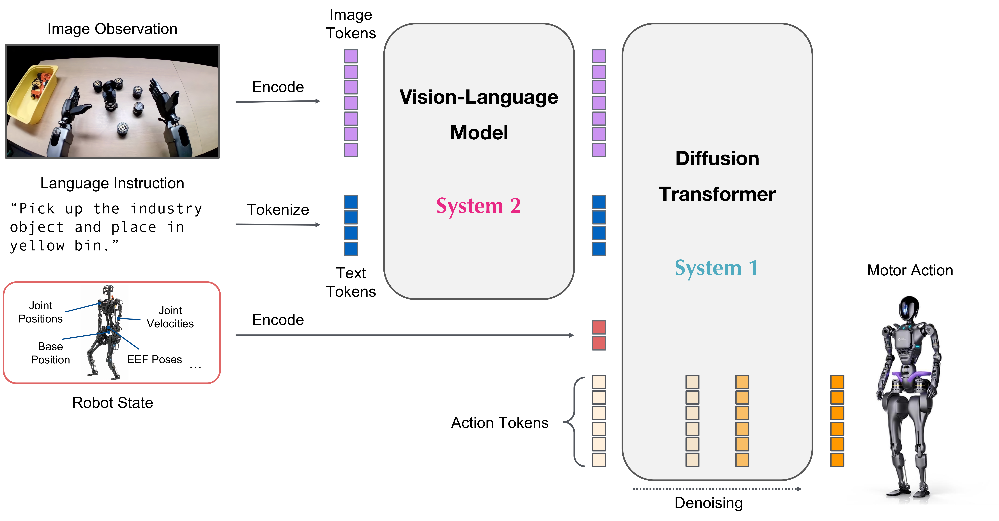
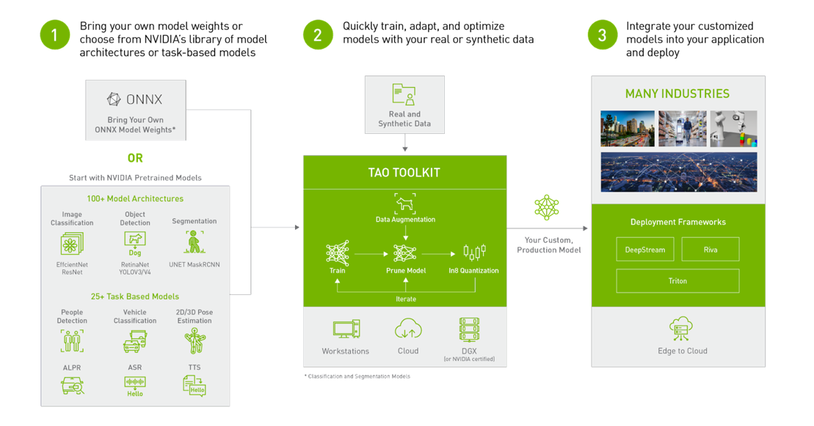
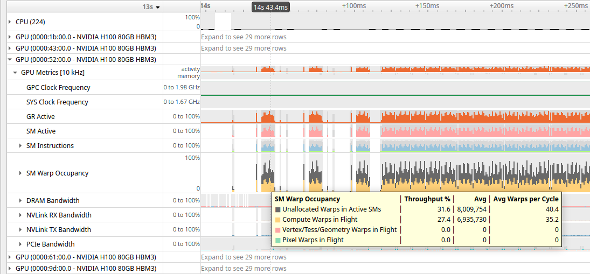
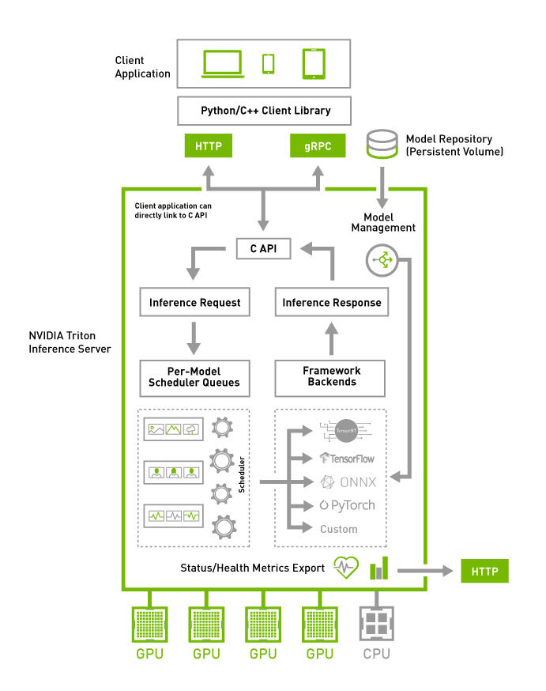
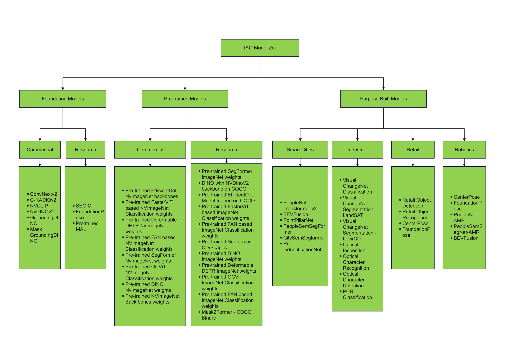
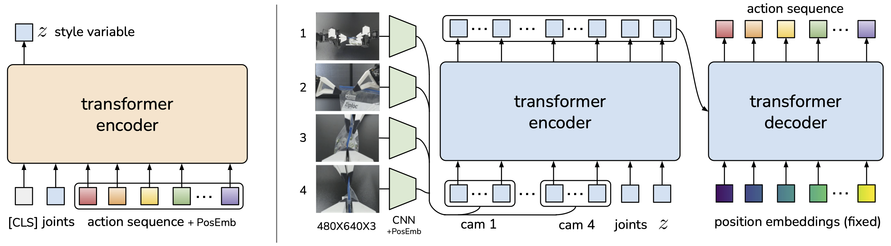

# NVIDIA AI能力：从多模态模型到机器人闭环

本报告于2026年11月4日整理，复用11月3日采集的官方版本快照，并在11月4日进一步补采模型任务目录、作者评估、端侧部署与动作策略原文。第1节扩展能力地图，第11—16节深入各类模型；其余章节保留完整GR00T与运行时分析。NVIDIA的优势是把模型后训练、GPU推理和机器人数据流接到同一工程体系；能否交付仍取决于目标本体数据、控制接口和闭环评估。下文将模型能力、推理速度和执行安全分开讨论，避免以芯片峰值算力代替机器人表现。

## 1. 能力地图与版本基线

| 工作负载 | 主要入口 | 输出及工程价值 | 使用边界 |
|---|---|---|---|
| 视觉语言动作VLA | Isaac GR00T N1.7 | 从图像、语言、状态生成动作块；提供本体微调和TRT部署 | 新本体需要动作语义、统计量和控制器适配 |
| LLM/VLM | NIM LLM/VLM 2.1.4及模型profile | 对话、视觉理解和结构化任务描述的服务入口 | 镜像backend、模型许可、GPU和显存须逐项匹配 |
| 检测、分割、姿态 | TAO 7.0.1、TensorRT、DeepStream、Isaac ROS | 数据准备、后训练、视觉推理和ROS输出 | 图像预处理、坐标系、训练域影响实际精度 |
| 强化学习策略 | Isaac Lab训练工作流、策略部署接口 | 并行采样和策略训练；将观测转换为动作 | 奖励函数与仿真动力学不会自动变成真实机器人能力 |
| 共享资源与运维 | CUDA、MPS、Nsight、Triton、BSP OTA | 并发执行、资源预算、监控及软件更新 | 不提供自动完成的机器人功能安全认证 |

以上入口依据[GR00T N1.7官方README](https://raw.githubusercontent.com/NVIDIA/Isaac-GR00T/main/README.md)、[NIM LLM/VLM容器架构](https://docs.nvidia.com/nim/large-language-models/latest/reference/architecture.html)、[TAO Toolkit 7.0.1官方Overview](https://docs.nvidia.com/tao/tao-toolkit/text/overview.html)、[DeepStream 9.2官方架构与开发指南](https://docs.nvidia.com/metropolis/deepstream/dev-guide/text/DS_Overview.html)、[GitHub IsaacLab README](https://raw.githubusercontent.com/isaac-sim/IsaacLab/main/README.md)、[Isaac ROS CUDA MPS静态GPU分区](https://nvidia-isaac-ros.github.io/concepts/gpu_partitioning/index.html)和[Jetson Linux软件包与镜像OTA指南](https://docs.nvidia.com/jetson/archives/r39.2.1/DeveloperGuide/SD/SoftwarePackagesAndTheUpdateMechanism.html)。国产框架专属适配不是本厂商的主计划必填项；跨芯片迁移主要依赖模型交换格式及替代运行时，不能将CUDA支持理解为支持所有NPU。

JetPack快照为7.2.1，集成TensorRT10.16.2；独立TensorRT支持矩阵已到11.4.1，NIM与GR00T又各自固定运行环境。这些版本不能简单按“全部升级最新”组合。GR00T端侧指南指定JetPack7.2/CUDA13.2/Python3.12，dGPU路径是另一套依赖；11.4.1的Orin DLA要求JetPack7.2.2或更高及Linux SBSA包。实施时应记录镜像digest、模型revision、BSP、驱动、CUDA、运行时和engine构建条件。[JetPack官方下载与版本矩阵](https://developer.nvidia.com/embedded/jetpack/downloads)；[TensorRT官方支持矩阵](https://docs.nvidia.com/deeplearning/tensorrt/latest/getting-started/support-matrix.html)；[GR00T官方部署与基准](https://raw.githubusercontent.com/NVIDIA/Isaac-GR00T/main/scripts/deployment/README.md)

### 1.1. 扩展能力地图：模型、算法和运行平台分别是什么

本次按机器人实际需要的任务选取代表模型，覆盖视觉几何、识别、语言/视觉推理、世界预测、操作动作、运动控制、语音和自动化。Jetson AI Lab采集目录列出56个条目，分为20个LLM、34个VLM和2个VLA；这些是网站目录分类，不能把其中全部条目视为NVIDIA自研模型或已经完成所有Jetson型号实测。下表以作者归属和实际输入输出重新整理；多任务模型会横跨多个类别。[LABMODELS官方资料](https://www.jetson-ai-lab.com/models/)；[LeRobot官方策略与部署入口](https://raw.githubusercontent.com/huggingface/lerobot/main/README.md)

| 任务类型 | 代表模型/方法 | 输入→输出 | NVIDIA平台关系 | 官方数字证据与权重入口 |
|---|---|---|---|---|
| 通用操作VLA | NVIDIA GR00T N1.7 | 图像、语言、状态→动作块 | 自研模型，Thor TRT部署 | 有完整policy-call测试，见第3节；[3B权重](https://huggingface.co/nvidia/GR00T-N1.7-3B)、[LIBERO权重](https://huggingface.co/nvidia/GR00T-N1.7-LIBERO)；[GR00T N1.7官方README](https://raw.githubusercontent.com/NVIDIA/Isaac-GR00T/main/README.md) |
| 自回归操作VLA | OpenVLA 7B | 相机、指令→动作 | 第三方PyTorch模型，需适配端侧 | 作者训练/评估说明存在；本轮未取得同条件Jetson闭环数据；[作者HF](https://huggingface.co/openvla/openvla-7b)；[OpenVLA官方模型说明](https://raw.githubusercontent.com/openvla/openvla/main/README.md) |
| flow/FAST操作VLA | π0、π0-FAST、π0.5 | 图像、语言、状态→动作序列 | 第三方OpenPI，JAX/PyTorch功能不同 | π0.5有LIBERO数字；官方权重为GCS，非HF；[Physical Intelligence官方OpenPI模型目录](https://raw.githubusercontent.com/Physical-Intelligence/openpi/main/README.md)、[OpenPI官方LIBERO闭环评估与结果](https://raw.githubusercontent.com/Physical-Intelligence/openpi/main/examples/libero/README.md) |
| 轻量操作VLA | SmolVLA | 视觉、指令、本体状态→动作 | 第三方LeRobot策略 | 已核验官方框架目录；模型细节见第13节，不把目录列名当Jetson测速；[LeRobot官方策略与部署入口](https://raw.githubusercontent.com/huggingface/lerobot/main/README.md) |
| 世界与动作联合预测 | BFL FLUX3 Action 7B | 图像、状态、指令→视频及动作 | 第三方模型；JetPack7.2/Thor示例 | 示例仅生成预测，未接机器人；[作者集合](https://huggingface.co/collections/black-forest-labs/flux-3-action)；[Jetson FLUX3 Action官方动作模型入口](https://www.jetson-ai-lab.com/models/flux-3-action) |
| 世界理解及生成 | NVIDIA Cosmos3 Edge | 文本/图像/视频/状态→文本、视频、动作 | 自研多塔模型，运行时分路 | 有reasoner解码速度，非action吞吐；[基础权重](https://huggingface.co/nvidia/Cosmos3-Edge)、[DROID策略](https://huggingface.co/nvidia/Cosmos3-Edge-Policy-DROID)；[Jetson Cosmos3 Edge官方部署](https://www.jetson-ai-lab.com/models/cosmos3-edge) |
| 物理视觉推理 | NVIDIA Cosmos Reason2 2B/8B | 图像、视频、文本→推理文本 | 自研VLM；vLLM及llama.cpp路线 | 有部署条件；8B页面默认图未显示可用测试值；[8B作者HF](https://huggingface.co/nvidia/Cosmos-Reason2-8B)；[Jetson Cosmos Reason2 8B官方部署与性能](https://www.jetson-ai-lab.com/models/cosmos-reason2-8b) |
| 文本推理与任务规划 | NVIDIA Nemotron3 Nano30B-A3B | 文本→文本/推理 | 自研混合MoE；Thor NVFP4/Orin社区AWQ | 页内基准槽为空，不引用为测速；[NVFP4权重](https://huggingface.co/nvidia/NVIDIA-Nemotron-3-Nano-30B-A3B-NVFP4)；[Jetson Nemotron3 Nano30B官方部署及性能](https://www.jetson-ai-lab.com/models/nemotron-3-nano-30b-a3b) |
| 边缘语言推理 | NVIDIA Nemotron Nano9B v2、3.5 Bolt | 文本→文本 | 自研；不同量化/运行时 | 部署入口已归档，本轮无同条件能力排名；[9B NVFP4](https://huggingface.co/nvidia/NVIDIA-Nemotron-Nano-9B-v2-NVFP4)、[Bolt GGUF](https://huggingface.co/nvidia/NVIDIA-Nemotron-3.5-Bolt-E4B-4GB)；[Jetson Nemotron Nano9B v2官方部署](https://www.jetson-ai-lab.com/models/nemotron-nano-9b-v2)、[Jetson Nemotron3.5 Bolt官方模型入口](https://www.jetson-ai-lab.com/models/Nemotron-3-5-Bolt-E4B-4GB) |
| 文档及视觉问答 | NVIDIA Nemotron Nano12B VL | 图像、文本→文本 | 自研VLM，量化checkpoint专用 | 部署说明有，统一目标任务精度未核验；[12B VL NVFP4-QAD](https://huggingface.co/nvidia/NVIDIA-Nemotron-Nano-12B-v2-VL-NVFP4-QAD)；[Jetson Nemotron Nano12B VL官方模型说明](https://www.jetson-ai-lab.com/models/nemotron-nano-12b-vl) |
| 多语言/多模态理解 | Qwen3-VL8B、Qwen3.5-4B | 图像/文本等→文本 | 阿里模型，NVIDIA提供端侧路线 | 不能用社区量化精度替代作者权重；[Qwen3-VL](https://huggingface.co/Qwen/Qwen3-VL-8B-Instruct)、[Qwen3.5](https://huggingface.co/Qwen/Qwen3.5-4B)；[Jetson Qwen3VL 8B官方部署与性能](https://www.jetson-ai-lab.com/models/qwen3-vl-8b)、[Jetson Qwen3.5 4B官方部署](https://www.jetson-ai-lab.com/models/qwen3-5-4b) |
| 紧凑多模态助手 | Gemma4 E2B | 文本、图像、音频→文本 | Google模型，Jetson vLLM/llama.cpp | 页面给能力和参数，未给统一闭环成功率；[作者权重](https://huggingface.co/google/gemma-4-E2B-it)；[Jetson Gemma4 E2B官方部署](https://www.jetson-ai-lab.com/models/gemma4-e2b) |
| 通用语言助手 | Llama3.1 8B Instruct | 文本→文本 | Meta模型，Jetson部署页 | 本轮不引用无值基准槽；[作者权重](https://huggingface.co/meta-llama/Llama-3.1-8B-Instruct)；[Jetson Llama3.1 8B官方部署与性能](https://www.jetson-ai-lab.com/models/llama3-1-8b) |
| 工具调用 | FunctionGemma270M | 指令、工具schema→函数及参数 | Google模型；Orin/Thor支持声明 | 未给本项目工具调用正确率；[作者权重](https://huggingface.co/google/functiongemma-270m-it)；[Jetson FunctionGemma官方工具调用模型](https://www.jetson-ai-lab.com/models/functiongemma) |
| 检测/分割/OCR/姿态 | PeopleNet、RT-DETR、SegFormer、OCRNet、BodyPose、CenterPose | 图像→框、mask、文本、关键点/位姿 | TAO模型族，TRT/ROS部署 | 多型号有trtexec吞吐；多数权重为NGC，未发现对应官方HF；[TAO官方预训练模型任务目录](https://docs.nvidia.com/tao/tao-toolkit/latest/text/model_zoo/overview.html) |
| 3D感知及检索 | BEVFusion、PointPillars、C-RADIO、CosmosEmbed1 | 点云/图像→3D框或embedding | TAO预训练/基础模型 | PointPillar有吞吐；[C-RADIO](https://huggingface.co/nvidia/C-RADIOv3-B)、[异常embedding](https://huggingface.co/nvidia/Cosmos-Embed1-448p-anomaly-detection)；[TAOZOO官方资料](https://docs.nvidia.com/tao/tao-toolkit/text/model_zoo/overview.html) |
| 新物体6D姿态 | FoundationPose | RGB-D、mask、CAD或参考图→姿态/追踪 | NVIDIA研究模型，Isaac ROS TRT接口 | ROS页给约7GB峰值显存；本轮未取得当前统一FPS；[FoundationPose官方6D位姿模型说明](https://raw.githubusercontent.com/NVlabs/FoundationPose/main/readme.md)、[Isaac ROS FoundationPose接口与性能](https://nvidia-isaac-ros.github.io/repositories_and_packages/isaac_ros_pose_estimation/isaac_ros_foundationpose/index.html) |
| 动作分块模仿 | ACT | 多相机、关节状态→动作块 | 第三方Transformer策略，可PyTorch训练 | 仿真教程约90%/50%，有具体任务；权重按任务训练；[ACT官方动作分块策略说明](https://raw.githubusercontent.com/tonyzhaozh/act/main/README.md) |
| 扩散控制策略 | Diffusion Policy | 视觉/低维观测→动作序列 | 第三方CNN/Transformer扩散策略 | 作者提供实验config、三个seed日志及checkpoint；无统一Jetson测试；[Diffusion Policy官方策略训练与评估](https://raw.githubusercontent.com/real-stanford/diffusion_policy/main/README.md) |
| 本体感觉运动控制 | AGILE及Lab训练的RL policy | joint/IMU等→关节动作 | NVIDIA训练/Deploy示例 | G1 MuJoCo部署教程，非本项目实机数据；[Isaac ROS Deploy AGILE](https://nvidia-isaac-ros.github.io/repositories_and_packages/isaac_ros_deploy/tutorials/deploy_agile.html) |
| 驾驶自主推理 | Alpamayo1/1.5/2 | 多相机、ego状态等→推理/轨迹 | NVIDIA自动驾驶模型；DRIVE路线另列 | 旧10B≥24GB，轨迹时域不是推理耗时；[1.5](https://huggingface.co/nvidia/Alpamayo-1.5-10B)、[2 Super](https://huggingface.co/nvidia/Alpamayo2-Super)；[Alpamayo当前模型与训练配方入口](https://raw.githubusercontent.com/NVlabs/alpamayo-recipes/main/README.md) |

以上HF链接由已归档作者README或NVIDIA部署页提供。HF模型卡采集受robots规则限制；本轮对GR00T、Parakeet及Magpie的尝试失败，因此不能把这些链接表述为已独立核验模型卡、许可全文或已下载权重。本文下载的是参考文档，不下载数十GB模型权重。页面缺少数字并不代表作者没有论文基准，而是当前已采集证据不足以填入可靠的数值比较。以此边界区分“有官方测量”“仅有部署教程”“模型卡未独立核验”。

## 2. GR00T N1.7：视觉、语言和连续动作如何连接

### 2.1 模型结构与动作语义

GR00T N1.7以Cosmos-Reason2-2B/Qwen3-VL作为视觉语言骨干，以flow-matching diffusion transformer动作头生成连续动作。骨干提供视觉和语言条件，状态编码补充当前本体状态，动作头在条件约束下多轮去噪，最后解码为动作块。官方README列出20K小时EgoScale人类视频参与预训练，并采用跨人类/机器人共享的相对末端执行器动作表示。这说明其迁移路径利用视觉及操作先验；不能据此推定一个未训练本体具有通用操作成功率。[GR00T N1.7官方README](https://raw.githubusercontent.com/NVIDIA/Isaac-GR00T/main/README.md)

**图1：GR00T N1.7官方模型架构。** 原图出处：[GR00T Architecture Image](https://raw.githubusercontent.com/NVIDIA/Isaac-GR00T/main/media/model-architecture.png)。

图中动作头与视觉语言骨干是不同计算阶段。更换相机分辨率或指令token数可能改变骨干开销；改变去噪次数和动作头结构可能改变推理耗时。模型最大状态/动作容量132、预测horizon40是接口容量及时间展开长度，既不是固定132个关节，也不是每次必须执行全部40步。README默认动作头由32层调整为16层，而下文LIBERO基准指定32块，必须保留checkpoint差别。[GR00T N1.7官方README](https://raw.githubusercontent.com/NVIDIA/Isaac-GR00T/main/README.md)；[GR00T官方部署与基准](https://raw.githubusercontent.com/NVIDIA/Isaac-GR00T/main/scripts/deployment/README.md)

相对EEF命令还需要约定参考坐标、姿态表示、单位及当前状态采样时点。若示教用世界坐标、部署用工具坐标，归一化后数值可能看似正常但含义错误。官方embodiment tag控制模态配置、state/action键和归一化；本体接入应把权重、processor、数据统计量和模态配置作为一个版本包。动作投影、限位、插值和伺服由控制系统完成。[GR00T New Embodiment](https://raw.githubusercontent.com/NVIDIA/Isaac-GR00T/main/getting_started/finetune_new_embodiment.md)；[GR00T N1.7官方README](https://raw.githubusercontent.com/NVIDIA/Isaac-GR00T/main/README.md)

### 2.2 数据、后训练与评估

| 环节 | 官方工作流 | 项目应形成的验收产物 |
|---|---|---|
| 示教整理 | GR00T-flavored LeRobot v2，多视频/state/action/任务文本 | 逐模态时间对齐记录、坐标约定、失败样本和数据划分 |
| 新本体配置 | NEW_EMBODIMENT和modality config | 观测键、动作维度、统计量与控制器对应表 |
| 后训练 | 多数据路径和mixture weights；可选择解冻模块 | 训练配置、checkpoint、目标域与留出任务结果 |
| 开环评估 | 对轨迹预测动作作误差比较 | 单位明确的误差、异常状态和量化前后差异 |
| 闭环评估 | 仿真benchmark及Policy API连接本体 | 任务成功、接触失效、恢复、超时和重复试验结果 |

该表前三列是官方入口与分析建议对应，并非已完成的实测。只看开环MSE会遗漏动作误差累积：一个小姿态误差可能在接触后造成完全不同的状态分布。训练/验证数据也应按场景、物体或任务隔离，防止同一轨迹切片泄漏使评估虚高。官方流程明确先做open-loop、再做simulation或real hardware验证。[GR00T N1.7官方README](https://raw.githubusercontent.com/NVIDIA/Isaac-GR00T/main/README.md)；[GR00T New Embodiment](https://raw.githubusercontent.com/NVIDIA/Isaac-GR00T/main/getting_started/finetune_new_embodiment.md)

README推荐推理16GB以上GPU内存，微调40GB以上；解冻LLM/视觉骨干会提高需求。共享128GB内存的Thor并不等于它拥有服务器训练的吞吐。官方单GPU训练测量冻结语言和视觉骨干，只训练projector、diffusion及VLLN；包含BF16前向、反向和AdamW更新，不含data loading，也不是分布式结果。[GR00T N1.7官方README](https://raw.githubusercontent.com/NVIDIA/Isaac-GR00T/main/README.md)；[GR00T Hardware Guide](https://raw.githubusercontent.com/NVIDIA/Isaac-GR00T/main/getting_started/hardware_recommendation.md)

| 官方训练设备 | batch1一步中位ms | 最大本地batch | 最大batch样本/秒 |
|---|---:|---:|---:|
| H100 80GB | 115.5 | 409 | 192.57 |
| L40 | 190.5 | 213 | 56.42 |
| RTX PRO6000 Blackwell Server 96GB | 119.3 | 502 | 131.33 |

表格摘自README。同一双相机工作负载，每候选batch两步warmup、五步计时，以新进程扩大并二分至相邻通过/OOM边界。此表帮助估计后训练资源，不提供从头预训练成本或实际数据管线吞吐。[GR00T N1.7官方README](https://raw.githubusercontent.com/NVIDIA/Isaac-GR00T/main/README.md)

## 3. VLA端侧加速：性能条件比峰值TFLOPS更重要

### 3.1 导出及量化管线

GR00T提供`dit_only`、`action_head`、`full_pipeline`三种TRT导出路径。完整路径覆盖视觉Transformer、LLM、状态/动作编码、DiT和动作解码，仍保留少量PyTorch连接操作。导出→engine构建→输出比较→benchmark四步应分别留日志；batch为静态维度，换batch需要重新导出构建。engine必须在目标设备验证，不能把另一平台成功反序列化或某个组件时间相加当成端到端通过。[GR00T官方部署与基准](https://raw.githubusercontent.com/NVIDIA/Isaac-GR00T/main/scripts/deployment/README.md)；[TensorRT构建、运行与对象生命周期](https://docs.nvidia.com/deeplearning/tensorrt/latest/architecture/how-trt-works.html)

Thor优化profile包括cross-attention K/V缓存、projection fusion和CUDA Graphs，量化可选FP8或mixed NVFP4，默认仍为baseline/BF16。量化需要目标本体代表性观测作calibration，且应将baseline和优化engine放在不同目录，保留相同checkpoint、输入和软件栈作对比。低精度减少算量和带宽负担，但应逐物体、逐任务检查动作偏差及闭环退化；神经网络输出cosine接近不替代接触任务验证。[GR00T官方部署与基准](https://raw.githubusercontent.com/NVIDIA/Isaac-GR00T/main/scripts/deployment/README.md)；[TensorRT官方性能与测量指南](https://docs.nvidia.com/deeplearning/tensorrt/latest/performance/best-practices.html)

### 3.2 官方完整policy-call基准

| 设备 | PyTorch eager ms | torch.compile ms | TRT完整管线ms | 优化+mixed NVFP4 ms |
|---|---:|---:|---:|---:|
| H100 80GB HBM3 | 101.5 | 53.4 | 22.9 | 未测 |
| RTX PRO6000 Blackwell Server 96GB | 75.7 | 52.1 | 24.7 | 未测 |
| L40 | 123.7 | 66.8 | 35.0 | 未测 |
| DGX Spark | 200.8 | 183.1 | 116.6 | 未测 |
| AGX Thor MAXN | 106.8 | 100.5 | 76.8 | 35.6 |
| Jetson Orin MAXN | 357.9 | 224.3 | 149.0 | 未测 |

测量对象为N1.7-LIBERO的`libero_10` checkpoint、32 DiT blocks、batch1、两路256×256相机、四次去噪、horizon40。含preprocessing及动作解码，不含RPC；每backend三轮，每轮10warmup及20timed，合并60个样本报告中位。CPU线程为8/interop1，Jetson使用MAXN并开启jetson_clocks，固定观测、平台分别配置运行时。[GR00T官方部署与基准](https://raw.githubusercontent.com/NVIDIA/Isaac-GR00T/main/scripts/deployment/README.md)

35.6ms倒数约28.1Hz，只表示该优化配置的动作块重规划率；默认完整TRT的76.8ms约13.0Hz。动作执行、相机采集、重规划各有时钟。采用chunk及异步执行可以使执行率高于重规划率，但会增加使用旧观测动作的风险，需限定动作队列有效期及新观测重规划策略。Hardware Guide另列单相机四次去噪的频率表，Thor12.4Hz和Orin6.6Hz，条件与双相机deployment表不同，不合并排名。[GR00T官方部署与基准](https://raw.githubusercontent.com/NVIDIA/Isaac-GR00T/main/scripts/deployment/README.md)；[GR00T Hardware Guide](https://raw.githubusercontent.com/NVIDIA/Isaac-GR00T/main/getting_started/hardware_recommendation.md)

官方还报告H100上单一LIBERO灶台任务20episodes：PyTorch20/20、TRT19/20；这只是一个仿真任务、小样本的闭环比较，不能外推所有LIBERO、真实G1或mixed NVFP4可靠性。目标机器人需要独立闭环评估。[公开资料未披露]该基准未给目标项目的最坏情况时延、温升降频后P99和实际动作接触风险。[GR00T官方部署与基准](https://raw.githubusercontent.com/NVIDIA/Isaac-GR00T/main/scripts/deployment/README.md)

## 4. LLM/VLM：任务语义与服务运行时

当前NIM LLM/VLM2.1.4把单一vLLM或SGLang backend和代理打包。代理提供OpenAI兼容推理API、TLS/CORS、live/ready健康探针，backend加载模型并执行GPU推理。每个镜像只有自己的backend及profile；旧1.x“TensorRT-LLM优先，再vLLM/SGLang”自动链已移除。模型profile包含精度、tensor parallel、LoRA与内存要求；应使用镜像列出的完整64字符ID或描述，不能自行拼一个名字当成可运行profile。[NIM LLM/VLM容器架构](https://docs.nvidia.com/nim/large-language-models/latest/reference/architecture.html)；[NIM模型profile选择与显存条件](https://docs.nvidia.com/nim/large-language-models/latest/deployment/model-profiles-and-selection.html)

| 服务状态或资源 | 官方机制 | 机器人接入的含义 |
|---|---|---|
| live | 代理进程可用 | 不说明权重加载完成 |
| ready | backend健康且模型就绪 | 控制任务发起前等待；重启期间保持本地状态机 |
| profile可运行 | 估计权重、KV cache、activations及overhead | 上下文、并发、视觉token都会争用内存 |
| low-memory profile | 缩短max-model-len可能可运行 | 限制输入加输出总长度，须符合任务需求 |
| API响应 | 对话、completion、embedding等 | 应由任务解析器校验后转换为目标，而非直接执行语言输出 |

此表依据[NIM LLM/VLM容器架构](https://docs.nvidia.com/nim/large-language-models/latest/reference/architecture.html)和[NIM模型profile选择与显存条件](https://docs.nvidia.com/nim/large-language-models/latest/deployment/model-profiles-and-selection.html)。LLM可以把“取桌上的杯子”变为物体/目标/约束描述，VLM辅助视觉关系解释，但实际位姿、可达性和碰撞约束应由机器人数据链校验。输出schema、目标白名单、坐标和置信度检查属于集成建议。[公开资料未披露]未找到可覆盖所有NIM模型在Thor的统一支持或同条件延迟表，因此不声称任一服务器NIM镜像均可在Jetson直接运行。

## 5. 视觉模型：从训练域到机器人坐标

TAO7.0.1提供模型、数据转换、自动标注、领域适配、蒸馏及部署工作流。Execution SDK将作业派发到local Docker、Brev、SLURM或Kubernetes等backend，skill bank描述可用能力；这些入口便利训练编排，但不是数据质量认证。传统检测/分割用于定位物体及可通行区域，姿态估计用于将物体模型映射到六维位姿，输出还需要相机内外参、深度质量及遮挡处理。[TAO Toolkit 7.0.1官方Overview](https://docs.nvidia.com/tao/tao-toolkit/text/overview.html)

**图2：NVIDIA官方TAO训练与部署软件栈。** 原图出处：[TAO Toolkit 7.0.1官方Overview](https://docs.nvidia.com/tao/tao-toolkit/text/overview.html)。

图展示CUDA/cuDNN与模型训练、TensorRT部署之间的层次。它不能说明所有训练算子、全部模型及backend都适用于每个Jetson SKU。部署时应检查模型对应导出路线和TensorRT版本，显式Q/DQ与ONNX中的量化语义需要保持；INT8/FP8支持按模型及平台判断。[TAO Toolkit 7.0.1官方Overview](https://docs.nvidia.com/tao/tao-toolkit/text/overview.html)；[TensorRT官方支持矩阵](https://docs.nvidia.com/deeplearning/tensorrt/latest/getting-started/support-matrix.html)

DeepStream适合多视频、批量视觉推理与metadata处理，Isaac ROS适合ROS消息和机器人模块集成。选择依据是下游消费者及数据路径：视频分析吞吐最大化与机器人单帧延迟最小化可能需要不同batch和队列配置。输入resize、色序、归一化、ROI及坐标回映射必须与训练一致；不能仅凭模型mAP推定抓取成功。[DeepStream 9.2官方架构与开发指南](https://docs.nvidia.com/metropolis/deepstream/dev-guide/text/DS_Overview.html)；[TAO Toolkit 7.0.1官方Overview](https://docs.nvidia.com/tao/tao-toolkit/text/overview.html)；[Isaac ROS原生Buffer概念文档](https://nvidia-isaac-ros.github.io/concepts/rosidl_buffer/index.html)

## 6. 强化学习：训练吞吐与端侧执行分离

Isaac Lab提供机器人学习框架和多后端训练流程，GPU并行环境用于加快采样。强化学习策略常将关节状态、基体姿态、接触或历史观测映射为目标动作；具体输出是位置、速度还是力矩由环境定义。奖励函数、动作缩放、控制频率、观测归一化和历史窗口都是策略的一部分，权重文件无法独立说明其适配范围。[GitHub IsaacLab README](https://raw.githubusercontent.com/isaac-sim/IsaacLab/main/README.md)；[Isaac Lab当前安装与后端选择指南](https://isaac-sim.github.io/IsaacLab/main/source/isaaclab/installation.html)

端侧策略推理可以比VLA小得多，但全身运动需要正确的状态估计与控制执行链。Isaac ROS Deploy提供策略、本体和converter的连接方式及ROS2Control接口；它解决软件打包和转换，不保证策略在真实硬件上稳定。[公开资料未披露]本报告未取得统一覆盖RL策略在Orin/Thor的模型尺寸、P99、功耗和实机成功率基准，不能用GR00T表格替代RL性能。仿真随机化及迁移验证另见05报告。[Isaac ROS Deploy Concept](https://nvidia-isaac-ros.github.io/repositories_and_packages/isaac_ros_deploy/concepts/how_it_works.html)

## 7. CPU、GPU、DLA和PVA：如何预算并发

| 资源 | 适合任务及官方接口 | 关键限制 | 项目调度建议 |
|---|---|---|---|
| CPU | ROS调度、任务状态机、I/O、部分控制 | 抢占与通信仍影响GPU输入新鲜度 | 测量线程、callback队列、控制周期 |
| GPU/Tensor Core | VLA、视觉及神经网络；CUDA/TRT | 共享内存、带宽及执行队列 | 先预算最坏并发再调stream、Graph及batch |
| Orin DLA | 支持层及精度的神经网络分区 | Nano无DLA；Thor无DLA；版本约束明确 | 验证整图可下放范围和GPU fallback开销 |
| PVA/VPI | 支持平台上的确定功能视觉处理 | 不是通用LLM/VLA加速器 | 将可支持的前处理移出GPU后重新测全链路 |
| MPS静态SM分区 | 多ROS进程分配固定SM份额 | 不分割GPU内存，不是完全隔离 | 固定份额后验证干扰、OOM和余量 |

资源事实依据[CUDA编程模型与线程层级](https://docs.nvidia.com/cuda/cuda-programming-guide/01-introduction/programming-model.html)、[TensorRT官方支持矩阵](https://docs.nvidia.com/deeplearning/tensorrt/latest/getting-started/support-matrix.html)、[Jetson Orin官方规格](https://www.nvidia.com/en-us/autonomous-machines/embedded-systems/jetson-orin/)、[PVA SDK 2.10.1处理器与编程架构](https://docs.nvidia.com/pva/sdk/2.10.1/architecture.html)、[VPI 4.1算法与平台说明](https://docs.nvidia.com/vpi/index.html)、[Isaac ROS CUDA MPS静态GPU分区](https://nvidia-isaac-ros.github.io/concepts/gpu_partitioning/index.html)。这里不虚构一个Jetson通用NPU：Orin的DLA与GPU角色不同，Thor没有DLA。TRT11.4.1支持Orin DLA的条件与JetPack10.x路线也应分别评估。

MPS包按chunk与SM数量建立分区，将`CUDA_MPS_SM_PARTITION`写入进程环境，当前前提包括MPS control版本13010以上。分区给感知固定份额后仍可能受到其他进程的内存带宽及容量影响；一个LLM长上下文OOM可能影响整个任务。实时CPU内核、GPUstream优先级、MPS份额各解决不同问题，不能组合后直接称硬实时认证。[Isaac ROS CUDA MPS静态GPU分区](https://nvidia-isaac-ros.github.io/concepts/gpu_partitioning/index.html)；[Jetson Real Time R38 2](https://docs.nvidia.com/jetson/archives/r38.2/DeveloperGuide/SD/Kernel/RealTimeKernel.html)

**图3：Nsight Systems官方GPU指标时间线示例。** 原图出处：[Nsight Systems官方User Guide](https://docs.nvidia.com/nsight-systems/UserGuide/index.html)。

图是分析工具截图，非本项目测量。应把相机采集、数据转换、推理、ROS发布和控制执行放在同一时间轴定位等待与拷贝，检查异步调用的实际GPU完成时间。报告建议同时记录P50/P95/P99、观测年龄、丢帧、内存峰值及持续运行温度；没有这些数据时，单次median不足以判断响应性。[Nsight Systems官方User Guide](https://docs.nvidia.com/nsight-systems/UserGuide/index.html)；[TensorRT官方性能与测量指南](https://docs.nvidia.com/deeplearning/tensorrt/latest/performance/best-practices.html)

## 8. MLOps：模型版本到机器人软件版本

Triton提供模型仓库、backend、dynamic/sequence batching及监控；NONE、EXPLICIT、POLL是不同模型管理模式，官方不推荐POLL用于生产。无状态视觉可研究dynamic batching，带状态模型需要明确sequence语义，而机器人的动作队列又不同于推理server的sequence scheduler。服务调度等待时间必须计入闭环延迟。[Triton Model Management](https://raw.githubusercontent.com/triton-inference-server/server/main/docs/user_guide/model_management.md)；[Triton Batching](https://raw.githubusercontent.com/triton-inference-server/server/main/docs/user_guide/batcher.md)；[Triton Inference Server官方架构](https://raw.githubusercontent.com/triton-inference-server/server/main/docs/user_guide/architecture.md)

**图4：Triton官方推理服务架构。** 原图出处：[Triton官方架构原图](https://raw.githubusercontent.com/triton-inference-server/server/main/docs/user_guide/images/arch.jpg)。

图中的调度、backend和model repository解决服务运行；模型效果回归、数据标注质量和机器人失效恢复需要上层系统。Triton官方metrics区分请求、排队、compute以及GPU资源指标，计数/时间指标与histogram的使用方式须按所部署版本核查，不把server平均延迟当成完整机器人P99。[Triton官方监控指标](https://docs.nvidia.com/deeplearning/triton-inference-server/user-guide/docs/user_guide/metrics.html)；[Triton Inference Server官方架构](https://raw.githubusercontent.com/triton-inference-server/server/main/docs/user_guide/architecture.md)

| 生命周期阶段 | 可复用工具 | 必须一起管理的产物 | 建议退出门槛 |
|---|---|---|---|
| 数据与训练 | TAO、GR00T、Lab及训练backend | 数据revision、许可、模态、seed、训练配置 | 留出任务及异常场景通过 |
| 编译及验证 | ONNX、TRT、量化工具 | engine、GPU型号、精度、calibration、运行时 | 输出一致性与目标设备可加载 |
| 服务发布 | Triton/NIM、容器编排 | 镜像digest、model/profile、API、健康探针 | 并发、重启、断网和回退演练 |
| 端侧更新 | BSP镜像/软件包OTA、项目模型发布 | BSP与模型兼容矩阵、控制配置 | 更新前后闭环回归与可恢复性 |
| 持续改进 | Nsight、server metrics、任务日志 | 推理指标加任务/安全事件 | 漂移触发再采样或回退，而非自动接受新模型 |

该表是基于[TAO Toolkit 7.0.1官方Overview](https://docs.nvidia.com/tao/tao-toolkit/text/overview.html)、[GR00T官方部署与基准](https://raw.githubusercontent.com/NVIDIA/Isaac-GR00T/main/scripts/deployment/README.md)、[Triton Model Management](https://raw.githubusercontent.com/triton-inference-server/server/main/docs/user_guide/model_management.md)、[NIM LLM/VLM容器架构](https://docs.nvidia.com/nim/large-language-models/latest/reference/architecture.html)和[Jetson Linux软件包与镜像OTA指南](https://docs.nvidia.com/jetson/archives/r39.2.1/DeveloperGuide/SD/SoftwarePackagesAndTheUpdateMechanism.html)整理的工程建议。BSP OTA是软件更新能力，不等于包含训练数据治理、跨本体模型注册、灰度发布和任务级监控的完整机器人云平台。[公开资料未披露]尚无一个公开的统一SLA覆盖上述全部组件及整机；商业支持应按组件和合同核对。

## 9. 开源、权重及商用边界

| 官方项目 | Stars快照 | 默认分支最近提交UTC | 代码许可与来源 |
|---|---:|---|---|
| [NVIDIA Isaac GR00T官方仓库](https://github.com/NVIDIA/Isaac-GR00T) | 8,307 | 2026-10-28 21:46:01 | Apache-2.0；[GR00T License](https://raw.githubusercontent.com/NVIDIA/Isaac-GR00T/main/LICENSE)、[GR00T Repo Metadata](https://api.github.com/repos/NVIDIA/Isaac-GR00T)、[GR00T Recent Commit](https://api.github.com/repos/NVIDIA/Isaac-GR00T/commits?per_page=1) |
| [Triton Project Page](https://github.com/triton-inference-server/server) | 11,127 | 2026-11-03 02:40:51 | BSD-3-Clause；[Triton License](https://raw.githubusercontent.com/triton-inference-server/server/main/LICENSE)、[Triton Repo Metadata](https://api.github.com/repos/triton-inference-server/server)、[Triton Recent Commit](https://api.github.com/repos/triton-inference-server/server/commits?per_page=1) |
| [TAO PyTorch官方仓库](https://github.com/NVIDIA/tao_pytorch_backend) | 132 | 2026-10-16 22:17:12 | Apache-2.0；[TAO PyTorch代码许可](https://raw.githubusercontent.com/NVIDIA/tao_pytorch_backend/main/LICENSE)、[TAO PyTorch仓库元数据快照](https://api.github.com/repos/NVIDIA/tao_pytorch_backend)、[TAO PyTorch最近提交快照](https://api.github.com/repos/NVIDIA/tao_pytorch_backend/commits?per_page=1) |

均为11月3日API快照，Stars不能证明商业采用或维护响应时间。GR00T README声称N1.7可Apache2商用，但其Cosmos骨干下载需要访问授权。11月4日本次尝试获取GR00T与Cosmos-Reason2模型卡时，下载器无法确认Hugging Face的robots规则，按规则停止，失败记录已留存。因此未取得独立权重许可文本，不把代码许可直接外推到所有骨干、权重及数据集。商业部署仍需逐模型许可复核；本次未下载受限权重。[GR00T N1.7官方README](https://raw.githubusercontent.com/NVIDIA/Isaac-GR00T/main/README.md)

## 10. 选型及验收结论

NVIDIA适合既需要多模态模型后训练，又需要端侧多路视觉与机器人软件集成的项目。对VLA先固定本体、任务和动作语义，再按官方完整policy-call条件建立baseline；对LLM先固定profile和上下文/并发预算；对视觉先确保标定与训练域一致；对RL先验证观测/动作/控制周期对应。上述四条路线共享CUDA工具链，但验收对象不同。

最低可交付证据应包括目标设备engine加载、输入输出与动作坐标一致性、量化前后闭环结果、共享负载下时延分布、热稳态资源余量，以及断网/模型超时/进程重启时的控制行为。本报告提供官方能力及实施门槛，没有完成这些实机验收；未披露的量产成本、目标任务可靠性和最坏时延不能由官方峰值或演示补齐。[GR00T官方部署与基准](https://raw.githubusercontent.com/NVIDIA/Isaac-GR00T/main/scripts/deployment/README.md)；[TensorRT官方性能与测量指南](https://docs.nvidia.com/deeplearning/tensorrt/latest/performance/best-practices.html)；[NIM模型profile选择与显存条件](https://docs.nvidia.com/nim/large-language-models/latest/deployment/model-profiles-and-selection.html)；[Isaac ROS CUDA MPS静态GPU分区](https://nvidia-isaac-ros.github.io/concepts/gpu_partitioning/index.html)

## 11. 视觉感知模型：闭集识别、开放语义与几何估计

### 11.1 按任务选模型，而不是按名字选框架

TAO将模型分为基础模型、针对任务的预训练模型及backbone。PeopleNet适合人员检测，RT-DETR Warehouse面向仓储对象；CitySemSegFormer输出像素语义，BodyPose输出人体关键点，CenterPose输出类别级物体位姿；BEVFusion融合相机和点云，PointPillars处理点云3D检测，OCR流程先定位文字区域再识别文本。它们的输出可以进入导航、抓取或作业状态识别，不能相互替代。例如“看见杯子”不等于得到经过标定、可供抓取的工具坐标目标。[TAO官方预训练模型任务目录](https://docs.nvidia.com/tao/tao-toolkit/latest/text/model_zoo/overview.html)

**图5：TAO官方模型任务树，等比例缩小阅读版，原始PNG保留。** 原图出处：[TAO官方预训练模型任务目录](https://docs.nvidia.com/tao/tao-toolkit/latest/text/model_zoo/overview.html)。

图按任务组织模型入口，显示基础表征与下游检测、分割等模型的关系；它不是所有权重都已为目标Jetson编译的清单。C-RADIO/NV-DINOv2/NV-CLIP及CosmosEmbed1提供视觉表征、匹配或异常检索，GroundingDINO/MaskGroundingDINO加入文本条件检测/分割，SegIC和ODISE用于不同语义分割路线。工业质检还可选择Visual ChangeNet与PCB模型。开放语义模型适合扩大对象覆盖，固定场景的闭集模型可能更容易标定阈值与计算预算；两者都要用目标场景数据评估漏检与误检。ODISE或research-only数据版本的许可不能套用整个TAO商业使用声明。[TAO官方预训练模型任务目录](https://docs.nvidia.com/tao/tao-toolkit/latest/text/model_zoo/overview.html)

### 11.2 可核查的Orin NX视觉吞吐

下表摘取官方latest model zoo的**Orin NX16GB、GPU、TensorRT trtexec**栏；精度、输入与batch均保持原文。它测的是指定网络吞吐，不能解释为同速率的相机到机械动作闭环。[TAO官方预训练模型任务目录](https://docs.nvidia.com/tao/tao-toolkit/latest/text/model_zoo/overview.html)

| 模型/架构 | 输入尺寸 | 精度 | GPU batch | 官方GPU FPS | 对机器人用途的解释 |
|---|---|---|---:|---:|---|
| PeopleNet/ResNet18 | 960×544×3 | INT8 | 16 | 400 | 大batch吞吐；单帧人员避障延迟需另测 |
| PeopleNet v2.3/ResNet34 | 960×544×3 | INT8 | 32 | 314 | 不能与不同batch直接比较单帧延迟 |
| BodyPose | 288×384×3 | INT8 | 16 | 195 | 姿态网络吞吐，非手势任务准确率 |
| PointPillar | [公开资料未披露] | FP16 | 1 | 38 | 输入形状在该表空缺，点数预算须另固定 |
| ActionRec3D RGB | 224×224×32×3 | FP16 | 4 | 38 | 时间窗口动作识别，含多帧输入 |
| OCRNet/ResNet50+Bi-LSTM pruned | 32×100×3 | FP16 | 64 | 1373 | 小文字crop识别，不含OCDNet定位 |
| OCDNet/DCN-RN18 | 640×640×3 | FP16 | 2 | 45 | 完整OCR还需拼接定位、裁剪和识别 |
| CitySemSegFormer v2/MIT | 1024×1024×3 | FP16 | 1 | 1.9 | 高分辨率分割可能成为实时管线瓶颈 |
| CenterPose/DLA34 | 512×512×3 | FP16 | 1 | 27.74 | DLA34为backbone名称，此行实际是GPU数据 |

PeopleNet/ResNet18另外给DLA1+DLA2合计batch16、300FPS；这是两个DLA栏的吞吐，不能写成单DLA300FPS，也不能与GPU400相加承诺整机700FPS。该汇总表未充分给出JetPack、时钟、功耗、热稳态、测量时长及p99延迟，不能据此宣称2026最新BSP的持续性能。它作为选型参考有价值，最终要在目标engine、真实图像预处理和共享负载下重测。[TAO官方预训练模型任务目录](https://docs.nvidia.com/tao/tao-toolkit/latest/text/model_zoo/overview.html)

### 11.3 FoundationPose：检测之后还需要几何与追踪

FoundationPose处理新物体6D姿态估计及tracking，支持CAD模型路径或少量参考图路径，核心价值是无需为每个新物体重新训练完整专用姿态网络。但实际管线仍需要RGB-D、物体mask、相机内参和对象几何，mask或深度错误会传到姿态。官方README中2024年3月BOP榜单是历史结果，不作为2026年当前排名。[FoundationPose官方6D位姿模型说明](https://raw.githubusercontent.com/NVlabs/FoundationPose/main/readme.md)

Isaac ROS页面说明FP32管线峰值GPU内存约7GB，建议至少8GB；TensorRT10.3+因FP16精度损失使用FP32，Thor构建engine约10—15分钟。构建时间是离线准备成本，不是推理延迟。首次位姿估计比已初始化追踪更重，官方建议可交错调度，或为固定对象训练CenterPose提升运行性能。部署验收应分别统计初始化、tracking、丢失后重定位与姿态误差；本轮没有取得该版本统一FPS表，不能套用旧版数字。[Isaac ROS FoundationPose接口与性能](https://nvidia-isaac-ros.github.io/repositories_and_packages/isaac_ros_pose_estimation/isaac_ros_foundationpose/index.html)

## 12. 语言、视觉推理和世界模型：能力与资源路径

### 12.1 Nemotron、Qwen、Gemma与Llama承担什么

Nemotron平台覆盖文本推理、视觉、语音、检索和安全模型，是模型家族而非一个统一checkpoint。Nano30B-A3B是Mamba-2、attention与MoE的混合架构，页面列128个expert加共享expert，每token激活6个expert；正文称约3.5B活跃参数，而摘要写3B，保留这一口径差异，不能把活跃参数当全部权重存储量。Thor路径用官方NVFP4，Orin路径使用社区AWQ，二者精度与许可均须独立验收。开启推理trace会增加输出长度及首个业务答案延迟，关闭thinking也需要检查任务正确率。[Jetson Nemotron3 Nano30B官方部署及性能](https://www.jetson-ai-lab.com/models/nemotron-3-nano-30b-a3b)；[NVIDIA Nemotron官方模型平台](https://www.nvidia.com/en-us/ai-data-science/foundation-models/nemotron/)

Nano9B v2与Nano12B VL应按文本和视觉输入分工，Bolt的Q4_K_M约4GB是模型内存目标，完整运行还含KV cache与服务开销。Qwen3-VL8B适用于视觉理解，Qwen3.5-4B提供较紧凑路径，Llama3.1-8B是语言模型；这些第三方模型在NVIDIA平台运行，不代表由NVIDIA训练或获得所有本体认证。社区AWQ/NVFP4与作者原始checkpoint需要明确仓库归属。[Jetson Nemotron Nano9B v2官方部署](https://www.jetson-ai-lab.com/models/nemotron-nano-9b-v2)；[Jetson Nemotron Nano12B VL官方模型说明](https://www.jetson-ai-lab.com/models/nemotron-nano-12b-vl)；[Jetson Nemotron3.5 Bolt官方模型入口](https://www.jetson-ai-lab.com/models/Nemotron-3-5-Bolt-E4B-4GB)；[Jetson Qwen3VL 8B官方部署与性能](https://www.jetson-ai-lab.com/models/qwen3-vl-8b)；[Jetson Qwen3.5 4B官方部署](https://www.jetson-ai-lab.com/models/qwen3-5-4b)；[Jetson Llama3.1 8B官方部署与性能](https://www.jetson-ai-lab.com/models/llama3-1-8b)

Gemma4 E2B页面区分2.3B有效参数和含embedding的5.1B参数，给128K上下文及音频/图像理解路线，音频片段说明为最多30秒。部署页顶部含视频输入，而详细I/O只列文本、图像、音频，不能从摘要推断原生连续视频处理契约。模型支持多模态并不意味着所选llama.cpp/vLLM版本已经支持所有输入；上下文上限也不是目标设备可承担的并发内存预算。[Jetson Gemma4 E2B官方部署](https://www.jetson-ai-lab.com/models/gemma4-e2b)

### 12.2 Cosmos Reason与Cosmos3 Edge的边界

Cosmos Reason2是物理场景理解VLM，输出空间、时序等推理文本，并不直接输出关节动作。8B的vLLM教程实际加载NGC FP8 checkpoint，服务max-model-len设8192；模型目录的256K上限与该运行配置不同。Orin Nano推荐社区GGUF路径，不能据此宣称同等精度。页面“Benchmark”默认组合无数值，本报告不用图标题NVFP4/W4A16替换教程FP8条件。[Jetson Cosmos Reason2 8B官方部署与性能](https://www.jetson-ai-lab.com/models/cosmos-reason2-8b)

Cosmos3 Edge由约2.4B reasoner和生成塔组成，约4B整体。一个权重包分为reasoner的vLLM文本/视觉服务，以及生成/动作的vLLM-Omni服务。只加载reasoner时的8GB Orin Nano验证，不足以证明视频生成和action policy也在8GB同负载运行。页面给出DROID后训练动作权重，但一处写每次32动作，I/O又写16×action-dim；动作horizon存在页内冲突，应以实际checkpoint配置和返回tensor核验，不在本报告擅自统一。[Jetson Cosmos3 Edge官方部署](https://www.jetson-ai-lab.com/models/cosmos3-edge)

| Cosmos3 Edge reasoner平台 | 文本decode tok/s | 图像decode tok/s | 视频decode tok/s | 官方条件 |
|---|---:|---:|---:|---|
| Thor T5000 | 68.2 | 67.2 | 67.1 | BF16、vLLM、batch1、streaming chat、greedy、最多128输出token |
| Thor T4000 | 63.9 | 65.6 | 65.5 | 同上 |
| AGX Orin64GB | 44.1 | 45.2 | 45.1 | 同上 |

数字来自同一官方页的正文性能表，而不是空的交互图。该页还称8并发时T5000约293tok/s、AGX Orin约171tok/s聚合吞吐。单请求和聚合吞吐必须分别使用；正文未充分固定各模态输入尺寸/帧数、engine revision、功耗与TTFT，页内ISL1705的图标题不能自动证明三个正文测试都采用相同图像/video输入。不能用decode速率推算首帧感知、完整推理答案延迟、生成视频FPS或机器人控制频率。[Jetson Cosmos3 Edge官方部署](https://www.jetson-ai-lab.com/models/cosmos3-edge)

## 13. 操作模型与动作策略：四种不同的泛化路径

### 13.1 OpenVLA与OpenPI

OpenVLA7B将视觉和指令条件连接到动作预测，官方明确不作为通用视觉聊天模型。当前README推荐2025年3月OFT recipe；不能把LoRA训练中的action_accuracy近100%当新场景成功率，尤其Bridge数据可能已见于预训练。作者提供base及四个LIBERO微调HF入口，但本轮没有归档OFT论文的完整对照实验，所以不引用未核验的“提速倍数”或综合成功率。约27GB的LoRA建议也不能推广到所有batch、图像数和模型版本。[OpenVLA官方模型说明](https://raw.githubusercontent.com/openvla/openvla/main/README.md)

OpenPI提供π0 flow-matching、π0-FAST动作token自回归及π0.5 knowledge-insulation路线。π0.5目前只支持flow head；JAX/PyTorch的功能矩阵不同，不能承诺FAST、LoRA或FSDP在两条路线都可用。作者建议推理>8GB、LoRA>22.5GB、full finetuning>70GB，这些是单GPU资源建议，非Jetson速度测试。官方预训练checkpoint放在`gs://openpi-assets/checkpoints/`，不编造对应“官方HF仓库”。[Physical Intelligence官方OpenPI模型目录](https://raw.githubusercontent.com/Physical-Intelligence/openpi/main/README.md)

| π0.5官方checkpoint | Spatial | Object | Goal | Libero10 | 平均 | 评估出处 |
|---|---:|---:|---:|---:|---:|---|
| pi05_libero、finetuned @30k | 98.8 | 98.2 | 98.0 | 92.4 | 96.85 | [OpenPI官方LIBERO闭环评估与结果](https://raw.githubusercontent.com/Physical-Intelligence/openpi/main/examples/libero/README.md) |

该表是作者公布的LIBERO任务成功率百分数，checkpoint为`gs://openpi-assets/checkpoints/pi05_libero/`，训练配置`pi05_libero`。该README未完整披露每项episode数、置信区间及服务器GPU型号，数字适合核验作者结果，不可直接与第3节GR00T的单任务20episode实测或真实工厂表现作排名；两者的任务划分、checkpoint和评估协议必须先对齐。官方给Docker/server-client复现实例，本项目没有运行它。[OpenPI官方LIBERO闭环评估与结果](https://raw.githubusercontent.com/Physical-Intelligence/openpi/main/examples/libero/README.md)

### 13.2 ACT：较小动作策略为何仍重要

**图6：ACT作者官方CVAE训练与Transformer动作解码架构。** 原图出处：[ACT与ALOHA作者项目及实验](https://tonyzhaozh.github.io/aloha/)。

图左是训练期CVAE encoder，将动作序列和关节观测编码为风格变量z；图右策略将多视角图像、关节状态和z作为条件，Transformer decoder输出动作块。推理时移除CVAE encoder，将z置为先验均值零，因此训练与部署图不同。作者2023年项目实验使用每任务50条示教、四路480×640RGB、50Hz关节位置动作和chunk90，训练/测试物体位置沿15cm范围随机化；这些具体研究条件与README的chunk100仿真配置不同。页面摘要中开透明调料杯、插电池约80—90%的表述属于该研究，不能视为当前Jetson产品性能。[ACT与ALOHA作者项目及实验](https://tonyzhaozh.github.io/aloha/)

ACT用Transformer生成未来动作块，适合通过任务示教学习多相机、双臂等固定操作。动作chunk减少逐步预测的误差积累，temporal aggregation对重叠预测进行融合；它属于模仿学习控制策略，不是具备开放语言知识的通用VLA。官方教程包含transfer cube和bimanual insertion仿真，示例chunk_size100、hidden_dim512、batch8、2000epochs、seed0；作者称成功率约90%及50%。这是教程期望值，并非本轮重现或置信区间完整的产品指标。[ACT官方动作分块策略说明](https://raw.githubusercontent.com/tonyzhaozh/act/main/README.md)

对实际任务，ACT的吸引力是数据链和动作语义相对直接；限制是未覆盖的对象/场景/接触变化依然需要示教或重新训练。作者建议真实数据至少5000epoch或loss平台后继续训练，并提醒loss稳定不等于闭环行为已经平滑。框架可把任务权重上传HF，但“支持HF上传”不是一个通用ACT预训练checkpoint，不能虚构统一模型卡。[ACT官方动作分块策略说明](https://raw.githubusercontent.com/tonyzhaozh/act/main/README.md)；[LeRobot官方策略与部署入口](https://raw.githubusercontent.com/huggingface/lerobot/main/README.md)

### 13.3 Diffusion Policy、SmolVLA与FLUX3 Action

Diffusion Policy以条件扩散生成动作序列，提供低维状态与视觉输入、CNN/Transformer路线，以及rollout评估。作者归档每项实验的config、三个seed的训练日志和best/latest checkpoint，每50epoch评估，并说明论文采用的聚合键；比只给一个总成功率更有利于复现。真实Push-T教程明确UR5-CB3/UR5e、双RealSenseD415、RTDE与Ubuntu20.04.3，不能将此工作站环境直接说成Jetson验证。示例eval_log的0.915…是特定score样例，不应提升为全套任务91.5%成功率。[Diffusion Policy官方策略训练与评估](https://raw.githubusercontent.com/real-stanford/diffusion_policy/main/README.md)

SmolVLA在LeRobot目录中属于VLA，而ACT/Diffusion属于模仿学习。其作者论文v1（2025年6月2日）描述约450M参数，其中约100M为action expert；这与笼统写“500M模型”不同。训练采用flow matching输出50步动作块、512×512图像处理，预训练来自社区少于30k episodes；模型结构、归一化和数据分布仍需本体适配。仓库说明仅指向论文，所以本次已下载作者24页PDF作为实质证据。[SmolVLA作者论文2025年6月](https://arxiv.org/pdf/2506.01844)；[LeRobot SmolVLA官方模型、异步推理与HF入口](https://raw.githubusercontent.com/huggingface/lerobot/main/docs/source/policy_smolvla_README.md)

论文第12页图5比较SO100上的同步与异步策略：同步一次动作块执行完才请求下个预测；异步解耦感知/预测与动作执行，以重叠队列减少等待。Pick-Place完成时间在10次试验、5个物体位置下，同步平均13.75s（std2.42），异步9.70s（std2.95），从开始运动计时，作者称约30%更快；固定时间实验合计成功搬运9与19个，不能把合计19当单次60秒19个。图5的三任务平均score同步78.3、异步73.3，Sorting从70降到50，说明速度收益没有保证每任务精度提升。真实任务采用部分完成计分，不能全当二元完整任务成功率。这是作者SO100研究实验，并无Jetson同芯片对照，不能当NVIDIA硬件提速倍数。[SmolVLA作者论文2025年6月](https://arxiv.org/pdf/2506.01844)

FLUX3 Action是7B世界动作模型，图像/video VAE和文本encoder提供条件，diffusion transformer结合本体状态，robot-specific I/O heads对应动作格式；它联合预测未来视觉和动作。作者提供Base、SO-101和DROID起点，适配新本体先做完整本体微调，再做任务LoRA，VAE/text encoder保持冻结。Thor指南使用DROID权重在GPU上生成预测，明确未接机器人，因此它证明软件推理入口存在，不证明Franka操作成功或视频/动作实时。[Jetson FLUX3 Action官方动作模型入口](https://www.jetson-ai-lab.com/models/flux-3-action)

## 14. 运动控制与自动化：不能把所有组件都称为模型

### 14.1 RL运动策略、全身运动规划和servo

AGILE的G1教程以joint/IMU为观测，在MuJoCo使用Deploy ROS2Control runtime；它解决本体感觉locomotion策略部署，不自动提供视觉操作或通用全身技能。Lab是训练框架，policy才是观测到动作的模型。cuRoboV2是运动规划/优化库，retargeting生成满足机器人几何约束的运动参考，不等于一个处理足底接触、平衡与状态估计的全身控制模型。SONIC候选官方路径本轮404、检索未能唯一核验，标为未纳入已验证模型，避免把不明仓库和频率写成事实。[Isaac ROS Deploy AGILE](https://nvidia-isaac-ros.github.io/repositories_and_packages/isaac_ros_deploy/tutorials/deploy_agile.html)；[GitHub IsaacLab README](https://raw.githubusercontent.com/isaac-sim/IsaacLab/main/README.md)；[cuRobo当前文档](https://nvlabs.github.io/curobo/latest/)；[cuRoboV2人形重定向教程](https://nvlabs.github.io/curobo/latest/getting-started/humanoid_retargeting.html)

Deploy的FR3实例区分50Hz Reach推理、200Hz controller manager和独立1kHz libfranka servo；这些是特定驱动设计说明。模型频率、规划刷新率和电机闭环分别衡量；动作块可以支持多步插值执行，却不能因此忽略观测老化或异常动作。在06报告中进一步展开真实本体接入与产品证据。[Franka FR3 ROS2Control接口](https://nvidia-isaac-ros.github.io/repositories_and_packages/isaac_ros_robots/franka_fr3_ros2_control/index.html)；[Isaac ROS Deploy Concept](https://nvidia-isaac-ros.github.io/repositories_and_packages/isaac_ros_deploy/concepts/how_it_works.html)

### 14.2 工具调用模型与任务自动化

FunctionGemma270M接受用户文本与工具schema，输出结构化函数及参数，支持parallel tool calling。官方部署页明确它不作为直接对话模型，通常需要进一步微调。它可以用于灯光、设备或任务系统API调用，机器人应用还要将schema映射到经过检查的技能接口；生成合法JSON不等于目标可达、工具执行成功或物理环境安全。页面支持Orin/Thor，但未公布本项目工具选择正确率、参数正确率、执行成功率或端侧TTFT，这些需分别评估。[Jetson FunctionGemma官方工具调用模型](https://www.jetson-ai-lab.com/models/functiongemma)

可实施流程是语音/视觉感知形成任务条件，LLM/VLM或工具调用模型生成结构化技能请求，规划与控制器执行，再用传感器或工具返回值反馈。这个流程是基于上述官方接口整理的分析建议，非已交付通用自主机器人。Nemotron负责文本/视觉推理，FunctionGemma负责较轻工具路由，VLA负责动作生成；OSMO编排训练/仿真/部署任务，cuOpt求解路线、调度或数学优化问题，二者属于工具平台/求解器，不是机器人基础模型。[NVIDIA Nemotron官方模型平台](https://www.nvidia.com/en-us/ai-data-science/foundation-models/nemotron/)；[cuOpt官方决策优化能力与接口](https://docs.nvidia.com/cuopt/user-guide/latest/introduction.html)；[OSMO_README官方资料](https://raw.githubusercontent.com/NVIDIA/OSMO/main/README.md)

## 15. 语音与检索：补齐人机交互链

NeMo官方ASR文档区分Canary和Parakeet：Canary用FastConformer encoder与Transformer decoder，面向ASR及语音翻译，文档声明25种EU语言及英语与其他24种语言翻译；Parakeet用FastConformer加CTC、RNN-T或TDT decoder。CTC的非自回归解码、Transducer或时长建模的取舍影响流式部署与计算路径，不能只看模型参数。该文档对Parakeet-TDT0.6B v2的榜单声明明确截至2025年5月2日，不升级为2026年当前第一，也不据此推导v3的WER。Canary页面有chunked/streaming入口，是否适合工厂噪声和近场/远场麦克风仍需目标语料测量。[NeMo官方ASR模型与任务](https://docs.nvidia.com/nemo-framework/user-guide/latest/nemotoolkit/asr/models.html)

已归档NeMo文档直接列出的作者权重入口包括[Canary1B v2](https://huggingface.co/nvidia/canary-1b-v2)、[Canary180M Flash](https://huggingface.co/nvidia/canary-180m-flash)和[Parakeet TDT0.6B v2](https://huggingface.co/nvidia/parakeet-tdt-0.6b-v2)。HF卡仍未独立核验，版本v2和候选v3分别列出。[NeMo官方ASR模型与任务](https://docs.nvidia.com/nemo-framework/user-guide/latest/nemotoolkit/asr/models.html)

NeMo TTS文档将声学生成器、vocoder、端到端模型和codec分开：FastPitch等生成mel-spectrogram，HiFi-GAN把mel转换为waveform，VITS组合变分声学生成与vocoder；这些是可构成完整语音输出链的不同组件。文档也把部分模型标为experimental，不能将可训练代码当作成熟产品服务。模型效果应同时看发音/语义正确性、说话人一致性、首段音频延迟及实时系数；仅给vocoder吞吐不会覆盖文本前处理或声学生成。[NeMo官方语音合成模型](https://docs.nvidia.com/nemo-framework/user-guide/latest/nemotoolkit/tts/models.html)

Nemotron官方平台包括speech、retrieval及safety模型，TAO含视觉embedding和异常检索。因此具身系统能力地图不应只有VLA和视觉检测。ASR把语音变成文本，TTS把文本变成语音，retriever/embedding为作业手册和对象知识检索提供向量；这些输出与动作策略分开，语音命令仍经过任务检查与技能执行。Gemma4 E2B部署页给音频理解路线，但它输出文本，不应直接归类为TTS。[NVIDIA Nemotron官方模型平台](https://www.nvidia.com/en-us/ai-data-science/foundation-models/nemotron/)；[TAO官方预训练模型任务目录](https://docs.nvidia.com/tao/tao-toolkit/latest/text/model_zoo/overview.html)；[Jetson Gemma4 E2B官方部署](https://www.jetson-ai-lab.com/models/gemma4-e2b)

本轮曾尝试归档[Parakeet TDT0.6B v3](https://huggingface.co/nvidia/parakeet-tdt-0.6b-v3)及[Magpie multilingual357M](https://huggingface.co/nvidia/magpie_tts_multilingual_357m)官方HF卡，因robots规则未成功；这些具体型号仅列为核验入口，不能填未经独立核验的WER、实时系数、语言数或许可。NeMo ASR/TTS官方文档补采状态在附录记录；语音模块的流式端点检测、噪声鲁棒性、ASR到动作总延迟是项目测试项。[公开资料未披露]本轮成功归档资料没有统一提供这些型号在目标Jetson上的同条件性能对照。

## 16. 自动驾驶模型另列：Alpamayo版本迁移与平台归属

旧NVlabs/alpamayo仓库已转limited maintenance并指向alpamayo-recipes。旧10B以Cosmos Reason与diffusion action expert形成推理及轨迹，说明4相机、ego motion、无route/VQA、未RL后训练，建议≥24GB显存；输出6.4秒、64个10Hzwaypoint是轨迹时域及采样率，不是推理速度或控制频率。[Alpamayo官方推理驾驶模型说明](https://raw.githubusercontent.com/NVlabs/alpamayo/main/README.md)

| recipes当前系列 | 骨干/能力 | 作者HF入口 | 版本边界 |
|---|---|---|---|
| Alpamayo1 Nano10B | 初代推理轨迹模型 | [R1-10B](https://huggingface.co/nvidia/Alpamayo-R1-10B) | recipes表含text commands，旧README无route/VQA；接口语义冲突保留 |
| Alpamayo1.5 Nano10B | Cosmos Reason2、RL后训练、可变相机、navigation/VQA | [1.5-10B](https://huggingface.co/nvidia/Alpamayo-1.5-10B) | 不能沿用初代输入限制，也不能直接沿用初代资源测试 |
| Alpamayo2 Super34B | Cosmos3、360°相机、meta-action、CoC/grounding/VQA | [2 Super](https://huggingface.co/nvidia/Alpamayo2-Super) | 定位teacher及向DRIVE AGX Thor蒸馏；未证明现成Jetson实时部署 |

表据当前[Alpamayo当前模型与训练配方入口](https://raw.githubusercontent.com/NVlabs/alpamayo-recipes/main/README.md)。AlpaSim、AlpaGym和recipes是仿真/训练工具，Alpamayo才是模型。自动驾驶与机器人操作共享多模态及action生成思路，但道路轨迹、导航条件和车辆动力学与机械臂关节动作不同；DRIVE Thor、Jetson Thor和服务器训练证据不能混写。当前已归档recipes未提供完整同条件闭环性能数字，本报告不使用其架构升级作为“产品提升百分比”的替代证据。

## 17. 新增开源项目快照与补采边界

| 官方项目 | Stars快照 | 最近默认分支提交UTC | 代码许可 | 原文/API证据 |
|---|---:|---|---|---|
| [openvla/openvla](https://github.com/openvla/openvla) | 7260 | 2025-03-23T23:40:34Z | MIT | [OpenVLA官方模型说明](https://raw.githubusercontent.com/openvla/openvla/main/README.md)；[OPENVLA_META官方资料](https://api.github.com/repos/openvla/openvla)；[OPENVLA_COMMIT官方资料](https://api.github.com/repos/openvla/openvla/commits?per_page=1) |
| [Physical-Intelligence/openpi](https://github.com/Physical-Intelligence/openpi) | 14522 | 2026-08-24T16:27:12Z | Apache-2.0 | [Physical Intelligence官方OpenPI模型目录](https://raw.githubusercontent.com/Physical-Intelligence/openpi/main/README.md)；[OPENPI_META官方资料](https://api.github.com/repos/Physical-Intelligence/openpi)；[OPENPI_COMMIT官方资料](https://api.github.com/repos/Physical-Intelligence/openpi/commits?per_page=1) |
| [tonyzhaozh/act](https://github.com/tonyzhaozh/act) | 2321 | 2024-01-28T20:18:07Z | MIT | [ACT官方动作分块策略说明](https://raw.githubusercontent.com/tonyzhaozh/act/main/README.md)；[ACT_META官方资料](https://api.github.com/repos/tonyzhaozh/act)；[ACT_COMMIT官方资料](https://api.github.com/repos/tonyzhaozh/act/commits?per_page=1) |
| [real-stanford/diffusion_policy](https://github.com/real-stanford/diffusion_policy) | 4703 | 2024-12-24T19:47:59Z | MIT | [Diffusion Policy官方策略训练与评估](https://raw.githubusercontent.com/real-stanford/diffusion_policy/main/README.md)；[DIFF_META官方资料](https://api.github.com/repos/real-stanford/diffusion_policy)；[DIFF_COMMIT官方资料](https://api.github.com/repos/real-stanford/diffusion_policy/commits?per_page=1) |
| [huggingface/lerobot](https://github.com/huggingface/lerobot) | 28670 | 2026-11-03T16:46:47Z | Apache-2.0 | [LeRobot官方策略与部署入口](https://raw.githubusercontent.com/huggingface/lerobot/main/README.md)；[LEROBOT_META官方资料](https://api.github.com/repos/huggingface/lerobot)；[LEROBOT_COMMIT官方资料](https://api.github.com/repos/huggingface/lerobot/commits?per_page=1) |
| [NVlabs/FoundationPose](https://github.com/NVlabs/FoundationPose) | 3674 | 2026-04-29T16:53:07Z | 自定义非商业研究/评估许可；[FoundationPose官方代码许可原文](https://raw.githubusercontent.com/NVlabs/FoundationPose/main/LICENSE) §3.3 | [FoundationPose官方6D位姿模型说明](https://raw.githubusercontent.com/NVlabs/FoundationPose/main/readme.md)；[POSE_META官方资料](https://api.github.com/repos/NVlabs/FoundationPose)；[POSE_COMMIT官方资料](https://api.github.com/repos/NVlabs/FoundationPose/commits?per_page=1) |
| [NVlabs/alpamayo-recipes](https://github.com/NVlabs/alpamayo-recipes) | 220 | 2026-11-03T17:43:54Z | Apache-2.0 | [Alpamayo当前模型与训练配方入口](https://raw.githubusercontent.com/NVlabs/alpamayo-recipes/main/README.md)；[ALPA_META官方资料](https://api.github.com/repos/NVlabs/alpamayo-recipes)；[ALPA_COMMIT官方资料](https://api.github.com/repos/NVlabs/alpamayo-recipes/commits?per_page=1) |

Stars和最近提交仅为2026年11月4日采集快照，不衡量模型精度或产品成熟度。表中API未识别的许可需要以LICENSE和依赖清单核查；代码许可不覆盖权重、训练数据、机器人资产与NIM二进制服务。原文README是可读参考，不能替代完整仓库的版本锁定。

FoundationPose研究仓库LICENSE §3.3限定非商业研究/评估，NVIDIA及关联方例外；不能将TAO或Isaac ROS部署入口的存在当作该研究代码商业授权。产品使用需核查实际代码、NGC权重及独立授权。[FoundationPose官方代码许可原文](https://raw.githubusercontent.com/NVlabs/FoundationPose/main/LICENSE)。

NeMo ASR补充原文已归档：[NeMo官方ASR模型与任务](https://docs.nvidia.com/nemo-framework/user-guide/latest/nemotoolkit/asr/models.html)。

NeMo TTS补充原文已归档：[NeMo官方语音合成模型](https://docs.nvidia.com/nemo-framework/user-guide/latest/nemotoolkit/tts/models.html)。

Diffusion Policy作者实验补充原文已归档：[Diffusion Policy作者项目及架构](https://diffusion-policy.cs.columbia.edu/)。

SmolVLA的独立官方说明已取得：[LeRobot SmolVLA官方模型、异步推理与HF入口](https://raw.githubusercontent.com/huggingface/lerobot/main/docs/source/policy_smolvla_README.md)。参见第13节的补充模型说明及作者论文。

未成功采集的HF卡、SONIC候选、FoundationStereo候选及API目录均保留失败记录，未作为正文数值证据。完整状态见项目reference_metrial的registry和04_model_expansion_failed_sources.json。已知失败链接不会被生成器作为有效参考资料引用。

## 参考资料与本地原文

本报告依据11月3日采集的快照及11月4日逐方向补充取得的官方网页、代码仓库、API和文档。资料由统一下载工具归档到本项目的reference_metrial；多个方向共享同一URL的已校验文件。网页保留HTML和依赖，部分资源受robots规则、失效链接或动态交互限制影响时，按metadata如实标明。采集时点、版本和原始响应哈希可在各资料目录内核对。

| 官方资料 | 原始URL | 本地原文 | 归档情况 |
|---|---|---|---|
| NVIDIA_GR00T_README | [官方原文](https://raw.githubusercontent.com/NVIDIA/Isaac-GR00T/main/README.md) | [content.md](REFERENCES.md#ref-5d29c835c8afd8af) | 原件已归档 |
| NVIDIA_02_NIM_ARCH | [官方原文](https://docs.nvidia.com/nim/large-language-models/latest/reference/architecture.html) | [index.html](REFERENCES.md#ref-fefc0f5c92c214a5) | 静态HTML依赖完整；动态功能另验 |
| NVIDIA_02_TAO_DOC | [官方原文](https://docs.nvidia.com/tao/tao-toolkit/text/overview.html) | [index.html](REFERENCES.md#ref-b218d6fada6ed5c0) | 静态HTML依赖完整；动态功能另验 |
| NVIDIA_02_DEEP_DOC | [官方原文](https://docs.nvidia.com/metropolis/deepstream/dev-guide/text/DS_Overview.html) | [index.html](REFERENCES.md#ref-67e9bd6641c6aed0) | 静态呈现依赖部分缺失；见metadata |
| NVIDIA_GitHub_IsaacLab_README | [官方原文](https://raw.githubusercontent.com/isaac-sim/IsaacLab/main/README.md) | [content.md](REFERENCES.md#ref-5af037b6c4754936) | 原件已归档 |
| NVIDIA_02_MPS_DOC | [官方原文](https://nvidia-isaac-ros.github.io/concepts/gpu_partitioning/index.html) | [index.html](REFERENCES.md#ref-1fd266641b8a8d14) | 静态呈现依赖部分缺失；见metadata |
| NVIDIA_02_BSP_UPDATE | [官方原文](https://docs.nvidia.com/jetson/archives/r39.2.1/DeveloperGuide/SD/SoftwarePackagesAndTheUpdateMechanism.html) | [index.html](REFERENCES.md#ref-fe91dd3e519be888) | 静态HTML依赖完整；动态功能另验 |
| NVIDIA_JetPack_Downloads | [官方原文](https://developer.nvidia.com/embedded/jetpack/downloads) | [index.html](REFERENCES.md#ref-a226cd46c59f27f9) | 静态呈现依赖部分缺失；见metadata |
| NVIDIA_TensorRT_Support_Matrix | [官方原文](https://docs.nvidia.com/deeplearning/tensorrt/latest/getting-started/support-matrix.html) | [index.html](REFERENCES.md#ref-3b68f26af8646cbc) | 静态HTML依赖完整；动态功能另验 |
| NVIDIA_GR00T_Deployment_Guide | [官方原文](https://raw.githubusercontent.com/NVIDIA/Isaac-GR00T/main/scripts/deployment/README.md) | [content.md](REFERENCES.md#ref-af6435cdb176784f) | 原件已归档 |
| NVIDIA_04_EXP_LABMODELS | [官方原文](https://www.jetson-ai-lab.com/models/) | [index.html](REFERENCES.md#ref-debeb722c13fb2d0) | 静态呈现依赖部分缺失；见metadata |
| NVIDIA_04_EXP_LEROBOT_README | [官方原文](https://raw.githubusercontent.com/huggingface/lerobot/main/README.md) | [content.md](REFERENCES.md#ref-ff1eedfea7364372) | 原件已归档 |
| NVIDIA_04_EXP_OPENVLA_README | [官方原文](https://raw.githubusercontent.com/openvla/openvla/main/README.md) | [content.md](REFERENCES.md#ref-4a932803c0397a9f) | 原件已归档 |
| NVIDIA_04_EXP_OPENPI_README | [官方原文](https://raw.githubusercontent.com/Physical-Intelligence/openpi/main/README.md) | [content.md](REFERENCES.md#ref-93ae0cec36eeb1cd) | 原件已归档 |
| NVIDIA_04_EXP_OPENPI_LIBERO | [官方原文](https://raw.githubusercontent.com/Physical-Intelligence/openpi/main/examples/libero/README.md) | [content.md](REFERENCES.md#ref-e0c2cad03f683ff0) | 原件已归档 |
| NVIDIA_04_EXP_LAB_FLUXACTION | [官方原文](https://www.jetson-ai-lab.com/models/flux-3-action) | [index.html](REFERENCES.md#ref-a774f23eab8b8e05) | 静态呈现依赖部分缺失；见metadata |
| NVIDIA_04_EXP_LAB_COSMOS3 | [官方原文](https://www.jetson-ai-lab.com/models/cosmos3-edge) | [index.html](REFERENCES.md#ref-ba46873b27b2d9de) | 静态呈现依赖部分缺失；见metadata |
| NVIDIA_04_EXP_LAB_REASON2 | [官方原文](https://www.jetson-ai-lab.com/models/cosmos-reason2-8b) | [index.html](REFERENCES.md#ref-197fb6dca6d01d03) | 静态呈现依赖部分缺失；见metadata |
| NVIDIA_04_EXP_LAB_NANO30B | [官方原文](https://www.jetson-ai-lab.com/models/nemotron-3-nano-30b-a3b) | [index.html](REFERENCES.md#ref-c30e44c7dd8d35f2) | 静态呈现依赖部分缺失；见metadata |
| NVIDIA_04_EXP_LAB_NANO9B | [官方原文](https://www.jetson-ai-lab.com/models/nemotron-nano-9b-v2) | [index.html](REFERENCES.md#ref-bfd218c0835e8001) | 静态呈现依赖部分缺失；见metadata |
| NVIDIA_04_EXP_LAB_BOLT | [官方原文](https://www.jetson-ai-lab.com/models/Nemotron-3-5-Bolt-E4B-4GB) | [index.html](REFERENCES.md#ref-ff8d7782ec398aac) | 静态呈现依赖部分缺失；见metadata |
| NVIDIA_04_EXP_LAB_NANOVL | [官方原文](https://www.jetson-ai-lab.com/models/nemotron-nano-12b-vl) | [index.html](REFERENCES.md#ref-62e2071dfa9f3a95) | 静态呈现依赖部分缺失；见metadata |
| NVIDIA_04_EXP_LAB_QWENVL | [官方原文](https://www.jetson-ai-lab.com/models/qwen3-vl-8b) | [index.html](REFERENCES.md#ref-47a6cd0fd10edbf9) | 静态呈现依赖部分缺失；见metadata |
| NVIDIA_04_EXP_LAB_QWEN35 | [官方原文](https://www.jetson-ai-lab.com/models/qwen3-5-4b) | [index.html](REFERENCES.md#ref-612286d6b8cbb0f7) | 静态呈现依赖部分缺失；见metadata |
| NVIDIA_04_EXP_LAB_GEMMA4 | [官方原文](https://www.jetson-ai-lab.com/models/gemma4-e2b) | [index.html](REFERENCES.md#ref-93157972fa84e54d) | 静态呈现依赖部分缺失；见metadata |
| NVIDIA_04_EXP_LAB_LLAMA | [官方原文](https://www.jetson-ai-lab.com/models/llama3-1-8b) | [index.html](REFERENCES.md#ref-5dca8b199aeaa5bb) | 静态呈现依赖部分缺失；见metadata |
| NVIDIA_04_EXP_LAB_FUNCTION | [官方原文](https://www.jetson-ai-lab.com/models/functiongemma) | [index.html](REFERENCES.md#ref-78f2895340fb5e00) | 静态呈现依赖部分缺失；见metadata |
| NVIDIA_04_EXP_TAOZOO_LATEST | [官方原文](https://docs.nvidia.com/tao/tao-toolkit/latest/text/model_zoo/overview.html) | [index.html](REFERENCES.md#ref-e4d97fb4d174393d) | 静态HTML依赖完整；动态功能另验 |
| NVIDIA_04_EXP_TAOZOO | [官方原文](https://docs.nvidia.com/tao/tao-toolkit/text/model_zoo/overview.html) | [index.html](REFERENCES.md#ref-1dd69c606e6e5959) | 静态HTML依赖完整；动态功能另验 |
| NVIDIA_04_EXP_FOUNDATIONPOSE_README | [官方原文](https://raw.githubusercontent.com/NVlabs/FoundationPose/main/readme.md) | [content.md](REFERENCES.md#ref-fa171cfaeb35cb89) | 原件已归档 |
| NVIDIA_04_EXP_POSE_BENCH | [官方原文](https://nvidia-isaac-ros.github.io/repositories_and_packages/isaac_ros_pose_estimation/isaac_ros_foundationpose/index.html) | [index.html](REFERENCES.md#ref-1ae555454a02185b) | 静态呈现依赖部分缺失；见metadata |
| NVIDIA_04_EXP_ACT_README | [官方原文](https://raw.githubusercontent.com/tonyzhaozh/act/main/README.md) | [content.md](REFERENCES.md#ref-1b21ddbac18a2bb3) | 原件已归档 |
| NVIDIA_04_EXP_DIFFUSION_README | [官方原文](https://raw.githubusercontent.com/real-stanford/diffusion_policy/main/README.md) | [content.md](REFERENCES.md#ref-ede4a40dcadbce0c) | 原件已归档 |
| NVIDIA_Isaac_ROS_Deploy_AGILE | [官方原文](https://nvidia-isaac-ros.github.io/repositories_and_packages/isaac_ros_deploy/tutorials/deploy_agile.html) | [index.html](REFERENCES.md#ref-20e0a19d75669952) | 静态呈现依赖部分缺失；见metadata |
| NVIDIA_04_EXP_ALPAMAYO_RECIPES | [官方原文](https://raw.githubusercontent.com/NVlabs/alpamayo-recipes/main/README.md) | [content.md](REFERENCES.md#ref-137f2f833cf56982) | 原件已归档 |
| NVIDIA_GR00T_New_Embodiment | [官方原文](https://raw.githubusercontent.com/NVIDIA/Isaac-GR00T/main/getting_started/finetune_new_embodiment.md) | [content.md](REFERENCES.md#ref-ac8632ec897dadd4) | 原件已归档 |
| NVIDIA_GR00T_Hardware_Guide | [官方原文](https://raw.githubusercontent.com/NVIDIA/Isaac-GR00T/main/getting_started/hardware_recommendation.md) | [content.md](REFERENCES.md#ref-162330cafc692010) | 原件已归档 |
| NVIDIA_02_TRT_WORK | [官方原文](https://docs.nvidia.com/deeplearning/tensorrt/latest/architecture/how-trt-works.html) | [index.html](REFERENCES.md#ref-9df325c2c44e3de5) | 静态HTML依赖完整；动态功能另验 |
| NVIDIA_04_TRT_PERF | [官方原文](https://docs.nvidia.com/deeplearning/tensorrt/latest/performance/best-practices.html) | [index.html](REFERENCES.md#ref-fac73fa8f8466577) | 静态HTML依赖完整；动态功能另验 |
| NVIDIA_02_NIM_PROFILE | [官方原文](https://docs.nvidia.com/nim/large-language-models/latest/deployment/model-profiles-and-selection.html) | [index.html](REFERENCES.md#ref-46669f77276cb8bf) | 静态HTML依赖完整；动态功能另验 |
| NVIDIA_02_BUFFER_DOC | [官方原文](https://nvidia-isaac-ros.github.io/concepts/rosidl_buffer/index.html) | [index.html](REFERENCES.md#ref-e9167f78686d3ef7) | 静态呈现依赖部分缺失；见metadata |
| NVIDIA_02_LAB_INSTALL_CURRENT | [官方原文](https://isaac-sim.github.io/IsaacLab/main/source/isaaclab/installation.html) | [index.html](REFERENCES.md#ref-80fe4c913dbac380) | 静态呈现依赖部分缺失；见metadata |
| NVIDIA_Isaac_ROS_Deploy_Concept | [官方原文](https://nvidia-isaac-ros.github.io/repositories_and_packages/isaac_ros_deploy/concepts/how_it_works.html) | [index.html](REFERENCES.md#ref-48a6c8b0b3bbace0) | 静态呈现依赖部分缺失；见metadata |
| NVIDIA_02_CUDA_MODEL | [官方原文](https://docs.nvidia.com/cuda/cuda-programming-guide/01-introduction/programming-model.html) | [index.html](REFERENCES.md#ref-ff852ad994d3a602) | 静态HTML依赖完整；动态功能另验 |
| NVIDIA_Product_Page_Jetson_Orin | [官方原文](https://www.nvidia.com/en-us/autonomous-machines/embedded-systems/jetson-orin/) | [index.html](REFERENCES.md#ref-822deacef0f6253c) | 静态呈现依赖部分缺失；见metadata |
| NVIDIA_02_PVA_ARCH2 | [官方原文](https://docs.nvidia.com/pva/sdk/2.10.1/architecture.html) | [index.html](REFERENCES.md#ref-782050b23c55b756) | 静态HTML依赖完整；动态功能另验 |
| NVIDIA_02_VPI_ROOT | [官方原文](https://docs.nvidia.com/vpi/index.html) | [index.html](REFERENCES.md#ref-eaae6e470379dc47) | 静态呈现依赖部分缺失；见metadata |
| NVIDIA_Jetson_Real_Time_R38_2 | [官方原文](https://docs.nvidia.com/jetson/archives/r38.2/DeveloperGuide/SD/Kernel/RealTimeKernel.html) | [index.html](REFERENCES.md#ref-4f7d74882e07d4d8) | 静态HTML依赖完整；动态功能另验 |
| NVIDIA_02_NSIGHT_DOC | [官方原文](https://docs.nvidia.com/nsight-systems/UserGuide/index.html) | [index.html](REFERENCES.md#ref-be8e5fe0447d1f1a) | 静态HTML依赖完整；动态功能另验 |
| NVIDIA_Triton_Model_Management | [官方原文](https://raw.githubusercontent.com/triton-inference-server/server/main/docs/user_guide/model_management.md) | [content.md](REFERENCES.md#ref-c537a4e0db6e70b8) | 原件已归档 |
| NVIDIA_Triton_Batching | [官方原文](https://raw.githubusercontent.com/triton-inference-server/server/main/docs/user_guide/batcher.md) | [content.md](REFERENCES.md#ref-de549fd37788912e) | 原件已归档 |
| NVIDIA_02_TRITON_ARCH | [官方原文](https://raw.githubusercontent.com/triton-inference-server/server/main/docs/user_guide/architecture.md) | [content.md](REFERENCES.md#ref-f54b53199df65acb) | 原件已归档 |
| NVIDIA_04_TRITON_METRICS | [官方原文](https://docs.nvidia.com/deeplearning/triton-inference-server/user-guide/docs/user_guide/metrics.html) | [index.html](REFERENCES.md#ref-fdbaeaf36e598920) | 静态HTML依赖完整；动态功能另验 |
| NVIDIA_GR00T_Project_Page | [官方原文](https://github.com/NVIDIA/Isaac-GR00T) | [index.html](REFERENCES.md#ref-6710c43ad408be3c) | 静态呈现依赖部分缺失；见metadata |
| NVIDIA_GR00T_License | [官方原文](https://raw.githubusercontent.com/NVIDIA/Isaac-GR00T/main/LICENSE) | [content.txt](REFERENCES.md#ref-9d9946c66ea15cdb) | 原件已归档 |
| NVIDIA_GR00T_Repo_Metadata | [官方原文](https://api.github.com/repos/NVIDIA/Isaac-GR00T) | [content.json](REFERENCES.md#ref-32f40fba80381d43) | 原件已归档 |
| NVIDIA_GR00T_Recent_Commit | [官方原文](https://api.github.com/repos/NVIDIA/Isaac-GR00T/commits?per_page=1) | [content.json](REFERENCES.md#ref-c27df6a41be14701) | 原件已归档 |
| NVIDIA_Triton_Project_Page | [官方原文](https://github.com/triton-inference-server/server) | [index.html](REFERENCES.md#ref-15ea9623387014d4) | 静态呈现依赖部分缺失；见metadata |
| NVIDIA_Triton_License | [官方原文](https://raw.githubusercontent.com/triton-inference-server/server/main/LICENSE) | [content.txt](REFERENCES.md#ref-eae927c4b685e115) | 原件已归档 |
| NVIDIA_Triton_Repo_Metadata | [官方原文](https://api.github.com/repos/triton-inference-server/server) | [content.json](REFERENCES.md#ref-9c26b3882332c0b5) | 原件已归档 |
| NVIDIA_Triton_Recent_Commit | [官方原文](https://api.github.com/repos/triton-inference-server/server/commits?per_page=1) | [content.json](REFERENCES.md#ref-ff0c2f24e6020822) | 原件已归档 |
| NVIDIA_02_TAO_REPO_PAGE | [官方原文](https://github.com/NVIDIA/tao_pytorch_backend) | [index.html](REFERENCES.md#ref-a88e9e6662094b58) | 静态呈现依赖部分缺失；见metadata |
| NVIDIA_02_TAO_REPO_LICENSE | [官方原文](https://raw.githubusercontent.com/NVIDIA/tao_pytorch_backend/main/LICENSE) | [content.txt](REFERENCES.md#ref-9ad164d27c050af9) | 原件已归档 |
| NVIDIA_02_TAO_REPO_META | [官方原文](https://api.github.com/repos/NVIDIA/tao_pytorch_backend) | [content.json](REFERENCES.md#ref-84abbfbe563eb626) | 原件已归档 |
| NVIDIA_02_TAO_REPO_COMMIT | [官方原文](https://api.github.com/repos/NVIDIA/tao_pytorch_backend/commits?per_page=1) | [content.json](REFERENCES.md#ref-7bc61a3f5ffd11f0) | 原件已归档 |
| NVIDIA_04_EXP_NEMOTRON_PAGE | [官方原文](https://www.nvidia.com/en-us/ai-data-science/foundation-models/nemotron/) | [index.html](REFERENCES.md#ref-e5d1fd3b6351b807) | 静态呈现依赖部分缺失；见metadata |
| NVIDIA_04_DEEP_ACT_PROJECT | [官方原文](https://tonyzhaozh.github.io/aloha/) | [index.html](REFERENCES.md#ref-81cae9ec791ee3cb) | 静态呈现依赖部分缺失；见metadata |
| NVIDIA_04_DEEP_SMOL_PAPER | [官方原文](https://arxiv.org/pdf/2506.01844) | [document.pdf](REFERENCES.md#ref-c1d0fbc63a0b707c) | 原件已归档 |
| NVIDIA_04_DEEP_SMOL_VERIFIED | [官方原文](https://raw.githubusercontent.com/huggingface/lerobot/main/docs/source/policy_smolvla_README.md) | [content.md](REFERENCES.md#ref-1f4d00470e7e7396) | 原件已归档 |
| NVIDIA_06_CUROBO_CANONICAL | [官方原文](https://nvlabs.github.io/curobo/latest/) | [index.html](REFERENCES.md#ref-b199312ad68d0e8e) | 静态呈现依赖部分缺失；见metadata |
| NVIDIA_06_RETARGET | [官方原文](https://nvlabs.github.io/curobo/latest/getting-started/humanoid_retargeting.html) | [index.html](REFERENCES.md#ref-30778176661e121f) | 静态呈现依赖部分缺失；见metadata |
| NVIDIA_06_FR3 | [官方原文](https://nvidia-isaac-ros.github.io/repositories_and_packages/isaac_ros_robots/franka_fr3_ros2_control/index.html) | [index.html](REFERENCES.md#ref-7a32cc45a78631e0) | 静态呈现依赖部分缺失；见metadata |
| NVIDIA_04_EXP_CUOPT | [官方原文](https://docs.nvidia.com/cuopt/user-guide/latest/introduction.html) | [index.html](REFERENCES.md#ref-a45deeff0b5286bd) | 静态HTML依赖完整；动态功能另验 |
| NVIDIA_08_OSMO_README | [官方原文](https://raw.githubusercontent.com/NVIDIA/OSMO/main/README.md) | [content.md](REFERENCES.md#ref-594757da33ea4f5a) | 原件已归档 |
| NVIDIA_04_DEEP_ASR_DOC | [官方原文](https://docs.nvidia.com/nemo-framework/user-guide/latest/nemotoolkit/asr/models.html) | [index.html](REFERENCES.md#ref-9e0c05fca037f472) | 静态HTML依赖完整；动态功能另验 |
| NVIDIA_04_DEEP_TTS_DOC | [官方原文](https://docs.nvidia.com/nemo-framework/user-guide/latest/nemotoolkit/tts/models.html) | [index.html](REFERENCES.md#ref-dfe791a70eb5d689) | 静态HTML依赖完整；动态功能另验 |
| NVIDIA_04_EXP_ALPAMAYO_README | [官方原文](https://raw.githubusercontent.com/NVlabs/alpamayo/main/README.md) | [content.md](REFERENCES.md#ref-70c20cd5adf272b8) | 原件已归档 |
| NVIDIA_04_DEEP_OPENVLA_META | [官方原文](https://api.github.com/repos/openvla/openvla) | [content.json](REFERENCES.md#ref-7f9e65e51bd6a573) | 原件已归档 |
| NVIDIA_04_DEEP_OPENVLA_COMMIT | [官方原文](https://api.github.com/repos/openvla/openvla/commits?per_page=1) | [content.json](REFERENCES.md#ref-9785cd78446e497d) | 原件已归档 |
| NVIDIA_04_DEEP_OPENPI_META | [官方原文](https://api.github.com/repos/Physical-Intelligence/openpi) | [content.json](REFERENCES.md#ref-0d7382bd298a7b17) | 原件已归档 |
| NVIDIA_04_DEEP_OPENPI_COMMIT | [官方原文](https://api.github.com/repos/Physical-Intelligence/openpi/commits?per_page=1) | [content.json](REFERENCES.md#ref-8cfff0caa9ac6c0f) | 原件已归档 |
| NVIDIA_04_DEEP_ACT_META | [官方原文](https://api.github.com/repos/tonyzhaozh/act) | [content.json](REFERENCES.md#ref-9457950c165e12f4) | 原件已归档 |
| NVIDIA_04_DEEP_ACT_COMMIT | [官方原文](https://api.github.com/repos/tonyzhaozh/act/commits?per_page=1) | [content.json](REFERENCES.md#ref-e28f025326ddb25b) | 原件已归档 |
| NVIDIA_04_DEEP_DIFF_META | [官方原文](https://api.github.com/repos/real-stanford/diffusion_policy) | [content.json](REFERENCES.md#ref-0e7a891d4957d982) | 原件已归档 |
| NVIDIA_04_DEEP_DIFF_COMMIT | [官方原文](https://api.github.com/repos/real-stanford/diffusion_policy/commits?per_page=1) | [content.json](REFERENCES.md#ref-cda2142f2586c0bc) | 原件已归档 |
| NVIDIA_04_DEEP_LEROBOT_META | [官方原文](https://api.github.com/repos/huggingface/lerobot) | [content.json](REFERENCES.md#ref-387ba45dbd455404) | 原件已归档 |
| NVIDIA_04_DEEP_LEROBOT_COMMIT | [官方原文](https://api.github.com/repos/huggingface/lerobot/commits?per_page=1) | [content.json](REFERENCES.md#ref-46ef9371547a31eb) | 原件已归档 |
| NVIDIA_04_DEEP_POSE_LICENSE | [官方原文](https://raw.githubusercontent.com/NVlabs/FoundationPose/main/LICENSE) | [content.txt](REFERENCES.md#ref-cc1af296092e857e) | 原件已归档 |
| NVIDIA_04_DEEP_POSE_META | [官方原文](https://api.github.com/repos/NVlabs/FoundationPose) | [content.json](REFERENCES.md#ref-884280366dff8bb2) | 原件已归档 |
| NVIDIA_04_DEEP_POSE_COMMIT | [官方原文](https://api.github.com/repos/NVlabs/FoundationPose/commits?per_page=1) | [content.json](REFERENCES.md#ref-f09f1c4a9a912654) | 原件已归档 |
| NVIDIA_04_DEEP_ALPA_META | [官方原文](https://api.github.com/repos/NVlabs/alpamayo-recipes) | [content.json](REFERENCES.md#ref-e8b170742c73da74) | 原件已归档 |
| NVIDIA_04_DEEP_ALPA_COMMIT | [官方原文](https://api.github.com/repos/NVlabs/alpamayo-recipes/commits?per_page=1) | [content.json](REFERENCES.md#ref-09612994921d01ee) | 原件已归档 |
| NVIDIA_04_DEEP_DIFF_PROJECT | [官方原文](https://diffusion-policy.cs.columbia.edu/) | [index.html](REFERENCES.md#ref-f885a065432cf7fa) | 静态呈现依赖部分缺失；见metadata |
| NVIDIA_GR00T_Architecture_Image | [官方原文](https://raw.githubusercontent.com/NVIDIA/Isaac-GR00T/main/media/model-architecture.png) | [content.png](REFERENCES.md#ref-7717413c25d7a056) | 原件已归档 |
| NVIDIA_02_TRITON_FIG | [官方原文](https://raw.githubusercontent.com/triton-inference-server/server/main/docs/user_guide/images/arch.jpg) | [content.jpg](REFERENCES.md#ref-002e850121ce1d07) | 原件已归档 |

以上技术事实与官方测量保持条件和版本边界。本调研未执行设备安装、模型训练、机器人实机测试或客户验收；文中的集成路线和选型门槛属于分析建议。公开资料未披露的交期、报价、最坏情况时延与认证结果不作推断。
