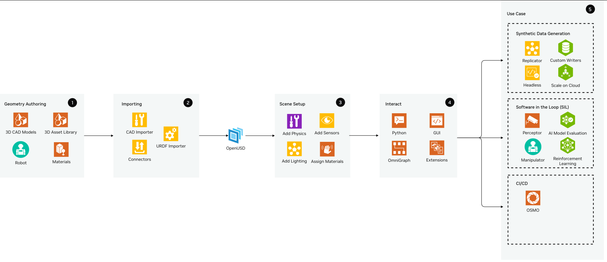
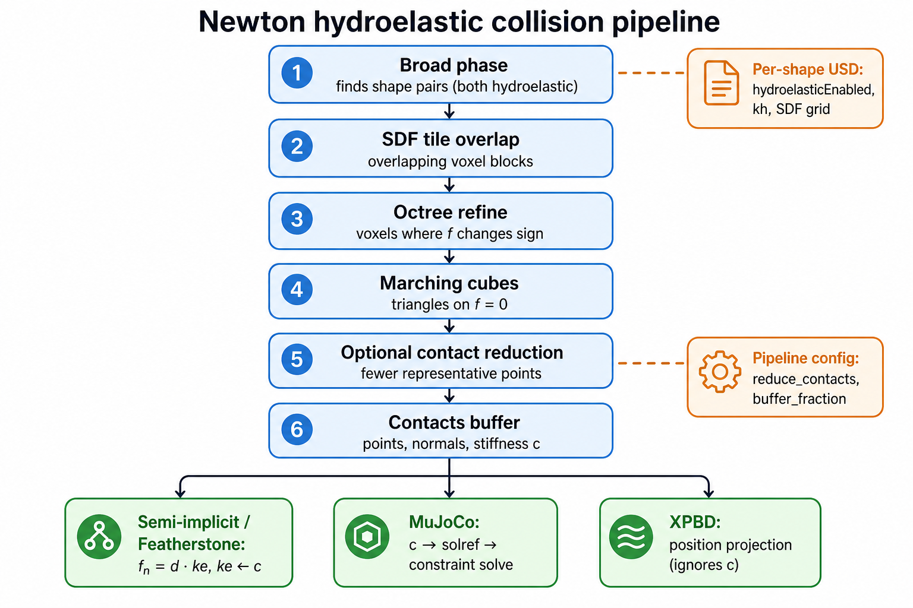
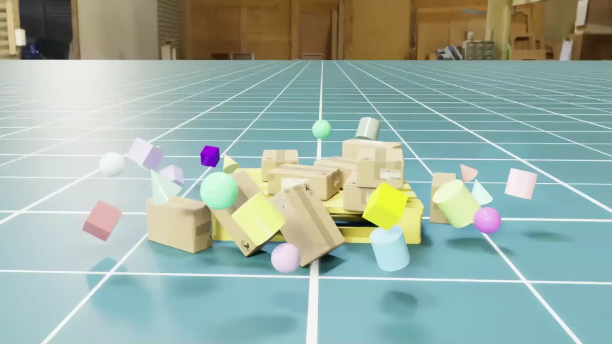
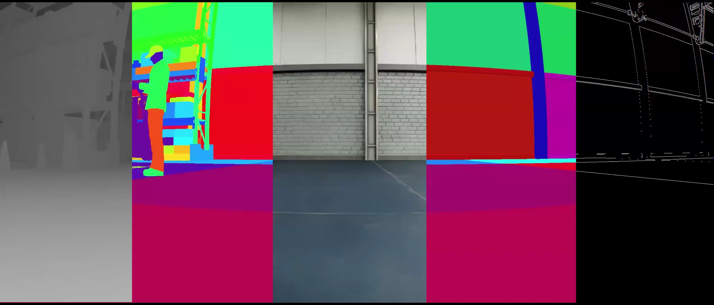

# NVIDIA仿真环境：物理、传感器、机器人学习与迁移验证

本报告于2026年11月4日整理，依据11月3日产品及仓库快照，并在11月4日下载仿真架构、接触、执行器、RTX传感器、合成数据与Managers API原文。NVIDIA仿真体系的价值在于统一资产、物理状态、视觉真值、训练与ROS软件测试；“高保真”需要落实到目标任务的误差量化，不能以画面逼真替代动力学或真实传感器验证。

## 1. 平台分工和版本选择

| 组件 | 职责 | 与其他组件的关系 | 项目选择条件 |
|---|---|---|---|
| Isaac Sim | OpenUSD资产、场景、机器人、物理、RTX传感器、ROS及SDG | Omniverse/Kit应用与扩展框架 | 需要数字孪生、视觉与机器人软件联调 |
| Isaac Lab 3.0 | RL、模仿学习、后训练及并行环境 | 支持Newton、OVPhysX、OVRTX及Isaac Sim | 按任务选physics/rendering backend |
| Newton | Warp上的GPU物理引擎及solver接口 | 主backend包含MuJoCo Warp；Linux Foundation项目 | 自定义物理、并行训练或Kit-less路线 |
| Warp | Python内核编译、GPU计算及可微计算基础 | Newton的计算基础；不是完整机器人仿真应用 | 自定义数值算法、优化和仿真模块 |
| PhysX / ovphysx | 刚体、关节及物理；C API、Python、USD/DLPack | SDK与Omniverse扩展版本分别配对 | 需要该backend且接受对应物理模型 |
| Replicator / CosmosWriter | 真值、随机化、数据写出；多模态控制视频 | 使用场景、渲染和物理状态 | 感知训练与生成式增强的数据管线 |

职责依据[GitHub IsaacSim README](https://raw.githubusercontent.com/isaac-sim/IsaacSim/main/README.md)、[GitHub IsaacLab README](https://raw.githubusercontent.com/isaac-sim/IsaacLab/main/README.md)、[Newton README](https://raw.githubusercontent.com/newton-physics/newton/main/README.md)、[Warp README](https://raw.githubusercontent.com/NVIDIA/warp/main/README.md)、[PhysX README](https://raw.githubusercontent.com/NVIDIA-Omniverse/PhysX/main/README.md)、[Isaac官方合成数据工作流](https://docs.isaacsim.omniverse.nvidia.com/latest/replicator_tutorials/tutorial_replicator_sdg_workflows.html)及[Isaac官方Cosmos数据增强教程](https://docs.isaacsim.omniverse.nvidia.com/latest/replicator_tutorials/tutorial_replicator_cosmos.html)。Newton由Disney Research、Google DeepMind与NVIDIA发起并社区维护，不能归为NVIDIA独占闭源引擎；Warp可微能力也不表示所有碰撞/solver/任务都能直接稳定反向传播。

Lab3.0的Sim工作流对应Isaac Sim6.2；3.0EA对应6.1，beta2对应6.0。默认安装Newton、不要求Isaac Sim，`isaacsim`、`ovphysx`、`ovrtx`等按extra安装；`all`是指定集合，不包含所有extra，也不包含Isaac Sim。独立Newton README默认Warp1.18，而Lab当前安装页指定Warp1.17，驱动及环境不能混用。应以release/tag及lockfile固定一套组合。[GitHub IsaacLab README](https://raw.githubusercontent.com/isaac-sim/IsaacLab/main/README.md)；[Isaac Lab当前安装与后端选择指南](https://isaac-sim.github.io/IsaacLab/main/source/isaaclab/installation.html)；[Newton README](https://raw.githubusercontent.com/newton-physics/newton/main/README.md)

## 2. Isaac Sim：从CAD资产到软件测试环境

### 2.1 官方参考架构

**图1：Isaac Sim官方资产、场景和应用参考架构（原图沿用4.5标识）。** 原图出处：[Isaac官方仿真参考架构](https://docs.isaacsim.omniverse.nvidia.com/latest/introduction/reference_architecture.html)。

官方当前页面仍使用4.5命名原图，并保留部分Python3.11及旧框架描述。本图用于解释几何创作→资产导入→场景设置→数字孪生交互→应用的职责，不作为6.2依赖表。当前Python3.12及多backend安装条件采用README和安装页。它提醒我们导入CAD只完成几何的一部分，机器人可运动与传感器输出仍要配置物理和接口。[Isaac官方仿真参考架构](https://docs.isaacsim.omniverse.nvidia.com/latest/introduction/reference_architecture.html)；[GitHub IsaacSim README](https://raw.githubusercontent.com/isaac-sim/IsaacSim/main/README.md)；[Isaac Lab当前安装与后端选择指南](https://isaac-sim.github.io/IsaacLab/main/source/isaaclab/installation.html)

OpenUSD保存场景层级、引用、几何、材质及物理schema，Isaac Sim默认单位米。URDF等导入器可以传递关节和碰撞信息；CAD转换成功则不必然有正确质量、惯量、碰撞近似和驱动参数。视觉mesh用于成像，collision mesh用于物理，二者可以不同。复杂mesh直接用于全部碰撞会带来成本及数值问题；过度简化又会丢失抓手、孔和螺纹等重要接触几何。[Isaac官方仿真参考架构](https://docs.isaacsim.omniverse.nvidia.com/latest/introduction/reference_architecture.html)；[Isaac官方仿真步进与碰撞指南](https://docs.isaacsim.omniverse.nvidia.com/latest/physics/simulation_fundamentals.html)

资产验收建议先核对静态尺寸、重心、关节轴向/限位，再检查自由落体、单关节轨迹、碰撞和重置。装配层级、工具TCP、相机frame与地面法向必须一致，尤其导入过程中毫米到米或左/右手坐标转换错误会污染后续数据。这里是分析建议，不能把已有资产库等同于目标机器人的校准数字孪生。

### 2.2 运行和资源边界

| 官方x86要求 | 最低 | Good | Ideal |
|---|---|---|---|
| RAM | 32GB | 64GB | 64GB |
| GPU | RTX4080 | RTX5080 | RTX PRO6000 Blackwell |
| VRAM | 16GB | 16GB | 48GB |
| 存储 | 50GB SSD | 500GB SSD | 1TB NVMe SSD |
| OS | Ubuntu22.04/24.04、Windows11 | 同左 | 同左 |

表摘自[Isaac Sim官方系统要求](https://docs.isaacsim.omniverse.nvidia.com/latest/installation/requirements.html)。这是运行Isaac Sim的参考配置，不是多相机RL训练资源保证。文档称A100/H100因无RT Core不受支持，aarch64当前支持DGX Spark，不能由CUDA可用推定Jetson能运行完整Sim。Ubuntu22.04已被标为deprecated；容器仅Linux。要求页同时保留“Sim6.0 on Spark cuRobo/cuMotion不支持”的限定，不能覆盖以后版本或默认所有ARM设备。[Isaac Sim官方系统要求](https://docs.isaacsim.omniverse.nvidia.com/latest/installation/requirements.html)

Lab Newton-only不采用Sim的工作站内存要求；headless Newton也不要求RTX。需要渲染时再选择并满足renderer条件。仿真训练应报告环境数、physics dt、动作decimation、相机数量与分辨率、渲染模式、GPU/驱动和数据写出开关；否则frames/s、steps/s与“实时倍速”不可比较。[Isaac Lab当前安装与后端选择指南](https://isaac-sim.github.io/IsaacLab/main/source/isaaclab/installation.html)；[Isaac Sim官方系统要求](https://docs.isaacsim.omniverse.nvidia.com/latest/installation/requirements.html)

## 3. 物理步进、碰撞和求解：误差从哪里进入

Isaac Sim的physics、rendering及应用更新不是同一频率。物理步进计算刚体与关节，rendering读取状态成像，控制器可能每多个physics step才更新动作。渲染慢或GUI卡顿不一定等于物理dt改变，但会影响真实墙钟速度及外部控制观测到达时间。软件在环可按仿真时钟推进，硬件在环必须同时记录墙钟和仿真时间，避免策略在离线加速环境里表现正常而真实设备超时。[Isaac官方仿真步进与碰撞指南](https://docs.isaacsim.omniverse.nvidia.com/latest/physics/simulation_fundamentals.html)；[Isaac官方仿真参考架构](https://docs.isaacsim.omniverse.nvidia.com/latest/introduction/reference_architecture.html)

| 物理项 | 官方机制 | 容易误判的情况 | 建议校准实验 |
|---|---|---|---|
| 刚体与惯量 | USD/PhysX质量、质心、惯性属性 | 只有视觉mesh，看似大小正确 | 重心及摆动响应 |
| 碰撞近似 | convex、分解、几何体、SDF等 | 凸包封死孔；简化接触面 | 接触位置、穿透和静态承载 |
| 摩擦/恢复 | 物理材质属性 | 把视觉材质当摩擦参数 | 滑移、滚动、落体反弹 |
| 关节/drive | 限位、刚度、阻尼及关节关系 | 大增益弥补模型错误 | 单轴阶跃、正反向和负载曲线 |
| 步长/solver | physics scene及求解参数 | 一个dt稳定不说明所有负载稳定 | dt减半后的误差收敛及成本 |

机制依据[Isaac官方仿真步进与碰撞指南](https://docs.isaacsim.omniverse.nvidia.com/latest/physics/simulation_fundamentals.html)与[Isaac官方仿真参考架构](https://docs.isaacsim.omniverse.nvidia.com/latest/introduction/reference_architecture.html)，实验列为分析建议。提高solver迭代或减小dt一般增加成本，不能从“GPU加速”推断每个小场景都更快；官方架构页建议未达数百刚体/机器人时CPU solver可能更高效。Newton和PhysX也不是可无差别互换的数值实现，应固定benchmark条件测试。[Isaac官方仿真参考架构](https://docs.isaacsim.omniverse.nvidia.com/latest/introduction/reference_architecture.html)；[Newton README](https://raw.githubusercontent.com/newton-physics/newton/main/README.md)；[PhysX README](https://raw.githubusercontent.com/NVIDIA-Omniverse/PhysX/main/README.md)

## 4. Newton、Warp和Hydroelastic接触

Newton将Warp计算、USD及可扩展solver连接，主backend采用MuJoCo Warp。PhysX仓库则包含SDK和ovphysx，后者支持USD及DLPack张量交互；当前README列ovphysx0.7与PhysX5.12.0配对，并另列Omniverse110.1/PhysX5.9.0与Sim6.0。SDK独立版本与Sim所打包扩展不是同一版本表。[Newton README](https://raw.githubusercontent.com/newton-physics/newton/main/README.md)；[PhysX README](https://raw.githubusercontent.com/NVIDIA-Omniverse/PhysX/main/README.md)

### 4.1 Hydroelastic管线和适用任务

**图2：Newton Hydroelastic接触生成官方流程。** 原图出处：[Isaac官方Hydroelastic接触](https://docs.isaacsim.omniverse.nvidia.com/latest/physics/hydroelastic_contact.html)。

Hydroelastic用两个物体SDF及接触界面形成面片，再从面片面积、穿透、法向和刚度生成接触贡献。管线经历broad phase、sparse SDF候选、octree refinement、marching-cubes surface extraction、contact generation、可选reduction和solver。分布式接触有助于接触力矩与精细几何交互，但增加SDF存储及计算成本，适用于目标任务需要接触面积和法向细节的情况。[Isaac官方Hydroelastic接触](https://docs.isaacsim.omniverse.nvidia.com/latest/physics/hydroelastic_contact.html)

| 参数/条件 | 官方要求或默认 | 实施含义 |
|---|---|---|
| runtime enabled | HydroelasticConfig.enabled启用 | 仅asset属性不够 |
| shape enabled | 两shape均hydroelasticEnabled=true | 混合pair不会自动走该管线 |
| SDF | 两shape有效SDF，且为体积几何 | plane/heightfield不属于此pair条件 |
| stiffness | 默认1e10 N/m³ | 是模型默认，不能作目标材料实测值 |
| max resolution | 默认64，能被8整除 | 提高分辨率增加内存，需捕捉任务几何尺度 |
| target voxel size | 正值时优先于max resolution | 单位米，改变接触细节与代价 |
| contact reduction | 可选合并并保持总力/力矩近似 | 必须验证合并后目标接触结果 |

参数依据[Isaac官方Hydroelastic接触](https://docs.isaacsim.omniverse.nvidia.com/latest/physics/hydroelastic_contact.html)。MuJoCo使用每contact刚度并转换solver reference/impedance；XPBD不使用该刚度，而以几何做位置投影。因此同一接触面片不保证两solver具有相同柔顺响应。图展示接触计算模型，不说明已捕获真实软组织、减速器回差或触觉读数。以螺纹装配为例，需要几何分辨率、摩擦及执行器模型共同验证，不能把某个成功演示当成工业插装精度承诺。

## 5. 执行器建模：理想PD到饱和、延迟及电机包络

当前`isaacsim.core.experimental.actuators`仍是experimental。ActuatorConfig由必须的DriveBase、可选clamping stages及Delay组成；官方提供DrivePD、ClampingMaxEffort、ClampingDCMotor和ClampingPositionBased。PD产生驱动力，clamping限制输出，Delay表现指令延迟；每步前callback读关节状态与目标并写effort。配置数组按机器人实例数，不是DOF数；关节名称与配置一一匹配。[Isaac官方Newton执行器指南](https://docs.isaacsim.omniverse.nvidia.com/latest/newton_actuators_tutorials/newton_actuators_python.html)

真实关节的有限转矩、转速、延迟和转子惯量会改变策略行为。官方非理想例子加入两步Delay和effort clamp，armature用于转子惯量及数值稳定；示例0.1只是示例参数，不是所有电机统一惯量。七个Franka臂关节显式执行器与两个手指隐式USD drive可以并存，feedforward只影响显式配置的关节。项目应核对每个关节究竟走哪条执行链，避免同一资产部分理想化却误称全本体非理想模型。[Isaac官方Newton执行器指南](https://docs.isaacsim.omniverse.nvidia.com/latest/newton_actuators_tutorials/newton_actuators_python.html)

分析建议按设备测量辨识增益、饱和、死区、滞后和控制延迟，再在不同负载下检查跟踪误差。RL训练时随机化电机能力或延迟只能覆盖设定分布，若真实电机温升后扭矩衰减超出范围，训练结果仍可能失效。[公开资料未披露]官方通用执行器教程没有目标本体电机的辨识曲线，应由项目提供或测量。

## 6. RTX与物理传感器：真值、噪声和时间语义

Sim提供camera、LiDAR、radar及contact/IMU/force等物理传感器。RTX传感器依据材质与相应光学/无线电交互模拟回波；这与简单几何ray caster或无噪声depth真值不同。当前旧`isaacsim.sensors.rtx`自6.0deprecated，转到experimental RTX扩展，authoring/runtime分开。API迁移、传感器profile和材质属性应随资产版本管理。[Isaac官方仿真参考架构](https://docs.isaacsim.omniverse.nvidia.com/latest/introduction/reference_architecture.html)；[Isaac官方RTX传感器指南](https://docs.isaacsim.omniverse.nvidia.com/latest/sensors/isaacsim_sensors_rtx.html)

| 传感器问题 | 官方行为 | 对训练/测试的影响 |
|---|---|---|
| Motion BVH | 默认关闭；LiDAR motion compensation及radar Doppler依赖启用 | 开启增加VRAM/渲染成本；未开启不能宣称准确运动回波 |
| GPU输出buffer | 文档要求当前annotator路径保持false | 强制GPU-resident可能得到空annotator |
| GMO辅助通道 | modality支持等级不同 | 同stage多sensor存在last-attach-wins已知问题 |
| LiDAR echoId | 文档限定6.0/6.1恒为0，无workaround | 该版本不能以echoId分组过滤多回波 |
| rotating scan | 可能跨多个render frame累积 | 拖影可能是扫描时间窗，不应直接当作bug |
| 旧USD辅助属性 | 新schema忽略旧属性 | 资产能载入不代表输出字段配置生效 |

表依据[Isaac官方RTX传感器指南](https://docs.isaacsim.omniverse.nvidia.com/latest/sensors/isaacsim_sensors_rtx.html)，问题限定于所引官方页面描述的版本范围。多sensor辅助通道可统一等级、调整attach顺序或拆stage，但仍需确认每个输出字段。相机等数据用于算法评估时还应注入真实曝光、噪声、遮挡、rolling-shutter或网络延迟的目标模型；公开通用支持清单不提供某款量产传感器全部误差保证。03报告中的真实SIPL/HSB时间戳语义也不能直接由仿真clock代替。

## 7. Isaac Lab：任务管理和域随机化

Lab将场景、动作、观测、命令、奖励、终止和事件作为可配置模块，并提供多种RL框架适配。ActionTerm的clip、缩放和关节集合影响动作，Observation定义及历史窗口影响策略输入；Reward与Termination决定优化目标及episode结束。训练出来的policy必须附带这些环境配置，否则导出的网络形状相同仍可能解释错误。[Isaac官方Managers与事件API](https://isaac-sim.github.io/IsaacLab/main/source/api/lab/isaaclab.managers.html)；[GitHub IsaacLab README](https://raw.githubusercontent.com/isaac-sim/IsaacLab/main/README.md)

EventManager可在prestartup、startup、reset、interval触发事件，例如质量/摩擦变化及随机push。**仅interval由manager直接处理，其他模式需要环境实现触发**；自定义mode也必须接入环境。interval_range_s控制时间分布，is_global_time决定共享或逐环境timer，resample_interval_on_reset控制重置后重新采样。仅配置一个随机化函数却没触发，不能声称策略已接受该扰动训练。[Isaac官方Managers与事件API](https://isaac-sim.github.io/IsaacLab/main/source/api/lab/isaaclab.managers.html)

| 随机化维度 | 示例 | 推荐的依据及留出验证 |
|---|---|---|
| 物理 | 质量、摩擦、重心、接触参数 | 实物测量范围；留出组合及极值 |
| 执行器 | 转矩包络、延迟、增益 | 电机/控制辨识；温升、载荷变化 |
| 视觉 | 材质、光照、相机姿态、遮挡 | 目标场景分布；新物体/背景留出 |
| 观测 | 噪声、丢包、状态延迟 | 真实日志；故障注入 |
| 任务 | 初始位置、目标及外扰 | 合法可行空间；成功与恢复指标 |

此表是基于[Isaac官方Managers与事件API](https://isaac-sim.github.io/IsaacLab/main/source/api/lab/isaaclab.managers.html)、[Isaac官方Newton执行器指南](https://docs.isaacsim.omniverse.nvidia.com/latest/newton_actuators_tutorials/newton_actuators_python.html)和[Isaac官方合成数据工作流](https://docs.isaacsim.omniverse.nvidia.com/latest/replicator_tutorials/tutorial_replicator_sdg_workflows.html)的设计建议。范围过窄覆盖不足，过宽可能训练出保守或无效策略；有依赖关系的参数应保持物理可行性。随机化不是用来掩盖错误模型，更不保证训练域外泛化。旧`source/features/domain_randomization.html`已无法取得，未作为来源，采用当前Managers API。

## 8. Replicator：合成数据生成的完整闭环

**图3：官方SDG工作流示例：物体落定后采集。** 原图出处：[Isaac官方合成数据工作流](https://docs.isaacsim.omniverse.nvidia.com/latest/replicator_tutorials/tutorial_replicator_sdg_workflows.html)。

Replicator的writer格式化RGB、depth、segmentation、bounding boxes等annotator结果，再交backend写盘。当前教程两个脚本分别复用persistent scene并等待物理settle，以及周期重建scene并作collision checks；BasicWriter附着render product，显式orchestrator step触发采集。图是工作流样例，展示成像及标注结果，不是目标任务数据的质量证明。[Isaac官方合成数据工作流](https://docs.isaacsim.omniverse.nvidia.com/latest/replicator_tutorials/tutorial_replicator_sdg_workflows.html)

采集前应禁用默认capture-on-play，明确所需帧；DLSS quality及temporal reset避免低分辨率、历史重投影带来伪影；rt_subframes与等待渲染保证修改后的场景已进入图像。异步writer需wait_until_complete后detach/销毁。额外annotator会增加GPU与I/O成本，数据吞吐应计入写盘完成而不只render启动。[Isaac官方合成数据工作流](https://docs.isaacsim.omniverse.nvidia.com/latest/replicator_tutorials/tutorial_replicator_sdg_workflows.html)

数据QA建议检查每帧image/label对应、instance ID一致、深度单位、坐标投影、遮挡比例和合法碰撞状态，并保存seed、asset revision、camera参数及随机化配置。仿真真值来自仿真内部：若物理或标定错误，标注可以内部自洽却与现实不符。对视觉模型应分别比较真实数据baseline、加入合成数据后结果和不同合成比例，留出真实场景作为最终判据。

## 9. CosmosWriter与生成式增强

官方Cosmos教程用Nova Carter仓库导航生成同步RGB、depth、segmentation、shaded segmentation和edges，Cosmos Transfer通过多控制分支作视觉增强。控制分支权重0—1调整结构约束与视觉变化；示例按clip管理数据，并等待writer完成。当前Cosmos产品页已经介绍Cosmos3，而教程仍是Transfer/Multi-ControlNet路线，应按教程及checkpoint区分，不能把产品页新名称套在旧API。[Isaac官方Cosmos数据增强教程](https://docs.isaacsim.omniverse.nvidia.com/latest/replicator_tutorials/tutorial_replicator_cosmos.html)；[Cosmos Page](https://developer.nvidia.com/cosmos)

**图4：CosmosWriter官方仓库多模态采集示例（原图5.1标识）。** 原图出处：[Isaac官方Cosmos数据增强教程](https://docs.isaacsim.omniverse.nvidia.com/latest/replicator_tutorials/tutorial_replicator_cosmos.html)。

生成视频增加材质、光照等变化，适合补充训练域；它不会自动给出新的真实动力学或经验证的执行器模型。生成后应重新检查物体位置、接触、遮挡、时序及标签仍对应，视觉结构受条件控制也不等于像素精确保持全部标注。合成数据、生成增强数据及真实数据应分开记录来源及许可，不把生成视频当成机器人在新场景真实成功的证据。[Isaac官方Cosmos数据增强教程](https://docs.isaacsim.omniverse.nvidia.com/latest/replicator_tutorials/tutorial_replicator_cosmos.html)

## 10. Sim-to-Real：分层验证和失败定位

| 验证层 | 输入/运行方式 | 能够检验 | 仍需补齐 |
|---|---|---|---|
| 资产和物理校准 | 单体及接触实验 | 几何、质量、惯量、执行器响应 | 真实目标参数和误差范围 |
| 软件在环SIL | 仿真sensor与机器人软件 | 接口、坐标、任务逻辑、重置 | 真实传感器及计算设备时序 |
| 硬件在环HIL | Sim数据通过ROS送端侧设备 | 目标硬件负载、数据链和推理 | 真实曝光、线缆、motor及接触 |
| 仿真闭环泛化 | 留出随机化组合和任务 | 策略反馈与失效恢复 | 域外真实分布 |
| 真实闭环 | 目标本体及场景，分级测试 | 最终任务效果、风险与持续运行 | 量产离散性及长期运维 |

SIL/HIL官方入口依据[Isaac官方仿真参考架构](https://docs.isaacsim.omniverse.nvidia.com/latest/introduction/reference_architecture.html)及[Isaac Sim ROS2 Bridge](https://docs.isaacsim.omniverse.nvidia.com/latest/ros2_tutorials/index.html)，验收列为分析建议。官方ROS Bridge概览注明最后验证Sim6.0，不能宣称所有6.2与ROS发行版已验证组合。使用仿真clock时暂停/重置与DDS队列策略需要检查，HIL数据不能由于等待网络而默默变为旧帧；虚拟sensor并不经过03中真实CSI/GMSL/CoE全部硬件路径。

建议以任务成功率、接触峰值、滑移/跌倒、定位误差、观测年龄、控制超时和恢复率建立迁移差异账本，再定位到感知、物理、执行器或资源竞争。成功率应说明episodes、场景、seed和置信区间。训练reward提高只能说明优化当前奖励，不保证目标真实任务通过。[公开资料未披露]没有官方统一百分比能代表所有本体的Sim-to-Real提升；本报告未运行仿真或实机试验。

## 11. 开源及资产许可

| 官方仓库 | Stars | 最近默认分支提交UTC | 许可及证据 |
|---|---:|---|---|
| [GitHub IsaacSim Page](https://github.com/isaac-sim/IsaacSim) | 4,425 | 2026-09-10 02:15:24 | 代码Apache2；Kit、3D/纹理另条款；[Isaac Sim官方代码及附加组件许可](https://raw.githubusercontent.com/isaac-sim/IsaacSim/main/LICENSE)、[Isaac Sim仓库元数据](https://api.github.com/repos/isaac-sim/IsaacSim)、[Isaac Sim提交快照](https://api.github.com/repos/isaac-sim/IsaacSim/commits?sha=main&per_page=1) |
| [GitHub IsaacLab Page](https://github.com/isaac-sim/IsaacLab) | 8,564 | 2026-11-03 05:08:05 | 框架BSD3，mimic Apache2；依赖/资产另核；[Isaac Lab官方代码许可](https://raw.githubusercontent.com/isaac-sim/IsaacLab/main/LICENSE)、[Isaac Lab仓库元数据](https://api.github.com/repos/isaac-sim/IsaacLab)、[Isaac Lab提交快照](https://api.github.com/repos/isaac-sim/IsaacLab/commits?sha=main&per_page=1) |
| [Newton Project Page](https://github.com/newton-physics/newton) | 5,883 | 2026-11-03 04:25:34 | 代码Apache2，文档CC-BY4；[Newton README](https://raw.githubusercontent.com/newton-physics/newton/main/README.md)、[Newton代码许可](https://raw.githubusercontent.com/newton-physics/newton/main/LICENSE.md)、[Newton Metadata](https://api.github.com/repos/newton-physics/newton)、[Newton Commit](https://api.github.com/repos/newton-physics/newton/commits?per_page=1) |
| [Warp Project Page](https://github.com/NVIDIA/warp) | 7,267 | 2026-11-02 22:28:32 | Apache2；libmathdx为独立NVIDIA软件条款；[Warp README](https://raw.githubusercontent.com/NVIDIA/warp/main/README.md)、[Warp代码许可](https://raw.githubusercontent.com/NVIDIA/warp/main/LICENSE.md)、[Warp Metadata](https://api.github.com/repos/NVIDIA/warp)、[Warp Commit](https://api.github.com/repos/NVIDIA/warp/commits?per_page=1) |
| [PhysX Project Page](https://github.com/NVIDIA-Omniverse/PhysX) | 4,825 | 2026-10-15 11:12:53 | README BSD3条款及各子目录许可；[PhysX README](https://raw.githubusercontent.com/NVIDIA-Omniverse/PhysX/main/README.md)、[PhysX Metadata](https://api.github.com/repos/NVIDIA-Omniverse/PhysX)、[PhysX Commit](https://api.github.com/repos/NVIDIA-Omniverse/PhysX/commits?per_page=1) |

Sim/Lab仓库Stars由11月4日API补采，commit沿用11月3日快照；其余Stars/commit为11月3日。开放代码、二进制依赖、模型、材质和生成数据不是同一许可层。Sim许可证明确构建及使用需额外组件；Lab README还提示未明确列出的资产受Sim许可及mimic的cuRobo依赖条款。不能把开源框架概括成所有资产均可无限制再分发。[Isaac Sim官方代码及附加组件许可](https://raw.githubusercontent.com/isaac-sim/IsaacSim/main/LICENSE)；[GitHub IsaacLab README](https://raw.githubusercontent.com/isaac-sim/IsaacLab/main/README.md)

## 12. 应用选择建议

多传感器AMR及视觉操作优先选择带RTX、ROS与SDG的Sim工作流；大规模无视觉RL可先评估Lab的Newton-only方案；精细接触任务先做接触和执行器辨识，再决定Hydroelastic或其他solver；生成式增强先有正确可控的多模态输入和数据QA。项目成本应计入资产建设、参数校准、GPU/存储、版本升级回归及实机迁移，不只看工具下载是否免费。

NVIDIA提供从资产到训练及软件测试的广泛入口，但最终成效取决于目标任务模型与证据链。采用官方原图、参数和开源代码有助于复现起点，不能替代目标本体的校准、控制及安全验收。本次仅完成公开资料调研和归档，未安装Sim/Lab、执行策略训练或测量迁移效果。

## 参考资料与本地原文

本报告依据11月3日采集的快照及11月4日逐方向补充取得的官方网页、代码仓库、API和文档。资料由统一下载工具归档到本项目的reference_metrial；多个方向共享同一URL的已校验文件。网页保留HTML和依赖，部分资源受robots规则、失效链接或动态交互限制影响时，按metadata如实标明。采集时点、版本和原始响应哈希可在各资料目录内核对。

| 官方资料 | 原始URL | 本地原文 | 归档情况 |
|---|---|---|---|
| NVIDIA_GitHub_IsaacSim_README | [官方原文](https://raw.githubusercontent.com/isaac-sim/IsaacSim/main/README.md) | [content.md](REFERENCES.md#ref-f83a41d58eaa5fc9) | 原件已归档 |
| NVIDIA_GitHub_IsaacLab_README | [官方原文](https://raw.githubusercontent.com/isaac-sim/IsaacLab/main/README.md) | [content.md](REFERENCES.md#ref-5af037b6c4754936) | 原件已归档 |
| NVIDIA_Newton_README | [官方原文](https://raw.githubusercontent.com/newton-physics/newton/main/README.md) | [content.md](REFERENCES.md#ref-38ed19edf0ff48b3) | 原件已归档 |
| NVIDIA_Warp_README | [官方原文](https://raw.githubusercontent.com/NVIDIA/warp/main/README.md) | [content.md](REFERENCES.md#ref-fff590e11a0d39f6) | 原件已归档 |
| NVIDIA_PhysX_README | [官方原文](https://raw.githubusercontent.com/NVIDIA-Omniverse/PhysX/main/README.md) | [content.md](REFERENCES.md#ref-2c95343eaa037b11) | 原件已归档 |
| NVIDIA_05_SDG | [官方原文](https://docs.isaacsim.omniverse.nvidia.com/latest/replicator_tutorials/tutorial_replicator_sdg_workflows.html) | [index.html](REFERENCES.md#ref-b864aac3a5128760) | 静态HTML依赖完整；动态功能另验 |
| NVIDIA_05_SIM_COSMOS | [官方原文](https://docs.isaacsim.omniverse.nvidia.com/latest/replicator_tutorials/tutorial_replicator_cosmos.html) | [index.html](REFERENCES.md#ref-a23e410695a197e2) | 静态HTML依赖完整；动态功能另验 |
| NVIDIA_02_LAB_INSTALL_CURRENT | [官方原文](https://isaac-sim.github.io/IsaacLab/main/source/isaaclab/installation.html) | [index.html](REFERENCES.md#ref-80fe4c913dbac380) | 静态呈现依赖部分缺失；见metadata |
| NVIDIA_05_SIM_ARCH | [官方原文](https://docs.isaacsim.omniverse.nvidia.com/latest/introduction/reference_architecture.html) | [index.html](REFERENCES.md#ref-f74626edcba85090) | 静态HTML依赖完整；动态功能另验 |
| NVIDIA_05_PHYSICS | [官方原文](https://docs.isaacsim.omniverse.nvidia.com/latest/physics/simulation_fundamentals.html) | [index.html](REFERENCES.md#ref-24508cffad8754f0) | 静态HTML依赖完整；动态功能另验 |
| NVIDIA_Documentation_IsaacSim_Requirements | [官方原文](https://docs.isaacsim.omniverse.nvidia.com/latest/installation/requirements.html) | [index.html](REFERENCES.md#ref-d77cc67f2e43f0b3) | 静态HTML依赖完整；动态功能另验 |
| NVIDIA_05_HYDRO | [官方原文](https://docs.isaacsim.omniverse.nvidia.com/latest/physics/hydroelastic_contact.html) | [index.html](REFERENCES.md#ref-ee558d6613a45451) | 静态HTML依赖完整；动态功能另验 |
| NVIDIA_05_ACTUATOR | [官方原文](https://docs.isaacsim.omniverse.nvidia.com/latest/newton_actuators_tutorials/newton_actuators_python.html) | [index.html](REFERENCES.md#ref-99c545c1f1062ec0) | 静态HTML依赖完整；动态功能另验 |
| NVIDIA_05_SENSOR | [官方原文](https://docs.isaacsim.omniverse.nvidia.com/latest/sensors/isaacsim_sensors_rtx.html) | [index.html](REFERENCES.md#ref-07af8d2eeb12326c) | 静态HTML依赖完整；动态功能另验 |
| NVIDIA_05_LAB_EVENTS | [官方原文](https://isaac-sim.github.io/IsaacLab/main/source/api/lab/isaaclab.managers.html) | [index.html](REFERENCES.md#ref-befa55326ba2b236) | 静态呈现依赖部分缺失；见metadata |
| NVIDIA_Cosmos_Page | [官方原文](https://developer.nvidia.com/cosmos) | [index.html](REFERENCES.md#ref-558f642be571ac1f) | 静态呈现依赖部分缺失；见metadata |
| NVIDIA_Isaac_Sim_ROS2_Bridge | [官方原文](https://docs.isaacsim.omniverse.nvidia.com/latest/ros2_tutorials/index.html) | [index.html](REFERENCES.md#ref-a537c0a95b145a1a) | 静态HTML依赖完整；动态功能另验 |
| NVIDIA_GitHub_IsaacSim_Page | [官方原文](https://github.com/isaac-sim/IsaacSim) | [index.html](REFERENCES.md#ref-e7af47084679a807) | 静态呈现依赖部分缺失；见metadata |
| NVIDIA_GitHub_IsaacSim_License | [官方原文](https://raw.githubusercontent.com/isaac-sim/IsaacSim/main/LICENSE) | [content.txt](REFERENCES.md#ref-1c21a8f4920bb953) | 原件已归档 |
| NVIDIA_05_SIM_META | [官方原文](https://api.github.com/repos/isaac-sim/IsaacSim) | [content.json](REFERENCES.md#ref-a08737b32ee8066b) | 原件已归档 |
| NVIDIA_GitHub_IsaacSim_Commits_API | [官方原文](https://api.github.com/repos/isaac-sim/IsaacSim/commits?sha=main&per_page=1) | [content.json](REFERENCES.md#ref-6169640d2c84df4a) | 原件已归档 |
| NVIDIA_GitHub_IsaacLab_Page | [官方原文](https://github.com/isaac-sim/IsaacLab) | [index.html](REFERENCES.md#ref-00204ffe01e0db3d) | 静态呈现依赖部分缺失；见metadata |
| NVIDIA_GitHub_IsaacLab_License | [官方原文](https://raw.githubusercontent.com/isaac-sim/IsaacLab/main/LICENSE) | [content.txt](REFERENCES.md#ref-8d3916d73175f044) | 原件已归档 |
| NVIDIA_05_LAB_META | [官方原文](https://api.github.com/repos/isaac-sim/IsaacLab) | [content.json](REFERENCES.md#ref-454a50d17a792302) | 原件已归档 |
| NVIDIA_GitHub_IsaacLab_Commits_API | [官方原文](https://api.github.com/repos/isaac-sim/IsaacLab/commits?sha=main&per_page=1) | [content.json](REFERENCES.md#ref-7ab71dffbb97e5c3) | 原件已归档 |
| NVIDIA_Newton_Project_Page | [官方原文](https://github.com/newton-physics/newton) | [index.html](REFERENCES.md#ref-2ca81acff58aff0c) | 静态呈现依赖部分缺失；见metadata |
| NVIDIA_05_NEWTON_LICENSE | [官方原文](https://raw.githubusercontent.com/newton-physics/newton/main/LICENSE.md) | [content.md](REFERENCES.md#ref-aac65d531df3ffee) | 原件已归档 |
| NVIDIA_Newton_Metadata | [官方原文](https://api.github.com/repos/newton-physics/newton) | [content.json](REFERENCES.md#ref-68015a7f2f98ce00) | 原件已归档 |
| NVIDIA_Newton_Commit | [官方原文](https://api.github.com/repos/newton-physics/newton/commits?per_page=1) | [content.json](REFERENCES.md#ref-7ccae7da3235b244) | 原件已归档 |
| NVIDIA_Warp_Project_Page | [官方原文](https://github.com/NVIDIA/warp) | [index.html](REFERENCES.md#ref-bec68bd795809b5e) | 静态呈现依赖部分缺失；见metadata |
| NVIDIA_05_WARP_LICENSE | [官方原文](https://raw.githubusercontent.com/NVIDIA/warp/main/LICENSE.md) | [content.md](REFERENCES.md#ref-fd135a80dfebcca5) | 原件已归档 |
| NVIDIA_Warp_Metadata | [官方原文](https://api.github.com/repos/NVIDIA/warp) | [content.json](REFERENCES.md#ref-5a40160095b9e332) | 原件已归档 |
| NVIDIA_Warp_Commit | [官方原文](https://api.github.com/repos/NVIDIA/warp/commits?per_page=1) | [content.json](REFERENCES.md#ref-f880f58e7af9f980) | 原件已归档 |
| NVIDIA_PhysX_Project_Page | [官方原文](https://github.com/NVIDIA-Omniverse/PhysX) | [index.html](REFERENCES.md#ref-e0703b192cf0af91) | 静态呈现依赖部分缺失；见metadata |
| NVIDIA_PhysX_Metadata | [官方原文](https://api.github.com/repos/NVIDIA-Omniverse/PhysX) | [content.json](REFERENCES.md#ref-5659c3d02d8165dd) | 原件已归档 |
| NVIDIA_PhysX_Commit | [官方原文](https://api.github.com/repos/NVIDIA-Omniverse/PhysX/commits?per_page=1) | [content.json](REFERENCES.md#ref-6131b21b9bcef1b9) | 原件已归档 |

以上技术事实与官方测量保持条件和版本边界。本调研未执行设备安装、模型训练、机器人实机测试或客户验收；文中的集成路线和选型门槛属于分析建议。公开资料未披露的交期、报价、最坏情况时延与认证结果不作推断。
