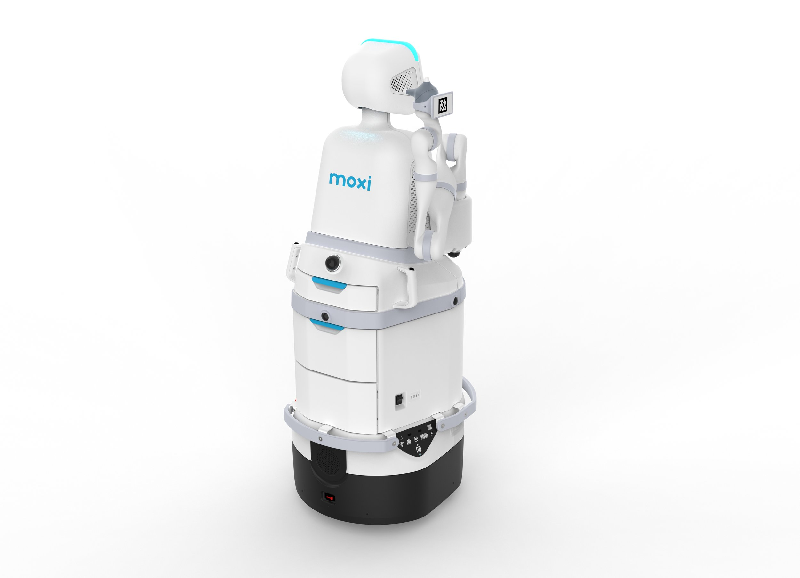
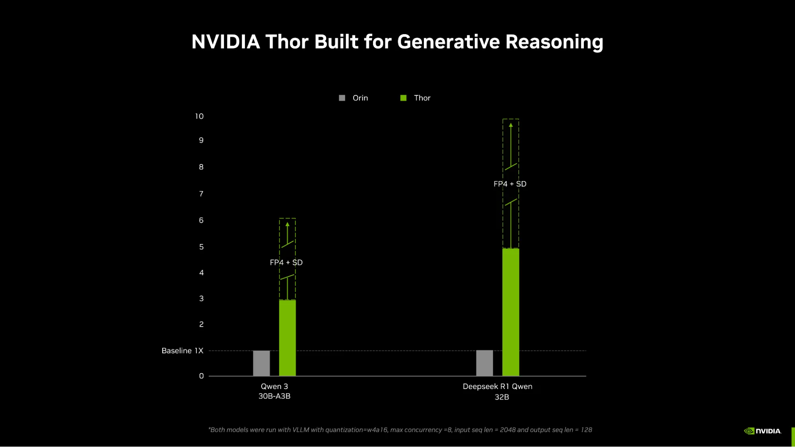
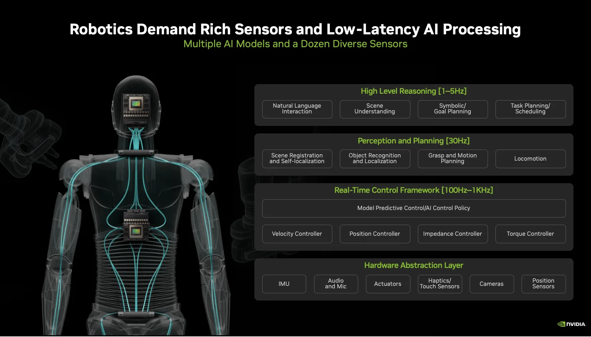
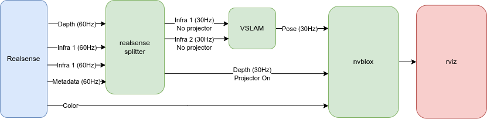
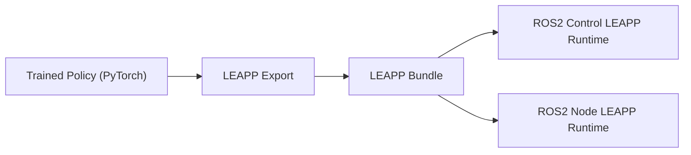

# NVIDIA机器人本体适配：描述、感知、规划、控制和安全

本报告于2026年11月4日深化产品级适配，增加Digit、Atlas、NEO、G1/H1及Moxi等整机采用与性能证据，复用11月3日官方资料并补采XRDF、cuMotion自定义机械臂、cuRobo当前文档及Deploy本体/FR3接口指南。NVIDIA提供广泛的机器人算法和连接组件，但本体适配是包含驱动、动作语义、控制和安全的系统工作。拥有一个URDF、能跑一个模型或出现在合作名单中，都不足以证明量产整机方案已经验证。

## 1. 集成层次与可交付范围

| 层次 | NVIDIA或官方接口 | 输入/输出 | 尚需本体侧承担 |
|---|---|---|---|
| 本体描述 | URDF、XRDF、USD/MJCF | 运动学、碰撞、关节及工具frame | 实物参数、资产和名称映射校验 |
| 感知 | Isaac ROS、相机、SLAM/Nvblox等 | 观测、位姿、地图和物体信息 | 标定、传感器驱动和数据时效 |
| 规划 | cuRoboV2、cuMotion/MoveIt插件 | IK、碰撞检查及轨迹 | 环境建模、目标约束和执行器边界 |
| 学习策略 | GR00T或RL、LEAPP/Deploy | 张量观测到动作 | 观测/动作语义、状态估计与OOD验证 |
| 执行 | ROS2Control、SystemInterface、vendor SDK | state/read和command/write | 电机索引、控制周期、失效行为 |
| 安全与交付 | SafetyController及平台能力 | 软件限幅、blend及fallback请求 | 独立保护、整机认证和验收 |

依据[XRDF官方描述规范](https://nvidia-isaac-ros.github.io/concepts/manipulation/xrdf.html)、[自定义机械臂cuMotion适配教程](https://nvidia-isaac-ros.github.io/concepts/manipulation/cumotion_moveit/tutorial_custom_manipulator.html)、[cuRoboV2官方README](https://raw.githubusercontent.com/NVlabs/curobo/main/README.md)、[Isaac ROS Deploy Concept](https://nvidia-isaac-ros.github.io/repositories_and_packages/isaac_ros_deploy/concepts/how_it_works.html)、[Isaac ROS Deploy本体适配指南](https://nvidia-isaac-ros.github.io/repositories_and_packages/isaac_ros_deploy/how_to_guides/bring_your_own_embodiment.html)及[Isaac ROS Deploy Safety](https://nvidia-isaac-ros.github.io/repositories_and_packages/isaac_ros_deploy/concepts/safety.html)。这些层之间必须有可验证的契约：关节顺序、单位、frame、频率和时间戳。报告中的适配建议来自官方工作流分析，未在真实本体执行。

## 2. 参考本体、工作流与合作案例分级

| 对象 | 可直接证实的公开能力 | 证据级别与限制 |
|---|---|---|
| Franka/Panda、UR5e、UR10e | cuMotion教程说明已有XRDF配置 | 预配置入口；自定义教程最后测试Sim4.2，不等于当前所有硬件/BSP验证 |
| Franka FR3 | 专用SystemInterface以libfranka/FCI驱动真实FR3 | 本体专用接口说明，控制及主机设置均有条件 |
| Unitree G1 AGILE | Deploy官方MuJoCo仿真教程 | 策略部署参考；不能称真实G1已完成本项目验收 |
| AMR/Perceptor | 当前官方称延续为Isaac for Mobility并优化Thor | 工作流转型入口；旧Perceptor指向legacy3.2 |
| 自定义机械臂/人形 | 自带URDF、仿真资产、C++SDK及配置路线 | 可扩展接口，需要完整本体工程与验证 |

来源为[自定义机械臂cuMotion适配教程](https://nvidia-isaac-ros.github.io/concepts/manipulation/cumotion_moveit/tutorial_custom_manipulator.html)、[Franka FR3 ROS2Control接口](https://nvidia-isaac-ros.github.io/repositories_and_packages/isaac_ros_robots/franka_fr3_ros2_control/index.html)、[Isaac ROS Deploy AGILE](https://nvidia-isaac-ros.github.io/repositories_and_packages/isaac_ros_deploy/tutorials/deploy_agile.html)、[Isaac for Mobility官方工作流](https://nvidia-isaac-ros.github.io/reference_workflows/isaac_for_mobility/index.html)和[Isaac ROS Deploy本体适配指南](https://nvidia-isaac-ros.github.io/repositories_and_packages/isaac_ros_deploy/how_to_guides/bring_your_own_embodiment.html)。旧Isaac for Manipulation索引404，未将其作为有效技术出处；旧cuRobo首页仅meta-refresh，已沿跳转取得`latest/`正文。官方现有教程中4.2、Isaac3.0等历史限定原样保留，不因页面在latest目录就改写成当前版本实测。

合作关系可以说明供应链或开发机会，但没有相同证据支持“集成包已验证”“真实机器人可靠运行”“有量产出货”三个层级。具体合同、客户验收及销量[公开资料未披露]，本报告不依据展示图片推断。

## 3. 产品级适配地图：芯片、整机和采用状态

产品级证据按三层记录：整机官网直接给计算配置、厂商/芯片方公告给采用关系、教程给开发接口。两家官方来源相互补足，并不自动形成独立实验验证；同一平台合作名单也不能替代型号BOM。以下网页为2026年11月4日采集快照，公告日期单列，未披露量产交付/完整任务指标时明确保留。[Blog Jetson Thor Physical AI](https://blogs.nvidia.com/blog/jetson-thor-physical-ai-edge/)；[Agility Robotics官方Digit与Jetson Thor公告](https://www.agilityrobotics.com/content/agility-robotics-powering-the-future-of-robotics-with-nvidia-jetson-thor)；[Unitree G1官方产品规格](https://www.unitree.com/g1)；[Unitree H1官方机器人及算力配置](https://www.unitree.com/h1)；[Diligent官方Moxi2.0机器人与IGX平台](https://www.diligentrobots.com/blog/moxi2-0)；[1X官方NEO机器人产品介绍](https://www.1x.tech/neo)

| 厂商/具体产品 | 公开计算平台 | 截至来源的采用状态 | 适配用途 | 性能/交付证据边界 | 官方出处 |
|---|---|---|---|---|---|
| Agility/Digit五代及六代路线 | 五代为Jetson，未指名模块；六代计划Jetson Thor | NVIDIA2025-08-25称六代计划采用；Agility同日称开始探索 | 全身控制、端到端操作、场景理解 | 五代已有商业部署；不等于六代Thor已量产；无具体闭环提升比例 | [Blog Jetson Thor Physical AI](https://blogs.nvidia.com/blog/jetson-thor-physical-ai-edge/)、[Agility Robotics官方Digit与Jetson Thor公告](https://www.agilityrobotics.com/content/agility-robotics-powering-the-future-of-robotics-with-nvidia-jetson-thor) |
| Boston Dynamics/Atlas | Jetson Thor | 厂商2025-03-18 PR明确design-in；2026-07仍为采用方 | 多模态模型接入厂商全身/操作控制器 | 未披露具体模块、量化、动作延迟/成功率 | [Boston Dynamics官方Atlas与Jetson Thor合作PR](https://bostondynamics.com/news/boston-dynamics-expands-collaboration-with-nvidia/)、[Blog Jetson Thor Physical AI](https://blogs.nvidia.com/blog/jetson-thor-physical-ai-edge/)、[NVIDIA Thor新模块机器人客户及性能](https://blogs.nvidia.com/blog/jetson-thor-robotics-edge-ai-agent/) |
| 1X/NEO | NEO Cortex（NVIDIA Jetson Thor） | 整机官网直接列入硬件规格 | Redwood视觉语言模型、机载LLM、导航/家庭操作 | 有产品配置；Early Access基础自主性与远程Expert Mode分开；无同条件上一代对照 | [1X官方NEO机器人产品介绍](https://www.1x.tech/neo) |
| Unitree/G1、G1-EDU | 高算力附件列Orin等多个品牌/型号 | 官网选配信息，不是全系标准配置 | 开发扩展计算及学习策略研究 | 基础计算为8核CPU；未给Orin具体SKU、显存或选配提升数据 | [Unitree G1官方产品规格](https://www.unitree.com/g1) |
| Unitree/H1、H1-2 | 标配Intel i5/i7；可选Orin NX等 | 明确选配；H1-2可选最多三台计算设备 | 感知与用户开发扩展 | 不能把运动速度、关节转矩等整机指标归因于选配Orin | [Unitree H1官方机器人及算力配置](https://www.unitree.com/h1) |
| Diligent/Moxi2.0 | PR称NVIDIA Thor；同文称IGX Thor早期采用方 | 2025-10-28发布下一代平台计划 | 密集医院导航、预测、移动操作 | 厂商称较Moxi1.0算力10倍，模块/精度/功耗口径未披露；新平台部署数不明 | [Diligent官方Moxi2.0机器人与IGX平台](https://www.diligentrobots.com/blog/moxi2-0)、[NVIDIA IGX Thor工业医疗应用案例](https://blogs.nvidia.com/blog/igx-thor-processor-physical-ai-industrial-medical-edge/) |
| Boston Dynamics/Spot RL Researcher Kit | Jetson AGX Orin payload | 2024-03-19厂商研究套件说明 | Joint-level API、部署RL策略、Isaac Lab仿真 | 研究payload，不证明所有量产Spot标配AGX Orin；无套件统一测速 | [Boston Dynamics官方Atlas强化学习与机载控制](https://bostondynamics.com/blog/starting-on-the-right-foot-with-reinforcement-learning/) |
| Boston Dynamics/Spot CORE I/O | Jetson Xavier NX、6核Arm+GPU | 2022-05-03历史产品发布文章称payload预订 | 自定义传感器、CV巡检、GPIO/供电及5G | 历史配置，当前SKU及供货需另核验，非Thor/Orin升级对照 | [Boston Dynamics官方Spot CORE I/O计算扩展](https://bostondynamics.com/blog/doing-more-with-spot/) |

合作公告另外提及1X、Agile Robots、Amazon Robotics、FANUC、Hitachi、Techman等在Thor平台建设，不能据公司名分配特定机器人型号。IGX公告中Maven为“将集成”、CMR Surgical为“评估”、EndoQuest为早期采用，均不升级为量产机器人实证。产品配置表只纳入能明确连到具体产品的关系；其余作为生态方向，详见07报告。[NVIDIA Thor新模块机器人客户及性能](https://blogs.nvidia.com/blog/jetson-thor-robotics-edge-ai-agent/)；[NVIDIA IGX Thor工业医疗应用案例](https://blogs.nvidia.com/blog/igx-thor-processor-physical-ai-industrial-medical-edge/)

## 4. 三条产品路线为何有不同的适配难点

### 4.1 Digit：从模拟训练到客户现场的机载策略

Agility原文把需求分为全身控制、精细操作、环境感知三类。其现有开发使用Isaac Lab强化学习、simulation-first及sim-to-sim validation，并探索Nvblox导航/避障。**正在探索Nvblox**不能写成所有客户Digit已启用它；同样，sim-to-sim不能替代真实地面与接触验证。厂商认为Thor能使更大的端到端操作和语义感知模型在现场运行，属于下一代设计动机，未提供量化实验。[Agility Robotics官方Digit与Jetson Thor公告](https://www.agilityrobotics.com/content/agility-robotics-powering-the-future-of-robotics-with-nvidia-jetson-thor)

NVIDIA同日说明五代Digit已集成Jetson，并计划六代采用Thor；此前物流部署存在不代表部署版本使用Thor。技术上，机载更大策略可能减少云通信依赖，但必须验证相机/状态同步、观察年龄、模型共享内存和上层动作到低层伺服的边界。若策略更大导致推理延迟增加，计算峰值提升并不保证动作响应变快。Agility公告未给模型名、batch、帧数、功耗、p99或六代任务成功率，故性能结果写为[公开资料未披露]。[Blog Jetson Thor Physical AI](https://blogs.nvidia.com/blog/jetson-thor-physical-ai-edge/)；[Agility Robotics官方Digit与Jetson Thor公告](https://www.agilityrobotics.com/content/agility-robotics-powering-the-future-of-robotics-with-nvidia-jetson-thor)

### 4.2 NEO与Atlas：机载计算不等于所有行为完全自主

NEO官网硬件区直接列NEO Cortex采用Jetson Thor，AI Compute“up to2070FP4TFLOPS”；这是芯片/系统算力标称。产品解释Redwood用于学习执行家庭任务，另有内置LLM用于理解/对话，导航和音频/视觉智能形成多模型负载。它同时区分Early Access基础自主性、预约1X Expert远程指导与App/VR远控，不能把带远程协助的任务演示当成纯自主成功率。无上一代统一测试，不能把标称峰值当作家庭作业性能提升。[1X官方NEO机器人产品介绍](https://www.1x.tech/neo)

NEO官网双8.85MP、90Hz立体鱼眼相机描述的是传感器规格，不证明全部图像以90Hz完成VLM或动作策略推理。对于其软体包覆、低惯量tendon驱动与人机互动，GPU只承担计算环节；产品的物理控制和安全由整机设计承担。Atlas的NVIDIA公告则明确Thor带来原本服务器级的机载计算、模型加速、带宽和内存，但未公开完整端侧模型与闭环结果；不能据双方合作推断所有Atlas代际都具有同一配置。[1X官方NEO机器人产品介绍](https://www.1x.tech/neo)；[Blog Jetson Thor Physical AI](https://blogs.nvidia.com/blog/jetson-thor-physical-ai-edge/)

Boston Dynamics当前Atlas产品页给出工业物料处理、技能向fleet分发、自动换电和Orbit与MES/WMS集成的产品路线，并描述Hyundai客户现场测试与逐步扩展早期采用方。该页没有直接披露Jetson模块或应用基准；故与NVIDIA的Thor采用公告构成产品与计算平台的两份一手资料，仍不能证明某项任务相对旧代提高百分比，也不能把厂商路线图当全部功能已在所有客户交付。[Boston Dynamics官方Atlas产品及平台](https://bostondynamics.com/products/atlas/)；[NVIDIA Thor新模块机器人客户及性能](https://blogs.nvidia.com/blog/jetson-thor-robotics-edge-ai-agent/)

厂商2025-03-18 PR进一步明确Atlas已将Thor设计进计算平台，多模态AI与Boston Dynamics自己的全身/操作控制器协同，Isaac Lab用于学习灵巧操作与运动策略；两家公司共同定义安全/安全性架构和视觉学习管线。这里存在清晰的职责分工：NVIDIA提供计算/训练平台，厂商保留整机控制器与产品工程。PR不宣称GR00T替代全部控制器，也没有公布特定操作任务的性能提升。[Boston Dynamics官方Atlas与Jetson Thor合作PR](https://bostondynamics.com/news/boston-dynamics-expands-collaboration-with-nvidia/)

### 4.3 Moxi2.0：医院移动操作的数据与产品升级

**图1：Diligent官方Moxi2.0产品渲染图。** 原图出处：[Diligent官方Moxi2.0机器人与IGX平台](https://www.diligentrobots.com/blog/moxi2-0)。

这是厂商发布的产品渲染图，用于识别Moxi平台及服务/交互形态，不能从图反推芯片模块、内部接线或安全认证。Diligent2025-10-28 PR称旧Moxi在美国25家以上医院工作，三年采集125万次以上配送数据，并以此研发下一代端到端action model，强化dense navigation和复杂操作。这些是已有fleet与训练数据背景，不是Moxi2.0的部署成绩；数据量也不能等价于完整任务成功率。[Diligent官方Moxi2.0机器人与IGX平台](https://www.diligentrobots.com/blog/moxi2-0)

同文既称Moxi2.0较Moxi1.0有10倍compute、感谢Jetson产品线进展，又称IGX Thor早期采用并对未来代际表达期待，后段写Moxi2.0“Powered by NVIDIA Thor”。因此只能确认Thor系列产品路线与IGX早期合作，不能擅自指定IGX T5000/T7000、dGPU或全部量产BOM。厂商还提出每院15+台和2030年数千台的扩展目标；它们是未来计划，不当作截至采集日已完成的规模。[Diligent官方Moxi2.0机器人与IGX平台](https://www.diligentrobots.com/blog/moxi2-0)；[NVIDIA IGX Thor工业医疗应用案例](https://blogs.nvidia.com/blog/igx-thor-processor-physical-ai-industrial-medical-edge/)

### 4.4 G1/H1：选配算力与开源参考分开

G1产品页将高算力模块列为附件，并提及Orin等多个品牌型号；H1/H1-2把平台功能与用户开发分别列为Intel i5/i7，Orin NX为可选配置。官网有选配是一手产品证据，却不提供通用GPU直接电机控制接口；需要确认真实SKU、供电散热、SDK、控制模式和可访问状态字段。额外多计算设备还增加通信、时间戳、版本管理和故障处理成本，不能简单把多个模块峰值相加承诺性能。[Unitree G1官方产品规格](https://www.unitree.com/g1)；[Unitree H1官方机器人及算力配置](https://www.unitree.com/h1)

Deploy的AGILE G1教程证明MuJoCo与ROS2Control策略路径存在，GR00T README中G1演示证明特定研究配置；两者都不能与产品选配页拼接为所有G1-EDU已交付同一模型及软件。真实用户要固定DOF、固件、状态/动作语义及SDK能力，再验证训练/推理/伺服管线。Orin选配是否提升目标识别、避障或操作成功率，[公开资料未披露]所采官网没有针对同款G1/H1的标准CPU与Orin对照。[Isaac ROS Deploy AGILE](https://nvidia-isaac-ros.github.io/repositories_and_packages/isaac_ros_deploy/tutorials/deploy_agile.html)；[GR00T N1.7官方README](https://raw.githubusercontent.com/NVIDIA/Isaac-GR00T/main/README.md)；[Unitree G1官方产品规格](https://www.unitree.com/g1)；[Unitree H1官方机器人及算力配置](https://www.unitree.com/h1)

### 4.5 Spot：研究payload与量产混合控制架构

2024-03-19厂商文章实际讨论的是Spot的强化学习运动控制。既有控制器并行评估几十个MPC候选，文称不足1ms；集成RL后学习原本较难手工设计的策略选择部分，并减少并行MPC求解负担，保留模型控制器处理擅长的部分。模型策略与传统控制器的混合，说明采用GPU和RL不等于完全删除已有控制器。文章描述超过百万仿真、内部robustness fleet每周累计2000小时以上测试及多类地面/摩擦场景，再将Spot4.0软件升级交付客户。该时点与统计口径保留，不称2026当前fleet结果；无具体降低跌倒比例，不能编造百分数。[Boston Dynamics官方Atlas强化学习与机载控制](https://bostondynamics.com/blog/starting-on-the-right-foot-with-reinforcement-learning/)

同文Spot RL Researcher Kit包含joint-level API许可、Jetson AGX Orin payload和Isaac Lab GPU仿真，给研究者从模型训练到真实本体执行的成套入口。初期AI Institute研究新步态比标准版本走得更快，但文中没有统一速度数值和对照条件，不能写成确定倍数。量产控制软件的可靠性测试也不能转移成任何用户自训练策略的可靠性保证。[Boston Dynamics官方Atlas强化学习与机载控制](https://bostondynamics.com/blog/starting-on-the-right-foot-with-reinforcement-learning/)

2022年Spot CORE I/O文章则说明Xavier NX计算payload用于现场CV检测和传感器数据处理，具备GPIO、稳压供电与5G连接。这是不同代际/用途的计算附件，不能与AGX Orin研究套件拼成一个标准BOM；历史页面在2026仍可访问不代表该SKU仍推荐采购，当前供应和版本[公开资料未披露]本轮来源未提供。其现场图像处理与数据连接价值明确，但没有完整任务性能对照。[Boston Dynamics官方Spot CORE I/O计算扩展](https://bostondynamics.com/blog/doing-more-with-spot/)

## 5. 性能提升证据：产品声明、客户优化和平台基准

### 5.1 已有客户收益，不能跨任务外推

| 对象/任务 | 官方基线及提升 | 日期/出处 | 缺少的测量条件 | 可采信的结论 |
|---|---|---|---|---|
| Moxi2.0机载compute | 厂商称较Moxi1.0为10× | 2025-10-28；[Diligent官方Moxi2.0机器人与IGX平台](https://www.diligentrobots.com/blog/moxi2-0) | 具体模块、算力精度、功耗、算法及任务指标 | 确认产品算力升级声明，非配送或成功率10倍 |
| UBTECH、Agile Robots、Connect Tech内存优化 | up to15GB，AGX Orin64GB迁到32GB | 2026-07-15；[NVIDIA Thor新模块机器人客户及性能](https://blogs.nvidia.com/blog/jetson-thor-robotics-edge-ai-agent/) | 未分列客户/型号/进程明细；无逐客户实验表 | 部分客户可降低内存SKU；不能宣称各公司每款机器人都节省15GB |
| GROOVE X/LOVOT负载分配 | 使用异构AI加速器，减少内存并迁到低内存配置 | 同上 | 具体Jetson型号、节省量与时延未披露 | 产品级优化方向明确，尚无数字提升 |
| SandStar智能零售 | up to4GB，Orin NX16GB迁到8GB | 同上 | 模型、视频数和测量时长未披露 | 是视觉零售客户收益，不能列为机器人整机案例 |
| NoTraffic交通平台 | TX2 NX内存降低30% | 同上 | 负载、版本及基准细项未披露 | 是交通边缘平台收益，非人形机器人表现 |

内存优化的实际机制可能涉及buffer复用、模型/运行时配置及异构调度，但该公告没有逐客户给完整因果实验，本报告不代替厂商补写。降低内存SKU有助于成本与模型余量，需要另测长时间内存峰值、启动过程、最大输入和并发；“不损失性能”的概括不构成目标项目热稳态/p99保证。机器人厂家型号未指名的结果，留在这一客户层证据表，不强行分配Walker等型号。[NVIDIA Thor新模块机器人客户及性能](https://blogs.nvidia.com/blog/jetson-thor-robotics-edge-ai-agent/)

### 5.2 具有测试条件的Thor/Orin平台比较

以下是NVIDIA2025-08-25技术文章表3的部分原值。官方统一列**output tokens/sec**，但VLA行未解释是否为动作块/调用等价单位，因此保留原单位并单独提醒，不能反推servo Hz。LLM/VLM用vLLM，VLA用TensorRT；输入序列2048、输出128、max concurrency8，两平台MAXN。[NVIDIA Jetson Thor官方技术发布与性能条件](https://developer.nvidia.com/blog/introducing-nvidia-jetson-thor-the-ultimate-platform-for-physical-ai/)

| 模型 | Thor官方值 | AGX Orin官方值 | 原表倍数 | 对适配的含义 |
|---|---:|---:|---:|---|
| Llama3.1 8B | 150.81 | 112.33 | 1.34× | 语言服务吞吐，非完整任务规划延迟 |
| Qwen3-32B | 79.10 | 16.84 | 4.70× | 模型不同收益差异大 |
| DeepSeek-R1-Distill-Qwen32B | 82.63 | 16.96 | 4.87× | 不足以据“up to5×”覆盖所有模型 |
| Qwen2.5-VL7B | 252.00 | 154.02 | 1.64× | 视觉服务须另固定相机数/分辨率 |
| GR00T N1.5 | 41.50 | 15.20 | 2.74× | 原文统一单位口径；不是N1.7或完整policy-call ms |

原表未充分列每行量化精度、软件revision和视觉输入细节；它是平台模型吞吐证据，不能与04的N1.7完整调用基准合并。文中另一Qwen2.5-VL7B“up to3.5×”使用FP4与Eagle speculative decoding，对比Orin W4A16，与上表1.64×不是相同运行条件，两个数字都保留。16并发的Qwen2.5-VL3B和Llama3.2-3B演示中TTFT<200ms、TPOT<50ms属于另一负载，不给全部机器人多模型共享负载承诺。[NVIDIA Jetson Thor官方技术发布与性能条件](https://developer.nvidia.com/blog/introducing-nvidia-jetson-thor-the-ultimate-platform-for-physical-ai/)

**图2：NVIDIA官方Thor与Orin生成式推理性能比较。** 原图出处：[NVIDIA Jetson Thor官方技术发布与性能条件](https://developer.nvidia.com/blog/introducing-nvidia-jetson-thor-the-ultimate-platform-for-physical-ai/)。

图的测试条件须与文中原表/图注核对；不同量化和推测解码配置改变收益，不能按芯片峰值给所有模型统一倍率。到产品层，仍需相机采样至动作生效的总延迟、动作预测成功、执行跟踪及异常恢复测试；现有Digit/Atlas/NEO/Moxi资料并未提供这一统一对照表。

原图脚注明确其中Qwen3-30B-A3B与DeepSeek-R1-Qwen32B采用vLLM、W4A16、并发8、输入2048/输出128；虚线FP4+SD标注与实心柱不同，不能将预期额外加速当作所有产品已实现结果。[NVIDIA Jetson Thor官方技术发布与性能条件](https://developer.nvidia.com/blog/introducing-nvidia-jetson-thor-the-ultimate-platform-for-physical-ai/)

## 6. 产品适配架构：将机载模型接入实际机器人

**图3：NVIDIA官方人形机器人硬件与软件分层。** 原图出处：[NVIDIA Jetson Thor官方技术发布与性能条件](https://developer.nvidia.com/blog/introducing-nvidia-jetson-thor-the-ultimate-platform-for-physical-ai/)。

官方分层包括hardware abstraction、real-time control、perception/planning与high-level reasoning。图解释为什么摄像头、GPU模型和低层执行器要建立不同契约；它不是Digit、Atlas、NEO或Moxi任一产品的实物架构图，不能将图内所有模块当作某一厂商实际采用。Thor可以承担视觉/VLA/语言服务，机器人厂商仍需负责状态估计、动作坐标、驱动协议、电机控制及整机失效处理。[NVIDIA Jetson Thor官方技术发布与性能条件](https://developer.nvidia.com/blog/introducing-nvidia-jetson-thor-the-ultimate-platform-for-physical-ai/)

图内high-level reasoning1—5Hz、perception/planning30Hz、control100Hz—1kHz是官方架构示意中的层次目标，非这些厂商实机测量，也不是硬实时保证。它帮助解释分层设计，具体频率仍由本体和负载测试确定。[NVIDIA Jetson Thor官方技术发布与性能条件](https://developer.nvidia.com/blog/introducing-nvidia-jetson-thor-the-ultimate-platform-for-physical-ai/)

产品工程中应把每条采用关系追溯到模块/载板、BSP及驱动、模型revision和本体控制接口。共享计算需要分别测试相机吞吐、模型内存、语言/VLA并发、控制线程CPU占用和热稳态；如果采用远程任务规划，还要记录断网行为和技能有效期。产品的峰值camera Hz、TFLOPS和电机控制频率不能互换。后续章节的XRDF、cuRobo、Deploy/FR3和SafetyController给出具体开发契约，服务于这条集成路线。[1X官方NEO机器人产品介绍](https://www.1x.tech/neo)；[NVIDIA Jetson Thor官方技术发布与性能条件](https://developer.nvidia.com/blog/introducing-nvidia-jetson-thor-the-ultimate-platform-for-physical-ai/)；[Isaac ROS Deploy本体适配指南](https://nvidia-isaac-ros.github.io/repositories_and_packages/isaac_ros_deploy/how_to_guides/bring_your_own_embodiment.html)；[Franka FR3 ROS2Control接口](https://nvidia-isaac-ros.github.io/repositories_and_packages/isaac_ros_robots/franka_fr3_ros2_control/index.html)

## 7. 公开产品证据仍不足以回答什么

Digit六代是否已以Thor量产、Atlas具体module/BSP、G1/H1每种选配的模型测试及Moxi2.0量产BOM，[公开资料未披露]本轮一手来源没有给完整回答；保留source日期而不以2026采集时间改写2025计划状态。1X官网给具体Thor采用配置，但基础自主性/Expert Mode仍需按实际任务区分。这些缺项不抹去已确认采用关系，也不由芯片官方吞吐补齐。

本轮访问Solomon产品PR、公共搜索与NVIDIA博客搜索API遇到robots限制或401，未将失败页面作有效引用。NVIDIA/厂商的强相关blog和PR已通过统一下载脚本保留HTML、正文、依赖及原始响应；存在失效/受限静态依赖时metadata保留缺失清单，未声称像素完全一致。不同方向复用同URL，产品图与测试图均能追溯原文。该报告是公开资料调研，没有进行本体安装或实机对照测试。

## 8. 机械臂描述：URDF之外为什么需要XRDF

### 8.1 运动学与碰撞契约

XRDF补充URDF，用YAML1.2定义c-space、工具frame、加速度/jerk限制、碰撞球和self-collision mask，还允许add_frame或set_base_frame作局部运动学调整。cspace.joint_names的顺序决定输入输出向量顺序；mimic joint不加入独立c-space。tool frame决定task-space目标作用的位置，工具安装变化需要同步更新描述。[XRDF官方描述规范](https://nvidia-isaac-ros.github.io/concepts/manipulation/xrdf.html)

| XRDF部分 | 官方职责 | 必查风险 |
|---|---|---|
| format/version、cspace | 必需格式及可控制关节 | 版本匹配、名称存在、顺序及非固定关节 |
| acceleration/jerk | 平滑运动边界 | 与joint_names顺序一致，依据本体能力而非示例值 |
| geometry/collision spheres | 高效机器人近似几何 | 未覆盖抓手、线缆和相机附件会漏检 |
| collision buffer | 环境碰撞距离 | 可为负值，误配置允许穿入障碍 |
| self_collision/ignore | 自碰检测及mask | 为减少误报而过度mask会隐藏真实碰撞 |
| default_joint_positions | IK seed或偏好姿态 | 限位内且按描述自碰无冲突 |
| tool_frames/modifiers | TCP与基体语义 | base变更删除上游关节/frame，后续引用需同步 |

依据[XRDF官方描述规范](https://nvidia-isaac-ros.github.io/concepts/manipulation/xrdf.html)。规范将geometry、collision、self_collision标为optional，只意味着语法可省略；官方警告缺少碰撞球无法避免相应环境/自碰。其Isaac3.0单geometry group约束属于该版本说明，不能外推当前cuRoboV2全部API。验收需要在已知障碍与自碰姿态测试，而不是只检查YAML能解析。

### 8.2 自定义机械臂接入步骤

官方教程要求先有MoveIt config和URDF，导入USD并核对articulation root，生成XRDF，再修改ros2_controllers、ros2_control xacro、SRDF group、kinematics、trajectory execution和launch。Franka/UR5e/UR10e已有配置可以少做部分步骤，其他机器人按实际情况完成。6.0中URDFImportFromROS2Node命令deprecated，新reader/importer路线需要适配；教程最后测试Sim4.2这一事实不能被“4.0或更高可安装”替代。[自定义机械臂cuMotion适配教程](https://nvidia-isaac-ros.github.io/concepts/manipulation/cumotion_moveit/tutorial_custom_manipulator.html)

集成时最常见问题是关节/link/group名称跨文件不一致、世界到机器人base变换错误，以及控制器声明的接口与planner发送的轨迹不匹配。建议先用无障碍单轴动作验证，再加工具和已知障碍，最后验证动态感知场景。MoveIt允许执行duration margin等配置只是超时策略，不是实时运动精度保证。[自定义机械臂cuMotion适配教程](https://nvidia-isaac-ros.github.io/concepts/manipulation/cumotion_moveit/tutorial_custom_manipulator.html)

## 9. cuRoboV2：规划、动力学和GPU感知

cuRoboV2是对v1的显著重写，官方要求依赖v1 API的项目固定v0.7.8。当前库基于PyTorch、CUDA和Warp，覆盖FK/IK、碰撞检查、轨迹优化、几何规划、ESDF和高DOF全身运动生成。V2引入B-spline的dynamics-aware trajectory optimization及转矩/平滑约束，不能继续用旧MotionGen示例断言当前API兼容。[cuRoboV2官方README](https://raw.githubusercontent.com/NVlabs/curobo/main/README.md)；[cuRobo当前文档](https://nvlabs.github.io/curobo/latest/)

### 9.1 碰撞自由轨迹如何形成

运动规划不仅求目标位姿的IK，还要找到从当前状态到目标的可行轨迹。并行IK提供候选，collision cost检查自碰和环境，geometric planning寻找绕障路线，trajectory optimization处理平滑及动力学约束。规划结果仍必须有成功状态、起始状态一致性和执行有效期；环境变化后过期轨迹需要重新评估。算法成功只相对于所提供的机器人/地图和约束成立。[cuRoboV2官方README](https://raw.githubusercontent.com/NVlabs/curobo/main/README.md)；[cuRoboV2运动规划教程](https://nvlabs.github.io/curobo/latest/getting-started/motion_planning.html)

对机械臂附着物体应将抓取后物体几何加入碰撞表示，真实障碍地图则需要更新、frame一致及足够覆盖。GPU-native深度到TSDF/ESDF可减少数据搬移，但遮挡、反光、透明物体和感知延迟仍可能造成不完整地图。README“up to10x”等性能表述缺少目标项目统一测量条件，本报告不以其作选型数值排名。[cuRoboV2官方README](https://raw.githubusercontent.com/NVlabs/curobo/main/README.md)；[cuRobo当前文档](https://nvlabs.github.io/curobo/latest/)

### 9.2 Reactive/MPC与伺服的区别

当前pose规划教程使用MotionPlanner、warmup()及plan_pose，start为弧度JointState，goal为末端Pose；障碍pose采用米及wxyz quaternion。plan_grasp连接approach、grasp、lift，教程对手指链碰撞作放宽。放宽是抓取规划配置，必须限定允许接触对象和阶段，不能将手指禁碰理解为所有路径对手指都安全。输出success、optimized与interpolated trajectory应分别检查。[cuRoboV2运动规划教程](https://nvlabs.github.io/curobo/latest/getting-started/motion_planning.html)

Reactive control随观测更新重新优化近期动作，适合变化场景；其刷新频率、horizon、碰撞距离和地图更新开销需要一起衡量。稳定的规划更新率并不等于电机伺服周期，控制层仍负责插值、限幅、驱动协议和跟踪误差。若目标机器人不支持planner假设的速度/加速度/转矩，数值可行轨迹也可能不能执行。[cuRoboV2 Reactive/MPC教程](https://nvlabs.github.io/curobo/latest/getting-started/reactive_control.html)；[Franka FR3 ROS2Control接口](https://nvidia-isaac-ros.github.io/repositories_and_packages/isaac_ros_robots/franka_fr3_ros2_control/index.html)

### 9.3 全身运动和retargeting

Reactive教程通过MPCSolverCfg设optimization_dt和interpolation_steps，逐步optimize_action_sequence并warm-start；其反馈示例以优化动作作为下一状态，是算法教程而非真实motor反馈测试。Retargeting教程以29DOF G1为例，frame0采用多seed global IK，后续以local solver/MPC利用上一帧解。源BVH、tool-frame映射、肢体scale/offset及CSV根姿态quaternion顺序均需转换；直接复制人类关节角不成立。[cuRoboV2 Reactive/MPC教程](https://nvlabs.github.io/curobo/latest/getting-started/reactive_control.html)；[cuRoboV2人形重定向教程](https://nvlabs.github.io/curobo/latest/getting-started/humanoid_retargeting.html)

cuRoboV2支持高DOF运动计算与人形motion retargeting，把源运动映射到目标机器人运动学及约束。它可以生成训练或动作参考，但retargeting不等于一个完成平衡、足底接触和状态估计的WBC。官方文档展示retargeted motion用于MimicKit/Newton训练全身策略，规划、训练和部署仍是不同阶段。[cuRoboV2人形重定向教程](https://nvlabs.github.io/curobo/latest/getting-started/humanoid_retargeting.html)；[cuRobo当前文档](https://nvlabs.github.io/curobo/latest/)

## 10. AMR：多传感器观测到导航目标

AMR集成至少包括传感器驱动/标定、定位、环境重建、导航规划和底盘执行。当前Isaac for Mobility页面明确承接Perceptor并优化Thor，legacy Perceptor文档是3.2路径，不能据此断言当前Thor整套AMR已完成同样验证。可以复用Isaac ROS现有视觉/深度/SLAM/Nvblox模块，仍需检查所选release/BSP及传感器配置。[Isaac for Mobility官方工作流](https://nvidia-isaac-ros.github.io/reference_workflows/isaac_for_mobility/index.html)；[Isaac ROS cuVSLAM接口、参数与坐标系](https://nvidia-isaac-ros.github.io/repositories_and_packages/isaac_ros_visual_slam/isaac_ros_cuvslam/index.html)；[Nvblox静态/动态重建及RealSense交替帧机制](https://nvidia-isaac-ros.github.io/concepts/scene_reconstruction/nvblox/technical_details.html)

**图4：NVIDIA官方RealSense、SLAM及Nvblox示例数据流。** 原图出处：[NVIDIA RealSense与Nvblox/SLAM交替帧数据流](https://nvidia-isaac-ros.github.io/concepts/scene_reconstruction/nvblox/technical_details.html)。

图展示特定RealSense示例对发射器/帧和SLAM重建数据进行组织，不是通用传感器三路自动融合器。ROS topic可接通之后还要检查内外参、TF方向、观测时效和地图坐标；轮速/IMU融合、底盘控制和故障恢复必须由所用模块或本体接口实际实现。03报告已区分SIPL、HSB与各sensor验证条件，此处不把其中一个硬件路径推广到全部AMR。

对安全相关导航，障碍图中“没有点”可能是未观测区域，不能直接认定可通行。建议把定位丢失、反光物体、运动障碍、坡面/轮滑和sensor超时作为闭环验收场景；底盘停止距离需按真实负载测量。[公开资料未披露]所引工作流不提供适用于全部底盘的统一速度、安全距离或量产SLA。

## 11. 学习策略接入：LEAPP与两种运行时

LEAPP导出训练策略为graph YAML、ONNX及可选safetensors，并可附term semantics、元素名、单位、frame、history/recurrent state等元数据。自动wiring只有在相应语义存在时成立，不是只要ONNX就能自动识别本体。以下Mermaid按官方Deploy管线原文重排显示，节点及连接未增加。[Isaac ROS Deploy Concept](https://nvidia-isaac-ros.github.io/repositories_and_packages/isaac_ros_deploy/concepts/how_it_works.html)

| 运行时 | 官方执行方式 | 适合输入 | 关键边界 |
|---|---|---|---|
| ROS2Control LEAPP | controller plugin读取state interface并写command | proprioceptive、单模型策略 | 位于controller update循环；最坏耗时仍需测量 |
| ROS2Node LEAPP | InputBuilder→TritonNode→OutputBuilder，topic数据流 | VLA、相机、multi-model、feedback | DDS/队列与观测年龄计入延迟 |
| message converter | ROS message与tensor双向转换 | 两运行时可用 | converter不负责重排 |
| interface converter | ros2_control interface与tensor | 仅Control运行时 | core按element_names重排 |

来源[Isaac ROS Deploy Concept](https://nvidia-isaac-ros.github.io/repositories_and_packages/isaac_ros_deploy/concepts/how_it_works.html)与[Isaac ROS Deploy转换器语义](https://nvidia-isaac-ros.github.io/repositories_and_packages/isaac_ros_deploy/concepts/converters.html)。官方称C++runtime通过NVIDIA Triton执行ONNX，但这是一条部署路线，不自动构成端到端硬实时的项目证据。模型大小、分配、通信和控制器周期必须在目标设备验证。不同输入年龄、history stacking或rotation表示错误会使策略分布漂移，不能只靠shape匹配排除。

### 11.1 自带本体的三包结构

官方建议description包保存URDF/xacro与USD/MJCF，ros2_control包实现真实hardware SystemInterface，bringup包保存控制器、policy groups及launch。真实C++插件实现lifecycle、export、read/write及command-mode switching；**SDK motor index必须映射URDF关节名，不能假定关节顺序相同**。仿真与真实hardware保持同state/command接口，再依次验证description、plugin、state、simple controller和policy group。[Isaac ROS Deploy本体适配指南](https://nvidia-isaac-ros.github.io/repositories_and_packages/isaac_ros_deploy/how_to_guides/bring_your_own_embodiment.html)

## 12. FR3：为什么策略、ROS和1kHz伺服要分开

FR3适配器以专用SCHED_FIFO线程运行libfranka的1kHz FCI回调，controller manager为200Hz，只通过预分配snapshot交换状态/命令；Reach推理降到50Hz，cuMotion IK可在controller manager频率更新。1kHz servo计算位置误差PD、滤波速度及coriolis，之后施加torque envelope和torque-rate limit。position接口代表torque servo的q_ref，而非直接FCI JointPositions命令。[Franka FR3 ROS2Control接口](https://nvidia-isaac-ros.github.io/repositories_and_packages/isaac_ros_robots/franka_fr3_ros2_control/index.html)

| FR3环节 | 官方条件/行为 | 实施重点 |
|---|---|---|
| 主机 | 隔离CPU及SMT sibling，线程pinning、mlockall/SCHED_FIFO | 容器CAP_SYS_NICE、rtprio、memlock及host设置 |
| packet clock | FCI1kHz按机器人packet时钟 | URDF不得is_async/rw_rate，避免host clock漂移 |
| 工具负载 | Desk中配置质量、重心、惯量 | driver不自动替换负载模型 |
| 命令异常 | 非有限值进入对应fallback/失效处理 | 与模型状态异常的处理不同，逐分支验证 |
| ROS写入停止 | FCI仍活动时继续跟踪最近一致snapshot | 不能宣传为任何上层超时都会自动停机 |
| blend0 | 保持position但不缩放policy gains | 等gain slew settling，检查torque telemetry |

依据[Franka FR3 ROS2Control接口](https://nvidia-isaac-ros.github.io/repositories_and_packages/isaac_ros_robots/franka_fr3_ros2_control/index.html)。该设计解释为什么50—200Hz策略/控制与1kHz伺服可共存；不能把“stock Ubuntu无需PREEMPT_RT”的专用适配结论推广到所有机器人。MuJoCo测试验证共享controller逻辑，**不验证真实libfranka callback**。这是公开接口说明，本项目未复现1kHz性能。

## 13. 人形G1：AGILE仿真参考与真实迁移

AGILE是Lab训练的locomotion policy，官方Deploy教程只用joint和IMU观测，在MuJoCo的G1运行，因此选择ROS2Control runtime。release5.0/Lyrical安装路径、LEAPP bundle和controller配置一起构成示例；本体相同名称也可能有不同DOF、SDK、固件或hardware选项，需要实际接口核查。[Isaac ROS Deploy AGILE](https://nvidia-isaac-ros.github.io/repositories_and_packages/isaac_ros_deploy/tutorials/deploy_agile.html)；[Isaac ROS Deploy本体适配指南](https://nvidia-isaac-ros.github.io/repositories_and_packages/isaac_ros_deploy/how_to_guides/bring_your_own_embodiment.html)

人形操作还涉及平衡、足底接触、上肢目标与全身约束。GR00T输出操作动作和AGILE纯本体感觉locomotion是不同功能，官方接口支持它们不意味着已经提供通用自动协调器。若项目组合两者，应定义优先级、base motion、接触状态及动作冲突处理，先仿真再做受控真实迁移。[公开资料未披露]未取得覆盖G1所有配置或全部人形平台的量产稳定性数据。

## 14. 自然语言交互、柔顺控制与安全

自然语言由LLM/VLM或VLA解释后，仍要经过任务schema、目标位姿与可达性校验。手势或视觉识别是感知输入，不提供物理安全授权。Compliance Control需要真实力/转矩观测、阻抗/导纳或其他控制律、电机接口及参数辨识，NVIDIA GPU运动规划本身不能代替这些本体环节。FR3文档给出了PD/torque servo实例，但不构成所有机器人力控功能保证。[GR00T N1.7官方README](https://raw.githubusercontent.com/NVIDIA/Isaac-GR00T/main/README.md)；[NIM LLM/VLM容器架构](https://docs.nvidia.com/nim/large-language-models/latest/reference/architecture.html)；[Franka FR3 ROS2Control接口](https://nvidia-isaac-ros.github.io/repositories_and_packages/isaac_ros_robots/franka_fr3_ros2_control/index.html)

SafetyController是可chain的ROS2Control插件，处理上游`*_raw`reference再写硬件command。interpolate将base pose与策略目标按blend_ratio混合并按关节slew；没有匹配interpolate_max_velocity或非正值的关节不受限。no_post_processing仍做blend，但不限制命令变化速度。OOD当前只检测配置关节velocity：emergency_controller非空且至少一个正阈值才启用；被排除的关节置零后参与max/mean计算。[Isaac ROS Deploy Safety](https://nvidia-isaac-ros.github.io/repositories_and_packages/isaac_ros_deploy/concepts/safety.html)

| 机制 | 能处理 | 不应推定 |
|---|---|---|
| blend ramp | 渐进引入policy命令 | blend0必然无力矩/无gain变化 |
| per-joint slew cap | 限定已匹配关节reference变化 | 所有关节默认有安全速度上限 |
| OOD velocity threshold | 超阈值latch emergency并请求controller switch | 任意物体碰撞、力异常或通信丢失均自动覆盖 |
| emergency switch | 失败cycle不写新命令，请求fallback | controller切换请求必然及时完成 |
| 系统安全 | 官方明确非功能安全认证架构 | 可单独作为安全关键部署唯一保护 |

依据[Isaac ROS Deploy Safety](https://nvidia-isaac-ros.github.io/repositories_and_packages/isaac_ros_deploy/concepts/safety.html)。应该逐关节检查配置匹配和默认值，测试检测关闭、阈值触发、switch失败/timeout及下游hardware行为。官方示例35rad/s、10rad/s是示例而非目标本体安全限值。整机需要独立保护及适用标准验收；平台软件组件和IGX安全能力的产品说明也不能替代整机认证。

## 15. 项目元数据与许可冲突

| 官方项目 | Stars快照 | 最近默认分支提交UTC | 许可及出处 |
|---|---:|---|---|
| [cuRobo Project Page](https://github.com/NVlabs/curobo) | 1,951 | 2026-09-10 17:21:47 | 当前代码Apache2；机器人asset另许可；[cuRobo License](https://raw.githubusercontent.com/NVlabs/curobo/main/LICENSE)、[cuRobo Repo Metadata](https://api.github.com/repos/NVlabs/curobo)、[cuRobo Recent Commit](https://api.github.com/repos/NVlabs/curobo/commits?per_page=1) |
| [Isaac ROS Deploy官方仓库](https://github.com/NVIDIA-ISAAC-ROS/isaac_ros_deploy) | 10 | 2026-09-24 07:07:45 | Apache-2.0; [Deploy代码许可](https://raw.githubusercontent.com/NVIDIA-ISAAC-ROS/isaac_ros_deploy/release-5.0/LICENSE)、[Deploy仓库元数据](https://api.github.com/repos/NVIDIA-ISAAC-ROS/isaac_ros_deploy)、[Deploy最近提交](https://api.github.com/repos/NVIDIA-ISAAC-ROS/isaac_ros_deploy/commits?per_page=1) |

cuRobo为11月3日快照，Deploy为11月4日补采。Lab README仍提醒mimic的cuRobo依赖有proprietary licensing，而当前cuRoboV2 README明确Apache2；这反映版本或依赖快照差异，不能抹去旧提示，也不能把当前许可倒推到旧二进制。机器人资产、SDK、模型权重仍需分别核查。[GitHub IsaacLab README](https://raw.githubusercontent.com/isaac-sim/IsaacLab/main/README.md)；[cuRoboV2官方README](https://raw.githubusercontent.com/NVlabs/curobo/main/README.md)

## 16. 从参考设计到本体验收

| 阶段 | 项目应交付的证据 | 未通过时的定位方向 |
|---|---|---|
| 描述/驱动 | 关节、frame、SDK索引、state/command一致 | asset、xacro、hardware plugin |
| 感知/规划 | 标定、地图时效、碰撞和轨迹约束测试 | sensor、TF、collision model |
| 控制/策略 | policy契约、控制频率、跟踪/资源记录 | converter、snapshot、servo |
| 失效处理 | OOD、断网、进程停止和fallback演练 | detector、controller manager、hardware保护 |
| 真实任务 | 重复试验、接触/恢复、持续运行与负载 | 本体参数、模型域差异及热/供电 |

本表基于[Isaac ROS Deploy本体适配指南](https://nvidia-isaac-ros.github.io/repositories_and_packages/isaac_ros_deploy/how_to_guides/bring_your_own_embodiment.html)、[自定义机械臂cuMotion适配教程](https://nvidia-isaac-ros.github.io/concepts/manipulation/cumotion_moveit/tutorial_custom_manipulator.html)、[Franka FR3 ROS2Control接口](https://nvidia-isaac-ros.github.io/repositories_and_packages/isaac_ros_robots/franka_fr3_ros2_control/index.html)和[Isaac ROS Deploy Safety](https://nvidia-isaac-ros.github.io/repositories_and_packages/isaac_ros_deploy/concepts/safety.html)整理为验收建议。NVIDIA适合作为感知、学习和规划计算平台，其本体扩展路径有明确接口；交付风险集中在跨层契约、真实执行器及失效处理。[公开资料未披露]未取得本项目BOM、采购价格、SDK合同、最坏时延或认证测试，不能将参考教程升级为完整量产承诺。

## 参考资料与本地原文

本报告依据11月3日采集的快照及11月4日逐方向补充取得的官方网页、代码仓库、API和文档。资料由统一下载工具归档到本项目的reference_metrial；多个方向共享同一URL的已校验文件。网页保留HTML和依赖，部分资源受robots规则、失效链接或动态交互限制影响时，按metadata如实标明。采集时点、版本和原始响应哈希可在各资料目录内核对。

| 官方资料 | 原始URL | 本地原文 | 归档情况 |
|---|---|---|---|
| NVIDIA_06_XRDF | [官方原文](https://nvidia-isaac-ros.github.io/concepts/manipulation/xrdf.html) | [index.html](REFERENCES.md#ref-a0af12f7d5ef24f5) | 静态呈现依赖部分缺失；见metadata |
| NVIDIA_06_CUSTOM_ARM | [官方原文](https://nvidia-isaac-ros.github.io/concepts/manipulation/cumotion_moveit/tutorial_custom_manipulator.html) | [index.html](REFERENCES.md#ref-f64a95c0a4c6b7ae) | 静态呈现依赖部分缺失；见metadata |
| NVIDIA_cuRobo_README | [官方原文](https://raw.githubusercontent.com/NVlabs/curobo/main/README.md) | [content.md](REFERENCES.md#ref-fc9de61d84b3320d) | 原件已归档 |
| NVIDIA_Isaac_ROS_Deploy_Concept | [官方原文](https://nvidia-isaac-ros.github.io/repositories_and_packages/isaac_ros_deploy/concepts/how_it_works.html) | [index.html](REFERENCES.md#ref-48a6c8b0b3bbace0) | 静态呈现依赖部分缺失；见metadata |
| NVIDIA_06_EMBODIMENT | [官方原文](https://nvidia-isaac-ros.github.io/repositories_and_packages/isaac_ros_deploy/how_to_guides/bring_your_own_embodiment.html) | [index.html](REFERENCES.md#ref-07b01900ce1e8a74) | 静态呈现依赖部分缺失；见metadata |
| NVIDIA_Isaac_ROS_Deploy_Safety | [官方原文](https://nvidia-isaac-ros.github.io/repositories_and_packages/isaac_ros_deploy/concepts/safety.html) | [index.html](REFERENCES.md#ref-029d4bca29febcf3) | 静态呈现依赖部分缺失；见metadata |
| NVIDIA_06_FR3 | [官方原文](https://nvidia-isaac-ros.github.io/repositories_and_packages/isaac_ros_robots/franka_fr3_ros2_control/index.html) | [index.html](REFERENCES.md#ref-7a32cc45a78631e0) | 静态呈现依赖部分缺失；见metadata |
| NVIDIA_Isaac_ROS_Deploy_AGILE | [官方原文](https://nvidia-isaac-ros.github.io/repositories_and_packages/isaac_ros_deploy/tutorials/deploy_agile.html) | [index.html](REFERENCES.md#ref-20e0a19d75669952) | 静态呈现依赖部分缺失；见metadata |
| NVIDIA_06_MOBILITY | [官方原文](https://nvidia-isaac-ros.github.io/reference_workflows/isaac_for_mobility/index.html) | [index.html](REFERENCES.md#ref-7544bdc8cbb0474f) | 静态呈现依赖部分缺失；见metadata |
| NVIDIA_Blog_Jetson_Thor_Physical_AI | [官方原文](https://blogs.nvidia.com/blog/jetson-thor-physical-ai-edge/) | [index.html](REFERENCES.md#ref-697d5e2aae5520ad) | 静态呈现依赖部分缺失；见metadata |
| NVIDIA_06_DEEP_AGILITY_THOR | [官方原文](https://www.agilityrobotics.com/content/agility-robotics-powering-the-future-of-robotics-with-nvidia-jetson-thor) | [index.html](REFERENCES.md#ref-9a45a9d4062d6f68) | 静态呈现依赖部分缺失；见metadata |
| NVIDIA_Unitree_G1_Page | [官方原文](https://www.unitree.com/g1) | [index.html](REFERENCES.md#ref-a282d0da081c21da) | 静态HTML依赖完整；动态功能另验 |
| NVIDIA_06_DEEP_UNITREE_H1 | [官方原文](https://www.unitree.com/h1) | [index.html](REFERENCES.md#ref-8678fa60c6865ccc) | 静态呈现依赖部分缺失；见metadata |
| NVIDIA_06_DEEP_DILIGENT | [官方原文](https://www.diligentrobots.com/blog/moxi2-0) | [index.html](REFERENCES.md#ref-eff801ab5d597595) | 静态呈现依赖部分缺失；见metadata |
| NVIDIA_06_DEEP_NEO | [官方原文](https://www.1x.tech/neo) | [index.html](REFERENCES.md#ref-724fbd7f6f247026) | 静态呈现依赖部分缺失；见metadata |
| NVIDIA_06_DEEP_BD_COLLAB | [官方原文](https://bostondynamics.com/news/boston-dynamics-expands-collaboration-with-nvidia/) | [index.html](REFERENCES.md#ref-2e127e386e4da364) | 静态呈现依赖部分缺失；见metadata |
| NVIDIA_Blog_Jetson_Thor_New_Modules | [官方原文](https://blogs.nvidia.com/blog/jetson-thor-robotics-edge-ai-agent/) | [index.html](REFERENCES.md#ref-95300e42c1581465) | 静态呈现依赖部分缺失；见metadata |
| NVIDIA_Blog_IGX_Thor | [官方原文](https://blogs.nvidia.com/blog/igx-thor-processor-physical-ai-industrial-medical-edge/) | [index.html](REFERENCES.md#ref-02532b0d240230f7) | 静态呈现依赖部分缺失；见metadata |
| NVIDIA_06_DEEP_BD_RL | [官方原文](https://bostondynamics.com/blog/starting-on-the-right-foot-with-reinforcement-learning/) | [index.html](REFERENCES.md#ref-e25516b1addd8ab5) | 静态呈现依赖部分缺失；见metadata |
| NVIDIA_06_DEEP_SPOT_COMPUTE | [官方原文](https://bostondynamics.com/blog/doing-more-with-spot/) | [index.html](REFERENCES.md#ref-5813dba036d5b6aa) | 静态呈现依赖部分缺失；见metadata |
| NVIDIA_06_DEEP_ATLAS | [官方原文](https://bostondynamics.com/products/atlas/) | [index.html](REFERENCES.md#ref-98606bb32b6e131e) | 静态呈现依赖部分缺失；见metadata |
| NVIDIA_GR00T_README | [官方原文](https://raw.githubusercontent.com/NVIDIA/Isaac-GR00T/main/README.md) | [content.md](REFERENCES.md#ref-5d29c835c8afd8af) | 原件已归档 |
| NVIDIA_06_DEEP_THOR_TECH | [官方原文](https://developer.nvidia.com/blog/introducing-nvidia-jetson-thor-the-ultimate-platform-for-physical-ai/) | [index.html](REFERENCES.md#ref-c17dd5eed35b00ec) | 静态呈现依赖部分缺失；见metadata |
| NVIDIA_06_CUROBO_CANONICAL | [官方原文](https://nvlabs.github.io/curobo/latest/) | [index.html](REFERENCES.md#ref-b199312ad68d0e8e) | 静态呈现依赖部分缺失；见metadata |
| NVIDIA_06_MOTION | [官方原文](https://nvlabs.github.io/curobo/latest/getting-started/motion_planning.html) | [index.html](REFERENCES.md#ref-174f05f5e8477c6a) | 静态呈现依赖部分缺失；见metadata |
| NVIDIA_06_REACTIVE | [官方原文](https://nvlabs.github.io/curobo/latest/getting-started/reactive_control.html) | [index.html](REFERENCES.md#ref-3021d836689af1c1) | 静态呈现依赖部分缺失；见metadata |
| NVIDIA_06_RETARGET | [官方原文](https://nvlabs.github.io/curobo/latest/getting-started/humanoid_retargeting.html) | [index.html](REFERENCES.md#ref-30778176661e121f) | 静态呈现依赖部分缺失；见metadata |
| NVIDIA_03_CUVSLAM_DOC | [官方原文](https://nvidia-isaac-ros.github.io/repositories_and_packages/isaac_ros_visual_slam/isaac_ros_cuvslam/index.html) | [index.html](REFERENCES.md#ref-4d9c66620e10ab82) | 静态呈现依赖部分缺失；见metadata |
| NVIDIA_03_OUSTER_NVBLOX | [官方原文](https://nvidia-isaac-ros.github.io/concepts/scene_reconstruction/nvblox/technical_details.html) | [index.html](REFERENCES.md#ref-b757a084266f692f) | 静态呈现依赖部分缺失；见metadata |
| NVIDIA_06_CONVERTERS | [官方原文](https://nvidia-isaac-ros.github.io/repositories_and_packages/isaac_ros_deploy/concepts/converters.html) | [index.html](REFERENCES.md#ref-2bd37918badf2162) | 静态呈现依赖部分缺失；见metadata |
| NVIDIA_02_NIM_ARCH | [官方原文](https://docs.nvidia.com/nim/large-language-models/latest/reference/architecture.html) | [index.html](REFERENCES.md#ref-fefc0f5c92c214a5) | 静态HTML依赖完整；动态功能另验 |
| NVIDIA_cuRobo_Project_Page | [官方原文](https://github.com/NVlabs/curobo) | [index.html](REFERENCES.md#ref-3a15d654beec1e8d) | 静态呈现依赖部分缺失；见metadata |
| NVIDIA_cuRobo_License | [官方原文](https://raw.githubusercontent.com/NVlabs/curobo/main/LICENSE) | [content.txt](REFERENCES.md#ref-e7935c7951d05964) | 原件已归档 |
| NVIDIA_cuRobo_Repo_Metadata | [官方原文](https://api.github.com/repos/NVlabs/curobo) | [content.json](REFERENCES.md#ref-f10d39d86e7b6c7f) | 原件已归档 |
| NVIDIA_cuRobo_Recent_Commit | [官方原文](https://api.github.com/repos/NVlabs/curobo/commits?per_page=1) | [content.json](REFERENCES.md#ref-0141b60b9fafa1c0) | 原件已归档 |
| NVIDIA_06_DEPLOY_PAGE | [官方原文](https://github.com/NVIDIA-ISAAC-ROS/isaac_ros_deploy) | [index.html](REFERENCES.md#ref-165a72fdcf44b02f) | 静态呈现依赖部分缺失；见metadata |
| NVIDIA_06_DEPLOY_LICENSE | [官方原文](https://raw.githubusercontent.com/NVIDIA-ISAAC-ROS/isaac_ros_deploy/release-5.0/LICENSE) | [content.txt](REFERENCES.md#ref-8c1b7de6386cb6b9) | 原件已归档 |
| NVIDIA_06_DEPLOY_META | [官方原文](https://api.github.com/repos/NVIDIA-ISAAC-ROS/isaac_ros_deploy) | [content.json](REFERENCES.md#ref-863bb2e9b26c26a9) | 原件已归档 |
| NVIDIA_06_DEPLOY_COMMIT | [官方原文](https://api.github.com/repos/NVIDIA-ISAAC-ROS/isaac_ros_deploy/commits?per_page=1) | [content.json](REFERENCES.md#ref-82f9e63b9397d141) | 原件已归档 |
| NVIDIA_GitHub_IsaacLab_README | [官方原文](https://raw.githubusercontent.com/isaac-sim/IsaacLab/main/README.md) | [content.md](REFERENCES.md#ref-5af037b6c4754936) | 原件已归档 |

以上技术事实与官方测量保持条件和版本边界。本调研未执行设备安装、模型训练、机器人实机测试或客户验收；文中的集成路线和选型门槛属于分析建议。公开资料未披露的交期、报价、最坏情况时延与认证结果不作推断。
