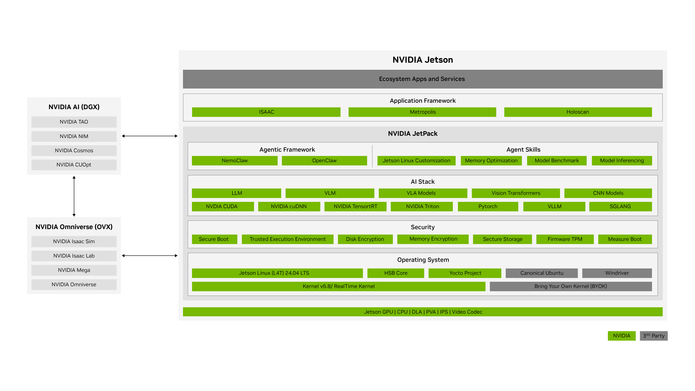
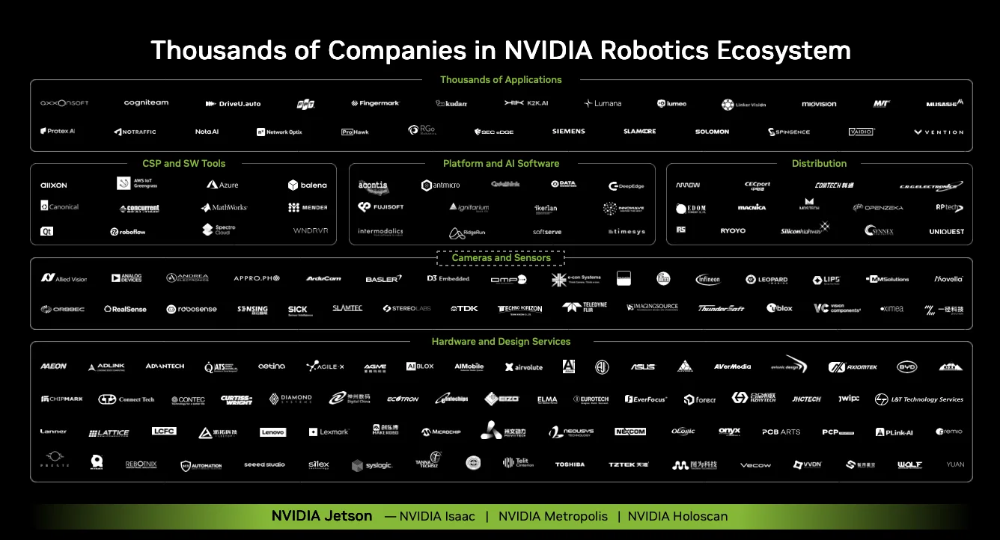
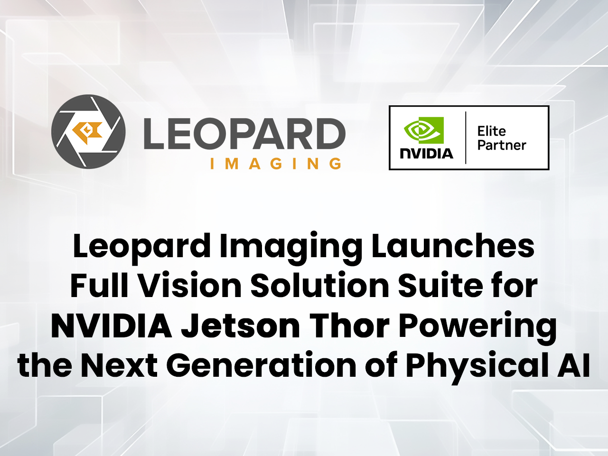
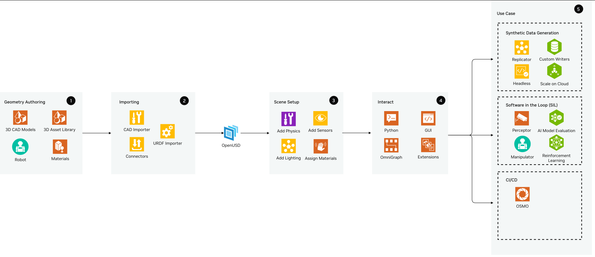
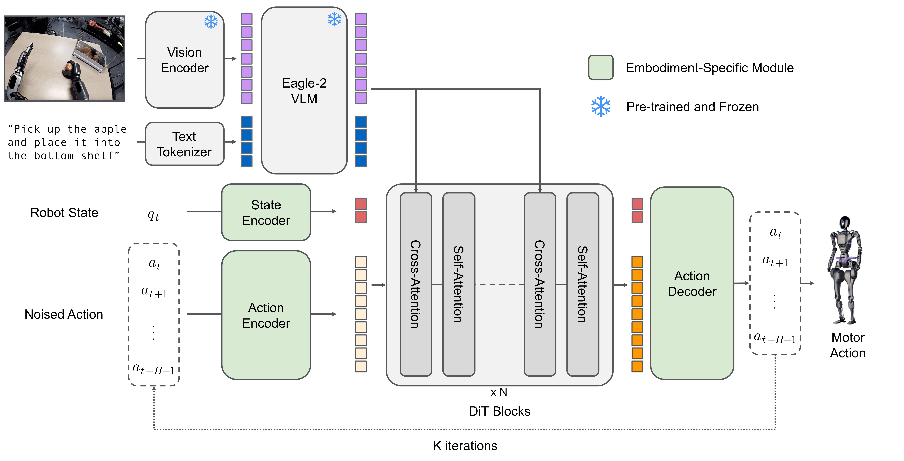

# NVIDIA：生态建设、供应链与原型到量产

## 1. 结论与评估口径

NVIDIA的具身智能生态价值在于把模组、载板设计资料、加速软件、相机与系统伙伴和机器人开发工作流连接起来。客户可以从开发套件验证算法，转向伙伴整机或自研载板，再维护自己的量产镜像。这个路径降低了从零设计计算平台的工作量，但不能替代整机厂商的热设计、接口验证、可靠性测试和售后责任。本报告以2026年11月3日已有官方快照为基础，11月4日补采伙伴检索数据、支持入口和Thor载板适配资料；供货日期、价格与产品标签均保留原始口径。[Jetson官方支持入口](https://developer.nvidia.com/embedded/support) [Jetson官方FAQ](https://developer.nvidia.com/embedded/faq) [官方Jetson伙伴检索数据](https://developer.nvidia.com/search-data/jetson_ecosystem_partners.json)

生态成熟度应分别考察文档是否可执行、具体版本是否兼容、伙伴是否交付了目标SKU，以及长期维护由谁承担。目录规模不是装机量，GitHub Stars不是工程质量，模组可供货年限也不是软件安全补丁承诺。以下将这些证据分开，避免用一个“生态完善”的概括代替采购与研发判断。

## 2. 开发者文档：从算法入口延伸到板级工程

官方支持入口按Thor、AGX Orin、Orin NX/Nano及旧产品组织资料，列出Datasheet、Product Design Guide、Thermal Design Guide、Pinmux、CAD模型、迁移与合规资料。软件侧连接JetPack、CUDA、DeepStream、Isaac ROS和历史版本文档，量产侧连接平台适配、信号调优、测试指南与支持元器件清单。它的优势是软硬件资料能够围绕同一模组查找；实际使用仍应固定模组料号、BSP和文档版本，不能把旧平台的检查项直接搬到Thor。[Jetson官方支持入口](https://developer.nvidia.com/embedded/support)

**图1：JetPack官方机器人软件分层与工作流。** 原图出处：[JetPack官方软件架构](https://developer.nvidia.com/embedded/jetpack)。

图中上层机器人、视觉与物理AI软件共用底层计算和Jetson Linux。这说明合作伙伴可在不同层提供服务：相机伙伴处理驱动与ISP，系统伙伴处理载板和散热，算法伙伴处理推理与应用。图并不证明每家伙伴都兼容所有层，也不意味着同一开发套件上的性能能直接复制到无风扇量产整机。[JetPack官方软件架构](https://developer.nvidia.com/embedded/jetpack)

| 开发阶段 | 官方资料入口 | 应形成的项目交付物 | 主要边界 |
|---|---|---|---|
| 算法原型 | JetPack、Isaac ROS安装及支持矩阵 | 模型、容器、依赖版本清单 | 最新库未必兼容既有BSP |
| 硬件选型 | Datasheet、设计与热指南 | 接口预算、供电及散热设计 | 芯片接口能力不等于载板引出能力 |
| 自研载板 | Thor Adaptation、Pinmux及BCT | 自有板名、设备树、启动和刷机配置 | 参考板配置需修改 |
| 集成测试 | Bring-up、接口调优及检查表 | 启动、接口、电源、热测试记录 | 需核对目标处理器适用列 |
| 量产维护 | 生命周期、PCN、OTA资料 | 发布镜像、回退策略、PCN追踪台账 | 供货承诺与补丁/SLA分开 |

资料来源：[Isaac ROS官方安装与支持矩阵](https://nvidia-isaac-ros.github.io/getting_started/index.html) [Thor载板适配与Bring-up指南](https://docs.nvidia.com/jetson/archives/r39.2.1/DeveloperGuide/HR/JetsonModuleAdaptationAndBringUp/JetsonThorAdaptationBringUp.html) [Jetson硬件软件Bring-up检查表](https://docs.nvidia.com/jetson/archives/r39.2.1/DeveloperGuide/HR/JetsonModuleAdaptationAndBringUp/Checklists.html) [Jetson Linux软件包与镜像OTA指南](https://docs.nvidia.com/jetson/archives/r39.2.1/DeveloperGuide/SD/SoftwarePackagesAndTheUpdateMechanism.html)。表中交付物是本报告的工程建议，未声称已经完成这些验证。网页静态正文已归档；需要登录下载的受限设计资源未在本轮获取，不能将支持入口中列出的名称视为已取得全部文件。

## 3. 代码社区与支持责任

公开代码仓库有助于理解接口、复现问题和锁定提交，但应逐仓库审核许可。11月3日API快照中，isaac_ros_common为322 Stars，默认分支最近提交时间为2026-09-22T02:16:15Z；Visual SLAM为1492 Stars，最近提交时间为2026-09-22T02:27:11Z。这里只比较本次取得的仓库快照，不据此推断全社区近30天活跃人数、问题响应时间或产品可靠性。[Isaac ROS Common Project Page](https://github.com/NVIDIA-ISAAC-ROS/isaac_ros_common) [Isaac ROS Repo Metadata](https://api.github.com/repos/NVIDIA-ISAAC-ROS/isaac_ros_common) [Isaac ROS Recent Commit](https://api.github.com/repos/NVIDIA-ISAAC-ROS/isaac_ros_common/commits?per_page=1) [Isaac ROS Visual SLAM官方仓库](https://github.com/NVIDIA-ISAAC-ROS/isaac_ros_visual_slam) [Isaac ROS Visual SLAM仓库元数据快照](https://api.github.com/repos/NVIDIA-ISAAC-ROS/isaac_ros_visual_slam) [Isaac ROS Visual SLAM最近提交快照](https://api.github.com/repos/NVIDIA-ISAAC-ROS/isaac_ros_visual_slam/commits?per_page=1)

| 仓库/软件 | 许可证据 | 可复用价值 | 商业维护应确认的事项 |
|---|---|---|---|
| isaac_ros_common | NVIDIA ISAAC ROS SOFTWARE LICENSE | 环境、公共工具和参考代码 | NVIDIA GPU平台限制、修改及再分发条件 |
| isaac_ros_visual_slam | 仓库代码Apache-2.0 | ROS接口及参考集成 | 随附加速二进制和依赖的独立条款 |
| Jetson Linux Driver Package | NVIDIA Driver Agreement与组件许可 | BSP、启动与平台支持 | 源码可见范围、平台限制、补丁与服务合同 |

来源：[Isaac ROS当前软件许可](https://raw.githubusercontent.com/NVIDIA-ISAAC-ROS/isaac_ros_common/main/LICENSE) [Isaac ROS Visual SLAM代码许可](https://raw.githubusercontent.com/NVIDIA-ISAAC-ROS/isaac_ros_visual_slam/main/LICENSE) [Jetson Linux 39 2 1 License](https://developer.nvidia.com/downloads/embedded/L4T/r39_Release_v2.1/release/Tegra_Software_License_Agreement-Tegra-Linux.txt)。不能将Visual SLAM仓库的代码许可延伸到所有cuVSLAM二进制，也不能因仓库公开就把isaac_ros_common写成Apache开源项目。

官方支持入口提供论坛、伙伴和FAQ路径；FAQ明确JetPack 4于2024年11月EOL，并建议利用Timesys、Codethink等伙伴维护旧内核。该建议说明旧产品存在维护服务路径，不等于NVIDIA仍对JetPack 4提供同等支持。伙伴检索JSON本次包含Timesys，但未唯一检出Codethink公司条目，因此后者仅作为FAQ中的维护建议，不纳入目录统计。[Jetson官方支持入口](https://developer.nvidia.com/embedded/support) [Jetson官方FAQ](https://developer.nvidia.com/embedded/faq)

[公开资料未披露] 本轮没有取得论坛近30天发帖量、官方响应分位数或付费支持服务等级合同。Driver Agreement的支持条款以另行约定为边界，因此不得把免费文档、论坛答复和生产停机SLA混为一谈。量产项目应明确模组供应商、载板厂、相机厂和整机厂各自的复现条件、修复责任与响应承诺。[Jetson Linux 39 2 1 License](https://developer.nvidia.com/downloads/embedded/L4T/r39_Release_v2.1/release/Tegra_Software_License_Agreement-Tegra-Linux.txt)

## 4. 合作伙伴网络：可复核的目录统计

11月4日下载官方检索JSON，按company_name精确去重得到114条记录、114家公司。categories、regions和products_supported都是多选字段，同一公司可以同时计入多个分类和地区。以下是目录覆盖面，不是市场份额，也不是已量产系统数量；未将旧产品标签剔除后伪称“当前机器人伙伴数”。[Jetson Partner Ecosystem](https://developer.nvidia.com/embedded/community/ecosystem) [官方Jetson伙伴检索数据](https://developer.nvidia.com/search-data/jetson_ecosystem_partners.json)

| 目录分类 | 公司条目数 | 能解决的主要工作 |
|---|---:|---|
| Design and Development Service | 62 | 载板、软件及项目定制 |
| ODM / System Builder | 47 | 模组到成品计算系统 |
| AI Model, Application, and Dev Tool | 35 | 算法、应用和开发工具 |
| System Software | 35 | 系统软件集成与维护 |
| Camera, LIDAR, and Sensors | 22 | 相机、激光雷达、驱动和标定 |
| Distributor | 10 | 销售与采购服务 |
| Distro and OS / Connectivity | 各3 | 发行版及连接技术 |

地区标签APAC为70、EMEA为61、NALA为67；另有USA、Japan、China各1条特殊地区标签。China=1不能解释为“只有一家在中国提供服务”，因为多数公司使用APAC等区域标签。产品标签AGX Orin为79、Orin NX为69、Orin Nano为53、AGX Thor为33、Thor为2；后两种原始标签未合并计数，避免重复公司与标签语义差异。统计脚本和JSON结果保存在本项目，原始数据亦可从文末本地原文复核。[官方Jetson伙伴检索数据](https://developer.nvidia.com/search-data/jetson_ecosystem_partners.json)

## 5. 代表伙伴如何覆盖软硬件链条

| 伙伴 | 官方目录所列角色 | Thor标签 | 值得进入采购核验的能力 |
|---|---|---|---|
| Advantech | ODM、设计、AI应用工具 | AGX Thor | MIC系列系统、载板、机箱、BSP及AI SDK |
| Aetina | ODM、设计 | AGX Thor | 模组、载板、系统，外设AVL与集成验证 |
| AAEON | ODM、设计 | AGX Thor | 工业边缘系统、I/O与热机械方案 |
| Connect Tech | ODM、AI应用工具 | AGX Thor | 载板、机箱、热设计与定制 |
| Leopard Imaging | 相机/传感器 | AGX Thor | RAW/YUV、CSI/USB及ISP方案 |
| e-con Systems | 相机/传感器、设计 | AGX Thor | CSI-2、USB、双目和多相机及驱动 |
| Seeed Studio | 设计、AI应用工具、系统软件 | 本次未列 | 设备、载板、外设、ML与制造服务 |
| ADLINK | ODM、设计、AI应用工具 | 本次未列 | 嵌入式模组、载板及定制系统 |
| Stereolabs | 相机/传感器、AI应用工具 | 本次未列 | ZED双目、深度/跟踪/映射SDK |
| Timesys | 设计、系统软件 | 本次未列 | Linux、安全维护和Yocto BSP定制 |

全部角色及描述来自[官方Jetson伙伴检索数据](https://developer.nvidia.com/search-data/jetson_ecosystem_partners.json)，不是本轮独立验收。“本次未列”仅说明目录字段，不证明厂商没有Thor产品。描述中也可能保留早期TX2/Nano文案；伙伴等级Elite/Preferred只作为目录字段，不能转换成技术评分。采购时应索取具体型号、BSP支持版本、相机曝光同步方式、持续负载下温度和限频日志、长供协议以及售后窗口，而不是只检查公司是否在名单中。

## 6. 系统厂商：从模组到可安装计算单元

### 6.1 研华 Advantech：计算、长线相机与选配数据入口

2025年8月26日官方发布MIC-742-AT Robotics Development Kit，采用Jetson Thor，列出128GB LPDDR5X、最高2070 FP4 TFLOPS、整机150W、−10至60°C工作温度和八路GMSL 2.0。2070是芯片的标称低精度峰值，150W是该发布稿的系统功耗口径，不能与T5000模组40—130W混用，更不能推导特定模型每瓦成功率。发布稿当时写2025年9月正式推出；本轮没有核验当地库存和批量交期。[Advantech官方Thor机器人开发套件PR](https://www.advantech.com/en-us/resources/news/advantech-announces-next-gen-robotics-development-kit-with-nvidia-jetson-thor-with-holoscan-built-in) [Datasheet Thor Full v1 5](https://developer.nvidia.com/downloads/assets/embedded/secure/jetson/thor/docs/jetson-thor-series-modules-datasheet_ds-11945-001.pdf)

其系统价值在于将载板、机箱、散热与多相机连接作为一个整机入口交付。对需要以太网传感器数据流的开发者，稿件明确MIC-FG-HSBA1和EKI-2712X-SPE为选配附件，分别提供Holoscan Sensor Bridge与交换机路径，不能写成每台MIC-742-AT默认带齐。这类组合适合人形和AMR的多模态采集，但发布稿所称亚毫秒多传感器对齐没有给出传感器型号、曝光起点、负载、样本数或尾部时延，不能作为整机闭环验收数字。正式设计应把相机曝光、传输、模型执行、动作下发分段测量，核对同步附件和软件版本。[Advantech官方Thor机器人开发套件PR](https://www.advantech.com/en-us/resources/news/advantech-announces-next-gen-robotics-development-kit-with-nvidia-jetson-thor-with-holoscan-built-in)

### 6.2 NVIDIA目录中的其他系统伙伴及证据等级

Aetina当前DeviceEdge官方页明确列出Thor的AIE-KT78/68系统和AIB-AT78/68平台，分别面向T5000/T4000；同时提供Orin NX/Nano、AGX Orin及Rockchip系列。其定制服务包括I/O、形态、热设计、BSP调整、第三方软件预装及设备集成，外设覆盖4G/5G、Wi-Fi、相机、存储和GPS。相对只采购SOM，这类服务把可用外设清单和软件镜像纳入系统交付。但官网“fully tested”未展开所有外设组合和连续负载测试，本轮只确认产品系列与服务范围，不给出未取得的温度、功耗或认证结果；页面的7.5×描述也不能作为该机箱特定机器人任务加速。[Aetina官方Jetson系统方案](https://www.aetina.com/products-features.php?t=337)

AAEON当前AI目录列出Thor BOXER-8740AI、8741AI、8742AI、8723AI和8752AI，并在这些项目前显示**Preliminary**。8742/8723/8752描述为无风扇方案，8740/8741为embedded box PC；目录没有给出全部具体SKU的功耗、温度及实际引出接口，所以不跨型号填参数。目录通用介绍仍提JetPack 6.0，与Thor当前栈不应混用，应以对应产品支持矩阵和R39系列BSP确认。Orin型号还可见Phase Out Notice，说明伙伴目录自身也需按型号管理生命周期，不能用“全系列支持”代替长供核查。[AAEON官方NVIDIA AI产品目录](https://www.aaeon.com/en/product/list/aaeon-nvidia-ai-solutions)

| 伙伴 | 已取得的官方层次 | 可购买/开发的对象 | 本轮能确认的工程角色 | 仍需补核的边界 |
|---|---|---|---|---|
| Advantech | 厂商产品发布稿 | MIC-742-AT及选配桥接/交换机 | 整机、GMSL、散热和Holoscan入口 | 当前交期、目标软件和连续负载日志 |
| Aetina | NVIDIA目录与厂商当前产品总览 | AIE-KT78/68、AIB-AT78/68 | 外设AVL、系统集成和验证 | 具体SKU参数、交期与验收矩阵 |
| AAEON | NVIDIA目录与厂商当前AI目录 | BOXER-8740/8741/8742/8723/8752AI | I/O、热机械、嵌入式定制 | Thor条目标Preliminary；量产配置与BSP另核 |
| Connect Tech | NVIDIA伙伴目录 | 载板、系统、机箱和定制 | 计算载体及散热设计 | 本次新发布稿抓取失败，未采用其新参数 |
| Seeed Studio | NVIDIA伙伴目录及LeRobot官方README | 嵌入式设备、制造及教学集成 | 设备/载板/软件和开发者上手 | 本次T2000/T3000文章抓取失败，不能确定具体系统交付状态 |
| ADLINK | NVIDIA伙伴目录 | 模组、载板与定制系统 | 嵌入式系统工程 | 目录未标Thor不代表没有Thor产品 |

目录证据：[官方Jetson伙伴检索数据](https://developer.nvidia.com/search-data/jetson_ecosystem_partners.json)；研华产品证据：[Advantech官方Thor机器人开发套件PR](https://www.advantech.com/en-us/resources/news/advantech-announces-next-gen-robotics-development-kit-with-nvidia-jetson-thor-with-holoscan-built-in)。这里有意保持证据层级：目录只支持服务角色，产品发布支持具体设计方案，库存/交期还需要销售报价。Seeed在LeRobot README中被提及为中文教程验证参与方，是开发者传播和上手服务的线索，不是所有LeRobot本体量产或Thor系统认证的证明。[LeRobot官方策略与部署入口](https://raw.githubusercontent.com/huggingface/lerobot/main/README.md)

**图2：NVIDIA官方机器人硬件、传感器与软件伙伴生态图。** 原图出处：[NVIDIA Jetson Thor官方技术发布与性能条件](https://developer.nvidia.com/blog/introducing-nvidia-jetson-thor-the-ultimate-platform-for-physical-ai/)。

图按芯片到系统、视觉和机器人应用呈现多层合作关系，帮助定位谁解决载板、相机、软件或整机问题。图来自2025年Thor技术文章，反映当时的合作覆盖，不是2026年全部伙伴清单；具体采用、选配与路线图仍逐产品核验。图中的品牌数量也不能解释为市场份额或已部署数量。[NVIDIA Jetson Thor官方技术发布与性能条件](https://developer.nvidia.com/blog/introducing-nvidia-jetson-thor-the-ultimate-platform-for-physical-ai/)

## 7. 传感器伙伴：驱动、图像质量与同步是主要交付物

### 7.1 Leopard Imaging：相机硬件与软件栈一起交付

2025年8月25日官方发布Thor视觉组合，包括单目、双目和ToF相机，组合分辨率最高25MP，接口覆盖MIPI、10GigE和STP。明确列举单目LI-IMX715-MIPI-HOLOSCAN-082H、3D感知LI-IPX-KW33000-MIPI-TOF和LI-HAWK-HOLOSCAN，以及适配板、驱动和同步附件。最高25MP是组合能力描述，不表示三个列举型号都是25MP，也不等于25MP全帧时可达某个未经披露的fps。[Leopard Imaging官方Thor视觉方案PR](https://leopardimaging.com/leopard-imaging-launches-full-vision-solution-suite-for-nvidia-jetson-thor-powering-the-next-generation-of-physical-ai/)

**图3：Leopard Imaging官方Thor视觉方案介绍图。** 原图出处：[Leopard Imaging官方Thor视觉方案PR](https://leopardimaging.com/leopard-imaging-launches-full-vision-solution-suite-for-nvidia-jetson-thor-powering-the-next-generation-of-physical-ai/)。

图用于识别相机与计算平台的集成定位，不承担分辨率、时延或同步精度的证明。官方稿件给出随相机提供Jetson驱动软件栈及Holoscan SDK，价值是开发者不必从裸传感器开始编写全部驱动。仍需逐型号查明镜头、曝光、RAW/YUV格式、ISP调参、触发输入、载板连接和对应BSP。厂商举出的机器人/AMR场景是方案适用方向，没有逐客户型号、量产数量或成功率数据，不计为06报告中的产品采用案例。[Leopard Imaging官方Thor视觉方案PR](https://leopardimaging.com/leopard-imaging-launches-full-vision-solution-suite-for-nvidia-jetson-thor-powering-the-next-generation-of-physical-ai/)

### 7.2 e-con Systems：用FPGA ISP分离采集前处理

2025年8月25日官方宣布USB See3CAM、ONVIF兼容RouteCAM GigE、10G Holoscan Camera及Thor ECU支持。10G方案由相机模组、自研HSB板和FPGA上的TintE ISP组成，列举IMX715、IMX568、AR0234、IMX900、AR2020、ISX031等传感器，支持组合最高20MP。该路径的特点是图像前处理放在桥接硬件，而GPU留给感知与推理；这是具体数据流和资源分工，比“支持AI相机”更能指导设计。[e-con Systems官方Thor视觉计算方案](https://www.e-consystems.com/pr/ai-powered-vision-and-compute-solutions-accelerated-by-nvidia-jetson-thor.asp)

官方使用“virtually zero CPU utilization”和“ultra-low latency”描述CoE，但没有给出CPU计数范围、传输负载、像素格式和P99。报告仅保留为厂商定性能力，不编造百分比。官方稿件另把同一10G板的双目相机支持写作roadmap，因此不能当成已完成的双目产品矩阵。ECU被厂商称production-ready并提供购买入口，但本次稿件没有展开完整ECU料号、温度和功耗；它不是研华MIC-742-AT参数的可替代证据。[e-con Systems官方Thor视觉计算方案](https://www.e-consystems.com/pr/ai-powered-vision-and-compute-solutions-accelerated-by-nvidia-jetson-thor.asp)

### 7.3 RealSense、Stereolabs与驱动接口的区别

RealSense在2025年8月25日的官方合作稿中具体介绍D555：v5 Vision Processor、片上PoE、原生HSB流传输、相机端神经网络图像后处理、global shutter、IMU和ROS 2。其技术价值是深度与图像前处理在相机端完成，再接Thor运行和Isaac Sim数字孪生工作流。稿件没有给出D555分辨率/距离/误差的完整表和条件化端到端时延，本报告不从Thor峰值反推相机性能，也不把“fully validated”描述扩展成客户整机认证。[RealSense官方与NVIDIA物理AI合作](https://realsenseai.com/news-insights/news/RealSense-and-NVIDIA-Collaborate-to-Usher-in-the-Age-of-Physical-AI)

RealSense多相机在Isaac ROS nvblox已有官方实例，需分别处理图像、深度、位姿、时间戳和发射器交错；这说明生态不仅是接通USB，还包括避免主动深度干扰和保持深度/颜色一致。Stereolabs在官方伙伴目录中提供ZED双目及深度、跟踪和映射SDK，属于传感器与软件一体的伙伴。本轮没有取得这两家全部Thor产品规格和统一条件性能数据，不能把已有ROS教程写成全线相机即插即用。[Nvblox静态/动态重建及RealSense交替帧机制](https://nvidia-isaac-ros.github.io/concepts/scene_reconstruction/nvblox/technical_details.html) [官方Jetson伙伴检索数据](https://developer.nvidia.com/search-data/jetson_ecosystem_partners.json)

| 相机路线 | 主要集成资产 | 更适合的起点 | 需要实际验收的事项 |
|---|---|---|---|
| USB/现成深度SDK | 用户态SDK、深度与标定 | 快速原型、少量传感器 | 带宽共享、深度干扰、CPU及时间戳 |
| MIPI/GMSL | 内核驱动、SerDes、ISP及触发 | 机内或长线多相机 | 载板走线、供电、曝光与BSP版本 |
| 10G HSB/CoE | 桥接FPGA、ISP、传输及接收端 | 高分辨率、多传感器采集 | 实际接收硬件、协议、同步、丢包和延迟 |
| ZED/其他专有SDK | 深度、定位和映射库 | 希望采购整合感知能力 | 二进制许可、硬件矩阵及失败恢复 |

表为[Leopard Imaging官方Thor视觉方案PR](https://leopardimaging.com/leopard-imaging-launches-full-vision-solution-suite-for-nvidia-jetson-thor-powering-the-next-generation-of-physical-ai/)、[e-con Systems官方Thor视觉计算方案](https://www.e-consystems.com/pr/ai-powered-vision-and-compute-solutions-accelerated-by-nvidia-jetson-thor.asp)、[Nvblox静态/动态重建及RealSense交替帧机制](https://nvidia-isaac-ros.github.io/concepts/scene_reconstruction/nvblox/technical_details.html)和[Holoscan Sensor Bridge 2.7架构与示例](https://docs.nvidia.com/holoscan/sensor-bridge/2-7-latest/applications/architecture)的工程归纳，非统一性能排名。不同接口不是同一目标下的速度档位，选型要结合线缆长度、触发、温度、图像质量与传感器数量。

## 8. 代表开源方案：每层如何协作和替换

### 8.1 Isaac Sim与Isaac Lab：资产、仿真与学习

Isaac Sim提供场景、渲染和传感器仿真；Isaac Lab构建机器人学习环境、奖励、观测、域随机化与训练接口。它们帮助本体企业复用环境和并行训练基础设施，客户仍要提供真实的关节、传动、接触和相机模型。仿真环境数量或训练fps不是实体机器人成功率；仿真渲染图也不能验证真实遮挡、摩擦与线缆约束。[Isaac官方仿真参考架构](https://docs.isaacsim.omniverse.nvidia.com/latest/introduction/reference_architecture.html) [GitHub IsaacLab README](https://raw.githubusercontent.com/isaac-sim/IsaacLab/main/README.md) [Isaac官方Managers与事件API](https://isaac-sim.github.io/IsaacLab/main/source/api/lab/isaaclab.managers.html)

**图4：Isaac Sim官方分层架构图。** 原图出处：[Isaac官方仿真参考架构](https://docs.isaacsim.omniverse.nvidia.com/latest/introduction/reference_architecture.html)。

图展示Sim建立在Kit等运行基础之上，并向外连接资产、传感器和机器人工作流。图片文件名保留4.5版本标识，当前文档版本更高，因此用于解释分层关系；当前功能依照各页正文确认，不能仅由这张历史架构图推出新release全部模块。Isaac Lab核心代码BSD-3-Clause，但README说明不同组件另有Apache-2.0；Sim代码、Kit运行时、USD资产、纹理与数据也分别核验，下载公开仓库并不等于得到所有再分发授权。[Isaac Lab官方代码许可](https://raw.githubusercontent.com/isaac-sim/IsaacLab/main/LICENSE) [Isaac Sim官方代码及附加组件许可](https://raw.githubusercontent.com/isaac-sim/IsaacSim/main/LICENSE) [GitHub IsaacLab README](https://raw.githubusercontent.com/isaac-sim/IsaacLab/main/README.md)

### 8.2 LeRobot：把采集、数据和策略接口标准化

LeRobot是Hugging Face维护的PyTorch机器人库，提供Robot接口与LeRobotDataset。Robot.connect/get_observation/select_action/send_action把硬件访问与策略逻辑分开；同步MP4或图像配合Parquet状态/动作让不同策略复用同一episode数据。当前README列出SO101、OpenARM、LeKiwi、Unitree G1等原生接口，第三方硬件按插件包自动发现。它的价值是本体、数据和模型接口更容易协作；接口存在不能证明每个平台都满足生产时延或安全要求。[LeRobot官方策略与部署入口](https://raw.githubusercontent.com/huggingface/lerobot/main/README.md)

**图5：LeRobot README中的GR00T类VLA官方结构图。** 原图出处：[LeRobot官方VLA结构图](https://raw.githubusercontent.com/huggingface/lerobot/main/media/readme/VLA_architecture.jpg)。

这张图描述视觉语言与动作模型的结构，说明LeRobot能接纳这类策略，**不是LeRobot库的总架构图**。其数据工具、Robot接口和插件机制由README文字核验。模型训练、仿真评估和实机rollout是不同流程；README中的coming soon条目不作为已实现能力。核心代码Apache-2.0不覆盖所有Hub权重、机器人数据和第三方插件。针对Jetson还要核对PyTorch/CUDA、视频解码、模型内存和本体动作格式。[LeRobot官方策略与部署入口](https://raw.githubusercontent.com/huggingface/lerobot/main/README.md)

### 8.3 cuRobo与Isaac ROS Deploy：规划到执行器边界

cuRobo提供GPU运动学、碰撞与轨迹优化，可作为机械臂规划组件；Isaac ROS Deploy通过ros2_control接真实和模拟本体，使用description、ros2_control和bringup三类包。官方接入教程要求实现SystemInterface的生命周期、read/write和命令模式切换，并显式把URDF关节名映射到厂商SDK电机序号，不能依赖二者顺序恰好一致。这是“模型能输出动作”到“执行器正确执行”的关键生态接口。[cuRobo当前文档](https://nvlabs.github.io/curobo/latest/) [Isaac ROS Deploy本体适配指南](https://nvidia-isaac-ros.github.io/repositories_and_packages/isaac_ros_deploy/how_to_guides/bring_your_own_embodiment.html)

已有策略和规划代码不提供通用整机安全保证。每个本体需要独立设置controller group、命令接口和阈值，从仿真开始逐层验证。开放代码有助于替换硬件接口，但GPU内核、策略运行库、驱动和厂商SDK仍可能分别受许可和平台条件约束。对接时应交付观测/动作schema、关节顺序、单位、坐标系与实机超限处理，而不只交付容器。[Isaac ROS Deploy Safety](https://nvidia-isaac-ros.github.io/repositories_and_packages/isaac_ros_deploy/concepts/safety.html) [Deploy代码许可](https://raw.githubusercontent.com/NVIDIA-ISAAC-ROS/isaac_ros_deploy/release-5.0/LICENSE) [cuRobo License](https://raw.githubusercontent.com/NVlabs/curobo/main/LICENSE)

### 8.4 OSMO：跨训练、仿真与边缘测试的编排

OSMO以YAML组织依赖任务并分配Kubernetes backend，能把数据生成、训练、仿真、HIL/SIL连接起来，支持云、本地和边缘异构算力。官方README给出simulation→train-policy→evaluate-thor示例，训练输出作为评估输入，比手工复制checkpoint更利于可追溯。官方平台FAQ同时明确它不直接部署生产机器人，不内置完整模型registry、实验看板或完整MLOps；可连接其他工具，不应写成一套包办生产运维的平台。[OSMO_README官方资料](https://raw.githubusercontent.com/NVIDIA/OSMO/main/README.md) [NVIDIA OSMO官方平台](https://developer.nvidia.com/osmo)

它的生态价值在于把团队的算力与流程资产连接，而非要求机器人持续联网云推理。README有Azure参考架构入口，但本轮未核验该架构全部部署细节，不给出未经测试的云端交付时长。路线图中的自动负载调度、动态工作流等也需要按实际release核验，不能因2026年目标日期已过就认定全部上线。[OSMO_README官方资料](https://raw.githubusercontent.com/NVIDIA/OSMO/main/README.md)

## 9. 开源快照与商业交付检查

| 官方项目 | Stars | 最近默认分支提交UTC | 代码许可 | 原文与快照 |
|---|---:|---|---|---|
| [GitHub IsaacLab Page](https://github.com/isaac-sim/IsaacLab) | 8564 | 2026-11-03T05:08:05Z | 核心BSD-3-Clause；组件另验 | [Isaac Lab仓库元数据](https://api.github.com/repos/isaac-sim/IsaacLab) [Isaac Lab提交快照](https://api.github.com/repos/isaac-sim/IsaacLab/commits?sha=main&per_page=1) [Isaac Lab官方代码许可](https://raw.githubusercontent.com/isaac-sim/IsaacLab/main/LICENSE) |
| [cuRobo Project Page](https://github.com/NVlabs/curobo) | 1951 | 2026-09-10T17:21:47Z | Apache-2.0 | [cuRobo Repo Metadata](https://api.github.com/repos/NVlabs/curobo) [cuRobo Recent Commit](https://api.github.com/repos/NVlabs/curobo/commits?per_page=1) [cuRobo License](https://raw.githubusercontent.com/NVlabs/curobo/main/LICENSE) |
| [Isaac ROS Deploy官方仓库](https://github.com/NVIDIA-ISAAC-ROS/isaac_ros_deploy) | 10 | 2026-09-24T07:07:45Z | Apache-2.0 | [Deploy仓库元数据](https://api.github.com/repos/NVIDIA-ISAAC-ROS/isaac_ros_deploy) [Deploy最近提交](https://api.github.com/repos/NVIDIA-ISAAC-ROS/isaac_ros_deploy/commits?per_page=1) [Deploy代码许可](https://raw.githubusercontent.com/NVIDIA-ISAAC-ROS/isaac_ros_deploy/release-5.0/LICENSE) |
| [OSMO_PAGE官方资料](https://github.com/NVIDIA/OSMO) | 280 | 2026-10-28T18:47:25Z | Apache-2.0 | [OSMO_META官方资料](https://api.github.com/repos/NVIDIA/OSMO) [OSMO_COMMIT官方资料](https://api.github.com/repos/NVIDIA/OSMO/commits?per_page=1) [OSMO_LICENSE官方资料](https://raw.githubusercontent.com/NVIDIA/OSMO/main/LICENSE) |
| [LeRobot](https://github.com/huggingface/lerobot) | 28670 | 2026-11-03T16:46:47Z | Apache-2.0，README声明 | [LeRobot官方策略与部署入口](https://raw.githubusercontent.com/huggingface/lerobot/main/README.md) [LEROBOT_META官方资料](https://api.github.com/repos/huggingface/lerobot) [LEROBOT_COMMIT官方资料](https://api.github.com/repos/huggingface/lerobot/commits?per_page=1) |

Stars和默认分支最近提交是采集快照，反映关注及代码更新线索，不代表装机量、兼容性、支持SLA或缺陷率。Isaac Lab API的许可识别为Other，本报告以实际LICENSE和README确认核心BSD-3-Clause及组件差异；机器人数据和权重许可不与框架代码合并。现有Visual SLAM/common许可情况见第3节。

对量产项目，建议按“传感器驱动与标定→载板/BSP和散热→数据/模型→执行器接口→发布和升级”组织交付。一个供应商可以覆盖多层，但每层要有版本、责任主体和验收日志。软件伙伴最有价值的部分常是BSP迁移、内核漏洞维护、GStreamer/相机pipeline、同步和现场调试；这些工程服务未必以公开GitHub Stars呈现。具体报价、漏洞修复窗口、支持年限及设备远程访问权限，应写入正式合同。

Timesys的NVIDIA官方服务页具体区分VigiShield Secure by Design、Vigiles漏洞管理和JetPack BSP Lifecycle Maintenance。VigiShield以meta-tegra Yocto layer提供secure boot、加密存储、安全更新、端口保护及密钥管理；Vigiles负责SBOM生成、漏洞识别和修复协作；BSP服务负责监控/打补丁/验证与状态报告。这些分别解决设计时防护、组件暴露追踪和部署后维护，不能互相替代。页内支持清单仍主要列Nano/TX2/Xavier并保留2021年活动，因此只证明服务能力，不证明当前Thor/R39已被该页逐项验证；页面所述符合安全标准也是支持客户合规，不能直接当作机器人取得IEC 62443等证书。[Timesys官方NVIDIA BSP服务](https://www.timesys.com/open-source-embedded/development-support/reference-bsp/processors/nvidia/)

RidgeRun的官方伙伴方案简介v1.0（2026年4月28日，1页）列出Linux/BSP、AI视觉、GStreamer、多媒体pipeline、相机驱动、传感器集成、硬件加速和产品化服务；产品覆盖视频稳像、鸟瞰、拼接、metadata和流媒体。它描述使用DeepStream、CUDA、VPI和Isaac ROS从架构到量产辅助客户，提供与相机厂/BSP厂之间的集成工程层。简介自述服务过100余Jetson客户、创建50余相机驱动，但没有逐驱动型号、版本、测试矩阵和时延，本报告仅视为厂商经验说明，不作为全部Thor外设兼容的证明。厂商网页本次静态抓取仅取得导航与服务入口，因此详细服务以已下载PDF为准；定制产品的授权和维护仍按合同核验。[RidgeRun官方伙伴方案简介](https://developer.download.nvidia.com/embedded/partners/one-pager/RidgeRun-OnePage-Sumary.pdf)

## 10. 原型到量产：真正需要迁移的层次

FAQ明确开发套件包含非量产规格模组和参考载板，不用于生产；量产模组出货时没有预装软件，需要装配目标载板并刷入客户镜像。开发套件默认一年开发用途保修，模组默认三年保修，均以另行注明为准；保修期限与五年或工业型号十年的operating lifetime是不同概念。[Jetson官方FAQ](https://developer.nvidia.com/embedded/faq)

Thor R39.2.1适配指南以T5000/P3834 SOM和P4071参考载板为例。更换载板需修改kernel device tree、MB1、MB2、ODM data及flashing configuration。Pinmux表生成gpio、padvoltage和pinmux dtsi并关联自有board.conf；不带载板EEPROM的设计还需要修改MB2读取配置及SKIP_EEPROM_CHECK。官方建议由最终DTB反编译检查修改是否生效。这些要求解释了为何“参考板能启动”不足以证明自研载板完成适配。[Thor载板适配与Bring-up指南](https://docs.nvidia.com/jetson/archives/r39.2.1/DeveloperGuide/HR/JetsonModuleAdaptationAndBringUp/JetsonThorAdaptationBringUp.html)

同页的25GbE实例需要同时修改kernel DT、BPMP DT、重建并刷机，参考套件QSFP默认10GbE。采购“支持25GbE”的系统时，应确认实际固件、布线与PHY/模块配置，不应只依据Thor芯片接口标称。通用检查表还保留AGX Orin适用列和部分旧平台项目，使用时必须按处理器筛选；不能从其旧供电条目推导Thor输入电压。[Thor载板适配与Bring-up指南](https://docs.nvidia.com/jetson/archives/r39.2.1/DeveloperGuide/HR/JetsonModuleAdaptationAndBringUp/JetsonThorAdaptationBringUp.html) [Jetson硬件软件Bring-up检查表](https://docs.nvidia.com/jetson/archives/r39.2.1/DeveloperGuide/HR/JetsonModuleAdaptationAndBringUp/Checklists.html)

建议量产放行至少覆盖冷/热启动与恢复刷机、所有实际I/O和同步信号、功耗模式切换、持续并发负载、异常断电、外设断连及镜像回退。对每个测试保留板版本、模组SKU、BSP、容器摘要和测试日志。官方OTA提供维护机制，但客户仍需设计升级失败恢复和版本兼容策略；本轮未实施刷机或量产测试。[Jetson Linux软件包与镜像OTA指南](https://docs.nvidia.com/jetson/archives/r39.2.1/DeveloperGuide/SD/SoftwarePackagesAndTheUpdateMechanism.html)

## 11. 长供与变更管理

| 产品族/型号 | 官方可供货至 | 规划影响 |
|---|---|---|
| T4000 / T5000 | 2036年1月 / 2035年8月 | 两款Thor不共用相同截止月 |
| AGX Orin 32/64、NX 8/16、Nano 4/8 | 2032年1月 | 可围绕统一代际规划存量产品 |
| AGX Orin Industrial | 2033年7月 | 与普通Orin供货窗口分开 |
| AGX Xavier 32、Xavier NX 8/16、TX2 NX | 2027年7月 | 新增长周期项目应评估迁移 |
| AGX Xavier Industrial、TX2i | 2027年7月 | 工业operating lifetime不延长供货日期 |
| Jetson Nano | 2027年1月 | 不宜只因低模组价延续新设计 |
| TX2 4/8、AGX Xavier 64 | 已于2025年1月EOL | 不能用其他同族型号期限替代 |
| TX1 | 已于2021年1月EOL | 存量维护与新设计分开 |

以上以专门[Jetson官方生命周期](https://developer.nvidia.com/embedded/lifecycle)为准。FAQ仍写Xavier普通款到2028年1月、工业款到2031年7月，与本次生命周期页冲突；本报告保留这一差异，并优先采用专门产品生命周期页。开发套件没有对应生命周期承诺，不能用模组日期证明套件将一直供货。[Jetson官方FAQ](https://developer.nvidia.com/embedded/faq)

NVIDIA按JEDEC JESD-046通知硬件变更，内存元器件变化可能伴随软件变化；最后出货前至少八个月发送EOL通知。客户应跟踪PCN到具体料号和镜像版本，保留新物料回归验证与最后采购流程。长供降低重新设计频率，但没有公开证据保证每批内存、BOM、交期和当地库存不变。[Jetson官方生命周期](https://developer.nvidia.com/embedded/lifecycle)

## 12. 成本控制：公开价锚与系统成本

| 量产模组 | FAQ建议价，USD，1KU+ | Cost Down关注点 |
|---|---:|---|
| T5000 / T4000 | 4999 / 2999 | 模型容量、并发与带宽需求是否必要 |
| AGX Orin 64GB / 32GB | 2999 / 1799 | 显存和持续负载预算 |
| AGX Orin Industrial | 3199 | 宽温和可靠性规格是否必须 |
| Orin NX 16GB / 8GB | 999 / 649 | 模型、缓存与扩展接口 |
| Orin Nano 8GB / 4GB | 399 / 349 | 小模型及低成本系统可行性 |

来源：[Jetson官方FAQ](https://developer.nvidia.com/embedded/faq)。这些数字是官方美元批量建议价，不是中国含税成交价、实时库存价或整机BOM。开发套件的Thor 5499美元、AGX Orin 3499美元、Nano Super 399美元也不能替代量产模组报价。模组外还要核算载板、存储、供电、散热、传感器、测试夹具、软件维护和返修成本。

具体降本路线应先裁剪任务和I/O，验证较小模组是否满足精度、P99闭环延迟和热稳态，再比较伙伴标准载板与自研NRE摊销。Orin Super没有新增模组硬件包，其性能提升来自软件；NX启用40W需要HV rail和相应散热，Nano对应25W模式。不能将软件升级简单写成无成本增益，供电与热结构变化可能抵消计算模组节省。[Jetson官方FAQ](https://developer.nvidia.com/embedded/faq)

[公开资料未披露] 中国地区折扣、税费、交期、伙伴整机BOM、NRE和批量良率，本轮没有取得正式报价或产线资料。报告因此不给出虚构的整机成本百分比，也不以建议价推断供应商利润或客户ROI。

## 13. 国内适配与自主可控边界

官方目录证明存在APAC服务与Seeed等硬件/软件服务路径，但没有提供中国机器人装机量、国产OS全矩阵或智算中心覆盖率。FAQ列出普通Thor/Orin部分SKU产地为China、USA或Vietnam，并单列来源特定料号；产地字段说明供应和制造路径，不证明芯片IP、GPU驱动或加速工具链自主可控。[官方Jetson伙伴检索数据](https://developer.nvidia.com/search-data/jetson_ecosystem_partners.json) [Jetson官方FAQ](https://developer.nvidia.com/embedded/faq)

| 层次 | 可由本地团队掌握的资产 | 仍需评估的外部依赖 |
|---|---|---|
| 机器人本体与载板 | 原理图、机电结构、I/O及驱动适配 | 模组供货、接口约束与PCN |
| 应用与模型 | 业务代码、采集数据和后训练流程 | 模型权重条款、算子及部署后端 |
| 系统发布 | 自有镜像、升级与日志、回归流程 | BSP二进制、底层驱动和版本支持 |
| 采购维护 | 本地服务合同、备件与替代验证 | 来源SKU、交期、许可及持续服务 |

NVIDIA Driver Agreement对所覆盖驱动软件有NVIDIA平台与修改限制，且没有把as-delivered软件认证为critical application解决方案。自主可控评估应据实际SBOM、源码可替换性、硬件替代成本及合同逐项完成，而不是给整个Jetson系统一个“国产化率”猜测。[Jetson Linux 39 2 1 License](https://developer.nvidia.com/downloads/embedded/L4T/r39_Release_v2.1/release/Tegra_Software_License_Agreement-Tegra-Linux.txt)

采购结论是：优先把伙伴生态用于缩短板级工程与传感器集成周期，同时把长期版本维护、关键二进制依赖、PCN响应和本地服务责任写进项目交付清单。对于只需单任务视觉的小型机器人，先验证Orin NX/Nano与标准载板；对多模态大模型和高速多传感器系统，再用实测并发与热预算决定Thor。这个结论是证据驱动的选型路线，不代表任何一家伙伴已通过本项目量产验收。

## 参考资料与本地原文

本报告依据11月3日采集的快照及11月4日逐方向补充取得的官方网页、代码仓库、API和文档。资料由统一下载工具归档到本项目的reference_metrial；多个方向共享同一URL的已校验文件。网页保留HTML和依赖，部分资源受robots规则、失效链接或动态交互限制影响时，按metadata如实标明。采集时点、版本和原始响应哈希可在各资料目录内核对。

| 官方资料 | 原始URL | 本地原文 | 归档情况 |
|---|---|---|---|
| NVIDIA_07_SUPPORT | [官方原文](https://developer.nvidia.com/embedded/support) | [index.html](REFERENCES.md#ref-aedf333904b70e30) | 静态呈现依赖部分缺失；见metadata |
| NVIDIA_Developer_Page_Jetson_FAQ | [官方原文](https://developer.nvidia.com/embedded/faq) | [index.html](REFERENCES.md#ref-7c29d52f2f676227) | 静态呈现依赖部分缺失；见metadata |
| NVIDIA_07_PARTNER_DATA | [官方原文](https://developer.nvidia.com/search-data/jetson_ecosystem_partners.json) | [content.json](REFERENCES.md#ref-447a3a34ae20f22d) | 原件已归档 |
| NVIDIA_JetPack_Page | [官方原文](https://developer.nvidia.com/embedded/jetpack) | [index.html](REFERENCES.md#ref-c9b618c904201b47) | 静态呈现依赖部分缺失；见metadata |
| NVIDIA_Isaac_ROS_Getting_Started | [官方原文](https://nvidia-isaac-ros.github.io/getting_started/index.html) | [index.html](REFERENCES.md#ref-c092d317bfdef4e3) | 静态呈现依赖部分缺失；见metadata |
| NVIDIA_07_BRINGUP | [官方原文](https://docs.nvidia.com/jetson/archives/r39.2.1/DeveloperGuide/HR/JetsonModuleAdaptationAndBringUp/JetsonThorAdaptationBringUp.html) | [index.html](REFERENCES.md#ref-dd9372d4369304e9) | 静态HTML依赖完整；动态功能另验 |
| NVIDIA_07_CHECKLIST | [官方原文](https://docs.nvidia.com/jetson/archives/r39.2.1/DeveloperGuide/HR/JetsonModuleAdaptationAndBringUp/Checklists.html) | [index.html](REFERENCES.md#ref-9cff7f37c7ae1cdf) | 静态HTML依赖完整；动态功能另验 |
| NVIDIA_02_BSP_UPDATE | [官方原文](https://docs.nvidia.com/jetson/archives/r39.2.1/DeveloperGuide/SD/SoftwarePackagesAndTheUpdateMechanism.html) | [index.html](REFERENCES.md#ref-fe91dd3e519be888) | 静态HTML依赖完整；动态功能另验 |
| NVIDIA_Isaac_ROS_Common_Project_Page | [官方原文](https://github.com/NVIDIA-ISAAC-ROS/isaac_ros_common) | [index.html](REFERENCES.md#ref-f48dd619bb3ed73e) | 静态呈现依赖部分缺失；见metadata |
| NVIDIA_Isaac_ROS_Repo_Metadata | [官方原文](https://api.github.com/repos/NVIDIA-ISAAC-ROS/isaac_ros_common) | [content.json](REFERENCES.md#ref-743710982275e714) | 原件已归档 |
| NVIDIA_Isaac_ROS_Recent_Commit | [官方原文](https://api.github.com/repos/NVIDIA-ISAAC-ROS/isaac_ros_common/commits?per_page=1) | [content.json](REFERENCES.md#ref-d1dc669e2c09ba89) | 原件已归档 |
| NVIDIA_03_VSLAM_PAGE | [官方原文](https://github.com/NVIDIA-ISAAC-ROS/isaac_ros_visual_slam) | [index.html](REFERENCES.md#ref-b39fc7adc1d5b027) | 静态呈现依赖部分缺失；见metadata |
| NVIDIA_03_VSLAM_META | [官方原文](https://api.github.com/repos/NVIDIA-ISAAC-ROS/isaac_ros_visual_slam) | [content.json](REFERENCES.md#ref-ba2cfc6ea270f045) | 原件已归档 |
| NVIDIA_03_VSLAM_COMMIT | [官方原文](https://api.github.com/repos/NVIDIA-ISAAC-ROS/isaac_ros_visual_slam/commits?per_page=1) | [content.json](REFERENCES.md#ref-9fcfc0d5b68bbe92) | 原件已归档 |
| NVIDIA_Isaac_ROS_Common_License | [官方原文](https://raw.githubusercontent.com/NVIDIA-ISAAC-ROS/isaac_ros_common/main/LICENSE) | [content.txt](REFERENCES.md#ref-0353d0b67009c6aa) | 原件已归档 |
| NVIDIA_03_VSLAM_LICENSE | [官方原文](https://raw.githubusercontent.com/NVIDIA-ISAAC-ROS/isaac_ros_visual_slam/main/LICENSE) | [content.txt](REFERENCES.md#ref-25909596da71a031) | 原件已归档 |
| NVIDIA_Jetson_Linux_39_2_1_License | [官方原文](https://developer.nvidia.com/downloads/embedded/L4T/r39_Release_v2.1/release/Tegra_Software_License_Agreement-Tegra-Linux.txt) | [content.txt](REFERENCES.md#ref-5394e70b58c257fd) | 原件已归档 |
| NVIDIA_Jetson_Partner_Ecosystem | [官方原文](https://developer.nvidia.com/embedded/community/ecosystem) | [index.html](REFERENCES.md#ref-c9b6bbd44a0203b9) | 静态呈现依赖部分缺失；见metadata |
| NVIDIA_07_DEEP_ADVANTECH | [官方原文](https://www.advantech.com/en-us/resources/news/advantech-announces-next-gen-robotics-development-kit-with-nvidia-jetson-thor-with-holoscan-built-in) | [index.html](REFERENCES.md#ref-798e0ba32d02b4d9) | 静态呈现依赖部分缺失；见metadata |
| NVIDIA_Datasheet_Thor_Full_v1_5 | [官方原文](https://developer.nvidia.com/downloads/assets/embedded/secure/jetson/thor/docs/jetson-thor-series-modules-datasheet_ds-11945-001.pdf) | [document.pdf](REFERENCES.md#ref-e0ae09b175a34eac) | 原件已归档 |
| NVIDIA_07_DEEP_AETINA | [官方原文](https://www.aetina.com/products-features.php?t=337) | [index.html](REFERENCES.md#ref-d6cfe98b2c978c0c) | 静态呈现依赖部分缺失；见metadata |
| NVIDIA_07_DEEP_AAEON | [官方原文](https://www.aaeon.com/en/product/list/aaeon-nvidia-ai-solutions) | [index.html](REFERENCES.md#ref-2d0d7c42f06bd6d6) | 静态呈现依赖部分缺失；见metadata |
| NVIDIA_04_EXP_LEROBOT_README | [官方原文](https://raw.githubusercontent.com/huggingface/lerobot/main/README.md) | [content.md](REFERENCES.md#ref-ff1eedfea7364372) | 原件已归档 |
| NVIDIA_06_DEEP_THOR_TECH | [官方原文](https://developer.nvidia.com/blog/introducing-nvidia-jetson-thor-the-ultimate-platform-for-physical-ai/) | [index.html](REFERENCES.md#ref-c17dd5eed35b00ec) | 静态呈现依赖部分缺失；见metadata |
| NVIDIA_07_DEEP_LEOPARD | [官方原文](https://leopardimaging.com/leopard-imaging-launches-full-vision-solution-suite-for-nvidia-jetson-thor-powering-the-next-generation-of-physical-ai/) | [index.html](REFERENCES.md#ref-6258bd6ae1cfd1ed) | 静态呈现依赖部分缺失；见metadata |
| NVIDIA_07_DEEP_ECON | [官方原文](https://www.e-consystems.com/pr/ai-powered-vision-and-compute-solutions-accelerated-by-nvidia-jetson-thor.asp) | [index.html](REFERENCES.md#ref-6cf415f5a3283e6a) | 静态呈现依赖部分缺失；见metadata |
| NVIDIA_07_DEEP_REALSENSE | [官方原文](https://realsenseai.com/news-insights/news/RealSense-and-NVIDIA-Collaborate-to-Usher-in-the-Age-of-Physical-AI) | [index.html](REFERENCES.md#ref-8eeb988bc5c698d6) | 静态呈现依赖部分缺失；见metadata |
| NVIDIA_03_OUSTER_NVBLOX | [官方原文](https://nvidia-isaac-ros.github.io/concepts/scene_reconstruction/nvblox/technical_details.html) | [index.html](REFERENCES.md#ref-b757a084266f692f) | 静态呈现依赖部分缺失；见metadata |
| NVIDIA_02_HSB_ARCH | [官方原文](https://docs.nvidia.com/holoscan/sensor-bridge/2-7-latest/applications/architecture) | [index.html](REFERENCES.md#ref-766974539088b048) | 静态呈现依赖部分缺失；见metadata |
| NVIDIA_05_SIM_ARCH | [官方原文](https://docs.isaacsim.omniverse.nvidia.com/latest/introduction/reference_architecture.html) | [index.html](REFERENCES.md#ref-f74626edcba85090) | 静态HTML依赖完整；动态功能另验 |
| NVIDIA_GitHub_IsaacLab_README | [官方原文](https://raw.githubusercontent.com/isaac-sim/IsaacLab/main/README.md) | [content.md](REFERENCES.md#ref-5af037b6c4754936) | 原件已归档 |
| NVIDIA_05_LAB_EVENTS | [官方原文](https://isaac-sim.github.io/IsaacLab/main/source/api/lab/isaaclab.managers.html) | [index.html](REFERENCES.md#ref-befa55326ba2b236) | 静态呈现依赖部分缺失；见metadata |
| NVIDIA_GitHub_IsaacLab_License | [官方原文](https://raw.githubusercontent.com/isaac-sim/IsaacLab/main/LICENSE) | [content.txt](REFERENCES.md#ref-8d3916d73175f044) | 原件已归档 |
| NVIDIA_GitHub_IsaacSim_License | [官方原文](https://raw.githubusercontent.com/isaac-sim/IsaacSim/main/LICENSE) | [content.txt](REFERENCES.md#ref-1c21a8f4920bb953) | 原件已归档 |
| NVIDIA_06_CUROBO_CANONICAL | [官方原文](https://nvlabs.github.io/curobo/latest/) | [index.html](REFERENCES.md#ref-b199312ad68d0e8e) | 静态呈现依赖部分缺失；见metadata |
| NVIDIA_06_EMBODIMENT | [官方原文](https://nvidia-isaac-ros.github.io/repositories_and_packages/isaac_ros_deploy/how_to_guides/bring_your_own_embodiment.html) | [index.html](REFERENCES.md#ref-07b01900ce1e8a74) | 静态呈现依赖部分缺失；见metadata |
| NVIDIA_Isaac_ROS_Deploy_Safety | [官方原文](https://nvidia-isaac-ros.github.io/repositories_and_packages/isaac_ros_deploy/concepts/safety.html) | [index.html](REFERENCES.md#ref-029d4bca29febcf3) | 静态呈现依赖部分缺失；见metadata |
| NVIDIA_06_DEPLOY_LICENSE | [官方原文](https://raw.githubusercontent.com/NVIDIA-ISAAC-ROS/isaac_ros_deploy/release-5.0/LICENSE) | [content.txt](REFERENCES.md#ref-8c1b7de6386cb6b9) | 原件已归档 |
| NVIDIA_cuRobo_License | [官方原文](https://raw.githubusercontent.com/NVlabs/curobo/main/LICENSE) | [content.txt](REFERENCES.md#ref-e7935c7951d05964) | 原件已归档 |
| NVIDIA_08_OSMO_README | [官方原文](https://raw.githubusercontent.com/NVIDIA/OSMO/main/README.md) | [content.md](REFERENCES.md#ref-594757da33ea4f5a) | 原件已归档 |
| NVIDIA_08_OSMO | [官方原文](https://developer.nvidia.com/osmo) | [index.html](REFERENCES.md#ref-759602171ae06e29) | 静态呈现依赖部分缺失；见metadata |
| NVIDIA_GitHub_IsaacLab_Page | [官方原文](https://github.com/isaac-sim/IsaacLab) | [index.html](REFERENCES.md#ref-00204ffe01e0db3d) | 静态呈现依赖部分缺失；见metadata |
| NVIDIA_05_LAB_META | [官方原文](https://api.github.com/repos/isaac-sim/IsaacLab) | [content.json](REFERENCES.md#ref-454a50d17a792302) | 原件已归档 |
| NVIDIA_GitHub_IsaacLab_Commits_API | [官方原文](https://api.github.com/repos/isaac-sim/IsaacLab/commits?sha=main&per_page=1) | [content.json](REFERENCES.md#ref-7ab71dffbb97e5c3) | 原件已归档 |
| NVIDIA_cuRobo_Project_Page | [官方原文](https://github.com/NVlabs/curobo) | [index.html](REFERENCES.md#ref-3a15d654beec1e8d) | 静态呈现依赖部分缺失；见metadata |
| NVIDIA_cuRobo_Repo_Metadata | [官方原文](https://api.github.com/repos/NVlabs/curobo) | [content.json](REFERENCES.md#ref-f10d39d86e7b6c7f) | 原件已归档 |
| NVIDIA_cuRobo_Recent_Commit | [官方原文](https://api.github.com/repos/NVlabs/curobo/commits?per_page=1) | [content.json](REFERENCES.md#ref-0141b60b9fafa1c0) | 原件已归档 |
| NVIDIA_06_DEPLOY_PAGE | [官方原文](https://github.com/NVIDIA-ISAAC-ROS/isaac_ros_deploy) | [index.html](REFERENCES.md#ref-165a72fdcf44b02f) | 静态呈现依赖部分缺失；见metadata |
| NVIDIA_06_DEPLOY_META | [官方原文](https://api.github.com/repos/NVIDIA-ISAAC-ROS/isaac_ros_deploy) | [content.json](REFERENCES.md#ref-863bb2e9b26c26a9) | 原件已归档 |
| NVIDIA_06_DEPLOY_COMMIT | [官方原文](https://api.github.com/repos/NVIDIA-ISAAC-ROS/isaac_ros_deploy/commits?per_page=1) | [content.json](REFERENCES.md#ref-82f9e63b9397d141) | 原件已归档 |
| NVIDIA_08_OSMO_PAGE | [官方原文](https://github.com/NVIDIA/OSMO) | [index.html](REFERENCES.md#ref-a5bc48eb9e590ca9) | 静态呈现依赖部分缺失；见metadata |
| NVIDIA_08_OSMO_META | [官方原文](https://api.github.com/repos/NVIDIA/OSMO) | [content.json](REFERENCES.md#ref-141eff30bdd290bb) | 原件已归档 |
| NVIDIA_08_OSMO_COMMIT | [官方原文](https://api.github.com/repos/NVIDIA/OSMO/commits?per_page=1) | [content.json](REFERENCES.md#ref-5fd70bf10a09cf19) | 原件已归档 |
| NVIDIA_08_OSMO_LICENSE | [官方原文](https://raw.githubusercontent.com/NVIDIA/OSMO/main/LICENSE) | [content.txt](REFERENCES.md#ref-e5fb4d7b489ab402) | 原件已归档 |
| NVIDIA_04_DEEP_LEROBOT_META | [官方原文](https://api.github.com/repos/huggingface/lerobot) | [content.json](REFERENCES.md#ref-387ba45dbd455404) | 原件已归档 |
| NVIDIA_04_DEEP_LEROBOT_COMMIT | [官方原文](https://api.github.com/repos/huggingface/lerobot/commits?per_page=1) | [content.json](REFERENCES.md#ref-46ef9371547a31eb) | 原件已归档 |
| NVIDIA_07_DEEP_TIMESYS_BSP | [官方原文](https://www.timesys.com/open-source-embedded/development-support/reference-bsp/processors/nvidia/) | [index.html](REFERENCES.md#ref-915567c13a805ad1) | 静态呈现依赖部分缺失；见metadata |
| NVIDIA_07_DEEP_RIDGERUN_PDF | [官方原文](https://developer.download.nvidia.com/embedded/partners/one-pager/RidgeRun-OnePage-Sumary.pdf) | [document.pdf](REFERENCES.md#ref-3ff1d17c6cecf02a) | 原件已归档 |
| NVIDIA_Developer_Page_Jetson_Lifecycle | [官方原文](https://developer.nvidia.com/embedded/lifecycle) | [index.html](REFERENCES.md#ref-782c8ca091275c8c) | 静态呈现依赖部分缺失；见metadata |
| NVIDIA_07_DEEP_LEROBOT_FIG | [官方原文](https://raw.githubusercontent.com/huggingface/lerobot/main/media/readme/VLA_architecture.jpg) | [content.jpg](REFERENCES.md#ref-55182f0cb8551ce1) | 原件已归档 |

以上技术事实与官方测量保持条件和版本边界。本调研未执行设备安装、模型训练、机器人实机测试或客户验收；文中的集成路线和选型门槛属于分析建议。公开资料未披露的交期、报价、最坏情况时延与认证结果不作推断。
