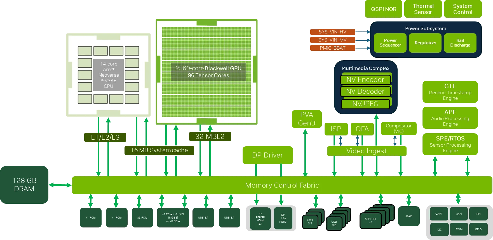
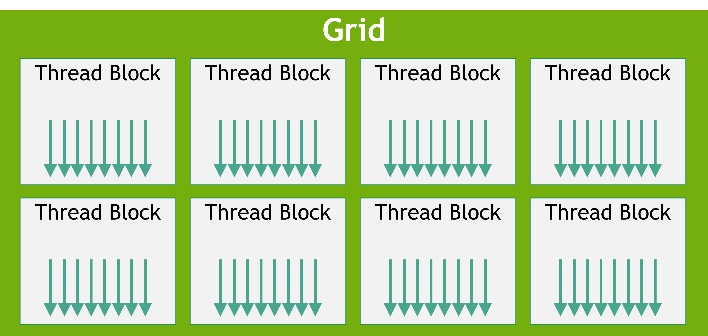
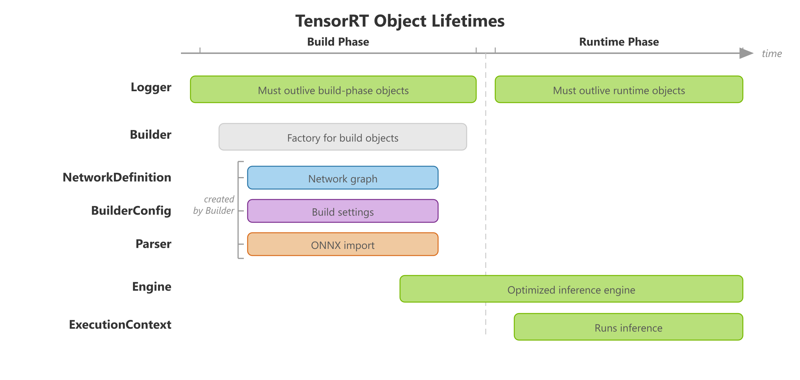
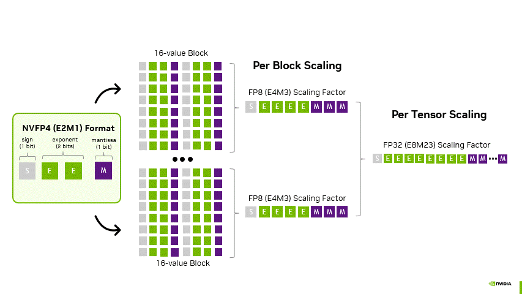
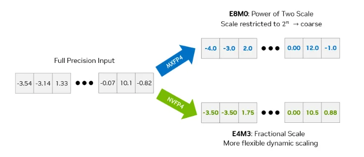
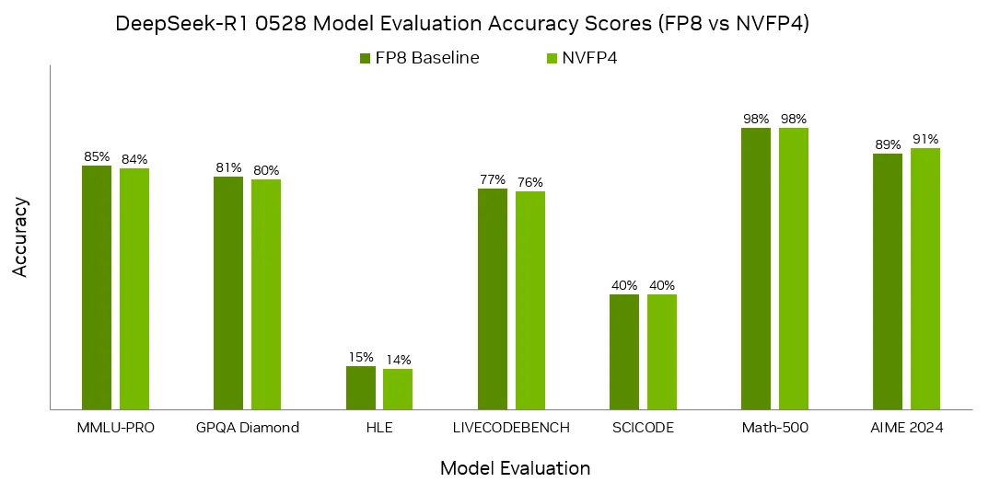
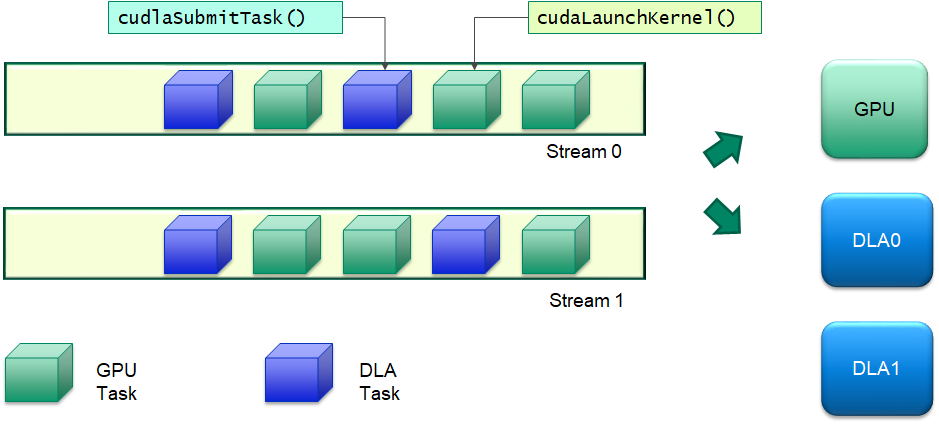

# NVIDIA核心技术护城河专题A：低精度计算、CUDA与推理部署

本专题研究四项相互连接但不能混为一谈的技术：Blackwell低精度矩阵计算、CUDA执行模型与Graphs、TensorRT编译部署、SoC内存与数据驻留。比较以已下载官方材料为依据：AMD对应HIP/ROCm，Intel对应OpenVINO。不同厂商硬件、模型和功耗没有共同测试条件时，只比较机制和迁移工作，不进行性能排名。

## 1. Blackwell Tensor Core与NVFP4：把带宽、容量和矩阵计算一起优化

### 1.1 实现原理与架构位置

Thor把第五代Tensor Core放在Blackwell GPU计算体系中，GPU与Arm CPU及其他引擎共用LPDDR5X。Tensor Core针对矩阵计算，CUDA core承担一般标量/向量任务；2070 TFLOPS不能解释为每类计算均有2070万亿次。T5000的2560 CUDA cores和T4000的1536 cores也不能直接换算为模型每秒动作次数。模型的attention、MLP、图像编码、归一化、调度和数据变换不一定全部使用相同精度或计算单元。[Datasheet Thor Full v1 5](https://developer.nvidia.com/downloads/assets/embedded/secure/jetson/thor/docs/jetson-thor-series-modules-datasheet_ds-11945-001.pdf)

**图1：NVIDIA官方Thor模组计算、内存与接口组成图。** 原图出处：[NVIDIA Jetson Thor官方技术发布与性能条件](https://developer.nvidia.com/blog/introducing-nvidia-jetson-thor-the-ultimate-platform-for-physical-ai/)。

图用来定位GPU、CPU和数据接口的组合关系，来自2025年技术文章；参数以2026年6月Datasheet v1.5为准。它不是B200数据中心GPU架构图，不能从Blackwell名称引入HBM或NVLink到Thor。[NVIDIA Jetson Thor官方技术发布与性能条件](https://developer.nvidia.com/blog/introducing-nvidia-jetson-thor-the-ultimate-platform-for-physical-ai/) [Datasheet Thor Full v1 5](https://developer.nvidia.com/downloads/assets/embedded/secure/jetson/thor/docs/jetson-thor-series-modules-datasheet_ds-11945-001.pdf)

FP4采用E2M1数值格式，低比特表示减少权重和激活体积，但需要缩放、转换及混合精度路径。TensorRT显式量化文档用scale定义量化/反量化，并说明FP4权重按每字节两元素打包；ONNX opset23加入FP4E2M1类型。转换后的模型必须实际包含被支持的量化路径，不能仅把模型文件精度标签改成FP4就得到矩阵加速。激进量化可能降低精度，Q/DQ位置、算子融合和插件里的scale管理都会影响结果。NVFP4两级缩放的官方原文与图已补充取得，数值机制、容量开销和任务验证详见第5节；机器人mixed NVFP4收益以GR00T部署原文为准。[TensorRT官方显式量化](https://docs.nvidia.com/deeplearning/tensorrt/latest/inference-library/quantized-types-explicit-quantization.html) [GR00T官方部署与基准](https://raw.githubusercontent.com/NVIDIA/Isaac-GR00T/main/scripts/deployment/README.md) [TensorRT官方支持矩阵](https://docs.nvidia.com/deeplearning/tensorrt/latest/getting-started/support-matrix.html)

### 1.2 参数与官方性能：峰值、软件收益和任务收益分开

| 官方原始指标 | T5000 | T4000 | 成立条件/限制 |
|---|---:|---:|---|
| FP4 sparse矩阵峰值 | 2070 TFLOPS | 1200 TFLOPS | MAXN及符合稀疏执行条件 |
| FP4 dense矩阵峰值 | 1035 TFLOPS | 600 TFLOPS | 不采用稀疏翻倍系数 |
| FP8 dense矩阵峰值 | 517 TFLOPS | 300 TFLOPS | 实际FP8 Tensor Core路径 |
| FP32 CUDA core峰值 | 8.064 TFLOPS | 4.700 TFLOPS | 通用计算口径，非矩阵峰值 |
| LPDDR5X容量/带宽 | 128GB/273GB/s | 64GB/273GB/s | CPU、GPU与系统共享预算 |
| 当前模组功耗范围 | 40—130W | 40—70W | 型号、供电、模式与热稳态 |

来源：[Datasheet Thor Full v1 5](https://developer.nvidia.com/downloads/assets/embedded/secure/jetson/thor/docs/jetson-thor-series-modules-datasheet_ds-11945-001.pdf)及当前[Jetson Thor官方规格](https://www.nvidia.com/en-us/autonomous-machines/embedded-systems/jetson-thor/)。早期Technical Brief对T4000写40—90W，且部分GPU数量文字矛盾，采用最新Datasheet，保留旧文供追溯。功耗不是整机功耗，也不是运行特定模型时的恒定功耗。

GR00T N1.7部署文档提供更接近应用的证据：LIBERO libero_10 checkpoint、32 DiT blocks、batch1、action horizon40、四次去噪、两路256×256相机、包含预处理与动作解码且排除RPC。Thor MAXN并启jetson_clocks时，PyTorch eager为106.8ms，TensorRT完整pipeline为76.8ms，优化执行加mixed NVFP4为35.6ms。每后端三轮，每轮10次预热与20次计时，合并60次取中位数。76.8/35.6≈2.16是**同一官方配置中整体优化组合的时延比**，不能单独归功FP4，更不是所有机器人2.16倍提速。[GR00T官方部署与基准](https://raw.githubusercontent.com/NVIDIA/Isaac-GR00T/main/scripts/deployment/README.md)

35.6ms倒数约28.1Hz，只代表动作块重新规划的调用频率；action horizon40不意味着伺服频率28.1Hz，也不意味着40个动作都在35.6ms内完成。文档用固定输入测量并与PyTorch输出核对，没有用该性能表报告闭环任务成功率。因此选型应同时保留动作误差、任务完成率和观测到执行器时延，不能只验收一次静态推理。

### 1.3 优势、友商对标与限制

AMD ROCm官方精度表已经列出__hip_fp4_e2m1和CDNA4（MI350X/MI355X）支持，并给出FP8等类型矩阵。因此FP4不是NVIDIA独有的数值格式。NVIDIA在本调研中的可确认优势是Thor端侧低精度硬件、内存和已公开的机器人模型优化流程共同可用。AMD材料对应数据中心/其他GPU架构，不能作为同功耗、同体积的Thor替代证明；也不能用类型支持打勾推断某VLA有同样的kernel或吞吐。[AMD ROCm官方精度支持矩阵](https://rocm.docs.amd.com/en/latest/reference/precision-support.html)

适用场景是大模型常驻、多模态矩阵密集任务和需要降低数据搬运的推理。限制是量化校准数据必须代表目标本体和相机分布；小batch、非矩阵算子、动态控制流、KV cache和内存争用可能成为新瓶颈。对高敏感动作维度可以保留更高精度路径，最终根据误差与成功率选型。没有公开的同模型、同精度、同功耗AMD/Thor实测，不给出跨厂商胜负数字。

## 2. CUDA执行模型、Graphs与同步：护城河是调优资产

### 2.1 为什么能够并行，又为什么会慢

CUDA以grid/block/thread组织任务，block内共享内存及同步，block映射到SM；warp为32线程，分支不一致会掩蔽部分线程并降低有效利用率。性能优化需要把相邻数据访问、线程块规模、寄存器/共享内存占用与计算量一起考虑。GPU并行性适合点云、图像变换、碰撞检查和批量轨迹候选，但不规则分支和串行依赖不会因线程数量增加自动消失。[CUDA编程模型与线程层级](https://docs.nvidia.com/cuda/cuda-programming-guide/01-introduction/programming-model.html)

**图2：CUDA官方线程块与计算层级示意图。** 原图出处：[CUDA编程模型与线程层级](https://docs.nvidia.com/cuda/cuda-programming-guide/01-introduction/programming-model.html)。

图是编程层级的说明，不是Thor各SM实际物理布局。block可在不同规模GPU运行有利于代码复用，但目标架构、内存和调度变化仍需重新调优，源码可编译与性能可迁移是两件事。[CUDA编程模型与线程层级](https://docs.nvidia.com/cuda/cuda-programming-guide/01-introduction/programming-model.html)

stream使同一队列按序执行，不同stream可表达并发；event建立必要依赖。优化的关键是让相机前处理、推理和规划保留数据驻留，减少不必要的全设备同步。异步提交只表示CPU不必等待该调用结束，不等于GPU操作已经完成；误用buffer或提前复用内存会造成数据竞争。Graphs将重复操作和依赖先定义/捕获、实例化，再反复launch，减少逐kernel的CPU提交成本。[CUDA异步执行文档](https://docs.nvidia.com/cuda/cuda-programming-guide/02-basics/asynchronous-execution.html) [CUDA Graphs官方文档](https://docs.nvidia.com/cuda/cuda-programming-guide/04-special-topics/cuda-graphs.html)

### 2.2 Graphs的适用条件及真实案例

对于固定形状的VLA去噪循环、多阶段视觉pipeline和重复运动优化，Graphs可以把大量小kernel的launch开销摊到初始化。GR00T优化同时利用cross-attention K/V缓存、projection fusion和Graphs，cuRobo官方教程也要求warmup预编译图。它们是公开的使用路径，但资料没有单独消融出Graphs在Thor上的中位数/P99收益，不能写“Graphs固定提升X%”。[GR00T官方部署与基准](https://raw.githubusercontent.com/NVIDIA/Isaac-GR00T/main/scripts/deployment/README.md) [cuRoboV2运动规划教程](https://nvlabs.github.io/curobo/latest/getting-started/motion_planning.html)

代价包括捕获/实例化时间、固定输入地址和结构约束、形状变化时的更新或重建，以及内存生命周期。第一次调用和稳态调用要分开计时，动态相机分辨率或动作长度变化也要测试。控制系统特别要核对CPU回调、错误处理和图外同步，避免用快速的GPU段掩盖长时间排队。CUDA通用新版本文档不代表目标JetPack已支持全部新功能，需要按BSP和runtime锁版本。[CUDA Graphs官方文档](https://docs.nvidia.com/cuda/cuda-programming-guide/04-special-topics/cuda-graphs.html) [TensorRT官方性能与测量指南](https://docs.nvidia.com/deeplearning/tensorrt/latest/performance/best-practices.html)

### 2.3 AMD HIP对标：原理相近，接口及资产迁移有成本

HIP官方定义同样的host/device、SIMT、线程层级、stream和event，Graphs同样分定义、实例化和执行，并强调循环次数足够才有收益。HIP stream capture禁止同步hipMalloc/hipMemcpy/hipFree，建议使用相应异步操作；非HIP普通host函数不会自动入图。这证明“GPU并行+图提交”不是独占思想。[AMD HIP官方编程模型](https://rocm.docs.amd.com/projects/HIP/en/latest/understand/programming_model.html) [AMD HIP官方Graphs](https://rocm.docs.amd.com/projects/HIP/en/latest/how-to/hip_runtime_api/hipgraph.html)

NVIDIA护城河更多体现在客户已有CUDA kernel、数值验证、Nsight分析、插件和机器人库的累积。换到HIP时通常可保留问题分解与数据结构，但要重新核对warp/wavefront、同步和库后端，不能只替换函数名就承诺相同性能。尤其是写死32线程假设、NVIDIA专用intrinsic、PVA程序和闭源二进制，迁移难度不同。HIP开放代码和多后端思路提供替代入口，但不自动覆盖Jetson载板、相机BSP和安全软件。两方没有统一机器人测试，故这里只比较机制。

## 3. TensorRT：把模型变为目标设备上的执行计划

### 3.1 编译与运行架构

TensorRT builder读取网络及构建配置，针对目标设备选择执行实现，做融合、精度及内存安排，产出序列化engine；runtime反序列化并创建execution context运行。模型文件、engine和context的职责不同：engine共享优化后的结构，context保存执行状态和动态输入等运行信息。builder的构建时间及workspace也不是稳态推理内存。[TensorRT构建、运行与对象生命周期](https://docs.nvidia.com/deeplearning/tensorrt/latest/architecture/how-trt-works.html)

**图3：TensorRT官方builder与runtime对象生命周期。** 原图出处：[TensorRT构建、运行与对象生命周期](https://docs.nvidia.com/deeplearning/tensorrt/latest/architecture/how-trt-works.html)。

图说明从网络到engine再到execution context的关系。客户应交付原始模型、校准集、插件源码、构建参数、版本及性能日志；仅保存plan文件会降低可重建性。反序列化engine会执行本机代码，官方建议只接收可信或签名engine；模型服务的信任边界也属于生产部署设计。[TensorRT构建、运行与对象生命周期](https://docs.nvidia.com/deeplearning/tensorrt/latest/architecture/how-trt-works.html) [TensorRT官方性能与测量指南](https://docs.nvidia.com/deeplearning/tensorrt/latest/performance/best-practices.html)

融合可以把相邻算子合成执行kernel，减少中间buffer和launch；显式Q/DQ描述量化/反量化边界，部分融合可消除不必要转换。收益取决于具体模式与支持算子，不是任意计算图都能全部融合。未支持算子需调整网络或插件；插件不仅增加实现工作，也会成为升级、复现和跨平台迁移资产。[TensorRT官方算子融合目录](https://docs.nvidia.com/deeplearning/tensorrt/latest/performance/fusion-catalog.html) [TensorRT官方显式量化](https://docs.nvidia.com/deeplearning/tensorrt/latest/inference-library/quantized-types-explicit-quantization.html)

### 3.2 性能测量、版本与使用限制

官方性能指南要求先量基线，再改融合、精度、batch、多stream或Graphs，再复测。batch提高吞吐时可能增加单请求等待；VLA宜优先测batch1、真实相机输入及P99，视觉巡检可以另测吞吐与能源。必须记录时钟、热限频、输入shape、冷/热启动、端到端范围和内存。TensorRT 11.4.1文档明确Jetson Thor无DLA，不能给Thor套用Orin DLA的性能或隔离优势；Orin DLA也必须核对对应TensorRT包和JetPack版本。[TensorRT官方性能与测量指南](https://docs.nvidia.com/deeplearning/tensorrt/latest/performance/best-practices.html) [TensorRT官方支持矩阵](https://docs.nvidia.com/deeplearning/tensorrt/latest/getting-started/support-matrix.html)

支持矩阵明确序列化engine不跨Linux/Windows通用；version-compatible与hardware compatibility有特定条件，不等于一份engine跨所有GPU和runtime。当前矩阵还区分TensorRT10到11、8到10的跨major兼容路径，8到11不属于支持组合。具体发布需受控反序列化并检查非空结果/日志，而不是以文件存在判为可部署。通用最新版支持矩阵不取代目标JetPack release的安装矩阵。[TensorRT官方支持矩阵](https://docs.nvidia.com/deeplearning/tensorrt/latest/getting-started/support-matrix.html)

### 3.3 Intel OpenVINO对标与选型含义

OpenVINO也有模型准备、设备编译和推理流程；HETERO可将模型按设备支持划分为子图，在设备间执行。它提供面向Intel CPU/GPU/NPU的部署替代，TensorRT则围绕NVIDIA GPU及适用平台的DLA优化。异构fallback有利于覆盖算子，但子图切分、数据搬运和设备同步可能影响时延，不能把“能运行”当成“更快”。[Intel OpenVINO 2025官方模型准备](https://docs.openvino.ai/2025/openvino-workflow/model-preparation.html) [Intel OpenVINO 2025官方异构执行](https://docs.openvino.ai/2025/openvino-workflow/running-inference/inference-devices-and-modes/hetero-execution.html) [Intel OpenVINO 2025官方延迟优化](https://docs.openvino.ai/2025/openvino-workflow/running-inference/optimize-inference/optimizing-latency.html)

TensorRT的优势是与Thor、CUDA及机器人模型的具体优化路径连接；OpenVINO的价值是Intel设备上的编译和部署选择。两者的模型前处理、精度和设备插件不是同一套资产，模型源可复用，engine/compiled model和自定义GPU插件通常需要重建。缺少相同VLA或感知模型、相同输入和功耗下的数据，不给出百分比比较。

## 4. 共享DRAM、Unified Memory与数据驻留

Thor共享物理DRAM有利于容量整合，但“CPU/GPU都访问同一内存芯片”“统一虚拟地址”“cudaMallocManaged迁移管理”和“设备间零拷贝”不是同一概念。CUDA官方说明Unified Memory行为与OS、GPU、驱动、页面迁移和互连条件有关；SoC不能直接套用数据中心独显的ATS/NVLink条件。CPU/GPU共享273GB/s标称带宽，还会受到相机、渲染、视频和模型并发影响。[CUDA内存模型文档](https://docs.nvidia.com/cuda/cuda-programming-guide/02-basics/understanding-memory.html) [Datasheet Thor Full v1 5](https://developer.nvidia.com/downloads/assets/embedded/secure/jetson/thor/docs/jetson-thor-series-modules-datasheet_ds-11945-001.pdf)

数据驻留策略是减少重复转换/复制：采集buffer的分配者、所有者、可写时间、DMA完成与GPU完成需要明确；为每段建立event/fence关系。省掉一次memcpy可能减少延迟，但如果下游格式不匹配又隐式拷贝、CPU缓存维护或排队变长，端到端收益会抵消。应用实际可用内存小于标称128GB，需要计入OS、图像buffer、KV cache、模型副本、workspace及故障恢复余量。[CUDA内存模型文档](https://docs.nvidia.com/cuda/cuda-programming-guide/02-basics/understanding-memory.html) [Jetson SIPL Camera over Ethernet架构](https://docs.nvidia.com/jetson/archives/r39.2.1/DeveloperGuide/SD/CameraDevelopment/SIPLFramework/SIPL-for-L4T/CoE/CoE-Solution-Overview.html) [Holoscan Sensor Bridge 2.7架构与示例](https://docs.nvidia.com/holoscan/sensor-bridge/2-7-latest/applications/architecture)

HIP同样提供内存操作及异构host/device机制，OpenVINO异构执行则需管理设备间子图的数据流。因此内存API本身不构成独占优势，NVIDIA的工程积累在于采集、CUDA、当前原生Buffer和TensorRT接口能形成一条可优化路径。使用限制是它不自动保证零拷贝，也不保证无内存带宽干扰。验收应记录真实读写流量、内存峰值和尾部延迟，不能以共享DRAM示意图证明闭环实时。[AMD HIP官方编程模型](https://rocm.docs.amd.com/projects/HIP/en/latest/understand/programming_model.html) [Intel OpenVINO 2025官方异构执行](https://docs.openvino.ai/2025/openvino-workflow/running-inference/inference-devices-and-modes/hetero-execution.html)

本专题的判断是：低精度硬件决定可达到的资源上限，CUDA和TensorRT决定实际执行路径，数据驻留决定有多少时间花在搬运。护城河形成于模型、内核、量化数据及性能复现资产的组合；业务代码和模型源仍应由客户保留，以控制未来迁移成本。

## 5. NVFP4的数值机制：从格式到可执行的量化配方

### 5.1 两层缩放解决什么问题

2025年6月24日NVIDIA官方NVFP4文章提供了原格式表和完整缩放说明。E2M1只有一位符号、两位指数和一位尾数，有限值集合包括±0、±0.5、±1、±1.5、±2、±3、±4、±6。直接把一个含离群值的张量压进这一集合，会让小数值被舍入或截断；数据类型有硬件支持，不代表数值损失已经解决。NVFP4在每16个元素上设置一个E4M3 FP8缩放，再以整个张量共享的FP32缩放扩展动态范围。可把重建理解为x≈q×s_block×s_tensor；这是对官方两级缩放的数学整理，不是新增第三种格式。[NVIDIA NVFP4官方低精度推理文章](https://developer.nvidia.com/blog/introducing-nvfp4-for-efficient-and-accurate-low-precision-inference/)

**图4：NVFP4官方每块及每张量两级缩放结构。** 原图出处：[NVIDIA NVFP4官方低精度推理文章](https://developer.nvidia.com/blog/introducing-nvfp4-for-efficient-and-accurate-low-precision-inference/)。

原图为官方动画；正文分析对应其两层缩放含义。FP32张量因子使E4M3块因子能覆盖原张量分布；块因子允许非二次幂的分数缩放，比只能选2的整数次幂更细地贴合局部范围。较小块增加局部适配机会，也增加scale存储及量化操作。不同块的最大值、分布和误差不同，不能据图宣布所有值都变得更准确。[NVIDIA NVFP4官方低精度推理文章](https://developer.nvidia.com/blog/introducing-nvfp4-for-efficient-and-accurate-low-precision-inference/)

| 官方格式比较的关键项 | 普通FP4 E2M1 | MXFP4 | NVFP4 |
|---|---|---|---|
| 值编码 | 4-bit E2M1 | 4-bit E2M1 | 4-bit E2M1 |
| 局部共享缩放 | 软件配方决定 | 每32值一个二次幂scale | 每16值一个E4M3 FP8 scale |
| 第二层缩放 | 依具体实现 | 原文比较中无需同样FP32张量因子 | 每张量FP32 |
| 官方文章的硬件缩放 | 无 | 有 | 有 |
| 应评估的代价 | 动态范围与量化误差 | 局部异常值及scale分辨率 | 更多scale和配方/后端支持 |

表按上述官方文章Table 1和后续说明摘录整理；Blackwell家族的格式比较不等于Thor支持全部文章举出的训练/服务路径。TensorRT当前量化方案另明确NVFP4 block size仅16，block轴应在最后两维之一；INT4采用64或128的block且仅支持权重量化。由此可见INT4和NVFP4不能仅凭“同为4bit”交换权重、scale或kernel。[TensorRT官方FP4/FP8缩放和量化方案](https://docs.nvidia.com/deeplearning/tensorrt/latest/inference-library/quantized-types-schemes.html)

**图5：官方二次幂与分数缩放的量化值对照。** 原图出处：[NVIDIA NVFP4官方低精度推理文章](https://developer.nvidia.com/blog/introducing-nvfp4-for-efficient-and-accurate-low-precision-inference/)。

图来自同一篇文章Figure 3，为便于对照省略第二级FP32缩放。它证明特定示例里局部映射的差异，不是机器人动作误差数据。更细scale可能改善整体误差，但少数单值仍可能更差；对末端姿态、接触力或关节增量敏感的输出，应检查逐维误差和偏置，不能只看网络平均MSE。

### 5.2 为什么不是无条件缩小四倍

官方给出的NVFP4存储为每元素4bit，加每16值一个8bit scale，平均4.5bit/值，再加每张量32bit。对包含n个元素、需向上取整block的张量，原始量化payload可估为4n+8⌈n/16⌉+32 bit，未含对齐、layout、元数据和其他未量化层。大张量忽略尾部后，16/4.5≈3.56是相对FP16的编码容量比，不是整模型内存或系统峰值内存固定缩小3.56倍。[NVIDIA NVFP4官方低精度推理文章](https://developer.nvidia.com/blog/introducing-nvfp4-for-efficient-and-accurate-low-precision-inference/) [TensorRT官方显式量化](https://docs.nvidia.com/deeplearning/tensorrt/latest/inference-library/quantized-types-explicit-quantization.html)

权重压缩并不同比例压缩KV cache、图像buffer、workspace、图捕获内存、CPU模型副本或activation。对于batch1的矩阵向量计算，读权重往往比大量复用的矩阵乘更重要，压缩有机会降低搬运；但小维度、非对齐、Q/DQ转换和高精度fallback会抵消收益。应报告哪些层实际量化、实际采用的kernel及系统内存峰值，避免将模型文件大小当成运行内存。

### 5.3 官方准确性证据与机器人证据分层

**图6：NVIDIA官方DeepSeek-R1-0528在FP8与NVFP4下的任务准确率图。** 原图出处：[NVIDIA NVFP4官方低精度推理文章](https://developer.nvidia.com/blog/introducing-nvfp4-for-efficient-and-accurate-low-precision-inference/)。

官方文章Figure 6比较七个语言/推理评测。下面按图的整数百分比标签摘录；差值是百分点，不是相对变化百分比。图的对象是DeepSeek-R1-0528的PTQ，不能把这些比例转换为GR00T抓取成功率，也不能把GB300/H100每token能效图套成Thor电池收益。文章未在该图范围给出机器人动作评测，本报告采用图说明“量化要验证任务质量”的方法，保留原评测标签，不重算跨数据集平均分。[NVIDIA NVFP4官方低精度推理文章](https://developer.nvidia.com/blog/introducing-nvfp4-for-efficient-and-accurate-low-precision-inference/)

| 官方评测标签 | FP8准确率 | NVFP4准确率 | NVFP4−FP8（百分点） |
|---|---:|---:|---:|
| MMLU-PRO | 85% | 84% | −1 |
| GPQA Diamond | 81% | 80% | −1 |
| HLE | 15% | 14% | −1 |
| LIVECODEBENCH | 77% | 76% | −1 |
| SCICODE | 40% | 40% | 0 |
| Math-500 | 98% | 98% | 0 |
| AIME 2024 | 89% | 91% | +2 |

图中未给出每项统计置信区间、全部推理采样设置和未舍入分数，因此不从整数标签推断显著性，也不将个别提升解释为量化普遍提高智能。

Thor上的直接机器人模型证据仍是本专题1.2的N1.7-LIBERO完整调用表。应先做BF16→优化但不量化→FP8→mixed NVFP4的独立消融，再在真实任务中测失败率，才能归因各项优化。原文提供的是组合配置结果，没有公开的全部独立消融；本报告不填造缺失列。护城河是数值配方、编译和可复现模型路径的组合，FP4编码本身已有友商对应能力。

## 6. CUDA为何会快或慢：执行层级、带宽与可迁移资产

### 6.1 SM利用率与访存的实际取舍

CUDA线程块的寄存器和共享内存需求决定同一SM能驻留多少block/warp。更多线程不必然提高速度：每线程寄存器太多可能降低驻留量，强行限制寄存器又可能spill到local memory；提高occupancy有助隐藏访问延迟，但不能消除串行依赖。warp分支发散使不同路径分批执行，非合并global memory访问增加事务，shared memory bank冲突也会拖慢规则视觉或碰撞检查。[CUDA编程模型与线程层级](https://docs.nvidia.com/cuda/cuda-programming-guide/01-introduction/programming-model.html) [CUDA内存模型文档](https://docs.nvidia.com/cuda/cuda-programming-guide/02-basics/understanding-memory.html) [CUDA官方Blackwell架构调优指南](https://docs.nvidia.com/cuda/blackwell-tuning-guide/index.html)

Blackwell Tuning Guide v13.4、2026年10月12日更新，主要列compute capability10.0/12.0及B200的资源。它列10.0每SM64warp、12.0为48warp、两者64K个32-bit寄存器，但这些数字**不作为Thor SM资源**。GR00T官方安装明确Thor wheel为sm_110、Orin为sm_87；品牌同属Blackwell并不让10.0/12.0的shared memory、cluster、HBM3或NVLink规格自动适用于11.0。目标平台应查询device属性、编译目标和实际Nsight支持。[CUDA官方Blackwell架构调优指南](https://docs.nvidia.com/cuda/blackwell-tuning-guide/index.html) [GR00T官方部署与基准](https://raw.githubusercontent.com/NVIDIA/Isaac-GR00T/main/scripts/deployment/README.md)

### 6.2 用计算强度判断优化方向

以下是基于Thor Datasheet的分析模型，不是实测。设算子实际计算量F、进入DRAM的数据量D，计算强度I=F/D；理想吞吐上界可表示P≤min(P_compute,B_memory×I)。T5000 FP4 dense1035TFLOPS除以273GB/s得到约3791次运算/byte的理论转折点，FP32 CUDA峰值8.064TFLOPS对应约29.5次运算/byte。两者使用不同执行单元与数值格式，不能用一个I把完整模型划进同一性能区间。[Datasheet Thor Full v1 5](https://developer.nvidia.com/downloads/assets/embedded/secure/jetson/thor/docs/jetson-thor-series-modules-datasheet_ds-11945-001.pdf)

这个推导说明：用FP4矩阵峰值评价低计算强度的图像复制、重排或batch1权重读取，会严重高估收益。实际带宽还需扣除CPU、ISP、相机、显示及其他模型竞争，缓存复用会改变D，量化scale读取也要计入。优化顺序应来自profiling：若数据搬运主导，先减少转换/中间tensor和改善驻留；若矩阵主导，再检查精度、维度对齐和Tensor Core；若提交主导，再用Graphs。没有实测D和可持续B时，该模型只提供方向，不能预测毫秒值。

| 观察到的瓶颈 | 官方机制对应的解释 | 优先动作 | 容易误判的指标 |
|---|---|---|---|
| CPU enqueue接近或超过GPU计算 | 小kernel提交/同步开销 | 捕获重复图，减少Python或CPU同步 | 单看GPU利用率 |
| DRAM流量高、算力未满 | 中间tensor、权重读取及格式转换 | 融合、压缩、驻留、访存布局 | 将矩阵峰值当实际吞吐 |
| SM忙但任务时延高 | 算法工作量、warp发散或资源限制 | 检查热点和寄存器/shared memory | occupancy越高一定越快 |
| 单模型快、并发变慢 | kernel调度及CPU/DRAM竞争 | 实际并发profiling，必要时分区 | 离线batch吞吐 |
| 稳态快、首帧或shape切换慢 | JIT、分配、page fault、profile更新 | 预编译、warmup、预分配与预取 | 只报告median |

来源：[TensorRT官方基准测量与Nsight分析](https://docs.nvidia.com/deeplearning/tensorrt/latest/performance/benchmarking.html) [TensorRT官方Graphs、并行与算子优化](https://docs.nvidia.com/deeplearning/tensorrt/latest/performance/optimization.html) [CUDA官方Tegra内存、一致性与跨引擎互操作应用说明](https://docs.nvidia.com/cuda/cuda-for-tegra-appnote/index.html)。这些是可验证的诊断路径，没有声称目标机器人已出现这些瓶颈。

### 6.3 Graphs不是调度器，也不是实时保证

TensorRT当前Graphs文档给出两阶段协议：输入shape变化后先enqueueV3一次更新内部状态，再捕获后续执行。循环、条件和数据依赖shape可能不支持capture；图还与执行context、输入输出地址及activation memory绑定。官方建议每个捕获图独立context，捕获时使用nonblocking stream及相应异步API，避免同期同步操作破坏capture。[TensorRT官方Graphs、并行与算子优化](https://docs.nvidia.com/deeplearning/tensorrt/latest/performance/optimization.html)

固定shape的四次去噪适合重复提交；变化相机数量、动态文本长度或异常分支可能需要另一图或图外处理。图省的是host launch，不保证任务在规定期限完成，也没有为不同stream建立完整优先级和WCET保证。batching会摊薄开销但可能增加等待和内存；较小batch有时因L2驻留反而提高吞吐。对机器人不能通过排队积累过时观测换取漂亮qps。

Nsight Systems适合追踪CPU thread、CUDA API、kernel、memcpy和NVTX范围的时间关系；TensorRT逐层profiler适合定位网络内部热点。两者应配合日志中的曝光/接收/动作发布时戳。profiling本身有开销，细粒度分析与无profile验收需分开；抓不到GPU metrics时也不能编造Tensor Core利用率。[Nsight Systems官方跨CPU/GPU时间线与采集说明](https://docs.nvidia.com/nsight-systems/UserGuide/index.html) [TensorRT官方基准测量与Nsight分析](https://docs.nvidia.com/deeplearning/tensorrt/latest/performance/benchmarking.html)

## 7. TensorRT的编译机制和工程壁垒

### 7.1 Tactic、融合与可复现构建

模型导入后，builder并非只“把ONNX转成plan”，而是依据算子、shape、精度、layout、workspace和设备选择可执行tactic。融合会消去中间DRAM tensor并减少launch，但支持pattern有具体限制；非对齐维度可能通过padding启用Tensor Core，同时增加计算及访存。最终选中tactic受测量噪声和资源预算影响，不能保证每层全局最优。[TensorRT官方算子融合目录](https://docs.nvidia.com/deeplearning/tensorrt/latest/performance/fusion-catalog.html) [TensorRT官方Graphs、并行与算子优化](https://docs.nvidia.com/deeplearning/tensorrt/latest/performance/optimization.html)

官方精度控制说明：不同tactic的浮点累加顺序可能不同，因此两次build不保证bit-identical。editable timing cache保存层的key、候选和选择；用kEDITABLE_TIMING_CACHE及ITimingCache::update可固定选择，并需保存日志和cache。它提高复建控制，但不保证换GPU/驱动、变输入或邻近batch时输出逐bit相同；错误地复用不匹配cache也不能代替回归。[TensorRT精度控制、Timing Cache与可复现构建](https://docs.nvidia.com/deeplearning/tensorrt/latest/inference-library/precision-control.html) [TensorRT官方执行计划、内存与线程安全](https://docs.nvidia.com/deeplearning/tensorrt/latest/architecture/how-trt-works.html)

TensorRT从11.0起只支持强类型网络，由模型明确全部tensor精度，仍自动调优layout和kernel。因此旧“打开FP16/INT8 builder flag即全网优化”的经验不能不加版本地描述。客户要保存模型中的cast和Q/DQ、精度配方、校准集、插件及目标包版本；TensorRT10.x与11.x的迁移应分别检查API和数值语义。Thor当前JetPack绑定的10.x与通用11.4.1文档也需分开。[TensorRT精度控制、Timing Cache与可复现构建](https://docs.nvidia.com/deeplearning/tensorrt/latest/inference-library/precision-control.html) [JetPack官方下载与版本矩阵](https://developer.nvidia.com/embedded/jetpack/downloads) [TensorRT官方支持矩阵](https://docs.nvidia.com/deeplearning/tensorrt/latest/getting-started/support-matrix.html)

### 7.2 动态形状：灵活性为何会牺牲性能与容量

动态维以−1定义，profile设置MIN/OPT/MAX；OPT是builder调优的形状，MIN/MAX定义合法运行范围。官方说明有些tactic只有MIN=OPT=MAX才能使用，范围放宽后会禁用；不同profile的内存可能显著变化。context需先选profile再设置输入，engine返回的仍可含−1，而context给出实际shape。单个setInputShape成功只证明该输入与profile一致，不证明所有输入的网络约束都成立。[TensorRT动态形状及Profile基础](https://docs.nvidia.com/deeplearning/tensorrt/latest/inference-library/dynamic-shapes-basics.html)

| 机器人变化因素 | 合理profile设计思路 | 必须验证的风险 |
|---|---|---|
| 相机固定两路、固定分辨率 | 固定主路径，避免无需求的大范围 | 图捕获、实际格式及resize成本 |
| 可切换不同相机分辨率 | 常用shape各自调优，覆盖实际范围 | profile切换、buffer重新分配及首帧 |
| 文本token长度变化 | 明确截断/padding与范围 | OPT以外时延和attention内存 |
| 场景对象数/检测输出变化 | 处理数据依赖output | 输出分配、上限、溢出及capture失败 |
| 多请求并发 | context/profile与buffer分别管理 | 生命周期、同context并发及内存峰值 |

表是依据官方机制提出的设计建议，不是现成GR00T支持矩阵。shape、sequence长度和实际控制周期变化应测切换过程的P99及旧动作有效期，不能只测每个shape的热稳态。[TensorRT当前动态形状文档](https://docs.nvidia.com/deeplearning/tensorrt/latest/inference-library/work-with-dynamic-shapes.html) [TensorRT动态形状及Profile基础](https://docs.nvidia.com/deeplearning/tensorrt/latest/inference-library/dynamic-shapes-basics.html)

### 7.3 插件与部署对象：最容易积累迁移成本的地方

官方IPluginV3分离core、build与runtime能力，插件creator负责注册和重建；shape表达、支持类型/layout、workspace、tactic及enqueue共同决定插件可否融入engine。仅CUDA kernel正确并不证明plugin的序列化、版本命名、动态shape或context生命周期正确。Python插件自TensorRT10.6起有decorator路径，能脱离Python部署的能力依具体路径，不能概括所有Python自定义层。[TensorRT官方IPluginV3扩展与插件生命周期](https://docs.nvidia.com/deeplearning/tensorrt/latest/inference-library/extending-custom-layers.html)

这种扩展允许补上特定动作头或相机算子，也增加平台依赖：自定义plugin内核、量化scale、TensorRT API和编译ABI都成为交付资产。迁移到OpenVINO/HIP可保留模型语义和误差测试，但通常需重新实现runtime扩展、kernel或fallback；不能把“ONNX开放”当成plan和插件可直接搬家。

runtime加载engine，engine创建context；每条并发执行路径应有独立context及buffer管理。权重、持久状态、activation/scratch及build临时空间的生命周期不同；限制workspace可能排除某些tactic，却不等于限制全部运行内存。官方还说明build通常有至少两份host权重，融合可能临时生成更多副本，SoC共享DRAM上需连CPU容量一起预算。[TensorRT官方执行计划、内存与线程安全](https://docs.nvidia.com/deeplearning/tensorrt/latest/architecture/how-trt-works.html)

序列化engine包含本机代码和plugin状态，来源管理应按二进制制品设计。sticky CUDA error的恢复可能需重启进程；捕获Python异常不是GPU故障域隔离。此处通用TensorRT的MIG说明不能替代Thor专门profile和共享DRAM边界，详见专题B。优势是执行计划可受控、可优化；限制是升级和恢复需要模型源、构建记录与应用进程架构。

## 8. Tegra内存一致性、互操作与端侧特有约束

### 8.1 按官方内存表拆开“统一内存”

CUDA for Tegra v13.4 Table 1确认device、host和managed allocation来自同一SoC DRAM，但缓存和CPU/GPU访问行为不同。I/O coherency是GPU读取CPU最新缓存的一向一致性，仍需GPU侧维护；Thor开始提供sysmem full coherency，使CPU也可读GPU最新缓存。物理共享、双向一致性和应用同步是三个层次，双向一致性不会解决两个线程同时改同一buffer的逻辑竞争。[CUDA官方Tegra内存、一致性与跨引擎互操作应用说明](https://docs.nvidia.com/cuda/cuda-for-tegra-appnote/index.html)

| 内存类型（官方表条件摘录） | CPU缓存/访问 | Thor iGPU行为 | 使用含义 |
|---|---|---|---|
| device allocation | CPU不可直接使用 | GPU缓存 | 中间tensor只在GPU使用 |
| pinned host | I/O coherent平台CPU缓存 | GPU通常不缓存 | 共享小buffer/单遍访问应实测 |
| registered host | CPU缓存 | full coherency且首物理页NUMA匹配时可L2缓存 | 注册已有buffer，注意IOMEMORY禁缓存 |
| pageable host | CPU缓存 | pageableMemoryAccess=1时可直接访问并缓存 | 查询设备属性，不由malloc名称推断 |
| managed | CPU缓存；具体由UVM管理 | concurrentManagedAccess=1时由UVM选映射；当前GPU uncached+I/O coherent | 不自动选最快的full coherent路径 |

该表保留官方条件，没有把所有内存类型当成每个Jetson都支持。注册host memory的GPU L2条件还包括首物理页NUMA与HOST_NUMA_ID匹配，cudaHostRegisterIoMemory排除L2缓存。Full coherence硬件也有协议/一致性开销，官方要求按实际workload比较。[CUDA官方Tegra内存、一致性与跨引擎互操作应用说明](https://docs.nvidia.com/cuda/cuda-for-tegra-appnote/index.html)

### 8.2 页面填充与首帧为什么仍可能慢

Thor/L4T上concurrentManagedAccess可为1，但cudaMallocManaged之后物理页可能尚未映射，CPU/GPU第一次访问会触发fault和填充；cudaMemPrefetchAsync可预先填页。旧concurrentManagedAccess=0路线用cudaStreamAttachMemAsync的预取行为，不应原样移到Thor。容量足够和稳态快并不排除首帧抖动，应把预分配、预取、warmup纳入启动流程，并测模型切换、内存压力与恢复之后的首帧。[CUDA官方Tegra内存、一致性与跨引擎互操作应用说明](https://docs.nvidia.com/cuda/cuda-for-tegra-appnote/index.html)

官方还明确：从CUDA13.0起，memory-sharing IPC在开放GPU driver的Thor及以后Tegra上可用；旧平台需EGLStream、NvSci或shareable handle等路线。IPC capability、跨process CUDA event、ROS消息与网络传输各有条件，不应据此宣布跨主机零拷贝。A专题原先提及NITROS的路径应读为历史路线，当前原生Buffer迁移详见专题B。[CUDA官方Tegra内存、一致性与跨引擎互操作应用说明](https://docs.nvidia.com/cuda/cuda-for-tegra-appnote/index.html) [Isaac ROS Buffer Migration](https://nvidia-isaac-ros.github.io/concepts/rosidl_buffer/nitros_migration.html)

### 8.3 互操作图及DLA的代际边界

**图7：CUDA for Tegra官方EGLStream图像生产、消费与处理流水线。** 原图出处：[CUDA官方Tegra内存、一致性与跨引擎互操作应用说明](https://docs.nvidia.com/cuda/cuda-for-tegra-appnote/index.html)。

图说明camera/graphics/CUDA等API如何共享资源与同步，属于Tegra通用互操作说明，不代表当前Thor的SIPL CoE硬件连接图；具体接收及buffer要求用专题B的R39.2.1资料核验。减少显式拷贝的价值要以格式转换、DMA完成、ownership和同步一起成立为条件。

**图8：CUDA for Tegra官方cuDLA与GPU任务的执行关系。** 原图出处：[CUDA官方Tegra内存、一致性与跨引擎互操作应用说明](https://docs.nvidia.com/cuda/cuda-for-tegra-appnote/index.html)。

图用于说明Orin等含DLA平台可以表达异构任务依赖，**Thor没有DLA**。cuDLA不是在Thor额外启用NPU的入口，不能将Orin DLA能效/任务卸载和Thor FP4算力加在一起。通用应用说明覆盖多个SoC/OS，RDMA、IPC和NVML需逐平台核验；NVML仅Thor及以后L4T支持的说明也不能追溯套到全部Orin。[CUDA官方Tegra内存、一致性与跨引擎互操作应用说明](https://docs.nvidia.com/cuda/cuda-for-tegra-appnote/index.html) [TensorRT官方支持矩阵](https://docs.nvidia.com/deeplearning/tensorrt/latest/getting-started/support-matrix.html)

## 9. 机制比较与护城河的可证实部分

| 机制 | NVIDIA可核验资产 | 友商相关对标 | 当前证据支持的结论 |
|---|---|---|---|
| 低精度矩阵 | Thor FP4硬件、NVFP4缩放、TRT/GR00T路径 | AMD CDNA4 FP4类型与ROCm | 数值格式非独占，机器人部署资产有差别 |
| 并行及图提交 | CUDA线程、stream、Graphs、分析工具 | HIP线程、stream、Graphs | 核心思想相近，kernel/后端和性能需迁移 |
| 模型编译 | TRT融合/tactic/QDQ/profile/plugin | OpenVINO设备编译及HETERO | 模型源可复用，执行计划不通用 |
| 数据驻留 | Tegra一致性、IPC、采集互操作 | HIP内存/Intel异构数据流 | 同名API不代表同缓存及互连条件 |
| 工具链复现 | 模型→量化→build→profile→端侧 | 各平台工具及后端组合 | 已验证配方和误差资产构成切换成本 |

来源：[AMD ROCm官方精度支持矩阵](https://rocm.docs.amd.com/en/latest/reference/precision-support.html) [AMD HIP官方编程模型](https://rocm.docs.amd.com/projects/HIP/en/latest/understand/programming_model.html) [AMD HIP官方Graphs](https://rocm.docs.amd.com/projects/HIP/en/latest/how-to/hip_runtime_api/hipgraph.html) [Intel OpenVINO 2025官方模型准备](https://docs.openvino.ai/2025/openvino-workflow/model-preparation.html) [Intel OpenVINO 2025官方异构执行](https://docs.openvino.ai/2025/openvino-workflow/running-inference/inference-devices-and-modes/hetero-execution.html)以及上述NVIDIA官方材料。没有相同功耗、价格、相机、模型和成功率下的跨平台对测，因此不以“CUDA生态大”推出所有项目性能或TCO获胜。

核心优势在于客户能把相机buffer、矩阵kernel、量化配方、engine和诊断串成同一套可复建工程。核心限制也来自同一积累：插件/BSP/编译目标依赖、版本升级、错误恢复和量化数值回归需要持续投入。对固定小模型、无需GPU并发或严格小功耗项目，较小平台或其他后端可能有更合适的成本结构；对VLA和多传感器并发，Thor的容量及公开优化路径更有评估价值，但放行必须以目标任务为准。

## 参考资料与本地原文

本报告依据截至2026年11月3日取得的官方网页、代码仓库、API和文档。资料由统一下载工具归档到本项目的reference_metrial；多个方向共享同一URL的已校验文件。网页保留HTML和依赖，部分资源受robots规则、失效链接或动态交互限制影响时，按metadata如实标明。采集时点、版本和原始响应哈希可在各资料目录内核对。

08专题材料独立保存在reference_metrial/08_core；以下链接指向该专题目录中的原文。HTML及依赖通过本地硬链接共享存储，规范URL登记仍在项目公共registry。

| 官方资料 | 原始URL | 本地原文 | 归档情况 |
|---|---|---|---|
| NVIDIA_Datasheet_Thor_Full_v1_5 | [官方原文](https://developer.nvidia.com/downloads/assets/embedded/secure/jetson/thor/docs/jetson-thor-series-modules-datasheet_ds-11945-001.pdf) | [document.pdf](REFERENCES.md#ref-e0ae09b175a34eac) | 原件已归档 |
| NVIDIA_06_DEEP_THOR_TECH | [官方原文](https://developer.nvidia.com/blog/introducing-nvidia-jetson-thor-the-ultimate-platform-for-physical-ai/) | [index.html](REFERENCES.md#ref-c17dd5eed35b00ec) | 静态呈现依赖部分缺失；见metadata |
| NVIDIA_08_DEEP_TRT_QUANT | [官方原文](https://docs.nvidia.com/deeplearning/tensorrt/latest/inference-library/quantized-types-explicit-quantization.html) | [index.html](REFERENCES.md#ref-f47c2746e3737567) | 静态HTML依赖完整；动态功能另验 |
| NVIDIA_GR00T_Deployment_Guide | [官方原文](https://raw.githubusercontent.com/NVIDIA/Isaac-GR00T/main/scripts/deployment/README.md) | [content.md](REFERENCES.md#ref-af6435cdb176784f) | 原件已归档 |
| NVIDIA_TensorRT_Support_Matrix | [官方原文](https://docs.nvidia.com/deeplearning/tensorrt/latest/getting-started/support-matrix.html) | [index.html](REFERENCES.md#ref-3b68f26af8646cbc) | 静态HTML依赖完整；动态功能另验 |
| NVIDIA_Product_Page_Jetson_Thor | [官方原文](https://www.nvidia.com/en-us/autonomous-machines/embedded-systems/jetson-thor/) | [index.html](REFERENCES.md#ref-91025a9bef10dc0b) | 静态呈现依赖部分缺失；见metadata |
| NVIDIA_08_DEEP_ROCM_PRECISION | [官方原文](https://rocm.docs.amd.com/en/latest/reference/precision-support.html) | [index.html](REFERENCES.md#ref-a7f14d8cfd9297f5) | 静态呈现依赖部分缺失；见metadata |
| NVIDIA_02_CUDA_MODEL | [官方原文](https://docs.nvidia.com/cuda/cuda-programming-guide/01-introduction/programming-model.html) | [index.html](REFERENCES.md#ref-ff852ad994d3a602) | 静态HTML依赖完整；动态功能另验 |
| NVIDIA_02_CUDA_ASYNC | [官方原文](https://docs.nvidia.com/cuda/cuda-programming-guide/02-basics/asynchronous-execution.html) | [index.html](REFERENCES.md#ref-106fd52933b5f86f) | 静态HTML依赖完整；动态功能另验 |
| NVIDIA_02_CUDA_GRAPH | [官方原文](https://docs.nvidia.com/cuda/cuda-programming-guide/04-special-topics/cuda-graphs.html) | [index.html](REFERENCES.md#ref-64fc09301027cc35) | 静态HTML依赖完整；动态功能另验 |
| NVIDIA_06_MOTION | [官方原文](https://nvlabs.github.io/curobo/latest/getting-started/motion_planning.html) | [index.html](REFERENCES.md#ref-174f05f5e8477c6a) | 静态呈现依赖部分缺失；见metadata |
| NVIDIA_04_TRT_PERF | [官方原文](https://docs.nvidia.com/deeplearning/tensorrt/latest/performance/best-practices.html) | [index.html](REFERENCES.md#ref-fac73fa8f8466577) | 静态HTML依赖完整；动态功能另验 |
| NVIDIA_08_DEEP_HIP_MODEL | [官方原文](https://rocm.docs.amd.com/projects/HIP/en/latest/understand/programming_model.html) | [index.html](REFERENCES.md#ref-b375803d7ee408be) | 静态呈现依赖部分缺失；见metadata |
| NVIDIA_08_DEEP_HIP_GRAPH | [官方原文](https://rocm.docs.amd.com/projects/HIP/en/latest/how-to/hip_runtime_api/hipgraph.html) | [index.html](REFERENCES.md#ref-0077a3438456f5e6) | 静态呈现依赖部分缺失；见metadata |
| NVIDIA_02_TRT_WORK | [官方原文](https://docs.nvidia.com/deeplearning/tensorrt/latest/architecture/how-trt-works.html) | [index.html](REFERENCES.md#ref-9df325c2c44e3de5) | 静态HTML依赖完整；动态功能另验 |
| NVIDIA_08_DEEP_TRT_FUSION | [官方原文](https://docs.nvidia.com/deeplearning/tensorrt/latest/performance/fusion-catalog.html) | [index.html](REFERENCES.md#ref-936530ce5896e85e) | 静态HTML依赖完整；动态功能另验 |
| NVIDIA_08_DEEP_OV_CONVERT | [官方原文](https://docs.openvino.ai/2025/openvino-workflow/model-preparation.html) | [index.html](REFERENCES.md#ref-4b9a319845340bd7) | 静态呈现依赖部分缺失；见metadata |
| NVIDIA_08_DEEP_OV_HETERO | [官方原文](https://docs.openvino.ai/2025/openvino-workflow/running-inference/inference-devices-and-modes/hetero-execution.html) | [index.html](REFERENCES.md#ref-c57744c4f30d3ed2) | 静态呈现依赖部分缺失；见metadata |
| NVIDIA_08_DEEP_OV_LATENCY | [官方原文](https://docs.openvino.ai/2025/openvino-workflow/running-inference/optimize-inference/optimizing-latency.html) | [index.html](REFERENCES.md#ref-cda8b2245cddb568) | 静态呈现依赖部分缺失；见metadata |
| NVIDIA_02_CUDA_MEMORY | [官方原文](https://docs.nvidia.com/cuda/cuda-programming-guide/02-basics/understanding-memory.html) | [index.html](REFERENCES.md#ref-453cf4bfa7cf193e) | 静态HTML依赖完整；动态功能另验 |
| NVIDIA_02_SIPL_COE | [官方原文](https://docs.nvidia.com/jetson/archives/r39.2.1/DeveloperGuide/SD/CameraDevelopment/SIPLFramework/SIPL-for-L4T/CoE/CoE-Solution-Overview.html) | [index.html](REFERENCES.md#ref-acc0a9a82b614a53) | 静态HTML依赖完整；动态功能另验 |
| NVIDIA_02_HSB_ARCH | [官方原文](https://docs.nvidia.com/holoscan/sensor-bridge/2-7-latest/applications/architecture) | [index.html](REFERENCES.md#ref-766974539088b048) | 静态呈现依赖部分缺失；见metadata |
| NVIDIA_08_DEEP_NVIDIA_NVFP4_BLOG | [官方原文](https://developer.nvidia.com/blog/introducing-nvfp4-for-efficient-and-accurate-low-precision-inference/) | [index.html](REFERENCES.md#ref-bdc20768416189cc) | 静态呈现依赖部分缺失；见metadata |
| NVIDIA_08_DEEP_TRT_QUANT_SCHEMES | [官方原文](https://docs.nvidia.com/deeplearning/tensorrt/latest/inference-library/quantized-types-schemes.html) | [index.html](REFERENCES.md#ref-0b0309c0e6253c0a) | 静态HTML依赖完整；动态功能另验 |
| NVIDIA_08_DEEP_BLACKWELL_TUNING | [官方原文](https://docs.nvidia.com/cuda/blackwell-tuning-guide/index.html) | [index.html](REFERENCES.md#ref-4202bcd69bf0729f) | 静态呈现依赖部分缺失；见metadata |
| NVIDIA_08_DEEP_TRT_BENCHMARK | [官方原文](https://docs.nvidia.com/deeplearning/tensorrt/latest/performance/benchmarking.html) | [index.html](REFERENCES.md#ref-93c559c64be1b36b) | 静态HTML依赖完整；动态功能另验 |
| NVIDIA_08_DEEP_TRT_OPTIMIZATION | [官方原文](https://docs.nvidia.com/deeplearning/tensorrt/latest/performance/optimization.html) | [index.html](REFERENCES.md#ref-cd21e064a83f1d04) | 静态HTML依赖完整；动态功能另验 |
| NVIDIA_08_DEEP_CUDA_TEGRA | [官方原文](https://docs.nvidia.com/cuda/cuda-for-tegra-appnote/index.html) | [index.html](REFERENCES.md#ref-e1e2a9f4bcacf89e) | 静态呈现依赖部分缺失；见metadata |
| NVIDIA_08_DEEP_NSIGHT_SYSTEMS | [官方原文](https://docs.nvidia.com/nsight-systems/UserGuide/index.html) | [index.html](REFERENCES.md#ref-be8e5fe0447d1f1a) | 静态HTML依赖完整；动态功能另验 |
| NVIDIA_08_DEEP_TRT_PRECISION | [官方原文](https://docs.nvidia.com/deeplearning/tensorrt/latest/inference-library/precision-control.html) | [index.html](REFERENCES.md#ref-45eb9eb6044ad3d6) | 静态HTML依赖完整；动态功能另验 |
| NVIDIA_08_DEEP_TRT_MEMORY | [官方原文](https://docs.nvidia.com/deeplearning/tensorrt/latest/architecture/how-trt-works.html) | [index.html](REFERENCES.md#ref-9df325c2c44e3de5) | 静态HTML依赖完整；动态功能另验 |
| NVIDIA_JetPack_Downloads | [官方原文](https://developer.nvidia.com/embedded/jetpack/downloads) | [index.html](REFERENCES.md#ref-a226cd46c59f27f9) | 静态呈现依赖部分缺失；见metadata |
| NVIDIA_08_DEEP_TRT_SHAPE_BASICS | [官方原文](https://docs.nvidia.com/deeplearning/tensorrt/latest/inference-library/dynamic-shapes-basics.html) | [index.html](REFERENCES.md#ref-a3672262cfb447b8) | 静态HTML依赖完整；动态功能另验 |
| NVIDIA_08_DEEP_TRT_DYNAMIC_CURRENT | [官方原文](https://docs.nvidia.com/deeplearning/tensorrt/latest/inference-library/work-with-dynamic-shapes.html) | [index.html](REFERENCES.md#ref-9314668c2216f3fd) | 静态HTML依赖完整；动态功能另验 |
| NVIDIA_08_DEEP_TRT_PLUGINS | [官方原文](https://docs.nvidia.com/deeplearning/tensorrt/latest/inference-library/extending-custom-layers.html) | [index.html](REFERENCES.md#ref-cd62d0597ecdd970) | 静态HTML依赖完整；动态功能另验 |
| NVIDIA_Isaac_ROS_Buffer_Migration | [官方原文](https://nvidia-isaac-ros.github.io/concepts/rosidl_buffer/nitros_migration.html) | [index.html](REFERENCES.md#ref-a74b452c91c23559) | 静态呈现依赖部分缺失；见metadata |

以上技术事实与官方测量保持条件和版本边界。本调研未执行设备安装、模型训练、机器人实机测试或客户验收；文中的集成路线和选型门槛属于分析建议。公开资料未披露的交期、报价、最坏情况时延与认证结果不作推断。
