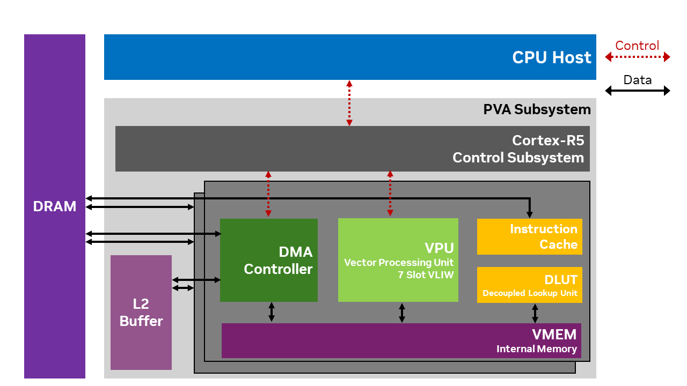
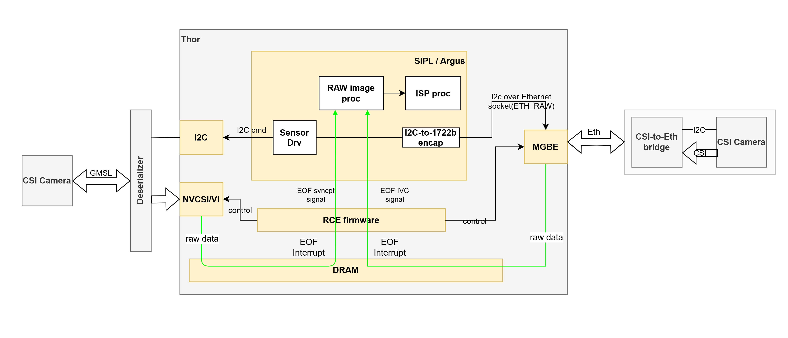
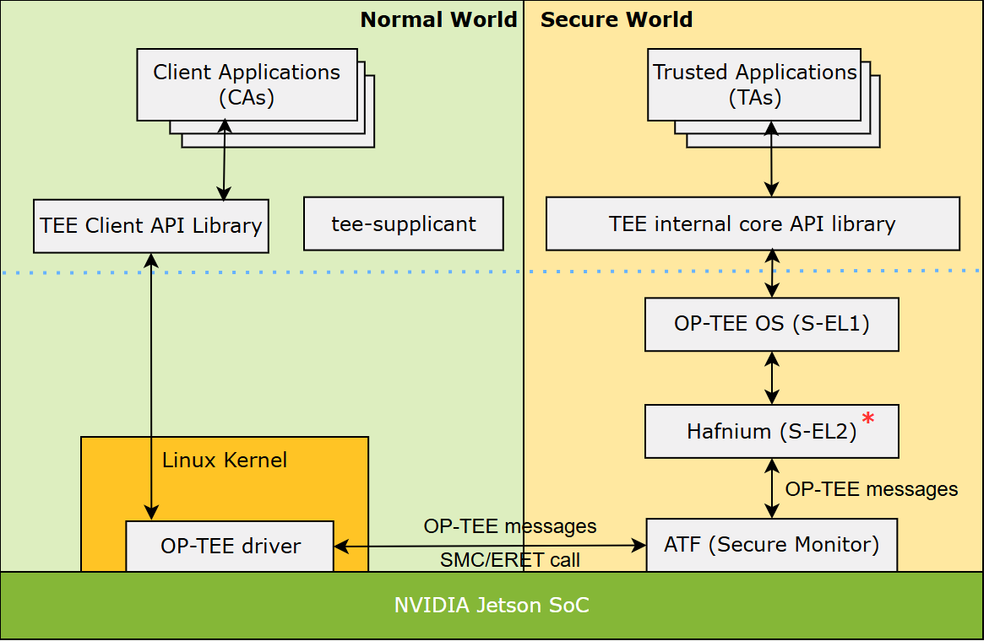
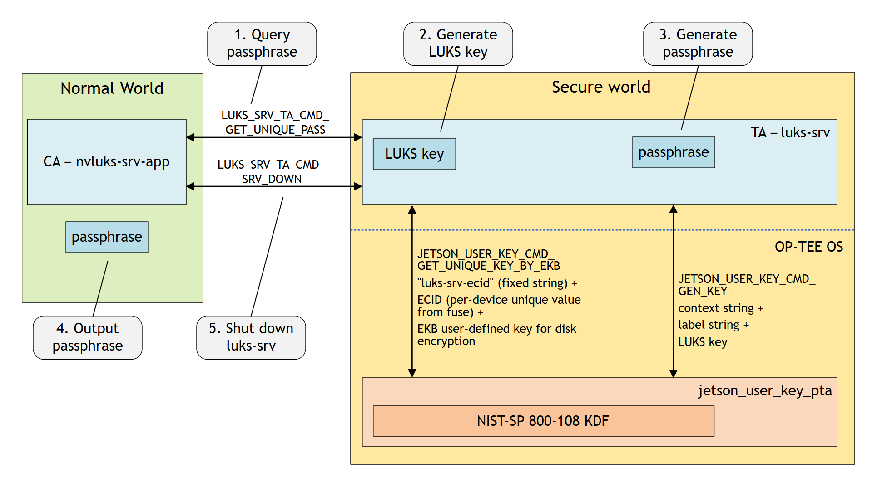
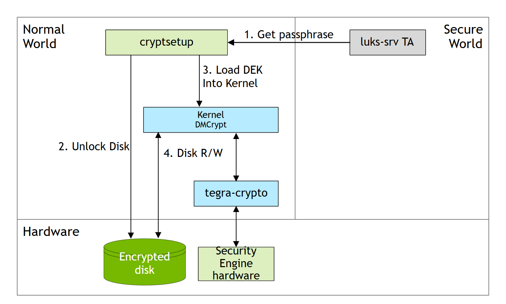

# NVIDIA核心技术护城河专题B：视觉引擎、传感器数据流与GPU隔离

本专题围绕PVA、SIPL/HSB、从NITROS到原生Buffer的迁移、MIG/MPS展开。它们分别优化规则视觉、数据进入计算平台、ROS内数据交换和并发资源管理。共同目标是让多传感器机器人减少搬运及争用，但没有任何一个机制单独保证整机硬实时或功能安全。引用固定到已归档的版本，数值不外推至未测机器人。

## 1. PVA v3与VPI：适合规则数据流的独立视觉计算

### 1.1 处理器原理与架构

PVA SDK 2.10.1将PVA描述为VLIW SIMD DSP，针对半稠密/稠密、规则计算、小数据集和可预测运行。架构包括两个可独立编程的Vector Processing Subsystems，以及负责调度的Cortex-R5控制子系统；控制子系统不向用户开放编程。VPS内含VPU、VMEM、DLUT和instruction cache，七路VLIW包括两标量ALU、两向量ALU、三load/store单元。SDK示例描述每VPU SIMD指令并行处理32个12-bit像素，属于处理器操作宽度，不能写成某算法32倍加速。[PVA SDK 2.10.1处理器与编程架构](https://docs.nvidia.com/pva/sdk/2.10.1/architecture.html)

**图1：PVA SDK官方处理器及运行架构。** 原图出处：[PVA SDK 2.10.1处理器与编程架构](https://docs.nvidia.com/pva/sdk/2.10.1/architecture.html)。

图中的VMEM承载局部数据，DLUT为查表访问减轻VPU工作，DMA连接输入/输出与局部计算。CPU host设置DMA/dataflow、分配资源和调度；设备代码在VPU上触发DMA并计算。这种显式数据流可避免大量规则视觉与神经网络争抢GPU，但仍会占用共享内存和系统资源，不能声称完全无干扰。Thor Datasheet确认一枚PVA v3，SDK处理器说明不代表所有NVIDIA SoC具有完全相同的资源容量。[PVA SDK 2.10.1处理器与编程架构](https://docs.nvidia.com/pva/sdk/2.10.1/architecture.html) [Datasheet Thor Full v1 5](https://developer.nvidia.com/downloads/assets/embedded/secure/jetson/thor/docs/jetson-thor-series-modules-datasheet_ds-11945-001.pdf)

### 1.2 使用方式、优势和参数限制

自定义PVA应用需要Host API、Executable、CmdProgram、dataflow、Stream和Fence配合；VPI则提供已有算法、图像封装和backend选择。前者是写设备程序，后者是使用库算法，不能把“VPI支持某算法”解释为用户得到该算法的任意自定义PVA源码。适合的任务是规则前处理、视觉跟踪等可表达的数据流；大规模VLA Transformer不是PVA的直接替代任务。[PVA SDK 2.10.1处理器与编程架构](https://docs.nvidia.com/pva/sdk/2.10.1/architecture.html) [VPI 4.1算法与平台说明](https://docs.nvidia.com/vpi/index.html) [VPI基本概念与数据接口](https://docs.nvidia.com/vpi/basic_concepts.html)

SDK规定全系统Context上限4，区分同步API错误和异步context失效；默认隐式Context失效可能要求进程重启，显式Context可以销毁重建。生产系统必须设计恢复与buffer回收，不能只写“低功耗DSP”。文档的cuPVA安全build适用性关联特定DRIVE OS安全release及认证版本，不能外推为普通Jetson PVA应用默认ASIL-B。[PVA SDK 2.10.1处理器与编程架构](https://docs.nvidia.com/pva/sdk/2.10.1/architecture.html)

| 可核验项目 | 官方事实 | 应怎样使用 |
|---|---|---|
| Thor视觉资源 | 一枚PVA v3 | 与GPU、OFA、视频资源分配开 |
| SDK处理结构 | 双VPS、调度控制子系统 | host/device及dataflow共同开发 |
| 指令形态 | 七路VLIW、宽SIMD | 算法访存和规则性决定实际效率 |
| Context | 系统上限4 | 规划进程和异常恢复 |
| 任务能耗/时延 | 本轮无统一Thor基准 | 不从峰值或指令宽度计算fps/W |

来源：[Datasheet Thor Full v1 5](https://developer.nvidia.com/downloads/assets/embedded/secure/jetson/thor/docs/jetson-thor-series-modules-datasheet_ds-11945-001.pdf) [PVA SDK 2.10.1处理器与编程架构](https://docs.nvidia.com/pva/sdk/2.10.1/architecture.html)。最后一行明确公开证据范围，并不是说PVA没有性能优势，而是当前资料不足以提供该机器人任务的量化收益。

### 1.3 TI TDA4VM对标：专用视觉和DSP也可分离GPU负载

TI TDA4VM官方Datasheet SPRSP36L（2026年6月修订，第1—3页）列出C7x向量DSP、VPAC/ISP、DMPAC和8-bit MMA。C7x最高1GHz，80GFLOPS/256GOPS，MMA最高8TOPS（8-bit，1GHz）。这是DSP、固定视觉引擎与神经网络引擎的异构组合，与PVA分离规则视觉负载的目标相关，不能用8TOPS与PVA SIMD像素宽度或Thor FP4 TFLOPS直接比较。[Texas Instruments TDA4VM官方数据手册](https://www.ti.com/lit/ds/symlink/tda4vm.pdf)

TI已经提供DSP和视觉加速器，因此规则视觉卸载并非NVIDIA独有。差别应落到算法支持、编程工具、相机驱动和下游推理接口：PVA可编程VPS、VPI库算法、TI C7x、VPAC/ISP并非完全等价可替换单元。NVIDIA优势是视觉资源与CUDA/Isaac ROS路径连接；短板是PVA专用程序和API增加迁移工作。TI手册明确AGV/AMR、安全传感器融合和机器视觉场景，不能因其峰值较低就认定这些任务不适用。公开资料没有同分辨率、像素格式、精度、算法和系统功耗的PVA/TI对测，本报告不判定任务能效胜负。[Texas Instruments TDA4VM官方数据手册](https://www.ti.com/lit/ds/symlink/tda4vm.pdf) [PVA SDK 2.10.1处理器与编程架构](https://docs.nvidia.com/pva/sdk/2.10.1/architecture.html)

## 2. SIPL Camera over Ethernet与HSB：三种接收路径必须分开

### 2.1 SIPL CoE原理：相机控制与像素接收一起抽象

Jetson R39.2.1官方CoE文档将相机传输接到SIPL，使用IEEE 1722b与Thor MGBE接收RAW像素；RCE固件管理DMA、帧事件与相关相机接收，SIPL管理应用提供的capture buffer及RAW/ISP输出。UDDF与HSL支持传感器、bridge、EEPROM和lens的驱动控制/硬件序列，I2C可通过以太网隧道到HSB。这样统一的是相机生命周期、格式与buffer语义，不只是把socket收包藏在一个API里。[Jetson SIPL Camera over Ethernet架构](https://docs.nvidia.com/jetson/archives/r39.2.1/DeveloperGuide/SD/CameraDevelopment/SIPLFramework/SIPL-for-L4T/CoE/CoE-Solution-Overview.html)

**图2：SIPL官方CoE与GMSL/MIPI相机路径。** 原图出处：[Jetson SIPL Camera over Ethernet架构](https://docs.nvidia.com/jetson/archives/r39.2.1/DeveloperGuide/SD/CameraDevelopment/SIPLFramework/SIPL-for-L4T/CoE/CoE-Solution-Overview.html)。

图显示以太网和传统相机入口如何进入camera framework。官方页列本release的Eagle/VB1940+HSB开箱支持，并把未来非CoE传输的共同API作为发展方向；不据此认定任意GigE Vision相机或全部GMSL模组已在当前SIPL支持。接口统一仍需sensor driver、bridge、JSON、ISP和支持矩阵。[Jetson SIPL Camera over Ethernet架构](https://docs.nvidia.com/jetson/archives/r39.2.1/DeveloperGuide/SD/CameraDevelopment/SIPLFramework/SIPL-for-L4T/CoE/CoE-Solution-Overview.html) [Jetson R39.2.1相机支持矩阵](https://docs.nvidia.com/jetson/archives/r39.2.1/DeveloperGuide/SD/CameraDevelopment/CameraDevelopmentSupportMatrix.html)

### 2.2 HSB RoCE原理：控制平面、数据平面和完成通知

HSB 2.7应用架构把I2C/SPI/local bus控制消息与高速采集数据分开。FPGA收集像素，数据平面用RoCE v2 RDMA write；ConnectX网卡按目标地址与认证key把内容写GPU或system memory，帧末write-immediate metadata包触发CPU通知。它降低的是逐包搬运开销，CPU仍负责控制、完成事件与应用调度，因此“DMA无CPU干预”不等于整机CPU占用0%。[Holoscan Sensor Bridge 2.7架构与示例](https://docs.nvidia.com/holoscan/sensor-bridge/2-7-latest/applications/architecture)

官网架构正文说明sensor对象、DataChannel、桥接硬件和receiver的分工，本轮该页未取得独立架构图片，以下按官方文字还原接收路径。新host配置文档另列AGX Thor JetPack7.2/MGBE/CoE，因此按接收硬件和协议列三条路径，避免把较早ConnectX示例当作全部HSB运行方式。[HSB 2.7主机接收与PTP配置](https://docs.nvidia.com/holoscan/sensor-bridge/2-7-latest/getting-started/host-setup) [Holoscan Sensor Bridge 2.7架构与示例](https://docs.nvidia.com/holoscan/sensor-bridge/2-7-latest/applications/architecture)

| 接收路线 | 协议/硬件 | 主要实现 | 已知边界 |
|---|---|---|---|
| Thor SIPL/CoE | IEEE 1722b、MGBE/RCE | 相机控制、DMA和RAW/ISP pipeline | 目标bridge、驱动与release支持 |
| HSB加速RoCE | RoCE v2、ConnectX | RDMA写入GPU/系统内存、完成metadata | 需要网卡、固件、PCIe/内存路径支持 |
| HSB Linux receiver | CPU/Linux网络栈 | socket收包提供开发/测试入口 | 没有同等包接收卸载收益 |

来源：[Jetson SIPL Camera over Ethernet架构](https://docs.nvidia.com/jetson/archives/r39.2.1/DeveloperGuide/SD/CameraDevelopment/SIPLFramework/SIPL-for-L4T/CoE/CoE-Solution-Overview.html) [Holoscan Sensor Bridge 2.7架构与示例](https://docs.nvidia.com/holoscan/sensor-bridge/2-7-latest/applications/architecture) [HSB 2.7主机接收与PTP配置](https://docs.nvidia.com/holoscan/sensor-bridge/2-7-latest/getting-started/host-setup)。x86 host文档明确：GPU/驱动看似提供GPUDirect，PCIe路径仍可能不支持，需禁用GPU VRAM frame buffer；不能只检查软件标志就宣布RDMA可用。

### 2.3 性能参数、同步与适用场景

HSB latency文档定义timestamp_s/ns为当前帧首个数据到FPGA的PTP时间，metadata_s/ns为帧末metadata发送时间；在正确主机PTP配置下，文档描述与主机时间同步到1微秒内。这是**时钟/时间戳同步描述**，不是相机曝光同步、整帧到推理时延或执行器响应。不同receiver还可提供不同metadata，应用需显式开启metadata。官方IMX274例子支持4K或1080p60FPS，但不能外推20路4K60并发、任意传感器或特定机器人。[HSB 2.7 metadata与延迟测量](https://docs.nvidia.com/holoscan/sensor-bridge/2-7-latest/applications/latency) [Holoscan Sensor Bridge 2.7架构与示例](https://docs.nvidia.com/holoscan/sensor-bridge/2-7-latest/applications/architecture) [HSB 2.7 PTP协议、VSYNC与性能应用说明](https://docs.nvidia.com/holoscan/sensor-bridge/2-7-latest/fpga-ip/ptp-application-note)

SIPL/HSB适合长线、多相机和高速传感器入口。限制包括桥接FPGA/ISP、时钟、MTU/缓冲、网络地址、固件、sensor格式和容器宿主配置；丢包与旧帧对闭环同样重要。性能应从曝光/首像素、帧完成、预处理、模型、动作发布分别记日志。25GbE或相机数量上限是资源边界，不是应用fps。

### 2.4 相关对标与方案选择

TI TDA4VM也集成ISP、视觉/深度运动引擎、CSI和以太网交换接口，是多传感器入口及前处理的相关替代路线；其335页Datasheet没有在本轮核验范围内给出与Thor IEEE1722b CoE、ConnectX RoCE v2相同的数据路径和同条件基准，所以不写成协议级直接替代。e-con的FPGA TintE ISP+10G HSB则是NVIDIA伙伴中的资源分工选项，不是独立芯片竞品。[Texas Instruments TDA4VM官方数据手册](https://www.ti.com/lit/ds/symlink/tda4vm.pdf) [e-con Systems官方Thor视觉计算方案](https://www.e-consystems.com/pr/ai-powered-vision-and-compute-solutions-accelerated-by-nvidia-jetson-thor.asp)

选型时在CPU网络栈、MIPI/ISP、MGBE/CoE和ConnectX/RDMA之间比较BOM、线缆、驱动、同步和目标负载；少量USB相机未必值得增加桥接硬件。NVIDIA优势需由实际省下的CPU/带宽及GPU可用时间证明，接口吞吐不能替代frame age和闭环延迟。本轮没有同传感器/负载的跨厂商对测，不给出固定倍数。

## 3. 从NITROS到rosidl::Buffer：数据传输护城河正在原生化

### 3.1 当前状态与架构原理

Isaac ROS官方迁移文档明确弃用NITROS、CUDA with NITROS和PyNITROS，未来release将移除；原来依赖NITROS的节点改用带rosidl::Buffer字段的ROS消息和CUDA buffer backend。历史NITROS提供NVIDIA特定type adaptation/type negotiation及GPU-aware transport；ROS 2 Lyrical原生加入共同容器/后端后，这部分能力向上游通用机制迁移。报告不能把旧接口仍描述为唯一长期路线。[Isaac ROS Buffer Migration](https://nvidia-isaac-ros.github.io/concepts/rosidl_buffer/nitros_migration.html)

当前结构分为三层：ROS消息定义可移植的数据语义，conversion package把消息转成图像/张量/点云对象，buffer backend负责存储与传输。uint8[]等原始数组字段在.msg中不变，生成C++表示从vector转为rosidl::Buffer；默认CPU行为仍近似vector，CUDA后端提供GPU存储。它保持标准publisher/subscription API，并避免为了发布消息而将大payload先搬回CPU再搬到GPU。[Isaac ROS原生Buffer概念文档](https://nvidia-isaac-ros.github.io/concepts/rosidl_buffer/index.html)

CUDA后端基于Virtual Memory Management与IPC，使用descriptor让兼容订阅端访问原始GPU存储。allocate_buffer分配CUDA buffer；from_output_buffer取得独占write handle并在指定stream记录完成；from_input_buffer取得read handle，等待publisher写事件后暴露只读指针；to_buffer将已有host/device指针的数据复制到输出。接口名包含buffer不代表每种操作都是零拷贝，to_buffer明确可能复制。[Isaac ROS官方CUDA buffer backend](https://nvidia-isaac-ros.github.io/concepts/rosidl_buffer/cuda_buffer_backend.html)

### 3.2 约束、性能边界与迁移工作

官方当前零拷贝条件为同host、同GPU、同user，并支持所需VMM特性；其他连接回退CPU transport。handle不仅包一层指针，还负责同步与生命周期：不能把raw pointer保留到handle/message失效之后，subscriber只读，不得绕过write access，且应用必须在CUDA-backed与fallback条件下都正确。跨主机、多GPU或不同用户不能由同机演示直接推断零拷贝。[Isaac ROS官方CUDA buffer backend](https://nvidia-isaac-ros.github.io/concepts/rosidl_buffer/cuda_buffer_backend.html)

迁移文档保持受支持节点的接口兼容，因此只使用节点接口的ROS图不必因底层传输改变全部重写；直接调用Managed NITROS publisher/subscriber、builder/view、Bridge或PyNITROS API的应用则需迁移。已有底层接口投资会产生升级成本；原生ROS消息和共享backend机制又降低NVIDIA特定协议绑定，两者需要同时分析。[Isaac ROS Buffer Migration](https://nvidia-isaac-ros.github.io/concepts/rosidl_buffer/nitros_migration.html)

| 技术层次 | 主要优化对象 | 成立条件 | 不能证明的事项 |
|---|---|---|---|
| 历史NITROS | 特定加速类型与协商 | 对应旧release的支持节点 | 未来版本继续保留全部旧API |
| ROS 2进程内通信 | 消息对象复制 | 合适进程图和unique_ptr所有权 | 自动消除GPU/CPU搬运 |
| rosidl::Buffer+CUDA backend | 标准消息的GPU数组存储及传输 | 同host/GPU/user和VMM能力 | 跨网络或多GPU自动零拷贝 |
| SIPL/HSB | 采集到主机buffer | 驱动、DMA、接收硬件和协议 | ROS下游无需任何转换 |

来源：[Isaac ROS Buffer Migration](https://nvidia-isaac-ros.github.io/concepts/rosidl_buffer/nitros_migration.html) [Isaac ROS官方CUDA buffer backend](https://nvidia-isaac-ros.github.io/concepts/rosidl_buffer/cuda_buffer_backend.html) [ROS 2官方Jazzy进程内通信文档源文件](https://raw.githubusercontent.com/ros2/ros2_documentation/jazzy/source/Tutorials/Demos/Intra-Process-Communication.rst) [Jetson SIPL Camera over Ethernet架构](https://docs.nvidia.com/jetson/archives/r39.2.1/DeveloperGuide/SD/CameraDevelopment/SIPLFramework/SIPL-for-L4T/CoE/CoE-Solution-Overview.html)。本轮没有目标机器人同一ROS图的旧NITROS/新Buffer/CPU transport性能消融，不给出X倍提升。应测copy字节数、节点排队、frame age及fallback发生条件。

### 3.3 对标与护城河变化

ROS 2 Jazzy官方文档源文件展示unique_ptr在同进程两节点传递时保持地址相同、避免对象复制，且讨论图拓扑变化后的复制。这是NVIDIA加速消息之外可用的原生通信机制。ROS官网本次返回挑战页面，该网页没有作为证据；文档源文件来自官方ros2_documentation仓库。当前Lyrical Buffer的上游网页同样受限，其架构在NVIDIA当前文档中已明确说明，但本轮未独立取得上游源文件，不声称已经复核所有RMW后端矩阵。[ROS 2官方Jazzy进程内通信文档源文件](https://raw.githubusercontent.com/ros2/ros2_documentation/jazzy/source/Tutorials/Demos/Intra-Process-Communication.rst) [Isaac ROS原生Buffer概念文档](https://nvidia-isaac-ros.github.io/concepts/rosidl_buffer/index.html)

因此该技术的优势在于NVIDIA已经提供可工作的CUDA backend和机器人节点集成；其基础容器和标准消息不属于独占资产。其他加速后端可使用共同抽象，但本轮未获得AMD/Intel同类型backend的实现和同条件基准，不假定它们已全部支持。客户应保留标准消息schema和conversion接口，让CUDA后端作为实现层；这能把性能优化与业务协议分开，并减少旧API生命周期变化带来的迁移风险。

## 4. MIG、MPS与进程恢复：隔离程度不能由名称推断

### 4.1 Thor MIG的硬件边界与实际配置

MIG在GPU硬件上按可用分区隔离任务。Thor Datasheet按GPC/TPC描述分区，T5000举4TPC+6TPC，T4000举4TPC+2TPC；图形只在具备图形能力的分区运行。R39.2.1指南进一步给出停显示、启persistence和MIG、枚举profile、创建GPU/compute instance及UUID绑定的流程，这已经是可执行配置证据，但本轮没有在设备上执行。[Datasheet Thor Full v1 5](https://developer.nvidia.com/downloads/assets/embedded/secure/jetson/thor/docs/jetson-thor-series-modules-datasheet_ds-11945-001.pdf) [Jetson R39.2.1官方MIG配置指南](https://docs.nvidia.com/jetson/archives/r39.2.1/DeveloperGuide/SD/MiG.html)

指南示例profile83为2g.0gb+gfx、12SM，profile78为1g.0gb+me、6SM，完整profile还有20SM。这里**示例profile不应由名称反推容量或任意切分比例**：0gb/0.00GiB是Jetson例子的输出字段，不等于可分配内存为零，也不能照搬A100/H100的HBM分区容量。Datasheet的TPC示意与指南SM示例不是一张完整映射表，本报告保留各自上下文，目标设备以实际枚举验证。[Jetson R39.2.1官方MIG配置指南](https://docs.nvidia.com/jetson/archives/r39.2.1/DeveloperGuide/SD/MiG.html) [Datasheet Thor Full v1 5](https://developer.nvidia.com/downloads/assets/embedded/secure/jetson/thor/docs/jetson-thor-series-modules-datasheet_ds-11945-001.pdf)

### 4.2 MPS、容器和安全的边界

Isaac ROS CUDA MPS文档通过chunks及控制程序提供静态SM配额，要求控制程序版本13010及以上；它不划分GPU内存，也不完全隔离任务。MIG的硬件分区、MPS的计算配额、进程容器的地址空间和整机安全等级是不同机制。给感知与VLA留计算资源可减少争抢，但不能自动消除共享相机、CPU、DRAM、供电与存储失效。[Isaac ROS CUDA MPS静态GPU分区](https://nvidia-isaac-ros.github.io/concepts/gpu_partitioning/index.html) [TensorRT构建、运行与对象生命周期](https://docs.nvidia.com/deeplearning/tensorrt/latest/architecture/how-trt-works.html)

分区会减少单任务可用计算资源，图形、媒体和peer访问按profile有约束，应用部署也需要固定UUID与监测实例。CUDA sticky error常需进程重启，健康检查和故障恢复必须独立设计。[公开资料未披露] 本轮没有Thor MIG/MPS在目标机器人上的P99、WCET、带宽干扰或故障注入数据，因此不写确定的硬实时收益或ASIL提升。[TensorRT官方性能与测量指南](https://docs.nvidia.com/deeplearning/tensorrt/latest/performance/best-practices.html) [Jetson R39.2.1官方MIG配置指南](https://docs.nvidia.com/jetson/archives/r39.2.1/DeveloperGuide/SD/MiG.html)

### 4.3 AMD MxGPU/SR-IOV对标

AMD官方Instinct Virtualization Driver文档描述MxGPU用SR-IOV让虚拟机共享GPU资源，面向QEMU/KVM，列出MI300X/MI325X/MI350X等支持设备。它与MIG都涉及多用户/多任务资源分配，但SR-IOV虚拟功能与Thor GPC/MIG profile不是同一抽象；支持VM共享并不能证明与Thor相同的错误域、内存隔离或机器人时延。[AMD Instinct官方虚拟化驱动](https://instinct.docs.amd.com/projects/virt-drv/en/latest/)

NVIDIA的独到工程价值是端侧Thor已有公开分区和图形共存配置，便于多模态服务设计；AMD方案则提供其支持设备上的虚拟化替代。两者没有同功耗端侧机器人对测，不能作直接性能排名。若主要问题是单模型资源不足，先考虑模型优化；若问题是多模型互扰，再比较分区、静态配额和服务分离。整机安全需求仍应按IGX或独立安全控制系统的完整证据评估。

## 5. PVA程序怎样落地：局部存储、分块DMA与故障传播

### 5.1 编程约束决定哪些算法值得卸载

PVA设备端VPU不能直接访问VMEM之外的数据，必须用DMA。Host把Executable、符号、buffer和Dataflow放入CmdProgram，完成dataflow编译；设备端按约定触发DMA、处理局部块并写回。编译后不能任意改DMA结构，官方允许通过OffsetPointer更新dataflow的数据指针。换图像尺寸、块布局或访问拓扑可能需要重新配置/编译，不能按普通CPU函数理解。[PVA SDK 2.10.1处理器与编程架构](https://docs.nvidia.com/pva/sdk/2.10.1/architecture.html)

| cuPVA官方Dataflow | 表达的数据移动 | 相关机器人任务（分析） | 主要约束 |
|---|---|---|---|
| RasterDataFlow | 图像二维tile扫描 | 前处理、局部图像运算 | 边界halo、pitch及触发次数 |
| TensorDataFlow | tensor三维volume扫描 | 规则张量变换 | layout及块间依赖 |
| GatherScatterDataFlow | 二维tile聚集/散射 | 特定非连续局部访问 | 有限可表达模式及DMA成本 |
| SequenceDataFlow | 设备端可重新配置的传输序列 | 动态局部数据流 | open/close及序列完成契约 |

左两列按SDK2.10.1架构原文摘录，任务列是适用性推导，不是官方全部实现清单。VPU必须完成约定的触发次数；遗漏DMA触发可能导致timeout，并对整个PVA引擎运行时间产生不可预测影响。可预测视觉处理不是仅由硬件名字得到，程序数据流本身必须正确。[PVA SDK 2.10.1处理器与编程架构](https://docs.nvidia.com/pva/sdk/2.10.1/architecture.html)

图像分块可以减少局部工作集、提升DMA和计算重叠机会，但卷积邻域/边界需要重复读halo，tile过小增加传输与调度，过大受VMEM限制。把规则前处理从GPU搬到PVA后，仍需计算进出VMEM与格式转换成本；若TensorRT随后重新resize或转layout，卸载的收益可能被重复工作消耗。官方VMEM/dataflow教程提供具体buffer和传输编程入口，比泛称“低功耗视觉协处理器”更接近工程可复建性。[PVA官方VMEM与分块Dataflow教程](https://docs.nvidia.com/pva/sdk/2.10.1/tutorial/vmem-buffers-dataflows.html)

### 5.2 Stream、Fence及Context的恢复边界

cuPVA Stream在Context内提交任务，Fence连接前后阶段的完成条件。SDK区分某次API调用失败与Context已经无效：若submit返回非InvalidContext错误，可能只属于该调用；Context失效则同Context另一条看似健康Stream也会拒绝提交。官方GetStatus提供结构化stream、submission和command定位，错误字符串格式不保证跨release稳定，不应靠解析日志字符串做恢复判断。[PVA SDK 2.10.1处理器与编程架构](https://docs.nvidia.com/pva/sdk/2.10.1/architecture.html)

应用需保留足够在途帧与submission历史，先停止上游提交、等待或确认失效，按显式Context方案销毁/重建资源，再重新接通下游。默认隐式Context可能要求进程重启。这里的Context恢复不等于MIG隔离，也不等于独立安全控制器已经收到故障信号；必须单独设计超时后的旧帧丢弃和机器人降级。四个Context系统上限也约束多进程拆分，不能无限用Context做故障域。

### 5.3 VPI、手写cuPVA及TI路线怎么比较

VPI适合先验证库内算法和CPU/CUDA/PVA等实际支持backend，再决定是否定制设备程序。VPI wrapper减少API间复制的可能，但格式、尺寸、backend flags、payload和stream同步仍需符合算法要求；不能由VPI总览推断每算法在Thor/PVA都可运行。手写cuPVA可控制tile/DMA与局部计算，代价是专用工具、数值验证与迁移。TI C7x/VPAC也能构成异构视觉分工，但驱动、算法接口及本地内存模型不同。[VPI基本概念与数据接口](https://docs.nvidia.com/vpi/basic_concepts.html) [Texas Instruments TDA4VM官方数据手册](https://www.ti.com/lit/ds/symlink/tda4vm.pdf)

性能比较应固定算法、误差容限、分辨率、像素格式、帧率、传输范围和系统功耗，报告前处理时延与整个VLA/SLAM并发结果。只测单个视觉函数可能看到GPU占用降低，却看不到共享DRAM/CPU瓶颈；同样不能用“DSP最高8TOPS”与“PVA每指令32像素”算比例。

VPI官方基准先预创建全部payload和输入/输出buffer，仅启目标backend及VPI_EXCLUSIVE_STREAM_ACCESS；预热1秒，按最多100次调用的batch计平均时间，至少测5秒且至少10批，剔除两端各5%后取median。Thor示例MAXN/最大风扇，CPU2.7GHz、GPU1.6GHz、PVA/VPS1.2GHz。它排除了部分创建和测量开销，也裁掉尾部，不能作为机器人P99或WCET。官方说明单枚PVA的双vector processor需两路以上并行VPIStream才能充分利用，但实际结果依算法与数据流；本轮未独立取得各算法动态性能表的完整数值，不编造fps/W。[VPI官方算法性能与测量说明](https://docs.nvidia.com/vpi/algo_performance.html)

## 6. 多传感器时序：从带宽表到观测年龄

### 6.1 带宽预算需在协议和像素层计算

以八路1920×1080、60fps、RAW12为**假设算例**，纯像素payload为8×1920×1080×60×12≈11.94Gbit/s，即约1.49GB/s。该计算未含协议头、blanking、metadata、重传及接收处理，不能当成任何具体camera实际链路量。若变成RGB8三通道，纯像素payload约23.89Gbit/s；格式选择本身就改变网络、DRAM与下游tensor预算。来源中的HSB/CoE协议和Thor资源用于限定路线，算例不是官方并发测试。[Jetson SIPL Camera over Ethernet架构](https://docs.nvidia.com/jetson/archives/r39.2.1/DeveloperGuide/SD/CameraDevelopment/SIPLFramework/SIPL-for-L4T/CoE/CoE-Solution-Overview.html) [Holoscan Sensor Bridge 2.7架构与示例](https://docs.nvidia.com/holoscan/sensor-bridge/2-7-latest/applications/architecture) [Datasheet Thor Full v1 5](https://developer.nvidia.com/downloads/assets/embedded/secure/jetson/thor/docs/jetson-thor-series-modules-datasheet_ds-11945-001.pdf)

一次采集写DRAM加一次下游读取已至少产生两份payload流量；CPU bounce、图像格式转换、resize输出、日志和模型读取会继续增加。LPDDR5X273GB/s标称带宽不是所有pipeline都可独享，也不能与网络标称bit/s直接相加。网络够快不代表驱动队列、buffer池、ISP、CPU通知或模型调用没有堵塞。

### 6.2 分阶段测量，避免把同步精度当时延

| 时间点/指标 | 可观察的意义 | 主要风险 | 应用处理 |
|---|---|---|---|
| 曝光开始/中点 | 物理世界被采样的时刻 | rolling shutter、曝光差异 | 核对相机和同步方式 |
| 首像素到FPGA | HSB timestamp对应的边界 | 不等于曝光中点 | 保留时间定义与PTP域 |
| 帧末metadata | 帧末发送与完成通知 | 不是GPU算法完成 | 完成后才能读完整buffer |
| 预处理/模型开始结束 | CUDA/PVA/TRT计算段 | 排队、shape、page fault | 分段event与host日志 |
| 动作实际应用 | 下游控制器执行的时刻 | RPC、控制周期与旧命令 | 记录有效期和控制确认 |
| frame age | 执行使用的观测距采样多久 | 高吞吐但观测过时 | 丢旧帧或降级策略 |

来源：[HSB 2.7 metadata与延迟测量](https://docs.nvidia.com/holoscan/sensor-bridge/2-7-latest/applications/latency) [HSB 2.7 PTP协议、VSYNC与性能应用说明](https://docs.nvidia.com/holoscan/sensor-bridge/2-7-latest/fpga-ip/ptp-application-note) [TensorRT官方基准测量与Nsight分析](https://docs.nvidia.com/deeplearning/tensorrt/latest/performance/benchmarking.html) [Isaac ROS Deploy本体适配指南](https://nvidia-isaac-ros.github.io/repositories_and_packages/isaac_ros_deploy/how_to_guides/bring_your_own_embodiment.html)。最后三项为基于接口设计的工程测量建议。HSB正确PTP设置下的1微秒描述只对应时钟/时间戳同步，不能覆盖曝光、整帧、推理或动作响应。

缓存深度和背压要结合控制任务决定：增加queue可降低丢帧但提高frame age；始终取最新帧可改善时效却需处理丢帧和各sensor不同步。PTP锁定也不能消除不同曝光时间和camera内部延迟。传感器融合需同时核对时间域、外参、frame ID、分辨率及丢包恢复，不能用统一camera API取代标定和数据QA。

### 6.3 协议路径和运维不能混用

SIPL CoE把IEEE1722b、MGBE/RCE与RAW/ISP buffer管理结合；HSB ConnectX RoCEv2由网卡执行RDMA；Linux socket路线经过CPU网络栈。选择需要具体host、bridge固件和接收文档，VPI/CUDA/Buffer又处在其下游。厂商产品页写“HSB compatible”不足以证明任意协议、相机、容器和GPU地址路径都已验收。[Jetson SIPL Camera over Ethernet架构](https://docs.nvidia.com/jetson/archives/r39.2.1/DeveloperGuide/SD/CameraDevelopment/SIPLFramework/SIPL-for-L4T/CoE/CoE-Solution-Overview.html) [HSB 2.7主机接收与PTP配置](https://docs.nvidia.com/holoscan/sensor-bridge/2-7-latest/getting-started/host-setup)

RoCE receiver的地址/key注册、PCIe拓扑及GPU-memory支持需按host核验；CoE需要sensor driver、HSL/UDDF、配置与对应release。容器共享host驱动和网络配置，无法凭镜像启动成功证明PTP、DMA和GPU-memory路径正常。相机断连、重连、配置变化及旧metadata应纳入恢复测试，不只是测一次正常收帧。

## 7. 零拷贝与隔离：端到端契约和可证明范围

### 7.1 三段独立的零拷贝条件

采集进入buffer、同机ROS transport、模型计算分别有不同所有权和同步条件。SIPL/HSB可优化入口；rosidl::Buffer CUDA backend可共享同host/GPU/user的VMM存储；TensorRT仍要求正确类型、layout和有效地址。若转换接口to_buffer把已有指针复制到输出，或CPU fallback/resize生成新tensor，路径就有复制。应对每条edge记录payload大小、分配者、读写handle、完成event和fallback条件。[Isaac ROS官方CUDA buffer backend](https://nvidia-isaac-ros.github.io/concepts/rosidl_buffer/cuda_buffer_backend.html) [Isaac ROS原生Buffer概念文档](https://nvidia-isaac-ros.github.io/concepts/rosidl_buffer/index.html) [TensorRT官方执行计划、内存与线程安全](https://docs.nvidia.com/deeplearning/tensorrt/latest/architecture/how-trt-works.html)

标准schema保留了业务可移植性，后端决定性能；直接持有raw pointer跨越handle生命周期会破坏消息的只读/独占语义。跨主机ROS连接还需要序列化/传输，不能把同机演示外推。当前官方弃用NITROS也说明护城河不是某个私有消息API永久不变，而是CUDA backend、conversion和节点实现的持续维护能力。

### 7.2 从故障资源判断MIG/MPS的价值

| 隔离对象 | 对应机制 | 可利用能力 | 仍需处理的共享条件 |
|---|---|---|---|
| GPU计算配额 | MPS静态SM份额 | 限制部分任务计算资源占用 | GPU内存、CPU、DRAM及错误恢复 |
| 硬件GPU实例 | Thor MIG/profile | 实例资源分配和图形/媒体能力选择 | SoC外部资源、实际profile及平台错误边界 |
| 进程地址/软件状态 | 独立进程与监督器 | 崩溃后重启单服务 | driver/GPU/供电及共享设备 |
| PVA提交上下文 | 显式Context | 故障定位与重建 | Context内所有Stream、系统Context上限 |
| 危险失效控制 | FSI/sMCU与完整安全架构 | 监测及安全响应基础 | 安全传感器、执行器、认证与恢复流程 |

来源：[Isaac ROS CUDA MPS静态GPU分区](https://nvidia-isaac-ros.github.io/concepts/gpu_partitioning/index.html) [Jetson R39.2.1官方MIG配置指南](https://docs.nvidia.com/jetson/archives/r39.2.1/DeveloperGuide/SD/MiG.html) [PVA SDK 2.10.1处理器与编程架构](https://docs.nvidia.com/pva/sdk/2.10.1/architecture.html) [Product Brief IGX Thor Safety](https://developer.download.nvidia.com/assets/igx/robotics-product-brief-igx-thor-safety-4473375.pdf)。该表没有把普通进程、MIG或PVA Context当成安全等级。Thor专门MIG文档的profile83/78、graphics/media差异和0gb输出保留原条件，通用数据中心MIG内存切片说明不能覆盖Jetson共享DRAM。

分区前要先测完整工作负载：若模型单独已经算力不足，分区可能更慢；若DRAM或CPU瓶颈主导，SM分区未必改善尾部；若多个GPU服务互扰，实例或配额才更有针对性。构建engine也应考虑部署时可用计算资源，独占GPU调优所得tactic未必在受限并发环境最优。[TensorRT官方Graphs、并行与算子优化](https://docs.nvidia.com/deeplearning/tensorrt/latest/performance/optimization.html) [Jetson R39.2.1官方MIG配置指南](https://docs.nvidia.com/jetson/archives/r39.2.1/DeveloperGuide/SD/MiG.html)

[公开资料未披露] 当前无本项目Thor多sensor+VLA+规划负载的隔离消融、P99/WCET及故障注入结果。硬件机制和配置命令可以核验，确定性收益仍需测量。应关注任务deadline违约、观测年龄、内存峰值、故障影响范围和恢复时间，不能只报告平均fps。

## 8. 平台可信链、加密与认证：隔离之外的另一层能力

### 8.1 Secure Boot保护的是加载来源

Thor R39.2.1 Quick Start分pre-UEFI和UEFI流程：前者把低层固件/bootloader验证连接到fuse中的密钥材料，后者涉及UEFI key enrollment和OS加载。它需要host环境、密钥准备、fuseblob、EKB、签名及刷写一起配置，不能以“支持Secure Boot”证明出货设备已经开启。文档内示例仍标R39.2.0，应按当前release包验证，不能盲抄版本字符串或示例密钥。[Thor官方Secure Boot验证链与配置](https://docs.nvidia.com/jetson/archives/r39.2.1/DeveloperGuide/SD/Security/SecureBoot/QuickStartThor.html)

fuse中的根信任材料和密钥轮换设计会影响制造、返修及升级；官方建议一次准备完整PKC key list，因为相应密钥烧录有一次性边界。本调研只分析流程，未操作设备。Secure Boot验证被加载代码，不证明已认证代码没有漏洞、模型动作可靠或运行期没有被有权限应用滥用；推理engine和机器人应用的制品信任仍要另外管理。

### 8.2 OP-TEE的隔离与Thor专属路径

**图3：Jetson官方normal world、secure world与Thor Hafnium分层。** 原图出处：[Jetson官方OP-TEE架构与安全域](https://docs.nvidia.com/jetson/archives/r39.2.1/DeveloperGuide/SD/Security/OpTee/Architecture.html)。

官方图显示Linux运行在normal world，OP-TEE及TA在secure world，通过客户端API、kernel driver、ATF monitor和安全服务调用。Thor有S-EL2/Hafnium路径，Orin没有同样S-EL2支持；图中Hafnium不能泛化到所有Jetson。TZ-DRAM carveout提供安全OS存储区域，TA由非安全端发起请求并响应，并非独立机器人安全控制loop。[Jetson官方OP-TEE架构与安全域](https://docs.nvidia.com/jetson/archives/r39.2.1/DeveloperGuide/SD/Security/OpTee/Architecture.html)

优势是密钥派生、可信服务及敏感操作不必全部暴露在普通Linux进程；限制是CA/TA接口、权限、数据校验和可信代码本身仍需设计。Arm TrustZone、OP-TEE和标准磁盘加密是通用技术，NVIDIA的价值在于与BootROM/bootloader、密钥、BSP及生产流程连接，不能把通用TEE列为完全独占发明。

### 8.3 磁盘、DRAM与PVA认证保护不同对象

**图4：官方LUKS服务与设备口令派生结构。** 原图出处：[Jetson官方磁盘加密概念与密钥](https://docs.nvidia.com/jetson/archives/r39.2.1/DeveloperGuide/SD/Security/DiskEncryption/Concepts.html)。

Jetson采用cryptsetup/LUKS和Linux DMCrypt，DEK加密数据，passphrase派生的密钥保护LUKS header中的DEK；luks-srv TA借助jetson_user_key_pta服务生成解锁口令。自动解锁可降低现场操作成本，也意味着要明确“离线拆盘”与“攻陷已解锁设备”的威胁边界：存储加密不能保护应用已读出的明文。[Jetson官方磁盘加密概念与密钥](https://docs.nvidia.com/jetson/archives/r39.2.1/DeveloperGuide/SD/Security/DiskEncryption/Concepts.html)

**图5：Jetson官方加密磁盘启动解锁流程。** 原图出处：[Jetson官方磁盘加密概念与密钥](https://docs.nvidia.com/jetson/archives/r39.2.1/DeveloperGuide/SD/Security/DiskEncryption/Concepts.html)。

图用于说明启动链与可信服务如何进入磁盘解锁，不代表整机器人已有远程密钥管理或数据合规认证。制造端密钥注入、每设备身份、返修处理、恢复镜像及权限应按量产流程设计。

R39.2.1内存加密页明确MSS提供128-bit AES-XTS，保护DRAM内容免受硬件snooping；Thor TZ/GSC carveout之外的non-secure DRAM也可设加密，T264板的enable_nsdram_encryption默认开启。官方仅定性称读写延迟低、通常不影响DRAM性能，没有本轮可引用的Thor工作负载百分比，不填“零开销”。DRAM加密与磁盘加密保护不同位置，也不提供应用内存访问授权。[Thor官方DRAM内存加密](https://docs.nvidia.com/jetson/archives/r39.2.1/DeveloperGuide/SD/Security/MemoryEncryption.html)

PVA认证则针对运行在VPU的应用代码：当前文档默认关闭，需显式启用；启用后仅允许签名应用，NVIDIA VPI包通过安装流程登记签名。签名登记错误可能表现为视觉任务执行失败，需区分认证与算法错误。页面适用列表包含多个Jetson系列，但不能由列表推断无PVA的SKU可以运行PVA。[Jetson官方PVA固件与应用认证](https://docs.nvidia.com/jetson/archives/r39.2.1/DeveloperGuide/SD/Security/PVAAuthentication.html) [Datasheet Thor Full v1 5](https://developer.nvidia.com/downloads/assets/embedded/secure/jetson/thor/docs/jetson-thor-series-modules-datasheet_ds-11945-001.pdf)

| 机制 | 保护对象/威胁 | 能证明什么 | 不能替代什么 |
|---|---|---|---|
| Secure Boot | 未授权加载的固件/OS | 受控验证链 | 运行期漏洞和动作安全 |
| OP-TEE | 可信服务和敏感材料 | secure world执行边界 | TA正确性及整机认证 |
| LUKS/DMCrypt | 存储静态数据 | 磁盘加密和解锁流程 | 已解锁系统内的明文保护 |
| MSS AES-XTS | DRAM硬件窥探 | 内存数据加密 | 应用权限/模型完整性 |
| PVA应用认证 | 未签名VPU应用 | 指定引擎代码来源验证 | 普通GPU/CPU代码全部可信 |
| ratcheting | 回退到旧受保护组件 | SWVN/HWVN比较限制 | 任意模型版本的自动防回退 |

来源依次为本节上述官方页面及[Jetson官方回滚保护](https://docs.nvidia.com/jetson/archives/r39.2.1/DeveloperGuide/SD/Security/RollbackProtection.html)。网络安全、保密性、完整性、计算配额与功能安全属于不同目标，应分别定义验收证据。

### 8.4 防回滚与现场恢复的张力

官方ratcheting使用软件SWVN与硬件HWVN：低于硬件版本时拒绝加载，高版本按具体组件流程更新版本边界；硬件fuse位不能反向恢复。保护对象是文档列出的boot组件和配置，不是所有容器、engine或策略文件自动防回滚。客户需要把固件防回滚、A/B更新恢复、签名制品和业务模型兼容性共同设计，不能承诺任意旧镜像都可现场恢复。[Jetson官方回滚保护](https://docs.nvidia.com/jetson/archives/r39.2.1/DeveloperGuide/SD/Security/RollbackProtection.html)

这些能力加深NVIDIA的端侧产品化工具链，但也增加密钥、签名、受控更新和BSP维护工作。TI等异构安全域是相关对标，具体密钥链/加密范围需另取对应手册；本轮不以ASIL等级替代网络安全比较，也不编造Intel/AMD同SKU的协议覆盖。

## 参考资料与本地原文

本报告依据截至2026年11月3日取得的官方网页、代码仓库、API和文档。资料由统一下载工具归档到本项目的reference_metrial；多个方向共享同一URL的已校验文件。网页保留HTML和依赖，部分资源受robots规则、失效链接或动态交互限制影响时，按metadata如实标明。采集时点、版本和原始响应哈希可在各资料目录内核对。

08专题材料独立保存在reference_metrial/08_core；以下链接指向该专题目录中的原文。HTML及依赖通过本地硬链接共享存储，规范URL登记仍在项目公共registry。

| 官方资料 | 原始URL | 本地原文 | 归档情况 |
|---|---|---|---|
| NVIDIA_02_PVA_ARCH2 | [官方原文](https://docs.nvidia.com/pva/sdk/2.10.1/architecture.html) | [index.html](REFERENCES.md#ref-782050b23c55b756) | 静态HTML依赖完整；动态功能另验 |
| NVIDIA_Datasheet_Thor_Full_v1_5 | [官方原文](https://developer.nvidia.com/downloads/assets/embedded/secure/jetson/thor/docs/jetson-thor-series-modules-datasheet_ds-11945-001.pdf) | [document.pdf](REFERENCES.md#ref-e0ae09b175a34eac) | 原件已归档 |
| NVIDIA_02_VPI_ROOT | [官方原文](https://docs.nvidia.com/vpi/index.html) | [index.html](REFERENCES.md#ref-eaae6e470379dc47) | 静态呈现依赖部分缺失；见metadata |
| NVIDIA_02_VPI_CONCEPT | [官方原文](https://docs.nvidia.com/vpi/basic_concepts.html) | [index.html](REFERENCES.md#ref-72830911d3af4db9) | 静态呈现依赖部分缺失；见metadata |
| NVIDIA_08_DEEP_TI_TDA4 | [官方原文](https://www.ti.com/lit/ds/symlink/tda4vm.pdf) | [document.pdf](REFERENCES.md#ref-3e2afc59421db651) | 原件已归档 |
| NVIDIA_02_SIPL_COE | [官方原文](https://docs.nvidia.com/jetson/archives/r39.2.1/DeveloperGuide/SD/CameraDevelopment/SIPLFramework/SIPL-for-L4T/CoE/CoE-Solution-Overview.html) | [index.html](REFERENCES.md#ref-acc0a9a82b614a53) | 静态HTML依赖完整；动态功能另验 |
| NVIDIA_03_SENSOR_MATRIX | [官方原文](https://docs.nvidia.com/jetson/archives/r39.2.1/DeveloperGuide/SD/CameraDevelopment/CameraDevelopmentSupportMatrix.html) | [index.html](REFERENCES.md#ref-e0e028686f7106c7) | 静态HTML依赖完整；动态功能另验 |
| NVIDIA_02_HSB_ARCH | [官方原文](https://docs.nvidia.com/holoscan/sensor-bridge/2-7-latest/applications/architecture) | [index.html](REFERENCES.md#ref-766974539088b048) | 静态呈现依赖部分缺失；见metadata |
| NVIDIA_03_HSB_HOST | [官方原文](https://docs.nvidia.com/holoscan/sensor-bridge/2-7-latest/getting-started/host-setup) | [index.html](REFERENCES.md#ref-aee361464dc08219) | 静态呈现依赖部分缺失；见metadata |
| NVIDIA_03_HSB_LATENCY | [官方原文](https://docs.nvidia.com/holoscan/sensor-bridge/2-7-latest/applications/latency) | [index.html](REFERENCES.md#ref-66135574a9b2eb3d) | 静态呈现依赖部分缺失；见metadata |
| NVIDIA_03_HSB_PTP_NOTE | [官方原文](https://docs.nvidia.com/holoscan/sensor-bridge/2-7-latest/fpga-ip/ptp-application-note) | [index.html](REFERENCES.md#ref-523b5e075482c49f) | 静态呈现依赖部分缺失；见metadata |
| NVIDIA_07_DEEP_ECON | [官方原文](https://www.e-consystems.com/pr/ai-powered-vision-and-compute-solutions-accelerated-by-nvidia-jetson-thor.asp) | [index.html](REFERENCES.md#ref-6cf415f5a3283e6a) | 静态呈现依赖部分缺失；见metadata |
| NVIDIA_Isaac_ROS_Buffer_Migration | [官方原文](https://nvidia-isaac-ros.github.io/concepts/rosidl_buffer/nitros_migration.html) | [index.html](REFERENCES.md#ref-a74b452c91c23559) | 静态呈现依赖部分缺失；见metadata |
| NVIDIA_02_BUFFER_DOC | [官方原文](https://nvidia-isaac-ros.github.io/concepts/rosidl_buffer/index.html) | [index.html](REFERENCES.md#ref-e9167f78686d3ef7) | 静态呈现依赖部分缺失；见metadata |
| NVIDIA_08_DEEP_BUFFER_CUDA | [官方原文](https://nvidia-isaac-ros.github.io/concepts/rosidl_buffer/cuda_buffer_backend.html) | [index.html](REFERENCES.md#ref-cc587411e9c9d2c8) | 静态呈现依赖部分缺失；见metadata |
| NVIDIA_08_DEEP_ROS2_INTRAPROCESS_RAW | [官方原文](https://raw.githubusercontent.com/ros2/ros2_documentation/jazzy/source/Tutorials/Demos/Intra-Process-Communication.rst) | [content.rst](REFERENCES.md#ref-3273578c57c520b7) | 原件已归档 |
| NVIDIA_08_MIG | [官方原文](https://docs.nvidia.com/jetson/archives/r39.2.1/DeveloperGuide/SD/MiG.html) | [index.html](REFERENCES.md#ref-85895374c012ed38) | 静态HTML依赖完整；动态功能另验 |
| NVIDIA_02_MPS_DOC | [官方原文](https://nvidia-isaac-ros.github.io/concepts/gpu_partitioning/index.html) | [index.html](REFERENCES.md#ref-1fd266641b8a8d14) | 静态呈现依赖部分缺失；见metadata |
| NVIDIA_02_TRT_WORK | [官方原文](https://docs.nvidia.com/deeplearning/tensorrt/latest/architecture/how-trt-works.html) | [index.html](REFERENCES.md#ref-9df325c2c44e3de5) | 静态HTML依赖完整；动态功能另验 |
| NVIDIA_04_TRT_PERF | [官方原文](https://docs.nvidia.com/deeplearning/tensorrt/latest/performance/best-practices.html) | [index.html](REFERENCES.md#ref-fac73fa8f8466577) | 静态HTML依赖完整；动态功能另验 |
| NVIDIA_08_DEEP_AMD_SRIOV | [官方原文](https://instinct.docs.amd.com/projects/virt-drv/en/latest/) | [index.html](REFERENCES.md#ref-b3d33688c0d4d78e) | 静态HTML依赖完整；动态功能另验 |
| NVIDIA_08_DEEP_PVA_DATAFLOW_TUTORIAL | [官方原文](https://docs.nvidia.com/pva/sdk/2.10.1/tutorial/vmem-buffers-dataflows.html) | [index.html](REFERENCES.md#ref-9cc74b3ba04b9d8e) | 静态HTML依赖完整；动态功能另验 |
| NVIDIA_08_DEEP_VPI_PERF | [官方原文](https://docs.nvidia.com/vpi/algo_performance.html) | [index.html](REFERENCES.md#ref-0ad58187dddda198) | 静态呈现依赖部分缺失；见metadata |
| NVIDIA_08_DEEP_TRT_BENCHMARK | [官方原文](https://docs.nvidia.com/deeplearning/tensorrt/latest/performance/benchmarking.html) | [index.html](REFERENCES.md#ref-93c559c64be1b36b) | 静态HTML依赖完整；动态功能另验 |
| NVIDIA_06_EMBODIMENT | [官方原文](https://nvidia-isaac-ros.github.io/repositories_and_packages/isaac_ros_deploy/how_to_guides/bring_your_own_embodiment.html) | [index.html](REFERENCES.md#ref-07b01900ce1e8a74) | 静态呈现依赖部分缺失；见metadata |
| NVIDIA_08_DEEP_TRT_MEMORY | [官方原文](https://docs.nvidia.com/deeplearning/tensorrt/latest/architecture/how-trt-works.html) | [index.html](REFERENCES.md#ref-9df325c2c44e3de5) | 静态HTML依赖完整；动态功能另验 |
| NVIDIA_Product_Brief_IGX_Thor_Safety | [官方原文](https://developer.download.nvidia.com/assets/igx/robotics-product-brief-igx-thor-safety-4473375.pdf) | [document.pdf](REFERENCES.md#ref-b71ae712d56c26cb) | 原件已归档 |
| NVIDIA_08_DEEP_TRT_OPTIMIZATION | [官方原文](https://docs.nvidia.com/deeplearning/tensorrt/latest/performance/optimization.html) | [index.html](REFERENCES.md#ref-cd21e064a83f1d04) | 静态HTML依赖完整；动态功能另验 |
| NVIDIA_08_DEEP_THOR_SECUREBOOT | [官方原文](https://docs.nvidia.com/jetson/archives/r39.2.1/DeveloperGuide/SD/Security/SecureBoot/QuickStartThor.html) | [index.html](REFERENCES.md#ref-7413bba87204cc0e) | 静态HTML依赖完整；动态功能另验 |
| NVIDIA_08_DEEP_OPTEE_ARCH | [官方原文](https://docs.nvidia.com/jetson/archives/r39.2.1/DeveloperGuide/SD/Security/OpTee/Architecture.html) | [index.html](REFERENCES.md#ref-3c2aa5405a06a367) | 静态HTML依赖完整；动态功能另验 |
| NVIDIA_08_DEEP_DISK_ENCRYPT | [官方原文](https://docs.nvidia.com/jetson/archives/r39.2.1/DeveloperGuide/SD/Security/DiskEncryption/Concepts.html) | [index.html](REFERENCES.md#ref-77fc9f47d572a6b3) | 静态HTML依赖完整；动态功能另验 |
| NVIDIA_08_DEEP_MEM_ENCRYPT | [官方原文](https://docs.nvidia.com/jetson/archives/r39.2.1/DeveloperGuide/SD/Security/MemoryEncryption.html) | [index.html](REFERENCES.md#ref-98374b8d5e19c9dd) | 静态HTML依赖完整；动态功能另验 |
| NVIDIA_08_DEEP_PVA_AUTH | [官方原文](https://docs.nvidia.com/jetson/archives/r39.2.1/DeveloperGuide/SD/Security/PVAAuthentication.html) | [index.html](REFERENCES.md#ref-b1cdbc1dbbf7aa3e) | 静态HTML依赖完整；动态功能另验 |
| NVIDIA_08_DEEP_ROLLBACK | [官方原文](https://docs.nvidia.com/jetson/archives/r39.2.1/DeveloperGuide/SD/Security/RollbackProtection.html) | [index.html](REFERENCES.md#ref-eee4b47b5ce46428) | 静态HTML依赖完整；动态功能另验 |

以上技术事实与官方测量保持条件和版本边界。本调研未执行设备安装、模型训练、机器人实机测试或客户验收；文中的集成路线和选型门槛属于分析建议。公开资料未披露的交期、报价、最坏情况时延与认证结果不作推断。
