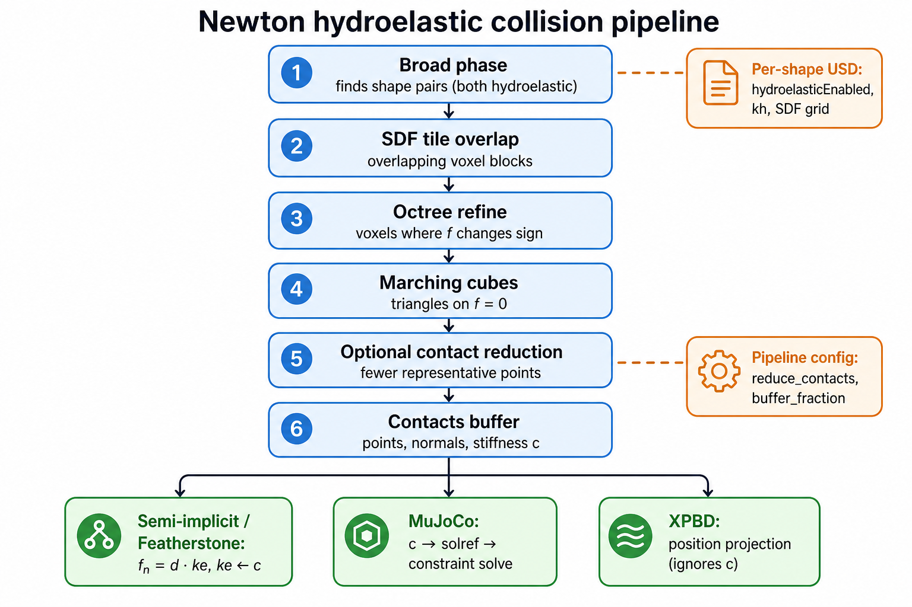
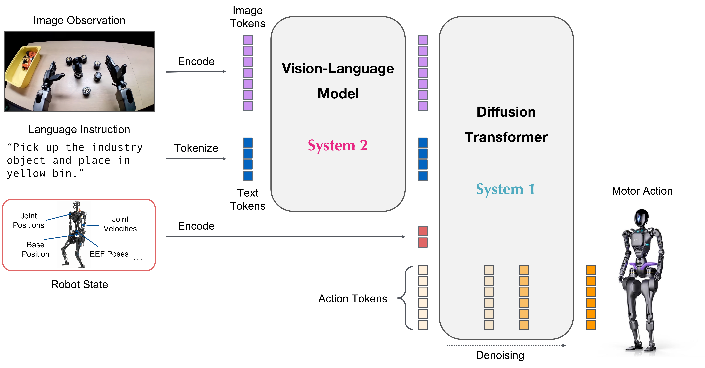
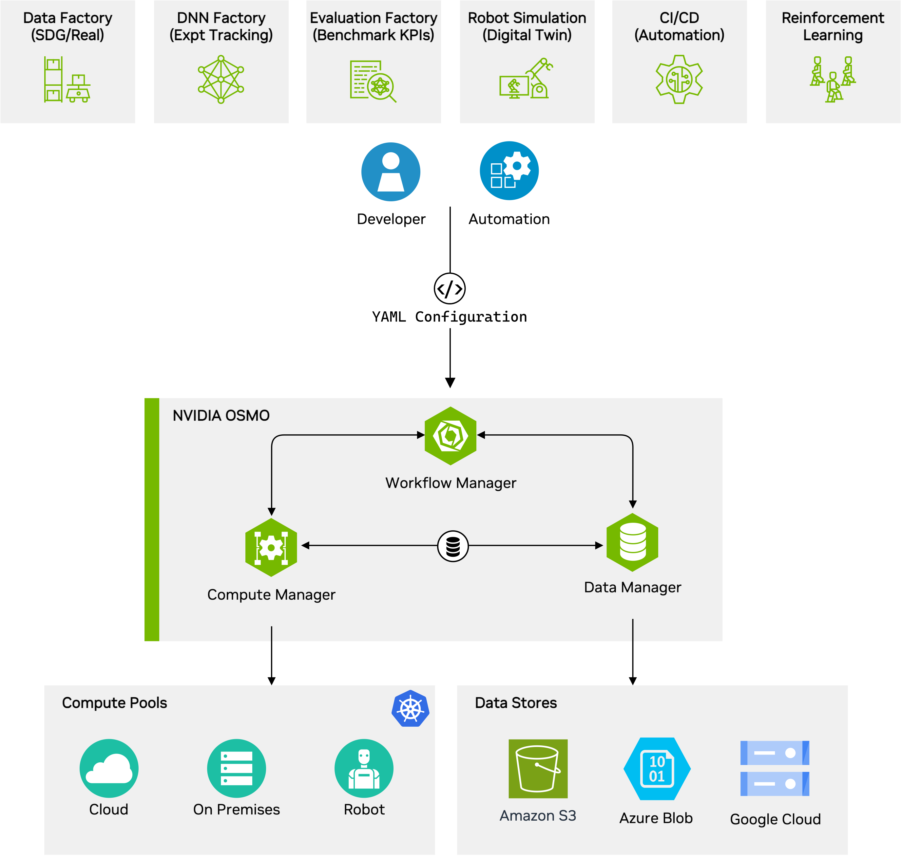
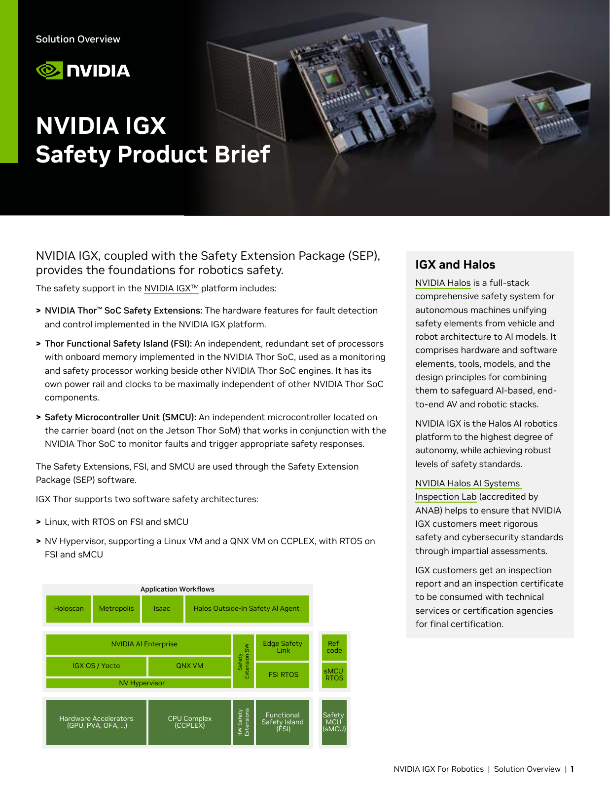
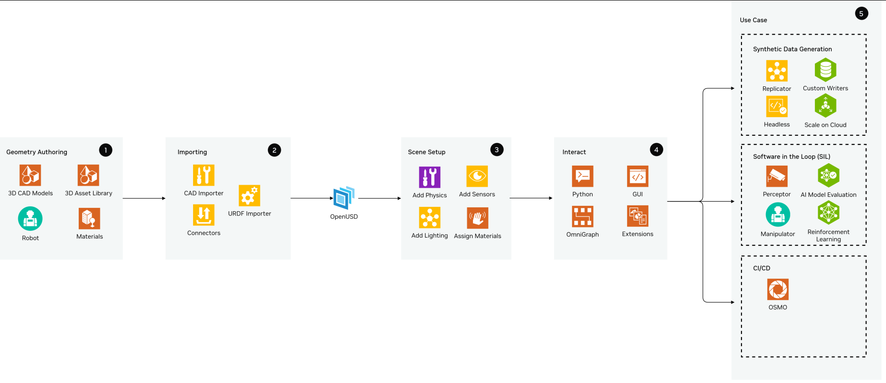
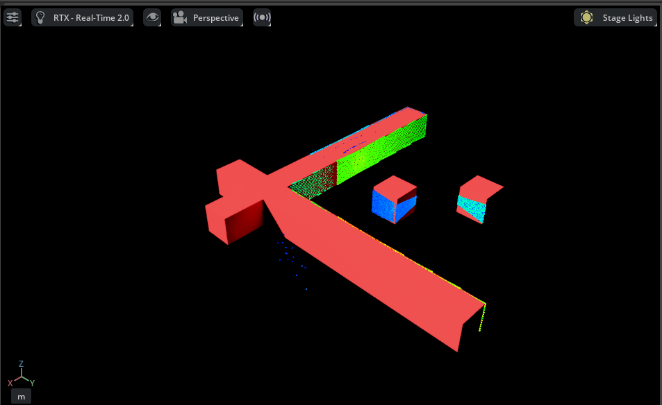
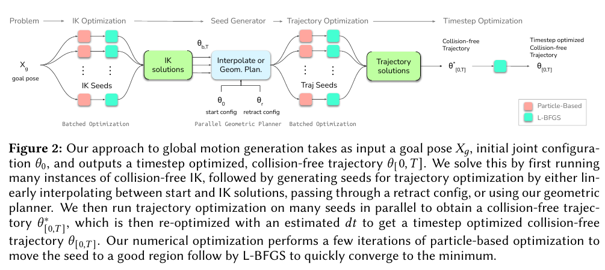
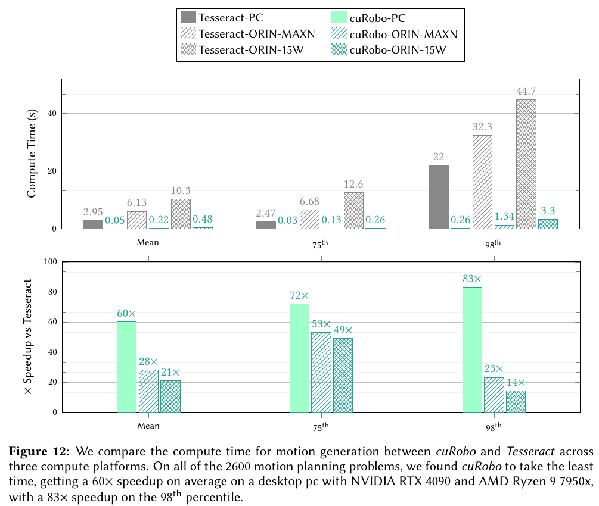
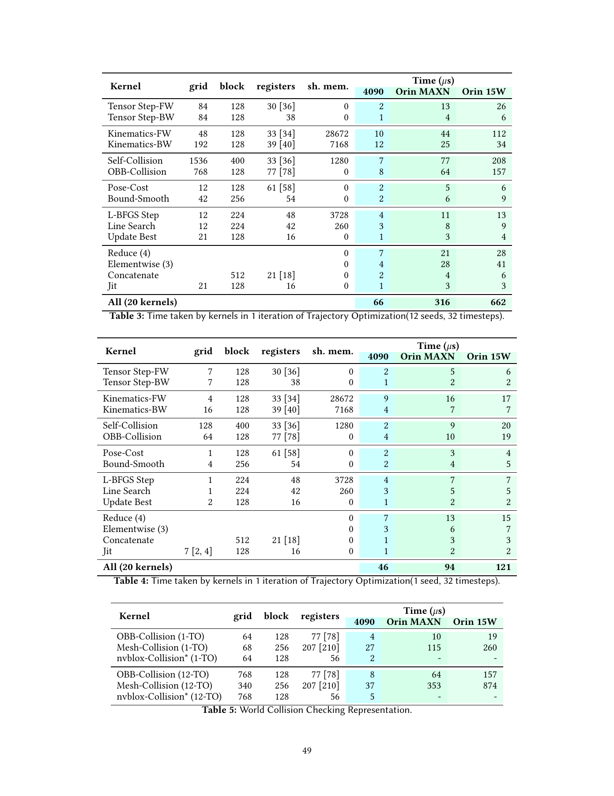

# NVIDIA核心技术护城河专题C：仿真、控制工作流、编排与安全

本专题将机器人开发链条拆成物理仿真、规划控制、模型/数据、工作流编排和工业安全五项技术。其竞争力来自工作流协同和工程资产，部分底层代码由社区共同维护，不能全部列为NVIDIA独占技术。公开图说明架构和接口，实机收益仍需要真实本体、版本与任务验收。

## 1. Isaac Sim、Isaac Lab与Newton：视觉和接触模型同时参与训练

### 1.1 分层架构与实现原理

Isaac Sim将USD场景资产、渲染、传感器与物理仿真连接，Isaac Lab在其上定义机器人学习的观测、动作、奖励、随机化和训练环境。传统PhysX路径与Newton backend需要分版本说明，不以一张旧架构图证明最新release全部功能。物理用于状态与接触演化，RTX相机/雷达模拟用于视觉输入；训练算法在环境中采样和优化，三者的fps和误差含义不同。[Isaac官方仿真参考架构](https://docs.isaacsim.omniverse.nvidia.com/latest/introduction/reference_architecture.html) [GitHub IsaacLab README](https://raw.githubusercontent.com/isaac-sim/IsaacLab/main/README.md) [Isaac官方Managers与事件API](https://isaac-sim.github.io/IsaacLab/main/source/api/lab/isaaclab.managers.html) [Isaac官方Hydroelastic接触](https://docs.isaacsim.omniverse.nvidia.com/latest/physics/hydroelastic_contact.html)

**图1：Isaac Sim官方Newton hydroelastic接触处理流程。** 原图出处：[Isaac官方Hydroelastic接触](https://docs.isaacsim.omniverse.nvidia.com/latest/physics/hydroelastic_contact.html)。

官方hydroelastic文档解释：常规点接触对大面积贴合可能出现接触点跳变和错误压力分布；hydroelastic把双方表面视为薄柔顺层，在重叠区域提取contact patch并积分法向力，切向摩擦仍由求解器在patch上的离散点处理。这改善的是接触力/力矩的表示，不是把所有材料精确仿真。双方shape须启用、具备有效SDF，runtime也要开启该路径；单边打开或无SDF不能自动生效。[Isaac官方Hydroelastic接触](https://docs.isaacsim.omniverse.nvidia.com/latest/physics/hydroelastic_contact.html)

适合抓取、推压、贴合及大面积接触，默认点接触仍可能更适合不需这种表示的任务。客户需提供几何、材料刚度、摩擦、质量与惯量，接触参数和SDF质量影响稳定性与成本。图中的pipeline说明可配置机制，不提供通用训练速度或真实机器人成功率；没有统一模型下的物理误差/能耗数据，不承诺更真实或更快。[Isaac官方Hydroelastic接触](https://docs.isaacsim.omniverse.nvidia.com/latest/physics/hydroelastic_contact.html)

### 1.2 MuJoCo/MJX对标：GPU仿真不是独占能力

MuJoCo官方计算文档采用软接触及约束优化，解释多刚体惯量、稀疏分解和接触/逆动力学。MJX则提供JAX API和批维度，支持域随机化及高吞吐学习；当前MJX-JAX运行于NVIDIA/AMD GPU、Apple Silicon和Google TPU，MJX-Warp针对NVIDIA GPU优化。JAX与Warp的可微性、几何、传感器和求解器支持有差异，修改结构字段会触发重新JIT编译，不宜把“GPU版MuJoCo”当成单一固定性能实现。[MuJoCo官方物理计算原理](https://mujoco.readthedocs.io/en/stable/computation/index.html) [Google DeepMind MuJoCo MJX官方文档](https://mujoco.readthedocs.io/en/stable/mjx.html)

| 比较维度 | NVIDIA Isaac路线 | MuJoCo/MJX路线 | 选型意义 |
|---|---|---|---|
| 资产与视觉 | USD、渲染、传感器及工作流整合 | MuJoCo模型及对应渲染/接口 | 多视觉任务需核验图像/资产工具 |
| 接触 | 版本相关PhysX/Newton；hydroelastic可选 | 官方软接触、约束优化 | 按具体接触误差和稳定性测试 |
| 批量训练 | Lab环境和随机化接口 | MJX批维度、JIT与vmap | 场景复杂度和batch决定吞吐 |
| 硬件可移植 | NVIDIA加速路径较深 | MJX-JAX多硬件；Warp偏NVIDIA | 不能把整个MJX路线写成无NVIDIA依赖 |
| 实机可靠性 | 需要sim-to-real验证 | 同样需要验证 | 仿真fps均不等于任务成功率 |

来源：[Isaac官方仿真参考架构](https://docs.isaacsim.omniverse.nvidia.com/latest/introduction/reference_architecture.html) [GitHub IsaacLab README](https://raw.githubusercontent.com/isaac-sim/IsaacLab/main/README.md) [Isaac官方Hydroelastic接触](https://docs.isaacsim.omniverse.nvidia.com/latest/physics/hydroelastic_contact.html) [Google DeepMind MuJoCo MJX官方文档](https://mujoco.readthedocs.io/en/stable/mjx.html)。没有同本体、接触、传感器和硬件设置下的官方对测，因此不作吞吐排名。Newton社区共同维护及开源代码不等于NVIDIA独占；护城河在资产、训练环境、渲染和部署的连接，而客户动力学/任务模型仍须自有。[Newton代码许可](https://raw.githubusercontent.com/newton-physics/newton/main/LICENSE.md) [Isaac Lab官方代码许可](https://raw.githubusercontent.com/isaac-sim/IsaacLab/main/LICENSE)

## 2. cuRobo：并行搜索、轨迹优化与滚动规划

### 2.1 算法机制与部署架构

cuRobo当前文档已更新到cuRoboV2/v0.8.0路线，不能把早期论文数值直接写成当前版本性能。motion planning把路径参数化为一串knot points，联合优化速度、加速度、jerk、碰撞及关节限制，多条seed在GPU并行优化，选择无碰撞结果。plan_pose先通过IK得到目标关节配置，再优化轨迹；warmup预编译CUDA graphs，为后续调用减少初始化开销。[cuRobo当前文档](https://nvlabs.github.io/curobo/latest/) [cuRoboV2运动规划教程](https://nvlabs.github.io/curobo/latest/getting-started/motion_planning.html)

grasp planner将approach、grasp、lift三段串联；教程的pre-grasp默认沿tool Z偏移−15cm，并在接近抓取时关闭部分finger-link碰撞。这是参考任务中的碰撞配置，不是所有夹爪的安全设置，客户必须重新核对手指、物体和环境几何。MPC则滚动求解短时域并以前次结果warm start，应对变化目标与障碍；optimization_dt和interpolation_steps是规划设置，不等于电机伺服周期。[cuRoboV2运动规划教程](https://nvlabs.github.io/curobo/latest/getting-started/motion_planning.html) [cuRoboV2 Reactive/MPC教程](https://nvlabs.github.io/curobo/latest/getting-started/reactive_control.html)

感知路径把深度数据融合到TSDF/ESDF，为碰撞与规划提供场景。当前官网展示2ms感知和1.5→0.5ms mapper改进，但首页没有在本轮核验范围内给出完整GPU、分辨率、地图容量与负载，**不采用为Thor性能参数**。代码适配本体、碰撞球、坐标和实时传感器输入比单次Demo成功更能决定工程收益。[cuRobo当前文档](https://nvlabs.github.io/curobo/latest/)

### 2.2 MoveIt对标、优势与限制

MoveIt官方采用插件接口，由move_group的ROS action/service调用规划器，默认OMPL，也提供Pilz和CHOMP；request/response adapters负责请求修正、约束和时间参数化。cuRobo更突出GPU并行候选及轨迹优化，MoveIt突出可扩展规划器与ROS场景/接口，二者都需要运动学、碰撞和执行接口配置，且可在工程上连接，不应写成互斥产品。[MoveIt官方运动规划架构](https://moveit.picknik.ai/main/doc/concepts/motion_planning.html)

cuRobo适合多候选搜索、需要快速重规划及GPU已存在的机器人；短板是GPU资源/内存与感知模型争用、机器人几何近似及任务约束需要验证。MoveIt的不同planner也不是统一CPU基准，本轮没有相同场景和超时/成功率条件的官方对测，不做X倍比较。所有规划器返回轨迹后仍需ros2_control/厂商SDK、超限检查、急停与独立安全控制，碰撞规划并非认证的保护装置。[Isaac ROS Deploy本体适配指南](https://nvidia-isaac-ros.github.io/repositories_and_packages/isaac_ros_deploy/how_to_guides/bring_your_own_embodiment.html) [Isaac ROS Deploy Safety](https://nvidia-isaac-ros.github.io/repositories_and_packages/isaac_ros_deploy/concepts/safety.html)

## 3. GR00T与Cosmos：模型、数据和推理优化形成可复用链条

### 3.1 模型原理与架构作用

GR00T把视觉、语言和机器人状态连接到动作生成，动作头使用条件生成/去噪得到一段动作；预训练知识可减少从零学习，但本体特定状态、动作维度及相机布局仍需对齐。官方部署要求embodiment tag和代表性校准观测，说明模型跨本体不是无需适配。[GR00T N1.7官方README](https://raw.githubusercontent.com/NVIDIA/Isaac-GR00T/main/README.md) [GR00T官方部署与基准](https://raw.githubusercontent.com/NVIDIA/Isaac-GR00T/main/scripts/deployment/README.md) [GR00T New Embodiment](https://raw.githubusercontent.com/NVIDIA/Isaac-GR00T/main/getting_started/finetune_new_embodiment.md)

**图2：GR00T官方研究模型架构图。** 原图出处：[GR00T Architecture Image](https://raw.githubusercontent.com/NVIDIA/Isaac-GR00T/main/media/model-architecture.png)。

图解释视觉语言输入、机器人状态和动作生成的关系；研究图不单独证明当前N1.7全部骨干配置，具体模型及运行路径以当前部署文档为准。N1.7 Thor官方35.6ms优化调用包含预处理和动作解码、排除RPC；它与动作执行和闭环成功率分开，完整条件见专题A。cross-attention K/V复用、projection fusion、Graphs和mixed NVFP4是联合优化，不把每项单独乘倍数。[GR00T官方部署与基准](https://raw.githubusercontent.com/NVIDIA/Isaac-GR00T/main/scripts/deployment/README.md)

Cosmos承担世界/视觉推理、视频生成增强、数据整理/评估等不同角色。官方目录中的Cosmos3 Super/Nano/Edge、Curator和Evaluator不能概括成一个模型；生成式世界模型增加视觉分布，物理仿真计算力与接触，真实演示提供执行结果。三者可形成数据迭代，但生成视频不是有效的动作真值，错误物理和不可执行动作可能进入训练集，需要过滤和真实任务评估。[Cosmos Page](https://developer.nvidia.com/cosmos) [Isaac官方Cosmos数据增强教程](https://docs.isaacsim.omniverse.nvidia.com/latest/replicator_tutorials/tutorial_replicator_cosmos.html) [Jetson Cosmos3 Edge官方部署](https://www.jetson-ai-lab.com/models/cosmos3-edge)

### 3.2 OpenPI/LeRobot对标及技术边界

OpenPI提供π0/π0.5等策略和后训练入口，官方checkpoint通过GCS发布；LeRobot通过同步视频/Parquet和策略/硬件接口提供开放数据工作流。这说明“预训练策略+本体适配+动作生成”并非NVIDIA独有。GR00T优势是已有Thor部署和Isaac数据/仿真连接；OpenPI/LeRobot提供可替换模型与数据接口，但仍需核验目标硬件、权重和动作schema。模型是否能输出动作不能替代执行器及安全集成。[Physical Intelligence官方OpenPI模型目录](https://raw.githubusercontent.com/Physical-Intelligence/openpi/main/README.md) [LeRobot官方策略与部署入口](https://raw.githubusercontent.com/huggingface/lerobot/main/README.md) [GR00T官方部署与基准](https://raw.githubusercontent.com/NVIDIA/Isaac-GR00T/main/scripts/deployment/README.md)

不同模型的LIBERO数据集、checkpoint、训练量、episode、相机和精度可能不同，不能将04中各自官方成功率与NVIDIA时延表合成跨模型排名。Cosmos对应的生成式世界模型也不能与MuJoCo接触求解器作准确率比较。[公开资料未披露] 本轮没有相同机器人任务下完整GR00T/Cosmos/OpenPI链条的样本效率、综合成本和成功率对测。

使用限制还包括数据许可、骨干模型和权重条款。GR00T代码Apache-2.0不自动覆盖所有权重与训练数据；本轮HF模型卡受robots核验限制，未独立取得的卡和授权不能凭仓库许可推断。客户应保留采集数据、校准集、失败样本、训练配置和模型源，避免优化engine成为唯一可交付资产。[GR00T License](https://raw.githubusercontent.com/NVIDIA/Isaac-GR00T/main/LICENSE) [Physical Intelligence官方OpenPI模型目录](https://raw.githubusercontent.com/Physical-Intelligence/openpi/main/README.md)

## 4. OSMO：跨三种计算环境的依赖编排

### 4.1 实现和架构

OSMO把物理AI的数据生成、训练、仿真及边缘HIL测试表示为YAML依赖任务，由控制面和注册的Kubernetes backend分配计算；任务的容器、平台、资源、输入/输出明确声明。官方README给出simulation→train-policy→evaluate-thor，并用对象存储保存结果；价值是团队不必依赖人工复制模型和日志才能联通多种计算环境。[OSMO_README官方资料](https://raw.githubusercontent.com/NVIDIA/OSMO/main/README.md) [NVIDIA OSMO官方平台](https://developer.nvidia.com/osmo)

**图3：OSMO官方工作流和多计算后端架构。** 原图出处：[OSMO官方LFS工作流架构图原件](https://media.githubusercontent.com/media/NVIDIA/OSMO/main/docs/user_guide/overview.svg)。

图说明异构训练、仿真和边缘测试如何纳入工作流。它是编排结构，不是机器人在线控制拓扑，不能据此要求每台机器人持续联网云推理。OSMO支持cloud/on-prem和x86/Arm，但backend的驱动、镜像、网络、存储、身份和容量仍需平台团队维护，“write once”不表示消除基础设施运维。[OSMO_README官方资料](https://raw.githubusercontent.com/NVIDIA/OSMO/main/README.md)

### 4.2 Argo对标、性能与使用限制

Argo Workflows官方架构同样基于Kubernetes，包含workflow controller、工作流pod/executor及server入口，支持容器任务与DAG。OSMO更强调物理AI的训练/仿真/边缘后端及数据工作流，Argo提供通用工作流机制。Kubernetes编排和DAG不是独占技术；OSMO护城河在领域接口、示例和部署经验。[Argo Workflows官方架构](https://argo-workflows.readthedocs.io/en/latest/architecture/) [OSMO_README官方资料](https://raw.githubusercontent.com/NVIDIA/OSMO/main/README.md)

官方OSMO FAQ明确它不直接部署生产机器人，也不提供完整实验看板、模型registry或全部MLOps。README的未来负载自动调度/动态工作流等路线图不能因日期已过就当成已发布能力。资料自述日常协调数千GPU-hours，但没有同工作流下OSMO/Argo的排队延迟、吞吐或运维成本对测，不编造省时百分比。适用于多团队、多算力的重复研究和测试；单机少量实验要权衡控制面和Kubernetes运维成本。[NVIDIA OSMO官方平台](https://developer.nvidia.com/osmo) [OSMO_README官方资料](https://raw.githubusercontent.com/NVIDIA/OSMO/main/README.md)

## 5. IGX FSI/SEP与工业可靠性：开发基础和整机认证分开

### 5.1 安全架构及故障路径

IGX Safety Product Brief（2026年2月，3页）把Thor hardware safety extensions、Functional Safety Island和载板sMCU分开。FSI有独立处理器、内存、电源轨和时钟；sMCU在载板，不在Jetson Thor SOM。SEP收集错误、传播到FSI/sMCU并提供监测、heartbeat、状态及安全响应基础。软件可采用Linux配合FSI/sMCU RTOS，或NV Hypervisor下Linux/QNX VM配合RTOS。普通Jetson套件不能因为名称含Thor就被视为具备全部SEP、sMCU和完整IGX安全路径。[Product Brief IGX Thor Safety](https://developer.download.nvidia.com/assets/igx/robotics-product-brief-igx-thor-safety-4473375.pdf)

**图4：IGX官方安全软硬件分层及控制器位置。** 原图出处：[Product Brief IGX Thor Safety](https://developer.download.nvidia.com/assets/igx/robotics-product-brief-igx-thor-safety-4473375.pdf)。

图中的GPU/CPU属于主计算，FSI和sMCU负责安全相关监测与响应。Edge Safety Link是可实现FSOE/PROFIsafe/CIP Safety等协议的基础设施，不等于本轮已取得所有协议认证。Brief列Safety Manual、FMEDA和检查材料入口，但没有在本轮公开取得授权版本，最终机器人证书和停止距离不作推断。[Product Brief IGX Thor Safety](https://developer.download.nvidia.com/assets/igx/robotics-product-brief-igx-thor-safety-4473375.pdf)

### 5.2 性能/等级参数与友商对标

| 官方安全口径 | NVIDIA IGX Brief | TI TDA4VM Datasheet | 比较限制 |
|---|---|---|---|
| 系统性失效开发流程 | SoC/SEP流程最高ASIL D、SIL3/SC3兼容 | 特定料号系统性能力最高ASIL D/SC3 | 流程等级不等于整机证书 |
| 主SoC/主域随机硬件完整性 | Thor SoC ASIL B、SIL2兼容 | Main Domain最高ASIL B/SIL2 | 按具体安全手册和料号 |
| 安全处理域 | Safety Island SIL3 | MCU Domain最高ASIL D/SIL3 | 故障架构和覆盖范围不同 |
| 控制器位置 | SoC FSI加载板sMCU | 隔离MCU域与R5F | 不直接等价BOM或诊断覆盖 |
| 整机认证 | 本轮未取得目标机器人证书 | 同样未取得目标机器人证书 | 需客户风险分析和认证 |

来源：[Product Brief IGX Thor Safety](https://developer.download.nvidia.com/assets/igx/robotics-product-brief-igx-thor-safety-4473375.pdf)第1—3页；[Texas Instruments TDA4VM官方数据手册](https://www.ti.com/lit/ds/symlink/tda4vm.pdf)第1—3页，SPRSP36L、2026年6月，335页。TI仅对特定料号给功能安全能力，列SR1.1/SR2.0认证范围；它明确支持AGV/AMR和传感器融合。安全岛和异构控制不是NVIDIA独有，NVIDIA价值是将大模型/传感器计算与企业安全软件、支持资料连接；TI可以是较传统视觉/安全控制的相关方案，不能按FP4峰值定安全优劣。

### 5.3 环境、网络安全与使用限制

AGX Orin Industrial FAQ给TTP −40至85°C、50G/11ms运行冲击、5G运行振动和inline DRAM ECC；普通AGX Orin TTP为−25至80°C。TTP是热传导板测点，不是环境温度，工业模组也不能自动延伸为整机宽温等级。Jetson安全目录中的secure boot、加密和可信执行等属于网络/平台安全机制，MIG属于资源隔离，功能安全则处理危险失效，三者应在系统设计中分别验收。[Jetson官方FAQ](https://developer.nvidia.com/embedded/faq) [Jetson R39.2.1官方安全机制目录](https://docs.nvidia.com/jetson/archives/r39.2.1/DeveloperGuide/SD/Security.html) [Jetson R39.2.1官方MIG配置指南](https://docs.nvidia.com/jetson/archives/r39.2.1/DeveloperGuide/SD/MiG.html)

IGX当前页提供AI Enterprise及最长十年支持，但须按SKU、软件release和合同核验，不等于全部Jetson组件自动有十年免费补丁。BSP Driver Agreement对受覆盖组件的平台用途、修改及再分发设限制，也明确as-delivered软件未获critical application认证。适用场景是工业/医疗/人机协作中需要受控发布、监测和安全证据的系统；限制是整机安全功能、执行器、安全传感器、制动和维护流程仍由客户集成并证明。[Product Page IGX](https://www.nvidia.com/en-us/edge-computing/products/igx/) [Jetson Linux 39 2 1 License](https://developer.nvidia.com/downloads/embedded/L4T/r39_Release_v2.1/release/Tegra_Software_License_Agreement-Tegra-Linux.txt)

## 6. 代码、权重与运行时的许可及快照

| 官方项目 | Stars快照 | 最近默认分支提交UTC | 代码许可 | 证据 |
|---|---:|---|---|---|
| [NVIDIA Isaac GR00T官方仓库](https://github.com/NVIDIA/Isaac-GR00T) | 8307 | 2026-10-28T21:46:01Z | Apache-2.0，权重另验 | [GR00T Repo Metadata](https://api.github.com/repos/NVIDIA/Isaac-GR00T) [GR00T Recent Commit](https://api.github.com/repos/NVIDIA/Isaac-GR00T/commits?per_page=1) [GR00T License](https://raw.githubusercontent.com/NVIDIA/Isaac-GR00T/main/LICENSE) |
| [GitHub IsaacSim Page](https://github.com/isaac-sim/IsaacSim) | 4425 | 2026-09-10T02:15:24Z | Apache-2.0，Kit/资产另验 | [Isaac Sim仓库元数据](https://api.github.com/repos/isaac-sim/IsaacSim) [Isaac Sim提交快照](https://api.github.com/repos/isaac-sim/IsaacSim/commits?sha=main&per_page=1) [Isaac Sim官方代码及附加组件许可](https://raw.githubusercontent.com/isaac-sim/IsaacSim/main/LICENSE) |
| [GitHub IsaacLab Page](https://github.com/isaac-sim/IsaacLab) | 8564 | 2026-11-03T05:08:05Z | 核心BSD-3-Clause，组件另验 | [Isaac Lab仓库元数据](https://api.github.com/repos/isaac-sim/IsaacLab) [Isaac Lab提交快照](https://api.github.com/repos/isaac-sim/IsaacLab/commits?sha=main&per_page=1) [Isaac Lab官方代码许可](https://raw.githubusercontent.com/isaac-sim/IsaacLab/main/LICENSE) |
| [Newton Project Page](https://github.com/newton-physics/newton) | 5883 | 2026-11-03T04:25:34Z | 代码Apache-2.0，文档CC-BY4 | [Newton Metadata](https://api.github.com/repos/newton-physics/newton) [Newton Commit](https://api.github.com/repos/newton-physics/newton/commits?per_page=1) [Newton代码许可](https://raw.githubusercontent.com/newton-physics/newton/main/LICENSE.md) |
| [cuRobo Project Page](https://github.com/NVlabs/curobo) | 1951 | 2026-09-10T17:21:47Z | V2代码Apache-2.0 | [cuRobo Repo Metadata](https://api.github.com/repos/NVlabs/curobo) [cuRobo Recent Commit](https://api.github.com/repos/NVlabs/curobo/commits?per_page=1) [cuRobo License](https://raw.githubusercontent.com/NVlabs/curobo/main/LICENSE) |
| [OSMO_PAGE官方资料](https://github.com/NVIDIA/OSMO) | 280 | 2026-10-28T18:47:25Z | Apache-2.0 | [OSMO_META官方资料](https://api.github.com/repos/NVIDIA/OSMO) [OSMO_COMMIT官方资料](https://api.github.com/repos/NVIDIA/OSMO/commits?per_page=1) [OSMO_LICENSE官方资料](https://raw.githubusercontent.com/NVIDIA/OSMO/main/LICENSE) |
| [HIP](https://github.com/ROCm/HIP) | 本轮API未取得 | 本轮API未取得 | 本轮许可API未核验 | 官方文档用于机制对标，不补造元数据 |
| [OpenVINO](https://github.com/openvinotoolkit/openvino) | 本轮API未取得 | 本轮API未取得 | 本轮许可API未核验 | 官方文档用于机制对标，不补造元数据 |
| [MuJoCo](https://github.com/google-deepmind/mujoco) | 本轮API未取得 | 本轮API未取得 | 本轮许可API未核验 | 官方文档用于机制对标，不补造元数据 |
| [Argo](https://github.com/argoproj/argo-workflows) | 本轮API未取得 | 本轮API未取得 | 本轮许可API未核验 | 官方文档用于机制对标，不补造元数据 |
| [MoveIt2](https://github.com/moveit/moveit2) | 本轮API未取得 | 本轮API未取得 | 本轮许可API未核验 | 官方文档用于机制对标，不补造元数据 |

快照只反映采集时点，不能当成采用率或性能。HIP/OpenVINO/MuJoCo/Argo/MoveIt等对标仓库本次GitHub API被robots检查阻止，Stars和最近提交标为未获取，不填写估算值；对标事实使用已下载官方文档。代码许可、模型权重、数据、仿真资产及加速二进制分别核验，开源项目不能全部写成NVIDIA独有。

## 7. USD、RTX与多时钟仿真：资产一致性和感知真实性

### 7.1 USD组合层为何重要，又为何不能保证动力学正确

OpenUSD官方26.11文档把场景组织成stage、prim、属性与layer，并通过引用、variants及组合机制汇集不同来源的资产。它能让机器人本体、仓库、传感器和任务配置以分层方式组织，减少把完整场景复制成多个互不一致文件的需要。核心价值是资产组合与协作接口，USD不是接触求解器，也不自动赋予CAD资产正确质量、惯量、摩擦或关节限制。[OpenUSD官方场景组合、Layer和Schema说明](https://openusd.org/release/intro.html) [Isaac官方仿真参考架构](https://docs.isaacsim.omniverse.nvidia.com/latest/introduction/reference_architecture.html)

**图5：Isaac Sim官方资产、场景、仿真及外部接口参考架构。** 原图出处：[Isaac官方仿真参考架构](https://docs.isaacsim.omniverse.nvidia.com/latest/introduction/reference_architecture.html)。

官方图资源名标4.5，说明基础分工与接口；当前Newton、6.x传感器和experimental API应以各自版本文档核验，不能把这张图当作最新功能清单。导入后需要分别核对可视mesh、collision geometry、关节frame、尺度、惯量、驱动增益和传感器位姿。同一视觉资产在多个场景复用有利于管理，错误的尺度或动力学也会随之复用。

对机器人训练，资产应至少区分几何/材质、物理参数、本体驱动、传感器及任务配置。对碰撞规划，近似几何要覆盖工具和所抓物体；对视觉SDG，语义标注要与可见资产一致；对接触学习，质量和摩擦要有实测或辨识基础。NVIDIA的集成降低连接工具的工作量，无法替代这些任务相关的真实性校验。

### 7.2 RTX传感器不仅是渲染一张漂亮图片

RTX non-visual materials官方文档明确，非可见光谱材质使用USD属性，包括omni:simready:nonvisual:base、coating及attributes；renderer由属性组合生成material ID，并通过GenericModelOutput AOV和annotator输出。相同可见RGB颜色并不保证相同雷达/激光回波，反过来渲染逼真也不保证非视觉传感器数据符合目标实物。[Isaac Sim官方RTX传感器材质与回波模型](https://docs.isaacsim.omniverse.nvidia.com/latest/sensors/isaacsim_sensors_rtx_materials.html)

**图6：官方非视觉材质应用与调试可视化。** 原图出处：[Isaac Sim官方RTX传感器材质与回波模型](https://docs.isaacsim.omniverse.nvidia.com/latest/sensors/isaacsim_sensors_rtx_materials.html)。

图展示材料配置及调试结果，用于核对资产上实际采用的材质类别，不是传感器精度或sim-to-real误差曲线。要评估性能，应核验特定sensor profile、材料属性、距离/角度/遮挡、噪声和annotator输出；默认材质能让sensor产生数据，不等于所有物体的实测响应已匹配。[Isaac Sim官方RTX传感器材质与回波模型](https://docs.isaacsim.omniverse.nvidia.com/latest/sensors/isaacsim_sensors_rtx_materials.html) [Isaac Sim官方相机与成像模型](https://docs.isaacsim.omniverse.nvidia.com/latest/sensors/isaacsim_sensors_camera.html)

相机模型另需内参、畸变、曝光、帧率和处理格式与实机一致，数据增强应保持训练标签与图像变换同步。涉及透明、镜面、运动模糊、细小接触部位时，应单独建立真实对照集。GPU ray tracing的优势是多视角/复杂场景可生成感知输入，限制是sensor建模、资产质量和算力成本；不能以RTX Core数量推出机器人定位/抓取成功率。

### 7.3 Multi-tick的三类时间与版本限制

Isaac Sim6.0及以后默认multi-tick，让每个sensor独立设置render rate，减少不需要每frame更新的冗余工作；omni:sensor:tickRate=0仍是每frame autotrigger。文档区分timeline、physics及renderer相关时钟，实际行为依physics_dt/loop_dt比例和fixed stepping设置；模拟传感器Hz、物理steps/s和wall-clock FPS并非同一指标。[Isaac Sim官方多tick渲染与传感器时序](https://docs.isaacsim.omniverse.nvidia.com/latest/sensors/isaacsim_sensors_multitick_rendering.html)

| 官方已明确的条件 | 当前行为 | 对训练/测试的影响 |
|---|---|---|
| Camera或OmniLidar独立tick | 可减少冗余sensor render | 配置与实际更新日志共同核对 |
| tickRate=0 | 每simulation frame触发 | 不能把0理解为关闭sensor |
| tiled cameras | 作为一个sensor tick | 不能假设tile独立任意频率 |
| OmniLidar | tickRate需等于scanRateBaseHz | 不一致可能退回每frame partial scan |
| RTX Radar，6.0 GA | renderer忽略tickRate并每frame渲染 | 下游限发布频率不消除同等渲染工作 |
| ROS helper旧frameSkipCount | 迁移到sensor属性；部分旧输入忽略/警告 | 旧图启动成功不证明更新频率正确 |

表来自当前multi-tick文档；Radar限制明确属于6.0 GA，后续修复需核验release，不能因“将修复”自动按已完成处理。优势是可分别模拟不同频率传感器及降低冗余工作；限制是时钟、扫描积累和API迁移会影响实际观测。仿真同步状态没有真实采集的网络、曝光及调度全部噪声，应在部署测试中补上延迟、丢帧和frame age。[Isaac Sim官方多tick渲染与传感器时序](https://docs.isaacsim.omniverse.nvidia.com/latest/sensors/isaacsim_sensors_multitick_rendering.html)

### 7.4 官方性能表：更多GPU不保证每项KPI提高

Isaac Sim官方benchmark使用isaacsim.benchmark.services，GPU相关KPI为600frames平均值。下面摘录当前页Ubuntu列；RTX5080/RTX PRO6000使用Core Ultra9 285K、64GB DDR5，L40使用双Xeon Platinum8362、1024GB DDR4、Ubuntu24.04。CPU/RAM不同，不能以表判断纯GPU性能排名。[Isaac Sim官方性能基准与场景条件](https://docs.isaacsim.omniverse.nvidia.com/latest/reference_material/benchmarks.html)

| 官方KPI | RTX5080 Ubuntu | RTX PRO6000 Blackwell Ubuntu | L40×1 Ubuntu24.04 | L40×4 | L40×8 |
|---|---:|---:|---:|---:|---:|
| Full Warehouse FPS | 172.71 | 186.92 | 127.71 | 105.04 | 85.99 |
| 10 O3dyn physics steps/s | 38.27 | 37.33 | 32.43 | 33.18 | 32.22 |
| Isaac ROS sample FPS | 72.52 | 69.74 | 49.29 | 50.45 | 42.94 |
| Nova Carter ROS2渲染/发布frames/s | 33.21 | 48.08 | 32.17 | 34.99 | 31.94 |
| simple SDG images/s，RGBD annotators | 42.90 | 40.15 | 25.96 | 19.58 | 15.92 |

同一L40参考系统增加GPU，仓库FPS和simple SDG并未单调增加；表本身没有逐项消融解释瓶颈，不能断言原因必为某个CPU或调度器。它足以否定“加八卡就让所有仿真八倍快”的推断。各KPI工作量和输出范围不同，不能把仓库FPS当训练environment steps/s，也不能当真实机器人控制Hz。

官方CPU参考系统i9-14900K/32GB DDR5的async启动31.472秒（含shader安装）与6.31秒（cached shaders）也表明冷启动和缓存改变工作流时间。本文不将启动KPI变成长期训练速度，选型应分别记录环境初始化、物理采样、渲染、annotator和写盘吞吐。训练能否扩大，应由目标资产/传感器/算法配置下的实测决定。[Isaac Sim官方性能基准与场景条件](https://docs.isaacsim.omniverse.nvidia.com/latest/reference_material/benchmarks.html)

## 8. cuRobo原始论文：GPU并行规划的证据与局限

### 8.1 优化、几何规划和时间参数化怎样协作

2023年11月3日arXiv2310.17274v2是NVIDIA作者的原始研究，不是当前cuRoboV2性能公告。Figure2先并行运行collision-free IK，再以起点到IK终点插值、retract configuration或几何planner生成多条seed；粒子优化使seed进入较好区域，L-BFGS估计下降方向及并行line search收敛，然后依据速度/加速度/jerk约束重新估计dt并优化。GPU提供的是多seed、多waypoint及碰撞查询并行机会，非自动获得全局最优的保证。[cuRobo原始论文：并行碰撞无关运动生成](https://arxiv.org/pdf/2310.17274)

**图7：cuRobo原始论文Figure2：IK、种子、轨迹与时间步优化流程。** 原图出处：[cuRobo原始论文：并行碰撞无关运动生成](https://arxiv.org/pdf/2310.17274)。

图从原PDF第7页完整保留Figure2及caption裁出；原PDF同时归档。其各阶段的算法作用不同：IK满足目标pose，几何搜索提供通路，轨迹优化满足代价/限制，时间参数化影响可执行速度与平滑性。减少计算时间不等于机器人路径更短、关节力矩可实现或接触操作可靠，应分别测量。

论文用球覆盖本体几何，把world碰撞转成球心到world的距离减半径；self collision检查球对距离，减少mesh-mesh查询成本。球近似更易并行，但覆盖不足会漏碰撞，过度保守会排除可行狭窄路径。所抓物体、线束和工具应纳入实际几何；world与sensor更新延迟也要保留。原论文讨论swept-volume处理，不能把离散waypoint无碰撞当成任意连续执行都无碰撞。[cuRobo原始论文：并行碰撞无关运动生成](https://arxiv.org/pdf/2310.17274) [XRDF官方描述规范](https://nvidia-isaac-ros.github.io/concepts/manipulation/xrdf.html)

### 8.2 原始基准的数值和样本边界

原论文采用motionbenchmaker800题和mpinets1800题，共2600个Franka Panda七关节问题、12类场景，方法允许random restarts并设60秒timeout。比较Tesseract-GP的RRTConnect与Tesseract的几何seed+TrajOpt，对应cuRobo-GP及完整cuRobo。其success定义为collision-free、不违反关节限制，并达到文中position/orientation阈值（原文5mm及5%的姿态口径；不擅自换成角度）。[cuRobo原始论文：并行碰撞无关运动生成](https://arxiv.org/pdf/2310.17274)第13—14页。

**图8：原论文Figure12：桌面及Orin不同功耗模式的规划时间和分位数。** 原图出处：[cuRobo原始论文：并行碰撞无关运动生成](https://arxiv.org/pdf/2310.17274)。

| 平台（论文2023配置） | Tesseract mean | cuRobo mean | cuRobo第98百分位 | Figure12原标mean加速 |
|---|---:|---:|---:|---:|
| RTX4090+Ryzen9 7950X | 2.95s | 0.05s | 0.26s | 60× |
| AGX Orin64GB MAXN，60W预算 | 6.13s | 0.22s | 1.34s | 28× |
| AGX Orin64GB，15W预算 | 10.3s | 0.48s | 3.3s | 21× |

表摘原图标签，倍数按论文原标而非用舍入值再计算；time用Python计时并同步host/device。60W/15W是配置预算，不是规划期间实测系统能耗。98百分位明显比mean长，不能把mean50ms写成固定20Hz硬实时。原结果证明特定任务/版本下并行方案的价值，没有Thor数据，也不替代当前V2或目标本体复测。

原论文完整cuRobo成功率99.8%、Tesseract98.53%，均按上述规划定义和timeout，不是抓取、插接或全身运动的闭环成功率。论文对失败问题解释与本体球近似有关，需要保留该几何边界，不能只引用较高分数。作者第32页还明确当时方案主要从静止状态规划完整动作，hard problem尾部阻碍固定solve rate；复杂姿态约束尚未充分验证。当前MPC教程存在反应式路径，但不能倒推旧论文已解决全部问题。[cuRobo原始论文：并行碰撞无关运动生成](https://arxiv.org/pdf/2310.17274) [cuRoboV2 Reactive/MPC教程](https://nvlabs.github.io/curobo/latest/getting-started/reactive_control.html)

### 8.3 Kernel细节解释算法优势，避免只报倍数

**图9：原论文Table3—5：不同seed和碰撞表示下的kernel时间。** 原图出处：[cuRobo原始论文：并行碰撞无关运动生成](https://arxiv.org/pdf/2310.17274)。

原PDF第49页Table3为12seeds、32timesteps的一次轨迹优化iteration：所有20kernel总时间RTX4090为66μs、Orin MAXN316μs、Orin15W662μs；Table4同样32timesteps、1seed时为46/94/121μs。它展示并行规模与设备资源影响实际执行，不能把一次iteration时间当整次motion generation；迭代数、IK、几何搜索和重试仍需计入。[cuRobo原始论文：并行碰撞无关运动生成](https://arxiv.org/pdf/2310.17274)

论文还说明nvblox碰撞路径当时未实现相同continuous collision，因此与cuboid/mesh的kernel耗时不是完全同工作量比较。这是技术深度上必要的边界：不同地图表示、球数、碰撞算法和seed数都会改变“GPU规划性能”。MoveIt/Tesseract等插件式路线提供其他planner与场景管理；不存在仅凭库名就可稳定复用的统一排名。

## 9. 随机化、生成模型和真实数据：避免把数据数量当能力

视觉随机化改变光源、纹理、背景、相机和物体pose；物理随机化改变质量、摩擦、驱动/延迟等任务相关变量。当前Replicator官方示例给出seed、writer开关、frames和顺序随机化，例如先移动pallet，再把bin放在其有效范围内，然后改变观察视角，说明随机变量之间可以有条件依赖。独立随机所有变量可能生成穿模、悬空或无法执行的场景，不能认为范围越宽越好。[Isaac Sim官方域随机化与物理属性](https://docs.isaacsim.omniverse.nvidia.com/latest/replicator_tutorials/tutorial_replicator_isaac_randomizers.html) [Isaac官方Managers与事件API](https://isaac-sim.github.io/IsaacLab/main/source/api/lab/isaaclab.managers.html)

| 数据来源 | 可以提供的标签/作用 | 必须核验的偏差 | 不应作出的推断 |
|---|---|---|---|
| USD/Replicator视觉SDG | 语义、几何/图像annotators | 资产分布、材质、遮挡及标签一致 | RGB视频自动有动作真值 |
| Isaac Lab物理rollout | 本体状态、动作、奖励和结果 | 动力学、接触、控制延迟及reset | 仿真reward等于真实成功 |
| Cosmos视频生成/增强 | 视觉变化及数据扩展 | 时间一致、物理可行、标注可信 | 生成动作可直接执行 |
| 真实遥操作/部署数据 | 实际观测、动作及失败轨迹 | 时间同步、动作语义及采集覆盖 | 机队数据全部可自由训练 |
| 目标设备推理日志 | engine输出、时延/错误 | 固定输入与闭环区别 | 输出接近就证明任务可靠 |

来源：[Isaac官方合成数据工作流](https://docs.isaacsim.omniverse.nvidia.com/latest/replicator_tutorials/tutorial_replicator_sdg_workflows.html) [Isaac官方Cosmos数据增强教程](https://docs.isaacsim.omniverse.nvidia.com/latest/replicator_tutorials/tutorial_replicator_cosmos.html) [GR00T New Embodiment](https://raw.githubusercontent.com/NVIDIA/Isaac-GR00T/main/getting_started/finetune_new_embodiment.md) [GR00T官方部署与基准](https://raw.githubusercontent.com/NVIDIA/Isaac-GR00T/main/scripts/deployment/README.md)。建议用真实任务划定训练、校准与留出集，将场景/对象/本体/相机变化分组评估。量化校准不能只取最容易的少量观测，失败样本也不能仅在训练中重复后再当独立验证。

GR00T跨本体模型、Cosmos视觉/世界模型和物理仿真各负责不同环节。NVIDIA优势是有模型、数据、仿真与Thor执行配方连接；限制是用户仍需提供动作schema、机器人数据、资产许可和任务评估。OpenPI/LeRobot提供开放数据与策略路线，能构成替代接口；公开代码不自动覆盖权重、数据或第三方传感器/SDK商用权利。[Physical Intelligence官方OpenPI模型目录](https://raw.githubusercontent.com/Physical-Intelligence/openpi/main/README.md) [LeRobot官方策略与部署入口](https://raw.githubusercontent.com/huggingface/lerobot/main/README.md) [GR00T License](https://raw.githubusercontent.com/NVIDIA/Isaac-GR00T/main/LICENSE)

## 10. 编排与安全：让开发结果可以交付和恢复

### 10.1 OSMO领域价值和DAG的非独占性

把simulation、train-policy、evaluate-thor放进同一个DAG，有助于规定输入输出、checkpoint和测试依赖；对象存储与容器使运行资产可引用。它并不保证某个任务结果数值可复现，仍需数据snapshot、随机seed、版本、GPU驱动和训练配置。OSMO的多backend和Arm/x86支持是研究工作流入口，实际image、节点权限、网络和GPU资源要由平台团队配置。[OSMO_README官方资料](https://raw.githubusercontent.com/NVIDIA/OSMO/main/README.md) [NVIDIA OSMO官方平台](https://developer.nvidia.com/osmo)

与Argo比较，通用DAG/Kubernetes controller不是NVIDIA独占机制，优势在于物理AI的参考流程、边缘/HIL测试连接及领域工具。将编排器替换通常能保留任务语义，但需要重建任务定义、资源匹配、存储和权限；无需夸大为所有数据/模型都无法迁移。OSMO不直接部署生产机器人、不提供完整模型registry/实验看板，缺失功能要由其他服务承担。[Argo Workflows官方架构](https://argo-workflows.readthedocs.io/en/latest/architecture/) [NVIDIA OSMO官方平台](https://developer.nvidia.com/osmo)

对生产价值，应追踪排队、环境准备、有效采样、失败重试、产物验证与计算费用，不能只报GPU-hours。多团队共享backend可能更有价值，少量单机实验则需权衡运维；本轮没有OSMO/Argo同任务成本或排队对测，不填省时比例。

### 10.2 安全响应链决定算力的使用边界

IGX的FSI、载板sMCU与SEP提供错误监测/传播及安全响应基础，但要形成可验收机器人安全功能，还需明确检测→通信→决策→执行器制动的完整链。主模型输出合法、MIG实例工作或SafetyController阈值通过，不等于安全传感器和执行器已达到系统目标标准。[Product Brief IGX Thor Safety](https://developer.download.nvidia.com/assets/igx/robotics-product-brief-igx-thor-safety-4473375.pdf) [Isaac ROS Deploy Safety](https://nvidia-isaac-ros.github.io/repositories_and_packages/isaac_ros_deploy/concepts/safety.html)

对匀速接近障碍的**分析模型**，停止距离至少考虑v×T_delay+v²/(2a)，其中T_delay含采集/观测年龄、判断、通信和制动起效时间，a需来自实际可保证减速度；坡度、摩擦、负载、制动建立过程和不确定性还需加裕量。此式不是认证方法，也没有代入任何未经实测的速度或减速度，它说明提高模型吞吐只能影响延迟中的一部分，不能单独保证停止距离。

| 失效触发 | 系统应检查的实际行为 | NVIDIA机制能支持的部分 | 仍由项目证明的部分 |
|---|---|---|---|
| 相机断连/旧帧 | 是否停止使用过时观测 | timestamp、buffer、监测接口 | frame age阈值与降级动作 |
| VLA超时/GPU错误 | 旧动作是否继续、进程能否恢复 | 日志、实例/进程隔离、SEP相关错误机制 | 安全控制器与执行器联动 |
| 上层ROS停止写入 | 下游是否保持最新命令 | 部署接口和controller切换 | 超时策略及真实hardware行为 |
| 配置/更新不兼容 | 能否进入受控安全状态 | 签名、版本/boot保护基础 | 发布回归、允许恢复路径和备件 |

来源：[HSB 2.7 metadata与延迟测量](https://docs.nvidia.com/holoscan/sensor-bridge/2-7-latest/applications/latency) [Isaac ROS官方CUDA buffer backend](https://nvidia-isaac-ros.github.io/concepts/rosidl_buffer/cuda_buffer_backend.html) [Franka FR3 ROS2Control接口](https://nvidia-isaac-ros.github.io/repositories_and_packages/isaac_ros_robots/franka_fr3_ros2_control/index.html) [Product Brief IGX Thor Safety](https://developer.download.nvidia.com/assets/igx/robotics-product-brief-igx-thor-safety-4473375.pdf) [Jetson官方回滚保护](https://docs.nvidia.com/jetson/archives/r39.2.1/DeveloperGuide/SD/Security/RollbackProtection.html)。表是故障测试设计，不是宣称全部故障已由SEP覆盖；具体诊断范围需授权Safety Manual/FMEDA和release材料。本轮未取得目标机器人认证与故障注入日志，不作等级外推。

因此核心技术护城河应按三个层次评价：基础机制是否独到、公开工程路径是否可复建、目标系统是否已通过任务与失效验收。RTX/训练/规划/编排/安全机制构成丰富的组合工具，但任何一层的峰值、演示或流程等级都不能跨越另两层的证据要求。

## 参考资料与本地原文

本报告依据截至2026年11月3日取得的官方网页、代码仓库、API和文档。资料由统一下载工具归档到本项目的reference_metrial；多个方向共享同一URL的已校验文件。网页保留HTML和依赖，部分资源受robots规则、失效链接或动态交互限制影响时，按metadata如实标明。采集时点、版本和原始响应哈希可在各资料目录内核对。

08专题材料独立保存在reference_metrial/08_core；以下链接指向该专题目录中的原文。HTML及依赖通过本地硬链接共享存储，规范URL登记仍在项目公共registry。

| 官方资料 | 原始URL | 本地原文 | 归档情况 |
|---|---|---|---|
| NVIDIA_05_SIM_ARCH | [官方原文](https://docs.isaacsim.omniverse.nvidia.com/latest/introduction/reference_architecture.html) | [index.html](REFERENCES.md#ref-f74626edcba85090) | 静态HTML依赖完整；动态功能另验 |
| NVIDIA_GitHub_IsaacLab_README | [官方原文](https://raw.githubusercontent.com/isaac-sim/IsaacLab/main/README.md) | [content.md](REFERENCES.md#ref-5af037b6c4754936) | 原件已归档 |
| NVIDIA_05_LAB_EVENTS | [官方原文](https://isaac-sim.github.io/IsaacLab/main/source/api/lab/isaaclab.managers.html) | [index.html](REFERENCES.md#ref-befa55326ba2b236) | 静态呈现依赖部分缺失；见metadata |
| NVIDIA_05_HYDRO | [官方原文](https://docs.isaacsim.omniverse.nvidia.com/latest/physics/hydroelastic_contact.html) | [index.html](REFERENCES.md#ref-ee558d6613a45451) | 静态HTML依赖完整；动态功能另验 |
| NVIDIA_08_DEEP_MUJOCO_COMPUTATION | [官方原文](https://mujoco.readthedocs.io/en/stable/computation/index.html) | [index.html](REFERENCES.md#ref-50bc861c2b70fd1e) | 静态呈现依赖部分缺失；见metadata |
| NVIDIA_08_DEEP_MUJOCO_MJX | [官方原文](https://mujoco.readthedocs.io/en/stable/mjx.html) | [index.html](REFERENCES.md#ref-63a58dbcc0c84e67) | 静态呈现依赖部分缺失；见metadata |
| NVIDIA_05_NEWTON_LICENSE | [官方原文](https://raw.githubusercontent.com/newton-physics/newton/main/LICENSE.md) | [content.md](REFERENCES.md#ref-aac65d531df3ffee) | 原件已归档 |
| NVIDIA_GitHub_IsaacLab_License | [官方原文](https://raw.githubusercontent.com/isaac-sim/IsaacLab/main/LICENSE) | [content.txt](REFERENCES.md#ref-8d3916d73175f044) | 原件已归档 |
| NVIDIA_06_CUROBO_CANONICAL | [官方原文](https://nvlabs.github.io/curobo/latest/) | [index.html](REFERENCES.md#ref-b199312ad68d0e8e) | 静态呈现依赖部分缺失；见metadata |
| NVIDIA_06_MOTION | [官方原文](https://nvlabs.github.io/curobo/latest/getting-started/motion_planning.html) | [index.html](REFERENCES.md#ref-174f05f5e8477c6a) | 静态呈现依赖部分缺失；见metadata |
| NVIDIA_06_REACTIVE | [官方原文](https://nvlabs.github.io/curobo/latest/getting-started/reactive_control.html) | [index.html](REFERENCES.md#ref-3021d836689af1c1) | 静态呈现依赖部分缺失；见metadata |
| NVIDIA_08_DEEP_MOVEIT_PLANNING | [官方原文](https://moveit.picknik.ai/main/doc/concepts/motion_planning.html) | [index.html](REFERENCES.md#ref-151b94198154c1f6) | 静态HTML依赖完整；动态功能另验 |
| NVIDIA_06_EMBODIMENT | [官方原文](https://nvidia-isaac-ros.github.io/repositories_and_packages/isaac_ros_deploy/how_to_guides/bring_your_own_embodiment.html) | [index.html](REFERENCES.md#ref-07b01900ce1e8a74) | 静态呈现依赖部分缺失；见metadata |
| NVIDIA_Isaac_ROS_Deploy_Safety | [官方原文](https://nvidia-isaac-ros.github.io/repositories_and_packages/isaac_ros_deploy/concepts/safety.html) | [index.html](REFERENCES.md#ref-029d4bca29febcf3) | 静态呈现依赖部分缺失；见metadata |
| NVIDIA_GR00T_README | [官方原文](https://raw.githubusercontent.com/NVIDIA/Isaac-GR00T/main/README.md) | [content.md](REFERENCES.md#ref-5d29c835c8afd8af) | 原件已归档 |
| NVIDIA_GR00T_Deployment_Guide | [官方原文](https://raw.githubusercontent.com/NVIDIA/Isaac-GR00T/main/scripts/deployment/README.md) | [content.md](REFERENCES.md#ref-af6435cdb176784f) | 原件已归档 |
| NVIDIA_GR00T_New_Embodiment | [官方原文](https://raw.githubusercontent.com/NVIDIA/Isaac-GR00T/main/getting_started/finetune_new_embodiment.md) | [content.md](REFERENCES.md#ref-ac8632ec897dadd4) | 原件已归档 |
| NVIDIA_Cosmos_Page | [官方原文](https://developer.nvidia.com/cosmos) | [index.html](REFERENCES.md#ref-558f642be571ac1f) | 静态呈现依赖部分缺失；见metadata |
| NVIDIA_05_SIM_COSMOS | [官方原文](https://docs.isaacsim.omniverse.nvidia.com/latest/replicator_tutorials/tutorial_replicator_cosmos.html) | [index.html](REFERENCES.md#ref-a23e410695a197e2) | 静态HTML依赖完整；动态功能另验 |
| NVIDIA_04_EXP_LAB_COSMOS3 | [官方原文](https://www.jetson-ai-lab.com/models/cosmos3-edge) | [index.html](REFERENCES.md#ref-ba46873b27b2d9de) | 静态呈现依赖部分缺失；见metadata |
| NVIDIA_04_EXP_OPENPI_README | [官方原文](https://raw.githubusercontent.com/Physical-Intelligence/openpi/main/README.md) | [content.md](REFERENCES.md#ref-93ae0cec36eeb1cd) | 原件已归档 |
| NVIDIA_04_EXP_LEROBOT_README | [官方原文](https://raw.githubusercontent.com/huggingface/lerobot/main/README.md) | [content.md](REFERENCES.md#ref-ff1eedfea7364372) | 原件已归档 |
| NVIDIA_GR00T_License | [官方原文](https://raw.githubusercontent.com/NVIDIA/Isaac-GR00T/main/LICENSE) | [content.txt](REFERENCES.md#ref-9d9946c66ea15cdb) | 原件已归档 |
| NVIDIA_08_OSMO_README | [官方原文](https://raw.githubusercontent.com/NVIDIA/OSMO/main/README.md) | [content.md](REFERENCES.md#ref-594757da33ea4f5a) | 原件已归档 |
| NVIDIA_08_OSMO | [官方原文](https://developer.nvidia.com/osmo) | [index.html](REFERENCES.md#ref-759602171ae06e29) | 静态呈现依赖部分缺失；见metadata |
| NVIDIA_08_DEEP_ARGO_ARCH | [官方原文](https://argo-workflows.readthedocs.io/en/latest/architecture/) | [index.html](REFERENCES.md#ref-44e30ae8eb3205be) | 静态呈现依赖部分缺失；见metadata |
| NVIDIA_Product_Brief_IGX_Thor_Safety | [官方原文](https://developer.download.nvidia.com/assets/igx/robotics-product-brief-igx-thor-safety-4473375.pdf) | [document.pdf](REFERENCES.md#ref-b71ae712d56c26cb) | 原件已归档 |
| NVIDIA_08_DEEP_TI_TDA4 | [官方原文](https://www.ti.com/lit/ds/symlink/tda4vm.pdf) | [document.pdf](REFERENCES.md#ref-3e2afc59421db651) | 原件已归档 |
| NVIDIA_Developer_Page_Jetson_FAQ | [官方原文](https://developer.nvidia.com/embedded/faq) | [index.html](REFERENCES.md#ref-7c29d52f2f676227) | 静态呈现依赖部分缺失；见metadata |
| NVIDIA_08_DEEP_BSP_SECURITY | [官方原文](https://docs.nvidia.com/jetson/archives/r39.2.1/DeveloperGuide/SD/Security.html) | [index.html](REFERENCES.md#ref-c29276b3e83c2f5f) | 静态HTML依赖完整；动态功能另验 |
| NVIDIA_08_MIG | [官方原文](https://docs.nvidia.com/jetson/archives/r39.2.1/DeveloperGuide/SD/MiG.html) | [index.html](REFERENCES.md#ref-85895374c012ed38) | 静态HTML依赖完整；动态功能另验 |
| NVIDIA_Product_Page_IGX | [官方原文](https://www.nvidia.com/en-us/edge-computing/products/igx/) | [index.html](REFERENCES.md#ref-1bf36659d6ccb38d) | 静态呈现依赖部分缺失；见metadata |
| NVIDIA_Jetson_Linux_39_2_1_License | [官方原文](https://developer.nvidia.com/downloads/embedded/L4T/r39_Release_v2.1/release/Tegra_Software_License_Agreement-Tegra-Linux.txt) | [content.txt](REFERENCES.md#ref-5394e70b58c257fd) | 原件已归档 |
| NVIDIA_GR00T_Project_Page | [官方原文](https://github.com/NVIDIA/Isaac-GR00T) | [index.html](REFERENCES.md#ref-6710c43ad408be3c) | 静态呈现依赖部分缺失；见metadata |
| NVIDIA_GR00T_Repo_Metadata | [官方原文](https://api.github.com/repos/NVIDIA/Isaac-GR00T) | [content.json](REFERENCES.md#ref-32f40fba80381d43) | 原件已归档 |
| NVIDIA_GR00T_Recent_Commit | [官方原文](https://api.github.com/repos/NVIDIA/Isaac-GR00T/commits?per_page=1) | [content.json](REFERENCES.md#ref-c27df6a41be14701) | 原件已归档 |
| NVIDIA_GitHub_IsaacSim_Page | [官方原文](https://github.com/isaac-sim/IsaacSim) | [index.html](REFERENCES.md#ref-e7af47084679a807) | 静态呈现依赖部分缺失；见metadata |
| NVIDIA_05_SIM_META | [官方原文](https://api.github.com/repos/isaac-sim/IsaacSim) | [content.json](REFERENCES.md#ref-a08737b32ee8066b) | 原件已归档 |
| NVIDIA_GitHub_IsaacSim_Commits_API | [官方原文](https://api.github.com/repos/isaac-sim/IsaacSim/commits?sha=main&per_page=1) | [content.json](REFERENCES.md#ref-6169640d2c84df4a) | 原件已归档 |
| NVIDIA_GitHub_IsaacSim_License | [官方原文](https://raw.githubusercontent.com/isaac-sim/IsaacSim/main/LICENSE) | [content.txt](REFERENCES.md#ref-1c21a8f4920bb953) | 原件已归档 |
| NVIDIA_GitHub_IsaacLab_Page | [官方原文](https://github.com/isaac-sim/IsaacLab) | [index.html](REFERENCES.md#ref-00204ffe01e0db3d) | 静态呈现依赖部分缺失；见metadata |
| NVIDIA_05_LAB_META | [官方原文](https://api.github.com/repos/isaac-sim/IsaacLab) | [content.json](REFERENCES.md#ref-454a50d17a792302) | 原件已归档 |
| NVIDIA_GitHub_IsaacLab_Commits_API | [官方原文](https://api.github.com/repos/isaac-sim/IsaacLab/commits?sha=main&per_page=1) | [content.json](REFERENCES.md#ref-7ab71dffbb97e5c3) | 原件已归档 |
| NVIDIA_Newton_Project_Page | [官方原文](https://github.com/newton-physics/newton) | [index.html](REFERENCES.md#ref-2ca81acff58aff0c) | 静态呈现依赖部分缺失；见metadata |
| NVIDIA_Newton_Metadata | [官方原文](https://api.github.com/repos/newton-physics/newton) | [content.json](REFERENCES.md#ref-68015a7f2f98ce00) | 原件已归档 |
| NVIDIA_Newton_Commit | [官方原文](https://api.github.com/repos/newton-physics/newton/commits?per_page=1) | [content.json](REFERENCES.md#ref-7ccae7da3235b244) | 原件已归档 |
| NVIDIA_cuRobo_Project_Page | [官方原文](https://github.com/NVlabs/curobo) | [index.html](REFERENCES.md#ref-3a15d654beec1e8d) | 静态呈现依赖部分缺失；见metadata |
| NVIDIA_cuRobo_Repo_Metadata | [官方原文](https://api.github.com/repos/NVlabs/curobo) | [content.json](REFERENCES.md#ref-f10d39d86e7b6c7f) | 原件已归档 |
| NVIDIA_cuRobo_Recent_Commit | [官方原文](https://api.github.com/repos/NVlabs/curobo/commits?per_page=1) | [content.json](REFERENCES.md#ref-0141b60b9fafa1c0) | 原件已归档 |
| NVIDIA_cuRobo_License | [官方原文](https://raw.githubusercontent.com/NVlabs/curobo/main/LICENSE) | [content.txt](REFERENCES.md#ref-e7935c7951d05964) | 原件已归档 |
| NVIDIA_08_OSMO_PAGE | [官方原文](https://github.com/NVIDIA/OSMO) | [index.html](REFERENCES.md#ref-a5bc48eb9e590ca9) | 静态呈现依赖部分缺失；见metadata |
| NVIDIA_08_OSMO_META | [官方原文](https://api.github.com/repos/NVIDIA/OSMO) | [content.json](REFERENCES.md#ref-141eff30bdd290bb) | 原件已归档 |
| NVIDIA_08_OSMO_COMMIT | [官方原文](https://api.github.com/repos/NVIDIA/OSMO/commits?per_page=1) | [content.json](REFERENCES.md#ref-5fd70bf10a09cf19) | 原件已归档 |
| NVIDIA_08_OSMO_LICENSE | [官方原文](https://raw.githubusercontent.com/NVIDIA/OSMO/main/LICENSE) | [content.txt](REFERENCES.md#ref-e5fb4d7b489ab402) | 原件已归档 |
| NVIDIA_08_DEEP_USD_INTRO | [官方原文](https://openusd.org/release/intro.html) | [index.html](REFERENCES.md#ref-7de15b45ad852750) | 静态HTML依赖完整；动态功能另验 |
| NVIDIA_08_DEEP_RTX_MATERIAL | [官方原文](https://docs.isaacsim.omniverse.nvidia.com/latest/sensors/isaacsim_sensors_rtx_materials.html) | [index.html](REFERENCES.md#ref-bee3c3e48db46d4d) | 静态HTML依赖完整；动态功能另验 |
| NVIDIA_08_DEEP_SIM_CAMERA | [官方原文](https://docs.isaacsim.omniverse.nvidia.com/latest/sensors/isaacsim_sensors_camera.html) | [index.html](REFERENCES.md#ref-5268ace777a03b5f) | 静态HTML依赖完整；动态功能另验 |
| NVIDIA_08_DEEP_SENSOR_TIMING | [官方原文](https://docs.isaacsim.omniverse.nvidia.com/latest/sensors/isaacsim_sensors_multitick_rendering.html) | [index.html](REFERENCES.md#ref-88a025fbe5a5be1b) | 静态HTML依赖完整；动态功能另验 |
| NVIDIA_08_DEEP_SIM_BENCHMARKS | [官方原文](https://docs.isaacsim.omniverse.nvidia.com/latest/reference_material/benchmarks.html) | [index.html](REFERENCES.md#ref-b07ba7136a8df329) | 静态HTML依赖完整；动态功能另验 |
| NVIDIA_08_DEEP_CUROBO_PAPER | [官方原文](https://arxiv.org/pdf/2310.17274) | [document.pdf](REFERENCES.md#ref-d323f34db075b715) | 原件已归档 |
| NVIDIA_06_XRDF | [官方原文](https://nvidia-isaac-ros.github.io/concepts/manipulation/xrdf.html) | [index.html](REFERENCES.md#ref-a0af12f7d5ef24f5) | 静态呈现依赖部分缺失；见metadata |
| NVIDIA_08_DEEP_SDG_RANDOM | [官方原文](https://docs.isaacsim.omniverse.nvidia.com/latest/replicator_tutorials/tutorial_replicator_isaac_randomizers.html) | [index.html](REFERENCES.md#ref-664edd10a2de8b71) | 静态HTML依赖完整；动态功能另验 |
| NVIDIA_05_SDG | [官方原文](https://docs.isaacsim.omniverse.nvidia.com/latest/replicator_tutorials/tutorial_replicator_sdg_workflows.html) | [index.html](REFERENCES.md#ref-b864aac3a5128760) | 静态HTML依赖完整；动态功能另验 |
| NVIDIA_03_HSB_LATENCY | [官方原文](https://docs.nvidia.com/holoscan/sensor-bridge/2-7-latest/applications/latency) | [index.html](REFERENCES.md#ref-66135574a9b2eb3d) | 静态呈现依赖部分缺失；见metadata |
| NVIDIA_08_DEEP_BUFFER_CUDA | [官方原文](https://nvidia-isaac-ros.github.io/concepts/rosidl_buffer/cuda_buffer_backend.html) | [index.html](REFERENCES.md#ref-cc587411e9c9d2c8) | 静态呈现依赖部分缺失；见metadata |
| NVIDIA_06_FR3 | [官方原文](https://nvidia-isaac-ros.github.io/repositories_and_packages/isaac_ros_robots/franka_fr3_ros2_control/index.html) | [index.html](REFERENCES.md#ref-7a32cc45a78631e0) | 静态呈现依赖部分缺失；见metadata |
| NVIDIA_08_DEEP_ROLLBACK | [官方原文](https://docs.nvidia.com/jetson/archives/r39.2.1/DeveloperGuide/SD/Security/RollbackProtection.html) | [index.html](REFERENCES.md#ref-eee4b47b5ce46428) | 静态HTML依赖完整；动态功能另验 |
| NVIDIA_GR00T_Architecture_Image | [官方原文](https://raw.githubusercontent.com/NVIDIA/Isaac-GR00T/main/media/model-architecture.png) | [content.png](REFERENCES.md#ref-7717413c25d7a056) | 原件已归档 |
| NVIDIA_08_DEEP_OSMO_DIAGRAM | [官方原文](https://media.githubusercontent.com/media/NVIDIA/OSMO/main/docs/user_guide/overview.svg) | [content.svg](REFERENCES.md#ref-c679d21fb41da9e9) | 原件已归档 |

以上技术事实与官方测量保持条件和版本边界。本调研未执行设备安装、模型训练、机器人实机测试或客户验收；文中的集成路线和选型门槛属于分析建议。公开资料未披露的交期、报价、最坏情况时延与认证结果不作推断。
