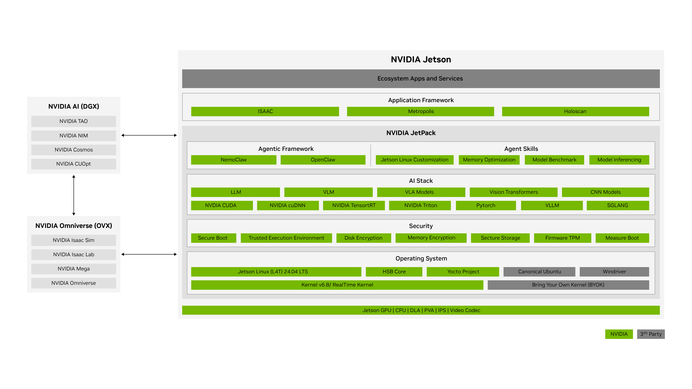
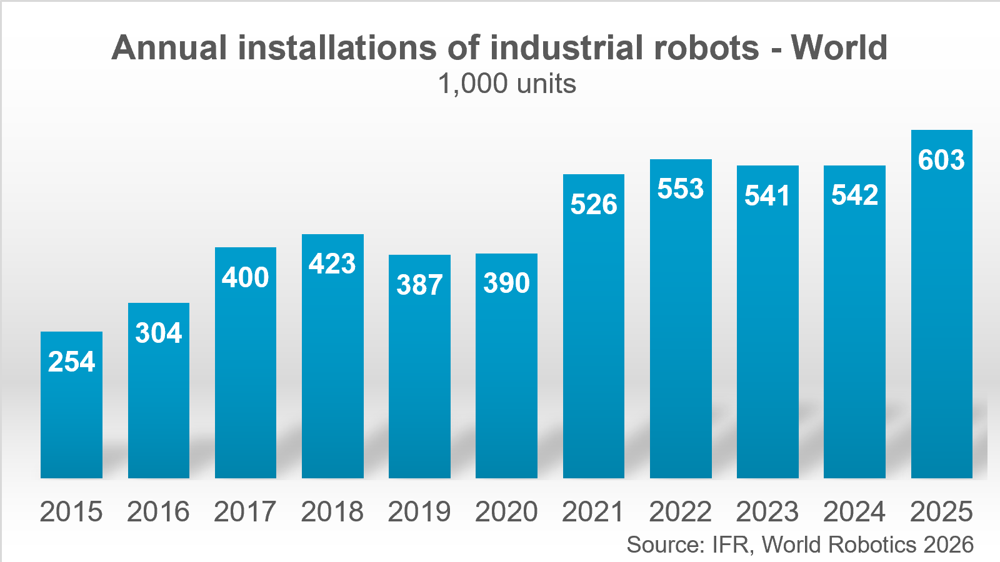
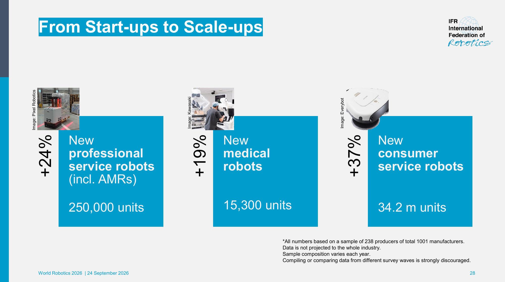
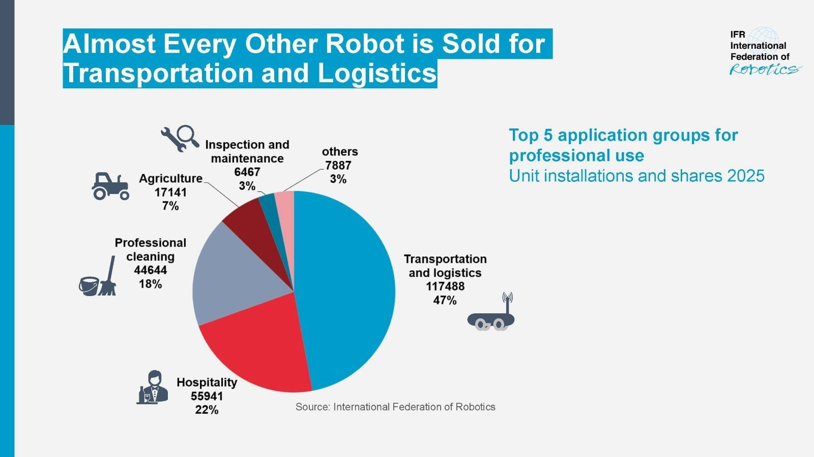
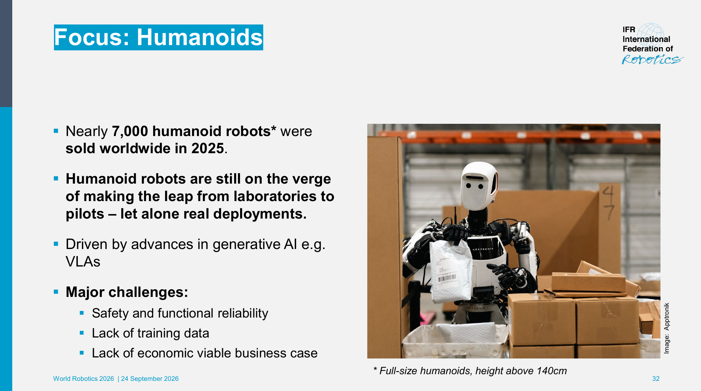

# NVIDIA：具身智能软硬件一体化SWOT与场景选型

## 1. 决策结论及证据边界

NVIDIA最适合作为需要多模态模型、GPU感知/规划、仿真训练和长期端侧软件维护的计算平台。它的优势来自软硬件协同和可复用工作流，交付风险主要集中在系统成本、版本依赖、真实本体适配、资源争用和安全责任。是否选择Thor、Orin或IGX，应从任务和验收条件向硬件反推，而不是默认“最大的算力最适合机器人”。[Jetson Thor官方规格](https://www.nvidia.com/en-us/autonomous-machines/embedded-systems/jetson-thor/) [Jetson Orin官方规格](https://www.nvidia.com/en-us/autonomous-machines/embedded-systems/jetson-orin/) [Product Page IGX](https://www.nvidia.com/en-us/edge-computing/products/igx/) [JetPack官方软件架构](https://developer.nvidia.com/embedded/jetpack)

本报告汇总01—08已核查事实，并结合本轮新增的市场和商业证据，复用本地归档。主要资料为2026年11月3日快照，伙伴、MIG、OSMO以及IFR市场、商业部署和财务资料于11月4日补采。优势、劣势指平台已有结构；机会、威胁是基于这些结构推导的业务情景，与本轮新增的官方市场统计、商业案例及财务披露分别标注，分析建议不当作实绩或预测。本轮未开展竞品同条件实测、客户报价、产线调研、机器人实验或认证审查，故不输出无依据的综合分数与市场排名。

**图1：JetPack官方机器人、AI与基础软件分层。** 原图出处：[JetPack官方软件架构](https://developer.nvidia.com/embedded/jetpack)。

图中的横向覆盖体现NVIDIA可连接多个研发阶段，但这些阶段仍有独立验收对象。能训练、能导出、能运行推理、能规划和能可靠执行是逐层递进的证据，不能由一个演示跨越全部环节。04报告展开模型与推理条件，05展开仿真与迁移，06展开本体和失效行为，07展开量产生态，08展开技术及许可边界。

## 2. 市场与产业位置：先厘清分母，再判断机会

### 2.1 工业机器人、专业服务与人形不是同一个市场

本轮采用IFR在2026年9月发布、统计2025年的官方新闻及World Robotics2026发布会PDF。工业统计反映机器人安装和运行存量；专业服务统计是厂商抽样；人形数据有尺寸定义。它们均不披露机器人搭载的处理器，不能推导Jetson份额，也不能把整机安装量乘T5000建议价当作NVIDIA收入机会。[IFR官方工业机器人安装及运行存量统计](https://ifr.org/ifr-press-releases/news/five-million-robots-now-operate-in-factories-globally) [IFR官方专业服务机器人销售及样本口径](https://ifr.org/ifr-press-releases/news/global-sales-of-professional-service-robots-surge-24-percent) [IFR World Robotics2026官方市场发布资料](https://ifr.org/downloads/press_docs/Market_Presentation_WR_Press_Conference_2026.pdf)

| 观察对象 | 官方数字及时间 | 统计边界 | 对平台选型的含义，分析 |
|---|---|---|---|
| 全球工业机器人 | 2025安装图示603千台；新闻称超过600,000、同比+11%；运行存量约500万、+9% | 安装流量与运行存量不同；图中千台为展示精度 | 已有工厂改造更需兼容现有控制和IT/OT，而非默认换成VLA |
| 中国工业机器人 | 2025安装354,000，占全球59%；中国供应商195,000、占中国市场55% | 国内整机供应商安装份额；不是国产芯片份额 | 本地整机和集成商是合作与竞争对象，具体BSP/渠道服务重要 |
| 专业服务机器人 | 约250,000、+24%；运输物流117,488、47% | 含AMR，来自抽样；不是全行业估计 | 先验证物流和移动服务任务是否需要额外多模态计算 |
| 医疗与消费服务 | PDF分别15,300、+19%及3420万、+37% | 独立类别，不并入专业服务250,000分母 | 医疗不能由消费出货规模推断；产品与安全要求需单独核查 |
| 全尺寸人形 | PDF称2025售出近7000台；识别174家人形厂商、超过一半在中国 | 全尺寸定义为身高超过140cm；销售不是在岗运营 | 科研、试点与真实商业任务应设不同验收标准 |

工业数字来自[IFR官方工业机器人安装及运行存量统计](https://ifr.org/ifr-press-releases/news/five-million-robots-now-operate-in-factories-globally)及[IFR官方全球工业机器人统计图](https://ifr.org/downloads/press_docs/Graphic_World_Robotics_2026_GLOBAL.png)；服务细分来自[IFR官方2025专业服务机器人应用份额图](https://ifr.org/downloads/press_docs/Graph_Service_Robots_share_2025_1600x900.jpg)，医疗、消费、人形及厂商数来自PDF第28、32、33页[IFR World Robotics2026官方市场发布资料](https://ifr.org/downloads/press_docs/Market_Presentation_WR_Press_Conference_2026.pdf)。人形约7000台不等于7000台具备全自主能力，也没有处理器品牌分布或客户付费任务比例。

**图2：IFR World Robotics2026：2015—2025全球工业机器人年度安装量，单位千台。** 原图出处：[IFR官方全球工业机器人统计图](https://ifr.org/downloads/press_docs/Graphic_World_Robotics_2026_GLOBAL.png)。

图用于说明既有工业需求的规模与时间序列。603千台是原图精度，不能据此声称已独立核验603,000这个精确整机数。2026及以后预测未混入上述实绩表，也未用增长率推算NVIDIA订单。

**图3：IFR官方PDF第28页：三类服务机器人数量、增长及抽样方法。** 原图出处：[IFR World Robotics2026官方市场发布资料](https://ifr.org/downloads/press_docs/Market_Presentation_WR_Press_Conference_2026.pdf)。

第28页脚注明确：总计识别1001家厂商，统计基于238家生产商样本；数据**未外推到全行业**，每年样本组成变化，强烈不建议拼接或比较不同调查波次。报告中的+24%等是IFR当次发布口径，不是本研究把两年不同样本总量相除。三类机器人被分开显示，也不能把3420万消费机器人和专业服务机器人相加后计算物流占比。

**图4：IFR官方2025专业服务机器人应用分布，47%为运输物流在该口径内的份额。** 原图出处：[IFR官方2025专业服务机器人应用份额图](https://ifr.org/downloads/press_docs/Graph_Service_Robots_share_2025_1600x900.jpg)。

原图依次为运输物流117,488（47%）、酒店及接待55,941（22%）、专业清洁44,644（18%）、农业17,141（7%）、检查维护6,467（3%）、其他7,887（3%）。数量总计249,568，与“约250,000”一致，比例按官方四舍五入展示。该分布说明可以从已有运输、清洁和检查工作流切入，**不能证明这些单位已经采用NVIDIA**。它也提示：对固定导航、覆盖清扫等任务，昂贵VLA平台的增量收益必须另证，市场规模本身不会替代模型必要性分析。

**图5：IFR官方PDF第32页：全尺寸人形销量及安全、数据、商业可行性挑战。** 原图出处：[IFR World Robotics2026官方市场发布资料](https://ifr.org/downloads/press_docs/Market_Presentation_WR_Press_Conference_2026.pdf)。

IFR原文强调人形多数尚在从实验室迈向试点的阶段，可靠性、安全、训练数据和可行商业案例仍是挑战。这与少数已付费部署并不矛盾：一个物流搬箱case可以成立，同时“通用家务全自主”仍需不同证据。对Thor应把研发需求与量产需求分别评估，试点采购不可被包装成稳定批量订单。

### 2.2 NVIDIA财务实力与机器人业务可见性的差别

NVIDIA官方2026年8月26日公告，FY2027第二季度截至2026年7月26日：收入962.21亿美元（标题四舍五入962亿美元）、同比+106%；Data Center约890亿美元、+117%；Edge Computing约72亿美元、+27%。三个月GAAP研发费用为70.54亿美元，见原文未审计损益表。上述数字证明公司层面有大规模研发和产品投入能力，却没有拆出Jetson、Thor、Isaac或机器人收入。不能把Data Center增长、Edge Computing收入或公司毛利率当作机器人市场份额与产品利润率。[NVIDIA官方FY2027第二季度业绩及风险说明](https://nvidianews.nvidia.com/news/nvidia-announces-financial-results-for-second-quarter-fiscal-2027)

**[公开资料未披露]** 本轮已核验公开原文没有提供Jetson全球装机份额、Thor在人形机器人中的份额、机器人业务独立毛利或客户采购金额。伙伴名单证明生态联系，design-in证明技术选择，均不能替代份额统计。财务实力对客户的意义是平台持续开发资源较充足的可能性；实际供货、漏洞修复、特定分支维护与现场服务仍以产品页和合同为准，不能由公司收入直接保证。

## 3. 商业案例：部署事实、芯片代际与收益分层

### 3.1 案例证据地图

| 案例与官方原文 | 已披露任务和状态 | NVIDIA相关证据 | 缺少的关键量化资料 | 可用于哪类判断 |
|---|---|---|---|---|
| GXO×Agility Digit，2024-06-27；[GXO与Agility多年度商业部署合同](https://gxo.com/news_article/gxo-signs-industry-first-multi-year-agreement-with-agility-robotics/) | 多年度RaaS合同；SPANX真实仓库，从cobot接tote放至conveyor；2023年末PoC后推进 | Agility另于2025-08-25讨论探索Thor；[Agility Robotics官方Digit与Jetson Thor公告](https://www.agilityrobotics.com/content/agility-robotics-powering-the-future-of-robotics-with-nvidia-jetson-thor) | 2024部署的GPU型号、台数、小时产出、uptime、费率、ROI | 有客户付费工作流；不能据此归因Thor |
| Diligent Moxi，2025-10-28；[Diligent官方Moxi2.0机器人与IGX平台](https://www.diligentrobots.com/blog/moxi2-0) | 当时已在美国超过25家医院，累计超过125万次配送；药品和样本运输 | NVIDIA-powered现有机队；Moxi2.0为计划、IGX Thor early adopter | 新旧型号分别贡献、失败率、每次成本、量产验收 | 已运营数据积累与产品升级关系；不是Thor现成业绩 |
| Boston Dynamics Atlas，2025-03-18；[Boston Dynamics官方Atlas与Jetson Thor合作PR](https://bostondynamics.com/news/boston-dynamics-expands-collaboration-with-nvidia/) | Thor design-in，Isaac Lab学灵巧和运动，研发合作 | 官方明确Jetson Thor与多模态模型、全身及操作控制器集成 | 同条件功耗/延迟提升、付费产线规模和可靠性 | 平台适配与研发能力证据 |
| 1X NEO，2026-11-03快照；[1X官方NEO机器人产品介绍](https://www.1x.tech/neo) | 产品页面，Early Access基础自主；复杂任务支持scheduled Expert Mode | 1X NEO Cortex标注NVIDIA Jetson Thor、up to2070 FP4TFLOPS | 实际交付数量、全自主任务比例、接管工时、长期用户ROI | 家庭场景设计与远程支持边界，不能当全自主普及 |

### 3.2 GXO/Digit：商业价值首先来自工作流闭合

GXO原文将合同描述为多年度RaaS，明确live warehouse与fully operational，并引用Agility负责人“generating revenue”的陈述。原文给出了比演示更强的业务证据：客户、地点、物料搬运任务、与既有AMR/cobot的接口，以及Agility Arc的编排和机队管理。它没有公开审计收入、持续运行小时或成本节约，故“收入生成”按公告归属表达，不升级为经独立审计的利润结论。[GXO与Agility多年度商业部署合同](https://gxo.com/news_article/gxo-signs-industry-first-multi-year-agreement-with-agility-robotics/)

**[分析]** 该任务把取放位置、容器、交接对象和流程约束明确化，使验证对象从“能走能抓”变成接箱、搬运、放箱、异常恢复和系统吞吐。选择计算平台时应测成功搬运/小时、无人介入比例、交接等待、人工救援和危险停车，而不是只测视觉或policy-call时延。RaaS会改变客户资本开支与运营支出的分配，也增加机队服务、网络和故障支持依赖；本轮未取得费率、服务等级和赔偿条款，不能说它一定更便宜。

时间线必须保留：2024商业部署公告早于2025年Thor公告，Agility后者描述未来计算探索。即使Digit产品家族与NVIDIA长期合作，也不能把2024客户现场的收益归因Thor的2070FP4TFLOPS，更不能据此宣称换Thor使搬箱效率提高某个百分比。若下一步采购Thor，需取得该代本体配置和同任务前后对照。

### 3.3 Moxi：真实数据资产有价值，累计次数不是成功率

Diligent原文用三年医院真实数据、超过125万累计配送说明Moxi的运营积累，计划用这些数据建设端到端动作模型。对NVIDIA的机会是提供更强模型和传感器处理资源，对客户的价值仍是药物与样本运送任务。配送总数没有尝试次数、介入次数和暴露小时分母，不能算闭环成功率；超过25家医院不等于25家已经部署Moxi2.0或IGX Thor。[Diligent官方Moxi2.0机器人与IGX平台](https://www.diligentrobots.com/blog/moxi2-0)

厂商“10x compute”没有提供新旧精度、芯片型号、功率模式及工作负载，因此只保留厂商宣称，不能换算成10倍配送速度。原文说15+台/医院是新能力上线后的扩展设计目标，未来医院覆盖翻倍及2030规模属于计划。本轮不把这些计划纳入已商业落地的台数。对医院客户，更有意义的采购指标是拥挤通道和电梯/门禁成功率、急件等待、服务响应、摄像头数据处理以及现场替换与恢复能力；功能安全证据和整机部署责任也需分别核验。

### 3.4 Atlas与NEO：算法自主、控制器与人工服务分别计账

Atlas官方PR将Thor多模态模型与Boston Dynamics全身/操作控制器连接，Isaac Lab支持策略学习，同时合作定义安全及感知架构。这里的分工说明GPU平台承载的是部分计算和开发链条，本体控制、技能数据及部署责任仍依赖整机方。PR中的高性能描述没有测试表，不能外推到Atlas量产机器人P99、运行小时或购买回收期。[Boston Dynamics官方Atlas与Jetson Thor合作PR](https://bostondynamics.com/news/boston-dynamics-expands-collaboration-with-nvidia/)

NEO页面明确基础自主与scheduled Expert Mode的区别，并提供远程控制。**[分析]** 对家庭机器人，应把自主成功任务、远程完成任务、等待专家时间及家庭隐私要求分开记账；低policy时延不会消除人工服务队列或用户授权需求。2070FP4TFLOPS是计算规格，不是全自主家务的验收值。数据是否必须上传、具体地区可用性、接管政策和订阅合同应以正式条款及客户交付证据核对，不能从当前产品页的能力描述推导。[1X官方NEO机器人产品介绍](https://www.1x.tech/neo)

四个案例共同说明：NVIDIA的产业位置主要是模型、仿真、部署与机载计算的支撑平台；终端工作流、数据积累、场地改造、支持服务和责任分配决定客户是否持续使用。商业case越接近运营，越需要把这些非芯片变量纳入选型。

## 4. 五项核心优势：价值成立需要哪些条件

| 优势 | 直接官方证据 | 对具身智能的实际价值 | 成立条件 |
|---|---|---|---|
| S1：模型到部署的协同路径 | GR00T本体配置、后训练及TRT导出 | 降低从VLA实验到端侧baseline的衔接成本 | 相机、动作语义、checkpoint和运行时一致 |
| S2：大模型与多模态并发资源 | T5000最高128GB、273GB/s；MIG/PVA | 容纳更多权重、缓存和传感器pipeline | 全系统容量、带宽、热稳态和分区预算通过 |
| S3：感知、规划与本体接口完整 | SIPL、XRDF、cuRobo及Deploy接口 | 复用相机、碰撞、规划与策略连接逻辑 | 驱动、标定、描述、SDK映射及控制器经过核验 |
| S4：仿真、合成数据与训练链条 | 仿真架构、随机化、SDG及学习框架 | 扩大可控试验与训练分布，降低部分试错成本 | 动力学、接触、标签及真实域验证有效 |
| S5：产品化资料和伙伴体系 | 114家目录、量产适配、PCN和生命周期 | 借助标准整机、载板和服务缩短工程周期 | 具体SKU、BSP、服务合同与供应承诺落地 |

来源依次为[GR00T N1.7官方README](https://raw.githubusercontent.com/NVIDIA/Isaac-GR00T/main/README.md) [GR00T官方部署与基准](https://raw.githubusercontent.com/NVIDIA/Isaac-GR00T/main/scripts/deployment/README.md)、[Datasheet Thor Full v1 5](https://developer.nvidia.com/downloads/assets/embedded/secure/jetson/thor/docs/jetson-thor-series-modules-datasheet_ds-11945-001.pdf) [Jetson R39.2.1官方MIG配置指南](https://docs.nvidia.com/jetson/archives/r39.2.1/DeveloperGuide/SD/MiG.html) [PVA SDK 2.10.1处理器与编程架构](https://docs.nvidia.com/pva/sdk/2.10.1/architecture.html)、[Jetson SIPL Camera over Ethernet架构](https://docs.nvidia.com/jetson/archives/r39.2.1/DeveloperGuide/SD/CameraDevelopment/SIPLFramework/SIPL-for-L4T/CoE/CoE-Solution-Overview.html) [XRDF官方描述规范](https://nvidia-isaac-ros.github.io/concepts/manipulation/xrdf.html) [cuRobo当前文档](https://nvlabs.github.io/curobo/latest/) [Isaac ROS Deploy Concept](https://nvidia-isaac-ros.github.io/repositories_and_packages/isaac_ros_deploy/concepts/how_it_works.html)、[Isaac官方仿真参考架构](https://docs.isaacsim.omniverse.nvidia.com/latest/introduction/reference_architecture.html) [Isaac官方合成数据工作流](https://docs.isaacsim.omniverse.nvidia.com/latest/replicator_tutorials/tutorial_replicator_sdg_workflows.html) [Isaac官方Managers与事件API](https://isaac-sim.github.io/IsaacLab/main/source/api/lab/isaaclab.managers.html)、[官方Jetson伙伴检索数据](https://developer.nvidia.com/search-data/jetson_ecosystem_partners.json) [Thor载板适配与Bring-up指南](https://docs.nvidia.com/jetson/archives/r39.2.1/DeveloperGuide/HR/JetsonModuleAdaptationAndBringUp/JetsonThorAdaptationBringUp.html) [Jetson官方生命周期](https://developer.nvidia.com/embedded/lifecycle)。这些是客户可以利用的能力，不能转换为本项目节省了多少人月或提高了多少成功率。

S1的价值是存在可复建的导出和优化流程。官方N1.7-LIBERO双相机基准中，Thor MAXN完整TRT为76.8ms，优化与mixed NVFP4为35.6ms；这说明软件优化可显著影响实际结果。测量固定batch1、两路256×256、四次去噪、horizon40、32 DiT blocks，含预处理/动作解码、不含RPC，以60个计时样本报告中位。35.6ms约28.1Hz是policy-call重规划率，不能称电机伺服率或目标机器人最坏时延。[GR00T官方部署与基准](https://raw.githubusercontent.com/NVIDIA/Isaac-GR00T/main/scripts/deployment/README.md)

S2的价值在于容量与资源组织。MIG提供Thor硬件分区，PVA能承担部分规则视觉计算，避免所有任务只争用同一GPU计算队列。它们不自动消除CPU callback、内存带宽、相机丢帧、存储或供电瓶颈。只有在开启真实传感器、视觉、VLA及控制并发后验证观测年龄和任务成功，才能将资源优势转化为应用优势。[Jetson R39.2.1官方MIG配置指南](https://docs.nvidia.com/jetson/archives/r39.2.1/DeveloperGuide/SD/MiG.html) [PVA SDK 2.10.1处理器与编程架构](https://docs.nvidia.com/pva/sdk/2.10.1/architecture.html) [TensorRT官方性能与测量指南](https://docs.nvidia.com/deeplearning/tensorrt/latest/performance/best-practices.html)

S3—S5共同降低平台从零建设的难度，但NVIDIA没有替客户完成本体工程。伙伴目录中的Thor标签不能证明载板验收，通用XRDF不能替代实际工具和线缆碰撞几何，仿真中的稳定策略不能证明真实关节和接触正确。项目管理应按子系统交付证据评估这些优势，而不以品牌或目录规模替代工程判断。

## 5. 五项主要短板：什么情况会抵消优势

| 劣势 | 事实基础 | 项目后果 | 可执行的缓解方式 |
|---|---|---|---|
| W1：系统成本和功耗预算较高 | Thor模组建议价及40—130W/40—70W范围 | 小型低成本机器人可能预算不匹配 | 先裁剪任务，测试NX/Nano，再核算系统BOM |
| W2：硬件及软件版本耦合 | BSP、库、镜像与engine有独立支持矩阵 | 升级或替换平台需重建/回归 | 固定版本清单、模型源和构建配方 |
| W3：演示到真实本体仍有明显工程缺口 | 关节/坐标/时间契约；G1示例限仿真 | 算法运行不等于真实任务可靠 | 分阶段驱动、描述、控制和闭环验收 |
| W4：吞吐与确定性、隔离并不等价 | MPS不分内存；官方VLA给中位 | 并发或热降频使闭环时效退化 | 测尾部、frame age、故障域与降级动作 |
| W5：许可、维护与安全边界需独立管理 | 专有BSP、分层许可、IGX安全产品路径 | 商用依赖与安全材料增加交付工作 | SBOM、合同、权重条款及系统认证逐项核对 |

证据：[Jetson官方FAQ](https://developer.nvidia.com/embedded/faq) [Jetson Thor官方规格](https://www.nvidia.com/en-us/autonomous-machines/embedded-systems/jetson-thor/)、[TensorRT官方支持矩阵](https://docs.nvidia.com/deeplearning/tensorrt/latest/getting-started/support-matrix.html) [JetPack官方下载与版本矩阵](https://developer.nvidia.com/embedded/jetpack/downloads) [GR00T官方部署与基准](https://raw.githubusercontent.com/NVIDIA/Isaac-GR00T/main/scripts/deployment/README.md)、[Isaac ROS Deploy本体适配指南](https://nvidia-isaac-ros.github.io/repositories_and_packages/isaac_ros_deploy/how_to_guides/bring_your_own_embodiment.html) [Isaac ROS Deploy AGILE](https://nvidia-isaac-ros.github.io/repositories_and_packages/isaac_ros_deploy/tutorials/deploy_agile.html) [XRDF官方描述规范](https://nvidia-isaac-ros.github.io/concepts/manipulation/xrdf.html)、[Isaac ROS CUDA MPS静态GPU分区](https://nvidia-isaac-ros.github.io/concepts/gpu_partitioning/index.html) [TensorRT官方性能与测量指南](https://docs.nvidia.com/deeplearning/tensorrt/latest/performance/best-practices.html)、[Jetson Linux 39 2 1 License](https://developer.nvidia.com/downloads/embedded/L4T/r39_Release_v2.1/release/Tegra_Software_License_Agreement-Tegra-Linux.txt) [Product Brief IGX Thor Safety](https://developer.download.nvidia.com/assets/igx/robotics-product-brief-igx-thor-safety-4473375.pdf) [Isaac ROS Deploy Safety](https://nvidia-isaac-ros.github.io/repositories_and_packages/isaac_ros_deploy/concepts/safety.html)。

W1并不表示Thor在所有项目都贵。若多模型与传感器可整合到一个计算平台，减少其他设备和集成工作，系统成本可能更有利；但本轮没有取得客户BOM与人力成本，不能量化这种收益。同样，模组130W不是机器人整机功率，也不是电池续航计算的完整输入；必须加上载板、外设、执行器和负载占空比。

W2可通过交付原始模型、插件源码、calibration与锁定环境降低风险。JetPack7.2.1集成TensorRT10.16.2，独立TensorRT矩阵已到11.4.1；GR00T又固定JetPack7.2/CUDA13.2/Python3.12。版本号更大不代表可直接替换整套环境，engine默认也不是跨全部GPU/平台的通用模型文件。[JetPack官方下载与版本矩阵](https://developer.nvidia.com/embedded/jetpack/downloads) [TensorRT官方支持矩阵](https://docs.nvidia.com/deeplearning/tensorrt/latest/getting-started/support-matrix.html) [GR00T官方部署与基准](https://raw.githubusercontent.com/NVIDIA/Isaac-GR00T/main/scripts/deployment/README.md)

W3尤其影响需要接触操作和全身平衡的机器人。FR3专用适配把1kHz FCI、200Hz controller manager和50Hz Reach推理分开；ROS写入停止时，FCI仍活动可以继续跟踪最新一致snapshot。因此“上层进程停了”不能被当成所有下游都自动停机的保证。SafetyController还存在阈值、关节匹配和switch条件，官方明确其不是功能安全认证架构。[Franka FR3 ROS2Control接口](https://nvidia-isaac-ros.github.io/repositories_and_packages/isaac_ros_robots/franka_fr3_ros2_control/index.html) [Isaac ROS Deploy Safety](https://nvidia-isaac-ros.github.io/repositories_and_packages/isaac_ros_deploy/concepts/safety.html)

## 6. 技术优势怎样转化为成本，短板何时变成否决项

### 6.1 算力与量化：工程收益来自整条路径

NVFP4不是简单把每个FP16数缩成4bit：E2M1数据、每16个值的E4M3 scale及张量级FP32 scale共同组成格式。08A按官方机制推导大张量约4.5bit/值，实际系统还有KV cache、activation、workspace、传感器buffer和模型中未量化算子。相对FP16的权重存储优势可以增加可容纳模型，但不能当整机内存缩小4倍，或电池续航增加4倍。[NVIDIA NVFP4官方低精度推理文章](https://developer.nvidia.com/blog/introducing-nvfp4-for-efficient-and-accurate-low-precision-inference/)

GR00T端侧35.6ms测量在固定模型、双相机、batch及去噪条件成立；全机器人完成一次任务还包括采集年龄、预处理、通信、规划、控制、执行及等待。**[分析]** 若动作执行和交接占主导，压缩推理只改善总时长的一部分；若观测或控制延迟已超预算，再加TFLOPS也不修复时间戳错配。选型先记录每阶段时延与任务错误，再决定是否需要T5000而非T4000/Orin。NVFP4的准确率差异需在目标动作任务留出集验证，不可用LLM问答基准替代机器人接触安全。[GR00T官方部署与基准](https://raw.githubusercontent.com/NVIDIA/Isaac-GR00T/main/scripts/deployment/README.md) [NVIDIA NVFP4官方低精度推理文章](https://developer.nvidia.com/blog/introducing-nvfp4-for-efficient-and-accurate-low-precision-inference/)

### 6.2 数据流与隔离：吞吐、尾部和安全证据分别预算

Thor共享内存与一致性可以改变CPU/GPU数据交换，但full coherence、managed memory的UVM策略和首次page fault具有不同前提，08A已说明。多相机pipeline的“零拷贝”需要采集buffer、处理库和推理接口三段都支持对应布局、设备和生命周期；图像解码/重排与应用外的传输也不能自动消失。PVA适合部分规则视觉任务，MIG可分GPU资源，二者都不能自动解决CPU排队、内存带宽或散热争用。[CUDA官方Tegra内存、一致性与跨引擎互操作应用说明](https://docs.nvidia.com/cuda/cuda-for-tegra-appnote/index.html) [PVA SDK 2.10.1处理器与编程架构](https://docs.nvidia.com/pva/sdk/2.10.1/architecture.html) [Jetson R39.2.1官方MIG配置指南](https://docs.nvidia.com/jetson/archives/r39.2.1/DeveloperGuide/SD/MiG.html)

**[分析]** 这类平台的优势是可控制更多数据路径与资源组织，成本则是驱动、DMA buffer、layout、同步、线程及调度的联合调试。对固定的小型视觉任务，已有CPU/DSP/NPU方案若在相同精度、尾部、功耗和成本边界满足要求，则NVIDIA生态广度未必足以抵消工程支出。本轮未执行跨厂商同条件实测，不输出“绝对最快/最便宜”排名。Thor无DLA，不应给它套用Orin的DLA卸载方案；换代同时要重新选择可用backend。[CUDA官方Tegra内存、一致性与跨引擎互操作应用说明](https://docs.nvidia.com/cuda/cuda-for-tegra-appnote/index.html) [Datasheet Thor Full v1 5](https://developer.nvidia.com/downloads/assets/embedded/secure/jetson/thor/docs/jetson-thor-series-modules-datasheet_ds-11945-001.pdf)

### 6.3 仿真与迁移：研发资产可复用，验证不能省略

OpenUSD、Isaac Sim/Lab和cuRobo形成资产、学习、感知、规划的衔接链。可复用的机器人描述、数据生成和实验配置能提高复现实验的可能性；但接触摩擦、非可见光回波材质、相机曝光、时序与关节动力学错误会把大量仿真训练变成无效投入。官方Sim benchmark也显示多L40并未让每类场景更快，增加GPU之前应看physics、render、ROS发布和数据写出中哪个是瓶颈。[OpenUSD官方场景组合、Layer和Schema说明](https://openusd.org/release/intro.html) [Isaac Sim官方RTX传感器材质与回波模型](https://docs.isaacsim.omniverse.nvidia.com/latest/sensors/isaacsim_sensors_rtx_materials.html) [Isaac Sim官方性能基准与场景条件](https://docs.isaacsim.omniverse.nvidia.com/latest/reference_material/benchmarks.html)

cuRobo原论文的PC/Orin规划收益证明GPU并行求解在其问题集上有效，不能直接换成真实机器人抓取成功率或产线收益。**[分析]** 若采购目标只是稳定的少量运动轨迹，传统规划与现有控制器的集成成本可能更低；若任务需要高频碰撞更新、多候选seed和GPU地图，cuRobo复用价值更大。最终比较应包括地图新鲜度、失败回退、轨迹可执行性和闭环完成，而不是单独0.05s平均规划时间。[cuRobo原始论文：并行碰撞无关运动生成](https://arxiv.org/pdf/2310.17274)

### 6.4 工具链依赖与竞争：按迁移对象拆分锁定成本

| 迁移对象 | NVIDIA可复用资产 | 迁出/换代成本来源，分析 | 推荐保留资产 |
|---|---|---|---|
| 模型与量化 | 训练checkpoint、TRT构建与性能配方 | 特定插件、精度与tactic；engine默认可移植范围有限 | 原始权重、模型卡、校准集、插件源码及精度回归 |
| 传感器与OS | JetPack/BSP、SIPL及既有载板 | kernel、设备树、驱动、DMA路径及OTA兼容 | 硬件描述、时序日志、刷机与回退流程 |
| 仿真与数据 | OpenUSD资产、场景、随机化配置 | 专有runtime、材质/传感器模型与生成器语义 | 资产来源、参数、真实校验集及标签定义 |
| 控制与安全 | XRDF、Deploy适配与平台安全资料 | 本体SDK、保护行为、认证范围及合同 | I/O契约、错误状态、失效测试与危险分析 |

事实依据[TensorRT构建、运行与对象生命周期](https://docs.nvidia.com/deeplearning/tensorrt/latest/architecture/how-trt-works.html) [Thor载板适配与Bring-up指南](https://docs.nvidia.com/jetson/archives/r39.2.1/DeveloperGuide/HR/JetsonModuleAdaptationAndBringUp/JetsonThorAdaptationBringUp.html) [OpenUSD官方场景组合、Layer和Schema说明](https://openusd.org/release/intro.html) [Isaac ROS Deploy本体适配指南](https://nvidia-isaac-ros.github.io/repositories_and_packages/isaac_ros_deploy/how_to_guides/bring_your_own_embodiment.html) [Product Brief IGX Thor Safety](https://developer.download.nvidia.com/assets/igx/robotics-product-brief-igx-thor-safety-4473375.pdf)。这张表不声称迁出不可行，而是指出NVIDIA优势中包含平台专用工程，选择时要记录其回报与替换成本。与AMD/Intel等通用CPU/GPU、Qualcomm等端侧加速器或独立仿真/开源规划方案比较，应使用同一任务和交付边界；08各专题的友商机制比较可以形成候选清单，尚不能替代采购级性能和成本对照。

## 7. 机会与威胁：按情景组织，而非预测排名

| 情景 | 机会或威胁 | 触发条件 | 决策行动及证据 |
|---|---|---|---|
| O1：视觉升级为语言条件操作 | 同一平台扩展模型与推理工作流 | 有足够示教数据、动作契约和容量 | 先用任务留出集验证；[GR00T N1.7官方README](https://raw.githubusercontent.com/NVIDIA/Isaac-GR00T/main/README.md) [GR00T官方部署与基准](https://raw.githubusercontent.com/NVIDIA/Isaac-GR00T/main/scripts/deployment/README.md) |
| O2：多传感器/多模型系统整合 | 高速采集与GPU流水线可能减少外部处理节点 | 接收硬件、协议、带宽和时钟匹配 | 比较CoE与HSB实际路径；[Jetson SIPL Camera over Ethernet架构](https://docs.nvidia.com/jetson/archives/r39.2.1/DeveloperGuide/SD/CameraDevelopment/SIPLFramework/SIPL-for-L4T/CoE/CoE-Solution-Overview.html) [Holoscan Sensor Bridge 2.7架构与示例](https://docs.nvidia.com/holoscan/sensor-bridge/2-7-latest/applications/architecture) |
| O3：研发数据与训练规模扩大 | 仿真、SDG和编排帮助重复运行及追踪 | 有正确资产、数据QA与算力backend | 再与真实数据联合评估；[Isaac官方合成数据工作流](https://docs.isaacsim.omniverse.nvidia.com/latest/replicator_tutorials/tutorial_replicator_sdg_workflows.html) [NVIDIA OSMO官方平台](https://developer.nvidia.com/osmo) |
| O4：工业长周期产品 | 工业模组与伙伴服务可支撑更长期计划 | SKU供货、PCN与软件维护协议明确 | 分别确认供货与服务；[Jetson官方生命周期](https://developer.nvidia.com/embedded/lifecycle) [Jetson官方支持入口](https://developer.nvidia.com/embedded/support) |
| T1：低成本单任务竞争 | 专用加速器或较小平台可能更省系统预算 | 任务固定、模型小、无多模态扩展要求 | 开展相同精度/时效/功耗的竞品测试；本轮未测 |
| T2：供应和支持窗口变化 | 生命周期、EOL、物料或当地交付影响项目 | 用旧型号或未跟踪PCN/来源SKU | 建迁移与备件计划；[Jetson官方生命周期](https://developer.nvidia.com/embedded/lifecycle) [Jetson官方FAQ](https://developer.nvidia.com/embedded/faq) |
| T3：维护及平台依赖积累 | 定制kernel、BSP和engine增加替换成本 | 缺模型源、构建配方或再分发权利 | 保存可复建资产并核验许可；[TensorRT构建、运行与对象生命周期](https://docs.nvidia.com/deeplearning/tensorrt/latest/architecture/how-trt-works.html) [Jetson Linux 39 2 1 License](https://developer.nvidia.com/downloads/embedded/L4T/r39_Release_v2.1/release/Tegra_Software_License_Agreement-Tegra-Linux.txt) |
| T4：安全与真实域要求提高 | 更强硬件仍无法替代系统安全证据 | 面向人机协作、复杂接触与未见场景 | 按危险分析、失效测试及标准验收；[Product Brief IGX Thor Safety](https://developer.download.nvidia.com/assets/igx/robotics-product-brief-igx-thor-safety-4473375.pdf) [Isaac ROS Deploy Safety](https://nvidia-isaac-ros.github.io/repositories_and_packages/isaac_ros_deploy/concepts/safety.html) |

机会是能力扩展的可选路线，不代表客户已经完成训练或供应商有保证交期。威胁中的竞品、成本及本地服务情景需要进一步验证；[公开资料未披露]本轮没有相同任务和边界下的竞品成本、成功率、P99，亦未取得Jetson/Thor订单量或芯片市场份额，不能把该表转换成确定的竞争结论。

## 8. 场景矩阵：按任务选择计算路径

| 应用场景 | 建议优先评估 | 选择原因 | 放行前关键验证 |
|---|---|---|---|
| 人形/VLA科研与后训练 | 服务器训练+Thor端侧；配套仿真 | 模型、数据、部署与大容量链条可复用 | 目标本体、闭环成功、量化与动作有效期 |
| 视觉操作机械臂 | Orin/Thor按模型与并发预算选择 | GPU视觉与cuMotion/cuRobo接口 | TCP、碰撞模型、地图时效、跟踪与接触 |
| 多模态工业AMR | 先比Orin与Thor完整pipeline | 相机/SLAM/重建与语言任务可共用平台 | 时间戳、定位丢失、并发尾部和停止距离 |
| 固定视觉检测/轻量服务机器人 | Orin NX/Nano或参与竞品同条件测试 | 较小模组可能满足任务并降低成本 | 精度、热稳态、资源余量及I/O |
| 宽温、运行振动等工业部署 | AGX Orin Industrial或伙伴工业系统 | 模组有针对性的环境规格 | TTP与环境温度分开，整机机械和可靠性 |
| 需安全证据的人机协作系统 | IGX完整产品路径及独立保护 | FSI、sMCU、SEP/OS与安全材料 | 具体release、认证范围和整机安全目标 |

来源：[GR00T Hardware Guide](https://raw.githubusercontent.com/NVIDIA/Isaac-GR00T/main/getting_started/hardware_recommendation.md) [GR00T官方部署与基准](https://raw.githubusercontent.com/NVIDIA/Isaac-GR00T/main/scripts/deployment/README.md) [自定义机械臂cuMotion适配教程](https://nvidia-isaac-ros.github.io/concepts/manipulation/cumotion_moveit/tutorial_custom_manipulator.html) [cuRobo当前文档](https://nvlabs.github.io/curobo/latest/) [Isaac for Mobility官方工作流](https://nvidia-isaac-ros.github.io/reference_workflows/isaac_for_mobility/index.html) [Jetson Orin官方规格](https://www.nvidia.com/en-us/autonomous-machines/embedded-systems/jetson-orin/) [Jetson官方FAQ](https://developer.nvidia.com/embedded/faq) [Product Brief IGX Thor Safety](https://developer.download.nvidia.com/assets/igx/robotics-product-brief-igx-thor-safety-4473375.pdf)。矩阵是进入验证的优先路径，不是采购批准，也不是给全部服务机器人指定同一型号。

科研场景优先关注复现效率和数据/模型迭代速度，量产场景更关注更新维护、成本、热稳定和异常恢复。纯本体感觉小策略可能无需大VLA平台；机械臂路径若只需固定视觉和稳定轨迹，也不应因存在Thor就忽略较小Orin。相反，超过原设备容量的多模态任务，不能仅通过更换量化精度承诺解决全部精度与时效问题。

安全相关场景应将“算法工作”“平台安全机制”和“系统满足目标标准”分开。IGX Safety Brief区分开发过程等级与随机硬件完整性，且载板sMCU不在Jetson SOM内；普通Jetson搭配名为SafetyController的软件不自动具备同样产品能力。安全路径的成本和时间需依据项目材料与认证合同，不能只比较模组价。[Product Brief IGX Thor Safety](https://developer.download.nvidia.com/assets/igx/robotics-product-brief-igx-thor-safety-4473375.pdf) [Isaac ROS Deploy Safety](https://nvidia-isaac-ros.github.io/repositories_and_packages/isaac_ros_deploy/concepts/safety.html)

## 9. 成本与供应：可量化锚点及不可推断项

| 量产模组 | 官方建议价，USD，1KU+ | 专门生命周期页可供货至 |
|---|---:|---|
| T5000 / T4000 | 4999 / 2999 | 2035年8月 / 2036年1月 |
| AGX Orin 64GB / 32GB | 2999 / 1799 | 2032年1月 |
| AGX Orin Industrial | 3199 | 2033年7月 |
| Orin NX 16GB / 8GB | 999 / 649 | 2032年1月 |
| Orin Nano 8GB / 4GB | 399 / 349 | 2032年1月 |

价格来自[Jetson官方FAQ](https://developer.nvidia.com/embedded/faq)，供货日期来自[Jetson官方生命周期](https://developer.nvidia.com/embedded/lifecycle)。这是建议价与供货规划锚点，不是中国含税报价、当前现货价或持续软件补丁期限。FAQ的Xavier日期与专门生命周期页冲突，07已保留并优先采用后者；开发套件不具同样供货承诺，也不用于量产。

成本模型建议分成两部分：单位系统成本=模组+载板+存储+电源/散热+传感器与线束+制造/测试+质保备件；项目总成本还加设计NRE、集成与回归、数据/训练、支持维护和迁移支出。对计划产量N，NRE摊销为NRE/N，但只有取得有效报价和产量计划后才可代入。不能直接用模组价格乘数量计算项目预算。

从Thor降到NX/Nano的判断顺序应是任务裁剪→目标精度与闭环验证→容量/带宽/热预算→系统BOM比较。Orin NX Super的40W模式可能要求HV rail和重新设计散热；软件性能提升不等于所有既有载板无改造成本。若评估宽温工业模组，应把实测环境、寿命和停机损失纳入，而不是只比较差价。[Jetson官方FAQ](https://developer.nvidia.com/embedded/faq)

[公开资料未披露] 当地折扣、税费、交期、NRE、良率、返修率、供应商服务费及真实任务训练成本均未取得。本报告不计算ROI、客户利润、续航或采购回收期；这些指标需要实际项目数据。

## 10. 采购经济性、交付与政策：把风险落到合同和验收

### 10.1 模组差价的透明敏感性分析

在官方1KU+建议价口径下，T5000对T4000、AGX Orin64GB均贵2000美元；对Orin NX16GB贵4000美元。下表是**[分析计算]**，只将公开模组差价在假设使用期内平均分摊，不含资金成本、折扣/税费、散热、载板、维修和NRE，不是客户ROI。分摊期5年与有效工作时数由本研究假设，并非供货商承诺。[Jetson官方FAQ](https://developer.nvidia.com/embedded/faq)

| 替代基线 | 单台模组差价USD | 假设5年、2000有效小时/年 | 假设5年、4000有效小时/年 | 正确用途 |
|---|---:|---:|---:|---|
| T4000或AGX Orin64GB | 2000 | 0.20USD/有效小时 | 0.10USD/有效小时 | 仅比较模组差价与有证据的小时增量价值 |
| Orin NX16GB | 4000 | 0.40USD/有效小时 | 0.20USD/有效小时 | 更大差价须由任务能力或系统整合价值支持 |

计算为差价/(年数×每年有效小时)。2000台假设采购时，仅T5000相对T4000模组名义差额为400万美元，**这不是项目总成本**，且真实供应报价未取得。若能整合处理节点，必须减去被实际取消设备及维护费用；若只能增加推理吞吐而任务产出不变，不能按每秒更多token计节省人工。采购评估应填真实有效运行小时、每次完成价值、接管工时和回归成本，并把设备空闲、充电与停机扣除。

**[分析模型]** 任务单位成本=（年度资本分摊+能源+维修/备件+软件/云/支持+人工接管+数据与回归分摊）/合格完成任务数。分母要用满足质量和安全要求的任务，不能用模型调用次数；累计配送case只有完成总数，尚不能填齐这个模型。RaaS则使用合同租赁/按次费用、客户侧改造、支持边界和人工接管，再与自购方案比较。融资、所有权、退出迁移、数据使用权和服务等级可能影响决策，本轮没有这些合同，不替客户判断净现值或回收期。[GXO与Agility多年度商业部署合同](https://gxo.com/news_article/gxo-signs-industry-first-multi-year-agreement-with-agility-robotics/) [Diligent官方Moxi2.0机器人与IGX平台](https://www.diligentrobots.com/blog/moxi2-0)

### 10.2 非技术优势与风险的因果链

| 因素 | 可核验的事实 | 项目影响，分析 | 触发条件与选型动作 |
|---|---|---|---|
| 财务与研发规模 | 公司季度收入与研发费用；[NVIDIA官方FY2027第二季度业绩及风险说明](https://nvidianews.nvidia.com/news/nvidia-announces-financial-results-for-second-quarter-fiscal-2027) | 有较强持续开发投入基础；不能保证具体SKU维护 | 合同写清产品支持分支、时限与责任 |
| 伙伴与本地交付 | 07已核验伙伴目录、载板/BSP与整机服务；[官方Jetson伙伴检索数据](https://developer.nvidia.com/search-data/jetson_ecosystem_partners.json) | 可选择整机路径，减少自研部分；目录不是可交付证明 | 对当地渠道核查SKU、交期、修复与现场支持 |
| 供应链与生命周期 | 专页公布长期供货计划；公告列第三方制造/封装依赖；[Jetson官方生命周期](https://developer.nvidia.com/embedded/lifecycle) [NVIDIA官方FY2027第二季度业绩及风险说明](https://nvidianews.nvidia.com/news/nvidia-announces-financial-results-for-second-quarter-fiscal-2027) | 长周期产品有规划锚点，也有外部供应依赖 | BOM/PCN、批次一致性、备件与替代验证分别落实 |
| 区域市场结构 | 中国占工业安装59%，国内整机供应商占中国55%；[IFR官方工业机器人安装及运行存量统计](https://ifr.org/ifr-press-releases/news/five-million-robots-now-operate-in-factories-globally) | 本地集成、成本和客户关系不能只靠全球品牌 | 与具体整机商共同验证需求和现场服务 |
| 数据与服务运营 | Moxi运营数据、NEO专家模式；[Diligent官方Moxi2.0机器人与IGX平台](https://www.diligentrobots.com/blog/moxi2-0) [1X官方NEO机器人产品介绍](https://www.1x.tech/neo) | 数据资产与人工支持影响竞争力和运营成本 | 明确上传/保存/删除/使用权与接管服务范围 |
| 行业需求和政策不确定性 | IFR列贸易限制、投资谨慎、劳动力短缺；[IFR World Robotics2026官方市场发布资料](https://ifr.org/downloads/press_docs/Market_Presentation_WR_Press_Conference_2026.pdf) | 自动化需求与地方供货/采购约束可能同时变化 | 采用分阶段验证与订单，核对当地正式采购条件 |

这里的短板不是笼统“价格高/有政策风险”：同一芯片放到两种合同和两种服务体系，客户总体风险可能不同。具备芯片但没有现场恢复、替换和更新回退能力的方案，不一定比较小平台更可交付；长期供货日期也不等于当地现货、每个软件版本持续安全补丁或某应用已认证。

### 10.3 中国项目和跨境供应：证据支持到哪里

NVIDIA FY2027Q2公告在下一季度展望中明确“不假设任何来自中国的Data Center compute收入”，并把全球经济政治、第三方制造及产品缺陷等列入风险。它说明跨区域业务具有现实不确定性，**但该句对象是Data Center compute，不是Jetson所有SKU**，不能据此断言Thor在中国一律禁售、全部豁免或特定采购必然可交付。[NVIDIA官方FY2027第二季度业绩及风险说明](https://nvidianews.nvidia.com/news/nvidia-announces-financial-results-for-second-quarter-fiscal-2027)

**[公开资料未披露/本轮未取得]** 本轮未独立核验具体Jetson/IGX型号的现行ECCN、许可结论、当地交付条件与最终用户资格；BIS法规入口、eCFR候选页未成功归档，未列为有效参考，不能据失败网页推导法律结论。对实际采购，供应商须提供准确SKU、分类/许可与当地销售条件，客户核对目的地、用途、最终用户及再出口要求；这些是采购核对项，不是本报告已经完成的法律认定。

训练服务器、端侧模组、整机出口和远程云服务也不是同一交易。应分别询价并确定软件/数据权利和跨区域服务可用性，避免用端侧有货推定训练算力也可获得，或用云服务可用推定本地机器人数据可以上传。IFR关于保护性贸易和区域化的讨论是产业趋势判断，不能代替具体政策文本。[IFR World Robotics2026官方市场发布资料](https://ifr.org/downloads/press_docs/Market_Presentation_WR_Press_Conference_2026.pdf)

### 10.4 把定性SWOT转成可验证的采购决定

**优先Thor的条件**：目标模型和传感器并发在Orin预算内无法满足，Thor上经量化回归仍满足任务质量；机载热稳态、时序、功耗与供应通过，增量价值能够覆盖真实系统差价。**优先较小模组的条件**：固定任务在目标P99、容量、热及质量边界有余量，大模型扩展没有已确认业务需求。两者都需实测，不能由市场增长或峰值算力直接批准。[Datasheet Thor Full v1 5](https://developer.nvidia.com/downloads/assets/embedded/secure/jetson/thor/docs/jetson-thor-series-modules-datasheet_ds-11945-001.pdf) [Jetson Orin官方规格](https://www.nvidia.com/en-us/autonomous-machines/embedded-systems/jetson-orin/) [GR00T官方部署与基准](https://raw.githubusercontent.com/NVIDIA/Isaac-GR00T/main/scripts/deployment/README.md)

**优先IGX路径的条件**：应用确实需要该产品提供的工业支持和安全材料，并确认所购配置、release及整机认证责任；若只是把普通Jetson升级为更高TFLOPS而没有系统危险分析，无法补齐安全论证。**分阶段试点的条件**：如人形或家庭任务依赖尚未验证的全自主能力，先以明确工作流、接管和服务费用建立证据，再扩展数量。GXO提供商业工作流范例，Atlas提供适配证据，NEO提供人工服务边界，不能互相替代。[Product Brief IGX Thor Safety](https://developer.download.nvidia.com/assets/igx/robotics-product-brief-igx-thor-safety-4473375.pdf) [GXO与Agility多年度商业部署合同](https://gxo.com/news_article/gxo-signs-industry-first-multi-year-agreement-with-agility-robotics/) [Boston Dynamics官方Atlas与Jetson Thor合作PR](https://bostondynamics.com/news/boston-dynamics-expands-collaboration-with-nvidia/) [1X官方NEO机器人产品介绍](https://www.1x.tech/neo)

## 11. 从SWOT到实施：四道验证门

下图为**[示意图，基于公开资料整理，非官方版本]**。节点表示建议的放行顺序，不代表本项目已经完成测试；依据[GR00T官方部署与基准](https://raw.githubusercontent.com/NVIDIA/Isaac-GR00T/main/scripts/deployment/README.md)、[Isaac ROS Deploy本体适配指南](https://nvidia-isaac-ros.github.io/repositories_and_packages/isaac_ros_deploy/how_to_guides/bring_your_own_embodiment.html)、[Thor载板适配与Bring-up指南](https://docs.nvidia.com/jetson/archives/r39.2.1/DeveloperGuide/HR/JetsonModuleAdaptationAndBringUp/JetsonThorAdaptationBringUp.html)和[Isaac ROS Deploy Safety](https://nvidia-isaac-ros.github.io/repositories_and_packages/isaac_ros_deploy/concepts/safety.html)整理。

| 验证门 | 需要交付的证据 | 通过口径 | 失败后的决策 |
|---|---|---|---|
| G1：任务/数据/本体 | 模态、单位、frame、关节顺序、数据划分、模型及许可 | 输入输出契约可复建，留出任务有结果 | 修正数据与接口，暂不扩大硬件采购 |
| G2：平台与资源 | BSP/镜像/engine清单、所有实际sensor和并发负载 | 精度、时延尾部、frame age与热稳态满足项目预算 | 调pipeline、分区或更换型号 |
| G3：闭环与故障 | 真实任务重复、进程停止、通信丢失、异常状态和回退日志 | 任务成功及失效行为满足需求和危险分析 | 修控制/保护，不能以单次演示放行 |
| G4：量产与生命周期 | 正式BOM、报价、PCN、刷机/OTA回退、支持合同及安全材料 | 目标SKU和维护责任明确，产测/更新可恢复 | 调供应/产品路径或缩小承诺范围 |

这些口径必须由项目定义任务和可接受风险后填入数值，例如动作有效期、P99预算、物体与任务留出成功率和热余量。官方基准提供初始比较点，不替客户设定安全限值。仅测P99还不能证明最坏情况；对硬实时要求应另做响应时间和干扰分析。[TensorRT官方性能与测量指南](https://docs.nvidia.com/deeplearning/tensorrt/latest/performance/best-practices.html) [Franka FR3 ROS2Control接口](https://nvidia-isaac-ros.github.io/repositories_and_packages/isaac_ros_robots/franka_fr3_ros2_control/index.html) [Isaac ROS Deploy Safety](https://nvidia-isaac-ros.github.io/repositories_and_packages/isaac_ros_deploy/concepts/safety.html)

G2尤其要在实际分辨率、曝光、网络拓扑、模型并发和日志写出条件下运行。离线固定观测median可能低估采集等待和通信开销，MPS配额又不隔离GPU内存。G3则要验证下游真实hardware行为，包括上层停写后是否保持命令、controller switch失败怎么办、未匹配阈值是否不限幅等。由此才能判断平台能力是否已转化为可交付机器人行为。[GR00T官方部署与基准](https://raw.githubusercontent.com/NVIDIA/Isaac-GR00T/main/scripts/deployment/README.md) [Isaac ROS CUDA MPS静态GPU分区](https://nvidia-isaac-ros.github.io/concepts/gpu_partitioning/index.html) [Franka FR3 ROS2Control接口](https://nvidia-isaac-ros.github.io/repositories_and_packages/isaac_ros_robots/franka_fr3_ros2_control/index.html) [Isaac ROS Deploy Safety](https://nvidia-isaac-ros.github.io/repositories_and_packages/isaac_ros_deploy/concepts/safety.html)

## 12. 所涉及代码项目与商用边界

| 官方项目 | Stars及采集日 | 默认分支最近提交UTC | 许可事实 |
|---|---|---|---|
| [NVIDIA Isaac GR00T官方仓库](https://github.com/NVIDIA/Isaac-GR00T) | 8307；11月3日 | 2026-10-28T21:46:01Z | 代码Apache2；骨干、权重及数据另核 |
| [GitHub IsaacSim Page](https://github.com/isaac-sim/IsaacSim) | 4425；11月4日 | 2026-09-10T02:15:24Z，11月3日快照 | 代码Apache2；Kit/纹理/资产另条款 |
| [cuRobo Project Page](https://github.com/NVlabs/curobo) | 1951；11月3日 | 2026-09-10T17:21:47Z | 当前V2代码Apache2；资产及旧版本分开 |
| [Isaac ROS Deploy官方仓库](https://github.com/NVIDIA-ISAAC-ROS/isaac_ros_deploy) | 10；11月4日 | 2026-09-24T07:07:45Z | Apache2；机器人SDK与其他依赖另核 |

证据：[GR00T Repo Metadata](https://api.github.com/repos/NVIDIA/Isaac-GR00T) [GR00T Recent Commit](https://api.github.com/repos/NVIDIA/Isaac-GR00T/commits?per_page=1) [GR00T License](https://raw.githubusercontent.com/NVIDIA/Isaac-GR00T/main/LICENSE) [Isaac Sim仓库元数据](https://api.github.com/repos/isaac-sim/IsaacSim) [Isaac Sim提交快照](https://api.github.com/repos/isaac-sim/IsaacSim/commits?sha=main&per_page=1) [Isaac Sim官方代码及附加组件许可](https://raw.githubusercontent.com/isaac-sim/IsaacSim/main/LICENSE) [cuRobo Repo Metadata](https://api.github.com/repos/NVlabs/curobo) [cuRobo Recent Commit](https://api.github.com/repos/NVlabs/curobo/commits?per_page=1) [cuRobo License](https://raw.githubusercontent.com/NVlabs/curobo/main/LICENSE) [Deploy仓库元数据](https://api.github.com/repos/NVIDIA-ISAAC-ROS/isaac_ros_deploy) [Deploy最近提交](https://api.github.com/repos/NVIDIA-ISAAC-ROS/isaac_ros_deploy/commits?per_page=1) [Deploy代码许可](https://raw.githubusercontent.com/NVIDIA-ISAAC-ROS/isaac_ros_deploy/release-5.0/LICENSE)。仓库公开、可下载与所有组件均开源不是同义词。GR00T模型卡补采受robots核验限制，本轮没有独立验证所有权重条款；Lab旧README对cuRobo依赖的专有许可提示与当前V2代码许可有版本差异，06已保留。[GitHub IsaacLab README](https://raw.githubusercontent.com/isaac-sim/IsaacLab/main/README.md)

## 13. 最终选型建议

对高研发强度、多模态并发、视觉操作与仿真训练项目，NVIDIA值得优先建立完整baseline，平台复用价值最有机会抵消系统与学习成本。对低功耗、低BOM、固定单任务项目，应先做较小模组及竞品同条件试验。对长周期工业产品，供货、PCN、软件维护和环境规格要分别确认；对安全相关系统，进入IGX及完整系统安全工程路径。

本报告给出的选择是有条件的：当任务闭环、系统预算、许可和量产责任同时通过时，才可将平台优势转化为采购与交付决定。公开资料足以说明可用能力和主要风险，却不足以替代目标机器人实测、正式成本与安全验收。全部方向完成后应统一审阅事实、版本和证据，再确定下一厂商或下一批任务的范围。

## 参考资料与本地原文

本报告依据11月3日采集的快照及11月4日逐方向补充取得的官方网页、代码仓库、API和文档。资料由统一下载工具归档到本项目的reference_metrial；多个方向共享同一URL的已校验文件。网页保留HTML和依赖，部分资源受robots规则、失效链接或动态交互限制影响时，按metadata如实标明。采集时点、版本和原始响应哈希可在各资料目录内核对。

| 官方资料 | 原始URL | 本地原文 | 归档情况 |
|---|---|---|---|
| NVIDIA_Product_Page_Jetson_Thor | [官方原文](https://www.nvidia.com/en-us/autonomous-machines/embedded-systems/jetson-thor/) | [index.html](REFERENCES.md#ref-91025a9bef10dc0b) | 静态呈现依赖部分缺失；见metadata |
| NVIDIA_Product_Page_Jetson_Orin | [官方原文](https://www.nvidia.com/en-us/autonomous-machines/embedded-systems/jetson-orin/) | [index.html](REFERENCES.md#ref-822deacef0f6253c) | 静态呈现依赖部分缺失；见metadata |
| NVIDIA_Product_Page_IGX | [官方原文](https://www.nvidia.com/en-us/edge-computing/products/igx/) | [index.html](REFERENCES.md#ref-1bf36659d6ccb38d) | 静态呈现依赖部分缺失；见metadata |
| NVIDIA_JetPack_Page | [官方原文](https://developer.nvidia.com/embedded/jetpack) | [index.html](REFERENCES.md#ref-c9b618c904201b47) | 静态呈现依赖部分缺失；见metadata |
| NVIDIA_09_DEEP_IFR_INDUSTRIAL | [官方原文](https://ifr.org/ifr-press-releases/news/five-million-robots-now-operate-in-factories-globally) | [index.html](REFERENCES.md#ref-bad3d5636979c1ec) | 静态呈现依赖部分缺失；见metadata |
| NVIDIA_09_DEEP_IFR_SERVICE | [官方原文](https://ifr.org/ifr-press-releases/news/global-sales-of-professional-service-robots-surge-24-percent) | [index.html](REFERENCES.md#ref-1e78f5fd4a5acdc8) | 静态呈现依赖部分缺失；见metadata |
| NVIDIA_09_DEEP_IFR_PRESENTATION | [官方原文](https://ifr.org/downloads/press_docs/Market_Presentation_WR_Press_Conference_2026.pdf) | [document.pdf](REFERENCES.md#ref-59cd5f63c28daab5) | 原件已归档 |
| NVIDIA_09_DEEP_IFR_GLOBAL_FIG | [官方原文](https://ifr.org/downloads/press_docs/Graphic_World_Robotics_2026_GLOBAL.png) | [content.png](REFERENCES.md#ref-f4b1d8f851a56e04) | 原件已归档 |
| NVIDIA_09_DEEP_IFR_SERVICE_FIG | [官方原文](https://ifr.org/downloads/press_docs/Graph_Service_Robots_share_2025_1600x900.jpg) | [content.jpg](REFERENCES.md#ref-c751c5304b28f479) | 原件已归档 |
| NVIDIA_09_DEEP_Q2FY2027 | [官方原文](https://nvidianews.nvidia.com/news/nvidia-announces-financial-results-for-second-quarter-fiscal-2027) | [index.html](REFERENCES.md#ref-9bc4950664f1773d) | 静态呈现依赖部分缺失；见metadata |
| NVIDIA_09_DEEP_GXO_DIGIT | [官方原文](https://gxo.com/news_article/gxo-signs-industry-first-multi-year-agreement-with-agility-robotics/) | [index.html](REFERENCES.md#ref-15d742b446e6cb9a) | 静态HTML依赖完整；动态功能另验 |
| NVIDIA_06_DEEP_AGILITY_THOR | [官方原文](https://www.agilityrobotics.com/content/agility-robotics-powering-the-future-of-robotics-with-nvidia-jetson-thor) | [index.html](REFERENCES.md#ref-9a45a9d4062d6f68) | 静态呈现依赖部分缺失；见metadata |
| NVIDIA_06_DEEP_DILIGENT | [官方原文](https://www.diligentrobots.com/blog/moxi2-0) | [index.html](REFERENCES.md#ref-eff801ab5d597595) | 静态呈现依赖部分缺失；见metadata |
| NVIDIA_06_DEEP_BD_COLLAB | [官方原文](https://bostondynamics.com/news/boston-dynamics-expands-collaboration-with-nvidia/) | [index.html](REFERENCES.md#ref-2e127e386e4da364) | 静态呈现依赖部分缺失；见metadata |
| NVIDIA_06_DEEP_NEO | [官方原文](https://www.1x.tech/neo) | [index.html](REFERENCES.md#ref-724fbd7f6f247026) | 静态呈现依赖部分缺失；见metadata |
| NVIDIA_GR00T_README | [官方原文](https://raw.githubusercontent.com/NVIDIA/Isaac-GR00T/main/README.md) | [content.md](REFERENCES.md#ref-5d29c835c8afd8af) | 原件已归档 |
| NVIDIA_GR00T_Deployment_Guide | [官方原文](https://raw.githubusercontent.com/NVIDIA/Isaac-GR00T/main/scripts/deployment/README.md) | [content.md](REFERENCES.md#ref-af6435cdb176784f) | 原件已归档 |
| NVIDIA_Datasheet_Thor_Full_v1_5 | [官方原文](https://developer.nvidia.com/downloads/assets/embedded/secure/jetson/thor/docs/jetson-thor-series-modules-datasheet_ds-11945-001.pdf) | [document.pdf](REFERENCES.md#ref-e0ae09b175a34eac) | 原件已归档 |
| NVIDIA_08_MIG | [官方原文](https://docs.nvidia.com/jetson/archives/r39.2.1/DeveloperGuide/SD/MiG.html) | [index.html](REFERENCES.md#ref-85895374c012ed38) | 静态HTML依赖完整；动态功能另验 |
| NVIDIA_02_PVA_ARCH2 | [官方原文](https://docs.nvidia.com/pva/sdk/2.10.1/architecture.html) | [index.html](REFERENCES.md#ref-782050b23c55b756) | 静态HTML依赖完整；动态功能另验 |
| NVIDIA_02_SIPL_COE | [官方原文](https://docs.nvidia.com/jetson/archives/r39.2.1/DeveloperGuide/SD/CameraDevelopment/SIPLFramework/SIPL-for-L4T/CoE/CoE-Solution-Overview.html) | [index.html](REFERENCES.md#ref-acc0a9a82b614a53) | 静态HTML依赖完整；动态功能另验 |
| NVIDIA_06_XRDF | [官方原文](https://nvidia-isaac-ros.github.io/concepts/manipulation/xrdf.html) | [index.html](REFERENCES.md#ref-a0af12f7d5ef24f5) | 静态呈现依赖部分缺失；见metadata |
| NVIDIA_06_CUROBO_CANONICAL | [官方原文](https://nvlabs.github.io/curobo/latest/) | [index.html](REFERENCES.md#ref-b199312ad68d0e8e) | 静态呈现依赖部分缺失；见metadata |
| NVIDIA_Isaac_ROS_Deploy_Concept | [官方原文](https://nvidia-isaac-ros.github.io/repositories_and_packages/isaac_ros_deploy/concepts/how_it_works.html) | [index.html](REFERENCES.md#ref-48a6c8b0b3bbace0) | 静态呈现依赖部分缺失；见metadata |
| NVIDIA_05_SIM_ARCH | [官方原文](https://docs.isaacsim.omniverse.nvidia.com/latest/introduction/reference_architecture.html) | [index.html](REFERENCES.md#ref-f74626edcba85090) | 静态HTML依赖完整；动态功能另验 |
| NVIDIA_05_SDG | [官方原文](https://docs.isaacsim.omniverse.nvidia.com/latest/replicator_tutorials/tutorial_replicator_sdg_workflows.html) | [index.html](REFERENCES.md#ref-b864aac3a5128760) | 静态HTML依赖完整；动态功能另验 |
| NVIDIA_05_LAB_EVENTS | [官方原文](https://isaac-sim.github.io/IsaacLab/main/source/api/lab/isaaclab.managers.html) | [index.html](REFERENCES.md#ref-befa55326ba2b236) | 静态呈现依赖部分缺失；见metadata |
| NVIDIA_07_PARTNER_DATA | [官方原文](https://developer.nvidia.com/search-data/jetson_ecosystem_partners.json) | [content.json](REFERENCES.md#ref-447a3a34ae20f22d) | 原件已归档 |
| NVIDIA_07_BRINGUP | [官方原文](https://docs.nvidia.com/jetson/archives/r39.2.1/DeveloperGuide/HR/JetsonModuleAdaptationAndBringUp/JetsonThorAdaptationBringUp.html) | [index.html](REFERENCES.md#ref-dd9372d4369304e9) | 静态HTML依赖完整；动态功能另验 |
| NVIDIA_Developer_Page_Jetson_Lifecycle | [官方原文](https://developer.nvidia.com/embedded/lifecycle) | [index.html](REFERENCES.md#ref-782c8ca091275c8c) | 静态呈现依赖部分缺失；见metadata |
| NVIDIA_04_TRT_PERF | [官方原文](https://docs.nvidia.com/deeplearning/tensorrt/latest/performance/best-practices.html) | [index.html](REFERENCES.md#ref-fac73fa8f8466577) | 静态HTML依赖完整；动态功能另验 |
| NVIDIA_Developer_Page_Jetson_FAQ | [官方原文](https://developer.nvidia.com/embedded/faq) | [index.html](REFERENCES.md#ref-7c29d52f2f676227) | 静态呈现依赖部分缺失；见metadata |
| NVIDIA_TensorRT_Support_Matrix | [官方原文](https://docs.nvidia.com/deeplearning/tensorrt/latest/getting-started/support-matrix.html) | [index.html](REFERENCES.md#ref-3b68f26af8646cbc) | 静态HTML依赖完整；动态功能另验 |
| NVIDIA_JetPack_Downloads | [官方原文](https://developer.nvidia.com/embedded/jetpack/downloads) | [index.html](REFERENCES.md#ref-a226cd46c59f27f9) | 静态呈现依赖部分缺失；见metadata |
| NVIDIA_06_EMBODIMENT | [官方原文](https://nvidia-isaac-ros.github.io/repositories_and_packages/isaac_ros_deploy/how_to_guides/bring_your_own_embodiment.html) | [index.html](REFERENCES.md#ref-07b01900ce1e8a74) | 静态呈现依赖部分缺失；见metadata |
| NVIDIA_Isaac_ROS_Deploy_AGILE | [官方原文](https://nvidia-isaac-ros.github.io/repositories_and_packages/isaac_ros_deploy/tutorials/deploy_agile.html) | [index.html](REFERENCES.md#ref-20e0a19d75669952) | 静态呈现依赖部分缺失；见metadata |
| NVIDIA_02_MPS_DOC | [官方原文](https://nvidia-isaac-ros.github.io/concepts/gpu_partitioning/index.html) | [index.html](REFERENCES.md#ref-1fd266641b8a8d14) | 静态呈现依赖部分缺失；见metadata |
| NVIDIA_Jetson_Linux_39_2_1_License | [官方原文](https://developer.nvidia.com/downloads/embedded/L4T/r39_Release_v2.1/release/Tegra_Software_License_Agreement-Tegra-Linux.txt) | [content.txt](REFERENCES.md#ref-5394e70b58c257fd) | 原件已归档 |
| NVIDIA_Product_Brief_IGX_Thor_Safety | [官方原文](https://developer.download.nvidia.com/assets/igx/robotics-product-brief-igx-thor-safety-4473375.pdf) | [document.pdf](REFERENCES.md#ref-b71ae712d56c26cb) | 原件已归档 |
| NVIDIA_Isaac_ROS_Deploy_Safety | [官方原文](https://nvidia-isaac-ros.github.io/repositories_and_packages/isaac_ros_deploy/concepts/safety.html) | [index.html](REFERENCES.md#ref-029d4bca29febcf3) | 静态呈现依赖部分缺失；见metadata |
| NVIDIA_06_FR3 | [官方原文](https://nvidia-isaac-ros.github.io/repositories_and_packages/isaac_ros_robots/franka_fr3_ros2_control/index.html) | [index.html](REFERENCES.md#ref-7a32cc45a78631e0) | 静态呈现依赖部分缺失；见metadata |
| NVIDIA_08_DEEP_NVIDIA_NVFP4_BLOG | [官方原文](https://developer.nvidia.com/blog/introducing-nvfp4-for-efficient-and-accurate-low-precision-inference/) | [index.html](REFERENCES.md#ref-bdc20768416189cc) | 静态呈现依赖部分缺失；见metadata |
| NVIDIA_08_DEEP_CUDA_TEGRA | [官方原文](https://docs.nvidia.com/cuda/cuda-for-tegra-appnote/index.html) | [index.html](REFERENCES.md#ref-e1e2a9f4bcacf89e) | 静态呈现依赖部分缺失；见metadata |
| NVIDIA_08_DEEP_USD_INTRO | [官方原文](https://openusd.org/release/intro.html) | [index.html](REFERENCES.md#ref-7de15b45ad852750) | 静态HTML依赖完整；动态功能另验 |
| NVIDIA_08_DEEP_RTX_MATERIAL | [官方原文](https://docs.isaacsim.omniverse.nvidia.com/latest/sensors/isaacsim_sensors_rtx_materials.html) | [index.html](REFERENCES.md#ref-bee3c3e48db46d4d) | 静态HTML依赖完整；动态功能另验 |
| NVIDIA_08_DEEP_SIM_BENCHMARKS | [官方原文](https://docs.isaacsim.omniverse.nvidia.com/latest/reference_material/benchmarks.html) | [index.html](REFERENCES.md#ref-b07ba7136a8df329) | 静态HTML依赖完整；动态功能另验 |
| NVIDIA_08_DEEP_CUROBO_PAPER | [官方原文](https://arxiv.org/pdf/2310.17274) | [document.pdf](REFERENCES.md#ref-d323f34db075b715) | 原件已归档 |
| NVIDIA_02_TRT_WORK | [官方原文](https://docs.nvidia.com/deeplearning/tensorrt/latest/architecture/how-trt-works.html) | [index.html](REFERENCES.md#ref-9df325c2c44e3de5) | 静态HTML依赖完整；动态功能另验 |
| NVIDIA_02_HSB_ARCH | [官方原文](https://docs.nvidia.com/holoscan/sensor-bridge/2-7-latest/applications/architecture) | [index.html](REFERENCES.md#ref-766974539088b048) | 静态呈现依赖部分缺失；见metadata |
| NVIDIA_08_OSMO | [官方原文](https://developer.nvidia.com/osmo) | [index.html](REFERENCES.md#ref-759602171ae06e29) | 静态呈现依赖部分缺失；见metadata |
| NVIDIA_07_SUPPORT | [官方原文](https://developer.nvidia.com/embedded/support) | [index.html](REFERENCES.md#ref-aedf333904b70e30) | 静态呈现依赖部分缺失；见metadata |
| NVIDIA_GR00T_Hardware_Guide | [官方原文](https://raw.githubusercontent.com/NVIDIA/Isaac-GR00T/main/getting_started/hardware_recommendation.md) | [content.md](REFERENCES.md#ref-162330cafc692010) | 原件已归档 |
| NVIDIA_06_CUSTOM_ARM | [官方原文](https://nvidia-isaac-ros.github.io/concepts/manipulation/cumotion_moveit/tutorial_custom_manipulator.html) | [index.html](REFERENCES.md#ref-f64a95c0a4c6b7ae) | 静态呈现依赖部分缺失；见metadata |
| NVIDIA_06_MOBILITY | [官方原文](https://nvidia-isaac-ros.github.io/reference_workflows/isaac_for_mobility/index.html) | [index.html](REFERENCES.md#ref-7544bdc8cbb0474f) | 静态呈现依赖部分缺失；见metadata |
| NVIDIA_GR00T_Project_Page | [官方原文](https://github.com/NVIDIA/Isaac-GR00T) | [index.html](REFERENCES.md#ref-6710c43ad408be3c) | 静态呈现依赖部分缺失；见metadata |
| NVIDIA_GitHub_IsaacSim_Page | [官方原文](https://github.com/isaac-sim/IsaacSim) | [index.html](REFERENCES.md#ref-e7af47084679a807) | 静态呈现依赖部分缺失；见metadata |
| NVIDIA_cuRobo_Project_Page | [官方原文](https://github.com/NVlabs/curobo) | [index.html](REFERENCES.md#ref-3a15d654beec1e8d) | 静态呈现依赖部分缺失；见metadata |
| NVIDIA_06_DEPLOY_PAGE | [官方原文](https://github.com/NVIDIA-ISAAC-ROS/isaac_ros_deploy) | [index.html](REFERENCES.md#ref-165a72fdcf44b02f) | 静态呈现依赖部分缺失；见metadata |
| NVIDIA_GR00T_Repo_Metadata | [官方原文](https://api.github.com/repos/NVIDIA/Isaac-GR00T) | [content.json](REFERENCES.md#ref-32f40fba80381d43) | 原件已归档 |
| NVIDIA_GR00T_Recent_Commit | [官方原文](https://api.github.com/repos/NVIDIA/Isaac-GR00T/commits?per_page=1) | [content.json](REFERENCES.md#ref-c27df6a41be14701) | 原件已归档 |
| NVIDIA_GR00T_License | [官方原文](https://raw.githubusercontent.com/NVIDIA/Isaac-GR00T/main/LICENSE) | [content.txt](REFERENCES.md#ref-9d9946c66ea15cdb) | 原件已归档 |
| NVIDIA_05_SIM_META | [官方原文](https://api.github.com/repos/isaac-sim/IsaacSim) | [content.json](REFERENCES.md#ref-a08737b32ee8066b) | 原件已归档 |
| NVIDIA_GitHub_IsaacSim_Commits_API | [官方原文](https://api.github.com/repos/isaac-sim/IsaacSim/commits?sha=main&per_page=1) | [content.json](REFERENCES.md#ref-6169640d2c84df4a) | 原件已归档 |
| NVIDIA_GitHub_IsaacSim_License | [官方原文](https://raw.githubusercontent.com/isaac-sim/IsaacSim/main/LICENSE) | [content.txt](REFERENCES.md#ref-1c21a8f4920bb953) | 原件已归档 |
| NVIDIA_cuRobo_Repo_Metadata | [官方原文](https://api.github.com/repos/NVlabs/curobo) | [content.json](REFERENCES.md#ref-f10d39d86e7b6c7f) | 原件已归档 |
| NVIDIA_cuRobo_Recent_Commit | [官方原文](https://api.github.com/repos/NVlabs/curobo/commits?per_page=1) | [content.json](REFERENCES.md#ref-0141b60b9fafa1c0) | 原件已归档 |
| NVIDIA_cuRobo_License | [官方原文](https://raw.githubusercontent.com/NVlabs/curobo/main/LICENSE) | [content.txt](REFERENCES.md#ref-e7935c7951d05964) | 原件已归档 |
| NVIDIA_06_DEPLOY_META | [官方原文](https://api.github.com/repos/NVIDIA-ISAAC-ROS/isaac_ros_deploy) | [content.json](REFERENCES.md#ref-863bb2e9b26c26a9) | 原件已归档 |
| NVIDIA_06_DEPLOY_COMMIT | [官方原文](https://api.github.com/repos/NVIDIA-ISAAC-ROS/isaac_ros_deploy/commits?per_page=1) | [content.json](REFERENCES.md#ref-82f9e63b9397d141) | 原件已归档 |
| NVIDIA_06_DEPLOY_LICENSE | [官方原文](https://raw.githubusercontent.com/NVIDIA-ISAAC-ROS/isaac_ros_deploy/release-5.0/LICENSE) | [content.txt](REFERENCES.md#ref-8c1b7de6386cb6b9) | 原件已归档 |
| NVIDIA_GitHub_IsaacLab_README | [官方原文](https://raw.githubusercontent.com/isaac-sim/IsaacLab/main/README.md) | [content.md](REFERENCES.md#ref-5af037b6c4754936) | 原件已归档 |

以上技术事实与官方测量保持条件和版本边界。本调研未执行设备安装、模型训练、机器人实机测试或客户验收；文中的集成路线和选型门槛属于分析建议。公开资料未披露的交期、报价、最坏情况时延与认证结果不作推断。
