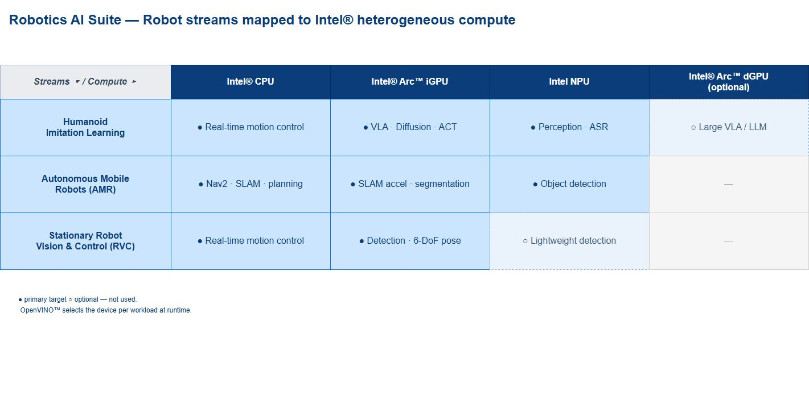
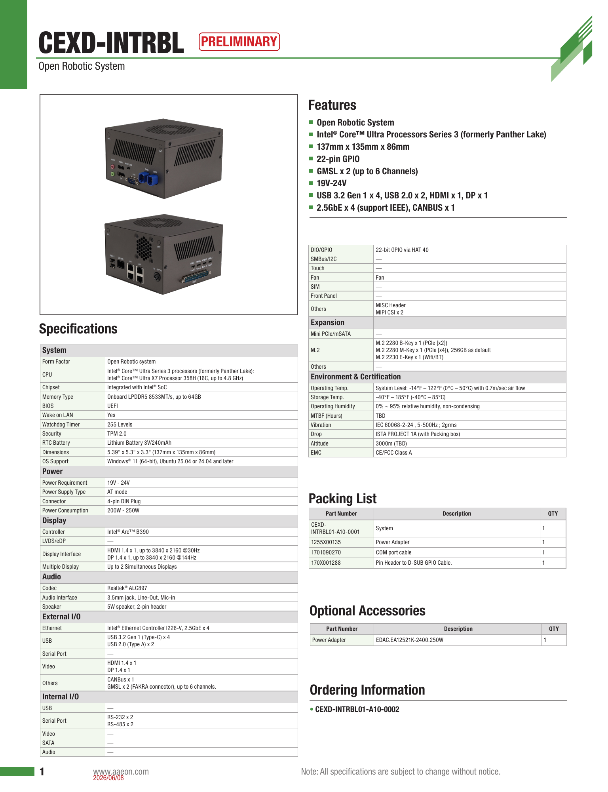
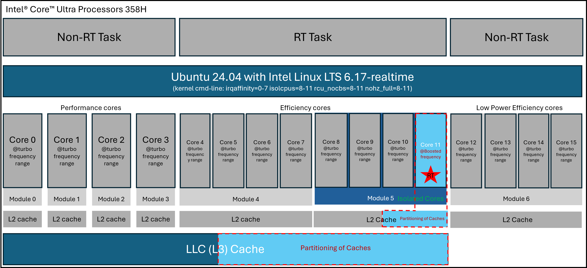
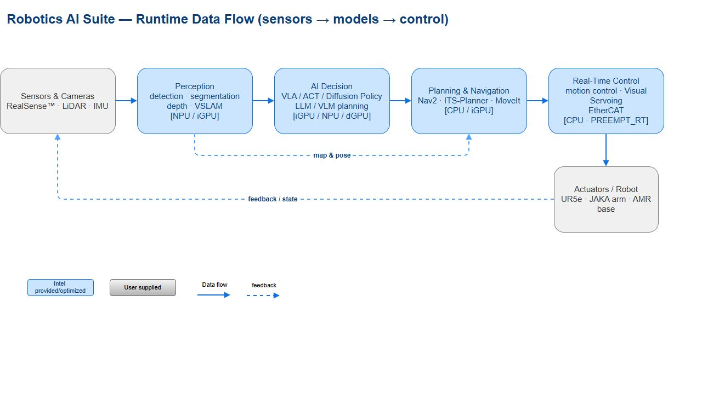

# Intel 具身智能硬件平台：异构计算、机器人开发系统与工业交付边界

调研截止：2026-11-05（Asia/Shanghai）。状态：01 深度审阅稿，等待用户审阅后进入 02；02—09 原有首轮文件尚未按本标准补深。下文“事实”指可核验规格/配置，“厂商称”指未由本研究独立复测的性能或商业表述，“分析”指依据公开约束作出的工程推导。本次没有执行模型、刷机或机器人实机测试。

## 1. 选型结论与准确研究范围

**Intel 的具身硬件路线是把通用 CPU、集成 GPU、NPU 与机器人 I/O 放入同一端侧系统，再按模型容量和实时要求决定是否增加独显或独立控制器。** 官方 Robotics AI Suite 把感知主要分配到 NPU/iGPU，把 VLA、ACT、扩散策略和大模型主要分配到 iGPU、可选 Arc 独显，把运动控制留给 CPU、PREEMPT_RT 与 EtherCAT。这一分工比“平台总 TOPS”更能解释其适合什么机器人，但它是参考架构，不是所有模块已在每个 SKU 上同时验收的证明。[官方 README](https://raw.githubusercontent.com/open-edge-platform/robotics-ai-suite/main/README.md)；[官方计算分工图原件](https://raw.githubusercontent.com/open-edge-platform/robotics-ai-suite/main/docs/user-guide/images/architecture/robotics-hardware-mapping.svg)。

本章详细核验 Core Ultra Series 3 的 X9 388H、X7 368H/358H、Ultra 9 386H、Ultra 5 338H、Ultra 7 355；用 Core 5 320 代表 Core Series 3（Wildcat Lake）轻量端侧；补充 Series 2 的 255H 与 258V、存量工业控制 Atom x7433RE，以及 B580、Arc Pro B60 两张扩展卡。系统层覆盖 AAEON CEXD-INTRBL、UP Nexus WCL Edge、UP WCL Edge 和 ASUS NUC 16。系列目录中的其他 SKU 是可继续筛选的族内变体，**不以某款已验证的数据填充整个系列**。Xeon/Gaudi 训练服务器、全部桌面处理器和消费显卡不纳入逐型号表，不能把服务器内存、AMX、数据中心互联或训练指标套到机器人端侧。[Series 3 官方目录](https://www.intel.com/content/www/us/en/ark/products/series/245528/intel-core-ultra-series-3-processors.html)；[Suite 官方处理器范围](https://raw.githubusercontent.com/open-edge-platform/robotics-ai-suite/1b0b22a2964f0f998c34cc03c5053fe61764015d/docs/user-guide/platform_foundation/processors.md)。

具体建议是：新增多相机、人形操作或需要本地多模态推理的原型，先评估 358H/368H/388H 的 B390 iGPU 与内存；需要成本、体积和能耗收敛的 AMR/视觉控制端侧，评估 338H、355 或 Core 5 320 的目标模型；已有 255H 工程基线优先判断迁移收益与接口代价。258V 是低功耗机制对照，不能仅因有较高 NPU 峰值就认定它是 Suite 已验收的工业平台。Atom 更适合作低层或存量工业控制主机，本章未取得它运行当前 Suite 全套 VLA 的验证证据。这些建议是分析，放行须经过第 11 节的目标系统测试。

## 2. 硬件层次与 CPU/GPU/NPU 的职责

Intel ARK 上的处理器是 BGA 芯片规格，不是含内存、SSD、连接器、散热器的可直接接入机器人的生产模组。CEXD 内部计算模组再接载板、SerDes 与机壳，才构成开发系统；UP/NUC 是第三方整机。与模组式路线比较时，需要把“处理器＋主板＋内存＋外部网卡/桥接＋散热＋电源”作为同一交付对象，不能拿裸芯片价格或 PBP 与另一家的完整模组价格、模组功率直接相除。[358H 芯片规格](https://www.intel.com/content/www/us/en/products/sku/245527/intel-core-ultra-x7-processor-358h-18m-cache-up-to-4-80-ghz/specifications.html)；[CEXD 开发系统说明](https://raw.githubusercontent.com/open-edge-platform/robotics-ai-suite/1b0b22a2964f0f998c34cc03c5053fe61764015d/docs/user-guide/platform_foundation/development_kits/robinson-bay/index.md)。

图 1：官方 `robotics-hardware-mapping.svg` 的浏览器完整渲染，原 SVG 保留。蓝色的主执行目标和空心的可选目标说明不同机器人类别如何选择 CPU/iGPU/NPU/dGPU；AMR 的规划与 SLAM 仍依赖 CPU，不能因为有 NPU 就忽略 CPU 负载。图中“OpenVINO selects device”不能证明任意模型、全部算子或任意精度均可自动跨设备高效执行。版本为 2026-11-05 归档的仓库主分支图件；源码引用、原件及哈希见证据记录。

Series 3 的高图形 SKU 是分 tile 的异构封装。358H、368H、388H 的 ARK 分别列 CPU 为 **Intel 18A**、GPU 为 **TSMC N3E**；355 的 GPU 字段为 **Intel 3**；Core 5 320 的 CPU/GPU 字段均为 **Intel 18A**。因此“Intel Series 3 全封装采用 18A”或者“所有 Series 3 都有同样 Xe3 图形性能”都超出证据。CPU 的 P/E/LP E 核负责不同调度需求，GPU 承担并行视觉与矩阵模型，NPU 面向适合其编译和算子约束的推理；精确片内总线、所有 tile 的面积/制程、封装内互联带宽本轮未取得正式手册正文，不补造。[358H](https://www.intel.com/content/www/us/en/products/sku/245527/intel-core-ultra-x7-processor-358h-18m-cache-up-to-4-80-ghz/specifications.html)；[355](https://www.intel.com/content/www/us/en/products/sku/245722/intel-core-ultra-7-processor-355-12m-cache-up-to-4-70-ghz/specifications.html)；[Core 5 320](https://www.intel.com/content/www/us/en/products/sku/246018/intel-core-5-processor-320-6m-cache-up-to-4-60-ghz/specifications.html)。

## 3. 主力与必要旧代：逐 SKU 核验

### 3.1 计算与功率规格

下表功率单位均为 W；顺序是 **PBP / MTP / Minimum Assured Power**，是处理器规范，不是三个已实测的整机工作档。CPU 数字为 P/E/LP E 核；GPU 与 NPU 数值只转录 ARK 的 **INT8 Peak TOPS**。ARK 的 “Sparsity Support: Yes”没有在所取正文中明确每个峰值是否含稀疏倍率，所以不自行写成 dense 或 sparse，也不转换成与 Jetson 的无条件性能排名。各行来源都是 2026-11-05 的正文快照，Q1/Q2 等为产品 Launch Date，非本轮材料发布时间。

| 处理器与代号 | CPU 核/线程；最高睿频 | iGPU；Xe 核 | GPU/NPU INT8 峰值 TOPS | PBP/MTP/最低保证功率 | 发布与来源 |
|---|---|---|---|---|---|
| Ultra X9 388H；Panther Lake | 4/8/4，16 线程；5.1 GHz | Arc B390；12 | 122 / 50 | 25 / 80 / 15 | Q1'26，Launched；[ARK](https://www.intel.com/content/www/us/en/products/sku/245526/intel-core-ultra-x9-processor-388h-18m-cache-up-to-5-10-ghz/specifications.html) |
| Ultra X7 368H；Panther Lake | 4/8/4，16 线程；5.0 GHz | Arc B390；12 | 122 / 50 | 25 / 80 / 15 | Q1'26，Launched；[ARK](https://www.intel.com/content/www/us/en/products/sku/245523/intel-core-ultra-x7-processor-368h-18m-cache-up-to-5-00-ghz/specifications.html) |
| Ultra X7 358H；Panther Lake | 4/8/4，16 线程；4.8 GHz | Arc B390；12 | 122 / 50 | 25 / 80 / 15 | Q1'26，Launched；[ARK](https://www.intel.com/content/www/us/en/products/sku/245527/intel-core-ultra-x7-processor-358h-18m-cache-up-to-4-80-ghz/specifications.html) |
| Ultra 9 386H；Panther Lake | 4/8/4，16 线程；4.9 GHz | Intel Graphics；4 | 40 / 50 | 25 / 80 / 15 | Q1'26，Launched；[ARK](https://www.intel.com/content/www/us/en/products/sku/245529/intel-core-ultra-9-processor-386h-18m-cache-up-to-4-90-ghz/specifications.html) |
| Ultra 5 338H；Panther Lake | 4/4/4，12 线程；4.7 GHz | Arc B370；10 | 98 / 47 | 25 / 65 / 15 | Q1'26，Launched；[ARK](https://www.intel.com/content/www/us/en/products/sku/245531/intel-core-ultra-5-processor-338h-18m-cache-up-to-4-70-ghz/specifications.html) |
| Ultra 7 355；Panther Lake | 4/0/4，8 线程；4.7 GHz | Intel Graphics；4 | 40 / 49 | 25 / 55 / 12 | Q1'26，Launched；[ARK](https://www.intel.com/content/www/us/en/products/sku/245722/intel-core-ultra-7-processor-355-12m-cache-up-to-4-70-ghz/specifications.html) |
| Core 5 320；Wildcat Lake | 2/0/4，6 线程；4.6 GHz | Intel Graphics；2 | 20 / 16 | 15 / 35 / 10 | Q2'26，Launched；[ARK](https://www.intel.com/content/www/us/en/products/sku/246018/intel-core-5-processor-320-6m-cache-up-to-4-60-ghz/specifications.html) |
| Ultra 7 255H；Arrow Lake | 6/8/2，16 线程；5.1 GHz | Arc 140T；8 | 74 / 13 | 28 / 115 / 20 | Q1'25，Launched；[ARK](https://www.intel.com/content/www/us/en/products/sku/241751/intel-core-ultra-7-processor-255h-24m-cache-up-to-5-10-ghz/specifications.html) |
| Ultra 7 258V；Lunar Lake | 4/0/4，8 线程；4.8 GHz | Arc 140V；8 | 64 / 47 | 17 / 37 / 8 | Q3'24，Launched；[ARK](https://www.intel.com/content/www/us/en/products/sku/240957/intel-core-ultra-7-processor-258v-12m-cache-up-to-4-80-ghz/specifications.html) |

这里有两个决定性差别。第一，386H 的 CPU 核数与 388H 相同，但 GPU 峰值为 40 对 122，不能以“Ultra 9”品牌推出更强的视觉/策略模型吞吐。第二，255H 与 258V 同属 Series 2，NPU 峰值却为 13 对 47；这不是通过升级 OpenVINO 就能互换的硬件配置。模型如果不能放到 NPU、需要 FP32、频繁 CPU fallback，或者以 batch 1 解码受带宽限制，理论 TOPS 的排序可能失效。[386H 原表](https://www.intel.com/content/www/us/en/products/sku/245529/intel-core-ultra-9-processor-386h-18m-cache-up-to-4-90-ghz/specifications.html)；[388H 原表](https://www.intel.com/content/www/us/en/products/sku/245526/intel-core-ultra-x9-processor-388h-18m-cache-up-to-5-10-ghz/specifications.html)；[255H 原表](https://www.intel.com/content/www/us/en/products/sku/241751/intel-core-ultra-7-processor-255h-24m-cache-up-to-5-10-ghz/specifications.html)；[258V 原表](https://www.intel.com/content/www/us/en/products/sku/240957/intel-core-ultra-7-processor-258v-12m-cache-up-to-4-80-ghz/specifications.html)。

单核最高睿频不是所有核同时持续工作的频率。25 W PBP 也不保证 GPU 122 TOPS、NPU 50 TOPS 和 CPU 睿频在该功率下同时成立；MTP、固件功率限制、散热、内存活动和实时配置都会改变可持续工作点。AAEON 宣传 CEXD “up to 180 TOPS”，是 CPU/GPU/NPU 的平台总峰值口径，不能把一个模型当作天然获得 180 TOPS，也不能把不同 SKU 的峰值累加进去。[AAEON 平台性能宣传](https://www.aaeon.com/en/article/detail/accelerate-robotics-development-aaeon-intel)。

### 3.2 制程、内存、封装与扩展

| SKU | ARK CPU/GPU 制程 | 内存类型与最高速率 | 处理器最大容量；通道数 | 封装尺寸；BGA | PCIe 最大资源 | 来源 |
|---|---|---|---|---|---|---|
| 388H/368H/358H | Intel 18A / TSMC N3E | LPDDR5X 9600 MT/s | 96 GB；2 | 50×25 mm；2540 | 12 lanes；Gen5/Gen4 | [388H](https://www.intel.com/content/www/us/en/products/sku/245526/intel-core-ultra-x9-processor-388h-18m-cache-up-to-5-10-ghz/specifications.html)、[368H](https://www.intel.com/content/www/us/en/products/sku/245523/intel-core-ultra-x7-processor-368h-18m-cache-up-to-5-00-ghz/specifications.html)、[358H](https://www.intel.com/content/www/us/en/products/sku/245527/intel-core-ultra-x7-processor-358h-18m-cache-up-to-4-80-ghz/specifications.html) |
| 386H | Intel 18A / Intel 3 | LPDDR5X 9600；DDR5 7200 MT/s | 128 GB；2 | 50×25 mm；2540 | 20 lanes；Gen5/Gen4 | [ARK](https://www.intel.com/content/www/us/en/products/sku/245529/intel-core-ultra-9-processor-386h-18m-cache-up-to-4-90-ghz/specifications.html) |
| 338H | Intel 18A / TSMC N3E | LPDDR5X 8533 MT/s | 96 GB；2 | 50×25 mm；2540 | 12 lanes；Gen5/Gen4 | [ARK](https://www.intel.com/content/www/us/en/products/sku/245531/intel-core-ultra-5-processor-338h-18m-cache-up-to-4-70-ghz/specifications.html) |
| 355 | Intel 18A / Intel 3 | LPDDR5X 7467；DDR5 6400 MT/s | 128 GB；2 | 50×25 mm；2540 | 12 lanes；Gen5/Gen4 | [ARK](https://www.intel.com/content/www/us/en/products/sku/245722/intel-core-ultra-7-processor-355-12m-cache-up-to-4-70-ghz/specifications.html) |
| Core 5 320 | Intel 18A / Intel 18A | LPDDR5X 7467；DDR5 6400 MT/s | 64 GB；1 | 35×25 mm；1516 | 6 lanes；Gen4 | [ARK](https://www.intel.com/content/www/us/en/products/sku/246018/intel-core-5-processor-320-6m-cache-up-to-4-60-ghz/specifications.html) |
| 255H | TSMC N3B / 本轮ARK未列GPU制程 | LPDDR5/X 8400；DDR5 6400 MT/s | 128 GB；2；ECC No | 50×25 mm；2049 | 28 lanes；Gen5/Gen4 | [ARK](https://www.intel.com/content/www/us/en/products/sku/241751/intel-core-ultra-7-processor-255h-24m-cache-up-to-5-10-ghz/specifications.html) |
| 258V | TSMC N3B / 本轮ARK未列GPU制程 | LPDDR5X 8533 MT/s | 32 GB；2 | 27.5×27 mm；2833 | 8 lanes；Gen5/Gen4 | [ARK](https://www.intel.com/content/www/us/en/products/sku/240957/intel-core-ultra-7-processor-258v-12m-cache-up-to-4-80-ghz/specifications.html) |

最大容量是内存控制器/处理器限制，不能认定每个整机支持该容量。358H 的 96 GB 不能填到固定 64 GB 的 CEXD 产品配置，255H 的 128 GB 也不能改写已验证的 64 GB Humanoid BKC。258V 的 32 GB 上限意味着大模型权重、KV cache、图像缓存和 OS 必须共同容纳在较小空间；对于需要扩容的机器人项目，应先核对内存是否可更换，而不是只看 NPU 47 TOPS。以上是容量约束分析，板卡是否有插槽、可选容量和维修方式仍以整机 BOM 为准。

386H 的扩展资源与高图形型号也不同：其 ARK 列 x8 Gen5、x4 Gen5 和两组 x4 Gen4，共20 lanes，而388H/368H/358H为12 lanes。更多资源可以扩大载板设计空间，但不保证整机把所有链路引出。255H/258V的本轮ARK只明确CPU制程，没有单列GPU制程，本章保留未知，不以家族层面的推测填入逐SKU规格。[386H扩展字段](https://www.intel.com/content/www/us/en/products/sku/245529/intel-core-ultra-9-processor-386h-18m-cache-up-to-4-90-ghz/specifications.html)；[255H](https://www.intel.com/content/www/us/en/products/sku/241751/intel-core-ultra-7-processor-255h-24m-cache-up-to-5-10-ghz/specifications.html)；[258V](https://www.intel.com/content/www/us/en/products/sku/240957/intel-core-ultra-7-processor-258v-12m-cache-up-to-4-80-ghz/specifications.html)。

**MT/s 不是 GB/s，也不是持续可用带宽。** 本轮处理器 ARK 未取得对应内存总位宽的正式手册定义，所以不把“2 channels”直接当作某个未经核验的位宽，亦不填写臆算峰值带宽。iGPU、NPU、CPU 在系统内存上并发工作时，会竞争带宽、缓存和功率；需要测量多相机＋模型＋日志＋控制同时运行后的尾延迟。相比之下，独显的 456 GB/s 是其本地 GDDR6 规格，不是主机经 PCIe 读取显存的速度。[358H 内存字段](https://www.intel.com/content/www/us/en/products/sku/245527/intel-core-ultra-x7-processor-358h-18m-cache-up-to-4-80-ghz/specifications.html)；[B580 显存字段](https://www.intel.com/content/www/us/en/products/sku/241598/intel-arc-b580-graphics/specifications.html)。

## 4. 专用工业与存量控制层

Atom x7433RE（Amston Lake）提供另一种角色：ARK 列 4 核、最高 3.4 GHz、Intel 7、9 W TDP、32 GB 最大内存、单通道 DDR4-3200/DDR5-4800/LPDDR5-4800，UHD Graphics 32 EU、9 条 PCH Gen3 PCIe、IPU 6.0，以及 Intel TCC 支持。它 Q2'24 发布、当前状态 Launched，支持 Extended Temperature Options；TJUNCTION 为 105°C，**不是允许机器人在 105°C 环境温度下工作**。ARK 本页没有给本研究可直接采用的数值环境温区，需板卡厂与正式数据手册确认。[x7433RE 工业规格](https://www.intel.com/content/www/us/en/products/sku/236967/intel-atom-x7433re-processor-6m-cache-up-to-3-40-ghz/specifications.html)。

分析上，这类低功率、工业使用条件和 TCC 面向同步/控制的处理器适合拆分“低层控制与高层 AI”：控制主机负责总线、时序和故障处理，上层 Core Ultra 负责视觉与策略。但 TCC Yes 不是系统 WCET 保证，更不是功能安全认证。本轮只取得 GNA 3.0 字段，没有现代 NPU INT8 峰值证据，不能把 GNA 写成等价的 VLA NPU。也没有当前 Suite 在该准确 Atom SKU 上的全栈验收记录，不能把旧 AMR 算法支持 Atom 的描述升级为当前所有参考应用均支持。

## 5. 从芯片到可交付系统：模组、载板和整机

### 5.1 官方开发系统比较

| 系统/交付层次 | 准确 CPU 范围 | 内存/存储证据 | 尺寸与散热 | 电源与环境温度 | I/O 关键区别 | 来源 |
|---|---|---|---|---|---|---|
| CEXD-INTRBL：计算模组＋载板＋机壳开发系统 | X7 358H | 板载 LPDDR5-8533，最高64GB；M-Key默认256GB NVMe | 系统137×135×86 mm，有风扇；内部计算模组100×87 mm | 19–24 V；PDF写200–250 W；系统0–50°C且0.7m/s气流 | 四I226-V 2.5GbE；四USB3.2 Gen1 Type-C＋两USB2；MIPI/GMSL；CAN | [2026-06-08 初版PDF](https://newdata.aaeon.com.tw/DOWNLOAD/2014%20datasheet/Systems/CEXD-INTRBL.pdf)；[Intel指南](https://raw.githubusercontent.com/open-edge-platform/robotics-ai-suite/1b0b22a2964f0f998c34cc03c5053fe61764015d/docs/user-guide/platform_foundation/development_kits/robinson-bay/index.md) |
| UP Nexus WCL Edge，UPN-WCL01-SYS；第三方无风扇整机 | Core 7 360 / Core 5 320 | 厂商概览48GB板载LPDDR5；Intel指南列UFS，未取得逐订货SKU容量表 | 134×105×53 mm；无风扇、可壁装 | 12–24 V；厂商概览-20–60°C；整机瓦数未取得 | 双2.5GbE、USB-A/C、40-pin GPIO；指南明确无GMSL/MIPI CSI | [厂商页](https://www.aaeon.com/en/product/detail/up-systems-up-nexus-wcl-edge)；[Intel指南](https://raw.githubusercontent.com/open-edge-platform/robotics-ai-suite/1b0b22a2964f0f998c34cc03c5053fe61764015d/docs/user-guide/platform_foundation/development_kits/up-nexus-wcl-edge/index.md) |
| UP WCL Edge，UP-WCL01-SYS；第三方整机 | Core 7 350 / Core 5 320 / Core 3 304 | 板载LPDDR5与UFS；具体容量未取得 | 95×70×42.3 mm；主动散热 | 12 V；具体整机功率和温区未取得 | 指南明确无GMSL/MIPI CSI；USB摄像头方案 | [厂商页](https://www.aaeon.com/en/product/detail/up-systems-up-wcl-edge)；[Intel指南](https://raw.githubusercontent.com/open-edge-platform/robotics-ai-suite/1b0b22a2964f0f998c34cc03c5053fe61764015d/docs/user-guide/platform_foundation/development_kits/up-wcl-edge/index.md) |
| ASUS NUC 16；Mini PC/Kit/Board，不等同NUC 16 Pro | Core Series 3，厂商最高Core 7；Suite指南未锁准确订货SKU | 最高64GB DDR5；可升级内存/存储，实配需BOM | 厂商144×117 mm占地、0.7 L；高度/热降额本轮未取得 | 本轮未取得匹配SKU的整机功率/环境温度 | 双2.5GbE、Thunderbolt4、三4K显示；Suite指南明确无GMSL/MIPI CSI | [ASUS产品页](https://www.asus.com/displays-desktops/nucs/nuc-mini-pcs/asus-nuc-16/)；[Intel指南](https://raw.githubusercontent.com/open-edge-platform/robotics-ai-suite/1b0b22a2964f0f998c34cc03c5053fe61764015d/docs/user-guide/platform_foundation/development_kits/asus-nuc-16/index.md) |

NUC 16 产品页另推荐 NUC 16 Pro，后者写 Core Ultra X9/B390/最高180 TOPS。**两者不是同一套硬件**；当前所取 Suite NUC 16 指南写的是 Core Series 3 与最高40平台TOPS，不能把 Pro 配置、价格或 AI 峰值移植到它。ASUS 的40平台TOPS分解是CPU4＋NPU18＋GPU18，属于其最高系统宣传；Core 5 320 ARK 是GPU20、NPU16，所以仍需确切CPU型号、固件和算力脚注，不能用40反推出每个Core Series 3均有NPU18。[原厂页及相关产品区](https://www.asus.com/displays-desktops/nucs/nuc-mini-pcs/asus-nuc-16/)；[320 ARK](https://www.intel.com/content/www/us/en/products/sku/246018/intel-core-5-processor-320-6m-cache-up-to-4-60-ghz/specifications.html)。

### 5.2 CEXD 的原厂参数表与工程约束

图 2：AAEON 2026-06-08 **PRELIMINARY** PDF 第1页的完整渲染，标题、订货信息与条件未裁掉。它证明这版原厂文档写了什么，不能视作最终量产数据手册。PDF Ordering Information 列 `CEXD-INTRBL01-A10-0002`，Packing List 的 System 行却列 `CEXD-INTRBL01-A10-0001`，需要采购时明确具体修订与配套。该页温度的华氏下限写“-14°F”，摄氏写“0°C”，换算不一致；正文仅保留其摄氏栏及气流条件作为候选设计边界，**不据此承诺最终工作温区**。[原PDF](https://newdata.aaeon.com.tw/DOWNLOAD/2014%20datasheet/Systems/CEXD-INTRBL.pdf)。

PDF 的“Power Consumption 200W–250W”和250W电源适配器与芯片25W PBP属于不同层。它没有给出模型、相机数量、功率测点、时间统计或热稳态，因而既不能断言空载就消耗200W，也不能擅自把这行改成仅电源容量。机器人电池、DC/DC、线束、瞬态和散热应要求供应商解释该行，随后测目标负载下输入功率。这是比“芯片25W适合低功耗机器人”更现实的放行条件。

同样，两个FAKRA不等于两路相机，也不等于八个传感器在满帧率下验收。AAEON宣传页与当前Intel GMSL指南写“最多8连接”，但初版PDF写“最多6 channels”；指南又明确D457每个4-in-1 FAKRA最多接2台，总共4台，不支持任意八台D457。硬件连接数、驱动支持数、有效传感器路数和目标模型吞吐需要分别确认。未取得两套文档是否对应不同载板修订的证明，所以保持差异，不选最大值当统一规格。[8路宣传](https://www.aaeon.com/en/article/detail/accelerate-robotics-development-aaeon-intel)；[连接限制](https://raw.githubusercontent.com/open-edge-platform/robotics-ai-suite/1b0b22a2964f0f998c34cc03c5053fe61764015d/docs/user-guide/platform_foundation/development_kits/robinson-bay/interfaces/gmsl.md)；[6路PDF](https://newdata.aaeon.com.tw/DOWNLOAD/2014%20datasheet/Systems/CEXD-INTRBL.pdf)。

## 6. 传感器、存储与控制接口：哪些需要外部器件

358H 的 IPU 7.5 字段列 CPhy/DPhy、6 MIPI lanes、3 ports、最高16MP；PCIe资源为一组x4 Gen5和两组x4 Gen4，总12 lanes。它不能直接证明GMSL长线相机可接芯片：CEXD接口指南明确有内置deserializer，仍需匹配传感器端serializer、线束、驱动、I2C地址和BIOS。采购NUC/UP而没有MIPI引出时，处理器具备IPU不产生连接器；需要改选载板或外部桥接。[芯片IPU/PCIe字段](https://www.intel.com/content/www/us/en/products/sku/245527/intel-core-ultra-x7-processor-358h-18m-cache-up-to-4-80-ghz/specifications.html)；[载板接口说明](https://raw.githubusercontent.com/open-edge-platform/robotics-ai-suite/1b0b22a2964f0f998c34cc03c5053fe61764015d/docs/user-guide/platform_foundation/development_kits/robinson-bay/interfaces/index.md)；[UP接口边界](https://raw.githubusercontent.com/open-edge-platform/robotics-ai-suite/1b0b22a2964f0f998c34cc03c5053fe61764015d/docs/user-guide/platform_foundation/development_kits/up-nexus-wcl-edge/index.md)。

PDF 的CEXD显示口实际是HDMI1.4（4K30）及DP1.4（4K144），而358H芯片列HDMI2.1 FRL、DP2.1 UHBR20。这是芯片可支持与板卡实际设计的差别，不能据芯片把整机标成HDMI2.1。Type-C也不自动意味着Thunderbolt或20Gbps：CEXD原厂表写USB3.2 Gen1，必须按5Gbps级接口预算及共享拓扑评估USB摄像头。[整机显示与USB规格](https://newdata.aaeon.com.tw/DOWNLOAD/2014%20datasheet/Systems/CEXD-INTRBL.pdf)；[芯片显示规格](https://www.intel.com/content/www/us/en/products/sku/245527/intel-core-ultra-x7-processor-358h-18m-cache-up-to-4-80-ghz/specifications.html)。

CEXD 的四个2.5GbE来自外部Intel I226-V控制器，宣传页写IEEE1588 PTP；这能帮助多传感器时间对齐，却没有证明配置后的跨端口时差或EtherCAT控制周期。CAN也有层次差异：PDF写CANBus×1，Intel指南写J1有两个隔离CAN FD channels并给H/L/GND_ISO引脚。可能是连接器计数与通道计数，也可能涉及修订；本轮未取得电路图、控制器型号和隔离等级，不能把“两个隔离通道”推广成任何CAN设备都可直接闭环控制。[网口与PTP宣传](https://www.aaeon.com/en/article/detail/accelerate-robotics-development-aaeon-intel)；[J1原始引脚表](https://raw.githubusercontent.com/open-edge-platform/robotics-ai-suite/1b0b22a2964f0f998c34cc03c5053fe61764015d/docs/user-guide/platform_foundation/development_kits/robinson-bay/interfaces/can.md)。

存储方面，CEXD PDF列M.2 2280 M-Key x4、默认256GB；另有B-Key x2、2230 E-Key Wi-Fi/BT，无SATA。是否共用PCIe lanes、可否扩容至某容量、相机录制耐久与掉电保护均未取得准确证据。分析上，数据记录、OTA双分区和模型缓存可能比默认256GB更早成为限制；需用写入速率×保存时长计算容量，再确认SSD TBW与断电恢复，不能仅以“M.2有槽”宣布可交付数据闭环。

## 7. 实时控制、隔离与散热的硬软件共同约束

图 3：官方源码树中的358H实时配置PNG原件。示例将0–7留给普通中断、8–11隔离，突出core11与L2/LLC分区；对应Ubuntu24.04、6.17 realtime环境。**这是官方配置示意，不是芯片物理结构测量图，也不是所有BIOS下固定的CPU编号或WCET承诺。** 所取RT指南的图片相对路径与源码树当前位置不一致，本轮从已取得的完整树定位到真实原件，保留实际路径而未制造不存在的链接。[图原件](https://raw.githubusercontent.com/open-edge-platform/robotics-ai-suite/1b0b22a2964f0f998c34cc03c5053fe61764015d/docs/user-guide/software_references/humanoid/assets/images/ptl_rt_setup.png)；[配套调优指南](https://raw.githubusercontent.com/open-edge-platform/robotics-ai-suite/1b0b22a2964f0f998c34cc03c5053fe61764015d/docs/user-guide/components/realtime_determinism/rt_tuning_guide.md)。

指南用`isolcpus`、`rcu_nocbs`、`nohz_full`与`irqaffinity`减少普通调度/中断干扰，再以CAT分配L2/LLC缓存、调整RC6/ASPM等省电状态。它明确配置依平台/BIOS而变，并要求查询CPUID缓存拓扑。Series2的SOC-North Efficient-cores示例设0，Series3设All；所以不能把一组CPU号、MSR mask或关闭省电设置复制给全部处理器后宣布实时达标。Core5 320只有6核，尤其不能照抄“isolcpus=8-11”。[UEFI/启动参数/CAT原文](https://raw.githubusercontent.com/open-edge-platform/robotics-ai-suite/1b0b22a2964f0f998c34cc03c5053fe61764015d/docs/user-guide/components/realtime_determinism/rt_tuning_guide.md)。

分析上，缓存分区减少控制与最佳努力任务互相驱逐缓存，但不能隔离所有内存控制器、DMA、PCIe与热功率竞争；CPU核隔离也不切断GPU共享的系统功耗。高性能设定可能增加静态功耗、风扇噪声和电池负担。因此要同时测热稳态的AI吞吐、控制数据年龄、调度尾延迟和总线丢帧，不能只测空载cyclictest平均值或把P99写成WCET。Intel图示只提供配置起点，失效时的独立安全停机、电机驱动器和监督控制路径仍是机器人系统责任。

安全与运维特性同样要逐SKU。368H的ARK列AMT、SIPP、Total Memory Encryption-Multi Key为Yes；358H列AMT No、SIPP No、Multi Key No，但ISM Yes。选368H可能有利于需要带外管理的部署，前提是整机BIOS、网卡、授权与安全配置共同支持；不能因为同属X7、同为B390就把管理能力互换。CEXD PDF的TPM2.0、watchdog与ASUS的fTPM/耐久测试都是组成特性，不能替代机器人功能安全等级认证。[368H安全/管理字段](https://www.intel.com/content/www/us/en/products/sku/245523/intel-core-ultra-x7-processor-368h-18m-cache-up-to-5-00-ghz/specifications.html)；[358H对照字段](https://www.intel.com/content/www/us/en/products/sku/245527/intel-core-ultra-x7-processor-358h-18m-cache-up-to-4-80-ghz/specifications.html)；[CEXD系统字段](https://newdata.aaeon.com.tw/DOWNLOAD/2014%20datasheet/Systems/CEXD-INTRBL.pdf)；[ASUS声明](https://www.asus.com/displays-desktops/nucs/nuc-mini-pcs/asus-nuc-16/)。

## 8. Arc 独显：模型容量扩展与额外系统成本

| 产品与交付角色 | 架构/制程；Xe/XMX | 显存；带宽 | 官方峰值 | 板卡功率/连接 | 发布、价格与边界 | 来源 |
|---|---|---|---|---|---|---|
| Arc B580；桌面参考卡/第三方卡 | Xe2 / TSMC N5；20/160 | 12GB GDDR6，192bit，456GB/s | INT8 233 TOPS；本轮ARK未给FP32值 | 190W TBP；PCIe4 x8；参考卡272×115mm、双槽、8-pin；推荐600W PSU | Q4'24，Launched；RCP USD249；Embedded Options No | [官方ARK](https://www.intel.com/content/www/us/en/products/sku/241598/intel-arc-b580-graphics/specifications.html) |
| Arc Pro B60；工作站扩展卡 | Xe2 / TSMC N5；20/160 | 24GB GDDR6，192bit，456GB/s | FP32 12.28 TFLOPS；INT8 197 TOPS | ARK200W TBP、PCIe5 x8；LP栏2GHz/120–200W；具体卡接口/尺寸需厂商BOM | Q2'25，Launched；本轮ARK未取得报价；Embedded Options No | [官方ARK](https://www.intel.com/content/www/us/en/products/sku/243916/intel-arc-pro-b60-graphics/specifications.html) |
| Humanoid Series2 Blueprint 的B580配置；MXM基线 | 指南未给准确模组厂商、P/N与独立手册 | 12GB GDDR6 | 未给对应功率点的峰值 | MXM3.1 TypeB，PCIe4 x8，2.3GHz，150W TDP | 这是官方参考配置，不等于零售B580190W规格 | [Blueprint原表](https://raw.githubusercontent.com/open-edge-platform/robotics-ai-suite/1b0b22a2964f0f998c34cc03c5053fe61764015d/docs/user-guide/hardware_blueprints/humanoid/index.md) |

**B580的150W与190W不能平均，也不能互相替代。** 当前官方Blueprint所述MXM形态和ARK桌面卡不同，本轮未取得那个MXM的量产厂商、准确订货号、可供货证明与150W性能曲线，所以把它视作待闭环的参考BOM。桌面B580的600W是推荐系统电源额定能力，不是GPU实耗600W；同理不能把190W TBP写成机器人整机190W。[150W来源](https://raw.githubusercontent.com/open-edge-platform/robotics-ai-suite/1b0b22a2964f0f998c34cc03c5053fe61764015d/docs/user-guide/hardware_blueprints/humanoid/index.md)；[190W与参考卡来源](https://www.intel.com/content/www/us/en/products/sku/241598/intel-arc-b580-graphics/specifications.html)。

分析上，24GB的Pro B60有利于模型权重、KV cache或多路任务超出12GB的工作站/固定边缘主机，但它并非自动更快：显存容量翻倍、带宽同为456GB/s，而INT8峰值低于当前B580表值。独显还增加PCIe数据复制、供电、散热和机械空间；如果源图像进系统内存、模型在独显、结果回CPU，必须测这条往返链路。CPU内存与GPU显存不能直接当作无成本合并容量。生产机器人若只需要轻量感知，移除独显的价值须由整机功耗与任务时延证明，不用宣传“省下一张GPU”替代完整BOM核算。

## 9. 官方性能证据：能支持什么，不能支持什么

图 4：官方`robotics-runtime-data-flow.svg`完整浏览器渲染。实线是传感器→感知→策略/大模型→规划→实时控制→执行器，虚线是状态反馈。它说明推理只是闭环中的一段，**不证明“模型inference/sec”就是策略调用Hz，更不证明电机伺服Hz或任务成功率**。图中AI Decision给多个设备候选，图1与README的“主要目标”则更窄；属于参考分工粒度不同，不把图4的全部候选当每个模型已验收的设备矩阵。[官方图原件](https://raw.githubusercontent.com/open-edge-platform/robotics-ai-suite/main/docs/user-guide/images/architecture/robotics-runtime-data-flow.svg)；[文字解释](https://raw.githubusercontent.com/open-edge-platform/robotics-ai-suite/main/README.md)。

下表全部是Intel性能索引中的厂商测试/整理，未由本研究复测。索引明确标注各次测试时间；2026-11-05归档不等于这些实验在2026年11月完成。不同工作负载不合并排名。[Edge Performance Index完整正文](https://edc.intel.com/content/www/us/en/products/performance/benchmarks/intel-core-ultra-processors-series-3/)。

| 厂商主张/任务 | 原始指标 | 目标Intel配置 | 对照配置 | 时间/口径 | 可以与不可以推出的结论 |
|---|---|---|---|---|---|
| DeepSeek “Ilama-8B”首token；页面称最高1.9× | 288 对543；该行未明确单位，原样保留 | 388H参考平台，16GB，45W TDP；Ubuntu24.04.3，6.17-next | Orin AGX64GB，JetPack6.2.1，MAXN | Nov2025 Demo；产品页脚注BS1/INT4 | 543/288≈1.89是该测试比值；单位/软件全版本与SKU描述有缺口，不外推358H、热稳态或闭环 |
| MobileNet分类；页面称最高1.7× | BS1，3596 对2114 FPS | 同上述388H参考平台 | 同上述Orin配置 | Nov2025 Demo | 是分类模型吞吐；不能理解为3596路相机，也不是多任务端到端FPS |
| ACT Bimanual insertion；页面称最高4.5× | 3854.85 对854 inference/sec | 388H参考板、16GB、65W；Ubuntu24.04.3，6.17-next | Orin AGX64GB、JetPack6.2.1、MAXN | Nov2025；四相机640×480、FP32 | 仅该ACT推理吞吐；不等同Pi0.5/RDT，也未给真实插入成功率、控制频率或WCET |
| MVTec DeepOCR / GC-AD NPU | 38.94对468.96ms；5.26对24.08ms | 358H、64GB、Ubuntu24.04.3、AI2 Plugin2025.03 | 155H、32GB、Ubuntu22.04，插件版本未完整列出 | Feb2026；宣称最高12×/4.5× | 可以说明厂商该应用结果；跨OS/内存/模型细节未齐，不解释为仅NPU硬件代际倍率 |
| Circulus Gemma12B / Yolo11x-seg | GPU11.92对3.03token/s；NPU10.51对1.95FPS | 358H、64GB、Ubuntu24.04；TTS在CPU | Orin AGX32GB、Ubuntu22.04 | Nov2025；引用25W对17W，但测点/热条件未齐 | 支持其异构设备分工案例；量化/shape/并发等缺口，不当作独立审计或整机收益证明 |

该索引还存在需要保留的内部问题：YOLO行的标题写3.7×，所列10.51/1.95却约5.39×；358H对RTX4060的配置行写“64G DDR5-6400”，而准确358H的当前ARK内存字段是LPDDR5X，未取得工程样片/平台识别解释；TCO部分用估计的上一代主机价格加溢价，一处338H标题写31%/$596而同段计算得39.4%/$745.80。这些差异使本章不能把客户引语的全部倍率当作已闭环硬件采购证据。没有统一测试硬件和测量边界时，仅保留原文、条件和可复算关系。[原测试条件及TCO段](https://edc.intel.com/content/www/us/en/products/performance/benchmarks/intel-core-ultra-processors-series-3/)。

此外，388H的“最高2.3×每瓦每美元视频分析”既需要性能分母，也需要功率与价格分母；索引列9.28E-04对4E-04而没有在该行给清晰可复建的单位/BOM。本章不将它写成真实客户ROI，不把第三方客户引语看成在岗机器人数量或收入。Intel产品页也声明不控制/审计第三方数据。[宣传页及脚注](https://www.intel.com/content/www/us/en/products/details/processors/core-ultra/edge.html)。

## 10. 采购、生命周期、温区与量产责任

| 对象 | 当前可核验状态 | 价格口径（2026-11-05采集） | 供货/支持边界 | 采购动作 |
|---|---|---|---|---|
| Series3所列Core Ultra与Core5 320 | ARK为Launched；Embedded Options多为Yes | 本轮未取得匹配裸芯片订货量的报价 | Edge页称10年产品可用；未取得每款P/N的最终供货日/PCN承诺 | 锁tray订货号、主板BOM、地区、数量、最后采购与最后交付条件 |
| 255H / 258V | Launched；255H Embedded Yes、258V No | 本轮未取得准确交付报价 | 旧代不等于EOL；Embedded Yes不等于现货或十年软件维护 | 已有系统复测；258V需特别确认工业供货和维修方案 |
| Atom x7433RE | Launched，工业扩温选项Yes | ARK RCP USD72；仅价格指导，数量/税费/地区未给 | 未取得准确P/N最终供货日 | 向板卡厂取得温区、BSP、PCN与长期供应合同 |
| B580 / Pro B60 | Launched；Embedded Options均No | B580 RCP USD249；Pro B60本轮无统一报价 | 无端侧工业长期供货保证；参考卡与OEM卡分开 | 确认卡厂P/N、功率、机械尺寸与保修 |
| CEXD-INTRBL | 官方案例/开发指南；所取PDF为PRELIMINARY | 现行Shop正文因robots检查403未取得；不报估计套件价 | Intel指南明确仅研发用途；未取得量产SOM单售/载板生命周期保证 | 先确认0001/0002修订、量产合同及更正后的最终手册 |
| UP/ASUS系统 | 有产品页和Suite开发指南；具体交付依SKU | 页面未提供可完整匹配型号、税费与数量的本轮报价 | ASUS宣传3年保修并有地区/型号条件；不等于10年供货 | 根据地区确认完整整机、服务、SSD和适配器报价 |

上表芯片价格来源：[Atom RCP说明](https://www.intel.com/content/www/us/en/products/sku/236967/intel-atom-x7433re-processor-6m-cache-up-to-3-40-ghz/specifications.html)；[B580 RCP说明](https://www.intel.com/content/www/us/en/products/sku/241598/intel-arc-b580-graphics/specifications.html)；生命周期宣传来源：[10年可用性声明](https://www.intel.com/content/www/us/en/products/details/processors/core-ultra/edge.html)；开发用途与整机服务来源：[Suite开发套件说明](https://raw.githubusercontent.com/open-edge-platform/robotics-ai-suite/1b0b22a2964f0f998c34cc03c5053fe61764015d/docs/user-guide/platform_foundation/development_kits/index.md)、[CEXD研发限定](https://raw.githubusercontent.com/open-edge-platform/robotics-ai-suite/1b0b22a2964f0f998c34cc03c5053fe61764015d/docs/user-guide/platform_foundation/development_kits/robinson-bay/index.md)、[保修与地区条件](https://www.asus.com/displays-desktops/nucs/nuc-mini-pcs/asus-nuc-16/)。RCP不是Intel正式销售要约，也不是中国含税整机价格；本轮没有数量、交期、渠道价，因而不计算硬件TCO排名。

Edge页说部分SKU支持-40°C到+100°C的embedded/industrial use conditions、15–65W可配置范围，并提Silicon Integrity与FSEDP。**这不是把所有SKU/整机的环境温度改为-40～100°C，也不是每款都已取得功能安全证书。** 2026-11-04更新的Edge Addendum（872716，文件名Rev004）已定位，Volume1（872188，页面2026-05-29，文件名002）也已定位；下载端点的robots规则不允许本归档器取正文。本轮只归档其元数据页面，不能拿页面描述冒充已阅读正式电气/安全/温度手册。量产前必须取得允许获取的原文或供应商受控手册。[扩温/安全脚注](https://www.intel.com/content/www/us/en/products/details/processors/core-ultra/edge.html)；[Addendum元数据页](https://www.intel.com/content/www/us/en/content-details/872716/intel-core-ultra-series-3-processor-for-edge-platforms-datasheet-addendum.html)；[Volume1元数据页](https://www.intel.com/content/www/us/en/content-details/872188/intel-core-ultra-series-3-processor-datasheet-volume-1-of-2.html)。

许可层次也须保持清楚：固定源码引用的Robotics AI Suite根LICENSE为Apache2.0，它支持对该许可覆盖的代码使用条件判断；不自动覆盖每个外部模型的权重、训练数据、runtime二进制、相机SDK、机器人SDK或商业安全资产。01没有运行这些组件，也未宣称全套可无条件商用，分项许可与BSP/驱动版本矩阵留在获批准的02研究范围。[根LICENSE原件](https://raw.githubusercontent.com/open-edge-platform/robotics-ai-suite/1b0b22a2964f0f998c34cc03c5053fe61764015d/LICENSE)。

## 11. 场景条件与可复建的硬件放行证据

| 场景 | 候选路线（分析） | 优势成立的前提 | 主要失效条件 | 放行前应取得的证据 |
|---|---|---|---|---|
| 人形/双臂多相机操作原型 | 358H CEXD；368H/388H另选匹配系统；大模型才评估独显 | 模型在可用内存运行，算子可加速，载板/相机驱动已匹配 | 多设备争用、GMSL数目混写、热限频、模型内存不足 | 准确CPU/板卡修订/BIOS，四D457或目标相机配置，热稳态端到端P99与任务测试 |
| AMR导航＋视觉 | 338H/355或Core320＋UP/NUC | 输入以USB/以太网为主；Nav2/SLAM与模型并发满足期限 | 需要原生GMSL、网口拓扑拥塞、6核平台套16核RT配置 | 长时映射与导航、传感器时间同步、控制/策略/总线频率分别测量 |
| 固定机械臂视觉引导 | Core Ultra iGPU/NPU＋独立机器人控制器 | 图像延迟和动作契约可追踪，安全停机路径独立 | 模型吞吐达标但数据过旧，控制器接收率/轨迹不匹配 | 采集至执行延迟、pose误差、轨迹可执行率、真实任务成功与失效响应 |
| 工业宽温/长期运维 | 工业UP系统或准确工业SKU；必要时Atom拆控制 | 温区、供货、隔离与管理由整机厂正式承诺 | 用芯片TJ代替环境温度，用开发套件当生产SOM | 温箱与持续负载、电源瞬态、BSP/PCN、备件和服务承诺 |
| 固定边缘/开发工作站大模型 | 255H或Series3主机＋ProB60/B580 | 显存容量/运行库匹配且供电散热足够 | 显存与主机RAM被无成本相加，PCIe传输占主导 | 目标模型/精度/batch/输入、GPU实配P/N、显存峰值与输入功耗 |

实施时应锁定CPU型号及stepping、主板/载板修订、内存容量和速率、SSD型号、PCIe分配、网卡、相机、BIOS/EC版本、OS/kernel/firmware/runtime版本。第一轮检验设备枚举、驱动与模型可执行；第二轮用真实传感器进行并发热稳态测试，同时记录DC输入功率、处理器/外壳温度、降频和风扇行为；第三轮才验证任务成功与危险响应。这里是验证方案，不是本研究已完成的实测成果。

在硬件成本评估中分别列芯片/模组、载板、内存、存储、相机桥接、网卡、散热、电源、线束、工装、软件支持与备件。若供应商只报开发套件价而没有量产交付BOM，报价仍不能作为机器人单机成本。若只有平均延迟没有P99/最大观测值和故障条件，也不能据此承诺控制期限。

## 12. 本章证据状态、未解决项与审阅门槛

本轮采用产品页→逐SKU ARK→机器人官方源码指南→原厂PDF/整机页→性能条件索引的交叉核验链。正式Volume1、QuickReference与Edge Addendum下载未获robots许可，失败候选留在registry研究记录，**未列为正文已取得的技术原件**；其元数据页仅用于证明文档存在、日期和取证缺口。developer.robotics站点的robots检查返回403，正文配置改用官方仓库公开源码，固定引用对象`1b0b22a2964f0f998c34cc03c5053fe61764015d`；没有把2026-10-28旧快照的采集日期换成本日。

尚未闭环的实质项包括：① CEXD 6/8路、CAN连接器/通道、200–250W定义、温区换算与订货修订；② 255H Blueprint B580 MXM 150W的原厂P/N和供应；③ INT8峰值dense/sparse条件、内存实际位宽/持续带宽及全tile工程规格；④ 各准确SKU的PCN/EOL、功能安全资产和系统认证；⑤性能索引若干型号/内存/倍率/TCO口径冲突；⑥完整目标系统价格、温箱/热稳态与真实机器人任务数据。这些未知不能用更多宣传页或篇幅代替。

全部引用使用项目唯一`reference_metrial`与URL registry；HTML保存原始响应和本地化静态资产，PDF/源码/SVG/PNG保留原件。部分Intel、AAEON、ASUS和EDC页面缺字体/图片/脚本依赖，具体URL与错误在metadata、unavailable及检查记录中；EDC性能页尤其不能声称像素级离线完整。正文/可见文本一致性和哈希检查与语义人工审阅分开，四张官方图已逐图打开核验；最后复用清单的去重检查记录供审阅。

本章按用户授权停在01：完成状态表示正文、资料和核验记录交付，**不表示用户已经批准，也不表示实机验收完成**。审阅通过后按02总览与独立软件专题顺序继续，不启动03—09或重新生成已有文件。

## 参考资料

所有本地入口均为实际归档原件；正文与静态依赖状态分开。ARK网页不具有本轮可识别的独立发布时间，产品Launch Date已在正文标明。源码快照SHA不当作各篇发布日期。

| 名称 | 原文URL | 版本/材料日期 | 本地原件 | 采集时间（UTC） | 归档边界 |
|---|---|---|---|---|---|
| Intel_Robotics_README | [原文](https://raw.githubusercontent.com/open-edge-platform/robotics-ai-suite/main/README.md) | 本日动态快照；独立发布日期未标明 | [本地原件](REFERENCES.md#ref-2b5c008f421ab1d5) | 2026-11-05T01:17:17.003851+00:00 | complete_static；缺失依赖0 |
| Intel_Hardware_Mapping | [原文](https://raw.githubusercontent.com/open-edge-platform/robotics-ai-suite/main/docs/user-guide/images/architecture/robotics-hardware-mapping.svg) | 本日动态快照；独立发布日期未标明 | [本地原件](REFERENCES.md#ref-c5855cdcb663a38c) | 2026-11-05T01:25:35.971509+00:00 | complete_static；缺失依赖0 |
| Intel_Runtime_Dataflow | [原文](https://raw.githubusercontent.com/open-edge-platform/robotics-ai-suite/main/docs/user-guide/images/architecture/robotics-runtime-data-flow.svg) | 本日动态快照；独立发布日期未标明 | [本地原件](REFERENCES.md#ref-2ec300fef3a0136d) | 2026-11-05T01:25:38.257635+00:00 | complete_static；缺失依赖0 |
| Intel_Series3_Index | [原文](https://www.intel.com/content/www/us/en/ark/products/series/245528/intel-core-ultra-series-3-processors.html) | 本日动态快照；独立发布日期未标明 | [本地原件](REFERENCES.md#ref-d44932be85110287) | 2026-11-05T01:16:05.126344+00:00 | complete_static；缺失依赖0 |
| Intel_ARK_388H | [原文](https://www.intel.com/content/www/us/en/products/sku/245526/intel-core-ultra-x9-processor-388h-18m-cache-up-to-5-10-ghz/specifications.html) | ARK动态规格；发布季度见正文 | [本地原件](REFERENCES.md#ref-bf7f10ea9da49115) | 2026-11-05T01:18:15.326120+00:00 | partial_static；缺失依赖12 |
| Intel_ARK_368H | [原文](https://www.intel.com/content/www/us/en/products/sku/245523/intel-core-ultra-x7-processor-368h-18m-cache-up-to-5-00-ghz/specifications.html) | ARK动态规格；发布季度见正文 | [本地原件](REFERENCES.md#ref-e45e79a7cf737ebc) | 2026-11-05T01:33:01.757059+00:00 | partial_static；缺失依赖12 |
| Intel_ARK_358H | [原文](https://www.intel.com/content/www/us/en/products/sku/245527/intel-core-ultra-x7-processor-358h-18m-cache-up-to-4-80-ghz/specifications.html) | ARK动态规格；发布季度见正文 | [本地原件](REFERENCES.md#ref-7ce0b2c22d5b198c) | 2026-11-05T01:14:21.325349+00:00 | partial_static；缺失依赖12 |
| Intel_ARK_386H | [原文](https://www.intel.com/content/www/us/en/products/sku/245529/intel-core-ultra-9-processor-386h-18m-cache-up-to-4-90-ghz/specifications.html) | ARK动态规格；发布季度见正文 | [本地原件](REFERENCES.md#ref-7b601f3dcdfb0170) | 2026-11-05T01:18:26.962016+00:00 | partial_static；缺失依赖12 |
| Intel_ARK_338H | [原文](https://www.intel.com/content/www/us/en/products/sku/245531/intel-core-ultra-5-processor-338h-18m-cache-up-to-4-70-ghz/specifications.html) | ARK动态规格；发布季度见正文 | [本地原件](REFERENCES.md#ref-e70ea05d1c87bfb0) | 2026-11-05T01:33:17.575753+00:00 | partial_static；缺失依赖12 |
| Intel_ARK_355 | [原文](https://www.intel.com/content/www/us/en/products/sku/245722/intel-core-ultra-7-processor-355-12m-cache-up-to-4-70-ghz/specifications.html) | ARK动态规格；发布季度见正文 | [本地原件](REFERENCES.md#ref-34db4f0c02f39912) | 2026-11-05T01:33:25.612459+00:00 | partial_static；缺失依赖12 |
| Intel_ARK_Core5320 | [原文](https://www.intel.com/content/www/us/en/products/sku/246018/intel-core-5-processor-320-6m-cache-up-to-4-60-ghz/specifications.html) | ARK动态规格；发布季度见正文 | [本地原件](REFERENCES.md#ref-79930db6a8e86730) | 2026-11-05T01:33:38.558018+00:00 | partial_static；缺失依赖12 |
| Intel_ARK_255H | [原文](https://www.intel.com/content/www/us/en/products/sku/241751/intel-core-ultra-7-processor-255h-24m-cache-up-to-5-10-ghz/specifications.html) | ARK动态规格；发布季度见正文 | [本地原件](REFERENCES.md#ref-33865066b296ec3d) | 2026-11-05T01:18:31.161081+00:00 | partial_static；缺失依赖12 |
| Intel_ARK_258V | [原文](https://www.intel.com/content/www/us/en/products/sku/240957/intel-core-ultra-7-processor-258v-12m-cache-up-to-4-80-ghz/specifications.html) | ARK动态规格；发布季度见正文 | [本地原件](REFERENCES.md#ref-97c0651960c345e6) | 2026-11-05T01:18:34.748068+00:00 | partial_static；缺失依赖12 |
| Intel_ARK_x7433RE | [原文](https://www.intel.com/content/www/us/en/products/sku/236967/intel-atom-x7433re-processor-6m-cache-up-to-3-40-ghz/specifications.html) | ARK动态规格；发布季度见正文 | [本地原件](REFERENCES.md#ref-c78843e2fc42f197) | 2026-11-05T01:25:40.942586+00:00 | partial_static；缺失依赖12 |
| Intel_ARK_B580 | [原文](https://www.intel.com/content/www/us/en/products/sku/241598/intel-arc-b580-graphics/specifications.html) | ARK动态规格；发布季度见正文 | [本地原件](REFERENCES.md#ref-46e6cb701d9ba6ff) | 2026-11-05T01:22:09.490010+00:00 | partial_static；缺失依赖12 |
| Intel_ARK_ProB60 | [原文](https://www.intel.com/content/www/us/en/products/sku/243916/intel-arc-pro-b60-graphics/specifications.html) | ARK动态规格；发布季度见正文 | [本地原件](REFERENCES.md#ref-dc49b201950e1a06) | 2026-11-05T01:22:13.912886+00:00 | partial_static；缺失依赖12 |
| AAEON_CEXD_Datasheet | [原文](https://newdata.aaeon.com.tw/DOWNLOAD/2014%20datasheet/Systems/CEXD-INTRBL.pdf) | 2026-06-08；PRELIMINARY | [本地原件](REFERENCES.md#ref-cd288988f5687568) | 2026-11-05T01:19:22.563843+00:00 | complete_static；缺失依赖0 |
| AAEON_Robotics | [原文](https://www.aaeon.com/en/article/detail/accelerate-robotics-development-aaeon-intel) | 本日动态快照；独立发布日期未标明 | [本地原件](REFERENCES.md#ref-77ef8d7a52dbb15c) | 2026-11-05T01:19:13.764957+00:00 | partial_static；缺失依赖34 |
| AAEON_UP_Nexus | [原文](https://www.aaeon.com/en/product/detail/up-systems-up-nexus-wcl-edge) | 本日动态快照；独立发布日期未标明 | [本地原件](REFERENCES.md#ref-e7bbe62e9e310ed5) | 2026-11-05T01:29:54.174974+00:00 | partial_static；缺失依赖27 |
| AAEON_UP_WCL | [原文](https://www.aaeon.com/en/product/detail/up-systems-up-wcl-edge) | 本日动态快照；独立发布日期未标明 | [本地原件](REFERENCES.md#ref-fdfeee31741f26e8) | 2026-11-05T01:29:58.197500+00:00 | partial_static；缺失依赖27 |
| ASUS_NUC16 | [原文](https://www.asus.com/displays-desktops/nucs/nuc-mini-pcs/asus-nuc-16/) | 本日动态快照；独立发布日期未标明 | [本地原件](REFERENCES.md#ref-a8a75969306301ed) | 2026-11-05T01:30:03.754308+00:00 | partial_static；缺失依赖5 |
| Intel_Doc_Processors | [原文](https://raw.githubusercontent.com/open-edge-platform/robotics-ai-suite/1b0b22a2964f0f998c34cc03c5053fe61764015d/docs/user-guide/platform_foundation/processors.md) | 固定源码对象1b0b22a…；逐篇发布日期未核 | [本地原件](REFERENCES.md#ref-d0e0eac30264273e) | 2026-11-05T01:26:57.667744+00:00 | complete_static；缺失依赖0 |
| Intel_Doc_Kits | [原文](https://raw.githubusercontent.com/open-edge-platform/robotics-ai-suite/1b0b22a2964f0f998c34cc03c5053fe61764015d/docs/user-guide/platform_foundation/development_kits/index.md) | 固定源码对象1b0b22a…；逐篇发布日期未核 | [本地原件](REFERENCES.md#ref-30997d958d395f28) | 2026-11-05T01:26:47.784296+00:00 | complete_static；缺失依赖0 |
| Intel_Doc_CEXD | [原文](https://raw.githubusercontent.com/open-edge-platform/robotics-ai-suite/1b0b22a2964f0f998c34cc03c5053fe61764015d/docs/user-guide/platform_foundation/development_kits/robinson-bay/index.md) | 固定源码对象1b0b22a…；逐篇发布日期未核 | [本地原件](REFERENCES.md#ref-ffbefaaf4a5334df) | 2026-11-05T01:26:49.094162+00:00 | complete_static；缺失依赖0 |
| Intel_Doc_CEXD_IO | [原文](https://raw.githubusercontent.com/open-edge-platform/robotics-ai-suite/1b0b22a2964f0f998c34cc03c5053fe61764015d/docs/user-guide/platform_foundation/development_kits/robinson-bay/interfaces/index.md) | 固定源码对象1b0b22a…；逐篇发布日期未核 | [本地原件](REFERENCES.md#ref-6295737a14497ba1) | 2026-11-05T01:26:50.222930+00:00 | complete_static；缺失依赖0 |
| Intel_Doc_CEXD_GMSL | [原文](https://raw.githubusercontent.com/open-edge-platform/robotics-ai-suite/1b0b22a2964f0f998c34cc03c5053fe61764015d/docs/user-guide/platform_foundation/development_kits/robinson-bay/interfaces/gmsl.md) | 固定源码对象1b0b22a…；逐篇发布日期未核 | [本地原件](REFERENCES.md#ref-c3a9119311ff1a49) | 2026-11-05T01:26:51.446108+00:00 | complete_static；缺失依赖0 |
| Intel_Doc_CEXD_CAN | [原文](https://raw.githubusercontent.com/open-edge-platform/robotics-ai-suite/1b0b22a2964f0f998c34cc03c5053fe61764015d/docs/user-guide/platform_foundation/development_kits/robinson-bay/interfaces/can.md) | 固定源码对象1b0b22a…；逐篇发布日期未核 | [本地原件](REFERENCES.md#ref-43ffa9f51a68a85d) | 2026-11-05T01:26:52.452173+00:00 | complete_static；缺失依赖0 |
| Intel_Doc_CEXD_BIOS | [原文](https://raw.githubusercontent.com/open-edge-platform/robotics-ai-suite/1b0b22a2964f0f998c34cc03c5053fe61764015d/docs/user-guide/platform_foundation/development_kits/robinson-bay/bios-configuration.md) | 固定源码对象1b0b22a…；逐篇发布日期未核 | [本地原件](REFERENCES.md#ref-584db193d65fdde9) | 2026-11-05T01:27:00.477394+00:00 | complete_static；缺失依赖0 |
| Intel_Doc_UP_Nexus | [原文](https://raw.githubusercontent.com/open-edge-platform/robotics-ai-suite/1b0b22a2964f0f998c34cc03c5053fe61764015d/docs/user-guide/platform_foundation/development_kits/up-nexus-wcl-edge/index.md) | 固定源码对象1b0b22a…；逐篇发布日期未核 | [本地原件](REFERENCES.md#ref-c639d9d14f456a9a) | 2026-11-05T01:26:53.486045+00:00 | complete_static；缺失依赖0 |
| Intel_Doc_UP_WCL | [原文](https://raw.githubusercontent.com/open-edge-platform/robotics-ai-suite/1b0b22a2964f0f998c34cc03c5053fe61764015d/docs/user-guide/platform_foundation/development_kits/up-wcl-edge/index.md) | 固定源码对象1b0b22a…；逐篇发布日期未核 | [本地原件](REFERENCES.md#ref-3a228cc14a383d16) | 2026-11-05T01:26:55.019229+00:00 | complete_static；缺失依赖0 |
| Intel_Doc_NUC16 | [原文](https://raw.githubusercontent.com/open-edge-platform/robotics-ai-suite/1b0b22a2964f0f998c34cc03c5053fe61764015d/docs/user-guide/platform_foundation/development_kits/asus-nuc-16/index.md) | 固定源码对象1b0b22a…；逐篇发布日期未核 | [本地原件](REFERENCES.md#ref-1f197c2d20e7d3a0) | 2026-11-05T01:26:56.301468+00:00 | complete_static；缺失依赖0 |
| Intel_Doc_Humanoid | [原文](https://raw.githubusercontent.com/open-edge-platform/robotics-ai-suite/1b0b22a2964f0f998c34cc03c5053fe61764015d/docs/user-guide/hardware_blueprints/humanoid/index.md) | 固定源码对象1b0b22a…；逐篇发布日期未核 | [本地原件](REFERENCES.md#ref-66a6f83935fc3d9c) | 2026-11-05T01:26:46.850693+00:00 | complete_static；缺失依赖0 |
| Intel_Doc_RT_Tuning | [原文](https://raw.githubusercontent.com/open-edge-platform/robotics-ai-suite/1b0b22a2964f0f998c34cc03c5053fe61764015d/docs/user-guide/components/realtime_determinism/rt_tuning_guide.md) | 固定源码对象1b0b22a…；逐篇发布日期未核 | [本地原件](REFERENCES.md#ref-6904386a2b4a2974) | 2026-11-05T01:26:59.261614+00:00 | complete_static；缺失依赖0 |
| Intel_Series3_RT_Figure | [原文](https://raw.githubusercontent.com/open-edge-platform/robotics-ai-suite/1b0b22a2964f0f998c34cc03c5053fe61764015d/docs/user-guide/software_references/humanoid/assets/images/ptl_rt_setup.png) | 固定源码对象1b0b22a…；逐篇发布日期未核 | [本地原件](REFERENCES.md#ref-2044814659e44102) | 2026-11-05T01:33:35.771241+00:00 | complete_static；缺失依赖0 |
| Intel_Edge_Performance | [原文](https://edc.intel.com/content/www/us/en/products/performance/benchmarks/intel-core-ultra-processors-series-3/) | 各实验Nov2025/Feb2026等；正文分项记录 | [本地原件](REFERENCES.md#ref-8fce22174ac28ba4) | 2026-11-05T01:22:18.893678+00:00 | partial_static；缺失依赖334 |
| Intel_Ultra_Edge | [原文](https://www.intel.com/content/www/us/en/products/details/processors/core-ultra/edge.html) | 本日动态快照；独立发布日期未标明 | [本地原件](REFERENCES.md#ref-2f9f34ce2add6153) | 2026-11-05T01:18:45.672005+00:00 | partial_static；缺失依赖12 |
| Intel_Datasheet_Landing | [原文](https://www.intel.com/content/www/us/en/content-details/872188/intel-core-ultra-series-3-processor-datasheet-volume-1-of-2.html) | 872188；页面2026-05-29；仅元数据 | [本地原件](REFERENCES.md#ref-92e5e49feb02ee15) | 2026-11-05T01:25:46.058464+00:00 | complete_static；缺失依赖1 |
| Intel_Addendum_Landing | [原文](https://www.intel.com/content/www/us/en/content-details/872716/intel-core-ultra-series-3-processor-for-edge-platforms-datasheet-addendum.html) | 872716；页面2026-11-04；仅元数据 | [本地原件](REFERENCES.md#ref-7b3603a20f6d93c1) | 2026-11-05T01:26:04.711961+00:00 | complete_static；缺失依赖1 |
| Intel_Robotics_License | [原文](https://raw.githubusercontent.com/open-edge-platform/robotics-ai-suite/1b0b22a2964f0f998c34cc03c5053fe61764015d/LICENSE) | 固定源码对象1b0b22a…；逐篇发布日期未核 | [本地原件](REFERENCES.md#ref-f6ff1e9082fdff84) | 2026-11-05T01:33:32.793586+00:00 | complete_static；缺失依赖0 |
| Intel_Robotics_Tree | [原文](https://api.github.com/repos/open-edge-platform/robotics-ai-suite/git/trees/main?recursive=1) | 本日动态快照；独立发布日期未标明 | [本地原件](REFERENCES.md#ref-7cc96199179a6e04) | 2026-11-05T01:24:51.802206+00:00 | complete_static；缺失依赖0 |
