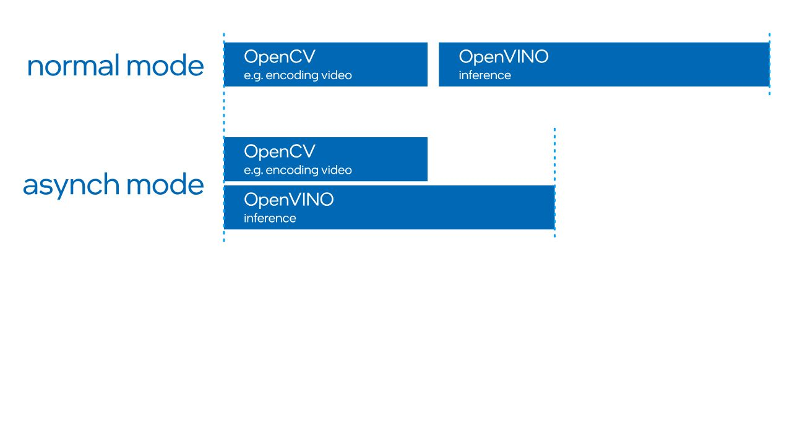

# 02B｜OpenVINO编译、量化与异构推理：图、设备、内存和请求的生命周期

截止2026-11-05。本文核验OpenVINO公开开发文档、插件实现指南与API示例，区分master动态快照、2026通用文档和Suite安装指南绑定的2025.3.0。新版文档中标明2026.0/2026.1的能力不自动回填到旧BKC。没有运行转换、编译、量化或benchmark。

## 1. 部署对象：模型图不是目标设备二进制

训练框架对象或ONNX经`ov.convert_model`进入`ov.Model`，可调整shape、预处理和精度，再保存为IR或交给`Core.compile_model`。IR通常由XML拓扑和BIN权重组成；`CompiledModel`则绑定设备插件和编译配置，`InferRequest`负责一次输入、执行及输出。支持读取ONNX不等于所有ONNX算子都能落到某个NPU，转换成功也不代表量化精度或真实机器人动作有效。PyTorch动态Python控制流、非张量辅助对象及自定义算子需要逐模型处理，不能将“支持PyTorch”作为完成部署的证明。[Intel02B_Convert](https://raw.githubusercontent.com/openvinotoolkit/openvino/master/docs/articles_en/openvino-workflow/model-preparation/convert-model-to-ir.rst)、[Intel02B_InferAPI](https://raw.githubusercontent.com/openvinotoolkit/openvino/master/docs/articles_en/assets/snippets/ov_infer_request.py)。

工程顺序应先锁模型revision、权重、输入命名、shape、dtype及归一化，再生成IR并以同一输入对齐源模型；之后选择显式CPU/GPU/NPU编译，记录执行设备、算子支持、内存和结果误差。用于感知的RGB/BGR顺序、NCHW/NHWC布局、resize及输出坐标契约是模型交付的一部分，不能留给ROS节点凭经验猜测。保存IR不意味着保存了传感器标定、动作单位或本体安全约束。

## 2. 设备选择与子图拆分：AUTO和HETERO解决不同问题

| 模式 | 官方执行对象 | 重要行为 | 成立条件 | 失效/验收重点 |
|---|---|---|---|---|
| 显式CPU/GPU/NPU | 一个目标插件的CompiledModel | 固定执行设备，利于精度对齐 | 算子、shape、驱动和内存支持 | 编译失败应追踪具体算子与布局 |
| AUTO | 代理设备选择完整模型执行目标 | 默认有CPU启动辅助和运行失败回退；NPU须显式列入 | 明确候选设备、性能hint和回退策略 | 启动/稳定阶段设备可能不同，精度与延迟要分别测 |
| HETERO | 按affinity分割子图，每段独立编译 | query_model后连接中间tensor，CPU可接不支持的算子 | 子图拓扑本身可编译，搬运代价可接受 | greedy分配不保证最优；NPU仅部分模型支持 |
| Pipeline parallelism | 将模型分阶段放到多个设备 | 当前文档标preview、估计内存与传输 | 足够内存，阶段/设备适配 | 顺序阶段不是单模型TOPS简单相加 |

AUTO文档明确NPU从默认优先列表排除，须显式指定。CPU启动辅助在最佳设备编译期间先执行，缓存已有或禁用startup fallback时行为不同；stateful模型也有例外。因此一次短时精度测试混用设备可能产生不一致结果，官方不建议用AUTO做精度验收。`execution_devices`、startup/runtime fallback和优先列表应写入测试记录；发生回退后仍返回结果不代表机器人期限仍满足。[Intel02B_AUTO](https://raw.githubusercontent.com/openvinotoolkit/openvino/master/docs/articles_en/openvino-workflow/running-inference/inference-devices-and-modes/auto-device-selection.rst)。

HETERO先通过query_model设置操作affinity，再把相连且同affinity的节点编成独立子图，用自动分配的中间tensor连接。自动分配是按优先级greedy处理，未必考虑某算子必须与邻接操作一起才能运行；官方要求必要时手动设置affinity。分析：小子图频繁CPU/GPU往返、同步及格式转换可能抵消加速，单个不支持算子的位置比其算术量更关键。NPU文档只称HETERO对部分模型支持，不将其写成任何模型都有无成本CPU fallback。[Intel02B_HETERO](https://raw.githubusercontent.com/openvinotoolkit/openvino/master/docs/articles_en/openvino-workflow/running-inference/inference-devices-and-modes/hetero-execution.rst)、[Intel02B_NPU](https://raw.githubusercontent.com/openvinotoolkit/openvino/master/docs/articles_en/openvino-workflow/running-inference/inference-devices-and-modes/npu-device.rst)。

## 3. GPU图优化：布局、kernel选择和内存复用

GPU插件的TransformationPipeline处理图变换，ProgramBuilder把语义转为primitive拓扑；program完成kernel选择、融合和内存依赖，network分配可执行内存。Graph是每stream的图副本，具有独立内存；常量可在stream/batch间共享，输出与workspace不能因此一概视为共享。`prepare_primitive_fusing`、`prepare_quantization`、`reorder_inputs`及`remove_redundant_reorders`揭示收益机制：减少中间读写、选取适合布局的实现、消除不必要重排。并非每次重排都能删除，ROS输入布局与blocked kernel布局不同仍会产生代价。[Intel02B_GPU_Flow](https://raw.githubusercontent.com/openvinotoolkit/openvino/master/src/plugins/intel_gpu/docs/simplified_workflow.md)、[Intel02B_GPU_Memory](https://raw.githubusercontent.com/openvinotoolkit/openvino/master/src/plugins/intel_gpu/docs/memory_allocation_gpu_plugin.md)。

kernel_selector用ParamsKey快速筛掉不支持的实现，再以Validate、启发式或适用的autotune选择kernel。形状、数据类型、fsv16/fsv32等布局、工作组大小及融合操作均影响选择；一个算子名相同不意味着使用同一kernel。memory_pool只在用户之间没有生命周期依赖时复用地址，out-of-order执行还需更完整依赖分析。分析：增加stream/request可能提升吞吐，同时提高内存驻留和workspace峰值；因此batch1机器人的最佳设置应由数据年龄和P99决定，而不是最大FPS。[Intel02B_GPU_Kernels](https://raw.githubusercontent.com/openvinotoolkit/openvino/master/src/plugins/intel_gpu/docs/gpu_kernels.md)、[Intel02B_GPU_Memory](https://raw.githubusercontent.com/openvinotoolkit/openvino/master/src/plugins/intel_gpu/docs/memory_allocation_gpu_plugin.md)。

当前通用GPU文档描述OpenCL默认实现；master新增COMBINED构建可在同一GPU设备名下同时提供OpenCL/Level Zero库，但明确opt-in、默认构建不变。COMBINED按物理设备及interop能力选runtime，缓存key区分OCL/ZE/SYCL，跨runtime不共享二进制。不能因为Suite装了Level Zero库，就认定所用OpenVINO GPU发行包已采用COMBINED，更不能直接用新的内部环境变量替代正式release验证。[Intel02B_GPU](https://raw.githubusercontent.com/openvinotoolkit/openvino/master/docs/articles_en/openvino-workflow/running-inference/inference-devices-and-modes/gpu-device.rst)、[Intel02B_GPU_Dispatch](https://raw.githubusercontent.com/openvinotoolkit/openvino/master/src/plugins/intel_gpu/docs/gpu_dual_runtime_dispatch.md)。

## 4. NPU编译路径、shape和产物兼容

NPU插件将IR转成平台特定产物，编译器负责各硬件子模块上的层调度和内存事务。传统Compiler-In-Driver来自驱动包；文档称2026.0引入Compiler-In-Plugin预览、2026.1将其作为优先选择，可用`compiler_type`覆盖。这改变了compiler与driver的交付耦合，但没有消除firmware、Level Zero和目标架构约束。Suite2025.3.0不能按2026.1默认行为解释。[Intel02B_NPU](https://raw.githubusercontent.com/openvinotoolkit/openvino/master/docs/articles_en/openvino-workflow/running-inference/inference-devices-and-modes/npu-device.rst)、[Intel02A_Install](https://raw.githubusercontent.com/open-edge-platform/robotics-ai-suite/1b0b22a2964f0f998c34cc03c5053fe61764015d/docs/user-guide/platform_foundation/getting_started/step_by_step.md)。

当前NPU动态shape仍标experimental，从NPU40XX/Lunar Lake起支持，需Linux驱动1.30或所列Windows驱动及更新版本；只支持有上界的维度，并限定Compiler-In-Plugin，Compiler-In-Driver不支持该动态路径。边界不仅是“动态支持Yes/No”：上界会影响分配、stride和最坏输入容量，语言token长度、多相机尺寸及batch必须分别核验。GPU/CPU也按各自动态实现判断，不能把CPUreshape成功推导为NPU可运行。[Intel02B_NPU](https://raw.githubusercontent.com/openvinotoolkit/openvino/master/docs/articles_en/openvino-workflow/running-inference/inference-devices-and-modes/npu-device.rst)、[Intel02B_Shapes](https://raw.githubusercontent.com/openvinotoolkit/openvino/master/docs/articles_en/openvino-workflow/running-inference/model-input-output/dynamic-shapes.rst)。

NPU的`runtime_requirements`与`compatibility_check`用于查询/检查编译产物需求；文档提示某些driver或weightless预览模型不支持该property，须先查supported_properties，直接读取可抛异常。正式资产清单应包含IR hash、compiler type/version、driver/firmware、设备架构、shape及选项，不把blob视为跨硬件、跨版本的通用文件。当前主张只说明API与兼容检查机制，不保证任意导出的旧产物都能被新包导入。[Intel02B_NPU](https://raw.githubusercontent.com/openvinotoolkit/openvino/master/docs/articles_en/openvino-workflow/running-inference/inference-devices-and-modes/npu-device.rst)。

## 5. 量化与压缩：scale、校准、精度与执行格式

NNCF的`quantize`需要Dataset及正确输入变换，估计激活量化参数；basic flow列subset_size默认300，可设置ignored_scope保留敏感层，fast_bias_correction影响校正流程。校准集应代表相机曝光、机器人状态及实际语言输入，训练集存在不等于校准覆盖充分。分析：离线误差低也可能在罕见接触或暗光场景恶化，感知精度与动作任务成功需分层评估。量化scale、zero point和粒度是模型产物的一部分，不可只给文件名加INT8标签。[Intel02B_Quant](https://raw.githubusercontent.com/openvinotoolkit/openvino/master/docs/articles_en/openvino-workflow/model-optimization-guide/quantizing-models-post-training/basic-quantization-flow.rst)、[Intel02B_NNCF](https://raw.githubusercontent.com/openvinotoolkit/nncf/develop/README.md)。

`compress_weights`是权重压缩，区别于权重和激活都量化的推理。INT4_SYM/ASYM、group_size、ratio和backup_mode决定压缩范围；当前文档推荐128/64/32组大小，默认128，ratio定义低位压缩层比例。较小group通常增加scale元数据与模型体积，可能改善精度，但性能仍需目标kernel验证。AWQ、GPTQ、scale_estimation等需要数据的选项应明确保存配置。压缩权重不证明每层计算全为INT4，也不意味着NPU峰值INT8与模型吞吐成比例。[Intel02B_Weight](https://raw.githubusercontent.com/openvinotoolkit/openvino/master/docs/articles_en/openvino-workflow/model-optimization-guide/weight-compression/4-bit-weight-quantization.rst)。

## 6. RemoteTensor与异步请求：省拷贝必须满足生命周期

GPU memory文档区分cl_mem、usm_host、usm_shared和usm_device：可访问、自动迁移、驻留位置不同。RemoteContext为共享对象建立上下文，RemoteTensor包装原生内存；GPU有OpenCL等interop，NPU文档列Linux DMA-BUF/Windows NT handle及Level Zero context。只是提供这些API不能证明某个RealSense ROS节点已经把buffer无拷贝传入NPU。跨进程、格式转换、设备同步和相机buffer回收均需检查。[Intel02B_GPU_Memory](https://raw.githubusercontent.com/openvinotoolkit/openvino/master/src/plugins/intel_gpu/docs/memory_allocation_gpu_plugin.md)、[Intel02B_RemoteGPU](https://raw.githubusercontent.com/openvinotoolkit/openvino/master/docs/articles_en/openvino-workflow/running-inference/inference-devices-and-modes/gpu-device/remote-tensor-api-gpu-plugin.rst)、[Intel02B_RemoteNPU](https://raw.githubusercontent.com/openvinotoolkit/openvino/master/docs/articles_en/openvino-workflow/running-inference/inference-devices-and-modes/npu-device/remote-tensor-api-npu-plugin.rst)。

NPU CPU虚拟地址路径要求指针和分配大小按4KB页对齐；内存须保持到全部相关请求执行完成、请求销毁且remote tensor销毁之后。提前将采集buffer归还相机池，即使推理已开始，也可能产生内存损坏。`create_tensor`等重载并不替调用方管理所有外部分配；准确C++示例已归档，未将void pointer接口描述为类型安全或任意指针可访问。[Intel02B_RemoteNPU](https://raw.githubusercontent.com/openvinotoolkit/openvino/master/docs/articles_en/openvino-workflow/running-inference/inference-devices-and-modes/npu-device/remote-tensor-api-npu-plugin.rst)、[Intel02B_RemoteAPI](https://raw.githubusercontent.com/openvinotoolkit/openvino/master/docs/articles_en/assets/snippets/npu_remote_objects_creation.cpp)。

图1展示预处理和推理重叠的机制，没有数值性能、硬件或测量坐标，不能据图推出加速倍数。原raw路径实际返回Git LFS指针，本轮取得官方media原SVG后完整渲染；指针没有进入有效引用。[Intel02B_AsyncFig_Original](https://media.githubusercontent.com/media/openvinotoolkit/openvino/master/docs/articles_en/assets/images/synch-vs-asynch.svg)。

InferRequest有infer/start_async/wait/wait_for/set_callback/cancel等对象生命周期。异步能使CPU处理下一帧时设备执行上一帧，但输入不可在请求仍使用时覆盖，输出也要在完成之后读取。callback应保存帧ID和采集时刻，不能按回调抵达顺序猜测多路相机的物理时间。建议以有界请求池和明确丢旧帧策略控制背压：当推理慢于采集时，无限FIFO会让导航使用过期障碍物，即使每秒推理次数稳定。这里是系统设计分析，文档API没有承诺自动处理ROS数据年龄。[Intel02B_InferAPI](https://raw.githubusercontent.com/openvinotoolkit/openvino/master/docs/articles_en/assets/snippets/ov_infer_request.py)。

## 7. 缓存、机制对照与验证链

cache_dir用于复用编译产物，首次写缓存可能略慢；设备不支持import/export时可正常推理但不生成缓存。模型cache、kernel cache和NPU driver cache是不同层；NPU驱动缓存有自己的目录、容量和淘汰。weightless缓存需要原始IR权重，不能仅发小cache文件；COMBINED也按runtime隔离key。不同文档对缓存加密的设备范围有不同描述：总览限定CPU/GPU，NPU页单列callbacks；应以准确release和插件supported_properties验证，本文不声称全设备默认加密。[Intel02B_Cache](https://raw.githubusercontent.com/openvinotoolkit/openvino/master/docs/articles_en/openvino-workflow/running-inference/optimize-inference/optimizing-latency/model-caching-overview.rst)、[Intel02B_CacheAPI](https://raw.githubusercontent.com/openvinotoolkit/openvino/master/docs/articles_en/assets/snippets/ov_caching.py)、[Intel02A_NPU_Overview](https://raw.githubusercontent.com/intel/linux-npu-driver/main/docs/overview.md)、[Intel02B_GPU_Dispatch](https://raw.githubusercontent.com/openvinotoolkit/openvino/master/src/plugins/intel_gpu/docs/gpu_dual_runtime_dispatch.md)、[Intel02B_NPU](https://raw.githubusercontent.com/openvinotoolkit/openvino/master/docs/articles_en/openvino-workflow/running-inference/inference-devices-and-modes/npu-device.rst)。

与TensorRT等目标编译runtime作机制对照，迁移单位是源模型、预后处理和测试集，而非直接复用engine/cache；收益来自适合设备的融合、kernel和内存执行，必须重新核验shape、算子、校准及异步接口。本篇不提供无同条件测量的性能排名。OpenVINO根Apache2.0、GPU第三方组件通知和NNCF说明分别归档；模型权重与机器人SDK许可仍独立。[Intel02B_License](https://raw.githubusercontent.com/openvinotoolkit/openvino/master/LICENSE)、[Intel02B_GPU_Impl](https://raw.githubusercontent.com/openvinotoolkit/openvino/master/src/plugins/intel_gpu/README.md)、[Intel02B_NNCF](https://raw.githubusercontent.com/openvinotoolkit/nncf/develop/README.md)。

可复建验收将转换耗时、首次编译、冷启动第一帧、warmup后单请求延迟、并发吞吐、内存峰值、P99及采集到结果数据年龄分别记录。显式设备做精度对齐，再测试AUTO回退；冷/热cache以及更新后不兼容产物应分别演练。统一记录模型revision、精度、batch、shape、SKU、功率、OS/kernel、runtime/compiler/driver/firmware及预后处理是否计时。01的厂商benchmark不能代替此流程，纯推理Hz也不是控制或电机伺服Hz。

## 参考资料

原文与本地原件对应如下。动态分支只代表所列采集时点；固定Suite源码对象不等于每篇发布日期。代码许可不自动覆盖固件、二进制、模型权重、数据和本体SDK。HTML静态依赖缺失以registry记录为准，不承诺动态交互或像素级离线一致。

| 资料 | 原文 | 版本/边界 | 本地原件 | 采集时间UTC | 归档状态 |
|---|---|---|---|---|---|
| Intel02B_Convert | [原文](https://raw.githubusercontent.com/openvinotoolkit/openvino/master/docs/articles_en/openvino-workflow/model-preparation/convert-model-to-ir.rst) | 动态快照；文中限定API/发行版本 | [本地原件](REFERENCES.md#ref-f288f100150bb3d1) | 2026-11-05T02:27:18.010032+00:00 | complete_static；缺失依赖0 |
| Intel02B_InferAPI | [原文](https://raw.githubusercontent.com/openvinotoolkit/openvino/master/docs/articles_en/assets/snippets/ov_infer_request.py) | 动态快照；文中限定API/发行版本 | [本地原件](REFERENCES.md#ref-b830c2bb20f73a68) | 2026-11-05T02:28:20.397791+00:00 | complete_static；缺失依赖0 |
| Intel02B_AUTO | [原文](https://raw.githubusercontent.com/openvinotoolkit/openvino/master/docs/articles_en/openvino-workflow/running-inference/inference-devices-and-modes/auto-device-selection.rst) | 动态快照；文中限定API/发行版本 | [本地原件](REFERENCES.md#ref-e1d65ba10091489c) | 2026-11-05T02:27:22.786073+00:00 | complete_static；缺失依赖0 |
| Intel02B_HETERO | [原文](https://raw.githubusercontent.com/openvinotoolkit/openvino/master/docs/articles_en/openvino-workflow/running-inference/inference-devices-and-modes/hetero-execution.rst) | 动态快照；文中限定API/发行版本 | [本地原件](REFERENCES.md#ref-92285406c05d6b21) | 2026-11-05T02:27:23.835544+00:00 | complete_static；缺失依赖0 |
| Intel02B_NPU | [原文](https://raw.githubusercontent.com/openvinotoolkit/openvino/master/docs/articles_en/openvino-workflow/running-inference/inference-devices-and-modes/npu-device.rst) | 动态快照；文中限定API/发行版本 | [本地原件](REFERENCES.md#ref-cb4e7b7716dce4f6) | 2026-11-05T02:27:21.574666+00:00 | complete_static；缺失依赖0 |
| Intel02B_Shapes | [原文](https://raw.githubusercontent.com/openvinotoolkit/openvino/master/docs/articles_en/openvino-workflow/running-inference/model-input-output/dynamic-shapes.rst) | 动态快照；文中限定API/发行版本 | [本地原件](REFERENCES.md#ref-d67fcdf544672283) | 2026-11-05T02:27:24.940715+00:00 | complete_static；缺失依赖0 |
| Intel02B_GPU | [原文](https://raw.githubusercontent.com/openvinotoolkit/openvino/master/docs/articles_en/openvino-workflow/running-inference/inference-devices-and-modes/gpu-device.rst) | 动态快照；文中限定API/发行版本 | [本地原件](REFERENCES.md#ref-cd83738a0dcf42fd) | 2026-11-05T02:27:20.518626+00:00 | complete_static；缺失依赖0 |
| Intel02B_GPU_Flow | [原文](https://raw.githubusercontent.com/openvinotoolkit/openvino/master/src/plugins/intel_gpu/docs/simplified_workflow.md) | 动态快照；文中限定API/发行版本 | [本地原件](REFERENCES.md#ref-c738c00e81f74dac) | 2026-11-05T02:29:16.828751+00:00 | complete_static；缺失依赖0 |
| Intel02B_GPU_Memory | [原文](https://raw.githubusercontent.com/openvinotoolkit/openvino/master/src/plugins/intel_gpu/docs/memory_allocation_gpu_plugin.md) | 动态快照；文中限定API/发行版本 | [本地原件](REFERENCES.md#ref-1e66c4fc5304f6fe) | 2026-11-05T02:29:17.784698+00:00 | complete_static；缺失依赖0 |
| Intel02B_GPU_Kernels | [原文](https://raw.githubusercontent.com/openvinotoolkit/openvino/master/src/plugins/intel_gpu/docs/gpu_kernels.md) | 动态快照；文中限定API/发行版本 | [本地原件](REFERENCES.md#ref-aeede87517ed4644) | 2026-11-05T02:29:18.814295+00:00 | complete_static；缺失依赖0 |
| Intel02B_GPU_Dispatch | [原文](https://raw.githubusercontent.com/openvinotoolkit/openvino/master/src/plugins/intel_gpu/docs/gpu_dual_runtime_dispatch.md) | 动态快照；文中限定API/发行版本 | [本地原件](REFERENCES.md#ref-ecfa9bdc23701352) | 2026-11-05T02:29:19.805964+00:00 | complete_static；缺失依赖0 |
| Intel02B_Quant | [原文](https://raw.githubusercontent.com/openvinotoolkit/openvino/master/docs/articles_en/openvino-workflow/model-optimization-guide/quantizing-models-post-training/basic-quantization-flow.rst) | 动态快照；文中限定API/发行版本 | [本地原件](REFERENCES.md#ref-df15d4aaeedfe9a7) | 2026-11-05T02:27:26.977277+00:00 | complete_static；缺失依赖0 |
| Intel02B_NNCF | [原文](https://raw.githubusercontent.com/openvinotoolkit/nncf/develop/README.md) | 动态快照；文中限定API/发行版本 | [本地原件](REFERENCES.md#ref-512875f56658d3ba) | 2026-11-05T02:27:35.288889+00:00 | complete_static；缺失依赖0 |
| Intel02B_Weight | [原文](https://raw.githubusercontent.com/openvinotoolkit/openvino/master/docs/articles_en/openvino-workflow/model-optimization-guide/weight-compression/4-bit-weight-quantization.rst) | 动态快照；文中限定API/发行版本 | [本地原件](REFERENCES.md#ref-b64ddbaeb8fddc28) | 2026-11-05T02:27:27.967781+00:00 | complete_static；缺失依赖0 |
| Intel02B_RemoteGPU | [原文](https://raw.githubusercontent.com/openvinotoolkit/openvino/master/docs/articles_en/openvino-workflow/running-inference/inference-devices-and-modes/gpu-device/remote-tensor-api-gpu-plugin.rst) | 动态快照；文中限定API/发行版本 | [本地原件](REFERENCES.md#ref-2571dc7a4ea9998f) | 2026-11-05T02:27:29.323402+00:00 | complete_static；缺失依赖0 |
| Intel02B_RemoteNPU | [原文](https://raw.githubusercontent.com/openvinotoolkit/openvino/master/docs/articles_en/openvino-workflow/running-inference/inference-devices-and-modes/npu-device/remote-tensor-api-npu-plugin.rst) | 动态快照；文中限定API/发行版本 | [本地原件](REFERENCES.md#ref-0c56cdb43a59da75) | 2026-11-05T02:27:30.347336+00:00 | complete_static；缺失依赖0 |
| Intel02B_RemoteAPI | [原文](https://raw.githubusercontent.com/openvinotoolkit/openvino/master/docs/articles_en/assets/snippets/npu_remote_objects_creation.cpp) | 动态快照；文中限定API/发行版本 | [本地原件](REFERENCES.md#ref-35b5ad23192199cb) | 2026-11-05T02:28:23.241030+00:00 | complete_static；缺失依赖0 |
| Intel02B_AsyncFig_Original | [原文](https://media.githubusercontent.com/media/openvinotoolkit/openvino/master/docs/articles_en/assets/images/synch-vs-asynch.svg) | 动态快照；文中限定API/发行版本 | [本地原件](REFERENCES.md#ref-e0d8384ef68a1ec1) | 2026-11-05T02:28:58.579384+00:00 | complete_static；缺失依赖0 |
| Intel02B_Cache | [原文](https://raw.githubusercontent.com/openvinotoolkit/openvino/master/docs/articles_en/openvino-workflow/running-inference/optimize-inference/optimizing-latency/model-caching-overview.rst) | 动态快照；文中限定API/发行版本 | [本地原件](REFERENCES.md#ref-b0da798395ae7d62) | 2026-11-05T02:27:25.933450+00:00 | complete_static；缺失依赖0 |
| Intel02B_CacheAPI | [原文](https://raw.githubusercontent.com/openvinotoolkit/openvino/master/docs/articles_en/assets/snippets/ov_caching.py) | 动态快照；文中限定API/发行版本 | [本地原件](REFERENCES.md#ref-083d3c5ef12b43f5) | 2026-11-05T02:28:21.313020+00:00 | complete_static；缺失依赖0 |
| Intel02A_NPU_Overview | [原文](https://raw.githubusercontent.com/intel/linux-npu-driver/main/docs/overview.md) | 动态快照；文中限定API/发行版本 | [本地原件](REFERENCES.md#ref-655df06adbff443a) | 2026-11-05T02:24:26.114091+00:00 | complete_static；缺失依赖0 |
| Intel02A_Install | [原文](https://raw.githubusercontent.com/open-edge-platform/robotics-ai-suite/1b0b22a2964f0f998c34cc03c5053fe61764015d/docs/user-guide/platform_foundation/getting_started/step_by_step.md) | 固定Suite源码对象 1b0b22a2964f | [本地原件](REFERENCES.md#ref-a532ce57d243d5ed) | 2026-11-05T02:21:08.033698+00:00 | complete_static；缺失依赖0 |
| Intel02B_License | [原文](https://raw.githubusercontent.com/openvinotoolkit/openvino/master/LICENSE) | 动态快照；文中限定API/发行版本 | [本地原件](REFERENCES.md#ref-51fd2d47e1ec0dfc) | 2026-11-05T02:27:33.786779+00:00 | complete_static；缺失依赖0 |
| Intel02B_GPU_Impl | [原文](https://raw.githubusercontent.com/openvinotoolkit/openvino/master/src/plugins/intel_gpu/README.md) | 动态快照；文中限定API/发行版本 | [本地原件](REFERENCES.md#ref-bcfa9daf136f7f26) | 2026-11-05T02:28:22.289309+00:00 | complete_static；缺失依赖0 |
