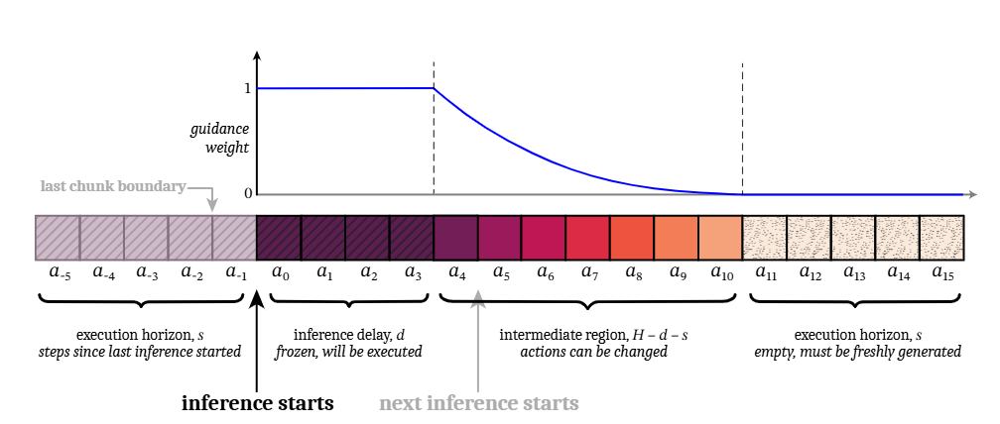

# 02C｜Physical AI模型流程与机器人运行接口：π0.5、RTC和动作契约

截止2026-11-05；固定Suite源码与PhysicalAI/LeRobot动态快照分别归档。本文研究软件部署链和执行对象，完整模型地图留待04；未下载受限权重、运行训练、转换模型或驱动本体。

## 1. 从模型优化到机器人runtime

Suite提供ACT、Diffusion Policy、RDT和π0.5+RTC等样例；它们并非同一环境中已同时验收的应用包。OpenVINO Physical AI是独立runtime，连接相机、机器人和policy；Physical AI Studio是与之相接的采集/训练/导出平台，不能把两者当成同一个推理插件。前者接收导出包、构造观测、调度推理和发动作，OpenVINO只承担其中的模型执行。[Intel02C_PhysicalRuntime](https://raw.githubusercontent.com/open-edge-platform/robotics-ai-suite/1b0b22a2964f0f998c34cc03c5053fe61764015d/docs/user-guide/ai_resources/openvino/openvino_physical_ai_runtime.md)、[Intel02C_PhysicalAI_README](https://raw.githubusercontent.com/openvinotoolkit/physicalai/main/README.md)、[Intel02C_Runtime_Architecture](https://raw.githubusercontent.com/openvinotoolkit/physicalai/main/docs/explanation/architecture.md)。

| 路线 | 输入/产物 | 目标执行证据 | 环境或成熟度边界 | 本体接口缺口 |
|---|---|---|---|---|
| π0.5旧ONNX教程 | PyTorch→ONNX→IR→INT8权重文件 | benchmark_app/验证脚本明确CPU | OpenVINO2025.4.0、NNCF2.19.0、ONNX1.20.0；LeRobot未锁revision | wrapper图的动作语义尚未闭环 |
| π0.5+RTC样例 | LeRobot子模块与patch、IR、旧chunk前缀 | OpenVINO sample_actions替换；MuJoCo/ALOHA流程 | 须固定submodule及全部patch；不能只用main README | 相机布局、动作映射、延迟与队列要逐配置验证 |
| ACT/DP/RDT | 训练/微调checkpoint、模型转换和仿真样例 | Suite独立教程、Deb包 | 每个任务/设备有自己的依赖和权重 | 不代表通用本体SDK或真实成功率 |
| PhysicalAI runtime | manifest＋模型＋stats→InferenceModel→RobotRuntime | OpenVINO/ONNX backend、Robot Protocol | 动态API有变化；适配器与模型包需匹配 | joint_names、校准、单位、停止路径由系统完成 |

表格分别依据官方导出、RTC、ACT、DP、RDT和runtime文档；目标设备不从架构图推测。[Intel02C_Pi05_Export](https://raw.githubusercontent.com/open-edge-platform/robotics-ai-suite/1b0b22a2964f0f998c34cc03c5053fe61764015d/docs/user-guide/ai_resources/openvino/pi05-optimization.md)、[Intel02C_RTC_README](https://raw.githubusercontent.com/open-edge-platform/robotics-ai-suite/1b0b22a2964f0f998c34cc03c5053fe61764015d/src/pipelines/pi05-rtc-ov/README.md)、[Intel02C_ACT](https://raw.githubusercontent.com/open-edge-platform/robotics-ai-suite/1b0b22a2964f0f998c34cc03c5053fe61764015d/docs/user-guide/software_references/humanoid/sample_pipelines/imitation_learning_act.md)、[Intel02C_DP](https://raw.githubusercontent.com/open-edge-platform/robotics-ai-suite/1b0b22a2964f0f998c34cc03c5053fe61764015d/docs/user-guide/software_references/humanoid/sample_pipelines/diffusion_policy.md)、[Intel02C_RDT](https://raw.githubusercontent.com/open-edge-platform/robotics-ai-suite/1b0b22a2964f0f998c34cc03c5053fe61764015d/docs/user-guide/software_references/humanoid/sample_pipelines/robotics_diffusion_transformer.md)、[Intel02C_PhysicalAI_README](https://raw.githubusercontent.com/openvinotoolkit/physicalai/main/README.md)。

## 2. π0.5旧转换链：路径完整，语义仍需核验

教程的具体链条是加载`lerobot/pi05_base`，`convert_pytorch_onnx.py`用torch.onnx.export输出ONNX，`onnx_to_ov_ir.py`生成XML/BIN，`nncf_int8_compression.py`执行INT8_ASYM权重压缩，验证脚本在CPU编译后读同一随机输入。源码设置opset20、ONNX_ATEN_FALLBACK、禁用constant folding，只把batch轴标动态；保留ATen fallback不证明OpenVINO能接受全部操作，batch动态也不是所有图像/token维度动态。[Intel02C_ExportCode](https://raw.githubusercontent.com/open-edge-platform/robotics-ai-suite/1b0b22a2964f0f998c34cc03c5053fe61764015d/src/pipelines/vla-pi0.5-openvino/convert_pytorch_onnx.py)、[Intel02C_IRCode](https://raw.githubusercontent.com/open-edge-platform/robotics-ai-suite/1b0b22a2964f0f998c34cc03c5053fe61764015d/src/pipelines/vla-pi0.5-openvino/onnx_to_ov_ir.py)、[Intel02C_CompressCode](https://raw.githubusercontent.com/open-edge-platform/robotics-ai-suite/1b0b22a2964f0f998c34cc03c5053fe61764015d/src/pipelines/vla-pi0.5-openvino/nncf_int8_compression.py)、[Intel02C_ValidateCode](https://raw.githubusercontent.com/open-edge-platform/robotics-ai-suite/1b0b22a2964f0f998c34cc03c5053fe61764015d/src/pipelines/vla-pi0.5-openvino/validation/lerobot_ov_inferencing.py)。

存在三处影响结论的条件。第一，教程将sample_noise的正态采样替为零，将sample_time替为固定beta均值；修改随机性可能改变行为，不能以导出成功证明原策略等价。第二，导出wrapper调用`policy.model(..., state, actions)`，把actions本身当输入，未调用policy.select_action。当前LeRobot源码明确训练forward计算MSE loss，另有sample_actions/predict_action_chunk推理路径，且当前参数签名与旧wrapper不同。旧教程没有锁LeRobot revision，因此本章不能确认该`actions_out`就是可执行动作chunk，也不直接断言历史所有版本相同；必须追到目标revision的调用语义和输出形状。第三，文档压缩示例有all_layers=True，归档脚本实际没有此参数，应分别记录，不能称实际产物已经全层量化。[Intel02C_Pi05_Export](https://raw.githubusercontent.com/open-edge-platform/robotics-ai-suite/1b0b22a2964f0f998c34cc03c5053fe61764015d/docs/user-guide/ai_resources/openvino/pi05-optimization.md)、[Intel02C_ExportCode](https://raw.githubusercontent.com/open-edge-platform/robotics-ai-suite/1b0b22a2964f0f998c34cc03c5053fe61764015d/src/pipelines/vla-pi0.5-openvino/convert_pytorch_onnx.py)、[Intel02C_CompressCode](https://raw.githubusercontent.com/open-edge-platform/robotics-ai-suite/1b0b22a2964f0f998c34cc03c5053fe61764015d/src/pipelines/vla-pi0.5-openvino/nncf_int8_compression.py)、[Intel02C_LeRobot_PI05_Source](https://raw.githubusercontent.com/huggingface/lerobot/main/src/lerobot/policies/pi05/modeling_pi05.py)。

教程benchmark输入列一幅224×224图、200语言token、32维state及50×32的actions，明确在CPU使用latency hint，没有给本轮实际延迟结果。MSE小于1e-3只是其建议的随机张量比较阈值，不是本研究获得的值，更不是任务成功或安全指标。如果比较的都是修改后的训练forward，误差再小也不能补齐真实policy推理语义。可靠验证应保存未经修改的参考、固定噪声输入、完整去噪/flow过程、反归一化结果和留出任务，逐层区分转换误差、压缩误差与环境误差。[Intel02C_Pi05_Export](https://raw.githubusercontent.com/open-edge-platform/robotics-ai-suite/1b0b22a2964f0f998c34cc03c5053fe61764015d/docs/user-guide/ai_resources/openvino/pi05-optimization.md)、[Intel02C_ValidateCode](https://raw.githubusercontent.com/open-edge-platform/robotics-ai-suite/1b0b22a2964f0f998c34cc03c5053fe61764015d/src/pipelines/vla-pi0.5-openvino/validation/lerobot_ov_inferencing.py)。

## 3. RTC：动作队列延续，不是提高模型调用频率

π0.5+RTC样例用前一个chunk尚未执行的尾部约束新chunk，在flow matching过程中以prefix guidance处理衔接，区别于生成后再做temporal ensembling。IR多出`prev_chunk_left_over`与`prefix_weights`，首帧可以传零tensor停用RTC。补丁将模型的sample_actions替换为OpenVINO实现，说明这条路线与旧forward导出教程不同；单个patch不是完整安装，仍需按序应用整组patch并固定LeRobot子模块。[Intel02C_Pi05_RTC](https://raw.githubusercontent.com/open-edge-platform/robotics-ai-suite/1b0b22a2964f0f998c34cc03c5053fe61764015d/docs/user-guide/software_references/humanoid/sample_pipelines/pi05_with_rtc.md)、[Intel02C_RTC_Patch](https://raw.githubusercontent.com/open-edge-platform/robotics-ai-suite/1b0b22a2964f0f998c34cc03c5053fe61764015d/src/pipelines/pi05-rtc-ov/patches/0003-Feat-Enable-ov-inference-in-pi05-policy.patch)。

图1原图来自Suite README，caption注明RTC论文来源。guidance weight在已冻结、将执行的前缀较高，后续中间区域衰减，新区域需重新生成；图中的d为推理延迟对应的动作步，s为执行horizon。它解释队列与新轨迹的衔接，不是50Hz实机测量。延迟变化、chunk不足或机器人执行状态偏离时，仍需降级和重新对齐。[Intel02C_RTC_Figure](https://raw.githubusercontent.com/open-edge-platform/robotics-ai-suite/1b0b22a2964f0f998c34cc03c5053fe61764015d/src/pipelines/pi05-rtc-ov/README.assets/RTC-overview.png)、[Intel02C_RTC_README](https://raw.githubusercontent.com/open-edge-platform/robotics-ai-suite/1b0b22a2964f0f998c34cc03c5053fe61764015d/src/pipelines/pi05-rtc-ov/README.md)。

分析：若控制以固定步长消费队列，模型可低于该频率调用，但队列耗尽后仍可能停顿；README中的50Hz是示例描述，不证明任一Core Ultra上长期无停顿。模型输入观测年龄、测量推理延迟、执行horizon、插值和实际设备命令节拍须共同记录。RTC不能解决关节顺序错误、归一化错误、丢包或独立安全停机；不能把后台线程称为硬实时线程。当前RTC指南还保留Meteor Lake force_probe=7d51与mtl固件的xe绑定示例，不应照搬到358H/Panther Lake；准确SKU应采用匹配release的驱动配置。[Intel02C_RTC_README](https://raw.githubusercontent.com/open-edge-platform/robotics-ai-suite/1b0b22a2964f0f998c34cc03c5053fe61764015d/src/pipelines/pi05-rtc-ov/README.md)、[Intel02C_Pi05_RTC](https://raw.githubusercontent.com/open-edge-platform/robotics-ai-suite/1b0b22a2964f0f998c34cc03c5053fe61764015d/docs/user-guide/software_references/humanoid/sample_pipelines/pi05_with_rtc.md)。

## 4. PhysicalAI导出包：Manifest、预后处理和Runner

runtime将导出包与运行配置分开。Manifest描述已经存在的模型产物、runner、chunk_size、stats及相机/本体；workflow YAML表达准备执行的配置，两者不能互相替代。InferenceModel读取导出目录，处理preprocess→runner→postprocess，选择OpenVINO或ONNX backend并维护episode状态；动作chunk和归一化统计不是一个XML文件能完全描述的。文档manifest中的class_path示例不能当作本研究已成功加载的真实包。[Intel02C_Runtime_Manifest](https://raw.githubusercontent.com/openvinotoolkit/physicalai/main/docs/explanation/manifests.md)、[Intel02C_Runtime_Inference](https://raw.githubusercontent.com/openvinotoolkit/physicalai/main/docs/explanation/inference.md)、[Intel02C_Runtime_PrePost](https://raw.githubusercontent.com/openvinotoolkit/physicalai/main/docs/how-to/inference/configure-pre-post-processing.md)。

resize预处理支持显式BCHW/BHWC输入布局，自动判定遇到歧义可抛ValueError；不支持未batch的CHW/HWC。ResizePreprocessor输出BCHW，SmolVLA resize叠成相机×batch×通道×高×宽并伴mask，不能以相机API返回HWC就直接喂模型。normalize/denormalize读取stats.safetensors；这些统计须与训练/导出配置一致。相机顺序、尺寸、mask、language tokenizer与proprio字段都影响语义，“unified API”不是自动修复不同机器人观测的算法。[Intel02C_Runtime_PrePost](https://raw.githubusercontent.com/openvinotoolkit/physicalai/main/docs/how-to/inference/configure-pre-post-processing.md)、[Intel02C_PhysicalAI_README](https://raw.githubusercontent.com/openvinotoolkit/physicalai/main/README.md)。

## 5. RobotRuntime、Execution和ActionQueue的责任

| 对象 | 负责什么 | 不负责什么 | 关键交接 |
|---|---|---|---|
| InferenceModel | 加载、预处理、推理、后处理 | 机器人循环时序 | 观测→动作chunk/单步接口 |
| Execution | 推理在哪个线程、何时触发 | 硬件I/O | Sync/Async/RTC调度 |
| ActionQueue/PolicySource | chunk缓存、合并、一tick动作 | 相机与本体时序 | 剩余chunk、阈值、前缀 |
| RobotRuntime | 观测、发动作、callbacks与tick | policy数学与决策 | fps、stop、disconnect |
| Robot Protocol | connect/observe/send_action/joint_names | 推理与校准正确性证明 | 控制器、本体SDK、动作单位 |

runtime文档明确这些边界。AsyncExecution在后台线程运行推理，request_threshold是剩余chunk比例；RTCExecution的fps将推理延迟换算为动作delay，必须与RobotRuntime控制率一致。可选interpolator能增加命令tick而不增加推理次数，因此policy调用、runtime tick、插值命令与电机伺服率是四个指标。推理延迟benchmark也不自动包含采集、控制器和实际执行。[Intel02C_Runtime_Loop](https://raw.githubusercontent.com/openvinotoolkit/physicalai/main/docs/explanation/runtime.md)、[Intel02C_Runtime_Modes](https://raw.githubusercontent.com/openvinotoolkit/physicalai/main/docs/how-to/runtime/use-execution-modes.md)。

停止语义尤其重要：stop在tick之间生效，已经开始的tick会完成并发动作；若同步推理或机器人read阻塞，停止会延后。stop不是disconnect，也不是安全急停；每次run与最终资源释放有不同生命周期。用户系统需要独立监督、期限和下游保护，不能依赖Python停止请求立即停止电机。RemoteExecution文档存在更新差异：runtime概念页仍列planned，而较新how-to称应使用RemoteInferenceModel、没有独立RemoteExecution类。本章保留差异，远程服务的真实实现、网络约束与release应在运维流程继续核验。[Intel02C_Runtime_Loop](https://raw.githubusercontent.com/openvinotoolkit/physicalai/main/docs/explanation/runtime.md)、[Intel02C_Runtime_Modes](https://raw.githubusercontent.com/openvinotoolkit/physicalai/main/docs/how-to/runtime/use-execution-modes.md)。

## 6. ACT、扩散策略和LLM样例的迁移边界

ACT、Diffusion Policy与RDT教程提供各自包、训练/转换和仿真流程，应按具体任务固定checkpoint、相机/状态与动作维度。RDT的语言embedding、视觉编码与动作生成有独立产物，任务微调权重和基础权重不能互换成功率。LLM Robotics由ASR/TTS、SAM/CLIP、Phi模型及JAKA/PLCopen接口组成；文档FunASR环境固定OpenVINO2024.3.0，而其他阶段引用2026.1 notebooks，不能压成“Suite统一使用最新OpenVINO”。其component documentation还链接ACT教程，属于导航差异，不能视作LLM实现正文。[Intel02C_ACT](https://raw.githubusercontent.com/open-edge-platform/robotics-ai-suite/1b0b22a2964f0f998c34cc03c5053fe61764015d/docs/user-guide/software_references/humanoid/sample_pipelines/imitation_learning_act.md)、[Intel02C_DP](https://raw.githubusercontent.com/open-edge-platform/robotics-ai-suite/1b0b22a2964f0f998c34cc03c5053fe61764015d/docs/user-guide/software_references/humanoid/sample_pipelines/diffusion_policy.md)、[Intel02C_RDT](https://raw.githubusercontent.com/open-edge-platform/robotics-ai-suite/1b0b22a2964f0f998c34cc03c5053fe61764015d/docs/user-guide/software_references/humanoid/sample_pipelines/robotics_diffusion_transformer.md)、[Intel02C_LLM](https://raw.githubusercontent.com/open-edge-platform/robotics-ai-suite/1b0b22a2964f0f998c34cc03c5053fe61764015d/docs/user-guide/software_references/humanoid/sample_pipelines/llm_robotics.md)。

自然语言产生代码/动作计划后，仍需检查可达性、碰撞、坐标、动作限幅及异常，不能直接把生成文本当生产控制程序。与其他VLA runtime作机制对照，可迁移资产是数据、策略权重、归一化统计、接口契约与测试集；目标编译产物和本体adapter须重新验证，本篇不输出品牌性能排名。

## 7. 许可和完整验证链

Pi05模型卡标`license: gemma`、base_model为PaliGemma，并明确当前LeRobot只包含flow-matching动作头，原工作的subtask prediction、action tokenization/RL等部分未包含；因此教程对原论文能力的介绍不能全套归因到这个checkpoint。模型卡建议针对具体任务微调，真实动作需pre/post processors。底座访问存在授权要求，本次只取公开模型卡，没有代用户接受条款或下载权重。[Intel02C_Pi05_ModelCard](https://huggingface.co/lerobot/pi05_base/raw/main/README.md)、[Intel02C_Pi05_RTC](https://raw.githubusercontent.com/open-edge-platform/robotics-ai-suite/1b0b22a2964f0f998c34cc03c5053fe61764015d/docs/user-guide/software_references/humanoid/sample_pipelines/pi05_with_rtc.md)。

PhysicalAI根代码Apache2.0、Suite样例文件SPDX Apache2.0已核验；模型权重、训练数据、外部本体SDK与插件分别检查。完整验收顺序是固定训练数据/模型revision→选真实推理入口→保留噪声与前后处理→IR/量化产物对齐→目标设备编译→相机状态映射→动作反归一化与关节契约→有界队列/回退→仿真留出→真实本体任务。本文追踪了每段交接，但没有把旧导出、独立RTC和runtime示例拼成已经验证的闭环系统。[Intel02C_Runtime_License](https://raw.githubusercontent.com/openvinotoolkit/physicalai/main/LICENSE)、[Intel02C_ExportCode](https://raw.githubusercontent.com/open-edge-platform/robotics-ai-suite/1b0b22a2964f0f998c34cc03c5053fe61764015d/src/pipelines/vla-pi0.5-openvino/convert_pytorch_onnx.py)、[Intel02C_Pi05_ModelCard](https://huggingface.co/lerobot/pi05_base/raw/main/README.md)。

## 参考资料

原文与本地原件对应如下。动态分支只代表所列采集时点；固定Suite源码对象不等于每篇发布日期。代码许可不自动覆盖固件、二进制、模型权重、数据和本体SDK。HTML静态依赖缺失以registry记录为准，不承诺动态交互或像素级离线一致。

| 资料 | 原文 | 版本/边界 | 本地原件 | 采集时间UTC | 归档状态 |
|---|---|---|---|---|---|
| Intel02C_PhysicalRuntime | [原文](https://raw.githubusercontent.com/open-edge-platform/robotics-ai-suite/1b0b22a2964f0f998c34cc03c5053fe61764015d/docs/user-guide/ai_resources/openvino/openvino_physical_ai_runtime.md) | 固定Suite源码对象 1b0b22a2964f | [本地原件](REFERENCES.md#ref-5ddbdc932397cad8) | 2026-11-05T02:32:39.725834+00:00 | complete_static；缺失依赖0 |
| Intel02C_PhysicalAI_README | [原文](https://raw.githubusercontent.com/openvinotoolkit/physicalai/main/README.md) | 动态快照；文中限定API/发行版本 | [本地原件](REFERENCES.md#ref-307bc4d885d3a5cb) | 2026-11-05T02:33:27.314624+00:00 | complete_static；缺失依赖0 |
| Intel02C_Runtime_Architecture | [原文](https://raw.githubusercontent.com/openvinotoolkit/physicalai/main/docs/explanation/architecture.md) | 动态快照；文中限定API/发行版本 | [本地原件](REFERENCES.md#ref-42b597212eb78068) | 2026-11-05T02:34:26.352088+00:00 | complete_static；缺失依赖0 |
| Intel02C_Pi05_Export | [原文](https://raw.githubusercontent.com/open-edge-platform/robotics-ai-suite/1b0b22a2964f0f998c34cc03c5053fe61764015d/docs/user-guide/ai_resources/openvino/pi05-optimization.md) | 固定Suite源码对象 1b0b22a2964f | [本地原件](REFERENCES.md#ref-81f1c3cd32409405) | 2026-11-05T02:32:40.889576+00:00 | complete_static；缺失依赖0 |
| Intel02C_RTC_README | [原文](https://raw.githubusercontent.com/open-edge-platform/robotics-ai-suite/1b0b22a2964f0f998c34cc03c5053fe61764015d/src/pipelines/pi05-rtc-ov/README.md) | 固定Suite源码对象 1b0b22a2964f | [本地原件](REFERENCES.md#ref-1a4a0587558affad) | 2026-11-05T02:32:44.193262+00:00 | complete_static；缺失依赖0 |
| Intel02C_ACT | [原文](https://raw.githubusercontent.com/open-edge-platform/robotics-ai-suite/1b0b22a2964f0f998c34cc03c5053fe61764015d/docs/user-guide/software_references/humanoid/sample_pipelines/imitation_learning_act.md) | 固定Suite源码对象 1b0b22a2964f | [本地原件](REFERENCES.md#ref-b6595b43ea1fe6e1) | 2026-11-05T02:32:45.564339+00:00 | complete_static；缺失依赖0 |
| Intel02C_DP | [原文](https://raw.githubusercontent.com/open-edge-platform/robotics-ai-suite/1b0b22a2964f0f998c34cc03c5053fe61764015d/docs/user-guide/software_references/humanoid/sample_pipelines/diffusion_policy.md) | 固定Suite源码对象 1b0b22a2964f | [本地原件](REFERENCES.md#ref-be18c90dbbb93a5b) | 2026-11-05T02:32:47.175264+00:00 | complete_static；缺失依赖0 |
| Intel02C_RDT | [原文](https://raw.githubusercontent.com/open-edge-platform/robotics-ai-suite/1b0b22a2964f0f998c34cc03c5053fe61764015d/docs/user-guide/software_references/humanoid/sample_pipelines/robotics_diffusion_transformer.md) | 固定Suite源码对象 1b0b22a2964f | [本地原件](REFERENCES.md#ref-92429532a8331fdf) | 2026-11-05T02:32:48.410709+00:00 | complete_static；缺失依赖0 |
| Intel02C_ExportCode | [原文](https://raw.githubusercontent.com/open-edge-platform/robotics-ai-suite/1b0b22a2964f0f998c34cc03c5053fe61764015d/src/pipelines/vla-pi0.5-openvino/convert_pytorch_onnx.py) | 固定Suite源码对象 1b0b22a2964f | [本地原件](REFERENCES.md#ref-482a49638f523e8e) | 2026-11-05T02:34:20.061817+00:00 | complete_static；缺失依赖0 |
| Intel02C_IRCode | [原文](https://raw.githubusercontent.com/open-edge-platform/robotics-ai-suite/1b0b22a2964f0f998c34cc03c5053fe61764015d/src/pipelines/vla-pi0.5-openvino/onnx_to_ov_ir.py) | 固定Suite源码对象 1b0b22a2964f | [本地原件](REFERENCES.md#ref-2bc2d5ec850019e4) | 2026-11-05T02:34:20.985319+00:00 | complete_static；缺失依赖0 |
| Intel02C_CompressCode | [原文](https://raw.githubusercontent.com/open-edge-platform/robotics-ai-suite/1b0b22a2964f0f998c34cc03c5053fe61764015d/src/pipelines/vla-pi0.5-openvino/nncf_int8_compression.py) | 固定Suite源码对象 1b0b22a2964f | [本地原件](REFERENCES.md#ref-9689f85d05ab1128) | 2026-11-05T02:34:22.009516+00:00 | complete_static；缺失依赖0 |
| Intel02C_ValidateCode | [原文](https://raw.githubusercontent.com/open-edge-platform/robotics-ai-suite/1b0b22a2964f0f998c34cc03c5053fe61764015d/src/pipelines/vla-pi0.5-openvino/validation/lerobot_ov_inferencing.py) | 固定Suite源码对象 1b0b22a2964f | [本地原件](REFERENCES.md#ref-23ed75283079c084) | 2026-11-05T02:34:23.030591+00:00 | complete_static；缺失依赖0 |
| Intel02C_LeRobot_PI05_Source | [原文](https://raw.githubusercontent.com/huggingface/lerobot/main/src/lerobot/policies/pi05/modeling_pi05.py) | 动态快照；文中限定API/发行版本 | [本地原件](REFERENCES.md#ref-d8c209d00eda69fe) | 2026-11-05T02:35:04.664190+00:00 | complete_static；缺失依赖0 |
| Intel02C_Pi05_RTC | [原文](https://raw.githubusercontent.com/open-edge-platform/robotics-ai-suite/1b0b22a2964f0f998c34cc03c5053fe61764015d/docs/user-guide/software_references/humanoid/sample_pipelines/pi05_with_rtc.md) | 固定Suite源码对象 1b0b22a2964f | [本地原件](REFERENCES.md#ref-3295b83592737754) | 2026-11-05T02:32:42.470858+00:00 | complete_static；缺失依赖0 |
| Intel02C_RTC_Patch | [原文](https://raw.githubusercontent.com/open-edge-platform/robotics-ai-suite/1b0b22a2964f0f998c34cc03c5053fe61764015d/src/pipelines/pi05-rtc-ov/patches/0003-Feat-Enable-ov-inference-in-pi05-policy.patch) | 固定Suite源码对象 1b0b22a2964f | [本地原件](REFERENCES.md#ref-296189752999e6d0) | 2026-11-05T02:34:24.134775+00:00 | complete_static；缺失依赖0 |
| Intel02C_RTC_Figure | [原文](https://raw.githubusercontent.com/open-edge-platform/robotics-ai-suite/1b0b22a2964f0f998c34cc03c5053fe61764015d/src/pipelines/pi05-rtc-ov/README.assets/RTC-overview.png) | 固定Suite源码对象 1b0b22a2964f | [本地原件](REFERENCES.md#ref-2fc2c219a2aa20c4) | 2026-11-05T02:34:25.454266+00:00 | complete_static；缺失依赖0 |
| Intel02C_Runtime_Manifest | [原文](https://raw.githubusercontent.com/openvinotoolkit/physicalai/main/docs/explanation/manifests.md) | 动态快照；文中限定API/发行版本 | [本地原件](REFERENCES.md#ref-55d0479a851060c2) | 2026-11-05T02:34:28.320579+00:00 | complete_static；缺失依赖0 |
| Intel02C_Runtime_Inference | [原文](https://raw.githubusercontent.com/openvinotoolkit/physicalai/main/docs/explanation/inference.md) | 动态快照；文中限定API/发行版本 | [本地原件](REFERENCES.md#ref-2038e1b9c8a3397c) | 2026-11-05T02:34:29.279042+00:00 | complete_static；缺失依赖0 |
| Intel02C_Runtime_PrePost | [原文](https://raw.githubusercontent.com/openvinotoolkit/physicalai/main/docs/how-to/inference/configure-pre-post-processing.md) | 动态快照；文中限定API/发行版本 | [本地原件](REFERENCES.md#ref-668f322dcdc9d991) | 2026-11-05T02:34:30.228942+00:00 | complete_static；缺失依赖0 |
| Intel02C_Runtime_Loop | [原文](https://raw.githubusercontent.com/openvinotoolkit/physicalai/main/docs/explanation/runtime.md) | 动态快照；文中限定API/发行版本 | [本地原件](REFERENCES.md#ref-c7bdfc8a7831a575) | 2026-11-05T02:34:27.311284+00:00 | complete_static；缺失依赖0 |
| Intel02C_Runtime_Modes | [原文](https://raw.githubusercontent.com/openvinotoolkit/physicalai/main/docs/how-to/runtime/use-execution-modes.md) | 动态快照；文中限定API/发行版本 | [本地原件](REFERENCES.md#ref-d29e314d40606670) | 2026-11-05T02:34:31.158151+00:00 | complete_static；缺失依赖0 |
| Intel02C_LLM | [原文](https://raw.githubusercontent.com/open-edge-platform/robotics-ai-suite/1b0b22a2964f0f998c34cc03c5053fe61764015d/docs/user-guide/software_references/humanoid/sample_pipelines/llm_robotics.md) | 固定Suite源码对象 1b0b22a2964f | [本地原件](REFERENCES.md#ref-9c2321f429bbf34d) | 2026-11-05T02:32:49.555540+00:00 | complete_static；缺失依赖0 |
| Intel02C_Pi05_ModelCard | [原文](https://huggingface.co/lerobot/pi05_base/raw/main/README.md) | 动态快照；文中限定API/发行版本 | [本地原件](REFERENCES.md#ref-e6655f48f9ab756c) | 2026-11-05T02:33:32.198250+00:00 | complete_static；缺失依赖0 |
| Intel02C_Runtime_License | [原文](https://raw.githubusercontent.com/openvinotoolkit/physicalai/main/LICENSE) | 动态快照；文中限定API/发行版本 | [本地原件](REFERENCES.md#ref-bc7b7041a0a10378) | 2026-11-05T02:34:32.406947+00:00 | complete_static；缺失依赖0 |
