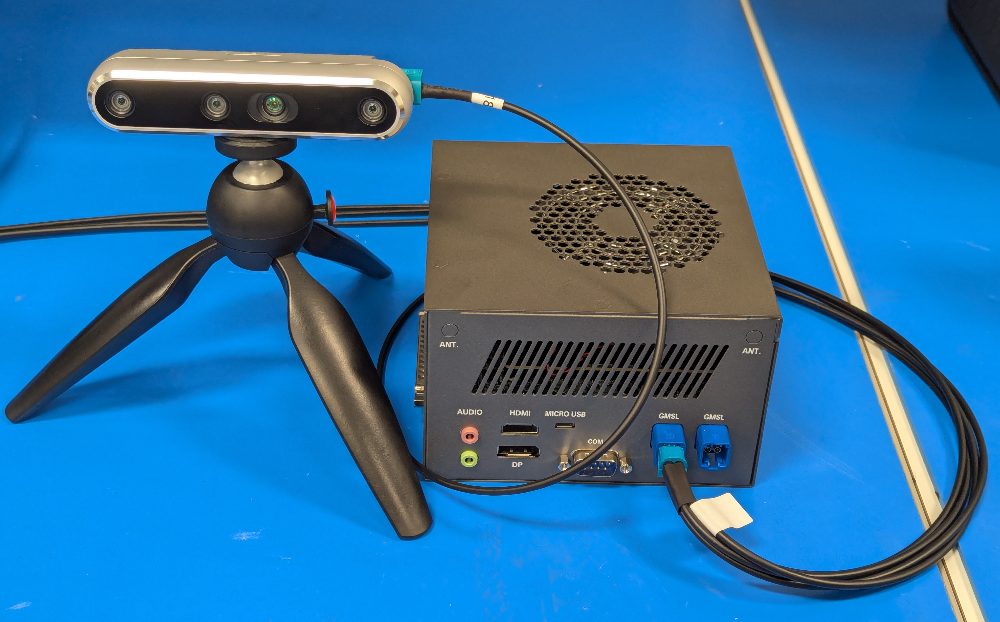

# 03 Intel 传感器接入：物理链路、时钟与观测数据

截止2026-11-05；以已归档Suite固定对象、RealSense/Orbbec官方SDK快照为证据。本文研究CEXD-INTRBL及x86机器人主机的相机、深度、LiDAR和惯性接入，不把任意外设的Linux驱动兼容性当Intel整机认证。传感器数据能显示、能推理、能对齐和能安全控制是四层不同验收。本研究没有接线、修改BIOS或驱动、测量多路负载。

## 物理接口与板级依赖

图为官方CEXD GMSL接线照片，可确认相机通过外部线缆接入开发系统；不能由照片得出链路速率、曝光同步、热稳定或全部八口同时验收。两组四合一mini-FAKRA连接器背后是MAX96724解串器及C-PHY到IPU路径，不是Core Ultra CPU原生八路GMSL PHY。Rev A/B/C的插孔方位有差异，不能按外壳左右位置猜CH编号。[Intel03_WiringFig](https://raw.githubusercontent.com/open-edge-platform/robotics-ai-suite/1b0b22a2964f0f998c34cc03c5053fe61764015d/docs/user-guide/platform_foundation/development_kits/robinson-bay/images/CEXD_GMSL_connected.jpg) [Intel03_GMSL](https://raw.githubusercontent.com/open-edge-platform/robotics-ai-suite/1b0b22a2964f0f998c34cc03c5053fe61764015d/docs/user-guide/components/sensors/cameras/gmsl/index.md) [Intel_Doc_CEXD_GMSL](https://raw.githubusercontent.com/open-edge-platform/robotics-ai-suite/1b0b22a2964f0f998c34cc03c5053fe61764015d/docs/user-guide/platform_foundation/development_kits/robinson-bay/interfaces/gmsl.md)

| 传感器路线 | 准确对象/接口 | 软件与产物 | 本轮证据范围 | 前提与限制 |
|---|---|---|---|---|
| GMSL RGB-D | D457、MAX96717→MAX96724→IPU7 | SSDT、maxim-serdes、V4L2、SDK | CEXD当前指南 | 每解串器总计四流，D457最多两台 |
| GMSL RGB | D3 D3CMCXXX-115-084/ISX031 | 单YUV流、media graph | CEXD八相机overlay | 每相机一流，非八台D457 |
| USB深度 | RealSense DXXX、示例D435i | librealsense、realsense2_camera | USB表列CEXD/UP WCL | 型号、firmware及USB拓扑单独验证 |
| 3D LiDAR | Velodyne VLP-16、Ethernet UDP | velodyne→PointCloud2 | Suite列validated | 网络丢包、逐点时间与TF |
| 2D LiDAR | RPLIDAR USB/UART、SICK nanoScan3 Ethernet | LaserScan及各家ROS驱动 | Suite接口表 | 安全扫描器不使ROS路径获安全认证 |
| 伙伴深度 | Orbbec SDK v2、Linux x64 | SDK frame、timestamp API | 上游SDK兼容路线 | 不代表CEXD GMSL特定验收 |

相机、电源、线缆、serializer/deserializer、MIPI接收、driver和应用分别承担接入责任。GMSL表只有D457与D3两个明确组合，USB表的DXXX是家族口径，不可扩为所有RealSense型号及固件。Radar、独立ToF、力矩/触觉没有在本次Suite传感器表取得准确型号/driver/吞吐的组合证据；它们可通过外部USB、Ethernet、CAN或本体SDK接入属于集成路线，不能把这些连接器称为专用传感器加速器。[Intel03_GMSLTable](https://raw.githubusercontent.com/open-edge-platform/robotics-ai-suite/1b0b22a2964f0f998c34cc03c5053fe61764015d/docs/user-guide/components/sensors/cameras/gmsl/fragment_camera_table_gmsl.md) [Intel03_USBTable](https://raw.githubusercontent.com/open-edge-platform/robotics-ai-suite/1b0b22a2964f0f998c34cc03c5053fe61764015d/docs/user-guide/components/sensors/cameras/usb/fragment_camera_table_usb.md) [Intel03_LiDAR](https://raw.githubusercontent.com/open-edge-platform/robotics-ai-suite/1b0b22a2964f0f998c34cc03c5053fe61764015d/docs/user-guide/components/sensors/lidar.md) [Intel03_Orbbec](https://raw.githubusercontent.com/orbbec/OrbbecSDK_v2/main/README.md)

## GMSL枚举、路由与缓冲格式

当前指南要求IPU7平台kernel提供CONFIG_I2C_ATR和media-ctl至少1.30，SSDT描述解串器、serializer、sensor，由GRUB早期initrd加载；BIOS相机配置需避免与overlay重复枚举。I2C bus编号可随启动改变，因此mc-setup.sh按ACPI/sysfs路径发现，再设置sensor→serializer→deserializer→CSI接收→video node的routes/formats。overlay须匹配实际相机或为其子集：描述不存在相机、或某link probe失败时，文档警告整组sub-device注册失败且都不能stream。这是共享枚举的故障域，不是单台相机故障天然隔离。[Intel03_GMSL](https://raw.githubusercontent.com/open-edge-platform/robotics-ai-suite/1b0b22a2964f0f998c34cc03c5053fe61764015d/docs/user-guide/components/sensors/cameras/gmsl/index.md)

每MAX96724四个总流是当前软件配置约束。两台D457各depth+RGB已经占满；要同台depth/RGB/IR/IMU四流，就不能继续套两台各四流的说法。D457深度FIXED在管线按UYVY8_1X16路由，video node设Z16供SDK识别；RGB是YUYV，IR可VYUY/Y8，IMU是38×1的Y8包。深度不是供显示的YUV彩色视频，不应送颜色转换后当距离。depth和IR并行需同分辨率，SDK用video-rs-* capture/sub-device symlink区分采集和控制。video编号与link间可能冲突，重配后需重新生成symlink并核验summary。[Intel03_GMSL](https://raw.githubusercontent.com/open-edge-platform/robotics-ai-suite/1b0b22a2964f0f998c34cc03c5053fe61764015d/docs/user-guide/components/sensors/cameras/gmsl/index.md)

从V4L2 mmap取帧只证明映射捕获缓冲，不证明OpenVINO remote tensor可直接引用。UYVY/YUYV到RGB、深度对齐、resize、BCHW布局、stride与batch可能创建新缓冲。CPU/iGPU共享物理RAM减少独立显存传输的一个成本，但GPU context、USM类型、cache一致性和同步仍需成立；NPU远程CPU内存还有四KB对齐及生命周期条件。应测捕获、转换、上传、推理、发布各阶段copy次数与buffer存活，而不是根据SoC内存类型宣称整链零拷贝。[Intel02B_RemoteNPU](https://raw.githubusercontent.com/openvinotoolkit/openvino/master/docs/articles_en/openvino-workflow/running-inference/inference-devices-and-modes/npu-device/remote-tensor-api-npu-plugin.rst) [Intel02B_RemoteGPU](https://raw.githubusercontent.com/openvinotoolkit/openvino/master/docs/articles_en/openvino-workflow/running-inference/inference-devices-and-modes/gpu-device/remote-tensor-api-gpu-plugin.rst) [Intel02C_Runtime_PrePost](https://raw.githubusercontent.com/openvinotoolkit/physicalai/main/docs/how-to/inference/configure-pre-post-processing.md)

RealSense ROS wrapper的同进程组件模式支持intra-process通信，消费者也须同container启用；文档限制RCLPY组件和压缩image_transport。pointcloud默认unordered，ordered_pc可切换；pointcloud QoS独立于depth/color，运行更改须重启filter使其生效。align_depth是几何投影，不是曝光时间同步；colorizer把深度话题改为RGB显示会改变数值语义。enable_sync组合frame set与unite_imu_method的copy/插值也不能证明硬触发同相曝光。[Intel03_RSROSReadme](https://raw.githubusercontent.com/realsenseai/realsense-ros/ros2-master/README.md)

## 时间同步与空间标定

Orbbec官方timestamp指南把frame capture、system host receive、global mapped capture区分，统一微秒单位仍不能跨clock相减。global支持要检查且非零，设备不支持frame timestamp时可能用host fallback；global映射保留曝光start/middle/end的原始含义。Gemini330不同基线默认曝光参考不同，不能将不同型号global数字接近当同步精度。Linux SDK monotonic使用CLOCK_MONOTONIC_RAW，与常用steady_clock不能直接混算；重新timerSync可产生时间跳变。该指南是伙伴SDK机制，不证明Intel板卡有同等硬件PTP触发。[Intel03_Timestamp](https://raw.githubusercontent.com/orbbec/OrbbecSDK_v2/main/docs/tutorial/timestamp.md)

分析：完整观测年龄应定义为同一时基上的动作提交时刻减曝光参考时刻。host receive减mapped capture只覆盖SDK接收之前，不包含ROS排队、模型和控制。硬件外触发可固定曝光起点，PTP可映射支持设备的clock，但还需核验NIC PHC、触发线、电气、频率、扫描LiDAR逐点偏移和曝光参考。本轮未取得CEXD多相机、LiDAR、IMU联合PTP误差的实测分布，因此不给微秒精度承诺。ROS header.stamp、TF lookup与bag记录时刻要在入流时保存来源、偏移和clock reset事件。[Intel03_Timestamp](https://raw.githubusercontent.com/orbbec/OrbbecSDK_v2/main/docs/tutorial/timestamp.md) [Intel02D_ROS_QoS](https://raw.githubusercontent.com/ros2/ros2_documentation/jazzy/source/Concepts/Intermediate/About-Quality-of-Service-Settings.rst)

CameraInfo内参、畸变、camera optical frame与robot base外参决定像素到空间；移动机器人还需LiDAR去畸变、IMU轴/单位及wheel odom协同。FastMapping要求depth16UC1毫米或32FC1米，多相机共用depth_info需相同光学分辨率/内参；误用一米为一毫米会直接改变障碍范围。Collab SLAM的AVX2/GPU包IMU有已列问题，使用SSE-only的限制不能由D457硬件有IMU而忽略。力矩数据也应区分传感器原始值、补偿后外力与本体控制器估算，尚无组合原件时不能给精度。[Intel02D_FastMap](https://raw.githubusercontent.com/open-edge-platform/robotics-ai-suite/1b0b22a2964f0f998c34cc03c5053fe61764015d/docs/user-guide/components/optimized_solutions/run-fastmapping-algorithm.md) [Intel02D_CollabSLAM](https://raw.githubusercontent.com/open-edge-platform/robotics-ai-suite/1b0b22a2964f0f998c34cc03c5053fe61764015d/docs/user-guide/components/optimized_solutions/collaborative-slam.md)

## 带宽、背压与异常恢复

以下是分析计算，非官方吞吐测试：四台D457按指南示例depth1280×720×16bit×30fps、RGB1280×800×16bit×30fps，裸payload为4×(55.296+61.44)=466.944MB/s。若RGB展开RGB888，后半变92.16MB/s，合计589.824MB/s；这说明转换和多次copy可增加内存流量。未计协议封包、stride padding、IR/IMU、点云展开、同步和缓存；不能据此反算摄像头通道的保证带宽。所用shape/FPS来自配置例子，亦不表示本研究已跑四台。[Intel03_GMSL](https://raw.githubusercontent.com/open-edge-platform/robotics-ai-suite/1b0b22a2964f0f998c34cc03c5053fe61764015d/docs/user-guide/components/sensors/cameras/gmsl/index.md)

| 异常 | 文档或机制依据 | 对闭环的影响 | 集成动作 |
|---|---|---|---|
| D457 RGB重复启动失败 | 未配置depth时仅能启动一次 | 恢复时视频停顿 | 按指南先配并启停depth |
| D457 I2C -121 | reboot不能恢复，须camera power cycle | 主机重启不足以恢复观测 | 独立相机供电/故障状态 |
| 单侧RGB/depth断流 | ImageSync单侧队列缺容量截断 | 陈旧观测/内存增长 | 有界队列、age与丢帧计数 |
| DDS QoS不兼容 | best-effort发布/reliable订阅不匹配 | 同名话题仍不通信 | qos事件、deadline与旧数据拒绝 |
| clock重同步/设备重启 | timestamp不连续 | 误配帧/TF失效 | epoch/序列号、重新标定偏移 |

这些动作是分析验收建议，不是已实现的自动恢复。GMSL页面仍残留旧绑定命令和重复步骤；ROS教程同时写“仅USB支持”又保留GMSL路径，冲突按章节/当前overlay版本保存，不合并为统一保证。与其他SoC摄像头路线比较，迁移单位是sensor/SerDes、media graph、时基、标定和buffer契约；OpenVINO模型兼容不降低这些板级工作。放行顺序是准确板修订与camera firmware→枚举/格式→单流曝光时间→多流持续吞吐与丢帧→标定与融合→CPU/GPU/NPU并发观测年龄→断流/热拔插/供电恢复。驱动代码、相机firmware、SDK二进制和采集数据各自核许可。[Intel03_GMSL](https://raw.githubusercontent.com/open-edge-platform/robotics-ai-suite/1b0b22a2964f0f998c34cc03c5053fe61764015d/docs/user-guide/components/sensors/cameras/gmsl/index.md) [Intel03_RSROS](https://raw.githubusercontent.com/open-edge-platform/robotics-ai-suite/1b0b22a2964f0f998c34cc03c5053fe61764015d/docs/user-guide/components/sensors/reference_applications/realsense-ros2.md) [Intel02D_ImageSync](https://raw.githubusercontent.com/open-edge-platform/robotics-ai-suite/1b0b22a2964f0f998c34cc03c5053fe61764015d/src/components/object-detection/src/yolo/src/ImageSync.hpp) [Intel02D_ROS_QoS](https://raw.githubusercontent.com/ros2/ros2_documentation/jazzy/source/Concepts/Intermediate/About-Quality-of-Service-Settings.rst)

## 参考资料

原文与本地原件对应如下。动态分支只代表所列采集时点；固定Suite源码对象不等于每篇发布日期。代码许可不自动覆盖固件、二进制、模型权重、数据和本体SDK。HTML静态依赖缺失以registry记录为准，不承诺动态交互或像素级离线一致。

| 资料 | 原文 | 版本/边界 | 本地原件 | 采集时间UTC | 归档状态 |
|---|---|---|---|---|---|
| Intel03_WiringFig | [原文](https://raw.githubusercontent.com/open-edge-platform/robotics-ai-suite/1b0b22a2964f0f998c34cc03c5053fe61764015d/docs/user-guide/platform_foundation/development_kits/robinson-bay/images/CEXD_GMSL_connected.jpg) | 固定Suite源码对象 1b0b22a2964f | [本地原件](REFERENCES.md#ref-d807f24bea1e1335) | 2026-11-05T03:58:49.518150+00:00 | complete_static；缺失依赖0 |
| Intel03_GMSL | [原文](https://raw.githubusercontent.com/open-edge-platform/robotics-ai-suite/1b0b22a2964f0f998c34cc03c5053fe61764015d/docs/user-guide/components/sensors/cameras/gmsl/index.md) | 固定Suite源码对象 1b0b22a2964f | [本地原件](REFERENCES.md#ref-c97c8e25d345d960) | 2026-11-05T03:58:13.692497+00:00 | complete_static；缺失依赖0 |
| Intel_Doc_CEXD_GMSL | [原文](https://raw.githubusercontent.com/open-edge-platform/robotics-ai-suite/1b0b22a2964f0f998c34cc03c5053fe61764015d/docs/user-guide/platform_foundation/development_kits/robinson-bay/interfaces/gmsl.md) | 固定Suite源码对象 1b0b22a2964f | [本地原件](REFERENCES.md#ref-c3a9119311ff1a49) | 2026-11-05T01:26:51.446108+00:00 | complete_static；缺失依赖0 |
| Intel03_GMSLTable | [原文](https://raw.githubusercontent.com/open-edge-platform/robotics-ai-suite/1b0b22a2964f0f998c34cc03c5053fe61764015d/docs/user-guide/components/sensors/cameras/gmsl/fragment_camera_table_gmsl.md) | 固定Suite源码对象 1b0b22a2964f | [本地原件](REFERENCES.md#ref-36366754074b4cbf) | 2026-11-05T03:58:14.668272+00:00 | complete_static；缺失依赖0 |
| Intel03_USBTable | [原文](https://raw.githubusercontent.com/open-edge-platform/robotics-ai-suite/1b0b22a2964f0f998c34cc03c5053fe61764015d/docs/user-guide/components/sensors/cameras/usb/fragment_camera_table_usb.md) | 固定Suite源码对象 1b0b22a2964f | [本地原件](REFERENCES.md#ref-18fddf1cca024bbb) | 2026-11-05T03:58:16.684065+00:00 | complete_static；缺失依赖0 |
| Intel03_LiDAR | [原文](https://raw.githubusercontent.com/open-edge-platform/robotics-ai-suite/1b0b22a2964f0f998c34cc03c5053fe61764015d/docs/user-guide/components/sensors/lidar.md) | 固定Suite源码对象 1b0b22a2964f | [本地原件](REFERENCES.md#ref-6e47badcd2ebe349) | 2026-11-05T03:58:17.654064+00:00 | complete_static；缺失依赖0 |
| Intel03_Orbbec | [原文](https://raw.githubusercontent.com/orbbec/OrbbecSDK_v2/main/README.md) | 动态快照；文中限定API/发行版本 | [本地原件](REFERENCES.md#ref-96eb386e04fb724f) | 2026-11-05T03:58:22.055378+00:00 | complete_static；缺失依赖0 |
| Intel02B_RemoteNPU | [原文](https://raw.githubusercontent.com/openvinotoolkit/openvino/master/docs/articles_en/openvino-workflow/running-inference/inference-devices-and-modes/npu-device/remote-tensor-api-npu-plugin.rst) | 动态快照；文中限定API/发行版本 | [本地原件](REFERENCES.md#ref-0c56cdb43a59da75) | 2026-11-05T02:27:30.347336+00:00 | complete_static；缺失依赖0 |
| Intel02B_RemoteGPU | [原文](https://raw.githubusercontent.com/openvinotoolkit/openvino/master/docs/articles_en/openvino-workflow/running-inference/inference-devices-and-modes/gpu-device/remote-tensor-api-gpu-plugin.rst) | 动态快照；文中限定API/发行版本 | [本地原件](REFERENCES.md#ref-2571dc7a4ea9998f) | 2026-11-05T02:27:29.323402+00:00 | complete_static；缺失依赖0 |
| Intel02C_Runtime_PrePost | [原文](https://raw.githubusercontent.com/openvinotoolkit/physicalai/main/docs/how-to/inference/configure-pre-post-processing.md) | 动态快照；文中限定API/发行版本 | [本地原件](REFERENCES.md#ref-668f322dcdc9d991) | 2026-11-05T02:34:30.228942+00:00 | complete_static；缺失依赖0 |
| Intel03_RSROSReadme | [原文](https://raw.githubusercontent.com/realsenseai/realsense-ros/ros2-master/README.md) | 动态快照；文中限定API/发行版本 | [本地原件](REFERENCES.md#ref-5ff6b26fbb3587f4) | 2026-11-05T03:58:20.921889+00:00 | complete_static；缺失依赖0 |
| Intel03_Timestamp | [原文](https://raw.githubusercontent.com/orbbec/OrbbecSDK_v2/main/docs/tutorial/timestamp.md) | 动态快照；文中限定API/发行版本 | [本地原件](REFERENCES.md#ref-6d698eb3dad5c80c) | 2026-11-05T03:58:23.253959+00:00 | complete_static；缺失依赖0 |
| Intel02D_ROS_QoS | [原文](https://raw.githubusercontent.com/ros2/ros2_documentation/jazzy/source/Concepts/Intermediate/About-Quality-of-Service-Settings.rst) | 动态快照；文中限定API/发行版本 | [本地原件](REFERENCES.md#ref-eeb1237343f7c813) | 2026-11-05T02:38:18.132211+00:00 | complete_static；缺失依赖0 |
| Intel02D_FastMap | [原文](https://raw.githubusercontent.com/open-edge-platform/robotics-ai-suite/1b0b22a2964f0f998c34cc03c5053fe61764015d/docs/user-guide/components/optimized_solutions/run-fastmapping-algorithm.md) | 固定Suite源码对象 1b0b22a2964f | [本地原件](REFERENCES.md#ref-ac1e1b0d57e36802) | 2026-11-05T02:38:10.317020+00:00 | complete_static；缺失依赖0 |
| Intel02D_CollabSLAM | [原文](https://raw.githubusercontent.com/open-edge-platform/robotics-ai-suite/1b0b22a2964f0f998c34cc03c5053fe61764015d/docs/user-guide/components/optimized_solutions/collaborative-slam.md) | 固定Suite源码对象 1b0b22a2964f | [本地原件](REFERENCES.md#ref-5faf4da0e195f7b7) | 2026-11-05T02:38:09.234091+00:00 | complete_static；缺失依赖0 |
| Intel03_RSROS | [原文](https://raw.githubusercontent.com/open-edge-platform/robotics-ai-suite/1b0b22a2964f0f998c34cc03c5053fe61764015d/docs/user-guide/components/sensors/reference_applications/realsense-ros2.md) | 固定Suite源码对象 1b0b22a2964f | [本地原件](REFERENCES.md#ref-9bd7cbc445b7744c) | 2026-11-05T03:58:19.622435+00:00 | complete_static；缺失依赖0 |
| Intel02D_ImageSync | [原文](https://raw.githubusercontent.com/open-edge-platform/robotics-ai-suite/1b0b22a2964f0f998c34cc03c5053fe61764015d/src/components/object-detection/src/yolo/src/ImageSync.hpp) | 固定Suite源码对象 1b0b22a2964f | [本地原件](REFERENCES.md#ref-4f3ee4a055ba1b65) | 2026-11-05T02:41:31.539582+00:00 | complete_static；缺失依赖0 |
