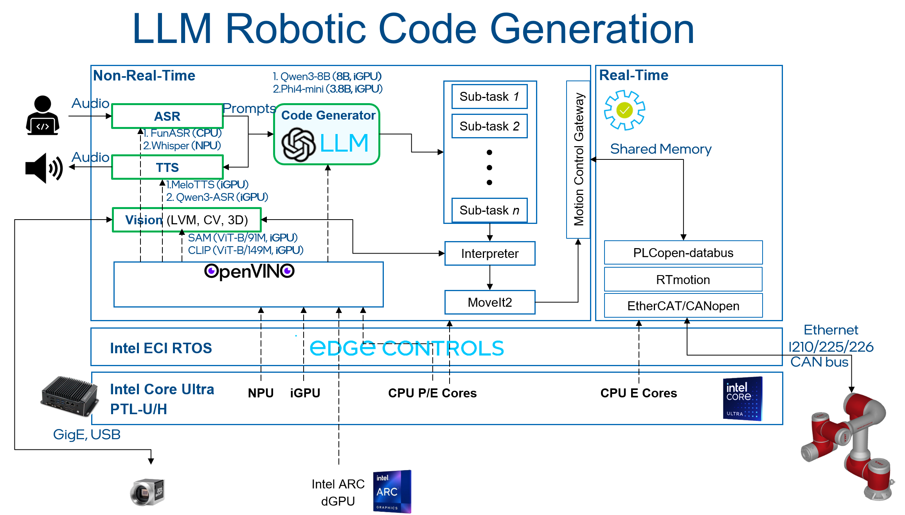

# Intel 04 — AI能力与模型地图

研究截止：2026-11-05。本文按任务与部署证据分类；Suite采用固定源码对象1b0b22a2964f，Studio采用b38bff4a9e6d，模型卡main是归档时快照。未安装模型、未执行训练或本体评测。

## 任务地图与支持层级

Intel的能力是把上游模型、OpenVINO插件、数据工具和控制组件衔接起来。语言生成、视觉定位、动作生成、轨迹求解属于不同契约。模型名字出现在库中，证明维护者提供相应实现；后端表写CPU/GPU/NPU，不能证明每个策略在每个SKU都编译通过。需要按模型版本、输入形状、精度、插件、驱动和机器人逐条验收。[Intel02F_Lib](https://raw.githubusercontent.com/open-edge-platform/physical-ai-studio/b38bff4a9e6d79481ce1b2bcfdaf3e8ec103724e/library/README.md)

| 任务 | 精确对象与模态 | 参数/动作范围 | Intel证据层级 | 模型/资料入口 | 尚缺证据 |
|---|---|---|---|---|---|
| 语言推理/工具规划 | Phi-4-mini-instruct，文本 | 图标注3.8B；卡含128K上下文 | JAKA代码生成部署教程，INT8 OV产物 | [Intel04_PhiMini](https://huggingface.co/microsoft/Phi-4-mini-instruct/raw/main/README.md)；[Intel02C_LLM](https://raw.githubusercontent.com/open-edge-platform/robotics-ai-suite/1b0b22a2964f0f998c34cc03c5053fe61764015d/docs/user-guide/software_references/humanoid/sample_pipelines/llm_robotics.md) | 长上下文资源/闭环成功率 |
| 语言/agent | Qwen3-8B，文本 | 卡为8.2B，原生32768上下文 | 同教程可替换INT8模型路径 | [Intel04_Qwen3](https://huggingface.co/Qwen/Qwen3-8B/raw/main/README.md) | thinking模式时限与安全执行 |
| 2D分割/语义检索 | SAM、CLIP ViT-B | 官方图91M/149M为图示口径 | 独立encoder/predictor与CLIP IR路径 | [Intel02C_LLM](https://raw.githubusercontent.com/open-edge-platform/robotics-ai-suite/1b0b22a2964f0f998c34cc03c5053fe61764015d/docs/user-guide/software_references/humanoid/sample_pipelines/llm_robotics.md) | MobileSAM文件名与SAM版本需锁定 |
| 检测/3D定位 | YOLO与ORB、PCL、FastMapping | 检测框/点云/地图，不是动作 | ROS组件/教程、CPU或GPU优化路径 | [Intel02D_Detection](https://raw.githubusercontent.com/open-edge-platform/robotics-ai-suite/1b0b22a2964f0f998c34cc03c5053fe61764015d/docs/user-guide/ai_resources/openvino/reference_applications/object_detection_tutorial.md)；[Intel02D_FastMap](https://raw.githubusercontent.com/open-edge-platform/robotics-ai-suite/1b0b22a2964f0f998c34cc03c5053fe61764015d/docs/user-guide/components/optimized_solutions/run-fastmapping-algorithm.md) | 目标场景精度、漂移和数据年龄 |
| 非学习控制 | MPC、IK、MoveIt轨迹 | 状态、约束→轨迹/控制量 | 参考管线，非基础模型 | [Intel04_MPC](https://raw.githubusercontent.com/open-edge-platform/robotics-ai-suite/1b0b22a2964f0f998c34cc03c5053fe61764015d/docs/user-guide/software_references/humanoid/sample_pipelines/mpc_demo.md) | 接触参数、求解上限和真实安全 |

上表把三维环境表示与模型分开：ORB特征、点云搜索和体素融合不是VLA，也不会因定位可用而自动生成稳定操作。传感器标定、深度失效和运动补偿直接改变策略观测分布，必须继承03的数据契约。

| 操作策略 | 架构与输入/输出 | 具体配置/范围 | 部署证据 | 权重/数据许可边界 |
|---|---|---|---|---|
| ACT | CVAE训练、视觉Transformer→动作chunk | 示例4相机、chunk100；50示范episode | act-ov，CPU/GPU eval；OV2025.2 | 教程链接checkpoint；未取得压缩包内许可，不能作商用授权 |
| Diffusion Policy | 图像或低维→迭代去噪动作 | Push-T四checkpoint，8.96M—262.71M | OV2024.6；encoder与UNet IR，仿真 | 上游代码/数据应独立核对，文件名分数非Intel实测 |
| RDT-1B | SigLIP＋T5＋动作DiT；语言/3视角/状态 | 主干1B，预测64动作；卡示例14维、25Hz | Suite CPU/GPU，MuJoCo 400步任务 | 卡声明代码/权重/微调数据MIT；预训练46数据集及编码器另核 |
| π0.5 LeRobot | PaliGemma前缀＋flow动作expert | 多视角/语言/离散状态；连续动作chunk | 转换、RTC和ALOHA调用教程 | pi05_base卡为Gemma；不是仅按LeRobot代码许可处理 |
| SmolVLA base | SmolVLM2-500M骨干＋flow动作 | 多视角/状态/可选语言，horizon按checkpoint | Studio库实现；本轮无该策略Intel设备实测 | 卡Apache-2.0，数据授权须按数据集 |

对应原文：[Intel02C_ACT](https://raw.githubusercontent.com/open-edge-platform/robotics-ai-suite/1b0b22a2964f0f998c34cc03c5053fe61764015d/docs/user-guide/software_references/humanoid/sample_pipelines/imitation_learning_act.md)、[Intel02C_DP](https://raw.githubusercontent.com/open-edge-platform/robotics-ai-suite/1b0b22a2964f0f998c34cc03c5053fe61764015d/docs/user-guide/software_references/humanoid/sample_pipelines/diffusion_policy.md)、[Intel02C_RDT](https://raw.githubusercontent.com/open-edge-platform/robotics-ai-suite/1b0b22a2964f0f998c34cc03c5053fe61764015d/docs/user-guide/software_references/humanoid/sample_pipelines/robotics_diffusion_transformer.md)、[Intel04_RDTCard](https://huggingface.co/robotics-diffusion-transformer/rdt-1b/raw/main/README.md)、[Intel02C_Pi05_ModelCard](https://huggingface.co/lerobot/pi05_base/raw/main/README.md)、[Intel04_SmolVLA](https://huggingface.co/lerobot/smolvla_base/raw/main/README.md)。ACT命令含`--weight 640`，是原文拼写；不静默改成已验证CLI。Diffusion Policy的0.967等是checkpoint命名内test_mean_score，Push-T奖励是最大形状重叠，不能当真实抓取成功率。

## 动作模型的三条深入路径

ACT把逐帧回归改为整段动作预测，减少误差逐步累积，并可用temporal aggregation融合重叠chunk。训练时CVAE编码示范差异，推理的潜变量处理及聚合必须固定。模型导出要求相机数量、分辨率、chunk、hidden_dim、kl_weight与训练一致；相机从一台改四台会改变视觉特征和输入图。示例batch8是命令配置，不能认作实时推理batch或八台机器人并行。动作chunk100也不代表100Hz，下层每tick消费几个动作、旧chunk是否过期决定闭环效果。[Intel02C_ACT](https://raw.githubusercontent.com/open-edge-platform/robotics-ai-suite/1b0b22a2964f0f998c34cc03c5053fe61764015d/docs/user-guide/software_references/humanoid/sample_pipelines/imitation_learning_act.md)

RDT使用统一物理动作空间减少跨数据集格式差异，但目标本体仍需填入对应状态、掩码和动作分量。语言可以预计算embedding，降低在线成本；这不包括语音识别或动态指令生成。其1B参数是动作模型口径，T5-XXL和SigLIP的权重、activation与缓存要额外计入内存。模型卡一方面介绍广泛机械臂兼容，另一方面明确未见本体的embodiment gap，建议小数据微调；因此“通用动作格式”与“零样本通用本体”不能互换。Suite两项任务使用ACT的MuJoCo资产并评估50轨迹的命令，是可复建入口，不是本研究执行的结果。[Intel04_RDTCard](https://huggingface.co/robotics-diffusion-transformer/rdt-1b/raw/main/README.md)、[Intel02C_RDT](https://raw.githubusercontent.com/open-edge-platform/robotics-ai-suite/1b0b22a2964f0f998c34cc03c5053fe61764015d/docs/user-guide/software_references/humanoid/sample_pipelines/robotics_diffusion_transformer.md)

π0.5的视觉/文本前缀与动作expert通过flow matching从噪声生成连续动作，RTC用旧chunk未执行尾部约束新chunk前缀，缓解异步推理后的等待与跳变。RTC IR增加`prev_chunk_left_over`和`prefix_weights`；首次调用可传零。相机数、chunk尺寸、动作归一化stats必须与checkpoint相配，IR仍需源配置与tokenizer。教程默认fps50、RTC horizon45是消费计划的配置，不是模型每秒50次完成推理，更不是电机伺服频率。缓存动作还可能因新障碍而变陈旧，需要年龄上限及取消契约。[Intel02C_RTC_README](https://raw.githubusercontent.com/open-edge-platform/robotics-ai-suite/1b0b22a2964f0f998c34cc03c5053fe61764015d/src/pipelines/pi05-rtc-ov/README.md)

pi05_base卡只包含flow动作head，原作的subtask prediction、action tokenization和RL部分未包含。现有LeRobot `forward(batch)`用于训练loss，而推理应走select_action/sample_actions路径；旧转换wrapper若导出forward且依赖actions输入，不能因IR生成就判定动作图正确。要核验输出名、shape、噪声与去噪步数、随机数固定是否改变分布，再检查真实数据上的动作误差和任务成功。INT8权重压缩不等于全图INT8 activation，也不能从文件缩小推出更省整机电。[Intel02C_Pi05_ModelCard](https://huggingface.co/lerobot/pi05_base/raw/main/README.md)、[Intel02C_ExportCode](https://raw.githubusercontent.com/open-edge-platform/robotics-ai-suite/1b0b22a2964f0f998c34cc03c5053fe61764015d/src/pipelines/vla-pi0.5-openvino/convert_pytorch_onnx.py)、[Intel02C_LeRobot_PI05_Source](https://raw.githubusercontent.com/huggingface/lerobot/main/src/lerobot/policies/pi05/modeling_pi05.py)

## 新策略、世界模型与资源竞争

Studio库还列MolmoAct2、RLDX-1、XR0、Cosmos3，不把名称清单补写成统一NPU支持表。MolmoAct2有`allenai/MolmoAct2-LIBERO`入口，norm_tag解析相机、状态、动作、horizon及控制元数据；Lightning checkpoint不打包tokenizer，旧SO101 frame转换若只改样本而未改统计量，训练信号可能被clamp，需重训，改manifest无法恢复。该例体现模型迁移需要单位和统计数据契约，而不只算子兼容。其完整权重卡和训练数据许可本轮尚未归档，不作全资产许可结论。[Intel04_MolmoAct2](https://raw.githubusercontent.com/open-edge-platform/physical-ai-studio/b38bff4a9e6d79481ce1b2bcfdaf3e8ec103724e/library/src/physicalai/policies/molmoact2/README.md)

Cosmos3在此是World Action Model的策略实现，含DiT/VAE/action heads与rectified flow；多相机拼成单canvas而非任意token流。默认chunk32，DROID为8维且夹爪反转，ALOHA为14维。Studio默认task_description＋256分辨率，而已发布DROID策略条件为augmented_json＋480，fps15、chunk32虽一致，提示词与视觉分布仍不同。其CPU/XPU/CUDA接口声明不证明OpenVINO NPU可完整执行；视频生成、场景合成和真实物理预测能力也不能由该策略接口推断。RLDX-1/XR0仅按库登记层级收录，精确权重、参数、许可与Intel完整推理结果保留未知。[Intel04_Cosmos3](https://raw.githubusercontent.com/open-edge-platform/physical-ai-studio/b38bff4a9e6d79481ce1b2bcfdaf3e8ec103724e/library/docs/explanation/policy/cosmos3.md)、[Intel02F_Lib](https://raw.githubusercontent.com/open-edge-platform/physical-ai-studio/b38bff4a9e6d79481ce1b2bcfdaf3e8ec103724e/library/README.md)

## 官方架构与性能应怎样读

图原件来自固定Suite；已打开核验。左侧ASR/LLM/视觉与MoveIt是非实时域，右侧共享内存、PLCopen、RTmotion与总线属于另一执行层。图标注Whisper/NPU等候选分工比正文FunASR部署步骤更宽，不能拿图替代逐模型编译记录。图里的SAM ViT-B也不自动解决教程mobilesam_helper命名差异。LLM生成代码必须限制调用集合、参数、坐标frame和工作空间，轨迹规划成功后仍需控制器与安全保护放行。[Intel04_LLMPipelineFigure](https://raw.githubusercontent.com/open-edge-platform/robotics-ai-suite/1b0b22a2964f0f998c34cc03c5053fe61764015d/docs/user-guide/software_references/humanoid/assets/images/llm-robotics-demo-arch.png)、[Intel02C_LLM](https://raw.githubusercontent.com/open-edge-platform/robotics-ai-suite/1b0b22a2964f0f998c34cc03c5053fe61764015d/docs/user-guide/software_references/humanoid/sample_pipelines/llm_robotics.md)

SnapFlow官方报告给出teacher 1941/2000、20k student 1951/2000，分别97.05%与97.55%，相差0.5个百分点；单seed42不能证明显著改善。H100 PCIe上Torch导出、batch1，5次warmup后100次合成输入chunk，中位175.4ms→58.9ms，包含前后处理，排除render、网络、加载、机器人I/O。它支持蒸馏减少去噪步数的研究路径，不支持Intel加速2.98倍；训练停在27647步，没有30k结果。[Intel02F_Benchmark](https://raw.githubusercontent.com/open-edge-platform/physical-ai-studio/b38bff4a9e6d79481ce1b2bcfdaf3e8ec103724e/library/docs/explanation/benchmark/snapflow-libero.md)

部署验证应固定采集→清洗/标注→示范数据版本→训练权重→压缩→目标编译→动作适配→回放与实机监测。CPU同时承担ROS、预处理、求解和运行时回退，iGPU还可能渲染仿真与视觉，NPU有shape/算子/driver边界；必须测并发热稳态下的观测年龄、chunk deadline miss、P99与任务成功/人工介入。规划代码生成、模型延迟和实际操作成功分别存档。本文没有同条件Intel/NVIDIA闭环结果，无法给加速排名、内存最低配置或安全结论。

## 参考资料

原文与本地原件对应如下。动态分支只代表所列采集时点；固定Suite源码对象不等于每篇发布日期。代码许可不自动覆盖固件、二进制、模型权重、数据和本体SDK。HTML静态依赖缺失以registry记录为准，不承诺动态交互或像素级离线一致。

| 资料 | 原文 | 版本/边界 | 本地原件 | 采集时间UTC | 归档状态 |
|---|---|---|---|---|---|
| Intel02F_Lib | [原文](https://raw.githubusercontent.com/open-edge-platform/physical-ai-studio/b38bff4a9e6d79481ce1b2bcfdaf3e8ec103724e/library/README.md) | 动态快照；文中限定API/发行版本 | [本地原件](REFERENCES.md#ref-92918aa573fbd230) | 2026-11-05T02:48:39.024440+00:00 | complete_static；缺失依赖0 |
| Intel04_PhiMini | [原文](https://huggingface.co/microsoft/Phi-4-mini-instruct/raw/main/README.md) | 动态快照；文中限定API/发行版本 | [本地原件](REFERENCES.md#ref-16aac6a6bea2fb07) | 2026-11-05T04:04:42.819151+00:00 | complete_static；缺失依赖0 |
| Intel02C_LLM | [原文](https://raw.githubusercontent.com/open-edge-platform/robotics-ai-suite/1b0b22a2964f0f998c34cc03c5053fe61764015d/docs/user-guide/software_references/humanoid/sample_pipelines/llm_robotics.md) | 固定Suite源码对象 1b0b22a2964f | [本地原件](REFERENCES.md#ref-9c2321f429bbf34d) | 2026-11-05T02:32:49.555540+00:00 | complete_static；缺失依赖0 |
| Intel04_Qwen3 | [原文](https://huggingface.co/Qwen/Qwen3-8B/raw/main/README.md) | 动态快照；文中限定API/发行版本 | [本地原件](REFERENCES.md#ref-324727f21c69dbe3) | 2026-11-05T04:04:43.804202+00:00 | complete_static；缺失依赖0 |
| Intel02D_Detection | [原文](https://raw.githubusercontent.com/open-edge-platform/robotics-ai-suite/1b0b22a2964f0f998c34cc03c5053fe61764015d/docs/user-guide/ai_resources/openvino/reference_applications/object_detection_tutorial.md) | 固定Suite源码对象 1b0b22a2964f | [本地原件](REFERENCES.md#ref-f2974af6ba9cd207) | 2026-11-05T02:38:03.152988+00:00 | complete_static；缺失依赖0 |
| Intel02D_FastMap | [原文](https://raw.githubusercontent.com/open-edge-platform/robotics-ai-suite/1b0b22a2964f0f998c34cc03c5053fe61764015d/docs/user-guide/components/optimized_solutions/run-fastmapping-algorithm.md) | 固定Suite源码对象 1b0b22a2964f | [本地原件](REFERENCES.md#ref-ac1e1b0d57e36802) | 2026-11-05T02:38:10.317020+00:00 | complete_static；缺失依赖0 |
| Intel04_MPC | [原文](https://raw.githubusercontent.com/open-edge-platform/robotics-ai-suite/1b0b22a2964f0f998c34cc03c5053fe61764015d/docs/user-guide/software_references/humanoid/sample_pipelines/mpc_demo.md) | 固定Suite源码对象 1b0b22a2964f | [本地原件](REFERENCES.md#ref-171a5f3860ed8f79) | 2026-11-05T04:07:15.916391+00:00 | complete_static；缺失依赖0 |
| Intel02C_ACT | [原文](https://raw.githubusercontent.com/open-edge-platform/robotics-ai-suite/1b0b22a2964f0f998c34cc03c5053fe61764015d/docs/user-guide/software_references/humanoid/sample_pipelines/imitation_learning_act.md) | 固定Suite源码对象 1b0b22a2964f | [本地原件](REFERENCES.md#ref-b6595b43ea1fe6e1) | 2026-11-05T02:32:45.564339+00:00 | complete_static；缺失依赖0 |
| Intel02C_DP | [原文](https://raw.githubusercontent.com/open-edge-platform/robotics-ai-suite/1b0b22a2964f0f998c34cc03c5053fe61764015d/docs/user-guide/software_references/humanoid/sample_pipelines/diffusion_policy.md) | 固定Suite源码对象 1b0b22a2964f | [本地原件](REFERENCES.md#ref-be18c90dbbb93a5b) | 2026-11-05T02:32:47.175264+00:00 | complete_static；缺失依赖0 |
| Intel02C_RDT | [原文](https://raw.githubusercontent.com/open-edge-platform/robotics-ai-suite/1b0b22a2964f0f998c34cc03c5053fe61764015d/docs/user-guide/software_references/humanoid/sample_pipelines/robotics_diffusion_transformer.md) | 固定Suite源码对象 1b0b22a2964f | [本地原件](REFERENCES.md#ref-92429532a8331fdf) | 2026-11-05T02:32:48.410709+00:00 | complete_static；缺失依赖0 |
| Intel04_RDTCard | [原文](https://huggingface.co/robotics-diffusion-transformer/rdt-1b/raw/main/README.md) | 动态快照；文中限定API/发行版本 | [本地原件](REFERENCES.md#ref-99a1b1266ae8da3a) | 2026-11-05T04:04:11.807696+00:00 | complete_static；缺失依赖0 |
| Intel02C_Pi05_ModelCard | [原文](https://huggingface.co/lerobot/pi05_base/raw/main/README.md) | 动态快照；文中限定API/发行版本 | [本地原件](REFERENCES.md#ref-e6655f48f9ab756c) | 2026-11-05T02:33:32.198250+00:00 | complete_static；缺失依赖0 |
| Intel04_SmolVLA | [原文](https://huggingface.co/lerobot/smolvla_base/raw/main/README.md) | 动态快照；文中限定API/发行版本 | [本地原件](REFERENCES.md#ref-0da7b42781bff858) | 2026-11-05T04:04:10.910100+00:00 | complete_static；缺失依赖0 |
| Intel02C_RTC_README | [原文](https://raw.githubusercontent.com/open-edge-platform/robotics-ai-suite/1b0b22a2964f0f998c34cc03c5053fe61764015d/src/pipelines/pi05-rtc-ov/README.md) | 固定Suite源码对象 1b0b22a2964f | [本地原件](REFERENCES.md#ref-1a4a0587558affad) | 2026-11-05T02:32:44.193262+00:00 | complete_static；缺失依赖0 |
| Intel02C_ExportCode | [原文](https://raw.githubusercontent.com/open-edge-platform/robotics-ai-suite/1b0b22a2964f0f998c34cc03c5053fe61764015d/src/pipelines/vla-pi0.5-openvino/convert_pytorch_onnx.py) | 固定Suite源码对象 1b0b22a2964f | [本地原件](REFERENCES.md#ref-482a49638f523e8e) | 2026-11-05T02:34:20.061817+00:00 | complete_static；缺失依赖0 |
| Intel02C_LeRobot_PI05_Source | [原文](https://raw.githubusercontent.com/huggingface/lerobot/main/src/lerobot/policies/pi05/modeling_pi05.py) | 动态快照；文中限定API/发行版本 | [本地原件](REFERENCES.md#ref-d8c209d00eda69fe) | 2026-11-05T02:35:04.664190+00:00 | complete_static；缺失依赖0 |
| Intel04_MolmoAct2 | [原文](https://raw.githubusercontent.com/open-edge-platform/physical-ai-studio/b38bff4a9e6d79481ce1b2bcfdaf3e8ec103724e/library/src/physicalai/policies/molmoact2/README.md) | 动态快照；文中限定API/发行版本 | [本地原件](REFERENCES.md#ref-ec14ed59aa327727) | 2026-11-05T04:04:14.597217+00:00 | complete_static；缺失依赖0 |
| Intel04_Cosmos3 | [原文](https://raw.githubusercontent.com/open-edge-platform/physical-ai-studio/b38bff4a9e6d79481ce1b2bcfdaf3e8ec103724e/library/docs/explanation/policy/cosmos3.md) | 动态快照；文中限定API/发行版本 | [本地原件](REFERENCES.md#ref-7afe9576256d9588) | 2026-11-05T04:04:13.554385+00:00 | complete_static；缺失依赖0 |
| Intel04_LLMPipelineFigure | [原文](https://raw.githubusercontent.com/open-edge-platform/robotics-ai-suite/1b0b22a2964f0f998c34cc03c5053fe61764015d/docs/user-guide/software_references/humanoid/assets/images/llm-robotics-demo-arch.png) | 固定Suite源码对象 1b0b22a2964f | [本地原件](REFERENCES.md#ref-407e3d2bcce4ade3) | 2026-11-05T04:04:40.855928+00:00 | complete_static；缺失依赖0 |
| Intel02F_Benchmark | [原文](https://raw.githubusercontent.com/open-edge-platform/physical-ai-studio/b38bff4a9e6d79481ce1b2bcfdaf3e8ec103724e/library/docs/explanation/benchmark/snapflow-libero.md) | 动态快照；文中限定API/发行版本 | [本地原件](REFERENCES.md#ref-75d80cfb523a1850) | 2026-11-05T02:49:24.243846+00:00 | complete_static；缺失依赖0 |
