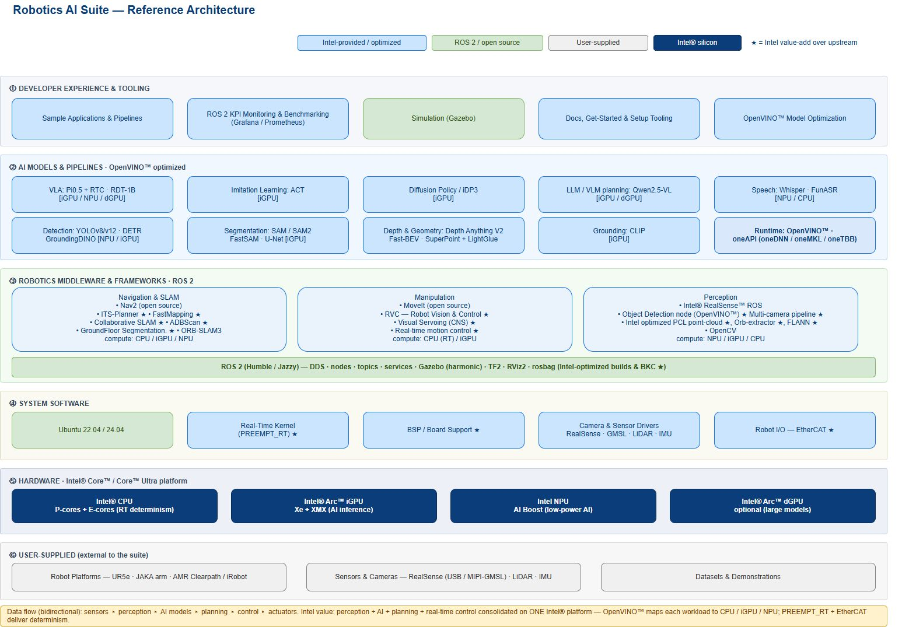

# Intel 07 — 生态分工与原型到量产

截至2026-11-05；按可取得的产品、服务、源码和客户材料核验。生态能力来自Intel、硬件伙伴、上游社区和整机集成商的共同交付；目录成员、支持标签、展会照片均不能代替目标配置验收。本文不提交询价或联系客户。

## 主要伙伴与可交接资产

| 角色/代表对象 | 官方提供内容 | 接口/产物 | 已核支持范围 | 必须另行负责 |
|---|---|---|---|---|
| Intel Suite/OpenVINO | BKC、模型转换、ROS组件与runtime | IR、驱动、话题、配置、补丁 | 指定CPU/GPU/NPU插件及版本 | 每个模型/板卡/本体的最终验收 |
| AAEON CEXD-INTRBL | 358H机器人开发系统、载板I/O | GMSL桥、CAN、以太网、BIOS | 开发套件；八物理GMSL link有流组合限制 | 工业结构、量产BOM/供电/维护合同 |
| AAEON UP Nexus WCL Edge | Core Series3紧凑系统 | 双2.5GbE、GPIO、USB | Jackal换装指定组合 | 不推广为所有WCL主板认证 |
| RealSense/Orbbec | 相机、SDK/ROS节点 | 图像、深度、点云与时间戳 | USB/GMSL准确组合按03核验 | 固件、标定、线缆和传感器供应 |
| Clearpath/UR/Robotiq | 底盘、臂、工具与控制箱 | robot.yaml、URCap、驱动/关节接口 | Jackal J100和UR5e蓝图 | 机型保修、保护功能和工位风险 |
| Trossen/LeRobot/PhysicalAI | 研究臂、数据与策略工具 | episode、stats、tokenizer、动作chunk | 演示/测试与插件入口 | 权重/数据许可、真实任务放行 |
| ROS/MoveIt/Nav2/Gazebo | 开源中间件、规划与仿真 | DDS、TF、action、world和bridge | Suite集成和优化指定部分 | 上游发行维护与兼容性 |

原文入口：[Intel02_Architecture](https://raw.githubusercontent.com/open-edge-platform/robotics-ai-suite/1b0b22a2964f0f998c34cc03c5053fe61764015d/docs/user-guide/images/architecture/Robotics-AI-Suite-Architecture.svg)、[AAEON_Robotics](https://www.aaeon.com/en/article/detail/accelerate-robotics-development-aaeon-intel)、[AAEON_UP_Nexus](https://www.aaeon.com/en/product/detail/up-systems-up-nexus-wcl-edge)、[Intel03_RSROSReadme](https://raw.githubusercontent.com/realsenseai/realsense-ros/ros2-master/README.md)、[Intel03_Orbbec](https://raw.githubusercontent.com/orbbec/OrbbecSDK_v2/main/README.md)、[Intel06_Jackal](https://raw.githubusercontent.com/open-edge-platform/robotics-ai-suite/1b0b22a2964f0f998c34cc03c5053fe61764015d/docs/user-guide/hardware_blueprints/amr/clearpath-jackal.md)、[Intel06_URBlueprint](https://raw.githubusercontent.com/open-edge-platform/robotics-ai-suite/1b0b22a2964f0f998c34cc03c5053fe61764015d/docs/user-guide/hardware_blueprints/stationary_arm/ur5e-robotiq-realsense.md)、[Intel06_CustomerCases](https://www.intel.com/content/www/us/en/newsroom/news/artificial-intelligence/intel-core-ultra-series-3-for-edge-ai-robotics.html)。传感器公司对外设承担产品责任，不能归为Intel SoC原生拥有全部深度、同步和安全感知能力。

## AAEON：硬件、BIOS与工程服务不是同一承诺

CEXD把CPU/iGPU/NPU与机器人接口集成，价值在于少一次自行设计高速桥接和载板的工程工作；八相机的宣传必须与GMSL流表、MAX96724/overlay和板卡版本一起读。开发系统标称AI峰值不能推导整机续航或全模型并发能力；GPIO口也不能当直接电机驱动。UP Nexus页面描述48GB内存、12—24V输入、-20—60°C运行范围和接口，具体SKU、热条件与订购版本仍需确认。网页“3工作日发货”是页面提示，不能作为每个地区、数量和定制配置的合同交期。[AAEON_Robotics](https://www.aaeon.com/en/article/detail/accelerate-robotics-development-aaeon-intel)、[AAEON_UP_Nexus](https://www.aaeon.com/en/product/detail/up-systems-up-nexus-wcl-edge)、[Intel03_GMSL](https://raw.githubusercontent.com/open-edge-platform/robotics-ai-suite/1b0b22a2964f0f998c34cc03c5053fe61764015d/docs/user-guide/components/sensors/cameras/gmsl/index.md)

AAEON BIOS服务页具体列出默认配置/BIOX、看门狗与自动重启、OS recovery hotkey、刷写工具及BIOS中断恢复；远程管理的BMC/IPMI、Intel AMT和Redfish仅在select platforms，页面要求销售确认。OTA描述面向ODM/custom场景，未证明CEXD或UP Nexus默认装有完整事务更新系统，也没有给每款机器的回退槽、签名密钥、版本兼容和断电恢复测试。不能把“支持OTA”写成量产机队已具备安全回滚。[Intel07_AAEON_BIOS](https://www.aaeon.com/en/article/list/bios-customization-services)

同页安全更新承诺限定产品active期间，critical/major及时更新、低严重度并入biennial更新。这里没有对应每SKU终止日期和响应时限，不能等同十年软件维护。Smart Boost称最多30% CPU Mark改善、Fast Boot称select platforms最快4.3秒，缺完整测试机条件，不作为机器人吞吐/冷启动承诺。主动提高性能还可能改变实时负载和散热边界，采购BKC应固定该开关并重做时延测量。

Q Service Plus公开给出载板原理图评审/设计、驱动开发、OS集成、firmware优化和从概念到量产ODM服务。这比伙伴名单更具体，说明可以购买工程支持；但页面没有本项目报价、工作包、保修期、响应SLA和本地备件承诺，仍需落实合同。工程服务的存在不证明免费支持所有本体SDK或客户应用。[Intel07_AAEON_QService](https://www.aaeon.com/en/article/list/q-service-embedded-boards-computer-on-module)

## 开源分工、许可与维护状态

本轮重新打开图，图例区分Intel提供/优化、ROS开源、用户供给和Intel硬件。底层本体、传感器和数据仍是用户资产；星号是相对上游增值标签，不是独占算法或认证标记。模型层的设备标签比单教程证据更广，逐模型支持要按04编译/接口矩阵验证。图支持责任边界，不提供维护期限或伙伴认证数量。[Intel02_Architecture](https://raw.githubusercontent.com/open-edge-platform/robotics-ai-suite/1b0b22a2964f0f998c34cc03c5053fe61764015d/docs/user-guide/images/architecture/Robotics-AI-Suite-Architecture.svg)

Suite、OpenVINO、PhysicalAI Runtime与Studio所归档LICENSE为Apache2.0；它覆盖相应代码的许可陈述，不替代GPU/NPU固件、二进制分发、模型权重、数据及本体SDK。π0.5权重卡为Gemma，RDT卡自述代码/权重/微调数据MIT，但46预训练源及编码器需要分别核对。下载工具接受公开页面不意味着已经接受受限模型条款，更不能把某权重的许可扩大到遥操作数据的肖像和现场数据。[Intel_Robotics_License](https://raw.githubusercontent.com/open-edge-platform/robotics-ai-suite/1b0b22a2964f0f998c34cc03c5053fe61764015d/LICENSE)、[Intel02B_License](https://raw.githubusercontent.com/openvinotoolkit/openvino/master/LICENSE)、[Intel02C_Runtime_License](https://raw.githubusercontent.com/openvinotoolkit/physicalai/main/LICENSE)、[Intel02F_License](https://raw.githubusercontent.com/open-edge-platform/physical-ai-studio/b38bff4a9e6d79481ce1b2bcfdaf3e8ec103724e/LICENSE)、[Intel02C_Pi05_ModelCard](https://huggingface.co/lerobot/pi05_base/raw/main/README.md)、[Intel04_RDTCard](https://huggingface.co/robotics-diffusion-transformer/rdt-1b/raw/main/README.md)

本轮尝试GitHub仓库元数据与release API，在统一下载器robots校验环节被阻止，未取得可引用正文，因此没有发布Stars、提交活跃度或最新release统计。已有固定tree能定位源文件和可解析对象，不能代替维护频率、issue响应或下载采用人数。Stars即使取得也只是关注指标，不能作为商业采用率。后续评估应以兼容矩阵、严重issue处理、发行回归和生命周期公告为证据。

ROS2把感知、地图、轨迹和底盘接口拆开，MoveIt/Nav2分别承担臂与导航规划，Gazebo用于接口/物理验证，Intel优化选定模块并提供BKC。升级上游发行会同时影响DDS、消息类型、controller plugin和driver ABI，平台统一安装并不消除这些组合。应把上游源码、Intel补丁和打包产物分别锁定，保存可重建镜像与软件物料清单；“开放”有利于查故障，但不自动给出现场支持责任。

## 培训、开发者与客户生态证据

MassRobotics公告记录波士顿创业社区与Intel进行Building Physical AI at the Edge workshop，讨论实时推理、传感器、负载整合、能效与可移植。它证明有开发者培训和生态接触渠道；未给参会公司数、合同、量产项目数、培训完成率或收益。本轮归档页面未取得明确发布日期，不以网页图片时间或采集日补填。[Intel07_MassRobotics](https://www.intel.com/content/www/us/en/newsroom/news/artificial-intelligence/postcard-massrobotics-physical-ai-startup-speed.html)

客户公告中Ella已切换、Trossen测试、Circulus OS运行和Oversonic机内采用属于不同阶段。代表案例的价值是发现感知、业务agent与确定性orchestrator的交接方式，不能由“dozens testing/adopting”推导量产客户总数。伙伴现场演示与研究套件提供可接触入口，实际下单仍需具体本体代际、芯片、系统镜像和服务地点。[Intel06_CustomerCases](https://www.intel.com/content/www/us/en/newsroom/news/artificial-intelligence/intel-core-ultra-series-3-for-edge-ai-robotics.html)

## 原型到量产的责任链

从开发套件转量产，先冻结芯片/内存/载板修订、BIOS、kernel、driver/firmware、模型及数据契约；随后分别验证烧录、端口/相机产测、传感器标定、总线ENI、温度与持续并发。相同产品名更换内存容量、板修订或BIOS默认值都可能改变缓存、I/O和实时行为。PCN/EOL需要记录提前通知、替代料再认证、备件与维修时间，而非只看现货商城。

更新必须区分OS、BIOS、加速器driver、模型和本体MCU，设计兼容矩阵、签名/权限、断电注入、更新失败恢复及机队分批放行。Image Composer生成镜像不等于OTA事务回退，Studio runtime tick间stop不等于控制箱急停。采集/日志/数据export也可能有跨帧一致性与磁盘容量限制，量产维护要加入看门狗、数据年龄、deadline miss、温度与故障快照。[Intel02A_ImageComposer](https://raw.githubusercontent.com/open-edge-platform/robotics-ai-suite/1b0b22a2964f0f998c34cc03c5053fe61764015d/docs/user-guide/platform_foundation/getting_started/image_composer_tool.md)、[Intel02F_Update](https://raw.githubusercontent.com/open-edge-platform/physical-ai-studio/b38bff4a9e6d79481ce1b2bcfdaf3e8ec103724e/application/docs/02-update-existing-installation.md)、[Intel02C_Runtime_Loop](https://raw.githubusercontent.com/openvinotoolkit/physicalai/main/docs/explanation/runtime.md)

最终由系统集成商对本体、感知、策略、实时控制与业务任务共同验收，Intel与板卡/相机/控制箱供应商分别对自己的交付物负责。当前资料足以建立生态角色和可购买工程路径，但不支持机器人市场份额、本地保修SLA、完整SBOM/OTA回退验收或十年全栈软件支持。MassRobotics、BIOS、Q-Service归档分别缺12/38/36项静态依赖；正文已取得，未承诺动态表单、视频及像素一致。

## 参考资料

原文与本地原件对应如下。动态分支只代表所列采集时点；固定Suite源码对象不等于每篇发布日期。代码许可不自动覆盖固件、二进制、模型权重、数据和本体SDK。HTML静态依赖缺失以registry记录为准，不承诺动态交互或像素级离线一致。

| 资料 | 原文 | 版本/边界 | 本地原件 | 采集时间UTC | 归档状态 |
|---|---|---|---|---|---|
| Intel02_Architecture | [原文](https://raw.githubusercontent.com/open-edge-platform/robotics-ai-suite/1b0b22a2964f0f998c34cc03c5053fe61764015d/docs/user-guide/images/architecture/Robotics-AI-Suite-Architecture.svg) | 固定Suite源码对象 1b0b22a2964f | [本地原件](REFERENCES.md#ref-0ead36e32550c972) | 2026-11-05T02:21:20.667057+00:00 | complete_static；缺失依赖0 |
| AAEON_Robotics | [原文](https://www.aaeon.com/en/article/detail/accelerate-robotics-development-aaeon-intel) | 动态快照；文中限定API/发行版本 | [本地原件](REFERENCES.md#ref-77ef8d7a52dbb15c) | 2026-11-05T01:19:13.764957+00:00 | partial_static；缺失依赖34 |
| AAEON_UP_Nexus | [原文](https://www.aaeon.com/en/product/detail/up-systems-up-nexus-wcl-edge) | 动态快照；文中限定API/发行版本 | [本地原件](REFERENCES.md#ref-e7bbe62e9e310ed5) | 2026-11-05T01:29:54.174974+00:00 | partial_static；缺失依赖27 |
| Intel03_RSROSReadme | [原文](https://raw.githubusercontent.com/realsenseai/realsense-ros/ros2-master/README.md) | 动态快照；文中限定API/发行版本 | [本地原件](REFERENCES.md#ref-5ff6b26fbb3587f4) | 2026-11-05T03:58:20.921889+00:00 | complete_static；缺失依赖0 |
| Intel03_Orbbec | [原文](https://raw.githubusercontent.com/orbbec/OrbbecSDK_v2/main/README.md) | 动态快照；文中限定API/发行版本 | [本地原件](REFERENCES.md#ref-96eb386e04fb724f) | 2026-11-05T03:58:22.055378+00:00 | complete_static；缺失依赖0 |
| Intel06_Jackal | [原文](https://raw.githubusercontent.com/open-edge-platform/robotics-ai-suite/1b0b22a2964f0f998c34cc03c5053fe61764015d/docs/user-guide/hardware_blueprints/amr/clearpath-jackal.md) | 固定Suite源码对象 1b0b22a2964f | [本地原件](REFERENCES.md#ref-61884da1615e1906) | 2026-11-05T04:13:51.190562+00:00 | complete_static；缺失依赖0 |
| Intel06_URBlueprint | [原文](https://raw.githubusercontent.com/open-edge-platform/robotics-ai-suite/1b0b22a2964f0f998c34cc03c5053fe61764015d/docs/user-guide/hardware_blueprints/stationary_arm/ur5e-robotiq-realsense.md) | 固定Suite源码对象 1b0b22a2964f | [本地原件](REFERENCES.md#ref-29f21fe2e4378b6f) | 2026-11-05T04:13:50.077356+00:00 | complete_static；缺失依赖0 |
| Intel06_CustomerCases | [原文](https://www.intel.com/content/www/us/en/newsroom/news/artificial-intelligence/intel-core-ultra-series-3-for-edge-ai-robotics.html) | 动态快照；文中限定API/发行版本 | [本地原件](REFERENCES.md#ref-a198bce07c1cd65c) | 2026-11-05T04:13:35.108017+00:00 | partial_static；缺失依赖12 |
| Intel03_GMSL | [原文](https://raw.githubusercontent.com/open-edge-platform/robotics-ai-suite/1b0b22a2964f0f998c34cc03c5053fe61764015d/docs/user-guide/components/sensors/cameras/gmsl/index.md) | 固定Suite源码对象 1b0b22a2964f | [本地原件](REFERENCES.md#ref-c97c8e25d345d960) | 2026-11-05T03:58:13.692497+00:00 | complete_static；缺失依赖0 |
| Intel07_AAEON_BIOS | [原文](https://www.aaeon.com/en/article/list/bios-customization-services) | 动态快照；文中限定API/发行版本 | [本地原件](REFERENCES.md#ref-3bbb5ab30769b4b0) | 2026-11-05T04:17:37.115311+00:00 | partial_static；缺失依赖38 |
| Intel07_AAEON_QService | [原文](https://www.aaeon.com/en/article/list/q-service-embedded-boards-computer-on-module) | 动态快照；文中限定API/发行版本 | [本地原件](REFERENCES.md#ref-a6834d2773de7cc9) | 2026-11-05T04:17:39.983259+00:00 | partial_static；缺失依赖36 |
| Intel_Robotics_License | [原文](https://raw.githubusercontent.com/open-edge-platform/robotics-ai-suite/1b0b22a2964f0f998c34cc03c5053fe61764015d/LICENSE) | 固定Suite源码对象 1b0b22a2964f | [本地原件](REFERENCES.md#ref-f6ff1e9082fdff84) | 2026-11-05T01:33:32.793586+00:00 | complete_static；缺失依赖0 |
| Intel02B_License | [原文](https://raw.githubusercontent.com/openvinotoolkit/openvino/master/LICENSE) | 动态快照；文中限定API/发行版本 | [本地原件](REFERENCES.md#ref-51fd2d47e1ec0dfc) | 2026-11-05T02:27:33.786779+00:00 | complete_static；缺失依赖0 |
| Intel02C_Runtime_License | [原文](https://raw.githubusercontent.com/openvinotoolkit/physicalai/main/LICENSE) | 动态快照；文中限定API/发行版本 | [本地原件](REFERENCES.md#ref-bc7b7041a0a10378) | 2026-11-05T02:34:32.406947+00:00 | complete_static；缺失依赖0 |
| Intel02F_License | [原文](https://raw.githubusercontent.com/open-edge-platform/physical-ai-studio/b38bff4a9e6d79481ce1b2bcfdaf3e8ec103724e/LICENSE) | 动态快照；文中限定API/发行版本 | [本地原件](REFERENCES.md#ref-fa3a54d1c3bbdeb1) | 2026-11-05T02:48:43.414901+00:00 | complete_static；缺失依赖0 |
| Intel02C_Pi05_ModelCard | [原文](https://huggingface.co/lerobot/pi05_base/raw/main/README.md) | 动态快照；文中限定API/发行版本 | [本地原件](REFERENCES.md#ref-e6655f48f9ab756c) | 2026-11-05T02:33:32.198250+00:00 | complete_static；缺失依赖0 |
| Intel04_RDTCard | [原文](https://huggingface.co/robotics-diffusion-transformer/rdt-1b/raw/main/README.md) | 动态快照；文中限定API/发行版本 | [本地原件](REFERENCES.md#ref-99a1b1266ae8da3a) | 2026-11-05T04:04:11.807696+00:00 | complete_static；缺失依赖0 |
| Intel07_MassRobotics | [原文](https://www.intel.com/content/www/us/en/newsroom/news/artificial-intelligence/postcard-massrobotics-physical-ai-startup-speed.html) | 动态快照；文中限定API/发行版本 | [本地原件](REFERENCES.md#ref-b53e31edd8b9979f) | 2026-11-05T04:16:35.867068+00:00 | partial_static；缺失依赖12 |
| Intel02A_ImageComposer | [原文](https://raw.githubusercontent.com/open-edge-platform/robotics-ai-suite/1b0b22a2964f0f998c34cc03c5053fe61764015d/docs/user-guide/platform_foundation/getting_started/image_composer_tool.md) | 固定Suite源码对象 1b0b22a2964f | [本地原件](REFERENCES.md#ref-5178c987443075de) | 2026-11-05T02:21:10.651286+00:00 | complete_static；缺失依赖0 |
| Intel02F_Update | [原文](https://raw.githubusercontent.com/open-edge-platform/physical-ai-studio/b38bff4a9e6d79481ce1b2bcfdaf3e8ec103724e/application/docs/02-update-existing-installation.md) | 动态快照；文中限定API/发行版本 | [本地原件](REFERENCES.md#ref-136ad43fcb34b02e) | 2026-11-05T02:48:40.907464+00:00 | complete_static；缺失依赖0 |
| Intel02C_Runtime_Loop | [原文](https://raw.githubusercontent.com/openvinotoolkit/physicalai/main/docs/explanation/runtime.md) | 动态快照；文中限定API/发行版本 | [本地原件](REFERENCES.md#ref-c7bdfc8a7831a575) | 2026-11-05T02:34:27.311284+00:00 | complete_static；缺失依赖0 |
