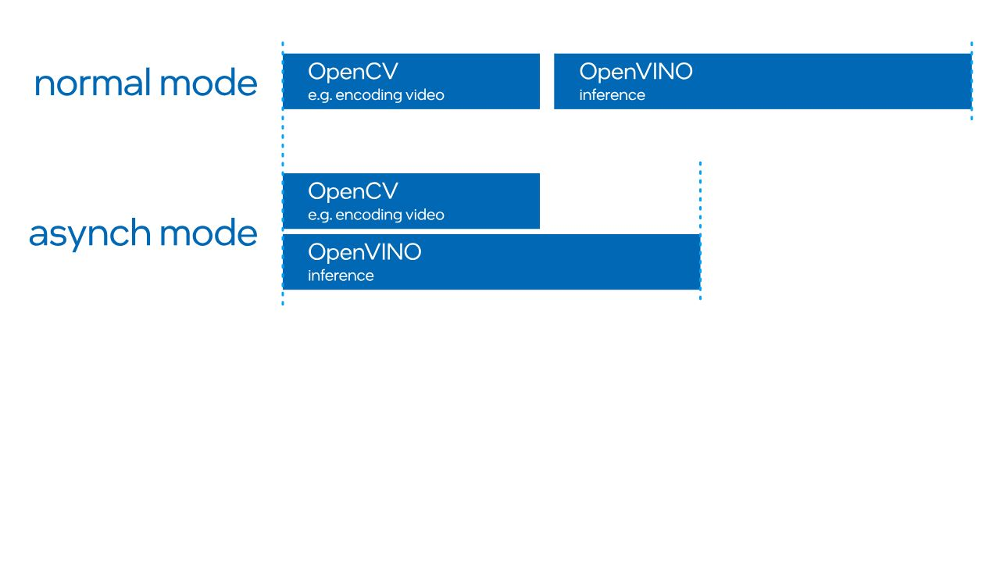

# Intel 08A — 异构编译与数据驻留的技术壁垒

截止2026-11-05。本专题从端侧并发、形状与内存交接判断技术优势，而不重列软件安装流程。OpenVINO通用master文档与Suite绑定2025.3属于不同版本证据；本文未执行编译或性能测试。

## 痛点：算子峰值不能解释机器人数据路径

机器人同时采集图像、计算视觉、推理动作与执行实时控制，CPU/iGPU/NPU共享的物理资源可能减少外部显卡和板间连接，也可能使内存带宽、缓存与热预算产生竞争。真正需要判断的是模型能否留在适合的设备、跨域边界搬运什么张量、首帧与稳态是否满足观测年龄。统一API本身不等于统一内存或自动隔离。[Intel02B_HETERO](https://raw.githubusercontent.com/openvinotoolkit/openvino/master/docs/articles_en/openvino-workflow/running-inference/inference-devices-and-modes/hetero-execution.rst)、[Intel02B_GPU_Memory](https://raw.githubusercontent.com/openvinotoolkit/openvino/master/src/plugins/intel_gpu/docs/memory_allocation_gpu_plugin.md)

| 技术对象 | 解决的问题 | 关键契约 | 优势成立条件 | 不成立时的代价 |
|---|---|---|---|---|
| AUTO | 设备选择与启动辅助 | 设备优先级、startup/runtime fallback | 已测目标路径和切换行为 | 短时CPU执行/精度变化、控制竞争 |
| HETERO | 不完整算子覆盖 | affinity子图、中间tensor | 分区足够大且搬运成本可控 | 频繁同步、边界layout转换 |
| RemoteTensor | 外部数据重复上传 | context、handle、shape与生命周期 | 内存可达、格式匹配、同步正确 | 隐式拷贝、悬空指针/旧帧 |
| 有界动态形状 | 可变输入与编译资源 | shape上下界、CIP/driver | 模型变化在边界内且版本满足 | 重新编译、内存扩张或不支持 |
| 模型/权重缓存 | 冷启动编译 | 源模型、插件、硬件与cache key | 完整原件、兼容缓存、正确失效 | 旧产物误用、首帧延迟反复出现 |

## 从图编译到执行边界

HETERO按query能力和优先级生成节点affinity，再连接多个子图。分图解决可运行性，不保证时延；例如视觉encoder在GPU而小后处理在CPU，边界tensor可能比最终动作大得多。应计算每次边界的shape、dtype、字节数与同步次数，并测是否出现layout reorder。GPU kernel选择还取决于ParamsKey、Validate、布局、类型及融合约束，同名算子不一定走相同kernel。高层模型支持列表无法替代执行图和性能counter。[Intel02B_HETERO](https://raw.githubusercontent.com/openvinotoolkit/openvino/master/docs/articles_en/openvino-workflow/running-inference/inference-devices-and-modes/hetero-execution.rst)、[Intel02B_GPU_Kernels](https://raw.githubusercontent.com/openvinotoolkit/openvino/master/src/plugins/intel_gpu/docs/gpu_kernels.md)、[Intel02B_GPU_Flow](https://raw.githubusercontent.com/openvinotoolkit/openvino/master/src/plugins/intel_gpu/docs/simplified_workflow.md)

AUTO不把所有加速器均分计算，默认设备集合排除NPU，CPU startup与runtime fallback改变实际运行位置。机器人要求固定预算时，应显式设置设备及fallback策略，记录冷启动期间实际执行设备，不能把目标GPU steady-state延迟当整段任务延迟。stateful模型也有特殊行为；缓存和状态迁移不能靠切换设备名自动解决。[Intel02B_AUTO](https://raw.githubusercontent.com/openvinotoolkit/openvino/master/docs/articles_en/openvino-workflow/running-inference/inference-devices-and-modes/auto-device-selection.rst)

NPU编译路线中，2026.0为插件内编译预览，2026.1优先；有界动态支持从NPU40XX、Linux driver1.30起且绑定CIP，不能回填Suite2025.3或CID老路线。上下界限制使编译器可预分配资源，但最小、最大和常用shape的速度/内存并不相同。对可变文本、相机数、动作horizon要冻结合法范围，超过范围的请求必须显式拒绝、重编译或走另一已验证路径，不能静默拖延动作。[Intel02B_NPU](https://raw.githubusercontent.com/openvinotoolkit/openvino/master/docs/articles_en/openvino-workflow/running-inference/inference-devices-and-modes/npu-device.rst)、[Intel02B_Shapes](https://raw.githubusercontent.com/openvinotoolkit/openvino/master/docs/articles_en/openvino-workflow/running-inference/model-input-output/dynamic-shapes.rst)

## 驻留、迁移与首帧成本

GPU内存文档区分cl_mem、usm_host、usm_shared、usm_device：shared按需迁移，host可同时访问但非可迁移，device仅所属设备可访问。共享地址空间因此不等于无page fault、无迁移或任意设备都能直接使用。常量先在host建立、图优化后可转device，跨batch/stream共享；中间workspace和输出buffer仍占内存。峰值分配、实际驻留与整机RAM是不同指标，必须把权重、activation、预处理图像、请求队列和仿真渲染一并计入。[Intel02B_GPU_Memory](https://raw.githubusercontent.com/openvinotoolkit/openvino/master/src/plugins/intel_gpu/docs/memory_allocation_gpu_plugin.md)

NPU RemoteTensor支持包裹CPU虚拟地址等路径，地址与size须4KB对齐，外部内存必须存活到使用它的tensor/request销毁。DMA-BUF或NT handle路径的存在不能证明所有相机buffer均可导入；驱动、句柄、访问权限、格式、stride和完成同步必须满足。设备读取前采集方要完成写入，读取完成前生产者不能复用槽。这个buffer生命周期是零拷贝收益和稳定性的共同前提，错误复用可能产生看似有效但跨帧混合的观测。[Intel02B_RemoteNPU](https://raw.githubusercontent.com/openvinotoolkit/openvino/master/docs/articles_en/openvino-workflow/running-inference/inference-devices-and-modes/npu-device/remote-tensor-api-npu-plugin.rst)、[Intel02B_RemoteGPU](https://raw.githubusercontent.com/openvinotoolkit/openvino/master/docs/articles_en/openvino-workflow/running-inference/inference-devices-and-modes/gpu-device/remote-tensor-api-gpu-plugin.rst)

ROS同进程组件零拷贝止于该消息交接；resize、色彩变换、张量转置和模型输入分配可能重新复制。建议逐边记录原始帧、预处理输出、设备tensor及动作结果的分配者、layout、句柄和释放点，再统计带宽；不能只看一段API用了remote就称传感器到电机全链零拷贝。选择驻留方案也要考虑可恢复性：丢帧时清槽、重建context或driver reset后旧handle失效，必须阻止旧动作继续执行。

## 异步与缓存如何形成工程收益

已重新打开图，normal串行而async重叠OpenCV与推理，图无具体数值。它说明可以隐藏部分独立工作时间，不证明单次模型更快、观测更新更鲜或deadline满足。增多infer request/stream可提高吞吐，也可能积压旧帧；操作策略通常需要限制未完成请求和动作年龄，测整条观测→执行延迟分布。异步完成顺序及reset要写入请求代号/episode代号。[Intel02B_AsyncFig_Original](https://media.githubusercontent.com/media/openvinotoolkit/openvino/master/docs/articles_en/assets/images/synch-vs-asynch.svg)、[Intel02B_InferAPI](https://raw.githubusercontent.com/openvinotoolkit/openvino/master/docs/articles_en/assets/snippets/ov_infer_request.py)

模型缓存保存设备编译结果，首次创建可能更慢，非支持import/export的设备不会得到加速。weightless缓存重新读取源权重，不是独立可分发engine。GPU COMBINED构建为opt-in，默认OpenCL，OCL/ZE缓存隔离；不能把所有发行包称LevelZero默认执行。cache加密在不同文档有范围差异，不能据单页推出所有产物默认加密。恢复方案应保存源IR/权重和配置，让缓存失效时可重编译，并分别测读文件、compile、首次infer和稳态。[Intel02B_Cache](https://raw.githubusercontent.com/openvinotoolkit/openvino/master/docs/articles_en/openvino-workflow/running-inference/optimize-inference/optimizing-latency/model-caching-overview.rst)、[Intel02B_CacheAPI](https://raw.githubusercontent.com/openvinotoolkit/openvino/master/docs/articles_en/assets/snippets/ov_caching.py)、[Intel02B_GPU_Dispatch](https://raw.githubusercontent.com/openvinotoolkit/openvino/master/src/plugins/intel_gpu/docs/gpu_dual_runtime_dispatch.md)

NNCF权重压缩与静态量化不同，权重INT8不意味着activation也INT8；有scale、分组和混合精度开销。内存缩减只有在权重占主导且插件采用相应kernel时才可转为时延或能耗收益。动作模型需保留随机噪声/去噪语义，先用真实输入比输出分布，再做闭环任务评估，不能只比较随机张量MSE。[Intel02B_NNCF](https://raw.githubusercontent.com/openvinotoolkit/nncf/develop/README.md)、[Intel02B_Weight](https://raw.githubusercontent.com/openvinotoolkit/openvino/master/docs/articles_en/openvino-workflow/model-optimization-guide/weight-compression/4-bit-weight-quantization.rst)

## 对标与可迁移资产

ONNX Runtime OpenVINO EP提供device_type、load_config、layout、reshape_input、缓存和NPU不支持时CPU fallback；它是额外一层图分区，不能当native OpenVINO HETERO完全相同。旧字段在OV2025.3/ORT1.23起有deprecated迁移，实际环境必须记录ORT与OV组合。其表有重复/历史算子条目，不能单凭表格认定目标模型验收。[Intel08A_ORTOV](https://onnxruntime.ai/docs/execution-providers/OpenVINO-ExecutionProvider.html)

ORT TensorRT EP同样提供engine/timing cache、FP16/INT8、min/max/opt shape及CUDA graph配置，并建议再注册CUDA EP接住TRT不支持节点。两类机制都解决构建与执行效率，不能以“另一家没有缓存/动态形状”构造优势。迁移可复用ONNX和任务数据，却需重建各平台优化产物、kernel/插件、设备内存绑定和数值回归。本文未取得同模型/精度/功率/输入的两平台结果，因此只作机制比较；该TRT页面缺2项静态依赖，正文成功归档。[Intel08A_ORTTRT](https://onnxruntime.ai/docs/execution-providers/TensorRT-ExecutionProvider.html)

Intel壁垒更可能体现为硬件插件、内存互操作、BKC和机器人中间件的组合知识及长期维护成本，而非仅API或开源算法独占。适用已有x86、可容纳端侧模型并能约束形状与并发的系统。若训练依赖CUDA专用算子、模型内存过大或动作时限对fallback不容忍，迁移成本可能超过取消独显的收益。放行需目标SKU完整图、buffer/shape契约、冷启动/热稳态、异常恢复与任务成功数据，尚无这些证据时不宣称统一SoC能替代所有独显方案。

## 参考资料

原文与本地原件对应如下。动态分支只代表所列采集时点；固定Suite源码对象不等于每篇发布日期。代码许可不自动覆盖固件、二进制、模型权重、数据和本体SDK。HTML静态依赖缺失以registry记录为准，不承诺动态交互或像素级离线一致。

| 资料 | 原文 | 版本/边界 | 本地原件 | 采集时间UTC | 归档状态 |
|---|---|---|---|---|---|
| Intel02B_HETERO | [原文](https://raw.githubusercontent.com/openvinotoolkit/openvino/master/docs/articles_en/openvino-workflow/running-inference/inference-devices-and-modes/hetero-execution.rst) | 动态快照；文中限定API/发行版本 | [本地原件](REFERENCES.md#ref-92285406c05d6b21) | 2026-11-05T02:27:23.835544+00:00 | complete_static；缺失依赖0 |
| Intel02B_GPU_Memory | [原文](https://raw.githubusercontent.com/openvinotoolkit/openvino/master/src/plugins/intel_gpu/docs/memory_allocation_gpu_plugin.md) | 动态快照；文中限定API/发行版本 | [本地原件](REFERENCES.md#ref-1e66c4fc5304f6fe) | 2026-11-05T02:29:17.784698+00:00 | complete_static；缺失依赖0 |
| Intel02B_GPU_Kernels | [原文](https://raw.githubusercontent.com/openvinotoolkit/openvino/master/src/plugins/intel_gpu/docs/gpu_kernels.md) | 动态快照；文中限定API/发行版本 | [本地原件](REFERENCES.md#ref-aeede87517ed4644) | 2026-11-05T02:29:18.814295+00:00 | complete_static；缺失依赖0 |
| Intel02B_GPU_Flow | [原文](https://raw.githubusercontent.com/openvinotoolkit/openvino/master/src/plugins/intel_gpu/docs/simplified_workflow.md) | 动态快照；文中限定API/发行版本 | [本地原件](REFERENCES.md#ref-c738c00e81f74dac) | 2026-11-05T02:29:16.828751+00:00 | complete_static；缺失依赖0 |
| Intel02B_AUTO | [原文](https://raw.githubusercontent.com/openvinotoolkit/openvino/master/docs/articles_en/openvino-workflow/running-inference/inference-devices-and-modes/auto-device-selection.rst) | 动态快照；文中限定API/发行版本 | [本地原件](REFERENCES.md#ref-e1d65ba10091489c) | 2026-11-05T02:27:22.786073+00:00 | complete_static；缺失依赖0 |
| Intel02B_NPU | [原文](https://raw.githubusercontent.com/openvinotoolkit/openvino/master/docs/articles_en/openvino-workflow/running-inference/inference-devices-and-modes/npu-device.rst) | 动态快照；文中限定API/发行版本 | [本地原件](REFERENCES.md#ref-cb4e7b7716dce4f6) | 2026-11-05T02:27:21.574666+00:00 | complete_static；缺失依赖0 |
| Intel02B_Shapes | [原文](https://raw.githubusercontent.com/openvinotoolkit/openvino/master/docs/articles_en/openvino-workflow/running-inference/model-input-output/dynamic-shapes.rst) | 动态快照；文中限定API/发行版本 | [本地原件](REFERENCES.md#ref-d67fcdf544672283) | 2026-11-05T02:27:24.940715+00:00 | complete_static；缺失依赖0 |
| Intel02B_RemoteNPU | [原文](https://raw.githubusercontent.com/openvinotoolkit/openvino/master/docs/articles_en/openvino-workflow/running-inference/inference-devices-and-modes/npu-device/remote-tensor-api-npu-plugin.rst) | 动态快照；文中限定API/发行版本 | [本地原件](REFERENCES.md#ref-0c56cdb43a59da75) | 2026-11-05T02:27:30.347336+00:00 | complete_static；缺失依赖0 |
| Intel02B_RemoteGPU | [原文](https://raw.githubusercontent.com/openvinotoolkit/openvino/master/docs/articles_en/openvino-workflow/running-inference/inference-devices-and-modes/gpu-device/remote-tensor-api-gpu-plugin.rst) | 动态快照；文中限定API/发行版本 | [本地原件](REFERENCES.md#ref-2571dc7a4ea9998f) | 2026-11-05T02:27:29.323402+00:00 | complete_static；缺失依赖0 |
| Intel02B_AsyncFig_Original | [原文](https://media.githubusercontent.com/media/openvinotoolkit/openvino/master/docs/articles_en/assets/images/synch-vs-asynch.svg) | 动态快照；文中限定API/发行版本 | [本地原件](REFERENCES.md#ref-e0d8384ef68a1ec1) | 2026-11-05T02:28:58.579384+00:00 | complete_static；缺失依赖0 |
| Intel02B_InferAPI | [原文](https://raw.githubusercontent.com/openvinotoolkit/openvino/master/docs/articles_en/assets/snippets/ov_infer_request.py) | 动态快照；文中限定API/发行版本 | [本地原件](REFERENCES.md#ref-b830c2bb20f73a68) | 2026-11-05T02:28:20.397791+00:00 | complete_static；缺失依赖0 |
| Intel02B_Cache | [原文](https://raw.githubusercontent.com/openvinotoolkit/openvino/master/docs/articles_en/openvino-workflow/running-inference/optimize-inference/optimizing-latency/model-caching-overview.rst) | 动态快照；文中限定API/发行版本 | [本地原件](REFERENCES.md#ref-b0da798395ae7d62) | 2026-11-05T02:27:25.933450+00:00 | complete_static；缺失依赖0 |
| Intel02B_CacheAPI | [原文](https://raw.githubusercontent.com/openvinotoolkit/openvino/master/docs/articles_en/assets/snippets/ov_caching.py) | 动态快照；文中限定API/发行版本 | [本地原件](REFERENCES.md#ref-083d3c5ef12b43f5) | 2026-11-05T02:28:21.313020+00:00 | complete_static；缺失依赖0 |
| Intel02B_GPU_Dispatch | [原文](https://raw.githubusercontent.com/openvinotoolkit/openvino/master/src/plugins/intel_gpu/docs/gpu_dual_runtime_dispatch.md) | 动态快照；文中限定API/发行版本 | [本地原件](REFERENCES.md#ref-ecfa9bdc23701352) | 2026-11-05T02:29:19.805964+00:00 | complete_static；缺失依赖0 |
| Intel02B_NNCF | [原文](https://raw.githubusercontent.com/openvinotoolkit/nncf/develop/README.md) | 动态快照；文中限定API/发行版本 | [本地原件](REFERENCES.md#ref-512875f56658d3ba) | 2026-11-05T02:27:35.288889+00:00 | complete_static；缺失依赖0 |
| Intel02B_Weight | [原文](https://raw.githubusercontent.com/openvinotoolkit/openvino/master/docs/articles_en/openvino-workflow/model-optimization-guide/weight-compression/4-bit-weight-quantization.rst) | 动态快照；文中限定API/发行版本 | [本地原件](REFERENCES.md#ref-b64ddbaeb8fddc28) | 2026-11-05T02:27:27.967781+00:00 | complete_static；缺失依赖0 |
| Intel08A_ORTOV | [原文](https://onnxruntime.ai/docs/execution-providers/OpenVINO-ExecutionProvider.html) | 动态快照；文中限定API/发行版本 | [本地原件](REFERENCES.md#ref-edb6a0a1f786820c) | 2026-11-05T04:20:29.209961+00:00 | complete_static；缺失依赖0 |
| Intel08A_ORTTRT | [原文](https://onnxruntime.ai/docs/execution-providers/TensorRT-ExecutionProvider.html) | 动态快照；文中限定API/发行版本 | [本地原件](REFERENCES.md#ref-79d5a0e8a1b18b5a) | 2026-11-05T04:21:22.334717+00:00 | partial_static；缺失依赖2 |
