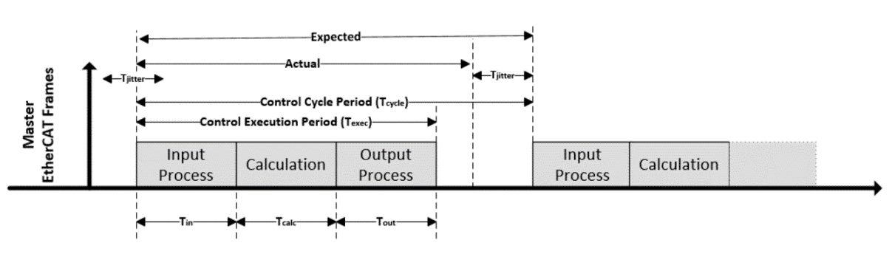

# Intel 08B — 时间隔离、控制调度与故障边界

截止2026-11-05；Suite固定对象1b0b22a2964f。本文深入调优指南与非ROS MPC补丁，没有写MSR、改BIOS、绑定网卡或运行控制。实时优势须由准确硬件、OS与负载条件证明。

## 同机整合的痛点与机制

端侧模型在CPU/iGPU/NPU并发运行，控制任务需要稳定读取关节、求解与输出；仅减少平均推理时间不保证总线周期不超时。Intel路线组合PREEMPT_RT、IRQ/核心亲和、缓存分配、频率/电源调优及原生网卡EtherCAT驱动，解决不同来源的干扰。每个机制覆盖一个层面，不能把组合标签理解成普适硬实时认证。[Intel02E_RT](https://raw.githubusercontent.com/open-edge-platform/robotics-ai-suite/1b0b22a2964f0f998c34cc03c5053fe61764015d/docs/user-guide/components/realtime_determinism/rt_tuning_guide.md)、[Intel02E_EtherCAT](https://raw.githubusercontent.com/open-edge-platform/robotics-ai-suite/1b0b22a2964f0f998c34cc03c5053fe61764015d/docs/user-guide/components/realtime_determinism/ethercat.md)

| 层面 | 配置/实现对象 | 作用机制 | 必须检查 | 不覆盖 |
|---|---|---|---|---|
| 调度与IRQ | isolcpus/rcu_nocbs/nohz_full/irqaffinity | 减少普通任务、回调和tick干扰 | 核心拓扑、线程/IRQ实际落点 | 固件SMI、热节流、所有共享资源 |
| 缓存 | CAT way mask与关联寄存器示例 | 给实时/尽力任务不同分配范围 | SKU能力、缓存域、mask及继承 | DRAM争用、I/O或硬件安全隔离 |
| 频率/电源 | HWP、pstate、每核C-state、GT唤醒 | 减少唤醒/调频变化 | 模块粒度、功耗与持续温度 | 永久锁定实际执行频率 |
| 网络 | IgH原生IGB/IGC/mGBE或generic | 减少协议栈路径开销 | 设备ID、driver、ENI、线缆/从站 | 任意NIC同样确定性 |
| 应用循环 | non-ROS MPC/MRT绝对tick网格 | 减少逐周期重新计时的漂移 | overrun、队列、实际完成周期 | 打断超时求解或WCET保证 |

## CPU与缓存隔离要绑定具体对象

Jazzy调优示例隔离8—11核心并把普通IRQ安排到0—7；Humble示例使用10—13和0—9。Series2设置SOC-North E-core为0，而Series3可全开；不能复用数字核心编号或只按P/E名称推测缓存组。应先查处理器拓扑、逻辑核心、共享缓存与中断归属，再把任务、运行时线程和从站网卡一起配置。隔离参数减少调度干扰，但没有自动阻止应用自行创建线程，也不控制所有内核活动。[Intel02E_RT](https://raw.githubusercontent.com/open-edge-platform/robotics-ai-suite/1b0b22a2964f0f998c34cc03c5053fe61764015d/docs/user-guide/components/realtime_determinism/rt_tuning_guide.md)

CAT示例给LLC不同mask：0x3f与0xfc0，E-core L2给0xff与0xff00，并以0xc8f关联实时核心。它表达把可分配缓存way划成不同范围以降低互相驱逐的意图；这些寄存器和值是特定配置示例，不适用于所有Core、Atom或缓存拓扑。CPUID0x4可查缓存几何，但不能仅凭有缓存推断CAT支持；还需核对分配能力和可用类数量。指南链接RDT/TCC手册，本轮RDT架构PDF未取得有效正文，因此没有补写未核验的CPUID能力位、MBA机制或寄存器普适范围。[Intel02E_RT](https://raw.githubusercontent.com/open-edge-platform/robotics-ai-suite/1b0b22a2964f0f998c34cc03c5053fe61764015d/docs/user-guide/components/realtime_determinism/rt_tuning_guide.md)

缓存分配优势在工作集能留在分配范围、且主干扰来自缓存驱逐时成立；给控制线程更少way可能反而增加它的miss。即使分配成功，DRAM、GPU/NPU流量、DMA及电源预算仍共享，需要在视觉/模型/日志最大负载下测miss、执行时间和deadline。CAT不是内存访问权限或保密机制，也不能替代独立安全控制器；不能由mask无重叠推出整个平台已具备安全隔离。

## 电源调优与持续温度

指南包含358H的3GHz实时核例子及HWP请求设置，说明P核可独立选P-state，E核通常每四核模块共用。限制尽力核心、调整EPP与禁部分C-state可能减少抖动，却牺牲能效或温度余量；固定请求不意味着功耗/温度限制下永不降频。文档自己提醒高频高压影响可靠性，不能只展示短时低延迟而忽略持续热稳态。[Intel02E_RT](https://raw.githubusercontent.com/open-edge-platform/robotics-ai-suite/1b0b22a2964f0f998c34cc03c5053fe61764015d/docs/user-guide/components/realtime_determinism/rt_tuning_guide.md)

i915有RC6配置，Xe文档称没有同样禁用参数而用持续打开forcewake调试文件保持GT醒。二者不可互套；示例中打开后立即关闭描述的是释放，不是持久保持。量产要设计该文件描述符持有者、异常退出、driver升级与恢复行为，不能把调试技巧当默认BSP服务。禁swap可避免已交换匿名页的major fault，但预分配、内存锁定及首次访问仍需验证。普通后台服务停掉可能减干扰，也可能失去更新维护能力，应按产品功能设计，而非在量产盲复制调优脚本。

## 总线周期与测量的读法

本轮重新打开图。Tin、Tcalc、Tout分别是输入、计算、输出；Texec为执行窗口，Tcycle为目标周期，expected/actual差为jitter。图无数值，只定义测量对象。cyclictest测线程预期与实际唤醒差，RTmotion的1ms示例、Servo2ms发布参数及整条EtherCAT输入到输出不能合并为同一个指标。控制闭环还需记录从站分布时钟、帧到达、驱动缓存和电机执行时刻。[Intel02E_TimingFig](https://raw.githubusercontent.com/open-edge-platform/robotics-ai-suite/1b0b22a2964f0f998c34cc03c5053fe61764015d/docs/user-guide/components/realtime_determinism/images/ethercat/rt_data_definition.png)、[Intel02E_Motion](https://raw.githubusercontent.com/open-edge-platform/edge-ai-libraries/e5dcdcc705a9306462897de913e39e44701566a1/libraries/edge-control-libraries/plcopen-motion-control/plcopen-motion/README.md)、[Intel02E_RVC](https://raw.githubusercontent.com/open-edge-platform/robotics-ai-suite/1b0b22a2964f0f998c34cc03c5053fe61764015d/docs/user-guide/software_references/stationary_arm/deployment/rvc_deploy.md)

指南推荐rt-tests2.6、主线程与测量线程分核、1ms interval和72h命令；展示18373ns最大值的样例只有C100000记录，并写“might be similar”。它不是72小时该平台实测，也不是18微秒WCET保证。没有提供该样例完整机器、BIOS、负载和功耗，不能移植到全部358H机器人。报告必须分开样例、测试命令与已执行结果，记录最大值、尾分布、超期次数、暴露时长和异常压力。[Intel02E_RT](https://raw.githubusercontent.com/open-edge-platform/robotics-ai-suite/1b0b22a2964f0f998c34cc03c5053fe61764015d/docs/user-guide/components/realtime_determinism/rt_tuning_guide.md)

IgH原生驱动路径限定IGB/IGC对应I210/I211/I225/I226及mGBE，generic经过Linux网络栈。原文称原生性能更高，是结构解释与厂商描述，没有本轮同条件倍数。绑定NIC还需要区分EtherCAT专用端口与普通网络、DKMS/kernel兼容和双master拓扑；以太网能通信不证明原生驱动已经生效。PTP接口存在也不等于相机、ROS时间戳和EtherCAT分布时钟已自动统一。[Intel02E_EtherCAT](https://raw.githubusercontent.com/open-edge-platform/robotics-ai-suite/1b0b22a2964f0f998c34cc03c5053fe61764015d/docs/user-guide/components/realtime_determinism/ethercat.md)

## 非ROS MPC：源码比频率标签更有意义

新增补丁将MPC与MRT分线程，MRT每1000周期用steady_clock报告实际循环频率。绝对网格`sleepTill += period`后sleep_until，避免每轮把固定唤醒迟延重新加进周期；落后时把下一deadline重置为now＋period，不做零sleep突发追赶。源码注释明确overrun不会被打断，因此稳定平均频率不代表每次求解都在预算内，也不代表已经测得示例1000Hz。应记录超期次数与重同步点，而非仅每千轮平均。[Intel08B_NonROSPatch](https://raw.githubusercontent.com/open-edge-platform/robotics-ai-suite/1b0b22a2964f0f998c34cc03c5053fe61764015d/src/pipelines/mpc-demo/ocs2/patches/0002-Add-non-ROS-MPC-MPC-MRT-module-and-test-pipeline-for.patch)

共享内存接收线程每约100微秒轮询，回调串行；重计算如FK若在回调中运行会影响其他订阅。ring每块深度16，原队列是竞争消费而非真正发布订阅，补丁用按消费者prefix分块做fan-out，增加副本和资源。晚订阅、队列满、消费者退出与旧状态年龄必须纳入验证，不能称它等价DDS语义或全链无拷贝。

文档警告close无条件unlink共享段，单进程重启可能异常；补丁源码已增加所有权约定：publisher关句柄，subscriber故意不close，让进程退出回收映射，避免订阅者退出删除其他人仍用的名称。这是对文档警告的局部缓解，未改变底层库没有detach-only API的事实；publisher重启、旧映射和新段并存仍需处理，安全恢复应验全组重启及epoch，不能声称已经事务恢复。[Intel04_MPC](https://raw.githubusercontent.com/open-edge-platform/robotics-ai-suite/1b0b22a2964f0f998c34cc03c5053fe61764015d/docs/user-guide/software_references/humanoid/sample_pipelines/mpc_demo.md)、[Intel08B_NonROSPatch](https://raw.githubusercontent.com/open-edge-platform/robotics-ai-suite/1b0b22a2964f0f998c34cc03c5053fe61764015d/src/pipelines/mpc-demo/ocs2/patches/0002-Add-non-ROS-MPC-MPC-MRT-module-and-test-pipeline-for.patch)

## 对标、适用范围与证据缺口

PREEMPT_RT、线程亲和、绝对周期调度和上游OCS2可以用于其他Linux平台，并非Intel独占；Intel差异在所选CPU/cache、电源、原生NIC与BKC协同。迁移到其他SoC或独立控制器时，算法/任务可以复用，MSR、缓存域、driver/ENI和测量方法不能原样移植。同机减少硬件成本的收益只有在并发测量和异常恢复通过时成立；独立控制域的方案可能更容易限制AI故障传播，本文未取得同条件成本/时延结果，不作优劣排序。

启动安全、TPM、固件签名或CPU隔离不自动构成功能安全。正式放行应有目标机器持续高负载、温度/电源变化、driver reset、断线/超期、进程重启的测试，并证明上层停写到驱动器安全状态的时间链。当前证据支持可实现的隔离与调度机制，缺RDT规范正文、整机WCET和安全认证，不能把“实时优化”写成所有机器人确定性承诺。

## 参考资料

原文与本地原件对应如下。动态分支只代表所列采集时点；固定Suite源码对象不等于每篇发布日期。代码许可不自动覆盖固件、二进制、模型权重、数据和本体SDK。HTML静态依赖缺失以registry记录为准，不承诺动态交互或像素级离线一致。

| 资料 | 原文 | 版本/边界 | 本地原件 | 采集时间UTC | 归档状态 |
|---|---|---|---|---|---|
| Intel02E_RT | [原文](https://raw.githubusercontent.com/open-edge-platform/robotics-ai-suite/1b0b22a2964f0f998c34cc03c5053fe61764015d/docs/user-guide/components/realtime_determinism/rt_tuning_guide.md) | 固定Suite源码对象 1b0b22a2964f | [本地原件](REFERENCES.md#ref-6904386a2b4a2974) | 2026-11-05T01:26:59.261614+00:00 | complete_static；缺失依赖0 |
| Intel02E_EtherCAT | [原文](https://raw.githubusercontent.com/open-edge-platform/robotics-ai-suite/1b0b22a2964f0f998c34cc03c5053fe61764015d/docs/user-guide/components/realtime_determinism/ethercat.md) | 固定Suite源码对象 1b0b22a2964f | [本地原件](REFERENCES.md#ref-cf99147edf176431) | 2026-11-05T02:44:00.816388+00:00 | complete_static；缺失依赖0 |
| Intel02E_TimingFig | [原文](https://raw.githubusercontent.com/open-edge-platform/robotics-ai-suite/1b0b22a2964f0f998c34cc03c5053fe61764015d/docs/user-guide/components/realtime_determinism/images/ethercat/rt_data_definition.png) | 固定Suite源码对象 1b0b22a2964f | [本地原件](REFERENCES.md#ref-6bd6d35c4a5c365e) | 2026-11-05T02:44:52.749880+00:00 | complete_static；缺失依赖0 |
| Intel02E_Motion | [原文](https://raw.githubusercontent.com/open-edge-platform/edge-ai-libraries/e5dcdcc705a9306462897de913e39e44701566a1/libraries/edge-control-libraries/plcopen-motion-control/plcopen-motion/README.md) | 动态快照；文中限定API/发行版本 | [本地原件](REFERENCES.md#ref-a4f19fd89157ba95) | 2026-11-05T02:44:48.535826+00:00 | complete_static；缺失依赖0 |
| Intel02E_RVC | [原文](https://raw.githubusercontent.com/open-edge-platform/robotics-ai-suite/1b0b22a2964f0f998c34cc03c5053fe61764015d/docs/user-guide/software_references/stationary_arm/deployment/rvc_deploy.md) | 固定Suite源码对象 1b0b22a2964f | [本地原件](REFERENCES.md#ref-2b7128bed0afd95b) | 2026-11-05T02:44:02.883750+00:00 | complete_static；缺失依赖0 |
| Intel08B_NonROSPatch | [原文](https://raw.githubusercontent.com/open-edge-platform/robotics-ai-suite/1b0b22a2964f0f998c34cc03c5053fe61764015d/src/pipelines/mpc-demo/ocs2/patches/0002-Add-non-ROS-MPC-MPC-MRT-module-and-test-pipeline-for.patch) | 固定Suite源码对象 1b0b22a2964f | [本地原件](REFERENCES.md#ref-4bd3d5ee930d282e) | 2026-11-05T04:23:47.344846+00:00 | complete_static；缺失依赖0 |
| Intel04_MPC | [原文](https://raw.githubusercontent.com/open-edge-platform/robotics-ai-suite/1b0b22a2964f0f998c34cc03c5053fe61764015d/docs/user-guide/software_references/humanoid/sample_pipelines/mpc_demo.md) | 固定Suite源码对象 1b0b22a2964f | [本地原件](REFERENCES.md#ref-171a5f3860ed8f79) | 2026-11-05T04:07:15.916391+00:00 | complete_static；缺失依赖0 |
