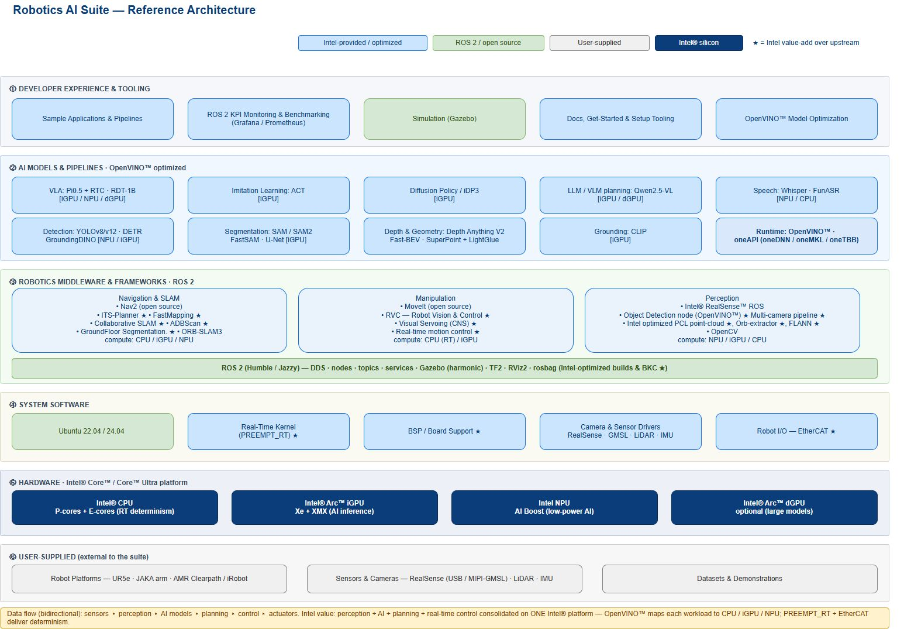

# Intel 08 — 核心技术护城河与能力证据地图

截止2026-11-05。本轮按实际机制新建规范总览与三个专题，旧08_Proprietary_Technologies.md保留为历史稿，不纳入本轮深度验收。护城河判断以公开API、调优指南、实现代码、版本与案例为依据；不以品牌、工艺名或峰值算力代替目标机器人测量。

## 结论：可积累的优势在系统交接

Intel具身路线把通用x86开发环境、端侧CPU/iGPU/NPU、工业I/O、实时调优与开放策略工具组织到一起。差异化可能降低既有工控系统的迁移和多板整合成本，但公开材料没有证明所有任务都比独显或专用控制平台更快、更便宜或更安全。这里应区分三种壁垒：芯片/驱动实现需要长期维护，平台集成与配置经验可积累，开源算法和通用接口则可被其他平台复用。[Intel02_Architecture](https://raw.githubusercontent.com/open-edge-platform/robotics-ai-suite/1b0b22a2964f0f998c34cc03c5053fe61764015d/docs/user-guide/images/architecture/Robotics-AI-Suite-Architecture.svg)、[Intel02B_GPU_Dispatch](https://raw.githubusercontent.com/openvinotoolkit/openvino/master/src/plugins/intel_gpu/docs/gpu_dual_runtime_dispatch.md)、[Intel02E_RT](https://raw.githubusercontent.com/open-edge-platform/robotics-ai-suite/1b0b22a2964f0f998c34cc03c5053fe61764015d/docs/user-guide/components/realtime_determinism/rt_tuning_guide.md)

| 能力族 | 深入专题 | 核心交接 | 可验证优势 | 主要失效条件 | 当前证据层 |
|---|---|---|---|---|---|
| 编译/驻留 | 08A | 分区图、tensor、cache、shape | 少重复搬运、降低部分冷启动 | fallback/迁移/动态边界/内存压力 | API与GPU实现文档 |
| 时间隔离/控制 | 08B | CPU/cache/IRQ、电源、EtherCAT、MPC/MRT | 减少已识别干扰与周期漂移 | 热节流、超期、共享总线与恢复 | 调优指南＋非ROS补丁 |
| 数据/部署契约 | 08C | schema、校准/stats、manifest、动作队列 | 迁移可解释与产物可复建 | 混帧、单位错、包更新/旧动作 | Studio/Runtime源码与模型文档 |

专题链接和资料/检查入口见08_Topics_Index；每篇独立检查与引用复用，联合资料目录为reference_metrial/08_core。总览解释各技术怎样组合及价值怎样被检验，不把专题规模或来源数量当性能证明。

## 官方架构的读法与边界

图已实际打开，颜色区分Intel提供/优化、上游开源、用户供给与Intel硬件，星号表示对上游的增值。底层机器人、传感器与示范数据依旧需要用户或伙伴提供，模型层设备标签是一张参考能力图，不是全模型全SKU验收表。图支持按层识别交付责任，不支持伙伴认证数量、实际延迟、低功耗或安全等级。[Intel02_Architecture](https://raw.githubusercontent.com/open-edge-platform/robotics-ai-suite/1b0b22a2964f0f998c34cc03c5053fe61764015d/docs/user-guide/images/architecture/Robotics-AI-Suite-Architecture.svg)

从采集到动作，技术交接顺序是：相机/关节观测确定格式和时间，预处理与编译图确定设备与布局，策略产生动作段，运行时队列决定消费与过期，控制线程/网卡决定执行节拍，本体保护决定危险响应。某个层面优化可能把瓶颈推到下一层，所以必须在最终任务中记录观测年龄和执行行为，不能把独立demo拼成已验证系统。

## 异构计算：优势须兑现到工作集与边界

一体化处理器能让部分数据避开独立板卡接口，但共享地址、remote tensor和同进程消息是三个不同层级。HETERO会分区并传中间tensor，GPU shared内存可能按需迁移，NPU虚拟地址导入有对齐/存活条件。优势成立于实际模型大部分驻留、边界少且数据格式匹配；若小子图反复回CPU，拷贝、同步和控制线程争用可能抵消硬件算力。[Intel02B_HETERO](https://raw.githubusercontent.com/openvinotoolkit/openvino/master/docs/articles_en/openvino-workflow/running-inference/inference-devices-and-modes/hetero-execution.rst)、[Intel02B_GPU_Memory](https://raw.githubusercontent.com/openvinotoolkit/openvino/master/src/plugins/intel_gpu/docs/memory_allocation_gpu_plugin.md)、[Intel02B_RemoteNPU](https://raw.githubusercontent.com/openvinotoolkit/openvino/master/docs/articles_en/openvino-workflow/running-inference/inference-devices-and-modes/npu-device/remote-tensor-api-npu-plugin.rst)

缓存缩短部分编译启动，并不替代模型/权重与驱动版本；形状有界使资源更可计划，却限制可变输入。采用新通用NPU动态机制必须核对CIP/driver和NPU代际，不能直接归为旧Suite绑定版本已支持。统一API可以减少调用层改写，硬件编译产物、kernel及buffer互操作仍要重新建立。[Intel02B_Cache](https://raw.githubusercontent.com/openvinotoolkit/openvino/master/docs/articles_en/openvino-workflow/running-inference/optimize-inference/optimizing-latency/model-caching-overview.rst)、[Intel02B_NPU](https://raw.githubusercontent.com/openvinotoolkit/openvino/master/docs/articles_en/openvino-workflow/running-inference/inference-devices-and-modes/npu-device.rst)

ORT的OpenVINO与TensorRT EP均有缓存、分区和设备配置；TensorRT路径还可用CUDA EP接不支持节点。因此不能把编译优化泛称独有，也不能因另一个平台有动态shape就推定动作质量一致。真正对比应固定模型、相机、语言长度、horizon、精度、功率与包含的链路，核对输出、fallback和尾延迟；本轮只具机制材料，没有同条件机器人排名。[Intel08A_ORTOV](https://onnxruntime.ai/docs/execution-providers/OpenVINO-ExecutionProvider.html)、[Intel08A_ORTTRT](https://onnxruntime.ai/docs/execution-providers/TensorRT-ExecutionProvider.html)

## 时间协调：目标周期与安全要求分开

CPU亲和、缓存mask、电源配置和原生NIC路径提供减少干扰的抓手；非ROS MPC补丁用绝对tick网格防长期频率漂移。这里能积累的工程资产是特定SKU/BIOS/kernel/驱动/负载的组合及可重复测量。换处理器、板修订或芯片电源策略后，旧核心编号、缓存域、网卡路径和热条件可能失效，须重验。[Intel02E_RT](https://raw.githubusercontent.com/open-edge-platform/robotics-ai-suite/1b0b22a2964f0f998c34cc03c5053fe61764015d/docs/user-guide/components/realtime_determinism/rt_tuning_guide.md)、[Intel02E_EtherCAT](https://raw.githubusercontent.com/open-edge-platform/robotics-ai-suite/1b0b22a2964f0f998c34cc03c5053fe61764015d/docs/user-guide/components/realtime_determinism/ethercat.md)、[Intel08B_NonROSPatch](https://raw.githubusercontent.com/open-edge-platform/robotics-ai-suite/1b0b22a2964f0f998c34cc03c5053fe61764015d/src/pipelines/mpc-demo/ocs2/patches/0002-Add-non-ROS-MPC-MPC-MRT-module-and-test-pipeline-for.patch)

调度器不打断超期求解，cache划分不隔离所有DRAM/I/O，循环平均频率不等于每次完成deadline。cyclictest样例不证明整条总线或机器人WCET。独立控制器可以提供另一故障域，同机方案减少部件却需要证明AI reset、内存压力和高温不影响安全路径；没有正式安全资料时，启动签名、TPM或PREEMPT_RT不能代替本体与工位功能安全。硬实时和安全属于不同验收目标。

## 可复建策略：模型之外的数据资产

MolmoAct2的本体校准、旧frame/degree与归一化单位转换说明相同权重换臂后仍需新scale。Studio manifest和导出源码把统计量、输入输出名、runner、处理器和硬件配方显式化，有利于解释迁移；但无锁Store允许混相邻样本，INT8后处理的xml/bin替换也非全包事务。此类限制直接关系到训练标签、动作质量和更新恢复，不能只称“端到端MLOps完整”。[Intel04_MolmoAct2](https://raw.githubusercontent.com/open-edge-platform/physical-ai-studio/b38bff4a9e6d79481ce1b2bcfdaf3e8ec103724e/library/src/physicalai/policies/molmoact2/README.md)、[Intel02F_Store](https://raw.githubusercontent.com/open-edge-platform/physical-ai-studio/b38bff4a9e6d79481ce1b2bcfdaf3e8ec103724e/application/backend/src/runtime_session/store.py)、[Intel02F_Hooks](https://raw.githubusercontent.com/open-edge-platform/physical-ai-studio/b38bff4a9e6d79481ce1b2bcfdaf3e8ec103724e/library/src/physicalai/export/hooks.py)

开放数据和多后端降低被单一产物锁定的风险，既有数据集、操作员工作流和本体校准积累则形成实际迁移成本。这种成本不应被夸大为用户不能迁移；它可以通过schema、任务定义、版本化原件和回归流程降低。代码Apache2.0不覆盖Gemma权重、受限模型/数据、固件和本体SDK，需要把可移植部分与授权部分分别交付。[Intel02F_Lib](https://raw.githubusercontent.com/open-edge-platform/physical-ai-studio/b38bff4a9e6d79481ce1b2bcfdaf3e8ec103724e/library/README.md)、[Intel02C_Pi05_ModelCard](https://huggingface.co/lerobot/pi05_base/raw/main/README.md)、[Intel02C_Runtime_License](https://raw.githubusercontent.com/openvinotoolkit/physicalai/main/LICENSE)

## 三个场景怎样形成闭环判断

固定视觉臂可以让图像编码与检测留GPU、抓取和状态机留CPU、实时执行有独立线程；仍要验证工厂校准、相机外参、TCP与碰撞模型，Servo发布参数不能代替驱动器保护。AMR更受地图时效、多传感器同步、成本地图与底盘看门狗约束，不能把检测加速直接转换为导航可靠性。人形策略还需关节顺序/单位、力矩限制和站立/动作模型的共享预算，默认CPU的站立yaml不能改写成NPU已完整验收。[Intel06_URBlueprint](https://raw.githubusercontent.com/open-edge-platform/robotics-ai-suite/1b0b22a2964f0f998c34cc03c5053fe61764015d/docs/user-guide/hardware_blueprints/stationary_arm/ur5e-robotiq-realsense.md)、[Intel06_Jackal](https://raw.githubusercontent.com/open-edge-platform/robotics-ai-suite/1b0b22a2964f0f998c34cc03c5053fe61764015d/docs/user-guide/hardware_blueprints/amr/clearpath-jackal.md)、[Intel02E_RLConfig](https://raw.githubusercontent.com/open-edge-platform/edge-ai-libraries/e5dcdcc705a9306462897de913e39e44701566a1/libraries/edge-control-libraries/fieldbus/robotmctask/examples/config/robot_rl_ov.yaml)

客户Ella取消独显及Oversonic机内采用证明存在整合路径，Trossen测试则处于另一成熟度。公告不给具体SKU、成对BOM、功耗、机队分母与ROI，不能把客户叙述作为技术对比的测量替身。适用性最终由目标任务、容量、控制要求与维护责任共同决定。[Intel06_CustomerCases](https://www.intel.com/content/www/us/en/newsroom/news/artificial-intelligence/intel-core-ultra-series-3-for-edge-ai-robotics.html)

## 证据缺口与放行动作

本轮未取得RDT架构PDF正文、完整本体安全认证、目标Intel模型持续并发闭环数据与全包更新恢复报告；失败候选保留研究日志，不进入有效引用。未系统检索专利族、许可收入或独占商业协议，不能声称已证明法律意义的专利护城河。固件/芯片制造与封装、开放源码和商业服务也分别需要采购资料，不能从企业所在地推断自主可控比例。

建议先用目标任务冻结观测/动作/安全契约，再拿准确机器验证分区、驻留和形状，接着验证时序、热稳定与异常恢复，最后在真实留出场景统计成功/人工介入/停机。只有这些证据一致，才能把减少开发工作或部件成本写成产品优势。本文总览与专题已完成文献、API和源码层研究，所有性能和量产结论仍遵守上述实测边界；08资料联合清单覆盖总览与全部专题，静态依赖缺失按各原件记录披露。

## 参考资料

原文与本地原件对应如下。动态分支只代表所列采集时点；固定Suite源码对象不等于每篇发布日期。代码许可不自动覆盖固件、二进制、模型权重、数据和本体SDK。HTML静态依赖缺失以registry记录为准，不承诺动态交互或像素级离线一致。

| 资料 | 原文 | 版本/边界 | 本地原件 | 采集时间UTC | 归档状态 |
|---|---|---|---|---|---|
| Intel02_Architecture | [原文](https://raw.githubusercontent.com/open-edge-platform/robotics-ai-suite/1b0b22a2964f0f998c34cc03c5053fe61764015d/docs/user-guide/images/architecture/Robotics-AI-Suite-Architecture.svg) | 固定Suite源码对象 1b0b22a2964f | [本地原件](REFERENCES.md#ref-0ead36e32550c972) | 2026-11-05T02:21:20.667057+00:00 | complete_static；缺失依赖0 |
| Intel02B_GPU_Dispatch | [原文](https://raw.githubusercontent.com/openvinotoolkit/openvino/master/src/plugins/intel_gpu/docs/gpu_dual_runtime_dispatch.md) | 动态快照；文中限定API/发行版本 | [本地原件](REFERENCES.md#ref-ecfa9bdc23701352) | 2026-11-05T02:29:19.805964+00:00 | complete_static；缺失依赖0 |
| Intel02E_RT | [原文](https://raw.githubusercontent.com/open-edge-platform/robotics-ai-suite/1b0b22a2964f0f998c34cc03c5053fe61764015d/docs/user-guide/components/realtime_determinism/rt_tuning_guide.md) | 固定Suite源码对象 1b0b22a2964f | [本地原件](REFERENCES.md#ref-6904386a2b4a2974) | 2026-11-05T01:26:59.261614+00:00 | complete_static；缺失依赖0 |
| Intel02B_HETERO | [原文](https://raw.githubusercontent.com/openvinotoolkit/openvino/master/docs/articles_en/openvino-workflow/running-inference/inference-devices-and-modes/hetero-execution.rst) | 动态快照；文中限定API/发行版本 | [本地原件](REFERENCES.md#ref-92285406c05d6b21) | 2026-11-05T02:27:23.835544+00:00 | complete_static；缺失依赖0 |
| Intel02B_GPU_Memory | [原文](https://raw.githubusercontent.com/openvinotoolkit/openvino/master/src/plugins/intel_gpu/docs/memory_allocation_gpu_plugin.md) | 动态快照；文中限定API/发行版本 | [本地原件](REFERENCES.md#ref-1e66c4fc5304f6fe) | 2026-11-05T02:29:17.784698+00:00 | complete_static；缺失依赖0 |
| Intel02B_RemoteNPU | [原文](https://raw.githubusercontent.com/openvinotoolkit/openvino/master/docs/articles_en/openvino-workflow/running-inference/inference-devices-and-modes/npu-device/remote-tensor-api-npu-plugin.rst) | 动态快照；文中限定API/发行版本 | [本地原件](REFERENCES.md#ref-0c56cdb43a59da75) | 2026-11-05T02:27:30.347336+00:00 | complete_static；缺失依赖0 |
| Intel02B_Cache | [原文](https://raw.githubusercontent.com/openvinotoolkit/openvino/master/docs/articles_en/openvino-workflow/running-inference/optimize-inference/optimizing-latency/model-caching-overview.rst) | 动态快照；文中限定API/发行版本 | [本地原件](REFERENCES.md#ref-b0da798395ae7d62) | 2026-11-05T02:27:25.933450+00:00 | complete_static；缺失依赖0 |
| Intel02B_NPU | [原文](https://raw.githubusercontent.com/openvinotoolkit/openvino/master/docs/articles_en/openvino-workflow/running-inference/inference-devices-and-modes/npu-device.rst) | 动态快照；文中限定API/发行版本 | [本地原件](REFERENCES.md#ref-cb4e7b7716dce4f6) | 2026-11-05T02:27:21.574666+00:00 | complete_static；缺失依赖0 |
| Intel08A_ORTOV | [原文](https://onnxruntime.ai/docs/execution-providers/OpenVINO-ExecutionProvider.html) | 动态快照；文中限定API/发行版本 | [本地原件](REFERENCES.md#ref-edb6a0a1f786820c) | 2026-11-05T04:20:29.209961+00:00 | complete_static；缺失依赖0 |
| Intel08A_ORTTRT | [原文](https://onnxruntime.ai/docs/execution-providers/TensorRT-ExecutionProvider.html) | 动态快照；文中限定API/发行版本 | [本地原件](REFERENCES.md#ref-79d5a0e8a1b18b5a) | 2026-11-05T04:21:22.334717+00:00 | partial_static；缺失依赖2 |
| Intel02E_EtherCAT | [原文](https://raw.githubusercontent.com/open-edge-platform/robotics-ai-suite/1b0b22a2964f0f998c34cc03c5053fe61764015d/docs/user-guide/components/realtime_determinism/ethercat.md) | 固定Suite源码对象 1b0b22a2964f | [本地原件](REFERENCES.md#ref-cf99147edf176431) | 2026-11-05T02:44:00.816388+00:00 | complete_static；缺失依赖0 |
| Intel08B_NonROSPatch | [原文](https://raw.githubusercontent.com/open-edge-platform/robotics-ai-suite/1b0b22a2964f0f998c34cc03c5053fe61764015d/src/pipelines/mpc-demo/ocs2/patches/0002-Add-non-ROS-MPC-MPC-MRT-module-and-test-pipeline-for.patch) | 固定Suite源码对象 1b0b22a2964f | [本地原件](REFERENCES.md#ref-4bd3d5ee930d282e) | 2026-11-05T04:23:47.344846+00:00 | complete_static；缺失依赖0 |
| Intel04_MolmoAct2 | [原文](https://raw.githubusercontent.com/open-edge-platform/physical-ai-studio/b38bff4a9e6d79481ce1b2bcfdaf3e8ec103724e/library/src/physicalai/policies/molmoact2/README.md) | 动态快照；文中限定API/发行版本 | [本地原件](REFERENCES.md#ref-ec14ed59aa327727) | 2026-11-05T04:04:14.597217+00:00 | complete_static；缺失依赖0 |
| Intel02F_Store | [原文](https://raw.githubusercontent.com/open-edge-platform/physical-ai-studio/b38bff4a9e6d79481ce1b2bcfdaf3e8ec103724e/application/backend/src/runtime_session/store.py) | 动态快照；文中限定API/发行版本 | [本地原件](REFERENCES.md#ref-2c8925d07dfb88c8) | 2026-11-05T02:49:21.311241+00:00 | complete_static；缺失依赖0 |
| Intel02F_Hooks | [原文](https://raw.githubusercontent.com/open-edge-platform/physical-ai-studio/b38bff4a9e6d79481ce1b2bcfdaf3e8ec103724e/library/src/physicalai/export/hooks.py) | 动态快照；文中限定API/发行版本 | [本地原件](REFERENCES.md#ref-030ca720250145a9) | 2026-11-05T02:49:23.287604+00:00 | complete_static；缺失依赖0 |
| Intel02F_Lib | [原文](https://raw.githubusercontent.com/open-edge-platform/physical-ai-studio/b38bff4a9e6d79481ce1b2bcfdaf3e8ec103724e/library/README.md) | 动态快照；文中限定API/发行版本 | [本地原件](REFERENCES.md#ref-92918aa573fbd230) | 2026-11-05T02:48:39.024440+00:00 | complete_static；缺失依赖0 |
| Intel02C_Pi05_ModelCard | [原文](https://huggingface.co/lerobot/pi05_base/raw/main/README.md) | 动态快照；文中限定API/发行版本 | [本地原件](REFERENCES.md#ref-e6655f48f9ab756c) | 2026-11-05T02:33:32.198250+00:00 | complete_static；缺失依赖0 |
| Intel02C_Runtime_License | [原文](https://raw.githubusercontent.com/openvinotoolkit/physicalai/main/LICENSE) | 动态快照；文中限定API/发行版本 | [本地原件](REFERENCES.md#ref-bc7b7041a0a10378) | 2026-11-05T02:34:32.406947+00:00 | complete_static；缺失依赖0 |
| Intel06_URBlueprint | [原文](https://raw.githubusercontent.com/open-edge-platform/robotics-ai-suite/1b0b22a2964f0f998c34cc03c5053fe61764015d/docs/user-guide/hardware_blueprints/stationary_arm/ur5e-robotiq-realsense.md) | 固定Suite源码对象 1b0b22a2964f | [本地原件](REFERENCES.md#ref-29f21fe2e4378b6f) | 2026-11-05T04:13:50.077356+00:00 | complete_static；缺失依赖0 |
| Intel06_Jackal | [原文](https://raw.githubusercontent.com/open-edge-platform/robotics-ai-suite/1b0b22a2964f0f998c34cc03c5053fe61764015d/docs/user-guide/hardware_blueprints/amr/clearpath-jackal.md) | 固定Suite源码对象 1b0b22a2964f | [本地原件](REFERENCES.md#ref-61884da1615e1906) | 2026-11-05T04:13:51.190562+00:00 | complete_static；缺失依赖0 |
| Intel02E_RLConfig | [原文](https://raw.githubusercontent.com/open-edge-platform/edge-ai-libraries/e5dcdcc705a9306462897de913e39e44701566a1/libraries/edge-control-libraries/fieldbus/robotmctask/examples/config/robot_rl_ov.yaml) | 动态快照；文中限定API/发行版本 | [本地原件](REFERENCES.md#ref-faf126229b50320e) | 2026-11-05T02:45:51.716577+00:00 | complete_static；缺失依赖0 |
| Intel06_CustomerCases | [原文](https://www.intel.com/content/www/us/en/newsroom/news/artificial-intelligence/intel-core-ultra-series-3-for-edge-ai-robotics.html) | 动态快照；文中限定API/发行版本 | [本地原件](REFERENCES.md#ref-a198bce07c1cd65c) | 2026-11-05T04:13:35.108017+00:00 | partial_static；缺失依赖12 |
