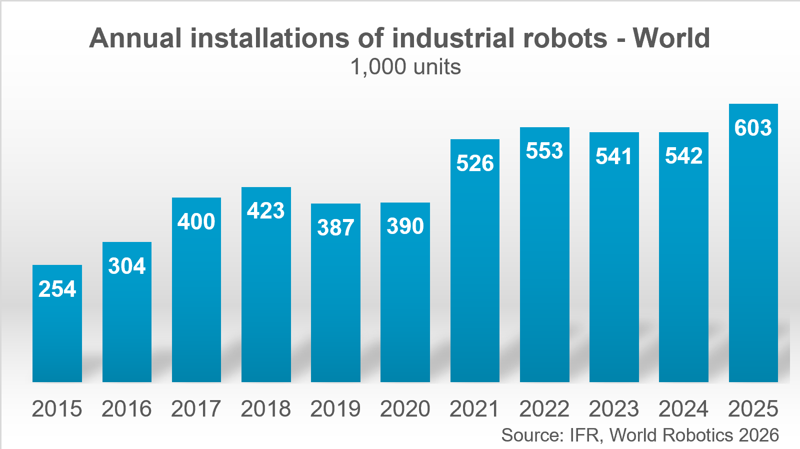

# Intel 09 SWOT与条件选型

研究截止：2026-11-05（Asia/Shanghai）。本章吸收01—08的规格、源码与客户证据，并新增IFR 2026统计、Intel 2026第三季度财报和欧盟机械法规官方说明。结论是：Intel适合把已有x86/ROS工程资产与中等规模端侧推理结合的项目；是否取消独显、进入长期运营，必须由准确整机、模型与业务数据决定。以下区分公开事实、厂商宣称、分析情景和待验收项，不输出未经同条件测量的平台排名。

## 1. 市场分母与商业信号

IFR于2026-09-24发布的工业机器人统计称，2025年全球在用存量约500万台，新安装超过60万台；中国安装35.4万台，占全球当年部署59%，中国厂商在中国市场的份额为55%。全球安装分母、中国安装分母与本土整机供应商份额不同；这些数字没有芯片品牌、VLA搭载率或Intel收入字段。不能把中国整机国产份额解释为计算平台国产化率，也不能用存量推导新一代处理器可替换数量。[Intel09_IFRIndustry](https://ifr.org/ifr-press-releases/news/five-million-robots-now-operate-in-factories-globally)

图1：IFR World Robotics 2026，单位为千台，2025柱为603，即按图示精度约60.3万台；正文“超过60万台”与图一致，不自行补出个位数精度。柱形图说明工业自动化需求规模，不能证明所有新增机器人都需要通用AI计算或任何一家芯片份额。[Intel09_IFRFigure](https://ifr.org/downloads/press_docs/Graphic_World_Robotics_2026_GLOBAL.png)

IFR于2026-09-30披露，2025年专业服务机器人出货接近25万台，运输物流销量117,500台、占47%；正文标题简写117,000，本文采用应用段的117,500并保留口径。全尺寸人形统计约7,000台，限定身高超过140cm、商业/专业用途且排除研发与娱乐。消费机器人接近3,420万台属于另一类别，不能据其规模估算高性能人形计算需求。公告没有披露可复建的样本名单、覆盖率和外推权重，本文没有取得完整统计方法，因而只转述协会公告；47%是应用类别占比。[Intel09_IFRService](https://ifr.org/ifr-press-releases/news/global-sales-of-professional-service-robots-surge-24-percent)

Intel于2026-10-29发布Q3结果，报告期截至2026-09-26：合并收入USD16.5 billion，同比增长21%；CCPG（Client Computing and Physical AI Group）USD8.1 billion，同比下降5%。财报说明该组在Q1及更早称CCG，不能直接把组名中的Physical AI当作单独收入。分部交易需抵销，Foundry收入不能直接加到Products估计公司收入；季度报表相关数字为未经审计财务披露。这里没有单列机器人芯片销量、端侧机器人收入或市占率。管理层对供给扩展、存储/基板短缺及贸易风险的表述支持供应情景分析，不能证明某CEXD订单会延期。[Intel09_Q3](https://www.intc.com/news-events/press-releases/detail/1786/intel-reports-third-quarter-2026-financial-results)

## 2. 真实案例与成熟度

2026-05-20客户公告称，Sensory AI的Ella已在Series 3发布后完全转为机内Intel-only架构；Avatar/Ella/Guardian三个agent分别面向交互、门店运营和系统健康，确定性编排器执行机械臂恢复。这支持“固定业务、推理为主、可能减少独显”的路线。没有准确CPU SKU、改造台数、营业暴露小时、取消独显前后的电表/BOM与人工介入率；每小时200杯是当时对Computex的预告，不能当门店实测收入。[Intel06_CustomerCases](https://www.intel.com/content/www/us/en/newsroom/news/artificial-intelligence/intel-core-ultra-series-3-for-edge-ai-robotics.html)

同公告中Oversonic称制造取放和医疗康复本体转为机内Series 3，训练仍使用独显；不能由机内推理路线推出端侧训练替代。Trossen是当年开始测试，Circulus是其操作系统运行Series 3及产品组合介绍；都未证明每款本体已完成量产切换。第06章的Jackal与UR5e蓝图则提供具体OS、板卡、相机/夹爪和通信配置，是参考适配证据。它们比伙伴名单更便于复建，但没有正式商业合同、在岗规模或新旧系统ROI数据。[Intel06_Jackal](https://raw.githubusercontent.com/open-edge-platform/robotics-ai-suite/1b0b22a2964f0f998c34cc03c5053fe61764015d/docs/user-guide/hardware_blueprints/amr/clearpath-jackal.md)、[Intel06_URBlueprint](https://raw.githubusercontent.com/open-edge-platform/robotics-ai-suite/1b0b22a2964f0f998c34cc03c5053fe61764015d/docs/user-guide/hardware_blueprints/stationary_arm/ur5e-robotiq-realsense.md)

## 3. SWOT：事实、影响、触发条件与动作

| 类别 | 可追溯事实 | 影响机制与条件 | 选型动作 |
|---|---|---|---|
| 优势S：已有工程资产 | Jackal明确24.04/Jazzy与UP Nexus组合；UR蓝图给外部控制路径 | 已有x86驱动、ROS节点与工程团队可复用；ARM专有二进制不能自动迁入 | 先列驱动/SDK架构与版本，复建蓝图后测试目标载板 |
| 优势S：集成异构 | OpenVINO支持设备选择及拆图，Ella公告称取消独显 | 小中型推理可减外部部件；前提是内存、算子与热预算满足并发 | 指定CPU/GPU/NPU实配，测全链路并发而非相加TOPS |
| 短板W：分区与交接成本 | HETERO存在分区边界；AUTO默认排除NPU | unsupported算子与搬运可能吞掉收益；源模型存在不等于目标NPU已优化 | 导出算子覆盖/设备图，记录fallback与观测年龄 |
| 短板W：量产责任分散 | CEXD指南限定研发；AAEON服务存在定制范围 | 芯片、载板、OS、固件、相机与本体分属不同交付责任 | 把最终BOM、修订、支持SLA、PCN/EOL写入合同 |
| 机会O：存量业务升级情景 | IFR物流应用最大；Ella展示业务编排 | 固定路线、固定工具与成熟流程更易建立可度量收益；不是市场份额预测 | 从单工位/单站点试点积累暴露时长与人工接管记录 |
| 威胁T：竞争和快速变化 | ONNX Runtime也有TensorRT EP、缓存/profile等机制 | NVIDIA等方案能解决同一编译痛点；迁移数据/算子/训练依赖决定切换成本 | 在同模型/功率/输入/任务下比较，保留可迁移模型与日志 |
| 威胁T：交付及政策变化 | 财报列供应链和贸易风险；欧盟机械规则有过渡日期 | 缺料、受控用途、软件更新或适用要求变化可扩大维护成本 | 逐P/N/目的地核分类并冻结放行版本；设置替代件再认证预算 |

上述机制来源为[Intel02B_AUTO](https://raw.githubusercontent.com/openvinotoolkit/openvino/master/docs/articles_en/openvino-workflow/running-inference/inference-devices-and-modes/auto-device-selection.rst)、[Intel02B_HETERO](https://raw.githubusercontent.com/openvinotoolkit/openvino/master/docs/articles_en/openvino-workflow/running-inference/inference-devices-and-modes/hetero-execution.rst)、[Intel08A_ORTTRT](https://onnxruntime.ai/docs/execution-providers/TensorRT-ExecutionProvider.html)、[Intel_Doc_CEXD](https://raw.githubusercontent.com/open-edge-platform/robotics-ai-suite/1b0b22a2964f0f998c34cc03c5053fe61764015d/docs/user-guide/platform_foundation/development_kits/robinson-bay/index.md)与[Intel07_AAEON_BIOS](https://www.aaeon.com/en/article/list/bios-customization-services)。S/W对应已取得交付物及机制；O/T是条件情景。实时指南的核隔离、功率调节和CAT只支持调优路径，样例cyclictest不证明72小时实测或WCET；共享资源争用与高频热成本必须测量。[Intel_Doc_RT_Tuning](https://raw.githubusercontent.com/open-edge-platform/robotics-ai-suite/1b0b22a2964f0f998c34cc03c5053fe61764015d/docs/user-guide/components/realtime_determinism/rt_tuning_guide.md)

## 4. 采购和透明TCO模型

截至本次采集，Atom x7433RE ARK RCP为USD72、B580为USD249。对象分别是芯片价格指导与显卡指导价；页面没有本项目数量、地区渠道、税/运费及报价有效期，不是中国含税整机报价。CEXD商店因robots访问失败没有可用正文，不能报估计套件价格。Edge页“10年可用性”仍需逐SKU/地区确认，不能变成十年BSP漏洞修复或任意载板现货保证；AAEON的active产品BIOS严重性分级更新安排，也没有给本项目十年全栈支持合同。[Intel_ARK_x7433RE](https://www.intel.com/content/www/us/en/products/sku/236967/intel-atom-x7433re-processor-6m-cache-up-to-3-40-ghz/specifications.html)、[Intel_ARK_B580](https://www.intel.com/content/www/us/en/products/sku/241598/intel-arc-b580-graphics/specifications.html)、[Intel_Ultra_Edge](https://www.intel.com/content/www/us/en/products/details/processors/core-ultra/edge.html)、[Intel07_AAEON_BIOS](https://www.aaeon.com/en/article/list/bios-customization-services)

以统一币种人民币计，分析模型为：`TCO = N×(B+S) + E + N×Y×(P/1000×H×e + M + R + D×L) − V`。N为部署台数；B为每台含税完整计算BOM（主板/内存/SSD/电源/散热/桥接/显卡），S为每台安装标定及认证分摊；E为一次性移植、数据和验证费用；Y为年数；P为同任务运行时平均输入功率W；H为每年工作小时；e为元/kWh；M为每台每年维护，R为服务/通信/许可，D为每台年停机小时，L为每停机小时损失，V为期末残值。此式假设单一工作模式、静态电价，不折现；若有待机、充电损耗、多个功率档，应按各档小时加总，不能用处理器PBP替代P。

| 情景输入（分析假设） | 数值/单位 | 可复算结果 | 尚缺输入 |
|---|---|---|---|
| 10台、3年、每年4,000小时、电价0.8元/kWh | N=10，Y=3，H=4,000，e=0.8 | 总计120,000台·小时 | 未代表某实际客户 |
| 同任务计算系统平均功率降低20W | ΔP=20W | 节电2,400kWh、1,920元 | 未测真实输入功率/充电链 |
| 新路线一次性移植增加20,000元 | ΔE=20,000元 | 若其余项相等，单台BOM须降低约1,808元才收支相等 | 未取得报价、移植工时、故障率 |

最后一行按`20,000/10−1,920/10`得到约1,808元/台，是假设的差额平衡点，不是平台报价或ROI。停机项、人工接管、云费用和维护不同，平衡点即改变。真实业务还要用每次尝试的成功率、每成功任务贡献毛利、有效运营小时与接管费用建立收益分母；“200杯/小时×单杯售价”既未扣成本也未证明持续工作，不能据此计算回本时间。Intel性能索引中估算主机价格和TCO百分比存在第01章已列的内部差异，本章不采用其节省百分比作为采购结论。[Intel_Edge_Performance](https://edc.intel.com/content/www/us/en/products/performance/benchmarks/intel-core-ultra-processors-series-3/)

## 5. 区域政策、数据运营与责任

欧盟委员会Machinery官方说明称，2027-01-20起新Machinery Regulation (EU) 2023/1230强制适用，在此日期前进入欧盟市场的机械仍需符合2006/42/EC。说明涵盖AI安全功能、合规相关软件数据和安全控制系统的cyber-safety、高风险机械符合性评估。该页面也提示原法规适用日期曾有勘误。这里引用委员会说明而非本轮未取得的逐条法规原文；不据此判定某机器人具体法律分类或认证完成。[Intel09_EUMachineryGuide](https://single-market-economy.ec.europa.eu/sectors/mechanical-engineering/machinery_en)

分析上的动作是：面向欧盟交付时记录首次投放日期、更新内容和最终机械责任主体，安全控制器/急停与学习策略分别建立证据。TPM、watchdog、PREEMPT_RT或本地推理不产生机械安全认证。中国项目的人脸、患者、店员/顾客视频、机器人录制数据与境外训练服务，应由实际数据类别、处理目的、留存和跨境路径核查；本轮未取得中国法规逐条原文和最新配套条件，不作具体豁免判断。GDPR与欧盟机械原文均返回HTTP202空白WAF响应，明确排除有效引用；中国人大定向检索未定位可归档全文，保留缺口。

“on-device”减少推理时上云依赖，但录制上传、遥测、远程维护、训练资产下载仍有数据流和离线可用性要求。Studio导出服务主要生成runtime配置/配方，需要目标机设备、相机和初始状态重新确认，不等于机队部署、凭据管理与回退已验收。[Intel02F_RuntimeExport](https://raw.githubusercontent.com/open-edge-platform/physical-ai-studio/b38bff4a9e6d79481ce1b2bcfdaf3e8ec103724e/application/backend/src/services/runtime_export.py) 出口和采购限制也必须逐准确P/N、目的地、最终用户/用途和时点确认；本轮没有对应Core Ultra、NPU或Arc端侧SKU的官方出口分类材料，不能将数据中心GPU规则泛套，更不能宣称这些端侧产品普遍不受限。这里是待供应商核验条件。

## 6. 场景选型与放行矩阵

| 场景 | Intel候选路线 | 成立条件 | 拒绝放行/补证触发 |
|---|---|---|---|
| 科研与操作数据采集 | x86主机＋Studio＋轻量策略 | 相机/关节顺序与标定固定，数据和权重许可清楚 | 模型卡与动作接口未闭环；导出成功但无真实动作校验 |
| 物流AMR | Jackal验证组合或同等级工程平台 | 导航/感知并发、观测年龄、通信与电池可验收 | 不同板卡/雷达仅靠驱动兼容就声称已验证 |
| 固定机械臂取放 | UR5e蓝图＋OpenVINO视觉 | 工具TCP/校准、控制器及失效保护已确认 | 使用示例2ms配置当真实500Hz/急停保证 |
| 固定视觉/零售agent | 集成GPU/NPU，必要时CPU fallback | 同任务可容纳内存，端侧并发和成本满足 | 用单模型毫秒值倒算全业务吞吐 |
| 人形/双臂大策略 | 大内存Core Ultra整机，按实测决定独显 | 动作horizon/单位/夹爪及热稳定，安全域独立 | 高参数模型不能全链加速；没有长暴露小时任务数据 |
| 消费小型本体 | 轻量Core或其他功耗平台同条件比较 | 体积、噪声、待机与整机价格符合产品预算 | 将工业开发套件价格/温区推广到消费量产 |
| 工业/医疗/安全关键 | AI主机作为非认证算法域候选 | 最终系统适用标准、认证控制器、风险分析及维护签署 | 把TPM或实时优化当安全等级/临床有效性 |

矩阵按第01—08章证据整理，属于分析选型动作；对应真实硬件约束见[Intel06_Jackal](https://raw.githubusercontent.com/open-edge-platform/robotics-ai-suite/1b0b22a2964f0f998c34cc03c5053fe61764015d/docs/user-guide/hardware_blueprints/amr/clearpath-jackal.md)、[Intel06_URBlueprint](https://raw.githubusercontent.com/open-edge-platform/robotics-ai-suite/1b0b22a2964f0f998c34cc03c5053fe61764015d/docs/user-guide/hardware_blueprints/stationary_arm/ur5e-robotiq-realsense.md)和[Intel_Doc_CEXD](https://raw.githubusercontent.com/open-edge-platform/robotics-ai-suite/1b0b22a2964f0f998c34cc03c5053fe61764015d/docs/user-guide/platform_foundation/development_kits/robinson-bay/index.md)。最后放行包应包含准确CPU/板卡/载板修订、BIOS/kernel/驱动/固件/runtime与模型哈希；同一目标系统满路采集、录制、推理、控制同时运行的热稳态观测年龄与尾延迟；断相机、模型超时、进程退出和网络失效后的闭环处置；任务尝试数/成功数、人工介入和暴露小时；正式BOM报价、供货/备件/SLA及更新回退演练。每项阈值由任务风险和合同设定，本章没有虚构通用达标值。

## 7. 审阅边界

本章完成的是文献、官方图和源码交叉核验；未安装SDK、执行模型或测试机器人。IFR与客户公告均有方法或业务细节缺口，财报不提供机器人单独收入，系统价格/PCN/EOL和SKU出口分类仍待取得。当前通用OpenVINO文档是动态快照，不能回填Suite绑定版本能力。报告参考表逐项链接原文及本地原件，正文和图有效，但部分HTML有静态资源缺失，不保证视频、登录或动态交互的离线复现。

## 参考资料

原文与本地原件对应如下。动态分支只代表所列采集时点；固定Suite源码对象不等于每篇发布日期。代码许可不自动覆盖固件、二进制、模型权重、数据和本体SDK。HTML静态依赖缺失以registry记录为准，不承诺动态交互或像素级离线一致。

| 资料 | 原文 | 版本/边界 | 本地原件 | 采集时间UTC | 归档状态 |
|---|---|---|---|---|---|
| Intel09_IFRIndustry | [原文](https://ifr.org/ifr-press-releases/news/five-million-robots-now-operate-in-factories-globally) | 动态快照；文中限定API/发行版本 | [本地原件](REFERENCES.md#ref-bad3d5636979c1ec) | 2026-11-05T04:34:24.949191+00:00 | partial_static；缺失依赖6 |
| Intel09_IFRService | [原文](https://ifr.org/ifr-press-releases/news/global-sales-of-professional-service-robots-surge-24-percent) | 动态快照；文中限定API/发行版本 | [本地原件](REFERENCES.md#ref-1e78f5fd4a5acdc8) | 2026-11-05T04:34:45.406815+00:00 | partial_static；缺失依赖6 |
| Intel09_IFRFigure | [原文](https://ifr.org/downloads/press_docs/Graphic_World_Robotics_2026_GLOBAL.png) | 动态快照；文中限定API/发行版本 | [本地原件](REFERENCES.md#ref-f4b1d8f851a56e04) | 2026-11-05T04:34:46.609536+00:00 | complete_static；缺失依赖0 |
| Intel09_Q3 | [原文](https://www.intc.com/news-events/press-releases/detail/1786/intel-reports-third-quarter-2026-financial-results) | 动态快照；文中限定API/发行版本 | [本地原件](REFERENCES.md#ref-995d59b508f909fa) | 2026-11-05T04:34:49.074597+00:00 | partial_static；缺失依赖8 |
| Intel06_CustomerCases | [原文](https://www.intel.com/content/www/us/en/newsroom/news/artificial-intelligence/intel-core-ultra-series-3-for-edge-ai-robotics.html) | 动态快照；文中限定API/发行版本 | [本地原件](REFERENCES.md#ref-a198bce07c1cd65c) | 2026-11-05T04:13:35.108017+00:00 | partial_static；缺失依赖12 |
| Intel06_Jackal | [原文](https://raw.githubusercontent.com/open-edge-platform/robotics-ai-suite/1b0b22a2964f0f998c34cc03c5053fe61764015d/docs/user-guide/hardware_blueprints/amr/clearpath-jackal.md) | 固定Suite源码对象 1b0b22a2964f | [本地原件](REFERENCES.md#ref-61884da1615e1906) | 2026-11-05T04:13:51.190562+00:00 | complete_static；缺失依赖0 |
| Intel06_URBlueprint | [原文](https://raw.githubusercontent.com/open-edge-platform/robotics-ai-suite/1b0b22a2964f0f998c34cc03c5053fe61764015d/docs/user-guide/hardware_blueprints/stationary_arm/ur5e-robotiq-realsense.md) | 固定Suite源码对象 1b0b22a2964f | [本地原件](REFERENCES.md#ref-29f21fe2e4378b6f) | 2026-11-05T04:13:50.077356+00:00 | complete_static；缺失依赖0 |
| Intel02B_AUTO | [原文](https://raw.githubusercontent.com/openvinotoolkit/openvino/master/docs/articles_en/openvino-workflow/running-inference/inference-devices-and-modes/auto-device-selection.rst) | 动态快照；文中限定API/发行版本 | [本地原件](REFERENCES.md#ref-e1d65ba10091489c) | 2026-11-05T02:27:22.786073+00:00 | complete_static；缺失依赖0 |
| Intel02B_HETERO | [原文](https://raw.githubusercontent.com/openvinotoolkit/openvino/master/docs/articles_en/openvino-workflow/running-inference/inference-devices-and-modes/hetero-execution.rst) | 动态快照；文中限定API/发行版本 | [本地原件](REFERENCES.md#ref-92285406c05d6b21) | 2026-11-05T02:27:23.835544+00:00 | complete_static；缺失依赖0 |
| Intel08A_ORTTRT | [原文](https://onnxruntime.ai/docs/execution-providers/TensorRT-ExecutionProvider.html) | 动态快照；文中限定API/发行版本 | [本地原件](REFERENCES.md#ref-79d5a0e8a1b18b5a) | 2026-11-05T04:21:22.334717+00:00 | partial_static；缺失依赖2 |
| Intel_Doc_CEXD | [原文](https://raw.githubusercontent.com/open-edge-platform/robotics-ai-suite/1b0b22a2964f0f998c34cc03c5053fe61764015d/docs/user-guide/platform_foundation/development_kits/robinson-bay/index.md) | 固定Suite源码对象 1b0b22a2964f | [本地原件](REFERENCES.md#ref-ffbefaaf4a5334df) | 2026-11-05T01:26:49.094162+00:00 | complete_static；缺失依赖0 |
| Intel07_AAEON_BIOS | [原文](https://www.aaeon.com/en/article/list/bios-customization-services) | 动态快照；文中限定API/发行版本 | [本地原件](REFERENCES.md#ref-3bbb5ab30769b4b0) | 2026-11-05T04:17:37.115311+00:00 | partial_static；缺失依赖38 |
| Intel_Doc_RT_Tuning | [原文](https://raw.githubusercontent.com/open-edge-platform/robotics-ai-suite/1b0b22a2964f0f998c34cc03c5053fe61764015d/docs/user-guide/components/realtime_determinism/rt_tuning_guide.md) | 固定Suite源码对象 1b0b22a2964f | [本地原件](REFERENCES.md#ref-6904386a2b4a2974) | 2026-11-05T01:26:59.261614+00:00 | complete_static；缺失依赖0 |
| Intel_ARK_x7433RE | [原文](https://www.intel.com/content/www/us/en/products/sku/236967/intel-atom-x7433re-processor-6m-cache-up-to-3-40-ghz/specifications.html) | 动态快照；文中限定API/发行版本 | [本地原件](REFERENCES.md#ref-c78843e2fc42f197) | 2026-11-05T01:25:40.942586+00:00 | partial_static；缺失依赖12 |
| Intel_ARK_B580 | [原文](https://www.intel.com/content/www/us/en/products/sku/241598/intel-arc-b580-graphics/specifications.html) | 动态快照；文中限定API/发行版本 | [本地原件](REFERENCES.md#ref-46e6cb701d9ba6ff) | 2026-11-05T01:22:09.490010+00:00 | partial_static；缺失依赖12 |
| Intel_Ultra_Edge | [原文](https://www.intel.com/content/www/us/en/products/details/processors/core-ultra/edge.html) | 动态快照；文中限定API/发行版本 | [本地原件](REFERENCES.md#ref-2f9f34ce2add6153) | 2026-11-05T01:18:45.672005+00:00 | partial_static；缺失依赖12 |
| Intel_Edge_Performance | [原文](https://edc.intel.com/content/www/us/en/products/performance/benchmarks/intel-core-ultra-processors-series-3/) | 动态快照；文中限定API/发行版本 | [本地原件](REFERENCES.md#ref-8fce22174ac28ba4) | 2026-11-05T01:22:18.893678+00:00 | partial_static；缺失依赖334 |
| Intel09_EUMachineryGuide | [原文](https://single-market-economy.ec.europa.eu/sectors/mechanical-engineering/machinery_en) | 动态快照；文中限定API/发行版本 | [本地原件](REFERENCES.md#ref-fe185ea0dce4a187) | 2026-11-05T04:37:06.231275+00:00 | partial_static；缺失依赖4 |
| Intel02F_RuntimeExport | [原文](https://raw.githubusercontent.com/open-edge-platform/physical-ai-studio/b38bff4a9e6d79481ce1b2bcfdaf3e8ec103724e/application/backend/src/services/runtime_export.py) | 动态快照；文中限定API/发行版本 | [本地原件](REFERENCES.md#ref-a982fe49ce23567f) | 2026-11-05T02:49:22.308406+00:00 | complete_static；缺失依赖0 |
