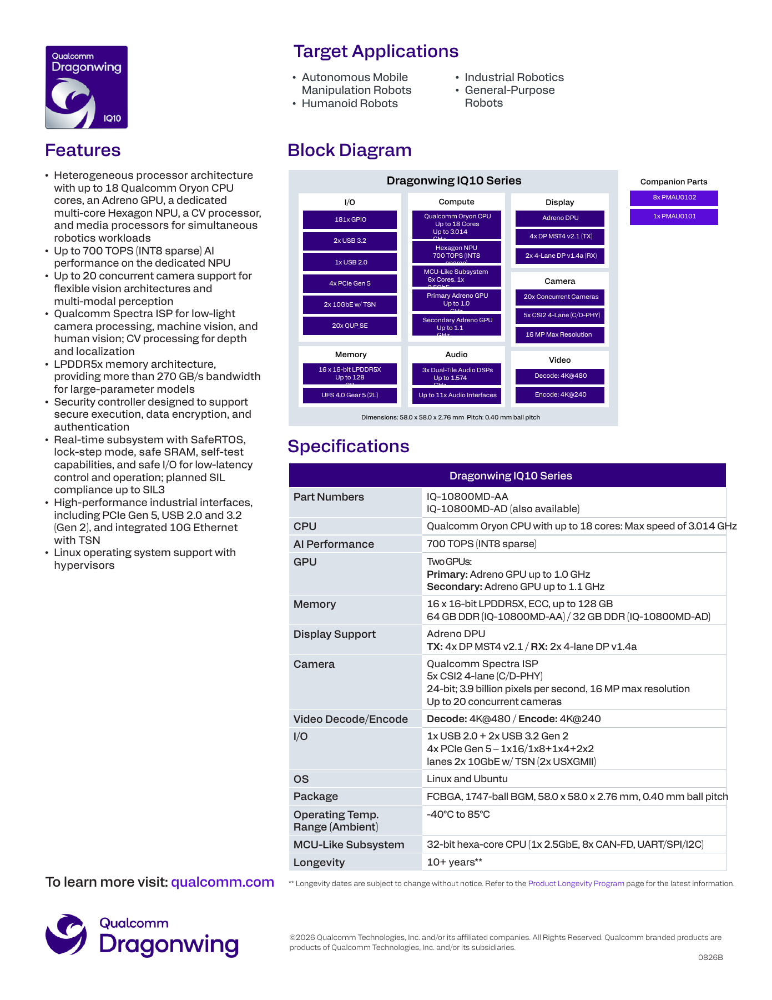
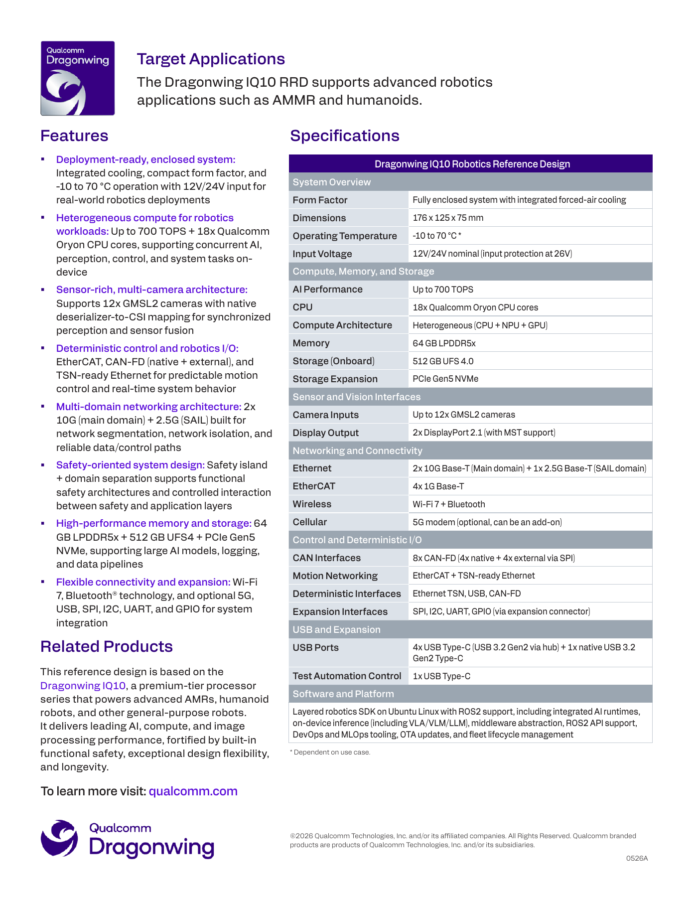
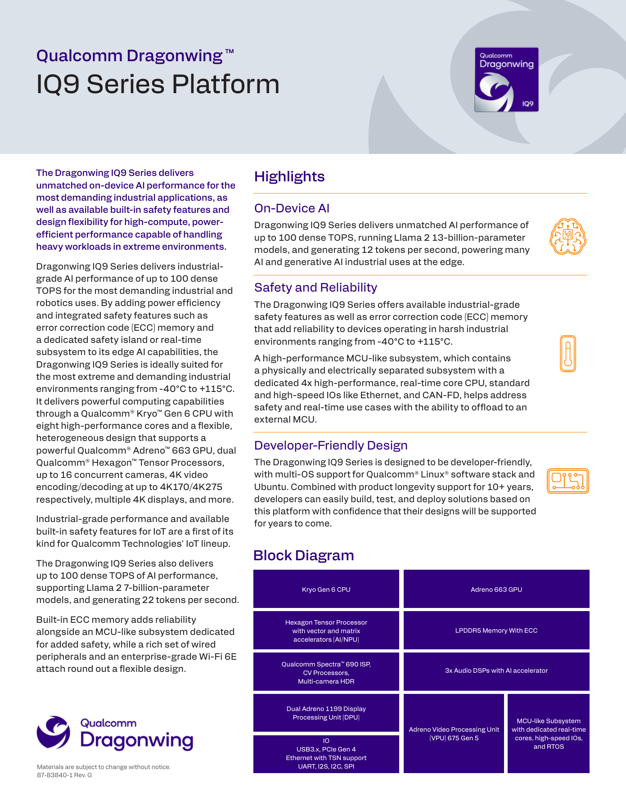
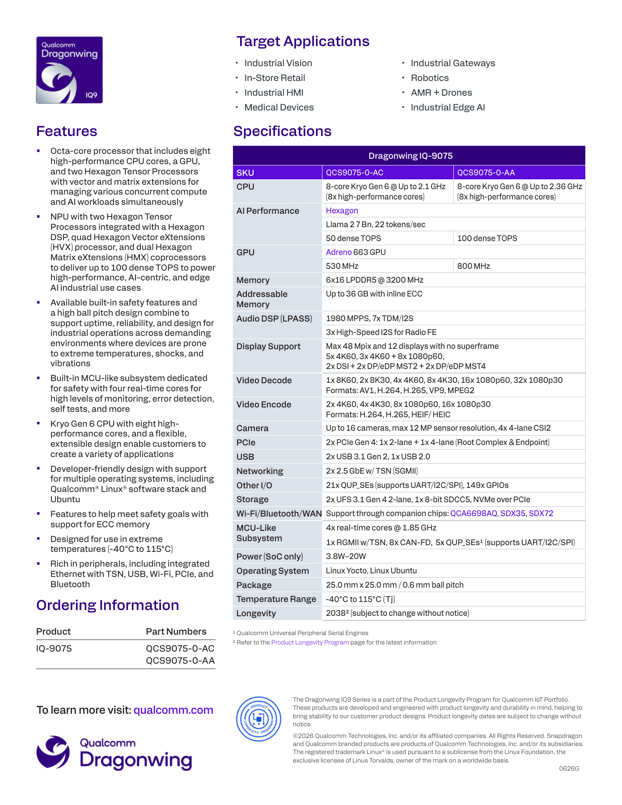
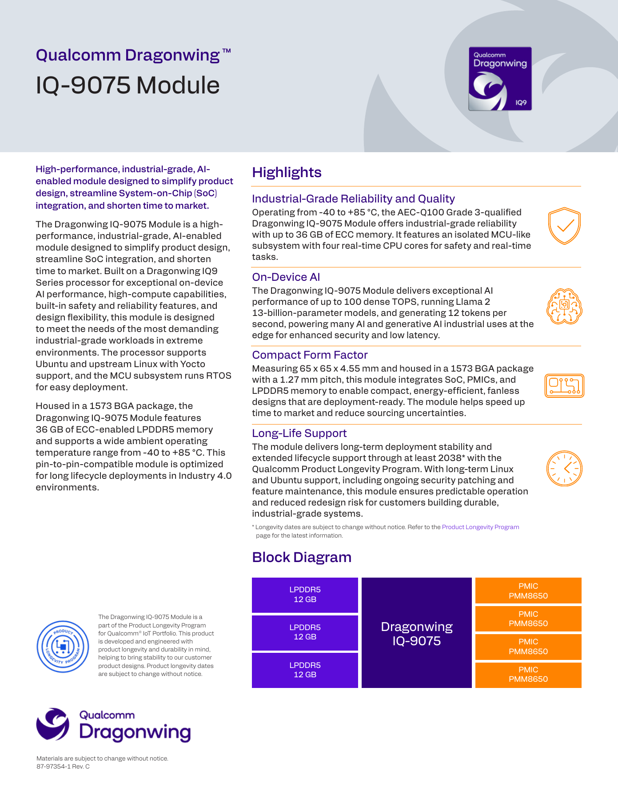
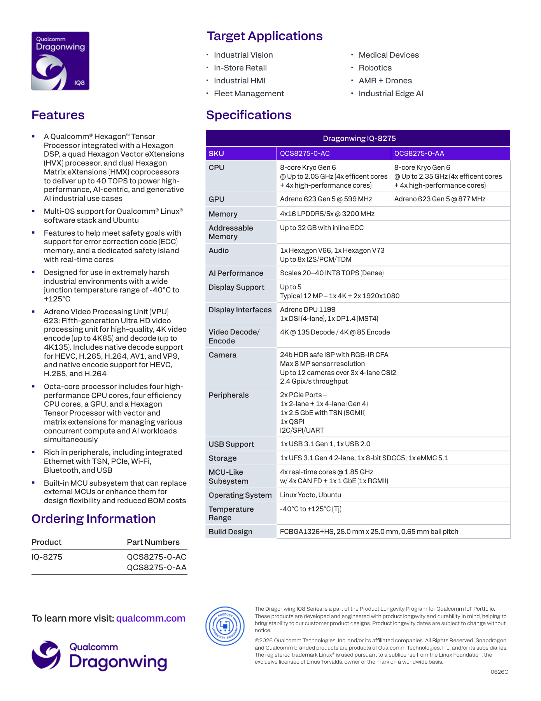
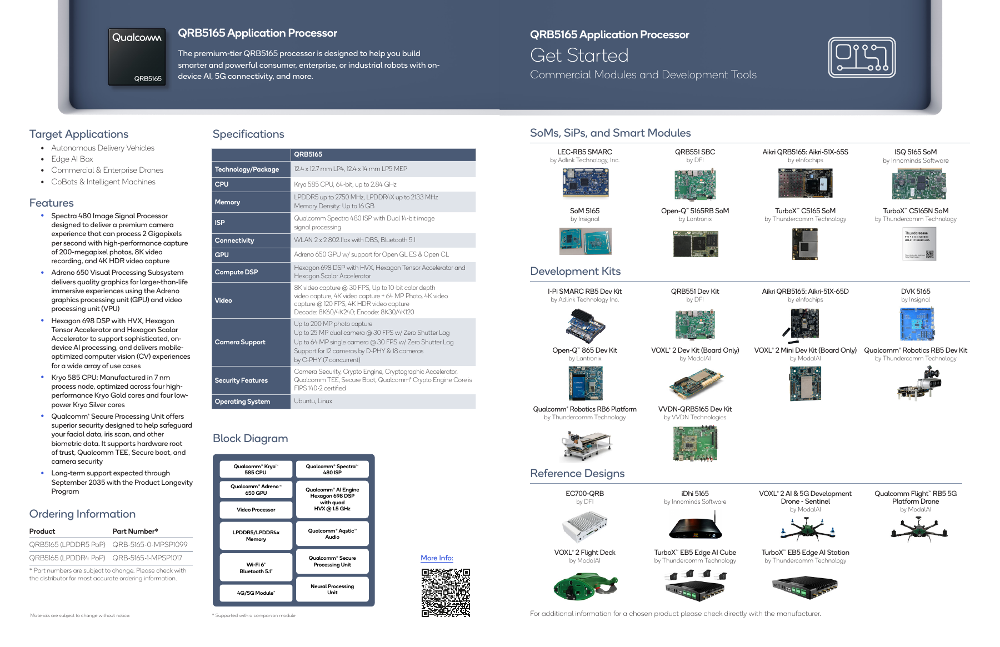
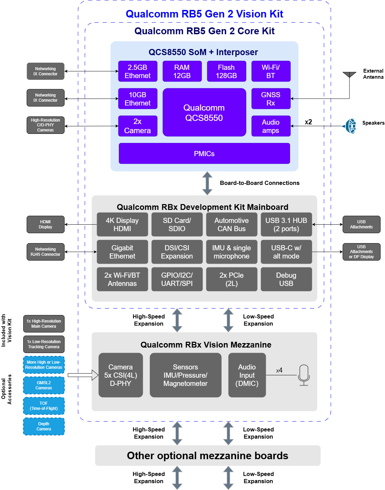

# Qualcomm 具身智能硬件平台深度调研

数据截止：2026-11-04（Asia/Shanghai）。版本：01质量样章／公开证据审阅稿。研究对象：机器人端侧计算硬件及从原型到量产所需的封装、模块、开发套件与参考系统。本章不包含未经本章验证的软件栈、模型兼容或本体商业收益结论。所有算力和应用速度均为厂商公开指标，本轮没有开展硬件、模型或机器人实机测试。

## 1. 核心结论与产品范围

Qualcomm 的机器人硬件已经形成三条需要分开评估的路线。第一条是 IQ10：面向移动操作与人形机器人的高算力平台，官方简报给出 Oryon CPU、多核 Hexagon NPU、两个 Adreno GPU、宽内存接口和 MCU-like 子系统。第二条是 IQ9/IQ8：把工业接口、ECC 和独立实时子系统集成到端侧处理器，分别提供最高100 dense TOPS、20–40 INT8 dense TOPS。第三条是 RB 系列和伙伴开发板：从 QRB5165 的 RB5，到外接 Cloud AI 100 的 RB6，再到 QCS8550 的 RB5 Gen 2、QCS6490 的 RB3 Gen 2，以及 IQ8 加 STM32 的 VENTUNO Q。它们对应不同交付形态，不能按产品名字中的数字排出一条统一代际性能曲线。[S01 原文](https://docs.qualcomm.com/doc/87-A2811-1/87-A2811-1_REV_B_Qualcomm_Dragonwing_IQ10_Series_Platform_Product_Brief.pdf)｜[S01 本地原件](REFERENCES.md#ref-6e5c94a7707cae4b) [S03 原文](https://docs.qualcomm.com/bundle/publicresource/87-83840-1_REV_A_Qualcomm_IQ9_Series_Product_Brief.pdf)｜[S03 本地原件](REFERENCES.md#ref-daea6771d503a523) [S05 原文](https://docs.qualcomm.com/bundle/publicresource/87-83839-1_REV_A_Qualcomm_IQ8_Series_Product_Brief________.pdf)｜[S05 本地原件](REFERENCES.md#ref-7d1bfbe24e063ca5) [S11 原文](https://www.thundercomm.com/product/qualcomm-robotics-rb6-development-kit/)｜[S11 本地原件](REFERENCES.md#ref-8e3bca5fb376ca0e) [S12 原文](https://www.thundercomm.com/product/qualcomm-rb5-gen-2-development-kit/)｜[S12 本地原件](REFERENCES.md#ref-c79fbdd239f83e65) [S13 原文](https://www.thundercomm.com/product/qualcomm-rb3-gen-2/)｜[S13 本地原件](REFERENCES.md#ref-ee69a435194a74a0) [S14 原文](https://www.arduino.cc/product-ventuno-q)｜[S14 本地原件](REFERENCES.md#ref-4c389d446211ac9a)

**本章的选型判断是：需要大内存、多路高速感知和复杂端侧推理时优先验证 IQ10；需要工业网络、独立实时域与长期供应安排时把 IQ9/IQ8 作为不同档位；既有 RB5 项目应先处理开发套件 EOL，而新原型应比较 RB5 Gen 2、RB3 Gen 2 或 VENTUNO Q。** 这是基于资源与交付结构的条件判断，不是吞吐、续航、成本或任务成功率排名。特别是 IQ10 的700 TOPS为 INT8 **稀疏** NPU峰值；RB6 的70–200 TOPS为带扩展加速器的平台宣传范围；两者都不能与普通未注明精度的 TOPS 直接相除。[S01 原文](https://docs.qualcomm.com/doc/87-A2811-1/87-A2811-1_REV_B_Qualcomm_Dragonwing_IQ10_Series_Platform_Product_Brief.pdf)｜[S01 本地原件](REFERENCES.md#ref-6e5c94a7707cae4b) [S10 原文](https://www.thundercomm.com/product/qualcomm-robotics-rb5-development-kit/)｜[S10 本地原件](REFERENCES.md#ref-334f80d91fbbc8df) [S11 原文](https://www.thundercomm.com/product/qualcomm-robotics-rb6-development-kit/)｜[S11 本地原件](REFERENCES.md#ref-8e3bca5fb376ca0e)

范围选择上，本章深入 IQ-10800MD-AA/AD、IQ10 RRD、IQ-9075 的 AC/AA SKU 和 QCS9075M-0-AA 模块、IQ-8275 的 AC/AA SKU，以及五类代表性板卡。QCS8550、QCS6490和 QRB5165用来解释板卡硬件及历史资源边界。低端通用IoT芯片、手机SoC、PC处理器和服务器加速卡不另行扩展为全产品目录；Cloud AI 100仅在RB6实际配置关系内讨论。官方2023年选择指南仅支撑旧代规格和当时供货规划，不能用它证明2026年全部伙伴仍有现货。[S06 原文](https://www.qualcomm.com/content/dam/qcomm-martech/dm-assets/documents/Qualcomm-Application-Processors-for-IoT-Selector-Guide.PDF)｜[S06 本地原件](REFERENCES.md#ref-306d7493b50a2d30) [S07 原文](https://www.qualcomm.com/content/dam/qcomm-martech/dm-assets/documents/Qualcomm-IoT-SoCs-Quick-Reference-Guide.PDF)｜[S07 本地原件](REFERENCES.md#ref-d237e8808cec4727)

## 2. 先分清芯片、封装模块和可采购系统

IQ-9075 SoC 本体是25×25mm封装，而 IQ-9075 Module 是65×65×4.55mm的1573-ball BGA模块，集成处理器、四颗PMIC和三颗12GB LPDDR5。模块不是带RJ45、USB插座和相机连接器的完整开发板，仍需载板、供电和散热设计。IQ10 Rev. B 则同时列出1747-ball BGM封装和带32/64GB DDR的订货号，因此本文按该简报的**订货封装配置**描述，不把它改写成所有裸SoC默认含64GB，也不擅自将其视为某一标准插接SOM。官方未提供本轮可取得的完整装配/BOM手册，封装内部的具体内存集成方式保留为采购核验项。[S01 原文](https://docs.qualcomm.com/doc/87-A2811-1/87-A2811-1_REV_B_Qualcomm_Dragonwing_IQ10_Series_Platform_Product_Brief.pdf)｜[S01 本地原件](REFERENCES.md#ref-6e5c94a7707cae4b) [S03 原文](https://docs.qualcomm.com/bundle/publicresource/87-83840-1_REV_A_Qualcomm_IQ9_Series_Product_Brief.pdf)｜[S03 本地原件](REFERENCES.md#ref-daea6771d503a523) [S04 原文](https://docs.qualcomm.com/doc/87-97354-1/87-97354-1_REV_C_Qualcomm_Dragonwing_IQ-9075_Module_Product_Brief.pdf)｜[S04 本地原件](REFERENCES.md#ref-ef8804ab803f95ad)

| 交付对象 | 层级／准确名称 | 已核验的集成内容 | 仍需要的外部部分 | 状态证据与边界 |
|---|---|---|---|---|
| IQ10订货配置 | IQ-10800MD-AA／IQ-10800MD-AD；1747-ball BGM | 简报分别列64GB／32GB DDR；CPU/GPU/NPU/实时域 | 主板、供电器件、连接器、系统散热与存储配置 | Rev. B列为订货号；未取得现货交期与量产验收记录（S01） |
| IQ10 RRD | Qualcomm Robotics Reference Design | 带风冷封闭系统、64GB、512GB UFS4、机器人接口 | 机器人本体、传感器、驱动器及业务验证 | 厂商称deployment-ready；不等于整机产品认证（S02） |
| IQ-9075 SoC | QCS9075-0-AC／-AA | 异构计算、ECC内存接口、4核实时域 | DRAM、PMIC、存储、PHY及载板 | 简报分别列50／100 dense TOPS（S03） |
| IQ-9075 Module | QCS9075M-0-AA；完整订货号见下文 | SoC、4×PMM8650、36GB LPDDR5 | 存储、载板、网络PHY和散热 | Rev. C列2038寿命规划，未取得PCN及库存（S04） |
| RB5／RB5 Gen 2／RB3 Gen 2 | 主板＋模块／interposer；Core或Vision Kit | 按套件安装RAM、存储和部分I/O | Vision mezzanine、选配相机、5G等依套件 | 具体套件各有价格/状态，不能由SoC页推导（S10/S12/S13） |
| VENTUNO Q | IQ-8275＋STM32H5F5双处理器板 | 16GB LPDDR5、64GB eMMC、外置MCU及板载接口 | 相机、电机、NVMe和应用集成 | 主页面仍显示PRE-ORDER，交期未核验（S14） |

分析：采购合同应同时写入芯片订货号、模块RAM和存储配置、载板revision、BSP版本、接口附件与散热版本。只写“IQ10平台”“RB5系列”会让32/64/128GB、Core/Vision和裸板/封闭机箱混在一起。发布新闻能证明方案被公开宣布，产品页能证明当前列出的商品与规格，二者都不自动证明已向任意地区交付或有量产安全证明。[S01 原文](https://docs.qualcomm.com/doc/87-A2811-1/87-A2811-1_REV_B_Qualcomm_Dragonwing_IQ10_Series_Platform_Product_Brief.pdf)｜[S01 本地原件](REFERENCES.md#ref-6e5c94a7707cae4b) [S02 原文](https://docs.qualcomm.com/doc/87-A0789-1/87-A0789-1_REV_A_Qualcomm_Dragonwing_IQ10_Robotics_Reference_Design_Product_Brief.pdf)｜[S02 本地原件](REFERENCES.md#ref-246d5ca4db6b9bc7) [S08 原文](https://www.thundercomm.com/turbox-irb10-launches-at-embedded-world-2026/)｜[S08 本地原件](REFERENCES.md#ref-dc6accab2b42cd74) [S09 原文](https://www.thundercomm.com/turbox-irb10-waic/)｜[S09 本地原件](REFERENCES.md#ref-d87b3aecbca07fa5) [S12 原文](https://www.thundercomm.com/product/qualcomm-rb5-gen-2-development-kit/)｜[S12 本地原件](REFERENCES.md#ref-c79fbdd239f83e65)

## 3. 核心计算与内存：SKU级比较

以下两表将计算、内存与接口拆开，数字按对应官方简报记录。“未取得”表示本轮公开原件没有给出，不表示芯片不存在该参数。IQ8/IQ9简报未把Kryo商业名映射到准确Arm微架构，也未给出制程；本文不借汽车芯片、手机芯片或相似编号补齐这些字段。QCS8550、QCS6490、QRB5165的制程来自明确列名的2023官方选择/参考指南。[S01 原文](https://docs.qualcomm.com/doc/87-A2811-1/87-A2811-1_REV_B_Qualcomm_Dragonwing_IQ10_Series_Platform_Product_Brief.pdf)｜[S01 本地原件](REFERENCES.md#ref-6e5c94a7707cae4b) [S03 原文](https://docs.qualcomm.com/bundle/publicresource/87-83840-1_REV_A_Qualcomm_IQ9_Series_Product_Brief.pdf)｜[S03 本地原件](REFERENCES.md#ref-daea6771d503a523) [S05 原文](https://docs.qualcomm.com/bundle/publicresource/87-83839-1_REV_A_Qualcomm_IQ8_Series_Product_Brief________.pdf)｜[S05 本地原件](REFERENCES.md#ref-7d1bfbe24e063ca5) [S06 原文](https://www.qualcomm.com/content/dam/qcomm-martech/dm-assets/documents/Qualcomm-Application-Processors-for-IoT-Selector-Guide.PDF)｜[S06 本地原件](REFERENCES.md#ref-306d7493b50a2d30) [S07 原文](https://www.qualcomm.com/content/dam/qcomm-martech/dm-assets/documents/Qualcomm-IoT-SoCs-Quick-Reference-Guide.PDF)｜[S07 本地原件](REFERENCES.md#ref-d237e8808cec4727)

| 硬件／SKU | CPU | GPU | AI峰值与口径 | 专用处理域 | 制程／证据 |
|---|---|---|---|---|---|
| IQ-10800MD-AA／AD | 最多18核Oryon，最高3.014GHz | 两个Adreno GPU，主1.0GHz／次1.1GHz；具体型号未取得 | 700 TOPS，INT8 sparse，专用多核Hexagon NPU；功率/频率/稀疏规则未列 | CV、ISP、媒体、音频DSP；6核32-bit MCU-like域 | Rev. B未列制程（S01） |
| QCS9075-0-AC | 8核Kryo Gen6，高性能核，最高2.1GHz | Adreno663，530MHz | 50 dense TOPS；规格行未注明位宽 | 双Hexagon Tensor Processor；4核实时域1.85GHz | 简报未列制程（S03） |
| QCS9075-0-AA | 8核Kryo Gen6，高性能核，最高2.36GHz | Adreno663，800MHz | 100 dense TOPS；规格行未注明位宽 | 双HTP、HVX/HMX、Spectra690、4核实时域 | 简报未列制程（S03） |
| QCS8275-0-AC／AA | 8核Kryo Gen6，4性能＋4效率；2.05／2.35GHz | Adreno623 Gen5，599／877MHz | 系列20–40 INT8 dense TOPS；表中未逐列分配峰值 | 一个HTP、HVX/HMX、4核实时域1.85GHz | 简报未列制程（S05） |
| QCS8550 | 8核Kryo：1×3.2＋4×2.8＋3×2.0GHz | Adreno740 | 官方旧指南48 INT8、12 FP16 TOPS；dense/sparse未明 | Hexagon V73／HVX/HMX、ISP、媒体和Sensing Hub | 4nm（S06，第4页） |
| QCS6490 | 8核Kryo670，最高2.7GHz | Adreno643，最高812MHz | 12 INT8 TOPS；dense/sparse未明 | Hexagon、Spectra570L、媒体处理 | 6nm（S06，第2、7页） |
| QRB5165 | 8核Kryo585，最高2.84GHz；4性能＋4低功耗 | Adreno650 | 15 INT8 TOPS，AI Engine口径；dense/sparse未明 | Hexagon698／HVX／HTA、Spectra480、EVA、Sensing Hub | 7nm；不是同名家族其他制程（S06，第5页；S07） |

IQ9 AA和AC的AI峰值相差两倍，CPU最高频率与GPU频率也不同；这说明“100 TOPS IQ9”只是高档SKU能力，不能用于低档器件的BOM。IQ8的20–40 TOPS在简报中是跨系列范围，虽然AC/AA分别列出较低/较高CPU和GPU频率，但不能仅凭这一对应关系补出未明确逐SKU分配的NPU档位。IQ10的18个Oryon核也与实时域6核分列；把二者相加成“24核通用CPU”会误导线程和内存部署。[S01 原文](https://docs.qualcomm.com/doc/87-A2811-1/87-A2811-1_REV_B_Qualcomm_Dragonwing_IQ10_Series_Platform_Product_Brief.pdf)｜[S01 本地原件](REFERENCES.md#ref-6e5c94a7707cae4b) [S03 原文](https://docs.qualcomm.com/bundle/publicresource/87-83840-1_REV_A_Qualcomm_IQ9_Series_Product_Brief.pdf)｜[S03 本地原件](REFERENCES.md#ref-daea6771d503a523) [S05 原文](https://docs.qualcomm.com/bundle/publicresource/87-83839-1_REV_A_Qualcomm_IQ8_Series_Product_Brief________.pdf)｜[S05 本地原件](REFERENCES.md#ref-7d1bfbe24e063ca5)

| 平台 | 内存控制器／可寻址上限 | 实际交付内存 | 带宽口径 | 存储控制器／扩展 | ECC与版本边界 |
|---|---|---|---|---|---|
| IQ10 | 16×16-bit LPDDR5X，最高128GB | AA列64GB、AD列32GB；RRD为64GB | 厂商列“more than 270 GB/s”，不是应用实测 | UFS4.0 Gear5 2-lane；RRD板载512GB UFS4，PCIe5 NVMe扩展 | 简报写ECC；纠错粒度和可用容量扣减未取得（S01/S02） |
| IQ9 SoC | 6×16-bit LPDDR5，3200MHz，最高36GB | 由具体模块决定 | 可作理想DDR计算；官方简报未列GB/s实测 | 2×UFS3.1、SDCC5、PCIe NVMe | inline ECC；不能把36GB上限当所有板卡标配（S03） |
| IQ-9075 Module | 继承IQ9接口 | 3×12GB LPDDR5，3200MHz | 未取得模块持续测量 | 模块框图未集成UFS/NVMe容量 | 官方称36GB ECC，实际OS可分配容量需查保留区（S04） |
| IQ8 SoC | 4×16-bit LPDDR5/5X，3200MHz，最高32GB | VENTUNO Q为16GB LPDDR5 | 可作理想DDR计算；不是测量值 | UFS3.1、SDCC5、eMMC5.1；VENTUNO Q为64GB eMMC＋NVMe4 | SoC支持inline ECC；Arduino页未确认交付板ECC启用（S05/S14） |
| RB5 Gen 2 | QCS8550上限16GB，LPDDR5/5X | 板卡12GB LPDDR5X＋128GB UFS3.1 | 芯片指南列4200MHz，不等于板卡实测 | MicroSD；套件扩展PCIe | 芯片可支持UFS4不等于该板标配UFS4（S06/S12） |
| RB3 Gen 2 | QCS6490内存配置依板卡 | 6GB LPDDR4X uMCP＋128GB UFS | 板卡带宽未取得 | MicroSD、PCIe扩展NVMe | 不继承其他QCS6490模块的LPDDR5容量（S13） |
| RB5 | QRB5165最高16GB；LPDDR5／LPDDR4X | Thundercomm套件8GB LPDDR5＋128GB UFS3.1 | LPDDR5最高2750MHz来自芯片指南 | MicroSD、PCIe3扩展 | 页面对当前不同RB5N变体的内存仍须核验（S06/S10） |

**分析：容量和带宽分别决定“能装入什么”和“多久能计算”。** 如仅估计模型权重，7B参数以4-bit保存约为3.5GB，13B约为6.5GB；这没有包含scale、分组元数据、KV cache、视觉编码器、激活、运行时工作区和Linux。故6GB开发板不能因为权重文件小于6GB就认定能稳定运行完整13B多模态策略。RRD的64GB与处理器128GB可寻址上限也是两种不同资源条件，若选用AD配置的32GB，不能套用64GB原型的模型并发结果。上述是容量分析，并非对某模型部署成功的声明。[S01 原文](https://docs.qualcomm.com/doc/87-A2811-1/87-A2811-1_REV_B_Qualcomm_Dragonwing_IQ10_Series_Platform_Product_Brief.pdf)｜[S01 本地原件](REFERENCES.md#ref-6e5c94a7707cae4b) [S02 原文](https://docs.qualcomm.com/doc/87-A0789-1/87-A0789-1_REV_A_Qualcomm_Dragonwing_IQ10_Robotics_Reference_Design_Product_Brief.pdf)｜[S02 本地原件](REFERENCES.md#ref-246d5ca4db6b9bc7) [S13 原文](https://www.thundercomm.com/product/qualcomm-rb3-gen-2/)｜[S13 本地原件](REFERENCES.md#ref-ee69a435194a74a0)

**分析示例：** 如果将IQ9/IQ8的3200MHz按双沿传输的接口时钟解释，理论线速分别为96/8×3200×2÷1000＝76.8GB/s、64/8×3200×2÷1000＝51.2GB/s。这是带明确假设的接口算术上限，扣除协议、刷新、ECC和多引擎争用后的可用带宽本轮未知，也不能在3200实际表示有效数据率时照搬。IQ10原文直接给出超过270GB/s，采用原值，不把它精确改写成273GB/s。统一内存减少分离显存容量限制，但CPU、GPU、NPU、ISP仍可能竞争同一外存，统一地址空间也不自动证明所有buffer零拷贝。[S01 原文](https://docs.qualcomm.com/doc/87-A2811-1/87-A2811-1_REV_B_Qualcomm_Dragonwing_IQ10_Series_Platform_Product_Brief.pdf)｜[S01 本地原件](REFERENCES.md#ref-6e5c94a7707cae4b) [S03 原文](https://docs.qualcomm.com/bundle/publicresource/87-83840-1_REV_A_Qualcomm_IQ9_Series_Product_Brief.pdf)｜[S03 本地原件](REFERENCES.md#ref-daea6771d503a523) [S05 原文](https://docs.qualcomm.com/bundle/publicresource/87-83839-1_REV_A_Qualcomm_IQ8_Series_Product_Brief________.pdf)｜[S05 本地原件](REFERENCES.md#ref-7d1bfbe24e063ca5)

## 4. IQ10：主力端侧平台与参考系统的真实边界

### 4.1 异构计算结构与资源调度含义

Rev. B把IQ10列为独立多核Hexagon NPU＋Oryon CPU＋主/次Adreno GPU＋CV及媒体处理器的异构平台。厂商称它针对感知、推理、规划和控制并发设计，并宣称CPU比IQ9提高超过5倍，但简报没有CPU benchmark名称、编译选项、功率或线程设置。因此“超过5倍”只作为厂商主张存档，不能用于估计MoveIt、ROS executor或VLA端到端加速。两个GPU的公开最高频率也不是FP32吞吐，未披露执行单元、显存隔离、互连和并发约束时不能自行计算GPU TFLOPS或双GPU线性加速。[S01 原文](https://docs.qualcomm.com/doc/87-A2811-1/87-A2811-1_REV_B_Qualcomm_Dragonwing_IQ10_Series_Platform_Product_Brief.pdf)｜[S01 本地原件](REFERENCES.md#ref-6e5c94a7707cae4b)

从机器人任务机制看，ISP/CV承担固定视觉链路，NPU适合被工具链支持的张量推理，CPU承载编排与不适合NPU的算子，实时域处理有时序约束的控制与监测。这种分工能够减少部分CPU软件处理压力，**成立条件**是驱动、编译器、buffer和任务分区确实支持该路径。若模型算子回退CPU、视频与日志占满带宽，峰值NPU再高也不能保证政策调用的P99。硬件框图仅证明模块结构，本章不宣称已将一条机器人闭环拆到这些引擎上运行。[S01 原文](https://docs.qualcomm.com/doc/87-A2811-1/87-A2811-1_REV_B_Qualcomm_Dragonwing_IQ10_Series_Platform_Product_Brief.pdf)｜[S01 本地原件](REFERENCES.md#ref-6e5c94a7707cae4b) [S02 原文](https://docs.qualcomm.com/doc/87-A0789-1/87-A0789-1_REV_A_Qualcomm_Dragonwing_IQ10_Robotics_Reference_Design_Product_Brief.pdf)｜[S02 本地原件](REFERENCES.md#ref-246d5ca4db6b9bc7)

图1为官方完整PDF页渲染。它同时展示CPU/NPU/GPU、内存、I/O和MCU域，支持“异构计算＋宽内存接口”的结构判断。**官方原PDF框图内部有部分GHz/GB标签被自身框格遮挡，本文未修补或重新绘制；数值以同页Specifications的完整文字为准。** 页底1747-ball、58×58×2.76mm、0.40mm球距是该简报的BGM封装信息，不是RRD箱体尺寸。[S01 原文](https://docs.qualcomm.com/doc/87-A2811-1/87-A2811-1_REV_B_Qualcomm_Dragonwing_IQ10_Series_Platform_Product_Brief.pdf)｜[S01 本地原件](REFERENCES.md#ref-6e5c94a7707cae4b)

### 4.2 相机、网络与控制域

IQ10处理器简报给出5组四lane CSI2、C/D-PHY、最高20相机并发、单传感器最大16MP以及3.9Gpixel/s ISP处理能力。20个逻辑相机不等于20套独立四lane物理接口；聚合、串行器/解串器和虚拟通道需要具体板卡实施。接口表另外列PCIe5、USB2.0和USB3.2 Gen2、双10GbE TSN的USXGMII以及实时域2.5GbE、8×CAN-FD。USXGMII是器件到PHY侧接口，不能当作已存在的RJ45插座。[S01 原文](https://docs.qualcomm.com/doc/87-A2811-1/87-A2811-1_REV_B_Qualcomm_Dragonwing_IQ10_Series_Platform_Product_Brief.pdf)｜[S01 本地原件](REFERENCES.md#ref-6e5c94a7707cae4b)

**分析／假设计算：** 若20路相机均按16MP、30fps计算，仅像素率就是20×16M×30＝9.6Gpixel/s，超过简报3.9Gpixel/s；因此“20路并发”“16MP最大分辨率”和某一最高帧率不能自由组合。即使采用12路3MP/30fps，12×3M×30＝1.08Gpixel/s只说明未越过名义ISP像素数，仍不能证明CSI带宽、曝光同步、HDR、内存和后续推理满足需求。这一计算是识别规格组合约束，不是最大可运行路数结论。[S01 原文](https://docs.qualcomm.com/doc/87-A2811-1/87-A2811-1_REV_B_Qualcomm_Dragonwing_IQ10_Series_Platform_Product_Brief.pdf)｜[S01 本地原件](REFERENCES.md#ref-6e5c94a7707cae4b)

实时子系统包含SafeRTOS、锁步模式、safe SRAM、自测和低延迟I/O；Rev. B写的是“planned SIL compliance up to SIL3”。它支持后续安全架构评估，但没有证明本轮取得某个已发证安全产品，也没有整机安全证书、故障反应时间和认证附件。对人形机器人，驱动器过流、关节限位、急停与失联停机还要落实到实际控制链；Linux推理循环停止或TSN支持本身不能代替这些措施。[S01 原文](https://docs.qualcomm.com/doc/87-A2811-1/87-A2811-1_REV_B_Qualcomm_Dragonwing_IQ10_Series_Platform_Product_Brief.pdf)｜[S01 本地原件](REFERENCES.md#ref-6e5c94a7707cae4b)

### 4.3 IQ10 RRD的可集成形态

RRD Rev. A比单颗平台简报更接近真实系统BOM：176×125×75mm、强制风冷、64GB LPDDR5X、512GB UFS4、NVMe PCIe5扩展、12/24V名义输入及26V输入保护。温度写−10～70°C，并明确dependent on use case；未给出持续满负载输入功率、风扇寿命或高温降频曲线。不能从12/24V和尺寸推导它一定适合某机器人电池、密闭机身或防水需求。[S02 原文](https://docs.qualcomm.com/doc/87-A0789-1/87-A0789-1_REV_A_Qualcomm_Dragonwing_IQ10_Robotics_Reference_Design_Product_Brief.pdf)｜[S02 本地原件](REFERENCES.md#ref-246d5ca4db6b9bc7)

| RRD接口／资源 | 已披露实现 | 与处理器上限的区别 | 工程核验要点 |
|---|---|---|---|
| 相机 | 最高12路GMSL2，解串到CSI映射 | 不是处理器宣传的20个独立插口 | 相机型号、线缆、聚合、同步和并发模式 |
| 主／安全域网络 | 主域2×10G Base-T；SAIL域1×2.5G Base-T | 区分主计算域与安全/实时域 | 驱动归属、流量隔离、TSN时钟和恢复 |
| EtherCAT | 4×1G Base-T接口 | 系统配置能力，不等于SoC四路原生EtherCAT MAC | 主站角色、实现器件、周期与抖动 |
| CAN-FD | 8路：4 native＋4经SPI外扩 | 不能将处理器8路CAN与板卡native数混用 | 外扩芯片、SPI争用、错误恢复与bus-off |
| USB | 4×USB-C经hub＋1 native USB3.2 Gen2；另有测试USB-C | 多插座不等于独立总带宽；测试口另算 | Hub共享链路、供电、相机与日志并发 |
| 显示／无线 | 2×DP2.1带MST；Wi-Fi7、BT；5G选配 | 不等于所有芯片显示通道均引出；5G非标配 | 配套无线器件、天线、监管与选配BOM |

图2支持板卡与系统级接口的判断，尤其是native/external CAN、USB hub和SAIL网络的区别。表中“EtherCAT＋TSN”是接口能力主张，本轮没有EtherCAT主站栈版本、负载与P99/WCET，不能据此写出1kHz伺服或确定性最坏时间保证。多域架构提供隔离基础，隔离是否覆盖电源、复位、内存、软件故障和网络故障仍需硬件参考手册及安全资料。[S02 原文](https://docs.qualcomm.com/doc/87-A0789-1/87-A0789-1_REV_A_Qualcomm_Dragonwing_IQ10_Robotics_Reference_Design_Product_Brief.pdf)｜[S02 本地原件](REFERENCES.md#ref-246d5ca4db6b9bc7)

### 4.4 TurboX IRB10与Qualcomm RRD不得互套规格

Thundercomm在2026-03-10发布的是development board prototype和reference design，称Q2正式发布，表头明确“subject to change prior to official release”。该表列双1000Base-T1、8 CAN-MCU和相机/显示组合；这与Qualcomm RRD的双10G Base-T、12路GMSL2及CAN native/external拆分明显不同。Base-T1与Base-T的线缆/PHY/连接器不同，不能把Qualcomm RRD作为IRB10最终交付手册，也不能拿3月原型表替代后续板卡revision。[S08 原文](https://www.thundercomm.com/turbox-irb10-launches-at-embedded-world-2026/)｜[S08 本地原件](REFERENCES.md#ref-dc6accab2b42cd74) [S02 原文](https://docs.qualcomm.com/doc/87-A0789-1/87-A0789-1_REV_A_Qualcomm_Dragonwing_IQ10_Robotics_Reference_Design_Product_Brief.pdf)｜[S02 本地原件](REFERENCES.md#ref-246d5ca4db6b9bc7)

该公告相机分项为2＋4＋1＋4＋1＋2，共14路，另以“up to20”描述平台上限；原文没有逐路映射和全部20路最终拓扑。显示分项eDP/DP写12，而标题写up to14，也需最终手册解释。新闻中缩短开发3–6个月、降低调试成本超过50%属于厂商预计，未给项目样本、基线和成本范围，故不作为工程BOM或ROI结果。2026-07-19公告进一步称IRB10集成到星尘智能人形机器人并在WAIC展示，支持“伙伴公开宣布产品级集成”这个成熟度判断；它没有公开台数、出货批次、最终内存/功率或长期运行记录。[S08 原文](https://www.thundercomm.com/turbox-irb10-launches-at-embedded-world-2026/)｜[S08 本地原件](REFERENCES.md#ref-dc6accab2b42cd74) [S09 原文](https://www.thundercomm.com/turbox-irb10-waic/)｜[S09 本地原件](REFERENCES.md#ref-d87b3aecbca07fa5)

## 5. IQ9／IQ8：工业可靠性、实时域与封装路径

### 5.1 IQ9的资源与双SKU边界

IQ9高档AA为8核高性能Kryo Gen6、Adreno663和双Hexagon Tensor Processor，AC降低CPU/GPU频率及AI峰值。其外设是2组PCIe4（x2＋x4，Root Complex/Endpoint）、双2.5GbE TSN、2×USB3.1 Gen2＋USB2.0、4组四lane CSI2，最高16相机和12MP单传感器。独立实时域有4核1.85GHz、RGMII TSN及8×CAN-FD。官方将它描述为物理和电气分离子系统，但未给应用CPU到实时域的共享内存、消息及故障隔离协议，这部分将在获准后的02软件章节继续核验。[S03 原文](https://docs.qualcomm.com/bundle/publicresource/87-83840-1_REV_A_Qualcomm_IQ9_Series_Product_Brief.pdf)｜[S03 本地原件](REFERENCES.md#ref-daea6771d503a523)

图3说明Tensor Processor、ISP/CV、LPDDR5 ECC和实时子系统都属于系统设计要素。GPU663、VPU675和DPU1199是不同处理模块，不能把视频编码帧率当GPU推理吞吐。Rev. G正文宣传段给4K170/4K275，而规格表列出2×4K60编码、4×4K60解码等组合；前者不能自动代表任意编码格式及任意分辨率的完整同时工作矩阵。模型、码率、画质、摄像头和多引擎负载条件未取得时，采购验收应采用明确组合而非单一“4K”字样。[S03 原文](https://docs.qualcomm.com/bundle/publicresource/87-83840-1_REV_A_Qualcomm_IQ9_Series_Product_Brief.pdf)｜[S03 本地原件](REFERENCES.md#ref-daea6771d503a523)

图4保留了50/100 dense TOPS两档、36GB上限、3.8–20W SoC-only及−40～115°C Tj标记。该功耗区间没有给每个工作点的时钟、NPU精度和CPU/GPU负载，不是系统可配置电源模式菜单，也不能把100 TOPS除以3.8W宣称最低功率能效；20W则不包含外部DRAM、PHY、存储、供电损耗及风扇。Tj为结温，不能标成115°C环境工作温度。[S03 原文](https://docs.qualcomm.com/bundle/publicresource/87-83840-1_REV_A_Qualcomm_IQ9_Series_Product_Brief.pdf)｜[S03 本地原件](REFERENCES.md#ref-daea6771d503a523)

### 5.2 IQ-9075 Module降低的是集成工作，不是全部系统风险

模块完整订货号为`QCS-9075M-0-BGM1573B-MT-01-0-AA`，规格简称`QCS9075M-0-AA`。Rev. C列输入3.3V、输出0.9/1.2/1.8V、4×PMM8650、36GB LPDDR5 ECC、33g、1.27mm球距和−40～85°C环境温度，并称AEC-Q100 Grade3 qualified。模块说明能支撑工业可靠性方案，但AEC-Q100器件资格不等于IEC61508/ISO13849机器人系统功能安全认证，也不证明整机抗振、防尘或防水等级。[S04 原文](https://docs.qualcomm.com/doc/87-97354-1/87-97354-1_REV_C_Qualcomm_Dragonwing_IQ-9075_Module_Product_Brief.pdf)｜[S04 本地原件](REFERENCES.md#ref-ef8804ab803f95ad)

图5直观证明模块把三颗DRAM和四颗PMIC纳入模块结构；因此相比裸SoC，采购和布局设计的边界确实更明确。**分析：** 这种集成可减少高密度内存布线和多电源器件选型工作，但65mm BGA仍需焊接工艺、载板、高速信号与热路径。厂商提到fanless designs，不能理解为所有100 TOPS负载在85°C环境中都可无风扇运行；本轮没有模块热阻、散热板温度或降频记录。模块pin-to-pin-compatible宣传也没有在本轮原件中给出完整互换对象清单，不能默认与IQ10、SMARC或任意第三方SOM互插。[S04 原文](https://docs.qualcomm.com/doc/87-97354-1/87-97354-1_REV_C_Qualcomm_Dragonwing_IQ-9075_Module_Product_Brief.pdf)｜[S04 本地原件](REFERENCES.md#ref-ef8804ab803f95ad)

### 5.3 IQ8的算力、实时域与实际板卡

IQ8与IQ9共享“应用计算＋独立实时域”的设计思路，但其CPU是4性能＋4效率核，一个Tensor Processor、64-bit内存接口、最高32GB和一组2.5GbE TSN。MCU-like域为4核1.85GHz、4×CAN-FD与1GbE。IQ9则有双Tensor Processor、96-bit内存接口和更多部分外设；不能只看40与100 TOPS而忽视CPU核类型、带宽及网络资源的变化。IQ8 CPU/GPU两档和AI系列范围分别记录，功耗工作点在本轮简报未取得。[S03 原文](https://docs.qualcomm.com/bundle/publicresource/87-83840-1_REV_A_Qualcomm_IQ9_Series_Product_Brief.pdf)｜[S03 本地原件](REFERENCES.md#ref-daea6771d503a523) [S05 原文](https://docs.qualcomm.com/bundle/publicresource/87-83839-1_REV_A_Qualcomm_IQ8_Series_Product_Brief________.pdf)｜[S05 本地原件](REFERENCES.md#ref-7d1bfbe24e063ca5)

图6的Temperature明确写Tj，−40～125°C不是板卡工作环境。IQ8官方图/段落对VPU命名有675与623文字差异，GPU则统一为Adreno623；本章只采用没有争议的GPU名和表中4K135解码/4K85编码能力，VPU准确型号留作正式硬件手册核验。简报3组四lane CSI、12路相机、8MP单传感器、2.4Gpixel/s也有组合约束。与IQ9一样，支持ECC不自动证明所有第三方板已经启用ECC。[S05 原文](https://docs.qualcomm.com/bundle/publicresource/87-83839-1_REV_A_Qualcomm_IQ8_Series_Product_Brief________.pdf)｜[S05 本地原件](REFERENCES.md#ref-7d1bfbe24e063ca5)

VENTUNO Q把IQ-8275与STM32H5F5（Cortex-M33、250MHz、4MB Flash、1.5MB RAM）组合，应用处理器和MCU通过RPC桥交互。官方页列16GB LPDDR5、64GB eMMC、NVMe4扩展、2.5GbE、Wi-Fi6/6GHz、BT5.3、3组四lane MIPI-CSI、USB、显示及CAN。它保留外置MCU，是一条Arduino工具链与本体动作接口的具体实现路线，不能因为IQ8本身已有实时域就认为STM32多余，也不能把MCU“<1ms响应”的宣传理解成图像到动作的完整闭环时延。[S14 原文](https://www.arduino.cc/product-ventuno-q)｜[S14 本地原件](REFERENCES.md#ref-4c389d446211ac9a)

板卡接口细节直接决定扩展能力：3个MIPI连接器与JMEDIA的2组MIPI复用，HDMI与JMEDIA的DSI也复用；1路CAN-FD screw terminal带PHY，其他JOMEGA/UNO header的CAN标明no PHY，需要外接收发器。USB-C5V/3A是该输入方式的电气额定值，不能推成全板负载固定15W；另外支持12–24V DC插孔和7–24V接线端子等供电入口。官网宣传CPU2.36GHz而IQ8 AA简报2.35GHz，本文保留这0.01GHz差别，不据其判断不同硅片。主页面显示PRE-ORDER，FAQ又说available，应按未确认交期处理。[S05 原文](https://docs.qualcomm.com/bundle/publicresource/87-83839-1_REV_A_Qualcomm_IQ8_Series_Product_Brief________.pdf)｜[S05 本地原件](REFERENCES.md#ref-7d1bfbe24e063ca5) [S14 原文](https://www.arduino.cc/product-ventuno-q)｜[S14 本地原件](REFERENCES.md#ref-4c389d446211ac9a)

## 6. RB系列：历史基线、外扩平台与当前开发板

### 6.1 RB5是QRB5165套件，不是所有同芯片模组的统称

官方旧选择指南确认QRB5165为7nm、Kryo585、Adreno650、Hexagon698、Spectra480，LPDDR5最高2750MHz或LPDDR4X最高2133MHz，容量上限16GB。Thundercomm的RB5套件实际是8GB LPDDR5、128GB UFS3.1、85×54mm主板，1GbE、MicroSD、USB-A/Type-C和HDMI1.4；HS/LS扩展还包含CSI/DSI、PCIe3、GPIO、UART/SPI/I2C及CAN信号。扩展针脚、串行器和安装传感器不是同一层级。Vision Kit才含主相机和tracking camera，深度/ToF/GMSL设备与相关mezzanine按附件配置核验。[S06 原文](https://www.qualcomm.com/content/dam/qcomm-martech/dm-assets/documents/Qualcomm-Application-Processors-for-IoT-Selector-Guide.PDF)｜[S06 本地原件](REFERENCES.md#ref-306d7493b50a2d30) [S07 原文](https://www.qualcomm.com/content/dam/qcomm-martech/dm-assets/documents/Qualcomm-IoT-SoCs-Quick-Reference-Guide.PDF)｜[S07 本地原件](REFERENCES.md#ref-d237e8808cec4727) [S10 原文](https://www.thundercomm.com/product/qualcomm-robotics-rb5-development-kit/)｜[S10 本地原件](REFERENCES.md#ref-334f80d91fbbc8df)

图7展示同一个QRB5165可进入模块、开发套件和无人机参考方案，说明芯片能力不能替代供应商交付规格。图中伙伴产品列表是2023年目录，不能当作2026年全部产品仍在售。5G和Wi-Fi在框图有companion module标记；QRB5165不能因平台宣传“5G机器人”就被写成原生集成蜂窝调制解调器。15 INT8 TOPS是旧AI Engine口径，原件没有dense/sparse或逐引擎算力拆分，不能视作专用NPU恒定输出15TOPS。[S06 原文](https://www.qualcomm.com/content/dam/qcomm-martech/dm-assets/documents/Qualcomm-Application-Processors-for-IoT-Selector-Guide.PDF)｜[S06 本地原件](REFERENCES.md#ref-306d7493b50a2d30) [S10 原文](https://www.thundercomm.com/product/qualcomm-robotics-rb5-development-kit/)｜[S10 本地原件](REFERENCES.md#ref-334f80d91fbbc8df)

Thundercomm现行RB5页明确EOL为2026年6月，Vision Kit仍列795美元及库存字段。这是生命周期与残余销售页面同时存在，不能解释为没有EOL，也不能推出芯片整体停产。页面历史BSP记录还包括2025-07-23因AX88179A EOL加入AX88179B以太网器件支持；这说明同名板卡的供应链器件变化可能要求新驱动。已有设备维护需确认实际以太网芯片、硬件revision和可刷固件，旧SoC同名不意味着原镜像一定适配。[S10 原文](https://www.thundercomm.com/product/qualcomm-robotics-rb5-development-kit/)｜[S10 本地原件](REFERENCES.md#ref-334f80d91fbbc8df)

### 6.2 RB6为何不能简单写成“200 TOPS机器人SoC”

RB6官网列Part Number为QRB5165N和Cloud AI 100，Card Types为Dual M.2／Dual M.2(edge)。CPU仍为Kryo585最高2.84GHz、GPU仍为Adreno650，平台AI宣传70–200 INT8 TOPS，主机内存项写up to16GB。商品清单具体列出Standard 70 Tops套件，含C5165N SOM、interposer、主I/O、Nav Mezz、AI Mezz及70TOPS AIC module，明确不含扩展5G Mezz Board；不能把这套商品写为200TOPS或默认含5G。原件未给全部70–200档位的卡级功率/加速器板载内存矩阵，也未给跨PCIe搬运开销，所以本章将其列为**应用处理器＋外扩AI加速器**方案，不拆算虚构其他加速器SKU，也不把16GB当全部加速器共享内存池。[S11 原文](https://www.thundercomm.com/product/qualcomm-robotics-rb6-development-kit/)｜[S11 本地原件](REFERENCES.md#ref-8e3bca5fb376ca0e)

**分析：** 外扩NPU能增加可用推理资源，但感知数据仍需从QRB主机侧送到加速器，模型编译、PCIe传输、同步、缓存及板卡热设计决定收益。若任务受CPU、ISP或单token内存带宽限制，AI峰值提升不保证同倍率闭环加速。页面七路并发相机与24路视频streaming也不是同一种输入；后者可能是视频流而不是24组独立CSI原始采集。Rel15及未来16/17/18 expansion card宣传只说明扩展路线，不能证明现售套件已实现所有Release18功能。[S11 原文](https://www.thundercomm.com/product/qualcomm-robotics-rb6-development-kit/)｜[S11 本地原件](REFERENCES.md#ref-8e3bca5fb376ca0e)

### 6.3 RB5 Gen 2与RB3 Gen 2的原型路径

RB5 Gen 2使用QCS8550，而非QRB5165升频版。板卡12GB LPDDR5X＋128GB UFS3.1，Adreno740及48TOPS，支持Core/Vision两套商品。官方块图将QCS8550 SOM＋interposer、RBx主板、Vision mezzanine和其他扩展板分开，并将2.5G/10G网络画到模块/interposer侧、1G RJ45画在主板；因此多种以太网接口是整个套件实现，不证明QCS8550内部原生集成三个MAC。工业IX连接器与RJ45转换附件也要按商品包确认。[S12 原文](https://www.thundercomm.com/product/qualcomm-rb5-gen-2-development-kit/)｜[S12 本地原件](REFERENCES.md#ref-c79fbdd239f83e65) [S06 原文](https://www.qualcomm.com/content/dam/qcomm-martech/dm-assets/documents/Qualcomm-Application-Processors-for-IoT-Selector-Guide.PDF)｜[S06 本地原件](REFERENCES.md#ref-306d7493b50a2d30)

图8支持主板、模块和Vision附件的物理边界，GMSL2、ToF和深度相机被画为optional accessories，不能写成Core Kit全部标配。原图把以太网写成“2.5GB/10GB”，结合产品参数表的2.5GbE/10GbE，本文按网络bit/s解释，保留原图文字，不将其当GB/s传输成绩。页面介绍写BT5.3，而规格表写5.4；PCIe扩展文字也延续部分Gen3说明。板级最终BOM、无线固件和各扩展口generation须向供应商核实，不能从QCS8550支持PCIe4就推定所有套件插口都是Gen4。[S12 原文](https://www.thundercomm.com/product/qualcomm-rb5-gen-2-development-kit/)｜[S12 本地原件](REFERENCES.md#ref-c79fbdd239f83e65)

RB3 Gen 2为QCS6490、6GB LPDDR4X和128GB UFS的更小内存原型方案；其Vision Kit列IMX577 12MP和OV9282 1MP，Core Kit则只提供相机扩展口。PCIe3 x2到扩展连接器，另有选配x1；USB与显示资源也依载板分配。它与RB3 Gen 2 Lite是不同SKU，本文不把Lite的QCS5430或其他产品价格继承到QCS6490套件。12TOPS来自该板与官方旧指南，稀疏定义仍未取得。若目标是多路检测、导航前处理或ROS接口验证，可把它作为预算/资源更小的候选；若目标为大上下文VLM/VLA并发，先核内存与编译路径，不凭“Gen2”判断能装下。[S13 原文](https://www.thundercomm.com/product/qualcomm-rb3-gen-2/)｜[S13 本地原件](REFERENCES.md#ref-ee69a435194a74a0) [S06 原文](https://www.qualcomm.com/content/dam/qcomm-martech/dm-assets/documents/Qualcomm-Application-Processors-for-IoT-Selector-Guide.PDF)｜[S06 本地原件](REFERENCES.md#ref-306d7493b50a2d30)

## 7. 功率、散热和环境的可比边界

本轮能形成的有效比较是不同层级的**已披露热电条件**，不能形成跨产品能效排名。IQ9给SoC-only3.8–20W；IQ10未给持续功耗；RRD给机箱与强制风冷；RB板常给12V/2.5A适配器；VENTUNO Q给不同输入入口。适配器30W是电气额定输出，并非板卡常态功耗。环境温度、结温、散热板温度和整机舱内温度各有意义，本文只采用原件明示的温度对象。[S01 原文](https://docs.qualcomm.com/doc/87-A2811-1/87-A2811-1_REV_B_Qualcomm_Dragonwing_IQ10_Series_Platform_Product_Brief.pdf)｜[S01 本地原件](REFERENCES.md#ref-6e5c94a7707cae4b) [S02 原文](https://docs.qualcomm.com/doc/87-A0789-1/87-A0789-1_REV_A_Qualcomm_Dragonwing_IQ10_Robotics_Reference_Design_Product_Brief.pdf)｜[S02 本地原件](REFERENCES.md#ref-246d5ca4db6b9bc7) [S03 原文](https://docs.qualcomm.com/bundle/publicresource/87-83840-1_REV_A_Qualcomm_IQ9_Series_Product_Brief.pdf)｜[S03 本地原件](REFERENCES.md#ref-daea6771d503a523) [S04 原文](https://docs.qualcomm.com/doc/87-97354-1/87-97354-1_REV_C_Qualcomm_Dragonwing_IQ-9075_Module_Product_Brief.pdf)｜[S04 本地原件](REFERENCES.md#ref-ef8804ab803f95ad) [S05 原文](https://docs.qualcomm.com/bundle/publicresource/87-83839-1_REV_A_Qualcomm_IQ8_Series_Product_Brief________.pdf)｜[S05 本地原件](REFERENCES.md#ref-7d1bfbe24e063ca5) [S10 原文](https://www.thundercomm.com/product/qualcomm-robotics-rb5-development-kit/)｜[S10 本地原件](REFERENCES.md#ref-334f80d91fbbc8df) [S12 原文](https://www.thundercomm.com/product/qualcomm-rb5-gen-2-development-kit/)｜[S12 本地原件](REFERENCES.md#ref-c79fbdd239f83e65) [S14 原文](https://www.arduino.cc/product-ventuno-q)｜[S14 本地原件](REFERENCES.md#ref-4c389d446211ac9a)

| 对象 | 功率／输入口径 | 温度口径 | 形态／散热 | 未取得的实质条件 |
|---|---|---|---|---|
| IQ10 BGM订货配置 | 持续功耗及功率模式未列 | −40～85°C，Ambient | 58×58×2.76mm，1747-ball；散热器另核 | NPU满载工作点、热阻、降频和电流（S01） |
| IQ10 RRD | 12/24V nominal，26V input protection | −10～70°C，dependent on use case | 176×125×75mm，integrated forced-air | 全系统输入功耗、重量、风扇曲线、IP防护（S02） |
| IQ9 SoC | 3.8–20W，SoC only | −40～115°C，Tj | 25×25mm，0.6mm pitch | 每档负载与频率、DRAM/载板耗电（S03） |
| IQ-9075 Module | 输入3.3V；全模块功耗未列 | −40～85°C，Ambient | 65×65×4.55mm，33g；厂商称支持fanless设计 | 满载无风扇条件、载板散热路径（S04） |
| IQ8 SoC | 本轮简报未给模式/功耗 | −40～125°C，Tj | 25×25mm，0.65mm pitch | 可持续工作点、板级环境范围（S05） |
| RB5／RB5 Gen 2 | 12V/2.5A适配器；不等于耗电 | 板级环境范围未列 | RB5主板85×54mm；附件含散热器/风扇选项 | 并发负载输入功率、表面温度（S10/S12） |
| VENTUNO Q | USB-C5V/3A等多输入规格 | 官方页未列环境温度 | 160×100×25.8mm | 整板散热、连续峰值与电机电源隔离（S14） |

**工程选型动作：** 固定模型版本、输入路数/分辨率、batch、量化格式、CPU/GPU同时负载及日志写入速率，在目标板revision上测整机DC输入、降频、风扇转速、丢帧、观测年龄和策略P99。若验证安全/实时任务，还需单独测最坏运行时间、看门狗与总线失联响应；平均时延或P99不等于WCET。密闭、振动或户外机身必须核载板和系统级试验报告，不能用SoC的宽Tj或模块AEC资格替代整机测试。这是后续验证建议，本轮没有执行这些测量。

## 8. 价格、供货规划与硬件版本冲突

以下价格为2026-11-04取得的Thundercomm英文商店页面美元标价、单套商品口径。税费、运费、目的地、渠道折扣、是否中国可交付和量产MOQ没有在这些价格旁明确给出；不把它们称为中国含税到货价或可锁定报价。芯片和BGA模块未取得公开单价，也不由开发套件售价反推芯片成本。[S10 原文](https://www.thundercomm.com/product/qualcomm-robotics-rb5-development-kit/)｜[S10 本地原件](REFERENCES.md#ref-334f80d91fbbc8df) [S11 原文](https://www.thundercomm.com/product/qualcomm-robotics-rb6-development-kit/)｜[S11 本地原件](REFERENCES.md#ref-8e3bca5fb376ca0e) [S12 原文](https://www.thundercomm.com/product/qualcomm-rb5-gen-2-development-kit/)｜[S12 本地原件](REFERENCES.md#ref-c79fbdd239f83e65) [S13 原文](https://www.thundercomm.com/product/qualcomm-rb3-gen-2/)｜[S13 本地原件](REFERENCES.md#ref-ee69a435194a74a0)

| 产品／商业对象 | 公开标价USD | 数量口径 | 供货／生命周期证据 | 采购限制 |
|---|---|---|---|---|
| IQ10 AA／AD；RRD | 未取得公开价格 | MOQ与批量价未取得 | BGM简报10+年；RRD称deployment-ready；交期未取得 | 需要准确订货号、最终BOM、板revision与现货报价（S01/S02） |
| TurboX IRB10 | 未取得 | 开发板/定制订单口径未取得 | 3月原型＋计划Q2正式发布；7月宣布星尘集成 | 未取得最终量产产品手册/PCN，不能以计划日期证明已普遍供货（S08/S09） |
| IQ9 SoC／IQ-9075 Module | 未取得 | 芯片与模块分别询价 | IQ9 Rev.G及模块Rev.C列2038，均subject to change | 生命周期不是现货、软件维护合同或零变更保证（S03/S04） |
| IQ8 SoC／VENTUNO Q | 本轮未取得明确可用报价 | SoC与开发板分别核 | IQ8简报10+年；VENTUNO主页面PRE-ORDER | FAQ与预订按钮状态不一致，交期需确认（S05/S14） |
| RB5 Vision Kit | 795 | 单套Vision Kit | 页面EOL：2026-06，同时仍列商品/库存字段 | 剩余库存不改变EOL；Core Kit仅询价（S10） |
| RB6 Standard 70 Tops | 2199 | 单套，含70TOPS AIC module，不含5G Mezz Board | 产品页具体在售条目，未取得长期供货截止日 | 不将搜索摘要的价格范围当另一个已核验SKU；200TOPS档及交期未确认（S11） |
| RB5 Gen 2 Core／Vision | 645／845 | 单套，Vision加相机附件 | 页面分别列商品和库存字段 | 税费/地区/量产保障未列；BOM差异需核（S12） |
| RB3 Gen 2 Core／Vision | 439／750 | 单套，非Lite | Vision页写缺货、预计2027-01到货；Core另列库存字段 | 预计日期不是已到货或可锁交期（S13） |

供货需要按层级理解。2023年官方指南预计QRB5165支持至2035年9月、QCS8550至2033年4月、QCS6490至2036年；这是当时规划，当前完整生命周期页面本轮只取得需要JavaScript的空壳HTML，未作为有效证据，所以本章将这些年份标为**历史规划**，不称现行承诺。IQ9和模块2026年的2038来自已完整取得的新简报，可作为较新的公开规划；依然要确认订货号、授权渠道和合同覆盖。软件补丁及功能维护也需拆成OS/BSP与商业服务期限，第02章获准后再深挖。[S06 原文](https://www.qualcomm.com/content/dam/qcomm-martech/dm-assets/documents/Qualcomm-Application-Processors-for-IoT-Selector-Guide.PDF)｜[S06 本地原件](REFERENCES.md#ref-306d7493b50a2d30) [S03 原文](https://docs.qualcomm.com/bundle/publicresource/87-83840-1_REV_A_Qualcomm_IQ9_Series_Product_Brief.pdf)｜[S03 本地原件](REFERENCES.md#ref-daea6771d503a523) [S04 原文](https://docs.qualcomm.com/doc/87-97354-1/87-97354-1_REV_C_Qualcomm_Dragonwing_IQ-9075_Module_Product_Brief.pdf)｜[S04 本地原件](REFERENCES.md#ref-ef8804ab803f95ad)

本章保留以下版本或来源冲突，避免无声拼接出不存在的“最佳规格”。正式采购应以对应订货配置、硬件参考手册和供应商确认的revision为准：

| 冲突／易误读处 | 可追溯的原件内容 | 本章处理方式 | 尚需资料 |
|---|---|---|---|
| IQ9／IQ8 PDF URL与正文版本 | URL含REV_A，正文实际Rev.G／Rev.C | 采用下载原件正文和页脚，保存URL及SHA256 | 发行历史／变更说明（S03/S05） |
| IQ10 20相机与RRD12 GMSL2 | 处理器上限20；RRD实现12 | 不互套；IRB10原型表另列 | 全部并发模式、相机/解串拓扑（S01/S02/S08） |
| IQ10 128GB与AA64/AD32 | 同页列可寻址上限和具体订货DDR配置 | 逐对象记录，不称RRD为128GB | 封装装配与内存SKU手册（S01/S02） |
| IQ9宣传温度与Tj表项 | −40～115°C；规格表明确Tj | 不当环境温度；模块Ambient另列 | 各载板/机箱环境等级（S03/S04） |
| IQ8 VPU名称 | 架构图675与功能段623不一致 | GPU只写Adreno623，VPU精确名待核 | 硬件参考手册／勘误（S05） |
| RB5 Gen2无线／PCIe | 文案BT5.3、表BT5.4；扩展口部分Gen3 | 保留冲突，不推断全接口升级 | 无线器件BOM、固件、PCIe拓扑（S12） |
| VENTUNO CPU／上市状态 | 页面2.36GHz、IQ8简报2.35GHz；PRE-ORDER与FAQ available并存 | 不推断新硅片；交期未确认 | 数据手册、店铺具体SKU/交期（S05/S14） |

## 9. 性能证据能说明什么，哪些选型仍不能下结论

与只有TOPS相比，IQ9/IQ8简报至少提供了Llama2模型级公开主张：IQ9称7B为22 tokens/s、13B为12 tokens/s；IQ8称13B为9 tokens/s，IQ-9075模块也称13B为12 tokens/s。它们证明厂商报告过某种端侧语言生成结果，但缺模型revision、权重/激活精度、上下文、batch、采样、prefill/decode拆分、具体测试板、CPU/GPU回退、功率和统计量。故本章不会把12/9写成IQ9一定比IQ8快33%的同条件结论，更不会把tokens/s当成VLA动作调用频率或机器人任务成功率。[S03 原文](https://docs.qualcomm.com/bundle/publicresource/87-83840-1_REV_A_Qualcomm_IQ9_Series_Product_Brief.pdf)｜[S03 本地原件](REFERENCES.md#ref-daea6771d503a523) [S04 原文](https://docs.qualcomm.com/doc/87-97354-1/87-97354-1_REV_C_Qualcomm_Dragonwing_IQ-9075_Module_Product_Brief.pdf)｜[S04 本地原件](REFERENCES.md#ref-ef8804ab803f95ad) [S05 原文](https://docs.qualcomm.com/bundle/publicresource/87-83839-1_REV_A_Qualcomm_IQ8_Series_Product_Brief________.pdf)｜[S05 本地原件](REFERENCES.md#ref-7d1bfbe24e063ca5)

| 主张 | 对象／公开指标 | 已知测量条件 | 缺失条件 | 允许／禁止的推论 |
|---|---|---|---|---|
| NPU峰值 | IQ10 700 INT8 sparse TOPS | 专用NPU、稀疏、INT8 | 稀疏规则、功率/频率、benchmark | 可记录峰值；不能推闭环吞吐或dense性能（S01） |
| CPU提升 | IQ10相对IQ9超过5倍 | 比较对象族名 | SKU、测试、功率、线程 | 厂商宣称；不用于任务加速估算（S01） |
| Llama2 7B | IQ9 22 tokens/s | 模型族与参数规模 | 精度/上下文/目标硬件/统计 | 厂商模型级结果；不当实时控制指标（S03） |
| Llama2 13B | IQ9／模块12、IQ8为9 tokens/s | 模型族与参数规模 | 是否同条件、功率、cache、runtime | 不作同条件排名或收益外推（S03/S04/S05） |
| 开发周期／成本 | IRB10预计3–6月缩短、调试成本降低>50% | 原型方案公告 | 项目分母、对照、成本组成 | 仅存档预计主张，不写实证ROI（S08） |
| 产品集成 | IRB10＋星尘人形机器人WAIC展示 | 伙伴公告2026-07-19 | 台数、运营暴露、干预、最终BOM | 可写公开集成；不写批量运营证明（S09） |

**条件选型：** 复杂移动操作／人形机器人若需要较大参数模型、多个视觉流及高吞吐网络，IQ10 RRD可以减少初期载板工作，但在冻结架构前必须取得负载功率、相机同步、模型编译和实时域交互证据。工业AMR若优先重视独立实时域、ECC和交付模块，IQ-9075模块提供较完整的封装/内存公开资料；量产需核100TOPS对应SKU、板级环境、网络PHY和安全认证。IQ8适合把资源需求压到较低档位的方案，选择VENTUNO Q时要接受16GB板卡资源和RPC外置MCU路径，而不是继承32GB处理器上限。以上是机制与约束匹配，不构成普遍推荐排名。[S01 原文](https://docs.qualcomm.com/doc/87-A2811-1/87-A2811-1_REV_B_Qualcomm_Dragonwing_IQ10_Series_Platform_Product_Brief.pdf)｜[S01 本地原件](REFERENCES.md#ref-6e5c94a7707cae4b) [S02 原文](https://docs.qualcomm.com/doc/87-A0789-1/87-A0789-1_REV_A_Qualcomm_Dragonwing_IQ10_Robotics_Reference_Design_Product_Brief.pdf)｜[S02 本地原件](REFERENCES.md#ref-246d5ca4db6b9bc7) [S03 原文](https://docs.qualcomm.com/bundle/publicresource/87-83840-1_REV_A_Qualcomm_IQ9_Series_Product_Brief.pdf)｜[S03 本地原件](REFERENCES.md#ref-daea6771d503a523) [S04 原文](https://docs.qualcomm.com/doc/87-97354-1/87-97354-1_REV_C_Qualcomm_Dragonwing_IQ-9075_Module_Product_Brief.pdf)｜[S04 本地原件](REFERENCES.md#ref-ef8804ab803f95ad) [S05 原文](https://docs.qualcomm.com/bundle/publicresource/87-83839-1_REV_A_Qualcomm_IQ8_Series_Product_Brief________.pdf)｜[S05 本地原件](REFERENCES.md#ref-7d1bfbe24e063ca5) [S14 原文](https://www.arduino.cc/product-ventuno-q)｜[S14 本地原件](REFERENCES.md#ref-4c389d446211ac9a)

既有QRB5165/RB5产品的首要动作是维护BOM/BSP和处理开发板EOL，不能仅为峰值数字迁移到RB6或IQ10。新视觉/ROS原型若模型可在较小内存运行，RB3 Gen2可作资源较小的候选；需要更大内存与QCS8550视觉/GPU资源时可验证RB5 Gen2。外扩RB6只有在编译及PCIe数据路径对目标任务有收益且供应链可持续时才成立。因为缺少同条件整机测量，本章不输出电池续航、BOM成本、商业ROI或平台市场份额。[S10 原文](https://www.thundercomm.com/product/qualcomm-robotics-rb5-development-kit/)｜[S10 本地原件](REFERENCES.md#ref-334f80d91fbbc8df) [S11 原文](https://www.thundercomm.com/product/qualcomm-robotics-rb6-development-kit/)｜[S11 本地原件](REFERENCES.md#ref-8e3bca5fb376ca0e) [S12 原文](https://www.thundercomm.com/product/qualcomm-rb5-gen-2-development-kit/)｜[S12 本地原件](REFERENCES.md#ref-c79fbdd239f83e65) [S13 原文](https://www.thundercomm.com/product/qualcomm-rb3-gen-2/)｜[S13 本地原件](REFERENCES.md#ref-ee69a435194a74a0)

## 10. 资料归档、审阅限制与后续交接

本章所有有效来源通过研究根`toolkit/download_materials.py`保存到Qualcomm项目唯一`reference_metrial`和URL registry，PDF保留原始响应与哈希，网页保留HTML、识别到的CSS/图片/字体等静态依赖。初始直连因无法检查robots而失败，随后使用Windows系统自动代理实际解析的代理重新运行；没有绕过robots、挑战页或登录限制。最终只把有实际正文的14份材料列为引用，产品SPA空壳、无法取得的SECO页与RB5 Gen2 setup PDF不计入有效来源。失败候选和原因留在研究日志及registry，不将下载失败写成厂商未披露。

有效网页仍是partial_static：部分字体、样式、脚本或其他呈现依赖受robots/HTTP错误/超时限制；具体URL与原因见各metadata及统一缺失登记。本章不声称像素级离线完整，也不保证视频、iframe和交互。8张正文图均实际打开核对，保留原图或完整官方PDF页，原件及衍生文件SHA256在章节证据JSON中登记；IQ10官方原图自身的局部标签遮挡和RB5 Gen2原图GB/Gb写法已在图注披露。结构检查只证明文件、引用、表格、哈希和基线，不自动认证事实或实机性能。

本章需要后续补证的重点是IQ10封装/最终板卡手册、完整功率及散热工作点、各SKU可用BSP与编译器、相机同步与最大并发模式、实时域契约和安全证书附件、当前逐订货号的生命周期/PCN/报价。硬件简报和96Boards外形兼容不意味着可自由复制整个商用设计，未取得开放原理图/BOM许可时不称硬件全开源。软件代码、runtime、固件、模型权重与本体SDK许可属于后续章节的独立核验项，不能用Linux/ROS名词代替授权判断。

01完成后的状态为“等待用户审阅”，不记为已批准。已有02—09首轮概述保留原样，不能视为按本技能完成的章节；用户通过01后才按02→09顺序开展，02将组织软件总览、独立深挖专题与专题索引。本轮不提前创建02专题空壳。

## 参考资料

有效来源均为Qualcomm或相关硬件厂商的原始资料；下表不含研究发现正文。各材料的实际采集UTC时间、HTTP状态、缺失依赖与SHA256见对应metadata，采集时间不能代替发布/修订时间。

| 编号／registry名称 | 官方材料与版本／日期 | 原始URL | 本地原件 | 归档边界 |
|---|---|---|---|---|
| S01／QC_IQ10_Brief | IQ10 Series Platform，87-A2811-1 Rev. B；页脚0826B，PDF创建2026-10-20，创建时间不是发布日期 | [官方原文](https://docs.qualcomm.com/doc/87-A2811-1/87-A2811-1_REV_B_Qualcomm_Dragonwing_IQ10_Series_Platform_Product_Brief.pdf) | [本地原件](REFERENCES.md#ref-6e5c94a7707cae4b) | complete_static；缺失依赖0 |
| S02／QC_IQ10_RRD | IQ10 Robotics Reference Design，87-A0789-1 Rev. A；页脚0526A，PDF创建2026-05-28 | [官方原文](https://docs.qualcomm.com/doc/87-A0789-1/87-A0789-1_REV_A_Qualcomm_Dragonwing_IQ10_Robotics_Reference_Design_Product_Brief.pdf) | [本地原件](REFERENCES.md#ref-246d5ca4db6b9bc7) | complete_static；缺失依赖0 |
| S03／QC_IQ9_Brief | IQ9 Series Platform，正文87-83840-1 Rev. G、0626G；URL仍含REV_A，采用正文版本 | [官方原文](https://docs.qualcomm.com/bundle/publicresource/87-83840-1_REV_A_Qualcomm_IQ9_Series_Product_Brief.pdf) | [本地原件](REFERENCES.md#ref-daea6771d503a523) | complete_static；缺失依赖0 |
| S04／QC_IQ9075_Module | IQ-9075 Module，87-97354-1 Rev. C、0526C | [官方原文](https://docs.qualcomm.com/doc/87-97354-1/87-97354-1_REV_C_Qualcomm_Dragonwing_IQ-9075_Module_Product_Brief.pdf) | [本地原件](REFERENCES.md#ref-ef8804ab803f95ad) | complete_static；缺失依赖0 |
| S05／QC_IQ8_Brief | IQ8 Series Platform，正文87-83839-1 Rev. C、0626C；URL仍含REV_A，采用正文版本 | [官方原文](https://docs.qualcomm.com/bundle/publicresource/87-83839-1_REV_A_Qualcomm_IQ8_Series_Product_Brief________.pdf) | [本地原件](REFERENCES.md#ref-7d1bfbe24e063ca5) | complete_static；缺失依赖0 |
| S06／QC_Selector | Application Processors Selector Guide，87-PN002-1 Rev. E；PDF创建2023-11-17，历史资料 | [官方原文](https://www.qualcomm.com/content/dam/qcomm-martech/dm-assets/documents/Qualcomm-Application-Processors-for-IoT-Selector-Guide.PDF) | [本地原件](REFERENCES.md#ref-306d7493b50a2d30) | complete_static；缺失依赖0 |
| S07／QC_Quickref | IoT SoCs Quick Reference Guide，页脚1023A；PDF创建2023-10-17，历史资料 | [官方原文](https://www.qualcomm.com/content/dam/qcomm-martech/dm-assets/documents/Qualcomm-IoT-SoCs-Quick-Reference-Guide.PDF) | [本地原件](REFERENCES.md#ref-d237e8808cec4727) | complete_static；缺失依赖0 |
| S08／TC_IRB10_Launch | Thundercomm IRB10 原型/参考设计发布公告，2026-03-10 | [官方原文](https://www.thundercomm.com/turbox-irb10-launches-at-embedded-world-2026/) | [本地原件](REFERENCES.md#ref-dc6accab2b42cd74) | partial_static；缺失依赖175 |
| S09／TC_IRB10_WAIC | Thundercomm IRB10 与星尘智能产品集成公告，2026-07-19 | [官方原文](https://www.thundercomm.com/turbox-irb10-waic/) | [本地原件](REFERENCES.md#ref-d87b3aecbca07fa5) | partial_static；缺失依赖175 |
| S10／TC_RB5_Kit | Thundercomm RB5 开发套件页，无页面发布日期；2026-11-04采集 | [官方原文](https://www.thundercomm.com/product/qualcomm-robotics-rb5-development-kit/) | [本地原件](REFERENCES.md#ref-334f80d91fbbc8df) | partial_static；缺失依赖201 |
| S11／TC_RB6 | Thundercomm RB6 平台页，无页面发布日期；2026-11-04采集 | [官方原文](https://www.thundercomm.com/product/qualcomm-robotics-rb6-development-kit/) | [本地原件](REFERENCES.md#ref-8e3bca5fb376ca0e) | partial_static；缺失依赖195 |
| S12／TC_RB5Gen2 | Thundercomm RB5 Gen 2 产品页，无页面发布日期；2026-11-04采集 | [官方原文](https://www.thundercomm.com/product/qualcomm-rb5-gen-2-development-kit/) | [本地原件](REFERENCES.md#ref-c79fbdd239f83e65) | partial_static；缺失依赖227 |
| S13／TC_RB3Gen2 | Thundercomm RB3 Gen 2 产品页，无页面发布日期；2026-11-04采集 | [官方原文](https://www.thundercomm.com/product/qualcomm-rb3-gen-2/) | [本地原件](REFERENCES.md#ref-ee69a435194a74a0) | partial_static；缺失依赖229 |
| S14／Arduino_Ventuno | Arduino VENTUNO Q 官方产品页，无页面发布日期；2026-11-04采集 | [官方原文](https://www.arduino.cc/product-ventuno-q) | [本地原件](REFERENCES.md#ref-4c389d446211ac9a) | partial_static；缺失依赖56 |
