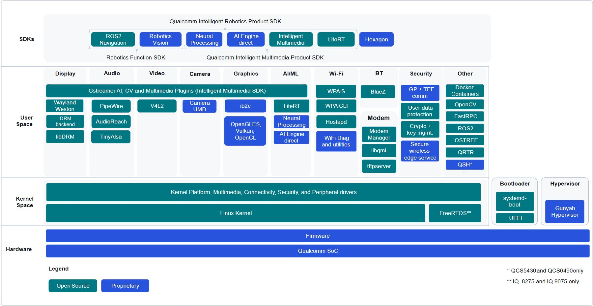

# 02A Qualcomm Linux、BSP 与执行域

## 1. 结论与适用范围

Qualcomm 的机器人操作系统基础不能只用“支持 Linux/Ubuntu”概括。公开可归档的 QLI 1.6 文档将交付分成上游 Base 与包含下游专有软件的 Custom；板级机器配置、固件、媒体和机器人 SDK 又各有版本。对已有 RB3 Gen 2、IQ8、IQ9，这套文档能够形成可检查的构建与刷写路径；对 IQ10，本轮取得的是 Ubuntu/ROS2 支持宣称与参考设计简报，没有取得同等完整的发布矩阵、固件兼容表及量产维护承诺。因此本专题建立两个证据层级，不将老平台软件版本套入 IQ10。[QC_Linux_Architecture_MD 原文](https://docs.qualcomm.com/bundle/publicresource/80-70022-252/topics/qualcomm-linux-sw-overview.md)｜[本地原件](REFERENCES.md#ref-592aca5269ff92a1) [QC_Linux_Release_1_6_MD 原文](https://docs.qualcomm.com/bundle/publicresource/RNO-251013063244/topics/ReleaseNote.md)｜[本地原件](REFERENCES.md#ref-3a9dba7e0f75e302) [QC_IQ10_RRD 原文](https://docs.qualcomm.com/doc/87-A0789-1/87-A0789-1_REV_A_Qualcomm_Dragonwing_IQ10_Robotics_Reference_Design_Product_Brief.pdf)｜[本地原件](REFERENCES.md#ref-246d5ca4db6b9bc7)

资料时点也需要明确。QLI 文档首页本轮仍返回“Qualcomm Linux 1.6 documentation”，发布说明更新为 2025-11-02，架构页为 2025-10-15 Rev.AA。这证明本轮取得的公共文档基线，不能证明到 2026-11-05 没有更新或客户专属发行版。报告以下所有版本结论限定在这些原件；若采购要求 IQ10 最新 BSP，需供应商提供准确包名、版本、release notes 与已知问题清单。[QC_Linux_Home_MD 原文](https://docs.qualcomm.com/bundle/publicresource/80-70022-115/topics/qualcomm-linux-docs-home.md)｜[本地原件](REFERENCES.md#ref-14d94e35ac5221f1) [QC_Linux_Release_1_6_MD 原文](https://docs.qualcomm.com/bundle/publicresource/RNO-251013063244/topics/ReleaseNote.md)｜[本地原件](REFERENCES.md#ref-3a9dba7e0f75e302)

## 2. Base、Custom 与板卡 BSP 的分工

Base 强调上游内核、UEFI、Mesa、V4L2 与通用框架，Custom 则加入 Camera UMD、AI Engine direct、Neural Processing、专有图形库和固件等。这不是两种发行版名称随意替换：Base 的相机路径提供原始帧接口，Custom 可通过 qmmfsrc、相机服务、UMD/KMD 控制更完整的 ISP 流程；Base 的 GLES 功能启用也不意味着具备 Custom 的全部 Vulkan/OpenCL 和 AI 加速能力。架构文档明确提醒 Base 在本发布未完全启用，应逐功能读 release notes。[QC_Linux_Architecture_MD 原文](https://docs.qualcomm.com/bundle/publicresource/80-70022-252/topics/qualcomm-linux-sw-overview.md)｜[本地原件](REFERENCES.md#ref-592aca5269ff92a1)

| 交付层 | 已取得的具体证据 | 负责的内容 | 工程边界 |
|---|---|---|---|
| QLI Base | IQ8/IQ9/IQ6，上游栈 | 内核、通用图形、V4L2、LiteRT | 架构描述不代表所有功能在本发布启用 |
| QLI Custom | QCS5430/QCS6490/IQ8/IQ9 | 下游驱动、专有媒体/AI及工具 | 公开 HLOS 不等于固件全部开源 |
| 参考板机器配置 | MACHINE、CDT、存储布局 | 板级引脚、外设、启动与分区 | SoC同名不能跨载板照刷 |
| Thundercomm RB5 BSP | 产品页 SDK Manager/BSP记录 | 伙伴板的软件交付与修复 | 旧RB5不能直接继承QLI1.6矩阵 |
| IQ10 RRD 软件 | 简报列Ubuntu、ROS2、OTA | 机器人参考系统的软件方向 | 完整版本和兼容表本轮未取得 |

[TC_RB5_Kit 原文](https://www.thundercomm.com/product/qualcomm-robotics-rb5-development-kit/)｜[本地原件](REFERENCES.md#ref-334f80d91fbbc8df) [QC_Linux_Release_1_6_MD 原文](https://docs.qualcomm.com/bundle/publicresource/RNO-251013063244/topics/ReleaseNote.md)｜[本地原件](REFERENCES.md#ref-3a9dba7e0f75e302) [QC_IQ10_RRD 原文](https://docs.qualcomm.com/doc/87-A0789-1/87-A0789-1_REV_A_Qualcomm_Dragonwing_IQ10_Robotics_Reference_Design_Product_Brief.pdf)｜[本地原件](REFERENCES.md#ref-246d5ca4db6b9bc7)

官方软件图中的绿色表示开源组件、蓝色表示专有组件；底部固件明确与 Linux 内核分层。它支持“开源应用层仍依赖专有底层”的结论，不证明所有 SDK 对所有 SoC 同时可用，也不构成逐文件许可清单。图中 FreeRTOS 的脚注限 IQ8/IQ9，QSH 的脚注限 QCS5430/QCS6490；把感知中心或实时域统一泛化到所有 Dragonwing 会遗漏具体支持差异。[QC_Linux_Architecture_MD 原文](https://docs.qualcomm.com/bundle/publicresource/80-70022-252/topics/qualcomm-linux-sw-overview.md)｜[本地原件](REFERENCES.md#ref-592aca5269ff92a1)

## 3. 版本、源码与固件是一组交付物

QLI 1.6 发布说明列 Linux 6.6.97、Yocto Scarthgap 5.0.11；Manifest 为 qcom-6.6.97-QLI.1.6-Ver.1.2.1，固件标签 r1.0_00108.0，extras 为 r1.0_00107.0；QIM 产品 SDK 为2.1.1、robotics manifest 后缀为 robotics-sdk-1.2。这里的编号分别表示发行版、里程碑、附加 SDK 和固件，不能把每一个数字都写成“机器人 SDK 版本”。构建指南示例又使用 Ver.1.2，而发布说明给 Ver.1.2.1，实际复现必须以选择的发布包清单为准，不能混合两个例子的标签。[QC_Linux_Release_1_6_MD 原文](https://docs.qualcomm.com/bundle/publicresource/RNO-251013063244/topics/ReleaseNote.md)｜[本地原件](REFERENCES.md#ref-3a9dba7e0f75e302) [QC_Linux_Unregistered_Build_MD 原文](https://docs.qualcomm.com/bundle/publicresource/80-70022-254/topics/github_workflow_unregistered_users.md)｜[本地原件](REFERENCES.md#ref-59dcd76126fe1d43)

| QLI1.6对象 | 发布质量 | 机器配置举例 | 固件／外设限制 |
|---|---|---|---|
| RB3 Gen 2 QCS6490 | GA | qcs6490-rb3gen2-vision-kit | Custom支持；eMMC迁移1.5→1.6不能直接OTA |
| RB3 Gen 2 Lite QCS5430 | GA | 同家族core/vision配置 | 应核实际芯片/板卡，不能当6490 |
| IQ-9075 EVK | GA | qcs9075-iq-9075-evk | 部分RTSS外设仍为下一版计划 |
| IQ-8275 EVK | Beta | qcs8275-iq-8275-evk-pro-sku | 稳定性压力测试曾见kernel panic |
| IQ10 RRD/IRB10 | 本文件未列 | 本轮未取得 | 不能据老QLI矩阵判断通过验收 |

未注册开发者可通过 GitHub manifest 构建 HLOS，并使用预编译固件；授权开发者的 extras/source 访问由用户或组织许可控制。源码可见、源码可编译和商业可分发是三个不同问题。文档并未授权将所有固件按 Linux 的许可证重新分发，RTSS 全源码构建在这一发布也未启用，需联系 Qualcomm。报告不代用户接受 SDK/EULA，不把公网上的下载地址当作商业授权证明。[QC_Linux_Unregistered_Build_MD 原文](https://docs.qualcomm.com/bundle/publicresource/80-70022-254/topics/github_workflow_unregistered_users.md)｜[本地原件](REFERENCES.md#ref-59dcd76126fe1d43) [QC_Linux_Release_1_6_MD 原文](https://docs.qualcomm.com/bundle/publicresource/RNO-251013063244/topics/ReleaseNote.md)｜[本地原件](REFERENCES.md#ref-3a9dba7e0f75e302)

## 4. 从主机到目标板的构建与启动链

官方未注册构建指南要求 Ubuntu22.04 主机、16GB RAM、300GB空闲磁盘及大于32GB swap，并列 Git/Python/GCC/Make最低版本。这些是构建主机要求，不能写成目标机器人必须装 Ubuntu22.04 或必须有300GB存储。主机通过 repo init/sync 固定 manifest，再用 MACHINE、DISTRO、QCOM_SELECTED_BSP 选择载板和软件变体，bitbake 输出 system.img 与配套部署目录；机器人发行版例子为 qcom-robotics-ros2-humble。[QC_Linux_Unregistered_Build_MD 原文](https://docs.qualcomm.com/bundle/publicresource/80-70022-254/topics/github_workflow_unregistered_users.md)｜[本地原件](REFERENCES.md#ref-59dcd76126fe1d43)

随后由 QDL 在 EDL 下载模式向目标上传 firehose loader，使用 rawprogram/patch XML 写入指定存储。CDT 包含平台ID、subtype和version，驱动/固件据此初始化；IQ8/IQ9还存在单独的 SAIL SPI NOR 刷写阶段。刷写不是只复制根文件系统：UFS provisioning、CDT、HLOS、NonHLOS和安全岛镜像都可能影响启动。报告仅核验官方步骤，没有执行这些命令，也没有把通用指南改写成可直接用于自研载板的操作脚本。[QC_Linux_Flash_MD 原文](https://docs.qualcomm.com/bundle/publicresource/80-70022-254/topics/flash_images.md)｜[本地原件](REFERENCES.md#ref-c65b09f5917b6f3d)

从运行机制看，ROM初始化并认证后续镜像，UEFI/systemd-boot选择高层系统，Linux初始化外设驱动，用户态加载媒体与AI库，通过服务和DSP通信进入异构计算域。其优势是高层开发可以复用 Linux 工具链；成立条件是底层固件、设备树、驱动与库保持兼容。若只更新容器中的AI runtime而保留不兼容的DSP镜像，应用能够启动也不能证明NPU工作正常。此处是基于官方分层的工程分析，未取得所有ABI跨版本兼容范围。[QC_Linux_Architecture_MD 原文](https://docs.qualcomm.com/bundle/publicresource/80-70022-252/topics/qualcomm-linux-sw-overview.md)｜[本地原件](REFERENCES.md#ref-592aca5269ff92a1) [QC_Linux_Release_1_6_MD 原文](https://docs.qualcomm.com/bundle/publicresource/RNO-251013063244/topics/ReleaseNote.md)｜[本地原件](REFERENCES.md#ref-3a9dba7e0f75e302)

## 5. 实时域与虚拟化不能替代控制保证

QLI 架构使用 Gunyah Type1 hypervisor，与高层OS独立；发布说明同时有 KVM 功能，但不同 Base/Custom与SoC栏的成熟度不同。Hypervisor 的隔离机制能够缩小故障传播范围，不等于每个虚拟机都有确定的截止期，更不等于 ROS2 回调自动成为硬实时控制器。需要单独核查 CPU资源、内存带宽、共享中断和DMA竞争、时钟与调度策略，才能评价控制尾延迟。[QC_Linux_Architecture_MD 原文](https://docs.qualcomm.com/bundle/publicresource/80-70022-252/topics/qualcomm-linux-sw-overview.md)｜[本地原件](REFERENCES.md#ref-592aca5269ff92a1) [QC_Linux_Release_1_6_MD 原文](https://docs.qualcomm.com/bundle/publicresource/RNO-251013063244/topics/ReleaseNote.md)｜[本地原件](REFERENCES.md#ref-3a9dba7e0f75e302)

IQ8/IQ9 的 RTSS 被描述为“芯片内的独立子系统”，本发布 FreeRTOS 为 binary-only，功能限启动和时钟/外设初始化。发布说明还将 CAN 与 RTSS Ethernet 列在下一发布计划接口中。因此“硬件有CAN/实时核”与“当前应用能编程并使用CAN闭环”之间有明确软件交付缺口。IQ10则在硬件简报采用 SafeRTOS和MCU-like安全域表述，不能把上述FreeRTOS二进制限制或接口计划直接迁移到IQ10，也不能凭计划SIL3认定获得安全认证。[QC_Linux_Architecture_MD 原文](https://docs.qualcomm.com/bundle/publicresource/80-70022-252/topics/qualcomm-linux-sw-overview.md)｜[本地原件](REFERENCES.md#ref-592aca5269ff92a1) [QC_Linux_Release_1_6_MD 原文](https://docs.qualcomm.com/bundle/publicresource/RNO-251013063244/topics/ReleaseNote.md)｜[本地原件](REFERENCES.md#ref-3a9dba7e0f75e302) [QC_IQ10_Brief 原文](https://docs.qualcomm.com/doc/87-A2811-1/87-A2811-1_REV_B_Qualcomm_Dragonwing_IQ10_Series_Platform_Product_Brief.pdf)｜[本地原件](REFERENCES.md#ref-6e5c94a7707cae4b)

分析：机器人可以将视觉推理、地图与规划放在 Linux，把周期稳定的伺服与保护逻辑交给经过确认的实时域或外置MCU，但必须补足命令有效期、心跳、序号、故障状态和超时动作的契约。独立核本身不能规定Linux失联时电机会停还是保持。当前公开原件未给出这些产品级约束，也未给出WCET、控制频率与实机危险响应数据，选型时应要求接口SDK和故障注入验收记录。

## 6. 维护、升级与迁移成本

OSTree OTA 从QLI GA1.3提供；架构页说1.3→1.4要处理分区布局，1.4→1.5无需相同操作。更具体的1.6 release notes又说明：GA1.6 HLOS搭配旧NonHLOS不受支持，QCS6490/QCS5430使用eMMC从1.5迁到1.6不能OTA。这是同一软件栈内部的条件限制，不是文档自相矛盾；只宣传“支持OTA”会掩盖存储介质、起始版本与固件配套的迁移工作。[QC_Linux_Architecture_MD 原文](https://docs.qualcomm.com/bundle/publicresource/80-70022-252/topics/qualcomm-linux-sw-overview.md)｜[本地原件](REFERENCES.md#ref-592aca5269ff92a1) [QC_Linux_Release_1_6_MD 原文](https://docs.qualcomm.com/bundle/publicresource/RNO-251013063244/topics/ReleaseNote.md)｜[本地原件](REFERENCES.md#ref-3a9dba7e0f75e302)

QLI1.6已知问题还包括长时间多模型相机输入时Wayland显示滞后、IQ9 GMSL CRC错误及KVM启动问题、IQ8压力测试页错误引发kernel panic。它们证明该版本公开披露了故障，不证明每一板卡必然遇到，也不证明到本轮采集时仍未修复。应取得修复对应的补丁和板卡复验结果，而不能从SoC峰值或GA标签推导稳定运营。[QC_Linux_Release_1_6_MD 原文](https://docs.qualcomm.com/bundle/publicresource/RNO-251013063244/topics/ReleaseNote.md)｜[本地原件](REFERENCES.md#ref-3a9dba7e0f75e302)

与其他边缘计算平台作机制比较，Qualcomm的Linux与异构固件紧耦合可减少厂商特性接入工作，但也增加HLOS/NonHLOS同步维护负担；上游Base降低专有接口依赖，却可能牺牲完整相机和AI路径。实际选型动作应先在目标载板上锁定可交付镜像、驱动、固件、SDK和恢复方法，再评价开发便利性。RB5伙伴页已有具体BSP修复记录且套件声明2026年6月EOL，维护计划必须另外确认；该EOL不能推成QRB5165芯片EOL，更不能影响新IQ10的生命周期判断。[TC_RB5_Kit 原文](https://www.thundercomm.com/product/qualcomm-robotics-rb5-development-kit/)｜[本地原件](REFERENCES.md#ref-334f80d91fbbc8df)

## 参考资料与归档边界

采集截止：2026-11-05（Asia/Shanghai）。原件通过项目统一下载器登记；官方 Markdown 是厂商提供的原始正文，保留嵌入 SVG/图片数据。HTML 静态壳不作为正文证据。网页依赖缺失按 metadata 记录；不承诺离线交互或像素一致。未执行硬件刷写、模型推理或机器人测试。

| 登记名称 | 版本／适用边界 | 原始资料 | 本地归档 |
|---|---|---|---|
| QC_Linux_Architecture_MD | 80-70022-252 Rev.AA，2025-10-15 | [原文](https://docs.qualcomm.com/bundle/publicresource/80-70022-252/topics/qualcomm-linux-sw-overview.md) | [原件](REFERENCES.md#ref-592aca5269ff92a1) |
| QC_Linux_Release_1_6_MD | 00107.0，Rev.3，2025-11-02；QLI1.6 | [原文](https://docs.qualcomm.com/bundle/publicresource/RNO-251013063244/topics/ReleaseNote.md) | [原件](REFERENCES.md#ref-3a9dba7e0f75e302) |
| QC_Linux_Home_MD | QLI1.6公共文档入口 | [原文](https://docs.qualcomm.com/bundle/publicresource/80-70022-115/topics/qualcomm-linux-docs-home.md) | [原件](REFERENCES.md#ref-14d94e35ac5221f1) |
| QC_Linux_Unregistered_Build_MD | 80-70022-254，QLI1.6示例，2025-10-15 | [原文](https://docs.qualcomm.com/bundle/publicresource/80-70022-254/topics/github_workflow_unregistered_users.md) | [原件](REFERENCES.md#ref-59dcd76126fe1d43) |
| QC_Linux_Flash_MD | 80-70022-254，QLI1.6相关指南 | [原文](https://docs.qualcomm.com/bundle/publicresource/80-70022-254/topics/flash_images.md) | [原件](REFERENCES.md#ref-c65b09f5917b6f3d) |
| QC_IQ10_RRD | 87-A0789-1 Rev.A，0526A | [原文](https://docs.qualcomm.com/doc/87-A0789-1/87-A0789-1_REV_A_Qualcomm_Dragonwing_IQ10_Robotics_Reference_Design_Product_Brief.pdf) | [原件](REFERENCES.md#ref-246d5ca4db6b9bc7) |
| QC_IQ10_Brief | 87-A2811-1 Rev.B，0826B | [原文](https://docs.qualcomm.com/doc/87-A2811-1/87-A2811-1_REV_B_Qualcomm_Dragonwing_IQ10_Series_Platform_Product_Brief.pdf) | [原件](REFERENCES.md#ref-6e5c94a7707cae4b) |
| TC_RB5_Kit | 伙伴商品/BSP页，2026-11-04快照 | [原文](https://www.thundercomm.com/product/qualcomm-robotics-rb5-development-kit/) | [原件](REFERENCES.md#ref-334f80d91fbbc8df) |
