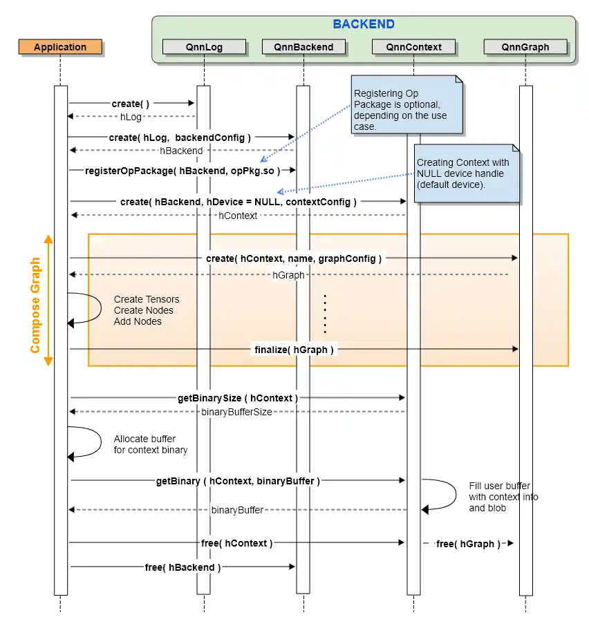

# 02B QAIRT、QNN 与 SNPE：编译产物和运行时契约

## 1. 技术位置：统一接口的收益和责任

Qualcomm AI Engine direct通常以QNN接口进入应用；SNPE对应Neural Processing SDK的模型容器与高层执行路径；QAIRT文档集合同时覆盖QNN、SNPE、Genie与其他入口。不能把这些名称当作互斥芯片或三套彼此无关的加速器。QNN把CPU/GPU/DSP等后端封装成各自的库，提供统一C风格API；它刻意把模型解析和网络切分留给高层框架。这使机器人应用可围绕同一组图与张量接口开发，但“统一”不保证同一算子、精度、动态shape和缓存在全部后端成立。[QC_QNN_Overview_MD 原文](https://docs.qualcomm.com/bundle/publicresource/80-63442-10/topics/QNN_general_overview.md)｜[本地原件](REFERENCES.md#ref-6c7fd9dcbcbda438)

本轮归档80-63442-10的官方Markdown，页面标2026-09-03。API总览给QNN API 2.39.0，HTP页给HTP backend API5.50.0；它们是不同接口的版本号，不是把SDK版本推定成2.39或5.50。本文未下载并接受完整QAIRT安装包，也未取得IQ10对应包的发布说明，故不把公共文档版本当成IQ10已验收runtime。[QC_QNN_API_MD 原文](https://docs.qualcomm.com/bundle/publicresource/80-63442-10/topics/api_overview.md)｜[本地原件](REFERENCES.md#ref-882106f8ffc3dd51) [QC_QNN_HTP_MD 原文](https://docs.qualcomm.com/bundle/publicresource/80-63442-10/topics/htp_backend.md)｜[本地原件](REFERENCES.md#ref-6979e07b66066d46)

## 2. 模型到产物：两条流程会合

QNN converter把训练模型转换为包含图构建API的model.cpp与存放权重偏置的model.bin；量化时同时改变数据类型与encoding。model-lib-generator将其制成目标工具链的model.so，应用动态装载或静态链接后构建图；context-binary-generator则调用指定后端准备并序列化图，生成可部署缓存。缓存可减少初始化时重复构图和优化，却会绑定后端、架构与编译配置。原训练模型、可编辑的图源码、目标CPU机器码和HTP缓存有不同用途，不能因为都叫“模型文件”就互换。[QC_QNN_Overview_MD 原文](https://docs.qualcomm.com/bundle/publicresource/80-63442-10/topics/QNN_general_overview.md)｜[本地原件](REFERENCES.md#ref-6c7fd9dcbcbda438) [QC_QNN_Tools_MD 原文](https://docs.qualcomm.com/bundle/publicresource/80-63442-10/topics/general_tools.md)｜[本地原件](REFERENCES.md#ref-f27afc3534f09247)

SNPE的主要产物是DLC：训练模型经转换成为容器，按目标需要量化，再由runtime加载。snpe-dlc-graph-prepare对量化DLC离线准备DSP/HTP图，snpe-dlc-quantize产生定点量化容器；工具页把量化在相应HTA/DSP场景列为必要步骤。QNN还提供libQnnModelDlc.so从DLC取得图，因此DLC并非只能在SNPE高层运行时使用。但共享容器格式不证明两个入口的缓存和执行配置完全相同。[QC_SNPE_Overview_MD 原文](https://docs.qualcomm.com/bundle/publicresource/80-63442-10/topics/SNPE_general_overview.md)｜[本地原件](REFERENCES.md#ref-f6e123a16966bbae) [QC_SNPE_Tools_MD 原文](https://docs.qualcomm.com/bundle/publicresource/80-63442-10/topics/SNPE_general_tools.md)｜[本地原件](REFERENCES.md#ref-97994f3b822597ae) [QC_QNN_Overview_MD 原文](https://docs.qualcomm.com/bundle/publicresource/80-63442-10/topics/QNN_general_overview.md)｜[本地原件](REFERENCES.md#ref-6c7fd9dcbcbda438)

| 路径／产物 | 谁生成 | 谁消费 | 对机器人部署的影响 |
|---|---|---|---|
| 训练模型ONNX/TF/PyTorch等 | 训练/导出框架 | converter | 保留算子版本、输入shape、权重和预处理 |
| QNN cpp＋bin | converter | 编译器、model库构建 | 源码与权重分离；量化encoding也要归档 |
| model.so/dll | model-lib-generator | 目标应用/缓存生成器 | 主机和目标工具链不能混用 |
| context binary | 后端prepare/finalize | 对应QNN backend | 加载快；架构/版本兼容必须核验 |
| DLC及准备缓存 | SNPE/QAIRT工具 | SNPE或QNN DLC入口 | 大模型无需全部编成共享模型库，但仍需匹配运行时 |

分析：迁移成本主要在算子语义、量化误差、内存布局及运行时集成，而非把文件扩展名更换。对视觉策略，导出阶段固定相机数与图像尺寸能简化准备；对语言/多模态模型则应先核动态长度、KV cache及分图机制。本轮没有获得某一VLA在IQ10上成功编译运行的证据，流程可行性不能写成产品实测。

## 3. Backend、Device、Context、Graph与Tensor

Backend管理后端资源及算子注册，Device绑定硬件设备/核心与性能配置，Context容纳一组图及可共享的张量，Graph通过节点和张量表示执行网络。QnnProperty查询能力，QnnMem注册外部分配内存，QnnProfile记录图/算子时间与内存。把这些对象分别管理，可以避免“一个模型实例”等同“一个独占NPU”的误解：同一上下文可能容纳多图，同一硬件设备也可能被多个应用竞争。[QC_QNN_API_MD 原文](https://docs.qualcomm.com/bundle/publicresource/80-63442-10/topics/api_overview.md)｜[本地原件](REFERENCES.md#ref-882106f8ffc3dd51)

官方缓存时序图显示初始化backend、可选注册OpPackage、create context、组成图、finalize，再getBinarySize/分配buffer/getBinary。这个图证明缓存来自已准备上下文，不是直接复制ONNX字节；它没有画出所有设备与多核调度条件。正文的基础构图段落却把创建context写成createFromBinary，与此图的create路径不同，报告保留该文字/图示差异：普通构图与缓存恢复应按实际函数头和样例区分，不能照抄段落生成未经验证的API代码。[QC_QNN_API_MD 原文](https://docs.qualcomm.com/bundle/publicresource/80-63442-10/topics/api_overview.md)｜[本地原件](REFERENCES.md#ref-882106f8ffc3dd51)

图必须finalize后才能execute，finalize后不能再加入节点和张量；节点按依赖次序加入，张量名称在context中必须唯一，且没有删除已注册节点/张量的API。输入张量APP_WRITE、输出APP_READ、内部NATIVE、常量STATIC、跨图APP_READWRITE分别描述角色。应用的shape、datatype、layout和quantization encoding必须与这些元信息一致，不能把相机NV12原始buffer当作已归一化RGB张量。[QC_QNN_API_MD 原文](https://docs.qualcomm.com/bundle/publicresource/80-63442-10/topics/api_overview.md)｜[本地原件](REFERENCES.md#ref-882106f8ffc3dd51)

同步execute与异步executeAsync提供不同完成通知方式。异步的收益是主机预处理或其他图可以与计算重叠；成立条件是支持相应后端、buffer生命周期与回调管理正确。发出请求不表示结果已可读，释放context会销毁内部图，释放backend使相关句柄失效。故机器人每帧buffer应在完成通知后复用，过期推理结果需要由上层按时间戳丢弃；API本身不替代安全控制的截止期判断。[QC_QNN_API_MD 原文](https://docs.qualcomm.com/bundle/publicresource/80-63442-10/topics/api_overview.md)｜[本地原件](REFERENCES.md#ref-882106f8ffc3dd51)

## 4. HTP执行、内存与精度边界

HTP可配置SoC model、Hexagon架构、core类型、签名process domain与VTCM等。文档要求线上通过平台信息查询设备能力，离线编译则提供正确设备配置；“另一HTP架构生成的context binary可能产生indeterminate result”是跨代部署的关键限制。QRB5165、QCM6490、QCS8550在支持表分别列V66、V68、V73以及不同工具链；其中QCS9100条目也不能未经厂商映射直接视为QCS9075/8275/IQ10的支持承诺。[QC_QNN_HTP_MD 原文](https://docs.qualcomm.com/bundle/publicresource/80-63442-10/topics/htp_backend.md)｜[本地原件](REFERENCES.md#ref-6979e07b66066d46) [QC_QNN_Overview_MD 原文](https://docs.qualcomm.com/bundle/publicresource/80-63442-10/topics/QNN_general_overview.md)｜[本地原件](REFERENCES.md#ref-6c7fd9dcbcbda438)

HTP图的输入输出会涉及主机与DSP通信。QnnMem可注册外部内存，但注册不是对任意camera buffer零拷贝的保证；必须满足后端接受的共享buffer、对齐、布局和缓存一致性。HTP页还专门提供Qmem shared-buffer-only图、多线程/批处理隐藏RPC开销以及VTCM共享/窗口化。分析：减少一次CPU↔DSP拷贝需要整个相机到张量路径兼容，若颜色转换、resize、tensor重排产生新buffer，局部共享仍不能等同全链零拷贝。[QC_QNN_API_MD 原文](https://docs.qualcomm.com/bundle/publicresource/80-63442-10/topics/api_overview.md)｜[本地原件](REFERENCES.md#ref-882106f8ffc3dd51) [QC_QNN_HTP_MD 原文](https://docs.qualcomm.com/bundle/publicresource/80-63442-10/topics/htp_backend.md)｜[本地原件](REFERENCES.md#ref-6979e07b66066d46)

| 优化 | 作用机制 | 成立条件 | 失效或代价 |
|---|---|---|---|
| 离线context缓存 | 省去重复构图/优化 | 后端和架构兼容 | SDK/ABI变动后可能重编 |
| 量化8/16位 | 降低数据量并用定点引擎 | 算子/encoding与校准有效 | 精度下降；更高位宽可能增内存/计算 |
| VTCM内局部复用 | 减少外存访存 | 权重/激活及工作区适配 | 大shape与多图并发造成spill |
| 多线程/批处理 | 隐藏RPC、复用权重 | 有独立工作、buffer与内存 | 增排队与峰值RAM，单帧尾延迟可能更差 |
| shared buffer | 减少边界数据复制 | 内存与格式契约满足 | 格式转换/重排仍可能复制 |

HTP文档区分量化8/16位与选择SoC上的float32网络/float16数学；BF16又有Windows V81及更新平台条件。这些支持范围不能覆盖所有Dragonwing。量化不是文件压缩：校准样本决定scale与范围，per-channel、权重对称性和激活位宽影响误差；文档给A16W16的特殊范围限制，显示位宽相同仍可能存在编码约束。机器人应在原框架与目标输出间比较检出率、深度误差或轨迹误差，不能用模型成功加载替代任务准确率。[QC_QNN_HTP_MD 原文](https://docs.qualcomm.com/bundle/publicresource/80-63442-10/topics/htp_backend.md)｜[本地原件](REFERENCES.md#ref-6979e07b66066d46) [QC_QNN_Tools_MD 原文](https://docs.qualcomm.com/bundle/publicresource/80-63442-10/topics/general_tools.md)｜[本地原件](REFERENCES.md#ref-f27afc3534f09247)

## 5. 回退、调度与可观测性

QNN低层不负责网络切分，高层框架才决定不能支持的节点放在哪里。统一后端接口也不会自动把每个失败算子回退CPU；SNPE工具中的float_fallback指向量化/浮点编码处理，不能据这个名字推导运行时“所有不支持算子自动CPU回退”。应分别验证转换阶段支持、准备阶段支持、runtime选择顺序及实际子图分配。若走ONNX Runtime或LiteRT，还要查其EP/delegate限制，本文不把第三方切分机制移植成QNN自身能力。[QC_QNN_Overview_MD 原文](https://docs.qualcomm.com/bundle/publicresource/80-63442-10/topics/QNN_general_overview.md)｜[本地原件](REFERENCES.md#ref-6c7fd9dcbcbda438) [QC_SNPE_Tools_MD 原文](https://docs.qualcomm.com/bundle/publicresource/80-63442-10/topics/SNPE_general_tools.md)｜[本地原件](REFERENCES.md#ref-97994f3b822597ae)

HTP variable batch仅有限支持：执行batch可为准备batch的正整数倍，所有输入输出必须使用相同倍数。它不等于任意分辨率和序列长度动态变化。图切换/多图切换仍标Beta，文档不支持切换图之间并发执行，并提醒内存压力可驱逐保留图。分析：多模型机器人若要稳定尾延迟，应分别测常驻内存方案和切换方案，不能只比较平均吞吐。[QC_QNN_HTP_MD 原文](https://docs.qualcomm.com/bundle/publicresource/80-63442-10/topics/htp_backend.md)｜[本地原件](REFERENCES.md#ref-6979e07b66066d46)

qnn-platform-validator用于平台检查，profile-viewer与HTP optrace、Hextimate等用于观察不同层；accuracy evaluator/debugger用于输出比较。工具存在不表示已经得到某模型的性能。合理测试应分离首次load/prepare、warmup、稳定execute、预后处理、RPC、调度等待及传感器时间；带上SKU、固件、频率/功率、shape、batch、迭代和统计量。本轮无实测P99/WCET，也不把工具对HTP的估计当作系统闭环延迟。[QC_QNN_Tools_MD 原文](https://docs.qualcomm.com/bundle/publicresource/80-63442-10/topics/general_tools.md)｜[本地原件](REFERENCES.md#ref-f27afc3534f09247) [QC_QNN_HTP_MD 原文](https://docs.qualcomm.com/bundle/publicresource/80-63442-10/topics/htp_backend.md)｜[本地原件](REFERENCES.md#ref-6979e07b66066d46)

## 6. 许可、维护与机制对标

SDK工具、后端二进制、DSP库、自定义算子源码、训练模型和权重需要分别看许可证。官方文档能核库的分工，不能替代完整下载包的EULA与再分发条款；本文没有取得这些条款，不认定闭源运行时可自由商用分发。自定义OpPackage还涉及平台特定实现与兼容维护，HTP页说传统OpPackage每个SDK release需要重编，新的QHPI旨在改进接口/ABI兼容，但也有迁移边界。[QC_QNN_HTP_MD 原文](https://docs.qualcomm.com/bundle/publicresource/80-63442-10/topics/htp_backend.md)｜[本地原件](REFERENCES.md#ref-6979e07b66066d46)

与其他厂商端侧编译runtime作机制比较，QNN的优势在可统一调不同片上引擎且深入暴露图/内存/性能配置，代价是应用承担较多对象生命周期和异构部署管理；高层SNPE则以DLC和runtime简化模型接入。两者均不提供通用训练平台，也不能用手机SoC benchmark为IQ10机器人配置作性能背书。选型应拿同一模型和输入集在目标板验证转换、缓存加载、准确性、持续功耗和异常恢复，兼容表缺失时保留原训练模型与可重编产物，避免把唯一资产冻结成不兼容缓存。[QC_QNN_API_MD 原文](https://docs.qualcomm.com/bundle/publicresource/80-63442-10/topics/api_overview.md)｜[本地原件](REFERENCES.md#ref-882106f8ffc3dd51) [QC_QNN_Overview_MD 原文](https://docs.qualcomm.com/bundle/publicresource/80-63442-10/topics/QNN_general_overview.md)｜[本地原件](REFERENCES.md#ref-6c7fd9dcbcbda438)

## 参考资料与归档边界

采集截止：2026-11-05（Asia/Shanghai）。原件通过项目统一下载器登记；官方 Markdown 是厂商提供的原始正文，保留嵌入 SVG/图片数据。HTML 静态壳不作为正文证据。网页依赖缺失按 metadata 记录；不承诺离线交互或像素一致。未执行硬件刷写、模型推理或机器人测试。

| 登记名称 | 版本／适用边界 | 原始资料 | 本地归档 |
|---|---|---|---|
| QC_QNN_API_MD | 80-63442-10；2026-09-03；API2.39.0 | [原文](https://docs.qualcomm.com/bundle/publicresource/80-63442-10/topics/api_overview.md) | [原件](REFERENCES.md#ref-882106f8ffc3dd51) |
| QC_QNN_HTP_MD | 80-63442-10；2026-09-03；HTP API5.50.0 | [原文](https://docs.qualcomm.com/bundle/publicresource/80-63442-10/topics/htp_backend.md) | [原件](REFERENCES.md#ref-6979e07b66066d46) |
| QC_QNN_Overview_MD | 80-63442-10；2026-09-03 | [原文](https://docs.qualcomm.com/bundle/publicresource/80-63442-10/topics/QNN_general_overview.md) | [原件](REFERENCES.md#ref-6c7fd9dcbcbda438) |
| QC_QNN_Tools_MD | 80-63442-10；2026-09-03 | [原文](https://docs.qualcomm.com/bundle/publicresource/80-63442-10/topics/general_tools.md) | [原件](REFERENCES.md#ref-f27afc3534f09247) |
| QC_SNPE_Overview_MD | 80-63442-10；2026-09-03 | [原文](https://docs.qualcomm.com/bundle/publicresource/80-63442-10/topics/SNPE_general_overview.md) | [原件](REFERENCES.md#ref-f6e123a16966bbae) |
| QC_SNPE_Tools_MD | 80-63442-10；2026-09-03 | [原文](https://docs.qualcomm.com/bundle/publicresource/80-63442-10/topics/SNPE_general_tools.md) | [原件](REFERENCES.md#ref-97994f3b822597ae) |
