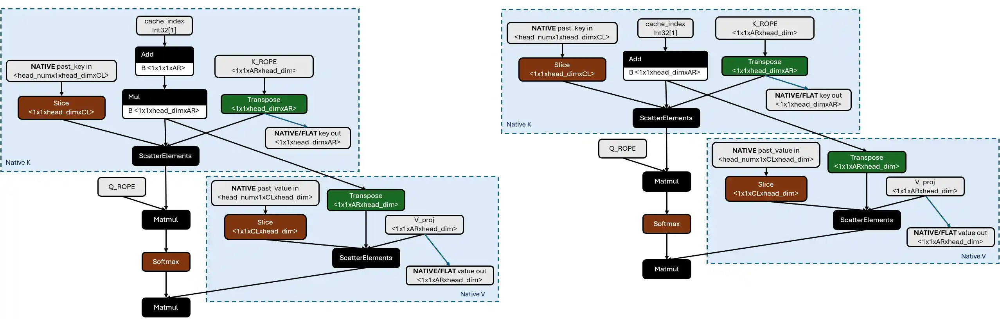

# 02C Qualcomm AI Hub Workbench 与 Genie 生成式部署

## 定位与交付关系

AI Hub Workbench 提供模型准备、目标编译和托管设备验证；Genie 则是应用在目标设备调用的生成式推理库。两者可以交接经过编译的模型资产，却不是同一个 runtime，也没有证据证明所有 AI Hub 模型都能直接交给 Genie。2026-11-05 采集的官方仓库 README 已使用 Workbench 名称，列出 QCS6490、8250、9075、8550，以及 RB3 Gen2、RB5 Gen2、IQ8、IQ9。目录中未见 IQ10 不能推断其不支持；IQ10 的设备名、BSP 与编译目标绑定仍须单独取得。[QC_AIHub_Models_Repo 原文](https://github.com/qualcomm/ai-hub-models)｜[本地原件](REFERENCES.md#ref-f2f0b5d0785d46a2)

仓库代码采用 BSD-3-Clause；模型权重、校准数据及其原始上游授权需逐模型核验。Workbench 需要 Qualcomm ID 和 API token，云端任务涉及上传模型与输入。本文没有登录、接受云服务协议或上传机器人数据。文档域名的 robots 文件未能通过统一下载器取得，下载器已停止归档；GitHub 的 Raw 路径被 robots 拒绝。有效证据来自允许归档的官方仓库 HTML 正文及 Qualcomm 官方 Markdown，前者缺一个静态依赖，不能声称完整离线交互。仓库 main 是采集快照与文件哈希，未当作固定发布版。

| 层级 | 输入／产物 | 已核验用途 | 机器人集成边界 |
|---|---|---|---|
| 轻量 qai-hub-models-cli | 模型目录、性能／精度记录、可下载资产 | 浏览与下载已准备模型 | 不执行本体控制 |
| 完整 qai_hub_models | 模型源码、依赖、导出和评估命令 | 量化、编译、profile、数据集评估 | 模型依赖需逐个安装 |
| Workbench 设备任务 | 所选设备、runtime、输入样本 | 云端真实设备执行 | 不能代表载板并发与总线时延 |
| Genie／QAIRT | tokenizer、JSON、QNN context binaries | 本机 LLM 推理管线 | 需匹配本机库与固件 |

## 从源模型到可部署资产

官方示例以 YOLOv7 演示：先安装模型依赖，再以 `export yolov7 --target-runtime tflite --precision w8a8 --device "Samsung Galaxy S25 (Family)"` 请求转换，最后以输出 model ID 执行 evaluate。导出流程依次包含适用时量化、为指定设备与 runtime 编译、下载产物、真实云设备 profile；评估把数据集子集上的设备输出与 PyTorch 输出比较。这里的 w8a8、LiteRT、Galaxy S25 是具体示例条件，不能移植为 IQ9 或 IQ10 的性能证明。任务成功只说明该任务资产在所选条件下执行，不能替代相机连续输入、ROS 消息时间戳和安全控制验证。[QC_AIHub_Models_Repo 原文](https://github.com/qualcomm/ai-hub-models)｜[本地原件](REFERENCES.md#ref-f2f0b5d0785d46a2)

可复建时，应保存模型源码与权重 revision、模型专属依赖锁、校准样本与预处理、输入 shape、量化配置、目标设备名、runtime、任务 ID、下载资产哈希，以及 profile 和 numerics 的原始结果。分析：若只保留最终文件而不保留校准与目标参数，后续 BSP 升级后无法区分精度变化来自模型、量化或 runtime；若只保留平均 kernel 时延，无法定位输入传输和后处理形成的观测年龄。本文未取得具体任务结果，故没有引用模型速度、内存或功耗排名。

默认 `demo` 使用本地 PyTorch CPU/GPU，README 明确写没有 NPU 支持；`--eval-mode on-device` 会把图像与编译模型发送到云设备。Python App 的 torch/numpy 前后处理以清晰示例为目标，未按最短预测时延优化。面向机器人应把必要预处理纳入编译图或本地优化实现，再通过设备原生应用接入 QNN/LiteRT/ONNX；原生示例仓库只是入口，尚未验证其与本文 ROS 流的完整联接。更换后处理时应重验阈值、坐标缩放、NMS 和输出数值，而不是仅检查可执行文件启动。

## Genie 的模型准备、配置与硬件依赖

Genie 的 2026-09-03 Introduction 描述其为简化连接边缘 GenAI 部署的库，同时写当前支持限于 LLM；文档树又提供可组合 Pipeline 与多模态教程。因此采用窄结论：已明确核验的是 LLM 管线及其配置，不能依据组件名字保证任意 VLM/VLA 可部署。可选执行后端包括 QNN HTP、QNN GPU、Snapdragon CPU 上的 QNN GenAiTransformer。后端选择改变模型格式、缓存布局和硬件资源，不是无成本透明切换。[QC_Genie_Introduction_MD 原文](https://docs.qualcomm.com/bundle/publicresource/80-63442-10/topics/introduction.md)｜[本地原件](REFERENCES.md#ref-3f43abb2a970e2f6)

官方 How to Use Genie 将工作分成三步：AIMET 准备与量化，QNN 转换生成一组 context binaries，配置 Genie 并在目标运行。教程假定 Linux 开发主机和 Android 目标，用 adb 传输；Linux 目标需要改用 ssh 等传输方式并适配脚本。教程包经 QPM 下载并需激活授权；本文只取得公开步骤，没有取得并执行三个 Notebook。文中 `2.22.6.240515` 是路径示例，不能作为本次通用文档或 IQ10 的 SDK 绑定版本。[QC_Genie_Use_MD 原文](https://docs.qualcomm.com/bundle/publicresource/80-63442-10/topics/how_to_use_genie.md)｜[本地原件](REFERENCES.md#ref-a611bd519d3c005b)

Dialog JSON 的 context 描述上下文长度、词表、BOS/EOS/EOT，tokenizer 指向词表文件；sampler 描述随机种子、temperature、top-k/top-p、greedy 与 token penalty；engine 描述线程、backend、extensions 和 model。HTP 的 model.type 为 binary，ctx-bins 列出序列化分片；GenAiTransformer 的 library 指向 model.bin。应用必须同时版本化这些资产。仅修改 context.size 并不能自动扩展已编译模型的最大序列长度，token ID 错配也可能得到能运行但语义错误的输出。[QC_Genie_Dialog_Config_MD 原文](https://docs.qualcomm.com/bundle/publicresource/80-63442-10/topics/dialog_json.md)｜[本地原件](REFERENCES.md#ref-9c7b374f7eeee68b)

| 配置／对象 | 实际作用 | 成立条件／失效风险 |
|---|---|---|
| n-threads | KV-cache 更新线程数量 | 不等于 NPU 核数或机器人控制频率 |
| spill-fill-bufsize | HTP 溢出回填预分配 | 大于模型各 context 的需求，受 VTCM 影响 |
| batch-size | 并行 query 的 KV 与 I/O 维度 | 必须匹配编译 batch |
| use-mmap／mmap-budget | 映射 context 文件及分块加载 | 不是所有权重已常驻，更不是硬实时保证 |
| direct-io | 经 udmabuf 将权重装入 DMA buffer | 需 /dev/udmabuf 和足够 size_limit_mb；默认关闭 |
| shared-engine | 共享 engine 管理 | HTP 要求 allow-async-init 为 True |

配置表与 schema 存在拼写差异：CPU 亲和性在 schema／示例写 cpu-mask，参数表出现 cpumask；表中列出的选项也比 schema 多。不要把文档 schema 片段当作可以直接通过解析器的生产 JSON。应优先从对应 SDK examples/Genie/configs 提取配置，再对当前二进制做解析与最小推理验证。Standalone Engine 示例还包含 embedding LUT 的 datatype、scale/offset、RoPE 和 draft-token-map，这些是模型数学语义的一部分，不能把其他模型的数值照搬。[QC_Genie_Engine_Config_MD 原文](https://docs.qualcomm.com/bundle/publicresource/80-63442-10/topics/engine_json.md)｜[本地原件](REFERENCES.md#ref-99e9ef27c30cb36d)

库构建文档提供 x86、OE、Android、Windows 路径，依赖 clang、Rust，Android 额外需要 ndk-build，已验证组合写 NDK r26c 与 clang14，OE 示例写 GCC11.2。源码样例“可构建”不证明全部依赖开源或可重新分发；QAIRT 二进制、Genie SDK 包、固件及教程许可全文未取得，代码仓库 BSD 不覆盖这些对象。[QC_Genie_Library_Example_MD 原文](https://docs.qualcomm.com/bundle/publicresource/80-63442-10/topics/source_code_examples_library.md)｜[本地原件](REFERENCES.md#ref-38cf23e7619f60f6)

## 原生 KV-cache：性能来源与适用范围

图来自 QNN HTP 原文，展示 native K/V、cache index、ScatterElements 与注意力计算的数据依赖；嵌入字节原样解码，原 Markdown 虽标 png，实际为 WebP，按真实格式保存并打开核验。它支持“缓存更新与张量布局共同决定执行路径”的结论，不提供速度倍数。[QC_QNN_HTP_MD 原文](https://docs.qualcomm.com/bundle/publicresource/80-63442-10/topics/htp_backend.md)｜[本地原件](REFERENCES.md#ref-6979e07b66066d46)

传统路径将 KV 输入转换成 HMX 布局，长上下文使转换成本增大。原生 KV 保持 HMX layout，让缓存管理模块直接更新该布局。官方限制为 uint8 对称量化、全部 decoder 层统一使用，context 长度为 256 的倍数、head_dim 为 64 的倍数，并使用 ScatterElement 而不是 Concat 更新。不同 ARN 条件又决定输出 native 或 flat；非 32 倍数路径由 client 负责 flat 到 native 的转换。编译时通过 data_format_config 为全部 KV tensors 指定 QNN_TENSOR_DATA_FORMAT_HMX_WEIGHT_LAYOUT。不能只在 Genie JSON 打开一个开关期待任意旧 context 自动获益。

HTP 文档写 v68 及更低不支持此机制，最大上下文还受固定 VTCM 限制，例子是 2M VTCM 不支持 16K 及以上。厂商称改善 TTFT、token rate 和功耗，但本材料没有相同模型与目标硬件的数值对照。选型动作应先核目标架构，再比较保持语义一致的两份产物；记录 prompt 长度、输出长度、prefill 与 decode、冷启动、缓存重用、并发、热状态。GenieProfile trace.enable 提供采集配置入口，却没有自动覆盖相机到动作的全链路。[QC_Genie_Profile_Config_MD 原文](https://docs.qualcomm.com/bundle/publicresource/80-63442-10/topics/profile_json.md)｜[本地原件](REFERENCES.md#ref-2644742917008d2f)

## 机制对标与机器人交接

分析：与其他端侧模型编译服务相比，Workbench 的价值是将目标设备编译和数值验证放在同一工作流；与通用 CPU 生成库相比，Genie 的价值在于明确管理 HTP 分片、KV 更新和后端依赖。迁移可保留源权重、校准语料、任务基准和 tokenizer 语义；context binaries、HTP 布局配置、专属 Op Package 需要重新生成。没有同条件官方实测，本章不输出比 NVIDIA 或其他平台快的结论。

机器人上可复建的交接方案是：图像／语言／状态预处理产生模型输入，编译 runtime 输出文本或任务候选，应用验证结构、时效与坐标，再交给规划或控制接口。Genie sampler 的随机性、长输出和上下文缓存会影响决策重复性，应以固定回放输入检查输出稳定性，再加入限制与超时处理。语言响应不能直接替代关节顺序、单位、速度限制和保护控制器。本文核验了编译与配置契约，尚未取得 IQ10 本机版本矩阵、任务 profile、闭环 P99 或故障降级结果；这些是系统放行所需交付物，而不是可由 token/s 推算的指标。

## 参考资料与归档边界

采集截止：2026-11-05（Asia/Shanghai）。原件通过项目统一下载器登记；官方 Markdown 是厂商提供的原始正文，保留嵌入 SVG/图片数据。HTML 静态壳不作为正文证据。网页依赖缺失按 metadata 记录；不承诺离线交互或像素一致。未执行硬件刷写、模型推理或机器人测试。

| 登记名称 | 版本／适用边界 | 原始资料 | 本地归档 |
|---|---|---|---|
| QC_AIHub_Models_Repo | main采集快照 2026-11-05，未固定发布commit | [原文](https://github.com/qualcomm/ai-hub-models) | [原件](REFERENCES.md#ref-f2f0b5d0785d46a2) |
| QC_Genie_Introduction_MD | 80-63442-10，Last Published 2026-09-03；非目标BSP绑定版本 | [原文](https://docs.qualcomm.com/bundle/publicresource/80-63442-10/topics/introduction.md) | [原件](REFERENCES.md#ref-3f43abb2a970e2f6) |
| QC_Genie_Use_MD | 80-63442-10，Last Published 2026-09-03；非目标BSP绑定版本 | [原文](https://docs.qualcomm.com/bundle/publicresource/80-63442-10/topics/how_to_use_genie.md) | [原件](REFERENCES.md#ref-a611bd519d3c005b) |
| QC_Genie_Dialog_Config_MD | 80-63442-10，Last Published 2026-09-03；非目标BSP绑定版本 | [原文](https://docs.qualcomm.com/bundle/publicresource/80-63442-10/topics/dialog_json.md) | [原件](REFERENCES.md#ref-9c7b374f7eeee68b) |
| QC_Genie_Engine_Config_MD | 80-63442-10，Last Published 2026-09-03；非目标BSP绑定版本 | [原文](https://docs.qualcomm.com/bundle/publicresource/80-63442-10/topics/engine_json.md) | [原件](REFERENCES.md#ref-99e9ef27c30cb36d) |
| QC_Genie_Library_Example_MD | 80-63442-10，Last Published 2026-09-03；非目标BSP绑定版本 | [原文](https://docs.qualcomm.com/bundle/publicresource/80-63442-10/topics/source_code_examples_library.md) | [原件](REFERENCES.md#ref-38cf23e7619f60f6) |
| QC_Genie_Profile_Config_MD | 80-63442-10，Last Published 2026-09-03；非目标BSP绑定版本 | [原文](https://docs.qualcomm.com/bundle/publicresource/80-63442-10/topics/profile_json.md) | [原件](REFERENCES.md#ref-2644742917008d2f) |
| QC_QNN_HTP_MD | 80-63442-10，Last Published 2026-09-03；非目标BSP绑定版本 | [原文](https://docs.qualcomm.com/bundle/publicresource/80-63442-10/topics/htp_backend.md) | [原件](REFERENCES.md#ref-6979e07b66066d46) |
