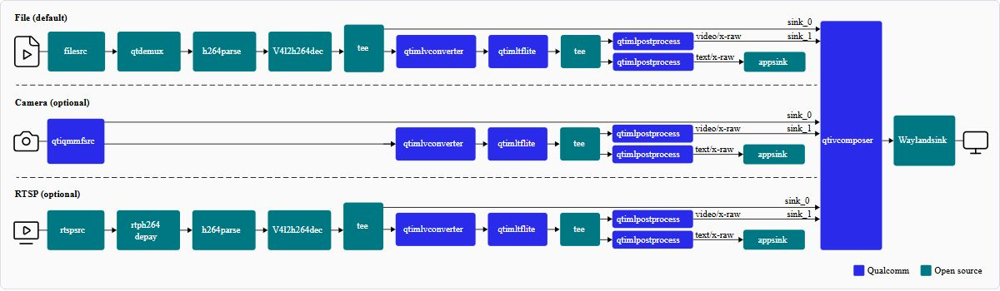

# 02 Qualcomm具身智能软件栈总览

## 核心结论及交付地图

Qualcomm具身软件能力由多套不同生命周期的产品构成。Qualcomm Linux负责板级启动、驱动、执行域和系统更新；QAIRT的QNN/SNPE负责模型转换及目标推理；AI Hub提供模型准备、云设备编译与测量路线；Genie为生成式推理提供会话与缓存接口；Intelligent Multimedia SDK连接相机、图像处理和推理插件；QIR补充ROS节点、机器人示例和仿真交接。RB6上的Cloud AI 100还要使用独立编译器和运行时。把这些名称放入同一框图，只能说明集成方向，不能证明它们的最新版可以任意组合。

本章的六篇独立专题分别核查这些交付边界。正文引用厂商公开API及发行资料；未下载需授权的二进制包，未刷机或运行模型。已取得的官方Markdown是公开文档的完整正文，不能与早先只返回导航的HTML壳等量齐观。静态网页缺少部分依赖已保留记录；本章的检查证明正文、链接及原件可追溯，不证明实机性能与闭环任务成功。

| 层级 | 厂商交付及伙伴责任 | 实际交接对象 | 深挖专题 |
|---|---|---|---|
| 系统 | Qualcomm Linux；板商BSP适配 | manifest、固件、镜像、设备树 | 02A |
| 模型 | QNN/SNPE转换与推理 | 图、DLC、库、context、tensor | 02B |
| 生成式 | AI Hub云工作流、Genie会话 | 模型配置、tokenizer、KV缓存 | 02C |
| 感知 | IM SDK、相机与加速插件 | caps、DMA buffer、metadata | 02D |
| 机器人 | QIR、ROS2及第三方控制接口 | frame、消息、launch、URDF、动作 | 02E |
| 外部卡 | Cloud AI Apps/Platform SDK | QPC、设备buffer、队列与结果 | 02F |

## 版本绑定先于功能选择

Linux1.6资料给出kernel6.6.97、Yocto Scarthgap5.0.11，并区分Base/Custom构建、QSH与不同SoC执行域。构建机Ubuntu22.04和存储要求是主机需求，不能作为机器人内存规格。QIR2.4的预构建路线采用ROS2 Jazzy、Ubuntu24.04 Docker工具链，与通用构建资料中的Humble并非同一环境。IM SDK1.6发行文件又列出不同firmware与manifest组合。实际交付必须以目标板整套发行包为单位，不能从每页挑“最新”数字组成从未发布的系统。[QC_Linux_Release_1_6_MD 原文](https://docs.qualcomm.com/bundle/publicresource/RNO-251013063244/topics/ReleaseNote.md)｜[本地原件](REFERENCES.md#ref-3a9dba7e0f75e302) [QC_QIR_Release_MD 原文](https://docs.qualcomm.com/bundle/publicresource/80-70022-260/topics/robotics-sdk-sep-2025.md)｜[本地原件](REFERENCES.md#ref-dee32c5cacd44e00) [QC_IMSDK_Release_MD 原文](https://docs.qualcomm.com/bundle/publicresource/80-70022-52/topics/qim-sdk-release-1-6.md)｜[本地原件](REFERENCES.md#ref-6fcff00d2f12e95b)

QNN公开API资料标出核心API2.39.0与HTP接口5.50.0，这些是接口版本而非同名完整SDK版本。IM示例使用QAIRT2.38，不能直接更新运行库而保留旧OpPackage与编译缓存。QNN仅保证所述源码兼容方向，ABI及跨HTP架构缓存不保证。软件清单应将宿主工具、目标共享库、DSP stub/skel、固件、算子包、模型权重和配置逐项记录，避免将一行“支持QNN”当成兼容矩阵。[QC_QNN_API_MD 原文](https://docs.qualcomm.com/bundle/publicresource/80-63442-10/topics/api_overview.md)｜[本地原件](REFERENCES.md#ref-882106f8ffc3dd51) [QC_QNN_HTP_MD 原文](https://docs.qualcomm.com/bundle/publicresource/80-63442-10/topics/htp_backend.md)｜[本地原件](REFERENCES.md#ref-6979e07b66066d46)

| 工作流 | 已核验版本或条件 | 不能直接推导的事项 |
|---|---|---|
| Qualcomm Linux1.6 | kernel6.6.97、Scarthgap5.0.11 | 任意板卡固件混装 |
| IM SDK1.6 | 页面中的QAIRT2.38与发行组合 | 自动兼容其他SDK补丁 |
| QIR2.4 | Jazzy预构建、指定板卡及工具链 | 通用Humble示例直接部署 |
| QNN通用API | 核心2.39.0、HTP5.50.0 | API号等于安装包号 |
| Cloud AI文档1.21 | 服务器x86-64/AArch64工作流 | RB6 ARM BSP已验收 |

## 一条模型到观测消息的真实接口链

以目标检测为例，首先从模型来源和权重许可开始，保存输入布局、分辨率、训练归一化与类别表。QNN converter处理模型与校准输入，输出模型源码和常量，再生成目标模型库；也可按后端准备context。图finalize后不应随意更改结构。运行阶段需要正确的Backend、Device、Context、Graph与Tensor对象，输入输出buffer生命周期覆盖异步执行。这条图对象链是模型部署的基础，不负责替上层保证所有算子能自动回退CPU。[QC_QNN_API_MD 原文](https://docs.qualcomm.com/bundle/publicresource/80-63442-10/topics/api_overview.md)｜[本地原件](REFERENCES.md#ref-882106f8ffc3dd51)

相机端qtiqmmfsrc通过QMMF打开相机并分配流；GStreamer caps描述格式和内存。qtimlvconverter将视频转换为模型tensor，其归一化公式是(channel-mean)×sigma，RGB/BGR和外部tensor类型必须与编译图一致。qtimlqnn接图执行，后处理转换模型输出为检测信息，再由metadata parser或appsink供应用读取。converter支持的外部类型与QNN插件caps并不完全相同；HTP支持低精度也不能自动推出插件能接收任意FLOAT16 buffer。[QC_IMSDK_Converter_MD 原文](https://docs.qualcomm.com/bundle/publicresource/80-70022-50/topics/qtimlvconverter.md)｜[本地原件](REFERENCES.md#ref-382fbcc3e4ba0663) [QC_IMSDK_QNN_MD 原文](https://docs.qualcomm.com/bundle/publicresource/80-70022-50/topics/qtimlqnn.md)｜[本地原件](REFERENCES.md#ref-03a3acf203032ea7) [QC_IMSDK_Metadata_MD 原文](https://docs.qualcomm.com/bundle/publicresource/80-70022-50/topics/gst-ai-metadata-parser.md)｜[本地原件](REFERENCES.md#ref-429d624c92606ff7)

官方metadata图已实际打开核验：一条支路生成叠图，一条支路送出文本元数据。它说明推理输出如何进入应用，不显示ROS桥接或动作安全链。ROS-GStreamer bridge与qrb_ros_camera另有公开示例，QIR节点的topic、encoding、frame和消息类型必须再次核对。检测二维框并非机器人坐标中的抓取位姿；需要标定、深度有效性和时间同步，不能把bbox直接交给机械臂。[QC_QIR_Bridge_MD 原文](https://docs.qualcomm.com/bundle/publicresource/80-70022-265/topics/ros-gst-bridge.md)｜[本地原件](REFERENCES.md#ref-1b03f7595198d6d4) [QC_QIR_Camera_MD 原文](https://docs.qualcomm.com/bundle/publicresource/80-70022-265/topics/qrb-ros-camera.md)｜[本地原件](REFERENCES.md#ref-62649bd8184a874b)

## 由观测到动作还缺什么

QIR提供MoveIt2机械臂仿真、AMR Twist消息和follow_me参考应用。开发示例中的camera与converter在不同ComposableNodeContainer，单节点intra_process开关不能证明跨容器零拷贝。机器人节点必须处理原始采集时间、消息排队、frame变换和结果超龄，控制器还需要关节顺序、单位、速度限制与指令失效契约。MoveIt计划完成并不保证真实关节轨迹可执行；上层policy调用频率、controller manager频率和电机伺服频率应分开测量。[QC_QIR_Development_MD 原文](https://docs.qualcomm.com/bundle/publicresource/80-70022-265/topics/develop_pipeline_application.md)｜[本地原件](REFERENCES.md#ref-d73ee7a1e67408e8) [QC_QIR_Pickplace_Simulation_MD 原文](https://docs.qualcomm.com/bundle/publicresource/80-70022-265/topics/simulation_sample_pick_and_place.md)｜[本地原件](REFERENCES.md#ref-874c72ebd299c85f) [QC_QIR_AMR_Simulation_MD 原文](https://docs.qualcomm.com/bundle/publicresource/80-70022-265/topics/simulation_sample_amr_simple_motion.md)｜[本地原件](REFERENCES.md#ref-921d51d8b5cb0dcd)

Genie把tokenizer、context、sampler、engine和ctx-bins联合配置，解决语言模型会话与KV缓存管理。原生KV布局要求量化和形状一致，v68及以下等限制明确。AI Hub模型仓库的默认demo仍可在本地PyTorch CPU/GPU运行，不能据此宣称已走机器人NPU；on-device流程涉及上传到云设备，数据与服务条款需单独核查。本研究没有上传模型或图片。语言推理输出自然语言或结构文本，不自动形成带执行器状态反馈的VLA动作头。[QC_Genie_Dialog_Config_MD 原文](https://docs.qualcomm.com/bundle/publicresource/80-63442-10/topics/dialog_json.md)｜[本地原件](REFERENCES.md#ref-9c7b374f7eeee68b) [QC_Genie_Engine_Config_MD 原文](https://docs.qualcomm.com/bundle/publicresource/80-63442-10/topics/engine_json.md)｜[本地原件](REFERENCES.md#ref-99e9ef27c30cb36d) [QC_AIHub_Models_Repo 原文](https://github.com/qualcomm/ai-hub-models)｜[本地原件](REFERENCES.md#ref-f2f0b5d0785d46a2)

## 多执行域与部署运维

Linux应用域、DSP/HTP、传感器域与实时域的隔离和接口受目标SoC限制。IQ8/IQ9资料中的FreeRTOS二进制路线不能替代IQ10的SafeRTOS或计划SIL3说明。硬件锁步和操作系统能力需要经过本体系统安全论证；Linux推理低延迟不是WCET保证。业务应用可在Linux中进行模型处理，但电机失效保护应独立核对执行域、故障通知、看门狗与最终切断路径。[QC_Linux_Architecture_MD 原文](https://docs.qualcomm.com/bundle/publicresource/80-70022-252/topics/qualcomm-linux-sw-overview.md)｜[本地原件](REFERENCES.md#ref-592aca5269ff92a1) [QC_IQ10_RRD 原文](https://docs.qualcomm.com/doc/87-A0789-1/87-A0789-1_REV_A_Qualcomm_Dragonwing_IQ10_Robotics_Reference_Design_Product_Brief.pdf)｜[本地原件](REFERENCES.md#ref-246d5ca4db6b9bc7)

更新也有两种层级：QIR文档中的colcon构建、tar/scp复制到/usr是开发部署；Qualcomm Linux的OSTree OTA有版本与分区条件。新HLOS搭配旧NonHLOS被明确排除，部分1.5到1.6的eMMC路线不能OTA。模型升级还须同步类别表、输入输出schema、编译缓存、OpPackage和回滚版本。仅回滚程序而保留新缓存或新权重，可形成启动成功而任务错误的隐蔽故障。[QC_Linux_Release_1_6_MD 原文](https://docs.qualcomm.com/bundle/publicresource/RNO-251013063244/topics/ReleaseNote.md)｜[本地原件](REFERENCES.md#ref-3a9dba7e0f75e302)

RB6的外部加速卡额外增加QPC、PCIe driver/firmware、InferenceSet对象与完成归还。Runtime的SetSize提高排队深度，可能提升吞吐却增加观测年龄；共享组内推理被串行化。相机DMA与卡DMABUF存在两个接口，不代表一块内存能够无复制贯通。应按实际buffer可达性和同步契约逐段追踪，再决定CPU/GPU/SoC NPU与外部卡如何分工。[QC_CloudAI_Runtime 原文](https://qualcomm.github.io/cloud-ai-sdk-pages/1.21/Cpp-API/runtime/index.html)｜[本地原件](REFERENCES.md#ref-4a6796d69a449572)

## 可复建与选型结论

放行前建立一套目标SKU的封闭版本清单，记录镜像、kernel、固件、SDK、commit、模型与编译产物哈希。先验证正确性，再分别测单模型推理、多相机预处理、ROS发布、控制输入年龄与动作故障响应。采样覆盖热稳定、背压、丢帧、队列满、服务重启、网络失联和更新回退；平均时延、P99与安全边界分开。每条结果记录是否包含预处理、传输和后处理，不能用NPU kernel毫秒数倒数充当机器人控制频率。

代码、模型权重、数据、二进制SDK、固件和本体接口必须分层验许可。开源示例有利于调试和修改，但不代表授权下载的生产包可自由分发。对于已有Qualcomm相机与移动平台经验的团队，这些接口能够降低复用成本；对于大模型操作或安全工业本体，应把缺失动作头、目标版本兼容、安全附件和持续性能作为采购前证据。当前公开材料支持“存在可集成路线”，仍不能证明某一IQ10整机已完成从多相机到真实任务成功的整套闭环验收。

## 参考资料与归档边界

采集截止：2026-11-05（Asia/Shanghai）。原件通过项目统一下载器登记；官方 Markdown 是厂商提供的原始正文，保留嵌入 SVG/图片数据。HTML 静态壳不作为正文证据。网页依赖缺失按 metadata 记录；不承诺离线交互或像素一致。未执行硬件刷写、模型推理或机器人测试。

| 登记名称 | 版本／适用边界 | 原始资料 | 本地归档 |
|---|---|---|---|
| QC_Linux_Release_1_6_MD | 正文版本及采集时点见本文；未认定为最新 | [原文](https://docs.qualcomm.com/bundle/publicresource/RNO-251013063244/topics/ReleaseNote.md) | [原件](REFERENCES.md#ref-3a9dba7e0f75e302) |
| QC_QIR_Release_MD | 正文版本及采集时点见本文；未认定为最新 | [原文](https://docs.qualcomm.com/bundle/publicresource/80-70022-260/topics/robotics-sdk-sep-2025.md) | [原件](REFERENCES.md#ref-dee32c5cacd44e00) |
| QC_IMSDK_Release_MD | 正文版本及采集时点见本文；未认定为最新 | [原文](https://docs.qualcomm.com/bundle/publicresource/80-70022-52/topics/qim-sdk-release-1-6.md) | [原件](REFERENCES.md#ref-6fcff00d2f12e95b) |
| QC_QNN_API_MD | 正文版本及采集时点见本文；未认定为最新 | [原文](https://docs.qualcomm.com/bundle/publicresource/80-63442-10/topics/api_overview.md) | [原件](REFERENCES.md#ref-882106f8ffc3dd51) |
| QC_QNN_HTP_MD | 正文版本及采集时点见本文；未认定为最新 | [原文](https://docs.qualcomm.com/bundle/publicresource/80-63442-10/topics/htp_backend.md) | [原件](REFERENCES.md#ref-6979e07b66066d46) |
| QC_IMSDK_Converter_MD | 正文版本及采集时点见本文；未认定为最新 | [原文](https://docs.qualcomm.com/bundle/publicresource/80-70022-50/topics/qtimlvconverter.md) | [原件](REFERENCES.md#ref-382fbcc3e4ba0663) |
| QC_IMSDK_QNN_MD | 正文版本及采集时点见本文；未认定为最新 | [原文](https://docs.qualcomm.com/bundle/publicresource/80-70022-50/topics/qtimlqnn.md) | [原件](REFERENCES.md#ref-03a3acf203032ea7) |
| QC_IMSDK_Metadata_MD | 正文版本及采集时点见本文；未认定为最新 | [原文](https://docs.qualcomm.com/bundle/publicresource/80-70022-50/topics/gst-ai-metadata-parser.md) | [原件](REFERENCES.md#ref-429d624c92606ff7) |
| QC_QIR_Bridge_MD | 正文版本及采集时点见本文；未认定为最新 | [原文](https://docs.qualcomm.com/bundle/publicresource/80-70022-265/topics/ros-gst-bridge.md) | [原件](REFERENCES.md#ref-1b03f7595198d6d4) |
| QC_QIR_Camera_MD | 正文版本及采集时点见本文；未认定为最新 | [原文](https://docs.qualcomm.com/bundle/publicresource/80-70022-265/topics/qrb-ros-camera.md) | [原件](REFERENCES.md#ref-62649bd8184a874b) |
| QC_QIR_Development_MD | 正文版本及采集时点见本文；未认定为最新 | [原文](https://docs.qualcomm.com/bundle/publicresource/80-70022-265/topics/develop_pipeline_application.md) | [原件](REFERENCES.md#ref-d73ee7a1e67408e8) |
| QC_QIR_Pickplace_Simulation_MD | 正文版本及采集时点见本文；未认定为最新 | [原文](https://docs.qualcomm.com/bundle/publicresource/80-70022-265/topics/simulation_sample_pick_and_place.md) | [原件](REFERENCES.md#ref-874c72ebd299c85f) |
| QC_QIR_AMR_Simulation_MD | 正文版本及采集时点见本文；未认定为最新 | [原文](https://docs.qualcomm.com/bundle/publicresource/80-70022-265/topics/simulation_sample_amr_simple_motion.md) | [原件](REFERENCES.md#ref-921d51d8b5cb0dcd) |
| QC_Genie_Dialog_Config_MD | 正文版本及采集时点见本文；未认定为最新 | [原文](https://docs.qualcomm.com/bundle/publicresource/80-63442-10/topics/dialog_json.md) | [原件](REFERENCES.md#ref-9c7b374f7eeee68b) |
| QC_Genie_Engine_Config_MD | 正文版本及采集时点见本文；未认定为最新 | [原文](https://docs.qualcomm.com/bundle/publicresource/80-63442-10/topics/engine_json.md) | [原件](REFERENCES.md#ref-99e9ef27c30cb36d) |
| QC_AIHub_Models_Repo | 正文版本及采集时点见本文；未认定为最新 | [原文](https://github.com/qualcomm/ai-hub-models) | [原件](REFERENCES.md#ref-f2f0b5d0785d46a2) |
| QC_Linux_Architecture_MD | 正文版本及采集时点见本文；未认定为最新 | [原文](https://docs.qualcomm.com/bundle/publicresource/80-70022-252/topics/qualcomm-linux-sw-overview.md) | [原件](REFERENCES.md#ref-592aca5269ff92a1) |
| QC_IQ10_RRD | 正文版本及采集时点见本文；未认定为最新 | [原文](https://docs.qualcomm.com/doc/87-A0789-1/87-A0789-1_REV_A_Qualcomm_Dragonwing_IQ10_Robotics_Reference_Design_Product_Brief.pdf) | [原件](REFERENCES.md#ref-246d5ca4db6b9bc7) |
| QC_CloudAI_Runtime | 正文版本及采集时点见本文；未认定为最新 | [原文](https://qualcomm.github.io/cloud-ai-sdk-pages/1.21/Cpp-API/runtime/index.html) | [原件](REFERENCES.md#ref-4a6796d69a449572) |
