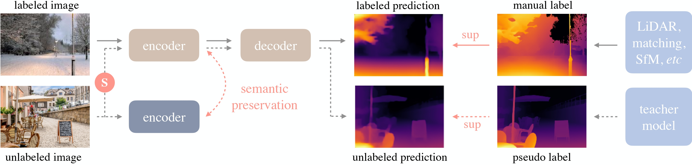

# 04 Qualcomm AI能力与模型地图

## 证据分级与任务分类

具身任务包含感知、语言与多模态理解、空间定位、动作策略、世界建模、学习训练及任务编排。Qualcomm AI Hub目录有大量视觉与语言配方，并已列ACT、π0.5和GR00T N1.5；公开模型卡还提供若干IoT芯片的组件推理数据。这比泛称“支持VLA”更具体，但不能把手机或IQ9075的组件结果归因到IQ10整机，也不能把离线轨迹误差当成真实任务成功率。本文采用截至采集时点的动态网页快照，没有锁定全部仓库commit与权重哈希。[QC_AIHub_Models_Repo 原文](https://github.com/qualcomm/ai-hub-models)｜[本地原件](REFERENCES.md#ref-f2f0b5d0785d46a2)

| 类型／任务 | 精确模型或路线 | 规模／模态与来源 | Qualcomm证据等级 |
|---|---|---|---|
| LLM／任务文本 | Llama3.2-1B/3B-Instruct、Qwen3-0.6B/4B | AI Hub目录；文本 | 官方recipe目录，非本体验收 |
| VLM／空间语言 | Qwen2.5-VL-3B-Instruct | 名称3B；卡统计约4B总量，图像/视频/文本 | 本篇3B上游卡；Hub另列7B，不混版本 |
| 手部视觉 | MediaPipe-Hand-Detection | detector1.76M、landmark2.01M；256×256 | 官方优化卡与目标芯片分项数据 |
| 单目深度 | Depth-Anything-V2-Small-hf | 24.8M，DINOv2+DPT | 上游卡；QIR有V2样例但非同权重证明 |
| VLA操作 | openvla/openvla-7b | 双视觉编码+Llama2；7维末端动作 | 公开上游模型，未取得目标NPU产物 |
| VLA操作 | qualcomm/Pi0.5 | 三相机224²、chunk50、混合量化 | 官方优化卡，IQ8275/IQ9075分组件 |
| VLA操作 | nvidia/GR00T-N1.5-3B | 视觉/文本/本体状态、连续动作chunk | Qualcomm有独立recipe，闭环未知 |

| 类型／任务 | 路线和来源 | 平台关系 | 验证缺口 |
|---|---|---|---|
| 模仿学习 | ACT、LeRobot Diffusion等 | ACT官方recipe；LeRobot第三方 | action schema、数据及目标持续时延 |
| 强化学习／运动 | LeRobot RL路线；本体专用策略 | 第三方训练/控制接口 | 未取得Qualcomm全身策略验收 |
| 世界模型 | Cosmos-Predict2-2B-Video2World | NVIDIA上游，离线研究对照 | 32.54GB GPU VRAM工作流，未见端侧移植 |
| SLAM／导航 | QIR Cartographer 2D LiDAR路线 | 官方集成第三方算法 | 留出轨迹定位误差、真实导航完成 |
| 规划／控制 | MoveIt2、IK、轨迹及Twist | QIR示例与第三方控制栈 | 非学习方法，不误称基础模型 |
| agent／编排 | LLM/Genie文本与应用工具调用 | 自定义任务接口所需 | 权限、状态机、反馈及恢复未交付 |

这些任务有不同输出契约。人体关键点和手部landmark是感知结果，不是机械手关节控制量；单目深度相对预测也不是带米制误差的安全距离。导航地图、运动策略和VLA需要本体状态反馈，不能仅靠相机加语言模型替代。

## 有测量的数据与口径

MediaPipe官方卡给出IQ9075 QNN_DLC float的hand_detector1.126ms、hand_landmark_detector1.629ms；输入256×256，主计算单元NPU，内存范围分别1—4MB。这是分模型profile。卡未在本篇取得的正文中完整列出batch、warmup、功率、迭代、平均/P99及相机预后处理范围；不能将两数直接换算成机器人动作频率，且图像裁剪/多手数量会增加工作量。它列QAIRT2.50及ONNX Runtime1.30.0，明显不同于02中的板级QAIRT2.38与通用API文档，必须核实际产物版本。[QC_HF_Hand 原文](https://huggingface.co/qualcomm/MediaPipe-Hand-Detection)｜[本地原件](REFERENCES.md#ref-fea59436d3cf05e7)

Pi0.5卡明确量化组合：backbone w4a16，vision encoder和action expert w8a16；三相机、224×224、action chunk50。IQ9075 QNN_CONTEXT_BINARY分项为backbone377.948ms、vision_encoder39.759ms、action_expert25.737ms、token_emb3.939ms。不能简单相加或用25.737ms倒数宣称约39Hz策略：视觉分支是否重复三次、action expert迭代次数、缓存复用、串并行和传输未给出完整应用计时。内存表是组件运行测量范围，不是总权重及整套峰值RAM。未列IQ10不能推出不支持，也不能推导其更快多少。[HF_QC_Pi05 原文](https://huggingface.co/qualcomm/Pi0.5)｜[本地原件](REFERENCES.md#ref-5f8734b971a4cbf3)

## VLA的架构、动作与迁移

OpenVLA上游卡描述970K Open X-Embodiment机器人episode训练，视觉来自DINOv2与SigLIP，语言骨干Llama2，输入语言和工作空间图像，输出(x,y,z,roll,pitch,yaw,gripper)归一化末端增量。predict_action使用unnorm_key选择每机器人/数据集统计；BridgeV2/Widow-X示例的bridge_orig不能用于任意人形机器人。卡明确新本体或训练分布外设置不能假定零样本泛化，需要收集示教并微调。MIT发布声明覆盖该模型与训练代码，不自动清除所有训练数据的来源条件。BF16权重示例和CUDA执行也不证明QNN支持自定义remote code与全部算子。[HF_OpenVLA 原文](https://huggingface.co/openvla/openvla-7b)｜[本地原件](REFERENCES.md#ref-5ca893085629869e)

π0.5的openpi上游采用flow-based VLA并提供knowledge insulation路线，目前公开仓库对π0.5训练与推理只支持flow matching head。policy.infer返回action_chunk，示例包含外部与腕部图像、prompt和本体相关数据映射；训练先转换LeRobotDataset、计算normalization statistics，再冻结训练配置与checkpoint。上游Ubuntu22.04、NVIDIA GPU内存建议是其训练/推理栈，不能移植成Qualcomm最低RAM规格。远程WebSocket策略服务可以把大模型放到离机GPU，但增加网络延迟和失联契约。[PI_Openpi_Repo 原文](https://github.com/Physical-Intelligence/openpi)｜[本地原件](REFERENCES.md#ref-0130878e2cb85cf3)

Qualcomm π0.5 demo源码进一步限定了当前例子的实际行为：HF_MODEL_ID为lerobot/pi05_libero_finetuned，数据为HuggingFaceVLA/libero，make_pi05_pre_post_processors使用dataset.meta.stats，Pi05App.predict_action_chunk后执行postprocessor反归一化。main虽构建带ON_DEVICE选项的parser，但随后assert eval_mode==FP并固定CPU。它从首episode拼50步ground truth，短序列重复末步补齐，compute_sequence_metrics按共同T/D截断计算MSE/RMSE/SQNR。由此可核这个demo是离线轨迹比较，不能当作云设备或机器人闭环成功证据。[QC_Pi05_Demo 原文](https://github.com/qualcomm/ai-hub-models/blob/main/src/qai_hub_models/models/pi05/demo.py)｜[本地原件](REFERENCES.md#ref-eb8e342ec0fc4b6c)

GR00T N1.5上游卡描述3B规模、视觉/文本/本体状态、flow matching动作Transformer，按embodiment区分状态与动作映射，连续动作向量维度受本体DOF影响。模型卡内部视觉/文本编码描述有不同表述，本文不据此锁死实际checkpoint模块，而以完整config和源码为复建依据。Qualcomm recipe给qnn_context_binary mixed导出命令并宣称优化适用于Qualcomm设备，却没有本篇取得的IQ10本体成功率。上游卡写“ready for non-commercial use”及NVIDIA License，不能以Hub代码BSD许可推导权重商业自由使用。[HF_GR00TN15 原文](https://huggingface.co/nvidia/GR00T-N1.5-3B)｜[本地原件](REFERENCES.md#ref-e65eec66e2269d4b) [QC_GR00T_Recipe 原文](https://github.com/qualcomm/ai-hub-models/blob/main/src/qai_hub_models/models/grootn15/README.md)｜[本地原件](REFERENCES.md#ref-4f9123cb87ecc138)

ACT recipe明确预测一段未来动作，下载示例为TFLite float，默认demo本地PyTorch，on-device为云目标设备。动作chunk降低逐步模型调用频率，但下层仍应按准确时间步执行、处理重规划与新旧chunk接替。固定chunk长度不是固定伺服频率；丢失新策略时继续执行旧动作的期限也需显式定义。[QC_ACT_Recipe 原文](https://github.com/qualcomm/ai-hub-models/blob/main/src/qai_hub_models/models/act/README.md)｜[本地原件](REFERENCES.md#ref-edf8322050fa7c15)

## 多模态理解、深度和世界预测

Qwen2.5-VL-3B上游支持图像/视频与文本，使用动态分辨率、视频采样与时间mRoPE，ViT的window attention减轻视觉计算。processor min_pixels/max_pixels控制视觉token量，尺寸按28倍数调整；机器人应限制视角数量、分辨率与输出长度。输入长视频理解能力与在线连续观测不是同一计时口径，生成bbox/JSON也仍是图像坐标信息。模型卡中的屏幕agent基准不是机器人规划或抓取成功。该3B卡未完整核定权重许可，商用前需取得对应LICENSE；不能沿用Hub另一个7B版本。[HF_Qwen25VL 原文](https://huggingface.co/Qwen/Qwen2.5-VL-3B-Instruct)｜[本地原件](REFERENCES.md#ref-52ec96785d9c0ae8)

Depth Anything V2 Small卡给DINOv2+DPT、595K合成标注及62M+真实无标签图像路线，标Apache2.0。QIR输出depth_map被API描述为color map，所以应用应明确原浮点预测、归一化显示及米制深度三者。视觉上细节更好不能证明碰撞距离误差更小。[HF_DepthAnythingV2 原文](https://huggingface.co/depth-anything/Depth-Anything-V2-Small-hf)｜[本地原件](REFERENCES.md#ref-1d6182f12b7e083a) [QC_QIR_APIs_MD 原文](https://docs.qualcomm.com/bundle/publicresource/80-70022-265/topics/qir_sdk_api_list.md)｜[本地原件](REFERENCES.md#ref-d217692d5a43ff07)

图为V2模型卡引用的原始Depth Anything训练示意，已实际打开核验，完整展示标注/无标注与teacher监督。它支持半监督深度路线的解释，不是V2精确训练架构图或Qualcomm加速框图。GR00T架构图及部分HF媒体未成功静态归档，缺失已记录，本文没有重造官方图。

Cosmos Predict2 2B卡规定BF16测试、NVIDIA GPU与Linux，给32.54GB GPU VRAM及不同分辨率/生成FPS的单次生成时间，明确空间、运动和物理交互可能不准确。生成视频帧率不是实时预测调用频率，卡中的PBench质量也不是sim-to-real安全证据。当前未取得Qualcomm编译产物，合理用途是离线数据/研究对照，不能当成已部署端侧世界模型。NVIDIA Open Model License还涉及Cosmos使用标识及分发条件，与代码许可分开。[HF_CosmosPredict 原文](https://huggingface.co/nvidia/Cosmos-Predict2-2B-Video2World)｜[本地原件](REFERENCES.md#ref-ecb08884ca728209)

## MLOps与并发验证

LeRobot提供Robot.connect/get_observation/send_action和Policy接口，数据用Parquet加视频/图像并保存状态/动作，有利于统一采集与训练。但统一Python接口并不自动解决电机单位、关节顺序、时钟或保护。代码Apache2.0与各policy权重/示教数据许可分开。训练时按场景与本体划分留出集，保留失败样本及人工介入；发布量化产物应同时验证数值、动作误差、闭环成功和恢复。[HF_LeRobot_Repo 原文](https://github.com/huggingface/lerobot)｜[本地原件](REFERENCES.md#ref-f41f68c5cf0cb6c7)

资源分析需把相机ISP、GPU预处理、NPU视觉编码与策略、CPU消息处理、日志和控制并发纳入。w4权重可减少某段存储，但激活、KV、临时tensor、缓冲与多视角仍占内存。缺失同条件功率与热稳定数据时不输出平台能效排名。部署前冻结准确模型revision、权重/配置/校准数据哈希、BSP/QAIRT/算子包、action schema与normalization statistics；验证热稳定下的policy P99、观测年龄、动作chunk过期及失联降级。本文取得模型和API证据，没有实际训练、下载权重或运行本体。

## 参考资料与归档边界

采集截止：2026-11-05（Asia/Shanghai）。原件通过项目统一下载器登记；官方 Markdown 是厂商提供的原始正文，保留嵌入 SVG/图片数据。HTML 静态壳不作为正文证据。网页依赖缺失按 metadata 记录；不承诺离线交互或像素一致。未执行硬件刷写、模型推理或机器人测试。

| 登记名称 | 版本／适用边界 | 原始资料 | 本地归档 |
|---|---|---|---|
| QC_AIHub_Models_Repo | 正文版本及采集时点见本文；未认定为最新 | [原文](https://github.com/qualcomm/ai-hub-models) | [原件](REFERENCES.md#ref-f2f0b5d0785d46a2) |
| QC_HF_Hand | 正文版本及采集时点见本文；未认定为最新 | [原文](https://huggingface.co/qualcomm/MediaPipe-Hand-Detection) | [原件](REFERENCES.md#ref-fea59436d3cf05e7) |
| HF_QC_Pi05 | 正文版本及采集时点见本文；未认定为最新 | [原文](https://huggingface.co/qualcomm/Pi0.5) | [原件](REFERENCES.md#ref-5f8734b971a4cbf3) |
| HF_OpenVLA | 正文版本及采集时点见本文；未认定为最新 | [原文](https://huggingface.co/openvla/openvla-7b) | [原件](REFERENCES.md#ref-5ca893085629869e) |
| PI_Openpi_Repo | 正文版本及采集时点见本文；未认定为最新 | [原文](https://github.com/Physical-Intelligence/openpi) | [原件](REFERENCES.md#ref-0130878e2cb85cf3) |
| QC_Pi05_Demo | 正文版本及采集时点见本文；未认定为最新 | [原文](https://github.com/qualcomm/ai-hub-models/blob/main/src/qai_hub_models/models/pi05/demo.py) | [原件](REFERENCES.md#ref-eb8e342ec0fc4b6c) |
| HF_GR00TN15 | 正文版本及采集时点见本文；未认定为最新 | [原文](https://huggingface.co/nvidia/GR00T-N1.5-3B) | [原件](REFERENCES.md#ref-e65eec66e2269d4b) |
| QC_GR00T_Recipe | 正文版本及采集时点见本文；未认定为最新 | [原文](https://github.com/qualcomm/ai-hub-models/blob/main/src/qai_hub_models/models/grootn15/README.md) | [原件](REFERENCES.md#ref-4f9123cb87ecc138) |
| QC_ACT_Recipe | 正文版本及采集时点见本文；未认定为最新 | [原文](https://github.com/qualcomm/ai-hub-models/blob/main/src/qai_hub_models/models/act/README.md) | [原件](REFERENCES.md#ref-edf8322050fa7c15) |
| QC_Pi05_Recipe | 正文版本及采集时点见本文；未认定为最新 | [原文](https://github.com/qualcomm/ai-hub-models/blob/main/src/qai_hub_models/models/pi05/README.md) | [原件](REFERENCES.md#ref-87d6bc6a3bae5c97) |
| HF_Qwen25VL | 正文版本及采集时点见本文；未认定为最新 | [原文](https://huggingface.co/Qwen/Qwen2.5-VL-3B-Instruct) | [原件](REFERENCES.md#ref-52ec96785d9c0ae8) |
| HF_DepthAnythingV2 | 正文版本及采集时点见本文；未认定为最新 | [原文](https://huggingface.co/depth-anything/Depth-Anything-V2-Small-hf) | [原件](REFERENCES.md#ref-1d6182f12b7e083a) |
| QC_QIR_APIs_MD | 正文版本及采集时点见本文；未认定为最新 | [原文](https://docs.qualcomm.com/bundle/publicresource/80-70022-265/topics/qir_sdk_api_list.md) | [原件](REFERENCES.md#ref-d217692d5a43ff07) |
| HF_CosmosPredict | 正文版本及采集时点见本文；未认定为最新 | [原文](https://huggingface.co/nvidia/Cosmos-Predict2-2B-Video2World) | [原件](REFERENCES.md#ref-ecb08884ca728209) |
| HF_LeRobot_Repo | 正文版本及采集时点见本文；未认定为最新 | [原文](https://github.com/huggingface/lerobot) | [原件](REFERENCES.md#ref-f41f68c5cf0cb6c7) |
