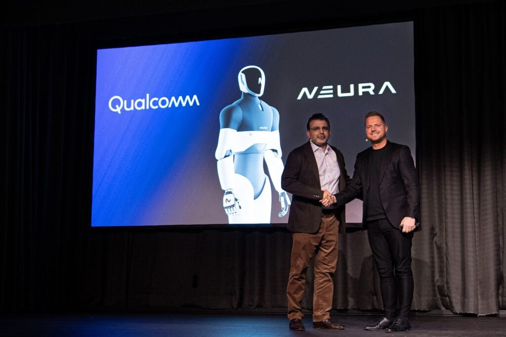

# 06｜Qualcomm 机器人本体适配：从板级接口到商业任务

本章关注“哪台机器人、在什么阶段、用哪套软硬件完成什么任务”，资料截止2026-11-05。公开证据最强的结论是存在真实合作和厂商报告的产品级集成；公开资料仍不足以构建可审计的机队收益、任务成功率或危险响应统计。芯片厂商提供计算和基础软件，不意味着已经交付每个客户的关节控制、安全认证与业务流程。

## 一、案例及成熟度

| 对象 | 官方时间／状态 | 计算关系 | 实际可核范围 | 未取得信息 |
|---|---|---|---|---|
| Thundercomm IRB10／星尘智能 | 2026-07-19，厂商称首次产品级部署 | IRB10，基于IQ10 | 人形机器人集成公告 | 精确本体SKU、台数、任务与收益分母 |
| NEURA／4NE1家族 | 2026-03-09长期合作；产品页现列Gen4 | 合作架构包括IQ10 | 参考架构及软件接口计划 | Gen4 BOM、IQ10交付版本、客户验收 |
| Arduino VENTUNO Q | 产品页同时有预订和available表述 | IQ8275＋STM32H5F5 | MPU/MCU分工与接口 | 具体客户本体、批量供货日期、实时测试 |
| QIR Follow Me | 公开开发样例 | RB3 Gen2参考路线 | Gemini335L＋移动底盘跟随 | 第三方底盘适配、实机闭环统计 |

## 二、IRB10：产品级集成宣称与设计交接

2026-03-10发布页将IRB10定位为机器人计算参考方案，展示原型并预计第二季度提供；到7月19日的WAIC公告，Thundercomm称其首次在星尘智能人形机器人中实现产品级部署。这是两份有时间先后的材料，支持从参考原型走向厂商报告的整机集成，不能由后来公告倒推三月已量产，也不能补出任何型号的销售量。[TC_IRB10_Launch 原文](https://www.thundercomm.com/turbox-irb10-launches-at-embedded-world-2026/)｜[本地原件](REFERENCES.md#ref-dc6accab2b42cd74) [TC_IRB10_WAIC 原文](https://www.thundercomm.com/turbox-irb10-waic/)｜[本地原件](REFERENCES.md#ref-d87b3aecbca07fa5)

这条路线的价值在于把计算板、连接、Ubuntu及机器人SDK打包，减少本体团队逐项做载板和底层适配的工作。不过发布材料的700 TOPS是峰值计算口径，摄像头连接数属于方案接口能力；不能直接解释为视觉策略吞吐或机器人完成任务的速度。发布页“预计缩短3—6个月”“底层适配调试成本降低超过50%”缺少客户样本、原方案、人员成本与验收口径，本文仅标为厂商预期。采购时应把其中可交付的BSP、驱动、设备树、固件、示例源码与技术支持时限逐项写入清单，再用自身里程碑测量节省的工程时间。

板卡接口也有版本边界。早期IRB10材料列1000BASE-T1与CAN-MCU接口；IQ10 RRD后续资料列主计算域以太网、SAIL网络和native／外部SPI扩展CAN-FD。两份不是同一块载板的统一接口表，不能把连接器、电气标准和总线数量拼成一张机器人BOM。真正交接须追踪SoC控制器→外部PHY或桥接→连接器→电机驱动器→线束终端，并核查隔离、错误计数、总线负载和供电故障传播。[QC_IQ10_RRD 原文](https://docs.qualcomm.com/doc/87-A0789-1/87-A0789-1_REV_A_Qualcomm_Dragonwing_IQ10_Robotics_Reference_Design_Product_Brief.pdf)｜[本地原件](REFERENCES.md#ref-246d5ca4db6b9bc7)

## 三、NEURA：合作架构不能代替4NE1代际认证

NEURA的2026-03-09公告把合作描述为“Brain + Nervous System”参考架构，结合Dragonwing（包括IQ10）与NEURA机器人硬件及具身软件，计划建立标准化runtime和部署接口。Neuraverse的仿真、训练、编排与生命周期功能在文中采用anticipated等未来表述；开发者市场亦属计划。机器人手臂、移动、服务、家用和人形产品可能成为参考平台，不是已经装配指定芯片的逐型号列表。[NEURA_Qualcomm_Collaboration 原文](https://neura-robotics.com/neura-qualcomm-collaboration/)｜[本地原件](REFERENCES.md#ref-351500d7acaf3f85)

当前4NE1页面首段已经介绍Gen4：厂商称其在NEURA Gyms运行并准备系列生产，NEURON AI在机器人本地运行，重量较前代降低20%。页面同时保留180cm、80kg、10—20kg payload、5km/h等规格块及Mini“Spring 2026”预订文案。本文保留这些页面内部年代与对象边界，不能确认下方规格全部专属于Gen4，也不能把Mini预订时间理解为实际交付。页面的本地多模态模型声明没有公布模型结构、计算BOM、功率和闭环基准，因此“本地运行”不等于“已核实IQ10上运行”。[NEURA_4NE1 原文](https://neura-robotics.com/products/4ne1/)｜[本地原件](REFERENCES.md#ref-35c1f1e8014cfbed)

图为官方合作公告照片，包含双方背景和机器人展示，已实际打开核验。它帮助确认合作公告的场景，不能证明图中本体安装IQ10、通过功能安全认证或已经客户验收。网页FAQ包含模板占位回答，这些段落不进入事实结论。

## 四、VENTUNO Q与QIR：可落地的接口仍需本体工程

VENTUNO Q明确给出IQ8275负责高层计算、STM32H5F5负责实时控制，两者通过RPC协作，Ubuntu与Zephyr分域。这是与关节执行相关的具体架构，比只说“支持机器人”更可用。但厂商的低于1ms和zero-jitter表述没有提供最坏执行时间、RPC包尺寸、总线仲裁与并发热状态；不能当作整条动作链硬实时证明。连接CAN时还要区分已有PHY和只有控制信号的接口，不能把所有引脚都算独立可用工业总线。App Lab降低应用拼接门槛，Works with Arduino认证的零代码迁移也需要落在其认证范围，不能外推任意机器人无需改动。[Arduino_Ventuno 原文](https://www.arduino.cc/product-ventuno-q)｜[本地原件](REFERENCES.md#ref-4c389d446211ac9a)

QIR Follow Me提供更明确的应用交接：Gemini335L采集人像，感知和跟踪生成移动意图，再交给移动底盘执行。样例使用RB3 Gen2参考路线，第三方底盘需要适配；部分源码面向authorized users，公开说明不足以替代完整可复建仓库。示例只跟随人，关闭超声保护之类的演示参数不是产品上线建议。它能证明开发路径存在，不能证明仓储在人流、反光、遮挡和失联下的成功率。[QC_QIR_Follow_MD 原文](https://docs.qualcomm.com/bundle/publicresource/80-70022-265/topics/followme.md)｜[本地原件](REFERENCES.md#ref-9b3625fa1813a0a2)

## 五、动作与故障契约：计算结果到电机之间的关键空隙

集成时第一份契约应是观测：相机标定、frame树、关节顺序、角度单位、时间戳来源及最大观测年龄。第二份是动作：策略输出的是末端位姿增量、关节目标还是速度，坐标在world／base／tool哪一层，horizon是否包含旧观测，关节限制和夹爪单位如何转换。VLA一次产生动作chunk，并不决定电机伺服周期；需要轨迹插值、IK、碰撞检查和本体控制器处理。以上是工程验收建议，不是已验证的IQ10客户实现。

第三份契约是失效：每条命令带序号、有效期和时间基准，接收端处理过期、乱序、重复和断流；关节驱动器与安全控制器定义减速、保持、制动或受控停车。上层停止发布不能保证下层不继续执行旧轨迹。CPU高负载、相机断开、NPU超时、总线bus-off、OTA失败和供电跌落应逐项注入，检查谁具有停止权限以及恢复是否需要人工确认。将安全岛与应用CPU分开有利于限制故障传播，但只有在供电、看门狗、通信和执行器响应都被验证后才形成系统保护。

IQ10材料中的SafeRTOS、lockstep及planned SIL3描述体现架构意图，不能写成已取得SIL3证书，更不能推导整机符合某项协作机器人标准。应索取准确SoC版本的安全手册、认证范围、诊断覆盖、失效假设与本体风险评估；普通Linux／ROS节点、语言理解和柔顺动作不自动进入认证边界。[QC_IQ10_Brief 原文](https://docs.qualcomm.com/doc/87-A2811-1/87-A2811-1_REV_B_Qualcomm_Dragonwing_IQ10_Series_Platform_Product_Brief.pdf)｜[本地原件](REFERENCES.md#ref-6e5c94a7707cae4b)

## 六、商业收益的可复建验收

| 层次 | 当前证据 | 放行所需实证 |
|---|---|---|
| 板级适配 | SDK、接口与参考设计 | 固定BSP／固件／源码、接线和产测记录 |
| 任务闭环 | 厂商整机集成公告、开发样例 | 尝试次数、成功定义、失败分布、人工介入 |
| 运营收益 | 未取得客户成本与暴露时间 | 地点、在岗台数、工作小时、备件和停机成本 |

商业评估建议把搬运、整理或跟随定义成可重复任务集合，分别记录首次部署成本和持续运营成本。与旧方案比较时控制本体、负载、路线、照明、操作员与软件版本；计入每小时任务数、失败恢复时长、人工接管比例和整机电耗。原型跑通后的二次标定、现场网络、备件、模型更新及安全复验均可能吞掉板级计算优势。本文没有取得可归因于IQ10或IQ8275的独立客户收益测量，也未取得星尘智能在岗台数和NEURA系列生产交付清单，因此不给ROI或商业规模排名。

## 参考资料与归档边界

采集截止：2026-11-05（Asia/Shanghai）。原件通过项目统一下载器登记；官方 Markdown 是厂商提供的原始正文，保留嵌入 SVG/图片数据。HTML 静态壳不作为正文证据。网页依赖缺失按 metadata 记录；不承诺离线交互或像素一致。未执行硬件刷写、模型推理或机器人测试。

| 登记名称 | 版本／适用边界 | 原始资料 | 本地归档 |
|---|---|---|---|
| TC_IRB10_Launch | 正文版本及采集时点见本文；未认定为最新 | [原文](https://www.thundercomm.com/turbox-irb10-launches-at-embedded-world-2026/) | [原件](REFERENCES.md#ref-dc6accab2b42cd74) |
| TC_IRB10_WAIC | 正文版本及采集时点见本文；未认定为最新 | [原文](https://www.thundercomm.com/turbox-irb10-waic/) | [原件](REFERENCES.md#ref-d87b3aecbca07fa5) |
| QC_IQ10_RRD | 正文版本及采集时点见本文；未认定为最新 | [原文](https://docs.qualcomm.com/doc/87-A0789-1/87-A0789-1_REV_A_Qualcomm_Dragonwing_IQ10_Robotics_Reference_Design_Product_Brief.pdf) | [原件](REFERENCES.md#ref-246d5ca4db6b9bc7) |
| NEURA_Qualcomm_Collaboration | 正文版本及采集时点见本文；未认定为最新 | [原文](https://neura-robotics.com/neura-qualcomm-collaboration/) | [原件](REFERENCES.md#ref-351500d7acaf3f85) |
| NEURA_4NE1 | 正文版本及采集时点见本文；未认定为最新 | [原文](https://neura-robotics.com/products/4ne1/) | [原件](REFERENCES.md#ref-35c1f1e8014cfbed) |
| Arduino_Ventuno | 正文版本及采集时点见本文；未认定为最新 | [原文](https://www.arduino.cc/product-ventuno-q) | [原件](REFERENCES.md#ref-4c389d446211ac9a) |
| QC_QIR_Follow_MD | 正文版本及采集时点见本文；未认定为最新 | [原文](https://docs.qualcomm.com/bundle/publicresource/80-70022-265/topics/followme.md) | [原件](REFERENCES.md#ref-9b3625fa1813a0a2) |
| QC_IQ10_Brief | 正文版本及采集时点见本文；未认定为最新 | [原文](https://docs.qualcomm.com/doc/87-A2811-1/87-A2811-1_REV_B_Qualcomm_Dragonwing_IQ10_Series_Platform_Product_Brief.pdf) | [原件](REFERENCES.md#ref-6e5c94a7707cae4b) |
