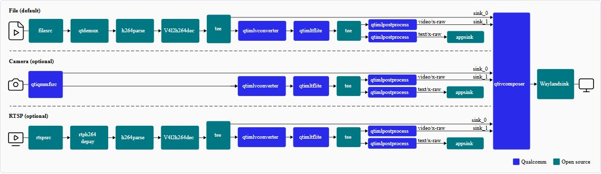

# 08｜Qualcomm核心技术护城河：能力组合、迁移资产和成立条件

Qualcomm具身平台的可证实价值是片上异构计算、摄像头与多媒体处理、模型部署工具、系统软件和伙伴交付路线的组合。护城河不能用单个峰值TOPS、伙伴Logo或机器人照片表达；需要解释哪项成本被降低、依赖哪些版本和资产、在什么任务下失效。本文是三个独立专题的结论地图，具体API、数值、buffer和隔离机制见相应文件；旧08_Proprietary_Technologies.md保留为历史首轮稿，不作为本次完成版。

## 一、专题与能力交接

| 专题 | 核心对象 | 可解释的收益 | 成立条件 | 主要限制 |
|---|---|---|---|---|
| 08A异构编译 | Graph、QDQ、context、VTCM | 减少CPU计算、重复准备及常量内存 | 算子与目标backend、有效校准 | 动态shape、缓存、并发与授权 |
| 08B传感器内存 | GstBuffer、DMA、fence、ROS | 降低复制和应用拼接成本 | 分配器／格式／同步全链兼容 | 转换、序列化、积压与时间域 |
| 08C安全实时域 | RTSS、VM、安全岛、更新集合 | 隔离应用与控制职责、限制故障传播 | 开放SDK、资源权限与系统验证 | planned认证、WCET、执行器链 |

独立文件为08A_Heterogeneous_Compilation.md、08B_Sensor_Memory_Pipeline.md和08C_Real_Time_Safety_Domains.md；索引另给绝对链接、证据与QA入口。总览不是把三篇的机制缩写成技术名列表，而是说明能力怎样组合，以及组合过程中哪些责任留给开发者。

## 二、部署资产使硬件能力可被重复利用

QNN把训练模型转换为图构建代码、权重或DLC入口，后端prepare／finalize形成可执行context。离线缓存减少重复构图的机会，统一Backend／Device／Context／Graph／Tensor接口让应用有一个共同资源管理入口。这类资产的长期价值在于开发团队可沉淀算子映射、校准集、输入契约和profile，而不只是某次生成的binary。缓存仍绑定架构与配置，API统一不保证所有backend同样支持，QNN低层也不负责任意CPU回退。[QC_QNN_API_MD 原文](https://docs.qualcomm.com/bundle/publicresource/80-63442-10/topics/api_overview.md)｜[本地原件](REFERENCES.md#ref-882106f8ffc3dd51) [QC_QNN_HTP_MD 原文](https://docs.qualcomm.com/bundle/publicresource/80-63442-10/topics/htp_backend.md)｜[本地原件](REFERENCES.md#ref-6979e07b66066d46)

上层ORT QNN EP进一步提供ONNX接入、分区、QDQ及缓存封装，降低通用框架集成成本。其固定shape、LoRA与backend选项均有边界；Model requirements和FP16选项的叙述还包含不同版本功能，必须锁定包组合。相比简单把训练模型拷到端侧，开发者得到更多优化控制，也承担对象生命周期、内存与异常恢复责任。优化工作可能形成工程积累，但本文没有公开证据证明独占算法专利、平台切换成本金额或无法复制的性能优势。[ORT_QNN_EP 原文](https://onnxruntime.ai/docs/execution-providers/QNN-ExecutionProvider.html)｜[本地原件](REFERENCES.md#ref-27112b5d3b433cdd)

官方AI Hub模型卡已覆盖Pi0.5等VLA组件，说明平台优化范围开始触及操作策略。Pi0.5在IQ9075的backbone、vision、action与token处理数据是分组件profile，不能拼成完整策略频率；demo中的FP／CPU断言又说明离线评估入口不是全链NPU闭环演示。编译及组件benchmark是部署证据的一层，任务成功还需要数据归一化、本体状态和动作反归一化、控制接口及真实试验。[HF_QC_Pi05 原文](https://huggingface.co/qualcomm/Pi0.5)｜[本地原件](REFERENCES.md#ref-5f8734b971a4cbf3) [QC_Pi05_Demo 原文](https://github.com/qualcomm/ai-hub-models/blob/main/src/qai_hub_models/models/pi05/demo.py)｜[本地原件](REFERENCES.md#ref-eb8e342ec0fc4b6c)

## 三、片上多媒体路径的系统价值

当机器人有多相机、编码和视觉模型时，ISP／VPU／GPU转换及NPU推理可分担CPU负载。IM SDK以GStreamer模块连接输入、转换、推理和后处理，应用可替换相机、文件或RTSP入口，降低重复写采集与展示逻辑的成本。价值在工作负载同时用到这些模块时更明显；如果任务只有低速单传感器或模型计算主导，集成多媒体路径未必是决定因素。[QC_IMSDK_Metadata_MD 原文](https://docs.qualcomm.com/bundle/publicresource/80-70022-50/topics/gst-ai-metadata-parser.md)｜[本地原件](REFERENCES.md#ref-429d624c92606ff7) [QC_IMSDK_Converter_MD 原文](https://docs.qualcomm.com/bundle/publicresource/80-70022-50/topics/qtimlvconverter.md)｜[本地原件](REFERENCES.md#ref-382fbcc3e4ba0663)

官方图再次完整打开核验，展示三种输入与Qualcomm／开源插件分工。线条描述逻辑数据流，不证明每段共享同一buffer，更未画出闭环控制。用这张图应询问哪一段实际转换、复制、排队和发布，而不是将图的直连线理解为低延迟保证。

DMA共享框架提供设备可达内存与异步访问同步，缓存一致性和所有权仍要单独管理。与普通CPU图像数组接口相比，它可能减少边界复制，但若张量布局、stride、量化或格式变化，产生新buffer仍是必要工作。实际技术优势需要通过复制次数、内存流量、观测年龄及持续功耗证明；图像显示帧率高不保证动作使用的是最新观测。[Linux_DMA_Buf 原文](https://docs.kernel.org/driver-api/dma-buf.html)｜[本地原件](REFERENCES.md#ref-d9042c814da994ac)

## 四、多域设计的潜力与交付边界

IQ10 RRD给主域／SAIL网络、CAN-FD和EtherCAT等接口，配合安全岛为控制分工提供硬件基础；brief的SafeRTOS、lockstep及planned SIL3是重要设计信息。本文没有取得已完成认证、安全手册及整机危险响应最坏时间，故安全能力只能写成架构潜力和待验收条件。相同系列的可编程性也必须逐SKU核验：QLI架构文档描述IQ8275／9075 RTSS的FreeRTOS binary-only当前功能限于初始化，不能把硬件存在写成用户控制SDK已交付。[QC_IQ10_RRD 原文](https://docs.qualcomm.com/doc/87-A0789-1/87-A0789-1_REV_A_Qualcomm_Dragonwing_IQ10_Robotics_Reference_Design_Product_Brief.pdf)｜[本地原件](REFERENCES.md#ref-246d5ca4db6b9bc7) [QC_IQ10_Brief 原文](https://docs.qualcomm.com/doc/87-A2811-1/87-A2811-1_REV_B_Qualcomm_Dragonwing_IQ10_Series_Platform_Product_Brief.pdf)｜[本地原件](REFERENCES.md#ref-6e5c94a7707cae4b) [QC_Linux_Architecture_MD 原文](https://docs.qualcomm.com/bundle/publicresource/80-70022-252/topics/qualcomm-linux-sw-overview.md)｜[本地原件](REFERENCES.md#ref-592aca5269ff92a1)

Gunyah公开Type1核心及Stage2内存、VCPU调度、中断与设备虚拟化机制，能解释权限隔离；生产配置、resource manager策略和安全认证仍是另一个资产层。网络、DMA、共享RAM和电源可能跨域传播干扰，Linux PREEMPT_RT也只改变部分不可抢占路径，不给整机WCET。多域优势最终取决于执行器具有明确停止权限，以及故障、更新和复位不会继续旧动作。[QC_Gunyah_Repo 原文](https://github.com/quic/gunyah-hypervisor)｜[本地原件](REFERENCES.md#ref-cb62fd0fb60b5b95) [Linux_PREEMPT_RT 原文](https://docs.kernel.org/core-api/real-time/differences.html)｜[本地原件](REFERENCES.md#ref-74547944cdb4b513)

## 五、与同类平台比较应迁移什么

| 比较对象 | 同类问题 | 可迁移资产 | 需要重做 |
|---|---|---|---|
| QNN／TensorRT类编译runtime | 模型执行、图优化与缓存 | ONNX、校准／留出集、输入契约 | 算子、精度、产物、调度及profile |
| IM SDK／ROS设备buffer路线 | 多媒体与消息交接 | 标定、topic语义、frame与时间规则 | 分配器、格式和同步桥接 |
| 片内域／外部MCU | 控制与应用职责隔离 | 动作有效期、状态机和故障定义 | 总线、权限、安全手册与认证 |

TensorRT同样要求逐算子支持和序列化版本兼容，CUDA／MIG等资源机制也有硬件与隔离边界；无法由其数据中心能力判断任意端侧板卡。NVIDIA官方NITROS仓库当前快照又显示向ROS2 Lyrical的rosidl::Buffer／CUDA backend迁移，说明成熟生态同样有源码迁移成本。比较应把版本和部署目标固定，而不是把某家当前工具与另一家历史API对照后宣称领先。[NV_TensorRT_Architecture 原文](https://docs.nvidia.com/deeplearning/tensorrt/latest/architecture/architecture-overview.html)｜[本地原件](REFERENCES.md#ref-d4c513c2460d0b2a) [NV_NITROS_Repo 原文](https://github.com/NVIDIA-ISAAC-ROS/isaac_ros_nitros)｜[本地原件](REFERENCES.md#ref-593e70f23cdc38f4)

## 六、护城河的可检验边界

最值得沉淀的是三类资产：目标模型的编译与校准流程、相机到动作的时间和内存契约、量产镜像及故障恢复矩阵。它们降低团队重复Bring-up与现场定位成本，并且能在更换模组伙伴或同系列芯片时部分复用。但训练数据、模型许可、闭源runtime再分发和生产固件权限会限制复用范围；代码公开不能覆盖权重与本体SDK。

放行建议先验证模型准确与可编译，再验证单路感知，之后加入多相机、并发模型、通信和日志，最后进行实机闭环及故障注入。每一步留存准确SKU、BSP／固件、编译器runtime、模型hash、功率热状态与统计口径。只有这些证据支持具体任务时，才把平台优势写成吞吐、能耗、开发时间或运营收益。本文完成官方机制与资料核查，没有进行实机或独立性能测量，未取得市占率、排他性IP或可归因机器人ROI；这些缺口限制商业护城河结论。

## 参考资料与归档边界

采集截止：2026-11-05（Asia/Shanghai）。原件通过项目统一下载器登记；官方 Markdown 是厂商提供的原始正文，保留嵌入 SVG/图片数据。HTML 静态壳不作为正文证据。网页依赖缺失按 metadata 记录；不承诺离线交互或像素一致。未执行硬件刷写、模型推理或机器人测试。

| 登记名称 | 版本／适用边界 | 原始资料 | 本地归档 |
|---|---|---|---|
| QC_QNN_API_MD | 正文版本及采集时点见本文；未认定为最新 | [原文](https://docs.qualcomm.com/bundle/publicresource/80-63442-10/topics/api_overview.md) | [原件](REFERENCES.md#ref-882106f8ffc3dd51) |
| QC_QNN_HTP_MD | 正文版本及采集时点见本文；未认定为最新 | [原文](https://docs.qualcomm.com/bundle/publicresource/80-63442-10/topics/htp_backend.md) | [原件](REFERENCES.md#ref-6979e07b66066d46) |
| ORT_QNN_EP | 正文版本及采集时点见本文；未认定为最新 | [原文](https://onnxruntime.ai/docs/execution-providers/QNN-ExecutionProvider.html) | [原件](REFERENCES.md#ref-27112b5d3b433cdd) |
| HF_QC_Pi05 | 正文版本及采集时点见本文；未认定为最新 | [原文](https://huggingface.co/qualcomm/Pi0.5) | [原件](REFERENCES.md#ref-5f8734b971a4cbf3) |
| QC_Pi05_Demo | 正文版本及采集时点见本文；未认定为最新 | [原文](https://github.com/qualcomm/ai-hub-models/blob/main/src/qai_hub_models/models/pi05/demo.py) | [原件](REFERENCES.md#ref-eb8e342ec0fc4b6c) |
| QC_IMSDK_Metadata_MD | 正文版本及采集时点见本文；未认定为最新 | [原文](https://docs.qualcomm.com/bundle/publicresource/80-70022-50/topics/gst-ai-metadata-parser.md) | [原件](REFERENCES.md#ref-429d624c92606ff7) |
| QC_IMSDK_Converter_MD | 正文版本及采集时点见本文；未认定为最新 | [原文](https://docs.qualcomm.com/bundle/publicresource/80-70022-50/topics/qtimlvconverter.md) | [原件](REFERENCES.md#ref-382fbcc3e4ba0663) |
| Linux_DMA_Buf | 正文版本及采集时点见本文；未认定为最新 | [原文](https://docs.kernel.org/driver-api/dma-buf.html) | [原件](REFERENCES.md#ref-d9042c814da994ac) |
| QC_IQ10_RRD | 正文版本及采集时点见本文；未认定为最新 | [原文](https://docs.qualcomm.com/doc/87-A0789-1/87-A0789-1_REV_A_Qualcomm_Dragonwing_IQ10_Robotics_Reference_Design_Product_Brief.pdf) | [原件](REFERENCES.md#ref-246d5ca4db6b9bc7) |
| QC_IQ10_Brief | 正文版本及采集时点见本文；未认定为最新 | [原文](https://docs.qualcomm.com/doc/87-A2811-1/87-A2811-1_REV_B_Qualcomm_Dragonwing_IQ10_Series_Platform_Product_Brief.pdf) | [原件](REFERENCES.md#ref-6e5c94a7707cae4b) |
| QC_Linux_Architecture_MD | 正文版本及采集时点见本文；未认定为最新 | [原文](https://docs.qualcomm.com/bundle/publicresource/80-70022-252/topics/qualcomm-linux-sw-overview.md) | [原件](REFERENCES.md#ref-592aca5269ff92a1) |
| QC_Gunyah_Repo | 正文版本及采集时点见本文；未认定为最新 | [原文](https://github.com/quic/gunyah-hypervisor) | [原件](REFERENCES.md#ref-cb62fd0fb60b5b95) |
| Linux_PREEMPT_RT | 正文版本及采集时点见本文；未认定为最新 | [原文](https://docs.kernel.org/core-api/real-time/differences.html) | [原件](REFERENCES.md#ref-74547944cdb4b513) |
| NV_TensorRT_Architecture | 正文版本及采集时点见本文；未认定为最新 | [原文](https://docs.nvidia.com/deeplearning/tensorrt/latest/architecture/architecture-overview.html) | [原件](REFERENCES.md#ref-d4c513c2460d0b2a) |
| NV_NITROS_Repo | 正文版本及采集时点见本文；未认定为最新 | [原文](https://github.com/NVIDIA-ISAAC-ROS/isaac_ros_nitros) | [原件](REFERENCES.md#ref-593e70f23cdc38f4) |
