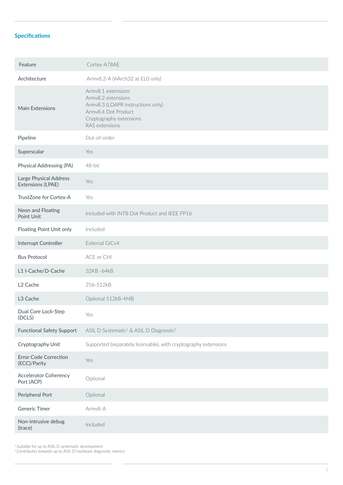
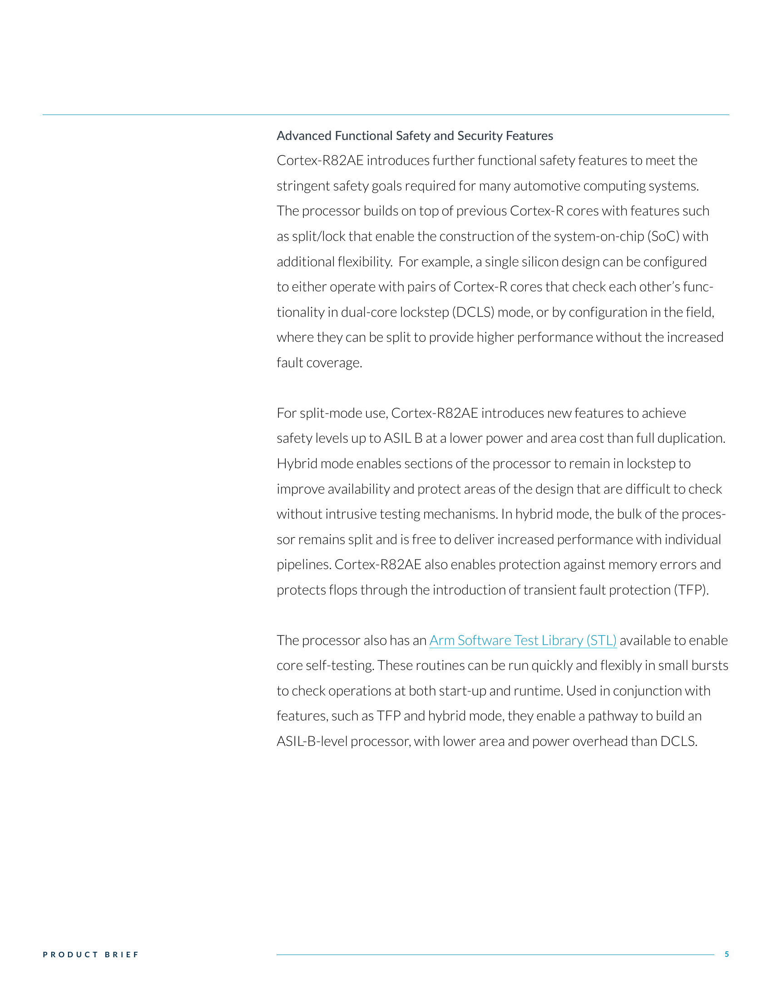
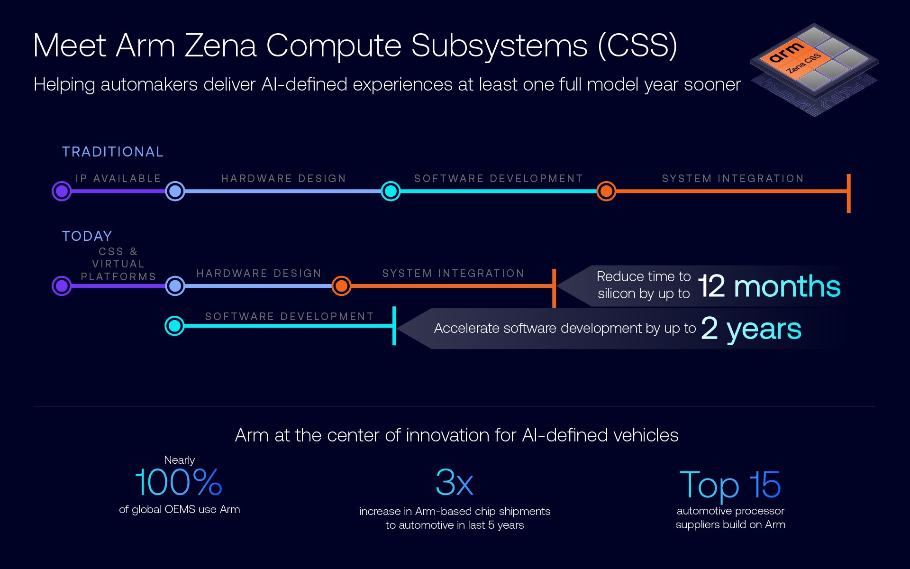
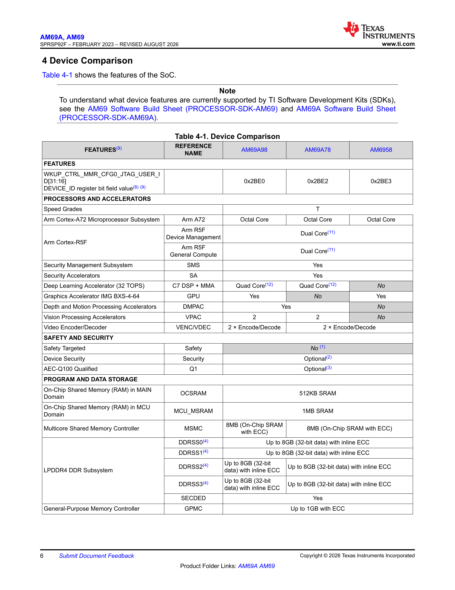
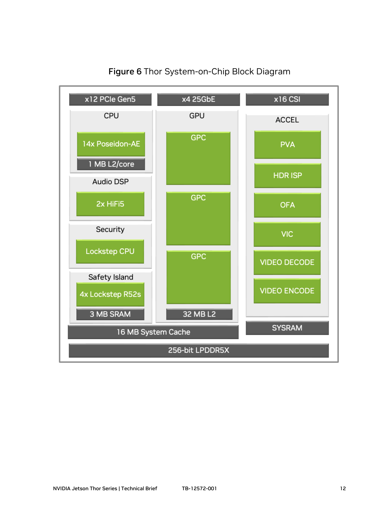
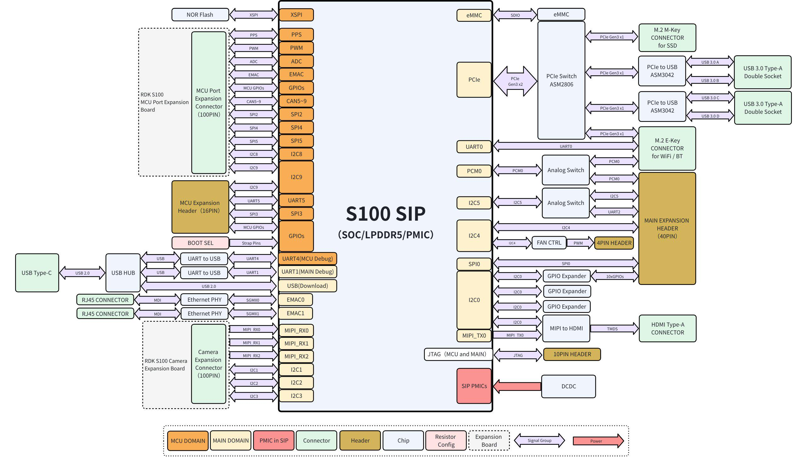
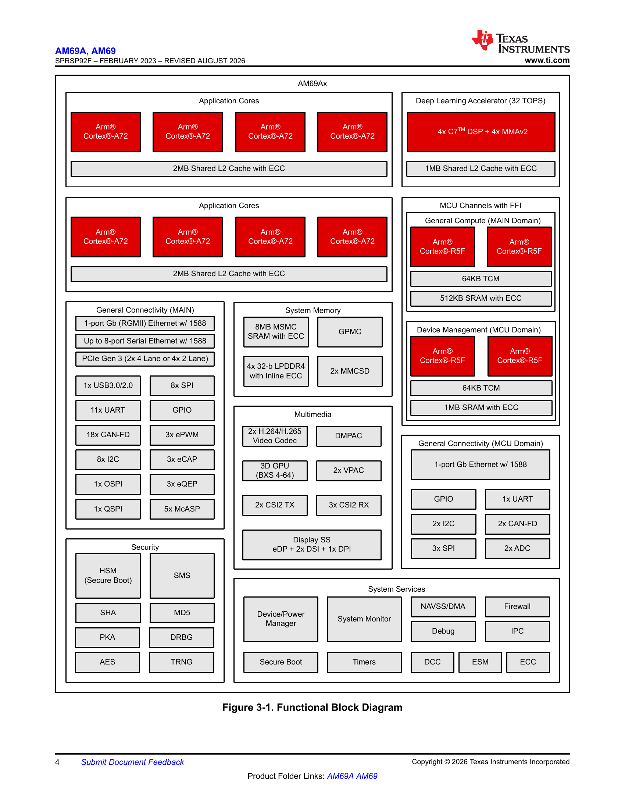
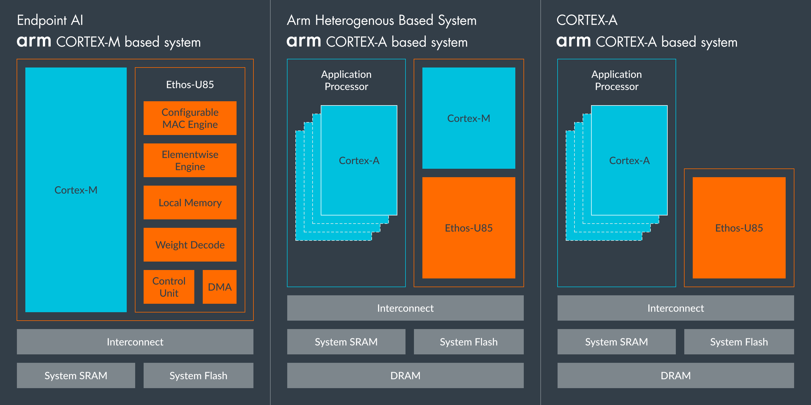

# Arm 具身智能软硬件平台调研：01 硬件平台

数据截止：2026-11-04（Asia/Shanghai）。本章为公开资料深度样章，待用户审阅。只完成01，既有02—09仍是首轮概述，未作为本轮深度成果。规格事实、厂商宣称、工程分析与证据缺口分别标注；未进行硬件、模型或机器人实机测试。

## 1. 研究结论与平台边界

**Arm 的具身平台必须分层选择：架构与处理器IP、预集成计算子系统、合作伙伴SoC、SOM/开发板及整机，具有不同交付责任。** 当前机器人官网明确把 Zena CSS、AE技术、Cortex-R、Cortex-M、安全与网络安全作为技术基础；这支持其围绕异构计算、实时控制和系统集成的定位，不证明 Arm 提供了统一机器人控制器或统一推理性能。2026-09-08的公告把 Total Design 扩展到 Physical AI，并提出共同描述机器人能力的框架；这些是架构与生态进展，不能当作已量产机器人的数量、认证或闭环收益。[S18](https://www.arm.com/markets/robotics) [S17](https://newsroom.arm.com/news/arm-total-design-and-robotics-capability-framework-for-physical-ai)

旧版“Arm只做IP、不出售芯片”的绝对判断需要更新。2026-03-24发布公告及当前 Arm AGI CPU 官方页明确称其为 Arm 首款 production silicon，并列出三个服务器CPU SKU。因此，准确表述是：**本章调查的机器人端侧主要通过Arm IP/CSS和芯片伙伴实现；Arm也进入了自研服务器CPU产品，但AGI CPU不是已核验的机器人SOM。** 发布时厂商称早期系统已可用、更广供货预计2026下半年；本章未核订单交期。它可进入云端任务编排和数据处理的候选边界，不能因为采用同一ISA而替代端侧控制、安全岛或GPU训练加速器。[S02](https://www.arm.com/products/cloud-datacenter/arm-agi-cpu) [S03](https://newsroom.arm.com/news/arm-agi-cpu-launch)

对近期机器人项目，最具体的采购对象仍是 Jetson Thor/Orin、地瓜 RDK S100/S100P、TI AM69A/TDA4VM 等产品。本章选择它们是为了解释同一Arm生态如何形成不同计算与控制架构，并非覆盖所有授权芯片商，也不构成品牌性能排名。NVIDIA的AI峰值属于其GPU/DLA，地瓜属于Nash BPU，TI属于MMA；都不能写成“Arm CPU TOPS”。[S27](https://www.nvidia.com/en-us/autonomous-machines/embedded-systems/jetson-thor/) [S26](https://www.nvidia.com/en-us/autonomous-machines/embedded-systems/jetson-orin/) [S22](https://raw.githubusercontent.com/D-Robotics/rdk_doc/main/docs_s/01_Quick_start/01_hardware_introduction/01_rdk_s100.md) [S33](https://www.ti.com/lit/gpn/AM69A) [S36](https://www.ti.com/lit/gpn/TDA4VM)

| 层级及对象 | 实际交付/研究对象 | 关键责任主体 | 可以支持的判断 | 尚不能支持的判断 |
|---|---|---|---|---|
| 架构及CPU/GPU/NPU IP | ISA、核、系统IP、设计资料 | Arm及其授权合同 | 指令、隔离、实时与安全机制能力边界 | 统一制程、功耗、接口插座或价格 |
| Zena CSS | 预集成计算子系统及参考软件/模型 | Arm交付包与芯片设计商 | 减少CPU/安全/系统集成工作 | 现货模组、完整传感器链、整机认证 |
| SoC：TI AM69A/TDA4VM、S100 | 具体芯片及芯片商SDK | 芯片商 | 核配置、控制器、加速器、封装 | 任意载板所有控制器都已引出 |
| SOM：Jetson T5000/T4000、Orin | 芯片＋DRAM＋模组连接器等 | NVIDIA与渠道 | SKU内存、热设计、模组接口 | 开发套件或整机环境/功耗等同模组 |
| 板级：RDK S100/S100P、SK-AM69 | 核心板/SoC＋载板＋实际连接器 | 地瓜、TI及集成商 | 明确插座、供电、原型开发入口 | 量产寿命、机器人任务成功率 |
| 服务器：Arm AGI CPU | 服务器CPU及伙伴服务器 | Arm、服务器厂商 | 云端编排候选及公开SKU | 端侧安全控制器或VLA闭环性能 |

表中层级判断依据为各产品实际页面和手册，商业责任分工为工程分析。机器人开发者通常购买芯片商的开发板或SOM；只有承担芯片设计与流片的团队，才直接把IP/CSS授权、物理实现、验证与封装量产纳入自身交付计划。

## 2. Arm原生硬件能力：按执行域比较

### 2.1 应用处理、实时控制与端点计算

| IP/家族 | 架构/执行定位 | 本章核实的机制 | 对机器人的意义（分析） | 实现及版本边界 | 依据 |
|---|---|---|---|---|---|
| Neoverse V3AE | 高性能应用CPU | 面向中央计算/ML；与CMN S3AE组成平台；支持CCA | 感知协调、复杂规划及多任务宿主 | 不等同Neoverse V3服务器SKU；频率/核数取SoC实现 | [S16](https://www.arm.com/products/silicon-ip-cpu/neoverse/neoverse-v3ae) |
| Cortex-A720AE / A520AE | 性能/能效型应用CPU | 汽车增强及功能安全设计；A520AE为Armv9.2 | 异构应用簇按实时性、能耗和并发分配 | 是否配置SVE等扩展及安全模式须核目标核/SoC | [S06](https://www.arm.com/products/silicon-ip-cpu/cortex-a/cortex-a720ae) [S05](https://www.arm.com/products/silicon-ip-cpu/cortex-a/cortex-a520ae) |
| Cortex-A78AE | Armv8-A应用CPU | split、lock、hybrid；hybrid为核split、DSU lock | 可在计算资源与诊断覆盖之间分配 | 目标芯片/固件是否开放相应模式另核；非任意运行时切换 | [S07](https://www.arm.com/products/silicon-ip-cpu/cortex-a/cortex-a78ae) |
| Cortex-R82AE | 64位实时CPU | MMU、coherency、virtualization；可作安全控制器 | 更丰富软件与高吞吐实时域共存 | 支持Linux不等于Linux获得硬实时保证 | [S11](https://www.arm.com/products/silicon-ip-cpu/cortex-r/cortex-r82ae) |
| Cortex-R52+ | Armv8-R实时CPU | 硬件软件隔离、实时虚拟化与确定性计算 | 控制/监控域减少对应用CPU调度依赖 | 与R52软件兼容不表示中断、时序及外设无需重验 | [S10](https://www.arm.com/products/silicon-ip-cpu/cortex-r/cortex-r52-plus) |
| Cortex-M85 | MCU/端点CPU | Helium向量处理、TrustZone；工业实时控制定位 | 关节控制、局部传感和小模型前处理候选 | IP没有统一MHz、片上SRAM、ADC或CAN数量 | [S09](https://www.arm.com/products/silicon-ip-cpu/cortex-m/cortex-m85) |

应用CPU解决大内存、复杂OS和多任务的问题；实时CPU/MCU侧重响应与执行边界。机器人需要的是相机处理、策略生成和执行保护各自满足时限，而不是全系统共用一个“实时”标签。把规划放在Cortex-A/Neoverse，把限幅、心跳检测与故障处理放在独立控制域，是基于这些机制的候选架构；正式成立需要目标SoC的时钟/电源域、TCM、DMA、共享内存、邮箱和复位关系证据。它不是Arm已经交付某款机器人控制栈的事实。

Neon、SVE/SVE2、Helium服务的CPU类型不同，不能把“Arm架构兼容”理解为每个核支持同一向量指令。二进制应针对目标ISA和扩展编译或做运行时分派。CPU指令能力也不能证明某个量化VLA算子会进入GPU/NPU；非支持算子回退CPU后，时延与内存交通可能成为整机瓶颈。具体编译器和运行时边界留到02核验，本章只建立硬件执行域。[S07](https://www.arm.com/products/silicon-ip-cpu/cortex-a/cortex-a78ae) [S11](https://www.arm.com/products/silicon-ip-cpu/cortex-r/cortex-r82ae) [S09](https://www.arm.com/products/silicon-ip-cpu/cortex-m/cortex-m85) [S02](https://www.arm.com/products/cloud-datacenter/arm-agi-cpu)

### 2.2 安全CPU为何不能直接变成安全机器人

A78AE官网说明 split模式用于簇级性能，lock模式用于容错，hybrid模式保持CPU独立而锁步DSU。锁步的机制是冗余执行与比较，用于检测一定范围的硬件故障；它不检查模型是否理解了人类意图，也不自动检验规划轨迹是否碰撞。独立核数量、可用算力与故障容忍的权衡必须按配置计算，不能把锁步配对的物理核全计作独立任务吞吐。[S07](https://www.arm.com/products/silicon-ip-cpu/cortex-a/cortex-a78ae)

安全证据也有不同对象：CPU IP的开发流程、诊断指标、Software Test Library、目标SoC、板级安全电源和整机应用。A78AE页面对ASIL/SIL模式的描述仅支持IP层机制；R82AE安全岛的监控功能不自动形成急停输出。需要沿故障注入→错误上报→控制域响应→总线/驱动限幅或停机追踪完整反应时间，同时记录失效保护和复位状态。**网络安全隔离、功能安全认证和实时调度是三类要求，不能相互替代。** [S07](https://www.arm.com/products/silicon-ip-cpu/cortex-a/cortex-a78ae) [S11](https://www.arm.com/products/silicon-ip-cpu/cortex-r/cortex-r82ae) [S36](https://www.ti.com/lit/gpn/TDA4VM)

图为Arm产品简报第2页的官方规格表，支持读取Armv8.2-A、Neon INT8 Dot Product/FP16、缓存可配置范围与DCLS能力；这些是IP选项而非Orin/RDK的具体缓存配置。本章不把IP证书外推为具体机器人认证。[S08](https://www.arm.com/-/media/files/pdf/product-brief/arm-cortex-a78ae-product-brief.pdf?rev=6cbe383972644a8e9de2ae5b8f57d976&revision=6cbe3839-7264-4a8e-9de2-ae5b8f57d976)

R82AE产品简报第5页说明split/lock/hybrid、Transient Fault Protection及STL的分工。它是官方机制说明原页，不是任务benchmark或机器人认证。R82AE网页的“more than 60% increased pipeline execution”和简报“more than 50% single-thread”是不同宣称口径，缺统一测试条件时，本章不以这些百分比推导机器人性能。[S12](https://www.arm.com/-/media/files/pdf/product-brief/arm-cortex-r82ae-product-brief.pdf?rev=3eb84993564f454289203756ba61961f&revision=3eb84993-564f-4542-8920-3756ba61961f) [S11](https://www.arm.com/products/silicon-ip-cpu/cortex-r/cortex-r82ae)

## 3. Zena CSS：预集成子系统的价值、组成和冲突

### 3.1 价值来自减少接口与验证工作

Zena是面向高性能SoC的计算子系统，官方强调预集成应用处理器、安全岛、安全enclave和系统IP，并配参考软件及虚拟平台。其作用是把部分共性集成提前完成，让芯片商保留AI加速器、感知I/O、内存与产品差异化的设计空间。官网声称可提前最多12个月、减少最多20%工程工作和最多30%软件移植工作量；这些是开发周期宣称，不能换算成机器人任务性能、单位成本或厂商实际节省工时。[S19](https://www.arm.com/products/autonomous-machines/zena-compute-subsystems) [S21](https://newsroom.arm.com/news/arm-unveils-zena-css)

处理器块执行复杂工作负载；官网模块说明中的SMMU负责设备地址转换与虚拟化、GIC处理设备到核及核间中断；发布材料明确的第一代互联则是CMN S3AE；R82AE安全岛执行系统监控与故障管理；安全enclave提供Root of Trust和启动安全服务。工程上，应用域可能提交感知/动作候选，监控域检查状态、截止期与系统健康，再由本体控制链执行。这是根据模块职能整理的分析路径，尚未取得Zena机器人参考实现中完整的数据/动作契约、邮箱布局和总线验证，不能画成已经闭合的量产控制链。[S19](https://www.arm.com/products/autonomous-machines/zena-compute-subsystems) [S11](https://www.arm.com/products/silicon-ip-cpu/cortex-r/cortex-r82ae)

### 3.2 当前官网配置冲突应如何使用

| 材料与位置 | 原文所述配置 | 本章处理 | 尚需取得的工程证据 |
|---|---|---|---|
| Zena官网“Compute and system IP”及FAQ | A78AE、R52+、CMN-600、NIC-450 | 保留为网页当前表述，不视为完整交付清单 | 授权包版本、可配置项及BOM |
| 同页“Processor Block / Safety Island” | A720AE、R82AE、SMMU-720AE、GIC-720AE | 作为更具体模块说明，结合发布材料交叉核对 | CPU簇数、核数、功能启用矩阵 |
| R82AE独立产品页 | R82AE为Zena提供实时/安全处理 | 支持R82AE关联，不据此确认所有旧核组合 | 精确CSS版本与Safety Manual |
| 2025-06-04发布公告及机制blog | 第一代：16核A720AE、R82AE安全岛、CMN S3AE、RSE；GPU/ISP可选 | 用明确第一代配置交叉核对；保留官网冲突 | 交付状态、目标节点及伙伴芯片型号 |

上述前两项来自同一归档，不是两个已验证SKU。报告不宣称它们是正式“低配/高配”选项，也不认定网页冲突已经解决。对计划自研芯片的团队，应要求Arm提供版本化模块清单、安全分析、参考固件和虚拟平台配套矩阵，再确认合作伙伴的物理实现及流片状态。对于机器人整机团队，Zena适合纳入中长期路线评估；不能用CSS发布直接承诺现货SOM采购交期。[S19](https://www.arm.com/products/autonomous-machines/zena-compute-subsystems) [S11](https://www.arm.com/products/silicon-ip-cpu/cortex-r/cortex-r82ae) [S21](https://newsroom.arm.com/news/arm-unveils-zena-css)

图为2025年6月官方blog中的开发流程信息图，说明CSS与虚拟平台如何让软件工作提前、与硬件开发并行。12个月和2年是Arm宣称的开发收益；图不是SoC框图，下半部汽车生态数字也不用于机器人市场份额。它不能证明某个机器人项目已经节省相应时间。第一代配置另由发布原文核对；当前网页冲突仍保留。[S20](https://newsroom.arm.com/blog/arm-zena-css-ai-defined-vehicle-compute-platform)

2025-06-04发布稿和第一代机制blog明确16核A720AE、R82AE、CMN S3AE、Runtime Security Engine及可选GPU/ISP。该组配置属于已公开第一代子系统，并非SOM SKU；本章没有取得核频率、DRAM容量/带宽、统一TOPS、功率或制程的最终芯片实现承诺。参考软件和虚拟平台可先行，不表示硅上机器人性能已测。[S21](https://newsroom.arm.com/news/arm-unveils-zena-css) [S20](https://newsroom.arm.com/blog/arm-zena-css-ai-defined-vehicle-compute-platform)

### 3.3 GPU/NPU不能从“AI-ready”推定

Zena的AI-ready定位并不等于一个固定Ethos NPU或固定TOPS的商品。芯片商仍须确定加速器IP、MAC规模、局部SRAM、DRAM控制器、互联QoS和编译运行时。Mali-G78AE提供图形/计算及工作负载隔离，Ethos/Corstone则提供另一类边缘AI集成路线；它们与NVIDIA Blackwell、TI MMA、地瓜Nash是不同执行体系。端侧机器人应先确认模型真正映射到哪个加速器，再计入吞吐、内存和热预算，不能把同一SoC的CPU/GPU/NPU峰值简单相加。[S15](https://www.arm.com/products/silicon-ip-multimedia/gpu/mali-g78ae) [S04](https://www.arm.com/products/silicon-ip-subsystems/corstone-320) [S29](https://dam-cdn.nvd.orangelogic.com/AssetLink/x20v2h2y15uh0ne54rpb73xh4x7s0m1s.pdf) [S33](https://www.ti.com/lit/gpn/AM69A) [S22](https://raw.githubusercontent.com/D-Robotics/rdk_doc/main/docs_s/01_Quick_start/01_hardware_introduction/01_rdk_s100.md)

## 4. 代表性量产实现：计算、内存和物理形态

### 4.1 SoC与模组规格分开读取

| 产品/口径 | CPU及控制资源 | AI/GPU资源与峰值口径 | 内存及带宽 | 制程/封装或形态 | 依据 |
|---|---|---|---|---|---|
| Jetson T5000，生产SOM | 14核V3AE，最高2.6GHz | Blackwell；2070 FP4稀疏TFLOPS，不能当dense或INT8 | 128GB，256-bit LPDDR5X，273GB/s | 100×87mm，699-pin B2B；制造节点本章未取得 | [S29](https://dam-cdn.nvd.orangelogic.com/AssetLink/x20v2h2y15uh0ne54rpb73xh4x7s0m1s.pdf) |
| Jetson T4000，生产SOM | 12核V3AE，最高2.6GHz | Blackwell；1200 FP4稀疏TFLOPS | 64GB，256-bit LPDDR5X，273GB/s | 同系列形态；准确电气/热配置按该SKU | [S29](https://dam-cdn.nvd.orangelogic.com/AssetLink/x20v2h2y15uh0ne54rpb73xh4x7s0m1s.pdf) |
| Jetson AGX Orin 64GB，生产SOM | 12核A78AE | Ampere GPU＋DLA；275 INT8稀疏TOPS是异构合计口径 | 64GB LPDDR5，204.8GB/s | 100×87mm模组；不能当独立GPU板卡 | [S26](https://www.nvidia.com/en-us/autonomous-machines/embedded-systems/jetson-orin/) |
| S100E→RDK S100 KS1E55Y | 6核A78AE，1.5GHz；4核R52+，含DCLS/Split-Lock | Nash BPU 80 TOPS；引用硬件页未完整说明精度/稀疏 | 12GB，96-bit LPDDR5，最高6400Mbps | 开发板/核心板口径；制造节点未取得 | [S22](https://raw.githubusercontent.com/D-Robotics/rdk_doc/main/docs_s/01_Quick_start/01_hardware_introduction/01_rdk_s100.md) |
| S100P→RDK S100P KS1P75Y | 6核A78AE，2.0GHz；同页控制域说明 | Nash BPU 128 TOPS；不能假定同Thor精度 | 24GB，96-bit LPDDR5，最高6400Mbps | 具体板型及核心板商业规格另核 | [S22](https://raw.githubusercontent.com/D-Robotics/rdk_doc/main/docs_s/01_Quick_start/01_hardware_introduction/01_rdk_s100.md) |
| AM69A98/AM69A78，SoC家族 | 8核A72、最高2GHz；4核R5F保留执行TI代码 | 4个MMA、合计32 TOPS；精度/稀疏定义在所引表未完整给出；98含GPU，78无GPU | LPDDR4-4266，最高4×32-bit、68GB/s；各通道最高8GB | 16nm FinFET，31×31mm，1414-pin FCBGA | [S33](https://www.ti.com/lit/gpn/AM69A) |
| TDA4VM，SoC家族 | 2核A72、最高2GHz；6核R5F、最高1GHz | MMA最高8 TOPS（8b，1GHz）；另有C7x/C66x/PowerVR | LPDDR4-4266，32-bit，inline ECC；外接容量 | 16nm FinFET，24×24mm，827-pin FCBGA | [S36](https://www.ti.com/lit/gpn/TDA4VM) |

TI的AM69A98与AM69A78都含8核A72与4个MMA，98有GPU、78没有；AM6958没有MMA。Rev.F第7—8页还明确：AM69/AM69A家族不支持功能安全，有需求应查TDA4VH；两个R5F子系统及C7+MMA保留执行TI提供代码，不开放custom code。因此，不能把“4核R5F”当作可自由部署用户伺服/安全应用的4核资源。首页/Description中的SIL相关宣传与料号表存在边界差异，本章采用具体Device Comparison及脚注约束。[S33](https://www.ti.com/lit/gpn/AM69A)

图为Rev.F第6页，保留GPU有无、Safety Targeted=No和内存子系统对比；限制性脚注位于完整PDF第7—8页，不能只截图第一页宣传参数。AM69A手册为SPRSP92F、2026年8月修订，TDA4VM为SPRSP36L、2026年6月修订；文件生成日期不替代封面修订日期。SoC封装尺寸不包含外接DRAM、PMIC、晶振、连接器、散热及PCB。[S33](https://www.ti.com/lit/gpn/AM69A) [S36](https://www.ti.com/lit/gpn/TDA4VM)

S100内存可作带宽上限分析：6400×10⁶ transfer/s ×96/8 byte＝76.8GB/s。这是依据接口宽度和速率计算的理论原始上限，不是实测持续带宽；CPU、BPU、GPU、ISP和DMA会共享内存资源，还存在协议、访问模式和控制器效率影响。与Thor 273GB/s的公开模组值比较时，可用于判断内存规模与资源压力，不能据此推出VLA快慢倍数。[S22](https://raw.githubusercontent.com/D-Robotics/rdk_doc/main/docs_s/01_Quick_start/01_hardware_introduction/01_rdk_s100.md) [S29](https://dam-cdn.nvd.orangelogic.com/AssetLink/x20v2h2y15uh0ne54rpb73xh4x7s0m1s.pdf)

### 4.2 峰值与应用性能不能混用

| 宣称/规格 | 可用的结论 | 不可用的推论 | 正确验证动作 |
|---|---|---|---|
| T5000 2070 FP4稀疏TFLOPS | 该精度/稀疏配置的GPU峰值规模 | 比128 TOPS BPU快约16倍；所有模型都可FP4 | 固定模型、量化/稀疏、功率、batch、输入和编译路径 |
| Orin 275 INT8稀疏TOPS | 多加速器合计峰值 | 一个GPU可独占275；任何算子都能进入DLA | 记录GPU/DLA分区及CPU回退 |
| TDA4VM 8 TOPS（8b，1GHz） | MMA峰值口径较明确 | 等同整模型时延或伺服Hz | 测前处理、MMA调用、回退和结果发布总时延 |
| AM69A 32 TOPS | 多个MMA的家族最高合计 | 单个模型必能线性利用全部4核 | 记录模型/流分配、DMA及共享DRAM瓶颈 |
| S100 80/128 TOPS | 硬件页厂商标称BPU档位 | 未注明的dense/sparse、精度可自行补齐 | 获取精确SKU算力定义与实测条件 |
| Zena减少开发时间 | 厂商对子系统集成收益的估计 | 自动减少整机成本或提高任务成功率 | 核对比较基线、工程范围与验收工作量 |

表中原始数字依据上表同名资料及Zena官网，验证动作属于分析。不能把模型推理毫秒倒数称为电机伺服频率；相机输入、policy调用、控制器更新、总线周期和驱动内部环各有独立时限。缺同模型、同精度、同功率和同统计口径的官方对照，本章只比较资源与机制，不给跨厂商应用排名。

模型容量也须在具体SOM/板级解释。128GB系统内存容纳权重的空间比12GB大，但权重之外还需激活、KV/cache、图编译工作区、图像缓冲、OS和并发任务；共享内存不等于任何设备都可无成本访问。端侧部署要确认实际可分配内存、DMA映射、一致性和峰值驻留，而不是用“参数量×位宽”直接保证模型能运行。

完整Thor手册DS-11945-001 v1.5（2026-06）进一步区分：T5000 MAXN FP4稀疏2070/dense1035，120W为稀疏1820/dense910 TFLOPS；FP8 MAXN稀疏1035/dense517，120W dense455。T4000 70W行是FP4稀疏1200/dense600。不能把T5000 MAXN值套到默认120W，也不能把不同精度或稀疏口径做加速倍数。完整手册修订史把T5000 I²C由12改为13，而JAN26短规格仍列12；本章电气设计采用完整v1.5，不默默合并。[S30](https://developer.nvidia.com/downloads/assets/embedded/secure/jetson/thor/docs/jetson-thor-series-modules-datasheet_ds-11945-001.pdf) [S29](https://dam-cdn.nvd.orangelogic.com/AssetLink/x20v2h2y15uh0ne54rpb73xh4x7s0m1s.pdf)

完整手册列CPU SPEC2017 base：T5000/T4000单核int_base均6.6，全核rate为80/70。该资料未在所引表给齐编译器、OS、配置文件等复建条件，本章只保存厂商指标，不用来排名机器人规划速度或Arm核IPC。全核rate差异含核数因素，不能按80/70宣称单核架构加速。[S30](https://developer.nvidia.com/downloads/assets/embedded/secure/jetson/thor/docs/jetson-thor-series-modules-datasheet_ds-11945-001.pdf)

Thor官方2025年技术简报第12页显示CPU、GPU、加速器、SRAM与安全岛。图中的Poseidon-AE早期名称、x12 PCIe Gen5和4x Lockstep R52s保留原样；模组引出配置以完整v1.5手册为准，不能由SoC安全岛图推定Jetson用户可部署运动控制代码或获得IGX安全交付包。[S28](https://dam-cdn.nvd.orangelogic.com/AssetLink/v686u306w26ftuk863xjeimilimtx55e.pdf) [S30](https://developer.nvidia.com/downloads/assets/embedded/secure/jetson/thor/docs/jetson-thor-series-modules-datasheet_ds-11945-001.pdf)

## 5. 真实I/O与开发板：从控制器到传感器、执行器

| 产品口径 | 摄像头/高速数据 | 网络/PCIe | 控制/低速接口 | 存储及外部器件 | 依据 |
|---|---|---|---|---|---|
| T5000 SOM | 16-lane CSI及HSB相关能力；不能等同套件插座 | 4×25GbE；PCIe Gen5配置按手册 | 4×CAN、UART/SPI/I²C/PWM；需外部PHY/收发器等 | 模组NOR；NVMe/USB SSD外接 | [S29](https://dam-cdn.nvd.orangelogic.com/AssetLink/x20v2h2y15uh0ne54rpb73xh4x7s0m1s.pdf) |
| AGX Thor开发套件 | QSFP上的HSB与USB相机入口 | 5GbE RJ45、QSFP28；M.2 M/E | 2组CAN排针等 | 随附1TB NVMe，载板供电散热为套件配置 | [S27](https://www.nvidia.com/en-us/autonomous-machines/embedded-systems/jetson-thor/) |
| RDK S100/S100P | 相机扩展口提供3×4-lane CSI-2 | 2×千兆RJ45；M.2 M/E各Gen3×1 | 40-pin及MCU扩展口；USB-C仅烧录/调试Device模式 | 板载64GB eMMC；SSD/Wi-Fi选配 | [S22](https://raw.githubusercontent.com/D-Robotics/rdk_doc/main/docs_s/01_Quick_start/01_hardware_introduction/01_rdk_s100.md) |
| AM69A SoC家族 | 3×4-lane CSI RX、2×4-lane TX；每lane最高2.5Gbps | 最高8端口交换；Gen3 2×4或4×2配置 | 20×MCAN是控制器总数，非板级20个插座 | eMMC/SD/OSPI等；Device Comparison列UFS=No；DRAM和PHY外置 | [S33](https://www.ti.com/lit/gpn/AM69A) |
| SK-AM69开发板 | 3个CSI-2口/40-pin高速相机口；12相机需hub | USB-A/C、以太网、M.2 M/E | 4路CAN-FD接口；串口USB桥 | 32GB LPDDR4-4266；启动及SSD配置按板级手册 | [S34](https://www.ti.com/tool/SK-AM69) |
| TDA4VM SoC家族 | 2×4-lane CSI RX、1×TX；RX原始总20Gbps | Gen3最多4控制器、每个最多2lane；以太网交换 | 16×MCAN；MCU/MAIN域分配不同 | eMMC/UFS/SD/OSPI控制器，非包含所有介质 | [S36](https://www.ti.com/lit/gpn/TDA4VM) |

“12路相机”与“3个CSI插座”不是冲突：聚合器、虚拟通道、分辨率、帧率和SDK配置决定实际并发。SK-AM69页面明确多相机hub前提；S100的3×4-lane来自扩展口，不能假定每路GMSL摄像头直接可接；Thor模组的CSI能力也不能改写成开发套件上有同数插座。GMSL/FPD-Link需要serializer/deserializer或桥接、供电和目标驱动。单个可用摄像头demo只证明该链路，不能推出多路同时推理的P99。[S34](https://www.ti.com/tool/SK-AM69) [S22](https://raw.githubusercontent.com/D-Robotics/rdk_doc/main/docs_s/01_Quick_start/01_hardware_introduction/01_rdk_s100.md) [S27](https://www.nvidia.com/en-us/autonomous-machines/embedded-systems/jetson-thor/)

分析示例：四路1920×1080、30fps、RGB8未压缩数据为4×1920×1080×30×3≈746.5MB/s，尚不含协议开销、帧缓冲复制和推理特征。这解释相机数据可能同时消耗链路与DRAM带宽；计算不能证明任何平台已支持该并发。MIPI有效载荷、以太网封包、PCIe DMA和ISP输出格式必须按实际链路预算，不能将Gbps与GB/s混用。

CAN控制器仍需收发器、隔离、电气保护和连接器；Ethernet MAC需要PHY与目标时间同步实现；通用网口不能自动证明EtherCAT主站认证。PCIe、USB、网口还可能共享高速PHY或引脚复用资源，硬件表中的各项最大值不构成全部同时启用承诺。最后应检查PCB走线、时钟、设备树、驱动与固件的共同配置，再由实际总线压力和时延验证放行。

图为地瓜RDK S100官方拓扑原图，支持读取MAIN/MCU资源和板级连接关系。原件来自该系列官方仓库文档的图片链接；不能推广到所有S100商业核心板或后续载板。它也不证明本体控制SDK、安全资料已无条件开放。

图为AM69x Rev.F手册第4页的官方框图，显示应用核、实时域、MMA、DMA、内存与连接资源。手册要求具体功能是否已被SDK支持另查Software Build Sheet，尤其第8页明确R5F和C7/MMA为TI代码保留资源，图上的MCU Channels with FFI不证明用户实时控制可交付；框图也不等于开发板引出表。

## 6. 功耗、温度、可靠性与供货

### 6.1 热预算必须绑定测量点和SKU

| 对象 | 已公开条件 | 正确理解 | 仍需项目验证 | 依据 |
|---|---|---|---|---|
| T5000/T4000 SOM | T5000默认120W/MAXN TMP130W；T4000默认70W/MAXN TMP90W | 70W模式不取消90W热设计；TMP不是供电瞬态EDP | TTP、结温、环境及持续并发分别测 | [S30](https://developer.nvidia.com/downloads/assets/embedded/secure/jetson/thor/docs/jetson-thor-series-modules-datasheet_ds-11945-001.pdf) [S31](https://developer.nvidia.com/downloads/assets/embedded/secure/jetson/thor/docs/jetson_thor_thermal_dg_tdg12271001.pdf) |
| RDK S100开发板 | 工作0—45°C；随附90W适配器；12—20V DC、输入最大150W | 开发板环境规格及供电能力；不是BPU功率 | MCU/BPU/CPU/相机/SSD并发、瞬态供电、风扇状态 | [S22](https://raw.githubusercontent.com/D-Robotics/rdk_doc/main/docs_s/01_Quick_start/01_hardware_introduction/01_rdk_s100.md) |
| AM69x SoC | 温度等级及Tj条件依器件；有POH与JEDEC热参数 | 芯片结温和可靠性条件，不是整机环境等级 | 系统级最坏功耗热仿真、目标PCB和散热实测 | [S33](https://www.ti.com/lit/gpn/AM69A) |
| TDA4VM SoC | 温度/安全属性按订货后缀与硅修订 | Catalog和Q1不能一律归为汽车认证件 | 核对选定料号、PMIC、安全包和板级测试 | [S36](https://www.ti.com/lit/gpn/TDA4VM) |
| Arm IP/CSS | 没有统一模组W数、散热器和工业温度 | 与频率、制程、物理实现及芯片封装相关 | 目标设计的功率分析、功耗状态和热稳定 | [S19](https://www.arm.com/products/autonomous-machines/zena-compute-subsystems) |

AM69x Rev.F第140页把extended条件下-40—105°C的Tj与100000 POH列为可靠性条件，汽车温度使用有规定分布的20000 POH剖面，并明确该信息不延长或修改保修。**POH不是十几年现货供应承诺，也不是运行到该小时数必不失效的保证。** 第151页给JEDEC板和气流条件下的热参数，并要求系统级最坏功耗热仿真；不能用实验板RθJA直接保证封闭机器人箱体的结温。[S33](https://www.ti.com/lit/gpn/AM69A)

机器人电池预算应分清SoC/模组、载板稳压损耗、SSD、相机和桥接器、PHY、无线模块、风扇以及电机驱动。没有固定负载下的功耗曲线和任务占空比，本章不给续航小时数，也不以适配器额定功率估算计算能耗。实时控制域还需检查应用域掉电、热降频或复位后能否维持监控并进入安全状态；独立CPU名称不证明电源/复位域已经独立。

Thor热指南v1.3（2026-05）要求T5000 TTP最高80°C、T4000最高75°C；推荐SoC工作90°C、最大工作115°C、关机阈值118°C。上述测量点不同，不能给机器人标“环境115°C可运行”。指南在50°C环境、60W TMP、假设平衡负载的例子里计算散热性能优于0.49°C/W并检查TTP约79.4°C；该例子只适用于这些假设，不能推广到130W或封闭无风整机。实际需要同时满足结温与TTP约束。[S31](https://developer.nvidia.com/downloads/assets/embedded/secure/jetson/thor/docs/jetson_thor_thermal_dg_tdg12271001.pdf)

TI数据手册首页列出UFS等superset特性，AM69A Device Comparison却明确UFS=No；软件必须按intended production device限制硬件功能。类似地，AM69A第7页说DP、SGMII、USB3.0与PCIe共享16 SerDes lanes，TDA4VM框图脚注说共享12 lanes。设计不能把所有宣传最大值相加成满速可用配置，应先列选定料号的lane分配和驱动配置，再测试传感器与存储并发。[S33](https://www.ti.com/lit/gpn/AM69A) [S36](https://www.ti.com/lit/gpn/TDA4VM)

### 6.2 量产采购应向谁取得什么

| 路线 | 应索取的交付物 | 报价口径 | 生命周期/维护核查 | 当前公开资料限制 |
|---|---|---|---|---|
| Arm IP/CSS自研芯片 | 授权包、RTL/配置、集成/安全资料、参考固件/模型 | 授权、royalty、工具、设计/验证、流片各自核算 | IP版本支持与最终SoC EOL分别约定 | 本章未取得合同、license费或量产芯片承诺 |
| Jetson生产SOM | 准确SKU、PCN/EOL、载板设计、散热/软件矩阵 | 模组＋载板＋存储＋散热＋电源 | 生命周期表为生产模组规划，开发套件不等同 | 本章未取得中国地区含税批量报价或实时交期 |
| RDK开发板到商业版 | 核心板/载板差异、商业SDK、MCU接口、安全文档 | 套件、核心板、授权服务分开 | NDA资料、商业供货、BSP维护另核 | 硬件页部分商业资料需申请/NDA，未获得 |
| TI SoC/开发板 | 精确orderable part、silicon revision、errata、PMIC、BSP | 裸芯片量价与开发板/定制PCB分别询价 | Active、PCN与订货可用量不等于长期合同 | 官网订单入口不能作为指定日期的现货保证 |

NVIDIA FAQ区分开发套件与生产模组：开发套件用于开发/预生产测试，无同等供货保证或EOL通知安排；量产模组的保修、PCN和生命周期按官方政策。产品页显示Buy/Order或ACTIVE仅支持存在采购入口/产品状态，不能证明地区可售、交期或稳定批量供货。所有正式报价应记录日期、地区、币种、税、数量、包装和有效期；本章没有可信同条件报价，因此不编造美元/人民币横向成本表。[S24](https://developer.nvidia.com/embedded/faq) [S25](https://developer.nvidia.com/embedded/lifecycle) [S32](https://www.ti.com/product/AM69A) [S35](https://www.ti.com/product/TDA4VM) [S22](https://raw.githubusercontent.com/D-Robotics/rdk_doc/main/docs_s/01_Quick_start/01_hardware_introduction/01_rdk_s100.md)

许可责任也分层：Arm IP与架构授权不等于芯片商二进制SDK许可；开源BSP不等于固件、runtime、安全库或商业MCU接口免费；模型代码、权重、数据和机器人SDK更不能合为一个“开源”属性。01只核查硬件采购/交付边界，02获授权后再按具体栈逐项核对代码及二进制许可，不能从技术可接入推出商业可交付。

## 7. Arm AGI CPU与低功耗IP的边界补充

### 7.1 服务器芯片进入Arm产品线，但不替代端侧

| AGI CPU SKU | 核数/最高频率 | 内存/缓存 | I/O及功率 | 本章用途边界 | 依据 |
|---|---|---|---|---|---|
| SP113012 | 136核V3，3.5GHz | 2MB L2/核、128MB系统cache；12通道DDR5最高8800MT/s | 96×Gen6 lane、CXL3.0；base TDP 300W | 云端编排/数据处理候选 | [S02](https://www.arm.com/products/cloud-datacenter/arm-agi-cpu) |
| SP113012S | 128核V3，3.5GHz | 同页内存及缓存规格 | 同页I/O；base TDP 300W | TCO定位须按真实负载评价 | [S02](https://www.arm.com/products/cloud-datacenter/arm-agi-cpu) |
| SP113012A | 64核V3，3.7GHz | 2MB L2/核；同页内存总配置，较高每核内存吞吐口径 | 同页I/O；base TDP 300W | 内存/核定位；非机器人开发板 | [S02](https://www.arm.com/products/cloud-datacenter/arm-agi-cpu) |

官网规格表把3.7GHz绑定64核SKU，而FAQ把136核和最高3.7GHz放在同一回答中。本章采用细分SKU表，不能写136核型号最高3.7GHz。300W是预设base TDP，官网明确处于可配置范围，不能当服务器墙上功率。TSMC 3nm是此服务器CPU的官方信息，不能推广到Zena合作芯片、Thor或所有Arm产品。AGI产品简报第3页的SKU表与网页一致，而该2026年4月PDF把“2倍每机架”注明为估算；当前网页的同类主张涉及与Arm合作的第三方Signal65评估及机架口径；本章未取得Signal65报告原件、也未据此推导端侧模型时延或机器人闭环收益。[S02](https://www.arm.com/products/cloud-datacenter/arm-agi-cpu) [S01](https://www.arm.com/static/az/pdf/product-brief/arm-agi-cpu-product-brief.pdf)

### 7.2 MCU与Ethos路线应先找实际实现

Corstone-320包含M85、DMA-350、Mali-C55 ISP及SSE-320示例子系统，Ethos-U85为可选集成项。它是ASIC/SoC设计与软件开发参考平台，不能当作量产开发板。Ethos-U85的现用产品页和独立产品简报已取得：128—2048 MAC配置，1GHz下厂商标称256 GOP/s—约4 TOPS；简报说明INT8权重、INT8/INT16激活。MAC乘加通常按两次运算计，2048×1GHz×2≈4.096 TOPS为分析上限；公开峰值表未逐配置完整声明dense/sparse和功耗条件，本章不把它与FP4稀疏GPU峰值作排名。[S04](https://www.arm.com/products/silicon-ip-subsystems/corstone-320) [S14](https://www.arm.com/products/silicon-ip-cpu/ethos/ethos-u85) [S13](https://www.arm.com/-/media/files/pdf/datasheets/arm-ethos-u85-product-brief.pdf?rev=7577858dcbb948ea953a04041478e2f2&revision=7577858d-cbb9-48ea-953a-04041478e2f2&hash=390DBE8E810BD123E988D83667C2FFC4)

U85通过AXI5 master连接系统内存，集成DMA提前取得权重/激活；NPU执行卷积、Matmul、Gather、Transpose及element-wise等重计算，离线编译进行融合/重排来减少外存压力。其价值成立于算子映射、张量布局、局部缓存和带宽均满足目标模型；“支持Transformer”不保证OpenVLA/大语言模型全部落到NPU，更不保证含摄像头与动作发布的闭环时延。20%能效提升、最高90%系统内存需求减少和75%无损模型压缩是简报厂商宣称，所引页未给完整模型/配置/功率/统计条件，不视为通用收益。[S13](https://www.arm.com/-/media/files/pdf/datasheets/arm-ethos-u85-product-brief.pdf?rev=7577858dcbb948ea953a04041478e2f2&revision=7577858d-cbb9-48ea-953a-04041478e2f2&hash=390DBE8E810BD123E988D83667C2FFC4)

图为Ethos-U85官方产品页框图原件，支持读取控制、DMA、局部内存、MAC/element-wise与系统互联的分工。它不包含某款机器人MCU的完整SRAM、摄像头I/O或电机控制外围，模型覆盖与编译产物留到02逐栈核验。

ST STM32N6和NXP i.MX95曾纳入候选检索，但本次下载未取得可用产品正文/数据手册；这里记录的是本研究的访问/链接缺口，不能据此写“厂商未披露”或填入记忆中的TOPS。它们不进入本章已核验的数值对比。Arm旧Ethos-U85和Mali URL返回页面不存在的正文，旧页被排除；Mali采用A78AE页面提供的现用链接，Ethos从Corstone页面追到独立现用产品页/简报，旧URL不进入有效引用。

## 8. 条件选型与需要实测的放行证据

| 场景 | 可进入PoC的路线（分析） | 选择机制 | 失效/不适用条件 | 放行证据 |
|---|---|---|---|---|
| 多模态/VLA研究与大内存端侧 | Thor/Orin等具体SOM | GPU路径、内存容量与机器人软件工程入口 | 模型量化/算子不适配，热预算超限 | 固定模型、全部传感器并发、总时延/精度/热稳定 |
| AMR与工业多相机感知 | AM69A用于感知；TDA4VM作安全/控制候选 | ISP/MMA/I/O；AM69A不提供用户开放R5F，需另设控制域 | CPU回退或DMA/DRAM争用使时限失败 | 完整感知链、外部控制器接口；TDA4VM精确料号/固件与干扰验证 |
| 国产开发板原型及感知控制协同 | S100/S100P准确板型 | BPU与A78AE/R52+同平台 | 商业MCU/安全资料未获授权，开发板温度不适用 | BPU模型覆盖、MCU契约、商业交付包、实机保护 |
| 关节/触觉/局部小模型 | M85及实际MCU实现 | 局部处理减少上行与响应依赖 | SRAM不足、总线/ADC能力不符或指令未启用 | 最坏时延、精度、端点掉线降级及资源余量 |
| 中长期定制机器人SoC | Zena＋自定义加速器/传感器 | 共性计算、安全与系统集成前置 | 缺流片资源、授权包配置或量产伙伴 | 版本BOM、功能安全证据、硅上验证、供应合同 |
| 机队云端数据/任务编排 | AGI CPU及伙伴服务器 | 高核数、内存/I/O和CPU编排 | 工作负载主要GPU或网络时延主导 | 软件兼容、真实吞吐、功耗/TCO及断网降级 |

上述是条件选择，不是Arm/芯片商对具体机器人任务的官方推荐。共同验收需要固定本体任务和数据契约：传感器时间戳、观测年龄、帧格式、动作单位/关节顺序、策略horizon和截止期。性能至少区分平均、P95/P99、最大观察时延及硬实时WCET；有限实验里的最大值不等于WCET证明。控制链同时检查丢帧、过期动作、应用CPU挂起、NPU超时、热降频、共享内存损坏、通信中断与重启恢复，不能只展示单模型FPS。

采购放行与技术放行也应分开。前者依准确SKU、批量报价、生命周期、PCN/EOL、可取得SDK与安全资料；后者依目标板级并发、热环境、时序和失效行为。Arm共同架构提供迁移起点，最终芯片、板卡、驱动、模型和本体合同决定能否交付。本文的结论适合缩小PoC范围，尚不能替代量产验收和安全审计。

## 9. 本章覆盖、证据缺口与审阅边界

已覆盖Arm当前机器人定位、CPU/实时核/MCU、Zena子系统、代表SoC/SOM/开发板、内存/I/O、峰值边界、热与可靠性、采购和许可证分工，以及云端新产品对“Arm只做IP”旧判断的修正。代表性平台用于硬件分析，没有在01展开02的软件专题或06的机器人案例研究。

关键未核验项包括：Zena授权交付包和网页配置冲突；准确芯片订货后缀的完整功能开放矩阵；S100公开硬件页TOPS精度/稀疏条件与商业MCU资料；NXP/ST候选资料访问；同模型同功耗的机器人端到端benchmark；中国地区税/数量一致的报价和实际交期。无法取得信息分别记为访问失败、资料未取得或官方页缺少定义，不混写成产品没有能力。

所有有效引用通过研究根目录统一下载器归档。每个HTML单独目录保存原响应、本地HTML、可见文本及识别到的CSS/图片/字体等依赖；有缺失资源的页面标partial_static，动态API、视频、登录和交互不保证离线可用。HTTP 200的页面不存在正文已人工排除；自动结构检查只验证链接、归档、哈希、表格和基线，并不能证明实机性能。

完成后停在01审阅门槛。通过后按02→03→…→09继续；02将按实际Arm/芯片伙伴栈分独立专题研究，保留本章的对象和版本边界。当前不把目录中已有后续文件误标为本轮已完成。

## 参考资料

各网页未注明发布日时，仅标记采集快照，不把采集时间或版权年份当作发布日期。原响应、元数据和哈希均在资料目录中；原始URL对应的版本边界如下。

| ID/registry名称 | 版本/发布日期边界 | 原始URL | 本地原件 | 归档状态 |
|---|---|---|---|---|
| S01 / ARM_AGI_Brief | 未明确发布版号；PDF生成2026-04-08，不等同发布日期 | [原文](https://www.arm.com/static/az/pdf/product-brief/arm-agi-cpu-product-brief.pdf) | [原件](REFERENCES.md#ref-ecd11b4d90e51df5) | 原件/已识别静态依赖完整；非交互保证 |
| S02 / ARM_AGI_CPU | 产品/政策页未明示发布日期；2026-11-04快照 | [原文](https://www.arm.com/products/cloud-datacenter/arm-agi-cpu) | [原件](REFERENCES.md#ref-331a2abd8065010b) | 静态依赖部分缺失：14项；交互不保证 |
| S03 / ARM_AGI_Launch | 公告2026-03-24；供货为公告时状态 | [原文](https://newsroom.arm.com/news/arm-agi-cpu-launch) | [原件](REFERENCES.md#ref-060845566203ff83) | 静态依赖部分缺失：13项；交互不保证 |
| S04 / ARM_Corstone_320 | 产品/政策页未明示发布日期；2026-11-04快照 | [原文](https://www.arm.com/products/silicon-ip-subsystems/corstone-320) | [原件](REFERENCES.md#ref-c49b241663fa789d) | 静态依赖部分缺失：14项；交互不保证 |
| S05 / ARM_Cortex_A520AE | 产品/政策页未明示发布日期；2026-11-04快照 | [原文](https://www.arm.com/products/silicon-ip-cpu/cortex-a/cortex-a520ae) | [原件](REFERENCES.md#ref-392196ee7b4f56a6) | 静态依赖部分缺失：14项；交互不保证 |
| S06 / ARM_Cortex_A720AE | 产品/政策页未明示发布日期；2026-11-04快照 | [原文](https://www.arm.com/products/silicon-ip-cpu/cortex-a/cortex-a720ae) | [原件](REFERENCES.md#ref-450702d2d734bf61) | 静态依赖部分缺失：14项；交互不保证 |
| S07 / ARM_Cortex_A78AE | 产品/政策页未明示发布日期；2026-11-04快照 | [原文](https://www.arm.com/products/silicon-ip-cpu/cortex-a/cortex-a78ae) | [原件](REFERENCES.md#ref-8d7b9379324b9651) | 静态依赖部分缺失：14项；交互不保证 |
| S08 / ARM_Cortex_A78AE_Brief | 未明示版号/发布日期；按原件版本使用 | [原文](https://www.arm.com/-/media/files/pdf/product-brief/arm-cortex-a78ae-product-brief.pdf?rev=6cbe383972644a8e9de2ae5b8f57d976&revision=6cbe3839-7264-4a8e-9de2-ae5b8f57d976) | [原件](REFERENCES.md#ref-aff3103bed2cc954) | 原件/已识别静态依赖完整；非交互保证 |
| S09 / ARM_Cortex_M85 | 产品/政策页未明示发布日期；2026-11-04快照 | [原文](https://www.arm.com/products/silicon-ip-cpu/cortex-m/cortex-m85) | [原件](REFERENCES.md#ref-9a7f8d1d74145798) | 静态依赖部分缺失：14项；交互不保证 |
| S10 / ARM_Cortex_R52_Plus | 产品/政策页未明示发布日期；2026-11-04快照 | [原文](https://www.arm.com/products/silicon-ip-cpu/cortex-r/cortex-r52-plus) | [原件](REFERENCES.md#ref-43afeef1d4329c31) | 静态依赖部分缺失：14项；交互不保证 |
| S11 / ARM_Cortex_R82AE | 产品/政策页未明示发布日期；2026-11-04快照 | [原文](https://www.arm.com/products/silicon-ip-cpu/cortex-r/cortex-r82ae) | [原件](REFERENCES.md#ref-88074afaa703853f) | 静态依赖部分缺失：14项；交互不保证 |
| S12 / ARM_Cortex_R82AE_Brief | 未明示版号/发布日期；按原件版本使用 | [原文](https://www.arm.com/-/media/files/pdf/product-brief/arm-cortex-r82ae-product-brief.pdf?rev=3eb84993564f454289203756ba61961f&revision=3eb84993-564f-4542-8920-3756ba61961f) | [原件](REFERENCES.md#ref-796a958188c27009) | 原件/已识别静态依赖完整；非交互保证 |
| S13 / ARM_Ethos_U85_Brief | 无明确发布版号；2024年生成/版权原件，不称最新版 | [原文](https://www.arm.com/-/media/files/pdf/datasheets/arm-ethos-u85-product-brief.pdf?rev=7577858dcbb948ea953a04041478e2f2&revision=7577858d-cbb9-48ea-953a-04041478e2f2&hash=390DBE8E810BD123E988D83667C2FFC4) | [原件](REFERENCES.md#ref-09a1f6662e509e24) | 原件/已识别静态依赖完整；非交互保证 |
| S14 / ARM_Ethos_U85_Current | 产品/政策页未明示发布日期；2026-11-04快照 | [原文](https://www.arm.com/products/silicon-ip-cpu/ethos/ethos-u85) | [原件](REFERENCES.md#ref-3a789454fa76ec03) | 静态依赖部分缺失：15项；交互不保证 |
| S15 / ARM_Mali_G78AE_Current | 产品/政策页未明示发布日期；2026-11-04快照 | [原文](https://www.arm.com/products/silicon-ip-multimedia/gpu/mali-g78ae) | [原件](REFERENCES.md#ref-79ce90ef9bff64b4) | 静态依赖部分缺失：14项；交互不保证 |
| S16 / ARM_Neoverse_V3AE | 产品/政策页未明示发布日期；2026-11-04快照 | [原文](https://www.arm.com/products/silicon-ip-cpu/neoverse/neoverse-v3ae) | [原件](REFERENCES.md#ref-0b42017f12a5cc3f) | 静态依赖部分缺失：14项；交互不保证 |
| S17 / ARM_Physical_AI_News | 公告2026-09-08 | [原文](https://newsroom.arm.com/news/arm-total-design-and-robotics-capability-framework-for-physical-ai) | [原件](REFERENCES.md#ref-3c6e029813d18cf4) | 静态依赖部分缺失：13项；交互不保证 |
| S18 / ARM_Robotics | 产品/政策页未明示发布日期；2026-11-04快照 | [原文](https://www.arm.com/markets/robotics) | [原件](REFERENCES.md#ref-2b837178f45bd201) | 静态依赖部分缺失：14项；交互不保证 |
| S19 / ARM_Zena | 产品/政策页未明示发布日期；2026-11-04快照 | [原文](https://www.arm.com/products/autonomous-machines/zena-compute-subsystems) | [原件](REFERENCES.md#ref-064e42e369083320) | 静态依赖部分缺失：14项；交互不保证 |
| S20 / ARM_Zena_Blog | 机制blog 2025-06-04；第一代Zena | [原文](https://newsroom.arm.com/blog/arm-zena-css-ai-defined-vehicle-compute-platform) | [原件](REFERENCES.md#ref-b4187a50990d4cca) | 静态依赖部分缺失：13项；交互不保证 |
| S21 / ARM_Zena_Launch | 发布2025-06-04；第一代Zena | [原文](https://newsroom.arm.com/news/arm-unveils-zena-css) | [原件](REFERENCES.md#ref-966edd4603a6c3e2) | 静态依赖部分缺失：13项；交互不保证 |
| S22 / DROBOTICS_S100 | main分支硬件文档采集快照；需绑定板型/商业版 | [原文](https://raw.githubusercontent.com/D-Robotics/rdk_doc/main/docs_s/01_Quick_start/01_hardware_introduction/01_rdk_s100.md) | [原件](REFERENCES.md#ref-bbf00e131fb43c5c) | 原件/已识别静态依赖完整；非交互保证 |
| S23 / DROBOTICS_S100_Figure | S100硬件页关联官方拓扑；原图未标版本 | [原文](https://rdk-doc.oss-cn-beijing.aliyuncs.com/doc/img/01_Quick_start/image/hardware_interface/image-rdk_s100_architecture_diagram.png) | [原件](REFERENCES.md#ref-f3a9074b0c428e82) | 原件/已识别静态依赖完整；非交互保证 |
| S24 / NVIDIA_FAQ | 产品/政策页未明示发布日期；2026-11-04快照 | [原文](https://developer.nvidia.com/embedded/faq) | [原件](REFERENCES.md#ref-7c29d52f2f676227) | 静态依赖部分缺失：142项；交互不保证 |
| S25 / NVIDIA_Lifecycle | 产品/政策页未明示发布日期；2026-11-04快照 | [原文](https://developer.nvidia.com/embedded/lifecycle) | [原件](REFERENCES.md#ref-782c8ca091275c8c) | 静态依赖部分缺失：142项；交互不保证 |
| S26 / NVIDIA_Orin | 产品/政策页未明示发布日期；2026-11-04快照 | [原文](https://www.nvidia.com/en-us/autonomous-machines/embedded-systems/jetson-orin/) | [原件](REFERENCES.md#ref-822deacef0f6253c) | 静态依赖部分缺失：34项；交互不保证 |
| S27 / NVIDIA_Thor | 产品/政策页未明示发布日期；2026-11-04快照 | [原文](https://www.nvidia.com/en-us/autonomous-machines/embedded-systems/jetson-thor/) | [原件](REFERENCES.md#ref-91025a9bef10dc0b) | 静态依赖部分缺失：31项；交互不保证 |
| S28 / NVIDIA_Thor_Brief | TB-12572-001 v1.0，2025-08-29 | [原文](https://dam-cdn.nvd.orangelogic.com/AssetLink/v686u306w26ftuk863xjeimilimtx55e.pdf) | [原件](REFERENCES.md#ref-a741ad086dbfeef0) | 原件/已识别静态依赖完整；非交互保证 |
| S29 / NVIDIA_Thor_Datasheet | JAN26短规格；低速接口/部分T4000参数有初步限制 | [原文](https://dam-cdn.nvd.orangelogic.com/AssetLink/x20v2h2y15uh0ne54rpb73xh4x7s0m1s.pdf) | [原件](REFERENCES.md#ref-1ef1c9aacccbd3ea) | 原件/已识别静态依赖完整；非交互保证 |
| S30 / NVIDIA_Thor_Full_DS | DS-11945-001 v1.5，2026-06-01 | [原文](https://developer.nvidia.com/downloads/assets/embedded/secure/jetson/thor/docs/jetson-thor-series-modules-datasheet_ds-11945-001.pdf) | [原件](REFERENCES.md#ref-e0ae09b175a34eac) | 原件/已识别静态依赖完整；非交互保证 |
| S31 / NVIDIA_Thor_Thermal | TDG-12271-001 v1.3，2026-05-18 | [原文](https://developer.nvidia.com/downloads/assets/embedded/secure/jetson/thor/docs/jetson_thor_thermal_dg_tdg12271001.pdf) | [原件](REFERENCES.md#ref-b908a3b7e6425904) | 原件/已识别静态依赖完整；非交互保证 |
| S32 / TI_AM69A | 产品/政策页未明示发布日期；2026-11-04快照 | [原文](https://www.ti.com/product/AM69A) | [原件](REFERENCES.md#ref-2217b7ec9ead3dc4) | 静态依赖部分缺失：1项；交互不保证 |
| S33 / TI_AM69A_Datasheet | SPRSP92F，2026-08修订；硅版本1.0 | [原文](https://www.ti.com/lit/gpn/AM69A) | [原件](REFERENCES.md#ref-dc203dc95f8fc979) | 原件/已识别静态依赖完整；非交互保证 |
| S34 / TI_SK_AM69 | 产品/政策页未明示发布日期；2026-11-04快照 | [原文](https://www.ti.com/tool/SK-AM69) | [原件](REFERENCES.md#ref-627559ad858d12e6) | 静态依赖部分缺失：1项；交互不保证 |
| S35 / TI_TDA4VM | 产品/政策页未明示发布日期；2026-11-04快照 | [原文](https://www.ti.com/product/TDA4VM) | [原件](REFERENCES.md#ref-0dab67798a5f4a0d) | 原件/已识别静态依赖完整；非交互保证 |
| S36 / TI_TDA4VM_Datasheet | SPRSP36L，2026-06修订；安全需选料号/硅修订 | [原文](https://www.ti.com/lit/gpn/TDA4VM) | [原件](REFERENCES.md#ref-3310d03a7bd97122) | 原件/已识别静态依赖完整；非交互保证 |

本章检查与续接入口：

- [资料索引](REFERENCES.md)
- [证据与逐图复核](research_state/evidence/01_Hardware_Platform.json)
- [本章前MD基线](research_state/baselines/01_Hardware_Platform_before.json)
- [结构/归档检查](research_state/archive_qa/01_Hardware_Platform_quality.json)
- [最终去重运行](research_state/archive_qa/01_Hardware_Platform_dedup_last_run.json)
- [研究状态](research_state/progress.json)
