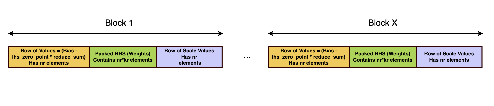

# 02A Arm CPU 推理：KleidiAI 与 Compute Library

数据截止：2026-11-04。对象是CPU及Mali计算库的公开源码与文档，未编译或实机执行。本专题解释它们如何进入模型运行时、产生什么中间数据，以及为何不能据库支持列表承诺机器人闭环性能。

## 1. 集成点决定工程责任

KleidiAI提供面向Arm CPU的微内核，调用者可只组合相应C/H文件及公共头；README明确没有动态内存分配、内存管理或内部调度。它面向已具备运行时、线程池、融合和内存管理的框架开发者。ACL则提供较完整的算子、内存与线程管理及融合能力，可承担较多模型计算工作；ACL也包含KleidiAI代码。这不是两套互斥模型格式，而是不同层次的集成接口。[S12](https://raw.githubusercontent.com/ARM-software/kleidiai/main/README.md) [S06](https://raw.githubusercontent.com/ARM-software/ComputeLibrary/main/README.md)

| 层次 | 输入与输出 | 主要责任 | 对机器人项目的作用 | 不能承诺的内容 |
|---|---|---|---|---|
| KleidiAI微内核 | 已满足布局契约的矩阵、量化参数→输出分块 | 调用者分配、分块、选ISA、管理线程 | 优化CPU前处理、模型算子或加速器回退 | 自动读取ONNX、调度整图或驱动摄像头 |
| ACL算子/运行时 | TensorInfo、张量、算子配置→张量结果 | 算子验证、准备、临时内存与执行 | CPU/Mali推理后端候选 | 任意ONNX直接载入、完整模型覆盖或控制周期 |
| 上层框架与机器人节点 | 模型图、观测→推理结果/动作候选 | 模型解析、设备分区、时序、消息与故障处理 | 将算子结果变成可追踪的数据链 | 底层峰值等于系统吞吐 |

前两行依据官方README及API；第三行为工程分工分析。01中的A72、A78AE、V3AE并不共同支持所有SVE/SME扩展。CPU名称之外，要记录OS暴露的特性、编译目标和实际选择的内核；不能只按“ARM64”加载SME2代码。KleidiAI列出Advanced SIMD、SVE、SME/SME2，并提示SME ABI与ZA寄存器调用链风险及编译选项。本研究没有核验各板BSP上的完整特性探测，因此不指定Thor/S100必用哪一变体。[S12](https://raw.githubusercontent.com/ARM-software/kleidiai/main/README.md)

## 2. 追踪一个INT4矩阵乘的数据契约

官方示例`matmul_clamp_f32_qsi8d32p_qsi4c32p`是可读到完整调用链的样例。源码固定M=71、N=63、K=128、block length=32，生成随机矩阵，量化权重，建立量化参考结果，再测试DotProd/I8MM变体。它不是语言模型或真实机器人数据集。输入LHS为FP32，运行前动态量化成带块scale的INT8；RHS为块量化INT4，携带FP16 scale。输出为clamp后的FP32矩阵。不能只凭文件名中的INT4，把整条链算作全INT4存储或全INT4算术。[S09](https://raw.githubusercontent.com/ARM-software/kleidiai/ebe33865eb77addae5f5ea8d277ca0656e1d1be7/examples/matmul_clamp_f32_qsi8d32p_qsi4c32p/matmul_clamp_f32_qsi8d32p_qsi4c32p.cpp)

权重重排是关键而非附属步骤。源码先读取内核`get_mr/get_nr/get_kr/get_sr`，调用packing size函数申请缓冲，再用RHS pack函数将权重、scale及必要参数排列成计算内核期望的块。权重为常量时，可在模型装载阶段只打包一次；每帧LHS仍需量化与packing。原模型文件的量化块序、nibble顺序、scale位置不必与内核布局相同。更换内核、块宽、模型权重或量化契约后，旧packed缓存不能未经验证继续使用。这里的缓存失效规则是工程分析，原文支持其布局依赖和常量权重一次打包机制。[S10](https://raw.githubusercontent.com/ARM-software/kleidiai/ebe33865eb77addae5f5ea8d277ca0656e1d1be7/kai/ukernels/matmul/pack/README.md) [S09](https://raw.githubusercontent.com/ARM-software/kleidiai/ebe33865eb77addae5f5ea8d277ca0656e1d1be7/examples/matmul_clamp_f32_qsi8d32p_qsi4c32p/matmul_clamp_f32_qsi8d32p_qsi4c32p.cpp)

图为同一固定commit的官方RHS packing示意，展示scale、bias与权重在块中的组织。它对应所述SME量化packing函数，不是上述INT4示例的逐字节布局；用途是说明内核消费的数据已经过重排，具体INT4格式仍以示例与函数说明为准。图不证明某个机器人模型可以无修改加载。[S10](https://raw.githubusercontent.com/ARM-software/kleidiai/ebe33865eb77addae5f5ea8d277ca0656e1d1be7/kai/ukernels/matmul/pack/README.md)

线程划分同样依赖布局。示例按`get_m_step()`计算每线程处理的行范围，通过packed offset和destination offset定位数据；小shape可能没有足够工作给全部线程。调用者必须保证输出区域不重叠、线程完成后再消费结果。KleidiAI没有内部线程池，不会自动避免ROS executor、框架线程和图像前处理线程竞争。分析上，应共用或协调线程预算，测并发时的尾延迟，不能按核数增加线程就推导线性加速。[S09](https://raw.githubusercontent.com/ARM-software/kleidiai/ebe33865eb77addae5f5ea8d277ca0656e1d1be7/examples/matmul_clamp_f32_qsi8d32p_qsi4c32p/matmul_clamp_f32_qsi8d32p_qsi4c32p.cpp) [S12](https://raw.githubusercontent.com/ARM-software/kleidiai/main/README.md)

示例的计时从创建worker前开始，在所有线程join后结束，包含线程创建、LHS packing及matmul；RHS预打包、随机输入生成和参考实现不在该窗口。每变体输出一次微秒计时并以0.0001绝对误差比较参考结果，没有完整warmup、重复样本、P99、频率或热状态说明。因此这段程序提供验证骨架，本章不把打印值当稳定benchmark，更未实际运行它。验证真实感知/语言模型时，应另测模型加载、首帧、稳态、权重缓存失效和并发摄像头输入。[S09](https://raw.githubusercontent.com/ARM-software/kleidiai/ebe33865eb77addae5f5ea8d277ca0656e1d1be7/examples/matmul_clamp_f32_qsi8d32p_qsi4c32p/matmul_clamp_f32_qsi8d32p_qsi4c32p.cpp)

## 3. ACL的配置、准备与运行生命周期

固定源码中的`NEGEMM`提供`validate`、`configure`、`prepare`及`run`。`configure`接收ITensor、alpha、beta与GEMMInfo；`validate`检查张量信息能否构成有效配置。`prepare`处理执行前准备，GEMMInfo明确允许矩阵B只在第一次run时reshape；构造函数接收内存与权重管理器。`has_opt_impl`可返回固定格式优化需要的WeightFormat。它们说明“同为矩阵乘”仍有数据类型、广播方向、权重格式和生命周期边界，不能拿一个支持表替代配置验证。[S05](https://raw.githubusercontent.com/ARM-software/ComputeLibrary/392d8863edeb45256887ae8bcf8de638dda23ad9/arm_compute/runtime/NEON/functions/NEGEMM.h)

该API所列类型组合为F32/F16/BFLOAT16，同一次调用不能混合类型；INT8应查相应低精度API，不应给NEGEMM强填INT8张量。批量GEMM的广播仅支持RHS rank小于LHS rank的情况，反向广播不成立。对Transformer算子而言，模型导出后的reshape、transpose和batch维可能使原以为可映射的矩阵乘落到其他路径。选型动作是逐算子验证真实TensorInfo、stride及量化属性，记录失败原因和回退成本。[S05](https://raw.githubusercontent.com/ARM-software/ComputeLibrary/392d8863edeb45256887ae8bcf8de638dda23ad9/arm_compute/runtime/NEON/functions/NEGEMM.h)

当前官方文档显示53.2.0，生成于2026-06-30；旧GitHub Pages的`latest`实际显示24.07。本章采用README指向的现用文档，并保存固定main commit源码，二者不能宣称为同一发行包。文档仍保留古老工具链和Windows段落，生成时间不证明每一段已更新。其24.01起NCHW优化弃用提醒支持优先审查NHWC布局，但具体算子仍按绑定版本核对。[S03](https://artificial-intelligence.sites.arm.com/computelibrary/latest/index.xhtml) [S04](https://arm-software.github.io/ComputeLibrary/latest/) [S02](https://api.github.com/repos/ARM-software/ComputeLibrary/commits/main)

构建应按backend明确配置。官方指南提供SCons的`neon/opencl/arch/os`选项，Bazel与CMake标为实验性CPU构建；Mali OpenCL要求DDK、扩展与实际驱动支持，链接stub库并不证明设备具备执行能力。README通知2026年起预编译静态库名称从`libarm_compute-static.a`变为`libarm_compute.a`，而文档例子仍出现旧名。迁移应以选定发行包实际文件与配置为准，不能机械复制混合版本命令。[S01](https://artificial-intelligence.sites.arm.com/computelibrary/latest/how_to_build.xhtml) [S06](https://raw.githubusercontent.com/ARM-software/ComputeLibrary/main/README.md)

## 4. 与GPU/NPU路径比较及部署放行

分析上，CPU库适合不支持的算子回退、低batch、小矩阵和已有CPU框架集成；GPU/NPU路径可能减少大规模算子耗时，但有图编译、数据移动和专用运行时的额外契约。没有同模型同功率测量，本章不输出谁更快。回退CPU的风险不是只有算子耗时，还包括张量重排、量化转换、缓存污染与线程抢占。优化一个matmul不能保证相机到动作的总时延下降。

可复建交付应记录：模型源及哈希、导出算子和shape、量化方式、框架版本、KleidiAI/ACL固定commit、编译器和ISA选项、OS/BSP、线程数、频率/功率、packed缓存键及测量窗口。先验证参考输出，再测实际模型与摄像头并发，最后连接有时间戳、观测年龄和动作有效期的ROS消息。本专题取得了内核链，尚未取得某个具体VLA框架在01各板上调用该链的完整版本证据，因此末端集成是待实现/待验证，不把独立微内核样例拼成已完成机器人demo。

KleidiAI README及本次示例以Apache-2.0标识，LICENSES目录另含BSD-3-Clause；具体分发文件必须逐项保留许可与NOTICE义务。ACL主项目为MIT，所引头文件包含完整MIT条款，但依赖KleidiAI、OpenCL头等有各自许可。模型权重、校准集、BSP固件和商业SDK不随计算库许可自动开放。开源允许集成，仍不构成功能安全保证或商业支持合同。[S07](https://raw.githubusercontent.com/ARM-software/kleidiai/ebe33865eb77addae5f5ea8d277ca0656e1d1be7/LICENSES/Apache-2.0.txt) [S08](https://raw.githubusercontent.com/ARM-software/kleidiai/ebe33865eb77addae5f5ea8d277ca0656e1d1be7/LICENSES/BSD-3-Clause.txt) [S05](https://raw.githubusercontent.com/ARM-software/ComputeLibrary/392d8863edeb45256887ae8bcf8de638dda23ad9/arm_compute/runtime/NEON/functions/NEGEMM.h) [S06](https://raw.githubusercontent.com/ARM-software/ComputeLibrary/main/README.md)

## 参考原件与版本边界

所有资料经项目统一下载器归档。网页静态依赖缺损按下表披露；动态交互不保证离线可用。采集日为2026-11-04，不能替代材料发布日期。

| ID/资料名 | 版本边界 | 官方原文 | 本地原件 | 归档状态 |
|---|---|---|---|---|
| S01 / ARM_ACL_Build | 2026-11-04采集快照；未明示版号/发布日期 | [原文](https://artificial-intelligence.sites.arm.com/computelibrary/latest/how_to_build.xhtml) | [归档](REFERENCES.md#ref-c1ce72ead8a3ff9b) | 部分静态依赖缺失，2项 |
| S02 / ARM_ACL_Commits | 2026-11-04采集快照；未明示版号/发布日期 | [原文](https://api.github.com/repos/ARM-software/ComputeLibrary/commits/main) | [归档](REFERENCES.md#ref-92249161a7b0c8cf) | 原件与已识别静态依赖完整 |
| S03 / ARM_ACL_Current_Docs | 53.2.0；生成2026-06-30，非各段更新保证 | [原文](https://artificial-intelligence.sites.arm.com/computelibrary/latest/index.xhtml) | [归档](REFERENCES.md#ref-14eff539cd98946f) | 部分静态依赖缺失，2项 |
| S04 / ARM_ACL_Docs | 旧站24.07；不当现用版本 | [原文](https://arm-software.github.io/ComputeLibrary/latest/) | [归档](REFERENCES.md#ref-ef8c4974e3f5a20c) | 部分静态依赖缺失，2项 |
| S05 / ARM_ACL_NEFunction | 固定commit 392d8863edeb45256887ae8bcf8de638dda23ad9 | [原文](https://raw.githubusercontent.com/ARM-software/ComputeLibrary/392d8863edeb45256887ae8bcf8de638dda23ad9/arm_compute/runtime/NEON/functions/NEGEMM.h) | [归档](REFERENCES.md#ref-b86b13162094677d) | 原件与已识别静态依赖完整 |
| S06 / ARM_ACL_Readme | 2026-11-04采集快照；未明示版号/发布日期 | [原文](https://raw.githubusercontent.com/ARM-software/ComputeLibrary/main/README.md) | [归档](REFERENCES.md#ref-599d29988b0cf58b) | 原件与已识别静态依赖完整 |
| S07 / ARM_KAI_Apache | 2026-11-04采集快照；未明示版号/发布日期 | [原文](https://raw.githubusercontent.com/ARM-software/kleidiai/ebe33865eb77addae5f5ea8d277ca0656e1d1be7/LICENSES/Apache-2.0.txt) | [归档](REFERENCES.md#ref-4acfa876a5b163c1) | 原件与已识别静态依赖完整 |
| S08 / ARM_KAI_BSD | 2026-11-04采集快照；未明示版号/发布日期 | [原文](https://raw.githubusercontent.com/ARM-software/kleidiai/ebe33865eb77addae5f5ea8d277ca0656e1d1be7/LICENSES/BSD-3-Clause.txt) | [归档](REFERENCES.md#ref-63be7633ac213fb6) | 原件与已识别静态依赖完整 |
| S09 / ARM_KAI_Example_Code | 同一固定KleidiAI commit | [原文](https://raw.githubusercontent.com/ARM-software/kleidiai/ebe33865eb77addae5f5ea8d277ca0656e1d1be7/examples/matmul_clamp_f32_qsi8d32p_qsi4c32p/matmul_clamp_f32_qsi8d32p_qsi4c32p.cpp) | [归档](REFERENCES.md#ref-36c503cbd9897c20) | 原件与已识别静态依赖完整 |
| S10 / ARM_KAI_Pack | 固定commit ebe33865eb77addae5f5ea8d277ca0656e1d1be7 | [原文](https://raw.githubusercontent.com/ARM-software/kleidiai/ebe33865eb77addae5f5ea8d277ca0656e1d1be7/kai/ukernels/matmul/pack/README.md) | [归档](REFERENCES.md#ref-b271d6fef76ced02) | 原件与已识别静态依赖完整 |
| S11 / ARM_KAI_Packing_Figure | 2026-11-04采集快照；未明示版号/发布日期 | [原文](https://raw.githubusercontent.com/ARM-software/kleidiai/ebe33865eb77addae5f5ea8d277ca0656e1d1be7/docs/imgs/kai_rhs_packing_pattern_2.png) | [归档](REFERENCES.md#ref-49ce967ac4e8c6bd) | 原件与已识别静态依赖完整 |
| S12 / ARM_KleidiAI_Readme | 2026-11-04采集快照；未明示版号/发布日期 | [原文](https://raw.githubusercontent.com/ARM-software/kleidiai/main/README.md) | [归档](REFERENCES.md#ref-76cf9034d5f688ad) | 原件与已识别静态依赖完整 |

- [独立资料索引](REFERENCES.md)

- [主张与图源记录](research_state/evidence/02A_CPU_KleidiAI_ACL.json)

- [开始前基线](research_state/baselines/02A_CPU_KleidiAI_ACL_before.json)
