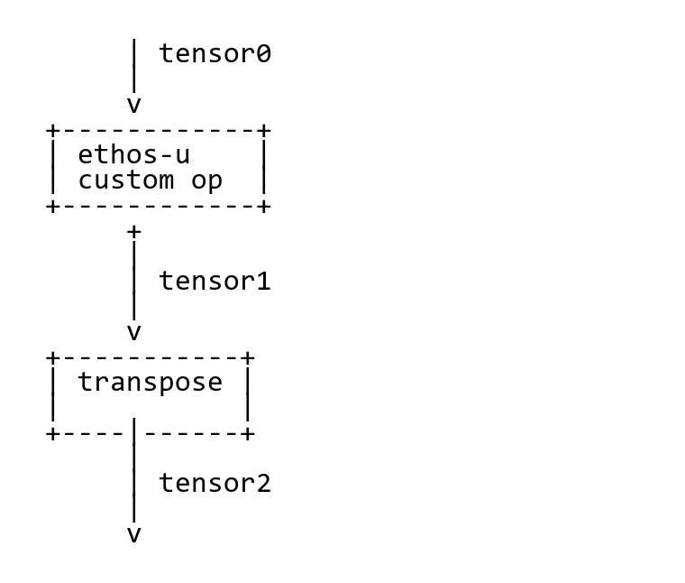

# 02B Ethos-U、Vela、TFLM 与 CMSIS-NN

数据截止：2026-11-04。研究范围包含MCU推理链与U85 Linux直驱参考实现；没有安装编译器、下载权重或执行FVP。Vela及core-driver的GitLab原件本次受robots/访问限制，未取得；以下依据成功归档的TFLM集成源码与Arm官方样例解释接口，不伪称完成编译器源码审计。

## 1. 执行域与交付对象

CMSIS-NN是Cortex-M的神经网络算子库，TFLM是读取模型、管理tensor arena并调用算子的微型运行时；Ethos-U是另一个执行设备，Vela将适合设备的子图变成Ethos-U custom op及命令流。TFLM遇到custom op时调用设备驱动，剩余普通算子仍需CPU实现。因而Vela优化后的tflite不是任意通用解释器都可直接执行的文件，也不意味着CPU只负责启动一次NPU。[S01](https://raw.githubusercontent.com/ARM-software/CMSIS-NN/main/README.md) [S11](https://raw.githubusercontent.com/tensorflow/tflite-micro/main/README.md) [S09](https://raw.githubusercontent.com/tensorflow/tflite-micro/main/tensorflow/lite/micro/kernels/ethos_u/README.md)

| 对象 | 关键输入→输出 | 承担的工作 | 实际边界 |
|---|---|---|---|
| CMSIS-NN | 量化张量/参数→算子结果 | Pure C、DSP、MVE优化 | 不是模型编译器，不驱动Ethos硬件 |
| TFLM | tflite、resolver、arena→模型输出 | 解释、分配、CPU/custom op调用 | arena必须容纳运行时与scratch，不止权重 |
| Vela产物 | 已编译子图→custom op/command stream | 为指定Ethos配置组织执行 | 完整编译规则本次未取得；不能跨NPU任意复用 |
| Ethos驱动 | command stream与基地址→执行状态 | 设备调用及资源管理 | MMIO/中断/cache/地址映射由目标BSP负责 |
| U85 Linux delegate | tflite及用户张量→推理结果 | Linux用户态推理与设备接口 | 本次样例绑定FVP，非任意商业U85板卡 |

前四项依据官方集成源码，第五项来自Arm直驱样例。TFLM的Arm说明仍主要列U55/U65和Corstone-300，不能用旧说明的型号覆盖证明U85完整支持；U85另采用其对应直驱实例核验。[S08](https://raw.githubusercontent.com/tensorflow/tflite-micro/fd2a85dfb3bedac81920e8667565b1044c6b6a43/docs/arm.md) [S05](https://raw.githubusercontent.com/ARM-software/ML-examples/main/ethos-u-corstone-1000/README.md)

## 2. custom op边界与驱动生命周期

此图将TFLM官方README的ASCII图原样渲染为PNG，未增加节点；它表示Ethos custom op与普通transpose之间的张量边界，不是全图NPU执行图。图支持“仍有普通算子”的机制，不能给出该算子在哪块具体MCU上的时延。[S09](https://raw.githubusercontent.com/tensorflow/tflite-micro/main/tensorflow/lite/micro/kernels/ethos_u/README.md)

已取得的`ethosu.cc`给出Init→Prepare→Eval链：Init通过persistent allocator保存OpData；Prepare申请保存基地址和长度的arena scratch；Eval读取custom data和command stream，组织模型、arena、fast scratch、输入及输出基址，reserve driver、调用`ethosu_invoke_v3`、release driver并返回执行状态。它把command stream作为custom op第一个输入，其他输入组成设备地址表。这里的张量数据指针必须满足驱动与硬件可访问范围，不能只因为C++能访问就假定NPU DMA可达。[S03](https://raw.githubusercontent.com/tensorflow/tflite-micro/main/tensorflow/lite/micro/kernels/ethos_u/ethosu.cc)

该版本源码把基地址数量限制到8，并特别说明IFM/OFM通过arena基地址访问，不能任意把输入输出指到arena之外。因此“摄像头DMA直接零拷贝进入NPU”需另证实目标delegate、驱动与内存接口，不能从generic custom op实现直接承诺。执行失败返回错误也不自动构成本体保护策略；应用需丢弃无效结果，保留观测年龄和动作截止期，交给独立控制域处理超时。后者是工程要求，不是所引文件已经实现的机器人保护链。[S03](https://raw.githubusercontent.com/tensorflow/tflite-micro/main/tensorflow/lite/micro/kernels/ethos_u/ethosu.cc)

## 3. 内存计划与CPU算子回退

TFLM使用单个arena，由Head、Temporary、Tail组成。Head中的非持久张量由GreedyMemoryPlanner按生命周期复用，Tail存放持久对象，Temporary用于短期作用域数据。offline计划可以为张量指定偏移，-1留给运行时分配；planner把运行时scratch安排在这些固定偏移之外。文件大小不能预测arena峰值，层数也不能直接相加，因为生存期重叠与复用决定实际空间。[S10](https://raw.githubusercontent.com/tensorflow/tflite-micro/fd2a85dfb3bedac81920e8667565b1044c6b6a43/docs/memory_management.md)

可复建核查使用RecordingMicroInterpreter与PrintAllocations审计head、tail、operator runtime data及对齐开销；记录API自身还增加内存和日志负担。文档例子中的2048-byte arena和9568-byte日志是不同示例，不是任何模型的通用推荐。量化模型应核权重、激活、输入scale/zero-point、输出反量化与scratch需求，在热启动、重复Invoke和异常输入条件下验证没有越界或过期数据。[S10](https://raw.githubusercontent.com/tensorflow/tflite-micro/fd2a85dfb3bedac81920e8667565b1044c6b6a43/docs/memory_management.md)

CMSIS-NN按编译器特性选择Pure C、DSP或MVE，M85只有实际配置并启用Helium时才进入相应优化。README的INT4明确是INT4权重加INT8激活，不是全INT4链。它遵循TFLM INT8/INT16量化契约并声明bit-exact边界；`CMSIS_NN_USE_SINGLE_ROUNDING`等编译选项可能改变输出，头文件相关选项须与TFLM一致。不能只看算子名称相同就认为数值契约可互换。[S01](https://raw.githubusercontent.com/ARM-software/CMSIS-NN/main/README.md)

当前main还出现实验性float16/float32和可选AOT。float面向具有MVE及浮点能力的Cortex-M，默认关闭，不以A类CPU为性能目标；文档明确NaN/Inf等边界值不是当前浮点优化目标，输入需保证有限数值。AOT把支持算子的权重packing与effective bias计算移到离线，默认关闭，开关可能改变公共参数布局；库、bindings与调用方必须一致。packed权重、scratch查询格式与binding版本都应进入产物身份。错误序列化的权重不能靠升级NumPy修复。这些是当前源码快照功能，不能当作已被任意芯片SDK正式发行支持。[S01](https://raw.githubusercontent.com/ARM-software/CMSIS-NN/main/README.md)

## 4. U85直驱：可读到的模型至设备链

Arm现用ML-examples中的Corstone-1000/Cortex-A320/U85样例要求2025.12参考BSP、CMake≥3.25、Bootlin AArch64 musl工具链与kas4.4。资源脚本读取manifest中的源URL和SHA256，准备MobileNetV2 INT8与YOLO-Fastest等资源，随后为U85配置运行Vela。README给出`ethos-u85-512`额外目标及默认Z2048产物；配置不同意味着不能只改文件名当作重新编译。[S05](https://raw.githubusercontent.com/ARM-software/ML-examples/main/ethos-u-corstone-1000/README.md) [S06](https://raw.githubusercontent.com/ARM-software/ML-examples/main/ethos-u-corstone-1000/resources/model_manifest.json)

具体链为：固定源模型和样本→资源校验→Vela优化tflite→交叉编译runner/delegate→打包MMC镜像→FVP BSP启动→用户态装载`libethosu_op_delegate.so`→预处理或binary输入→输出文件。README列MobileNet输入224×224×3 u8，manifest的zero输入150528 bytes，与维度相符；这只验证输入文件尺寸契约，不能证明零输入代表真实模型精度。图像分类样例另有BMP和labels，检测样例还需其独立后处理。机器人摄像头buffer、时间戳和动作接口没有在这里闭合。[S05](https://raw.githubusercontent.com/ARM-software/ML-examples/main/ethos-u-corstone-1000/README.md) [S06](https://raw.githubusercontent.com/ARM-software/ML-examples/main/ethos-u-corstone-1000/resources/model_manifest.json)

requirements绑定MLEK `26.06-rc1`工具来源，不应称稳定发行；构建还从GitLab取得固定MLEK与Linux driver stack。本次网络未取得这些依赖原件，所以完整可复建性仍有实质缺口。`--cycles`记录NPU PMU周期，不等于包含Linux调度、图像预处理与ROS发布的端到端时延；FVP执行也不是硅上机器人功耗测试。旧Corstone-300例子已明确deprecated/no longer actively maintained，本章不使用它作为当前生产路线保证。[S07](https://raw.githubusercontent.com/ARM-software/ML-examples/main/ethos-u-corstone-1000/scripts/py/requirements.txt) [S05](https://raw.githubusercontent.com/ARM-software/ML-examples/main/ethos-u-corstone-1000/README.md) [S04](https://raw.githubusercontent.com/ARM-software/ML-examples/main/ethos-u-corstone-300/README.md)

## 5. 条件选型、许可与验证动作

分析上，小型关节/触觉分类器可先评估CMSIS-NN/TFLM，Ethos适合已核算子覆盖及memory contract的低功耗加速；大型VLA不应由“支持Transformer”或单个Conformer例子推出可部署。相比02A，MCU路线要付出arena、量化与固件资源约束，CPU路线则有更丰富OS/内存但不同响应边界。没有同模型同功率测量，不输出性能排名。

技术放行依模型导出、数值参考、编译分区报告、CPU回退、arena/scratch峰值、实际NPU配置、编译器/driver/firmware版本及总时延；产品放行还需BSP维护、错误恢复、许可与商用支持。CMSIS-NN为Apache-2.0，TFLM所引源码同为Apache-2.0；模型manifest中的第三方YOLO权重、样本及标签需另核许可，源URL和checksum不等于许可证。本次Vela/core-driver原件未取得，不能用TFLM的许可替它们下法律结论。未执行硬件或FVP，所有部署命令是官方可复建流程记录。[S02](https://raw.githubusercontent.com/ARM-software/CMSIS-NN/main/LICENSE) [S03](https://raw.githubusercontent.com/tensorflow/tflite-micro/main/tensorflow/lite/micro/kernels/ethos_u/ethosu.cc) [S06](https://raw.githubusercontent.com/ARM-software/ML-examples/main/ethos-u-corstone-1000/resources/model_manifest.json)

## 参考原件与版本边界

所有资料经项目统一下载器归档。网页静态依赖缺损按下表披露；动态交互不保证离线可用。采集日为2026-11-04，不能替代材料发布日期。

| ID/资料名 | 版本边界 | 官方原文 | 本地原件 | 归档状态 |
|---|---|---|---|---|
| S01 / ARM_CMSIS_NN | main快照；特性不能当厂商SDK稳定发行 | [原文](https://raw.githubusercontent.com/ARM-software/CMSIS-NN/main/README.md) | [归档](REFERENCES.md#ref-036d2ea5a8151d46) | 原件与已识别静态依赖完整 |
| S02 / ARM_CMSIS_NN_License | 2026-11-04采集快照；未明示版号/发布日期 | [原文](https://raw.githubusercontent.com/ARM-software/CMSIS-NN/main/LICENSE) | [归档](REFERENCES.md#ref-0478e7bf4f947769) | 原件与已识别静态依赖完整 |
| S03 / ARM_TFLM_Ethos_Kernel | 2026-11-04采集快照；未明示版号/发布日期 | [原文](https://raw.githubusercontent.com/tensorflow/tflite-micro/main/tensorflow/lite/micro/kernels/ethos_u/ethosu.cc) | [归档](REFERENCES.md#ref-f453352ee1acb671) | 原件与已识别静态依赖完整 |
| S04 / ARM_U55_Example | 2026-11-04采集快照；未明示版号/发布日期 | [原文](https://raw.githubusercontent.com/ARM-software/ML-examples/main/ethos-u-corstone-300/README.md) | [归档](REFERENCES.md#ref-182f0d7f97ff585c) | 原件与已识别静态依赖完整 |
| S05 / ARM_U85_Direct | main参考实现，绑定2025.12 BSP/FVP | [原文](https://raw.githubusercontent.com/ARM-software/ML-examples/main/ethos-u-corstone-1000/README.md) | [归档](REFERENCES.md#ref-af97edcc6ae30f5d) | 原件与已识别静态依赖完整 |
| S06 / ARM_U85_Model_Manifest | 2026-11-04采集快照；未明示版号/发布日期 | [原文](https://raw.githubusercontent.com/ARM-software/ML-examples/main/ethos-u-corstone-1000/resources/model_manifest.json) | [归档](REFERENCES.md#ref-8b2aeecf31f8c104) | 原件与已识别静态依赖完整 |
| S07 / ARM_U85_Requirements | MLEK 26.06-rc1，kas4.4 | [原文](https://raw.githubusercontent.com/ARM-software/ML-examples/main/ethos-u-corstone-1000/scripts/py/requirements.txt) | [归档](REFERENCES.md#ref-0f52b29e2e3f674a) | 原件与已识别静态依赖完整 |
| S08 / TFLM_Arm | 2026-11-04采集快照；未明示版号/发布日期 | [原文](https://raw.githubusercontent.com/tensorflow/tflite-micro/fd2a85dfb3bedac81920e8667565b1044c6b6a43/docs/arm.md) | [归档](REFERENCES.md#ref-59db5a73a8b0ca63) | 原件与已识别静态依赖完整 |
| S09 / TFLM_Ethos_Readme | 2026-11-04采集快照；未明示版号/发布日期 | [原文](https://raw.githubusercontent.com/tensorflow/tflite-micro/main/tensorflow/lite/micro/kernels/ethos_u/README.md) | [归档](REFERENCES.md#ref-8a8b70f388d1bb14) | 原件与已识别静态依赖完整 |
| S10 / TFLM_Memory_Current | 固定commit fd2a85dfb3bedac81920e8667565b1044c6b6a43 | [原文](https://raw.githubusercontent.com/tensorflow/tflite-micro/fd2a85dfb3bedac81920e8667565b1044c6b6a43/docs/memory_management.md) | [归档](REFERENCES.md#ref-2ef2ee40e2b2e2f7) | 原件与已识别静态依赖完整 |
| S11 / TFLM_Readme | 2026-11-04采集快照；未明示版号/发布日期 | [原文](https://raw.githubusercontent.com/tensorflow/tflite-micro/main/README.md) | [归档](REFERENCES.md#ref-ef922d359676db0e) | 原件与已识别静态依赖完整 |

- [独立资料索引](REFERENCES.md)

- [主张与图源记录](research_state/evidence/02B_Ethos_Vela_CMSIS.json)

- [开始前基线](research_state/baselines/02B_Ethos_Vela_CMSIS_before.json)
