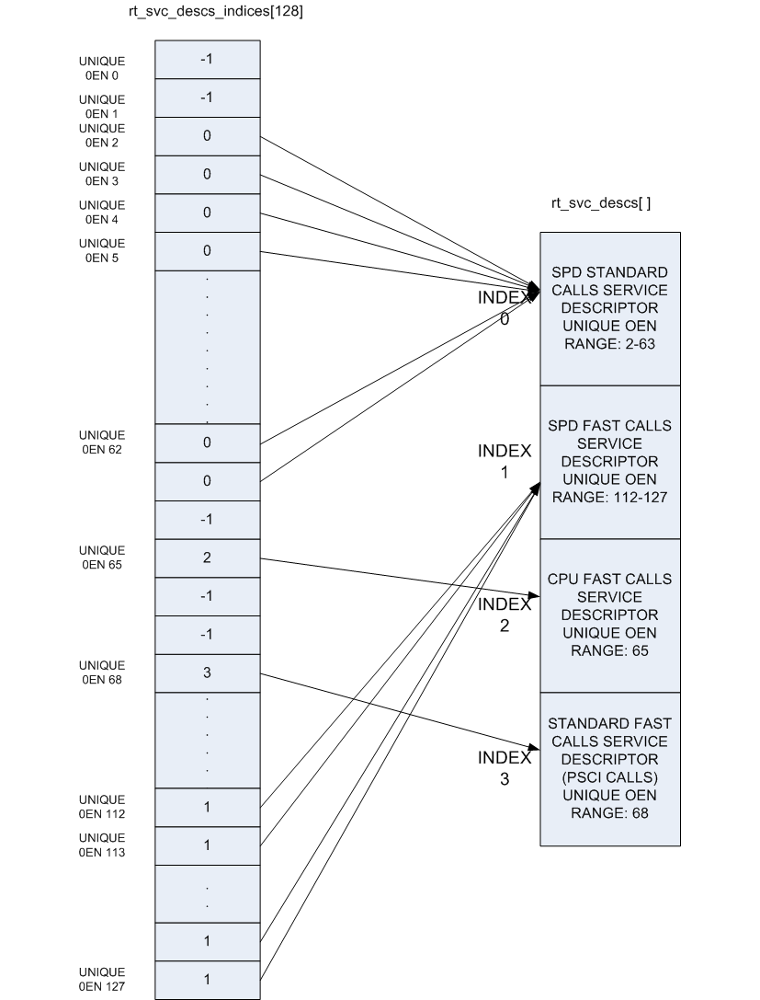

# 02C BSP、多执行域通信、可信启动与更新

数据截止：2026-11-04。本文研究Arm相关通用固件与异构系统机制，不能当作01所有板卡已经提供的BSP。官方Linux文档本次页头为7.4.0-rc1，TF-A/Xen/OpenAMP为开发分支快照；生产系统必须绑定芯片商支持版本。本研究未构建内核、烧录固件、执行升级或控制实机。

## 1. 同一Arm架构不能替代BSP合同

实际链条是启动固件→内存/中断/时钟初始化→设备树与内核驱动→用户态runtime及机器人节点→设备消息/总线→执行域。ISA定义处理器指令，不定义某块载板的GPIO电气、相机桥、CAN收发器、DMA布局或安全固件开放程度。01已核AM69A的R5F/C7资源限制；此处的remoteproc/OpenAMP机制不能取消该限制。只有目标BSP支持用户固件、必要IP/外设可用、资源映射有明确契约时，才可把通用机制用于产品设计。

| 组件 | 管理对象与接口 | 机制价值 | 尚须由目标平台实现 |
|---|---|---|---|
| TF-A | BL1/BL2/BL31/可选BL32/BL33、SMC/PSCI | 启动交接、EL3服务与CPU电源管理 | ROM信任根、密钥、地址/安全状态及芯片适配 |
| Linux remoteproc | firmware、resource table、start/stop/kick | 远端核生命周期与资源登记 | MMIO、电源/复位、TCM、IOMMU与中断 |
| RPMsg/OpenAMP | endpoint、channel、vring、buffer | Linux与RTOS/裸机消息传递 | cache一致性、共享区域、并发与消息语义 |
| PREEMPT_RT | 锁、IRQ和内核执行上下文 | 减少不可抢占路径 | 驱动兼容、优先级/负载与时序验证 |
| Xen Arm启动 | DT中guest内核、RAM、vCPU、设备 | 启动域与资源划分 | SMMU/设备分配、共享资源干扰与板级支持 |
| MCUboot | 签名镜像、slot、test/confirm/revert | MCU固件校验与可恢复升级 | flash layout、密钥、安全计数及产品确认策略 |

表中机制分别来自以下原件，整机作用是工程分析；不存在“一套Arm BSP包含全部组件”的证据。[S08](https://raw.githubusercontent.com/ARM-software/arm-trusted-firmware/master/docs/design/firmware-design.rst) [S03](https://docs.kernel.org/staging/remoteproc.html) [S06](https://raw.githubusercontent.com/OpenAMP/open-amp/main/README.md) [S02](https://docs.kernel.org/core-api/real-time/differences.html) [S11](https://raw.githubusercontent.com/xen-project/xen/master/docs/misc/arm/device-tree/booting.txt) [S04](https://raw.githubusercontent.com/mcu-tools/mcuboot/main/docs/design.md)

## 2. remoteproc：加载固件以前先确定资源边界

Linux remoteproc抽象power on、firmware load和power off；平台驱动提供start/stop，使用virtio消息时还需kick。rproc_boot和rproc_shutdown按引用计数配对，shutdown不必立即物理关机；不能只见API返回成功就认为远端核已重置到安全状态。崩溃上报接口负责报告异常，不替应用定义重启后能否继续执行原动作。[S03](https://docs.kernel.org/staging/remoteproc.html)

ELF firmware包括入口、segment装载地址和resource table。RSC_CARVEOUT、RSC_DEVMEM、RSC_TRACE、RSC_VDEV分别声明连续内存、设备映射、日志和virtio设备/vring。资源表不是普通配置装饰：远端核会按其地址访问数据，Linux须满足声明且限制不可信地址。更新firmware时只替换ELF、未同步设备树或共享区域，可导致装载覆盖、IOMMU拒绝、vring错位或旧消息被新固件误解。[S03](https://docs.kernel.org/staging/remoteproc.html)

分析上，应把firmware哈希、resource table、device-tree reserved-memory、核boot模式、地址转换、mailbox IRQ与CPU/cache属性作为同一个版本化接口包。共享数据至少含协议版本、长度、序列号、时间戳、有效期与校验；控制域只接收仍有效的动作候选，应用域挂起时由独立监控收敛到预设安全行为。这些不是remoteproc原生提供的机器人消息协议，而是其生命周期机制之上必须补足的契约。

## 3. RPMsg与OpenAMP：消息可达不等于时限成立

RPMsg是virtio消息总线，channel有文本名及源/目标地址，endpoint把接收回调绑定到地址。rpmsg_send在TX buffer耗尽时会阻塞，文档列可等待到15秒并返回重启错误；rpmsg_trysend立即失败而不等待。控制周期内直接调用潜在长期阻塞接口会破坏截止期。非阻塞失败也需要明确丢弃、重试或降级策略，而不是在高优先级线程里无限spin。[S01](https://docs.kernel.org/staging/rpmsg.html)

OpenAMP包含virtio、rpmsg、remoteproc和proxy，libmetal承担cache、IO mapping、IRQ、atomic与系统适配。WITH_DCACHE控制对vring/buffer/resource table的cache操作；关闭选项是否安全取决于真实一致性与内存属性。生产板的共享cache可能与FVP不同，因此虚拟平台echo通过不证明硅上大吞吐或数据正确性。[S06](https://raw.githubusercontent.com/OpenAMP/open-amp/main/README.md)

OpenAMP README默认RPMSG_BUFFER_SIZE=512并提示Linux host配置不要修改；所引Linux开发文档已增加VIRTIO_RPMSG_F_BUFSZ协商TX/RX大小。两者属于不同软件版本/能力层，不是可任意拼接的配置建议。应查双方是否协商该feature、头部和alignment、实际payload上限；即使协商大buffer，也不能把buffer尺寸直接称作吞吐。传大量图像更适合另行评估共享数据区与轻量消息通知，仍需所有权与cache协议，不能把raw pointer直接作为跨域有效地址。[S06](https://raw.githubusercontent.com/OpenAMP/open-amp/main/README.md) [S01](https://docs.kernel.org/staging/rpmsg.html)

Linux文档特别提醒remote processors可能直接访问物理内存和敏感外设，RTOS任务也可能没有完整隔离。因此应限制暴露给userland的channel及消息内容。名为“实时域”的核不自然成为安全沙箱，必须核SMMU/MPU、设备归属、复位影响和故障反应路径。[S01](https://docs.kernel.org/staging/rpmsg.html)

## 4. 可信启动、虚拟化与实时调度分别解决什么

TF-A的AArch64冷启动路径分BL1、BL2、BL31、可选BL32、BL33，并以SMC提供PSCI等运行时服务。BL31是EL3 runtime，BL33是non-trusted firmware；平台仍需提供ROM/密钥、内存区与配置交接。TF-A实现部分TBBR要求，不等于所有合作伙伴SoC开箱即具备所需可信链。功能安全要求检测运行中故障，可信启动验证来源/完整性，两者不能互代。[S08](https://raw.githubusercontent.com/ARM-software/arm-trusted-firmware/master/docs/design/firmware-design.rst)

图是TF-A设计文档的官方EL3 service descriptor/index布局，展示SMC call type与OEN如何索引服务处理器；不是整机启动框图或认证图。正文说明重复/重叠OEN等声明错误并未全部自动检测；安全状态中的运行时仍需配置验证，不能因处于EL3而默认服务注册正确。[S08](https://raw.githubusercontent.com/ARM-software/arm-trusted-firmware/master/docs/design/firmware-design.rst)

Xen Arm启动文档通过/chosen传入dom0 kernel/initrd与bootargs，也可直接创建guest，指定RAM、vCPU和共享资源。当前文档提醒GICv3 redistributor布局会限制实际vCPU，申请数不必等于生成数。设备透传还需目标平台证明SMMU和中断隔离。容器共享宿主内核，虚拟机划分执行域；两者都可能共享DRAM、cache与总线，不能由部署形式推出WCET隔离。SOAFEE现用首页将其定位为CoreCollective下的汽车软件方法与工作组；这是协作/方法事实，不是机器人OS、安全认证或某块板的BSP。[S11](https://raw.githubusercontent.com/xen-project/xen/master/docs/misc/arm/device-tree/booting.txt) [S07](https://www.soafee.io/)

PREEMPT_RT通过线程化IRQ和可睡眠spinlock使更多路径可抢占，raw_spinlock仍保留不可抢占语义，部分IRQ有例外。原驱动假设softirq或local_bh_disable必然保护per-CPU数据，在RT下可能不成立。放行需要按绑定内核验证所有相机/网卡/NPU驱动、锁顺序、中断优先级和内存分配，再测压力负载中的调度与总链尾延迟。P99很好不等于WCET证明；RT kernel更不代替独立故障停机链。[S02](https://docs.kernel.org/core-api/real-time/differences.html)

## 5. OTA：镜像认证后还要证明可运行与可恢复

MCUboot区分bootutil与各port boot application，镜像包含header、版本和TLV，升级路径按swap/direct-XIP/RAM-load等模式配置。test swap启动新镜像后，应通过自检再confirm，否则下一次启动revert；永久更新可能不再回退。它解决的是固件镜像启动/恢复，不自动验证新模型输出正确或主域与控制域协议兼容。[S04](https://raw.githubusercontent.com/mcu-tools/mcuboot/main/docs/design.md)

防降级与回退也须区分：security counter的抗旧版机制和运行失败回退不是同一策略。模型、主域runtime、RTOS固件、设备树和校准参数应有依赖矩阵，升级确认应覆盖消息版本、传感器、执行保护与断电恢复；否则新firmware签名有效，仍可能与旧主域不兼容。针对多域robot，候选动作是先进入允许升级的本体状态，再试启动新包，完成自检后确认，同时预留可接受的安全降级组合。这属于工程方案，未在目标板执行。

TF-A以BSD-3-Clause为主并列依赖许可，OpenAMP为BSD许可组合，MCUboot所引设计文件为Apache-2.0。内核、hypervisor、BSP二进制和芯片安全库必须分别核查，不能沿用用户态库许可。本专题建立了通用资源/更新链，具体Thor/S100/TI BSP支持与软件开放程度由后续板级专题分别核验；未取得的安全包、密钥服务或商业hypervisor不写成已可用。[S09](https://raw.githubusercontent.com/ARM-software/arm-trusted-firmware/master/docs/license.rst) [S05](https://raw.githubusercontent.com/OpenAMP/open-amp/main/LICENSE.md) [S04](https://raw.githubusercontent.com/mcu-tools/mcuboot/main/docs/design.md)

## 参考原件与版本边界

所有资料经项目统一下载器归档。网页静态依赖缺损按下表披露；动态交互不保证离线可用。采集日为2026-11-04，不能替代材料发布日期。

| ID/资料名 | 版本边界 | 官方原文 | 本地原件 | 归档状态 |
|---|---|---|---|---|
| S01 / Linux_RPMsg | Linux 7.4.0-rc1在线文档；非生产BSP绑定 | [原文](https://docs.kernel.org/staging/rpmsg.html) | [归档](REFERENCES.md#ref-4d2d7c913df4a462) | 原件与已识别静态依赖完整 |
| S02 / Linux_RT | Linux 7.4.0-rc1在线文档；非生产BSP绑定 | [原文](https://docs.kernel.org/core-api/real-time/differences.html) | [归档](REFERENCES.md#ref-74547944cdb4b513) | 原件与已识别静态依赖完整 |
| S03 / Linux_Remoteproc | Linux 7.4.0-rc1在线文档；非生产BSP绑定 | [原文](https://docs.kernel.org/staging/remoteproc.html) | [归档](REFERENCES.md#ref-c8e57b87341a5390) | 原件与已识别静态依赖完整 |
| S04 / MCUboot_Design | 2026-11-04采集快照；未明示版号/发布日期 | [原文](https://raw.githubusercontent.com/mcu-tools/mcuboot/main/docs/design.md) | [归档](REFERENCES.md#ref-9f38724963631ae1) | 原件与已识别静态依赖完整 |
| S05 / OpenAMP_License | 2026-11-04采集快照；未明示版号/发布日期 | [原文](https://raw.githubusercontent.com/OpenAMP/open-amp/main/LICENSE.md) | [归档](REFERENCES.md#ref-fe7b515a9369f42e) | 原件与已识别静态依赖完整 |
| S06 / OpenAMP_Readme | 2026-11-04采集快照；未明示版号/发布日期 | [原文](https://raw.githubusercontent.com/OpenAMP/open-amp/main/README.md) | [归档](REFERENCES.md#ref-8a0e4078ea14861c) | 原件与已识别静态依赖完整 |
| S07 / SOAFEE_Home | 2026-11-04采集快照；未明示版号/发布日期 | [原文](https://www.soafee.io/) | [归档](REFERENCES.md#ref-885a355c76bf9924) | 部分静态依赖缺失，2项 |
| S08 / TFA_Design | 2026-11-04采集快照；未明示版号/发布日期 | [原文](https://raw.githubusercontent.com/ARM-software/arm-trusted-firmware/master/docs/design/firmware-design.rst) | [归档](REFERENCES.md#ref-067af44d752ca91c) | 原件与已识别静态依赖完整 |
| S09 / TFA_License | 2026-11-04采集快照；未明示版号/发布日期 | [原文](https://raw.githubusercontent.com/ARM-software/arm-trusted-firmware/master/docs/license.rst) | [归档](REFERENCES.md#ref-f72f07c401f91a18) | 原件与已识别静态依赖完整 |
| S10 / TFA_Service_Figure | 2026-11-04采集快照；未明示版号/发布日期 | [原文](https://raw.githubusercontent.com/ARM-software/arm-trusted-firmware/master/docs/resources/diagrams/rt-svc-descs-layout.png) | [归档](REFERENCES.md#ref-f6485f6dac51a10c) | 原件与已识别静态依赖完整 |
| S11 / Xen_ARM_Boot | 2026-11-04采集快照；未明示版号/发布日期 | [原文](https://raw.githubusercontent.com/xen-project/xen/master/docs/misc/arm/device-tree/booting.txt) | [归档](REFERENCES.md#ref-b683d5b46bf0ed38) | 原件与已识别静态依赖完整 |

- [独立资料索引](REFERENCES.md)

- [主张与图源记录](research_state/evidence/02C_BSP_Multidomain.json)

- [开始前基线](research_state/baselines/02C_BSP_Multidomain_before.json)
