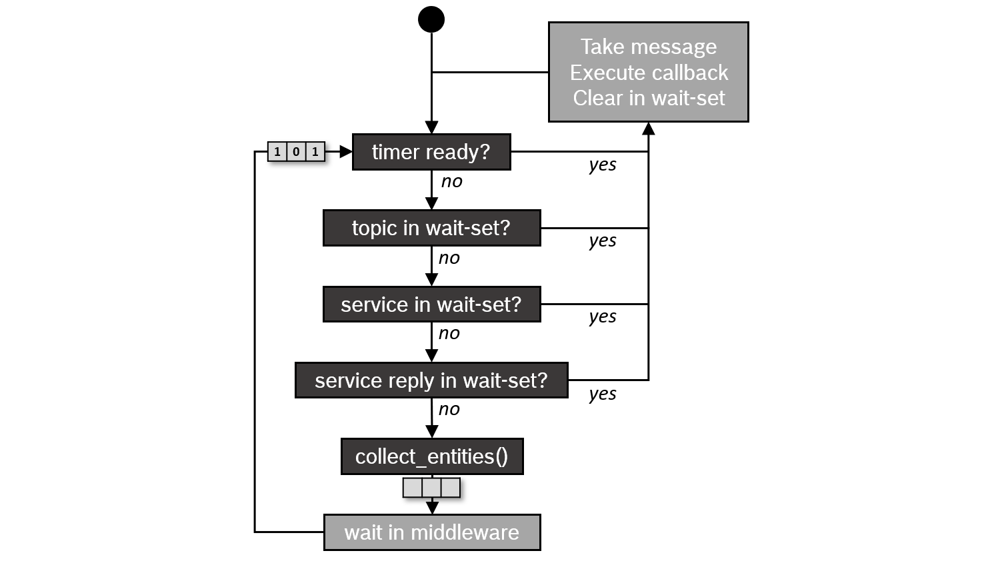

# 02D Jetson BSP、TensorRT 与 ROS 部署链

数据截止：2026-11-05，材料采集窗口11-04—11-05。Jetson属于Arm CPU加NVIDIA专有加速体系，CUDA/TensorRT并非通用Arm软件。本章读取公开文档及release-5.0节点源码，未装SDK、构建engine、运行ROS或执行本体。

## 1. 当前版本不能横向拼接

JetPack下载页的公开基线是7.2.1/Jetson Linux39.2.1，内核6.8、Ubuntu24.04、CUDA13.2.2、cuDNN9.20.0及TensorRT10.16.2，支持Thor T5000/T4000和Orin家族。页内日期写8/11/2026，本研究保留其格式，不擅自断定月日顺序。BSP包含UEFI、kernel、驱动、flashing工具及sample rootfs，载板相机与外设仍须对应设备树/驱动适配。[S07](https://developer.nvidia.com/embedded/jetpack/downloads)

| 材料对象 | 已核版本/条件 | 工程处理 |
|---|---|---|
| JetPack下载页 | 7.2.1、L4T39.2.1、TRT10.16.2 | 作为可见套件基线，不替换为通用TRT最新版 |
| TRT现用支持矩阵 | 11.4.1；Jetson条目要求JetPack7.2.2+ | 与下载页基线存在版本差距；必须取得升级包与支持矩阵 |
| Isaac ROS现用文档 | release-5.0路径，ROS2 Lyrical、JetPack7.2；检查R39 revision2.0 | 与下载页39.2.1小版本不同，按实际安装包验证 |
| ROS通用文档原件 | Jazzy源文档 | 解释QoS/executor机制，不能当Lyrical新buffer特性证据 |

下载页的Isaac ROS SDK栏还写Coming soon，而Isaac现用文档已列测试平台和安装流程。它们属于不同页面的发行/验证边界，不能默默拼成同一套经过验证的镜像。TRT支持矩阵11.4.1中，Orin的DLA依JetPack7.2.2+及Linux SBSA包，11.4.0/11.3等版本还有不同限制；Thor没有DLA。01硬件资源不能证明任何runtime版本均可访问。[S13](https://docs.nvidia.com/deeplearning/tensorrt/latest/getting-started/support-matrix.html) [S07](https://developer.nvidia.com/embedded/jetpack/downloads) [S04](https://nvidia-isaac-ros.github.io/getting_started/index.html)

## 2. 模型图至engine：编译物的身份与内存

官方Python API链为ONNX parser→network→builder config→serialized engine→runtime反序列化→execution context。parser拥有导入权重的内存，必须保持至builder完成；workspace限制会排除需要更大临时空间的tactic。构建阶段选择实现，推理阶段使用已编译plan，两阶段耗时不能混为一项。模型、opset、插件、精度与量化契约、shape/profile、GPU、TRT/CUDA/BSP和构建配置应进入engine身份。[S12](https://docs.nvidia.com/deeplearning/tensorrt/latest/inference-library/python-api-docs.html)

通用runtime指南说engine通常绑定平台及GPU；支持矩阵进一步给version-compatible和hardware-compatibility的例外。跨major不是无限前向兼容：11.4.1矩阵列10→11和8→10支持组合，不支持8→11；没有开启相关模式的engine不能认为跨架构可复用。启动期须在受控流程反序列化并检查logger/返回结果，不能用文件扩展名保证兼容。engine包含可执行CUDA tactics，应从可信构建/交付链取得；这是官方产物性质说明，非本研究执行的安全测试。[S13](https://docs.nvidia.com/deeplearning/tensorrt/latest/getting-started/support-matrix.html) [S12](https://docs.nvidia.com/deeplearning/tensorrt/latest/inference-library/python-api-docs.html)

dynamic输入需要build时的MIN/OPT/MAX profile，运行时选profile再设输入shape；profile范围可能显著改变内存，有些tactic只有MIN=OPT=MAX可用。动态输出需inferShapes/getTensorShape或output allocator，未知大小不能用负维度直接分配。大量预分配可能抬高常驻内存，按经验小分配又有OOM风险。固定分辨率robot与可变视频输入需不同产物策略，不能仅通过max_batch扩大所有动态维。[S11](https://docs.nvidia.com/deeplearning/tensorrt/latest/inference-library/dynamic-shapes-basics.html)

运行接口set_tensor_address及execute_async_v3接收真实设备地址和stream；输入搬运、计算、输出消费必须按event/stream同步。API返回不等于结果已完成，带data-dependent shape、loops或同步插件时还可能同步执行。缓冲区寿命至少覆盖设备访问，别在发布下一帧时覆盖尚未读完的输入。内存上同时保留weights、context activation、workspace、消息buffer与其他并发模型，不应只按模型文件大小配置。[S12](https://docs.nvidia.com/deeplearning/tensorrt/latest/inference-library/python-api-docs.html)

## 3. Isaac节点源码比泛化支持表更具体

现用TRTNode文档与源码来自`isaac_ros_dnn_inference`的release-5.0，而不是先前猜测的独立tensor_rt仓库。节点链需要encoder做图像归一化/布局、TensorRTNode推理、decoder做任务后处理；只有ONNX→TensorList并未产生机器人动作。参数包括model_file_path、engine_file_path、force_engine_update、tensor/binding名称和workspace。force_engine_update默认true，部署预生成engine时应明确配置，避免把模型装载及重编译时间计入稳态推理。[S06](https://nvidia-isaac-ros.github.io/repositories_and_packages/isaac_ros_dnn_inference/isaac_ros_tensor_rt/index.html) [S05](https://raw.githubusercontent.com/NVIDIA-ISAAC-ROS/isaac_ros_dnn_inference/release-5.0/isaac_ros_tensor_rt/src/tensor_rt_node.cpp)

源码`ResolveInputDims`仅处理dynamic batch，拒绝dynamic non-batch维；输入可与binding同rank，或只省略单一batch维，其他rank差异被认为不安全。**TensorRT通用dynamic shape能力不等于该节点开放任意动态C/H/W。** 图像encoder的CHW/NCHW、batch与模型binding必须一致，不能把通用API样例直接套入节点。源码保持engine的非batch维并检查省略batch时是否为1。[S05](https://raw.githubusercontent.com/NVIDIA-ISAAC-ROS/isaac_ros_dnn_inference/release-5.0/isaac_ros_tensor_rt/src/tensor_rt_node.cpp)

源码现用TensorList是`isaac_ros_tensor_msgs`，用conversion read/write handle保存CUDA buffer寿命，并在enqueueV3提交之后让handle析构记录事件。现用网页的参数表却仍列NITROS formats、旧TensorList interface和FP16开关说明。这是文档残留冲突，正文优先采用release源码的接口，配置前仍需绑定安装包。源码提示FP16 builder flag从TRT10.12起已deprecated；不得按旧参数表为TRT11 strongly typed网络补造精度开关行为。[S05](https://raw.githubusercontent.com/NVIDIA-ISAAC-ROS/isaac_ros_dnn_inference/release-5.0/isaac_ros_tensor_rt/src/tensor_rt_node.cpp) [S06](https://nvidia-isaac-ros.github.io/repositories_and_packages/isaac_ros_dnn_inference/isaac_ros_tensor_rt/index.html)

## 4. 从NITROS迁移到ROS2 buffer backend

当前迁移页明确NITROS（含PyNITROS、Managed publisher/subscriber、builder/view、bridge等）正在弃用，未来版本移除；ROS2 Lyrical引入rosidl::Buffer。标准.msg字段如uint8[]保持数据语义，生成C++表示可用CPU/CUDA等backend存储。兼容endpoint可传descriptor来访问原存储，不能服务的连接回退CPU序列化。原标准ROS图接口可保留，直接依赖NITROS类型/API的自定义代码需要源码迁移，不是重命名类。[S03](https://nvidia-isaac-ros.github.io/concepts/rosidl_buffer/nitros_migration.html) [S01](https://nvidia-isaac-ros.github.io/concepts/rosidl_buffer/index.html)

一般应用优先conversion package，把image/tensor等数据语义与内存backend分开；只有需要控制设备指针、stream和lifetimes的CUDA代码才直接访问backend。验证应覆盖accelerated及CPU fallback两条路。跨进程、跨设备、录包、可视化和第三方节点能否零拷贝取决于backend与middleware，不能把“减少不必要复制”宣传当作整图所有节点零复制。[S01](https://nvidia-isaac-ros.github.io/concepts/rosidl_buffer/index.html) [S03](https://nvidia-isaac-ros.github.io/concepts/rosidl_buffer/nitros_migration.html)

## 5. QoS、executor与相机到动作的验证链

完整候选链是：相机/驱动时间戳→image buffer→encoder张量→合法binding/profile→engine执行→decoder输出→任务/规划节点→独立控制器。每一环记录单位、帧格式、观测年龄、有效期、处理起止时间和丢帧原因。官方TRT节点提供中段接口，但本研究没有把这些环节连接到实际机器人。传感器、模型和动作控制链必须按本体实测，不能把推理FPS倒数称为servo周期。

ROS QoS的deadline是发布间隔期望，lifespan限制样本过期，reliability可能引入重传，depth只在KeepLast下生效。sensor data profile倾向best effort及较小队列以获得较新读数；执行命令仍需按应用选择策略。发布订阅QoS不兼容可能完全不连通，可靠也不保证观测及时。此处引用Jazzy机制原件，Lyrical/RMW实际行为需要重新核对。[S10](https://raw.githubusercontent.com/ros2/ros2_documentation/jazzy/source/Concepts/Intermediate/About-Quality-of-Service-Settings.rst)

图为ROS2 Jazzy文档保留的官方executor调度示意，与源文档配套。原图先检查timer，但同页明确timer优先级已在Eloquent移除，因此该历史顺序不能当Jazzy或Lyrical现行调度规则。过载时wait set只报告topic是否有数据，文档说明round-robin而非完整FIFO处理及priority inversion风险；图用于解释wait set和回调机制，没有硬实时WCET数字。[S09](https://raw.githubusercontent.com/ros2/ros2_documentation/jazzy/source/Concepts/Intermediate/About-Executors.rst)

正式测量固定board/SKU、JetPack/TRT/Isaac/ROS/RMW、engine hash、精度、相机流、batch、线程/stream、队列、功率与热状态。分别测加载/首帧、GPU event区间、模型总时延、相机至结果/动作时延及P99；增加burst、CPU回退、日志/录包、网络阻塞和热降频负载。选用MAXN或最大时钟只是官方开发建议，不能代表机器人实际电池热预算。[S04](https://nvidia-isaac-ros.github.io/getting_started/index.html)

Isaac DNN仓库为Apache-2.0，不能由此推定TensorRT/cuDNN/CUDA二进制、模型权重、Isaac Sim资产或商业安全软件同许可。JetPack下载页明确接受NVIDIA Software License Agreement；本章保存开源许可证并指出二进制合同入口，未逐条法律审计或取得供应支持合同。网页部分依赖缺失、旧路径404和ROS文档站挑战已记录；ROS机制取成功取得的官方源码原件，未声称网页离线完整。[S02](https://raw.githubusercontent.com/NVIDIA-ISAAC-ROS/isaac_ros_dnn_inference/release-5.0/LICENSE) [S07](https://developer.nvidia.com/embedded/jetpack/downloads)

## 参考原件与版本边界

所有资料经项目统一下载器归档。网页静态依赖缺损按下表披露；动态交互不保证离线可用。采集日为2026-11-04，不能替代材料发布日期。

| ID/资料名 | 版本边界 | 官方原文 | 本地原件 | 归档状态 |
|---|---|---|---|---|
| S01 / Isaac_Buffer | 2026-11-04采集快照；未明示版号/发布日期 | [原文](https://nvidia-isaac-ros.github.io/concepts/rosidl_buffer/index.html) | [归档](REFERENCES.md#ref-e9167f78686d3ef7) | 部分静态依赖缺失，2项 |
| S02 / Isaac_DNN_License | 2026-11-04采集快照；未明示版号/发布日期 | [原文](https://raw.githubusercontent.com/NVIDIA-ISAAC-ROS/isaac_ros_dnn_inference/release-5.0/LICENSE) | [归档](REFERENCES.md#ref-855ed4afdf73e0f3) | 原件与已识别静态依赖完整 |
| S03 / Isaac_NITROS_Migration | 2026-11-04采集快照；未明示版号/发布日期 | [原文](https://nvidia-isaac-ros.github.io/concepts/rosidl_buffer/nitros_migration.html) | [归档](REFERENCES.md#ref-a74b452c91c23559) | 部分静态依赖缺失，2项 |
| S04 / Isaac_ROS_Getting_Started | 现用release-5.0文档/ROS Lyrical；2026-09-21更新 | [原文](https://nvidia-isaac-ros.github.io/getting_started/index.html) | [归档](REFERENCES.md#ref-c092d317bfdef4e3) | 部分静态依赖缺失，2项 |
| S05 / Isaac_TRT_Node_Code | release-5.0源码快照，非固定发行包哈希 | [原文](https://raw.githubusercontent.com/NVIDIA-ISAAC-ROS/isaac_ros_dnn_inference/release-5.0/isaac_ros_tensor_rt/src/tensor_rt_node.cpp) | [归档](REFERENCES.md#ref-64cdaa5bb99f217b) | 原件与已识别静态依赖完整 |
| S06 / Isaac_TRT_Package | 2026-11-04采集快照；未明示版号/发布日期 | [原文](https://nvidia-isaac-ros.github.io/repositories_and_packages/isaac_ros_dnn_inference/isaac_ros_tensor_rt/index.html) | [归档](REFERENCES.md#ref-0c86d6d9becd52ce) | 部分静态依赖缺失，2项 |
| S07 / JetPack_Downloads | JetPack7.2.1/L4T39.2.1；页面日期8/11/2026原样保留 | [原文](https://developer.nvidia.com/embedded/jetpack/downloads) | [归档](REFERENCES.md#ref-a226cd46c59f27f9) | 部分静态依赖缺失，85项 |
| S08 / ROS_Executor_Figure | 2026-11-04采集快照；未明示版号/发布日期 | [原文](https://raw.githubusercontent.com/ros2/ros2_documentation/jazzy/source/Concepts/images/executors_scheduling_semantics.png) | [归档](REFERENCES.md#ref-ac52a46ce41c6428) | 原件与已识别静态依赖完整 |
| S09 / ROS_Executors_Source | Jazzy分支原件，图保留历史timer顺序并附Eloquent修正 | [原文](https://raw.githubusercontent.com/ros2/ros2_documentation/jazzy/source/Concepts/Intermediate/About-Executors.rst) | [归档](REFERENCES.md#ref-3759b956cf598eb5) | 原件与已识别静态依赖完整 |
| S10 / ROS_QoS_Source | 2026-11-04采集快照；未明示版号/发布日期 | [原文](https://raw.githubusercontent.com/ros2/ros2_documentation/jazzy/source/Concepts/Intermediate/About-Quality-of-Service-Settings.rst) | [归档](REFERENCES.md#ref-eeb1237343f7c813) | 原件与已识别静态依赖完整 |
| S11 / TRT_Dynamic_Current | TRT11.4.1文档；更新2026-10-28；非JetPack7.2.1绑定版本 | [原文](https://docs.nvidia.com/deeplearning/tensorrt/latest/inference-library/dynamic-shapes-basics.html) | [归档](REFERENCES.md#ref-a3672262cfb447b8) | 原件与已识别静态依赖完整 |
| S12 / TRT_Runtime_API | TRT11.4.1文档；更新2026-10-28；非JetPack7.2.1绑定版本 | [原文](https://docs.nvidia.com/deeplearning/tensorrt/latest/inference-library/python-api-docs.html) | [归档](REFERENCES.md#ref-c92d10d3c41527ea) | 原件与已识别静态依赖完整 |
| S13 / TRT_Support | TRT11.4.1文档；更新2026-10-28；非JetPack7.2.1绑定版本 | [原文](https://docs.nvidia.com/deeplearning/tensorrt/latest/getting-started/support-matrix.html) | [归档](REFERENCES.md#ref-3b68f26af8646cbc) | 原件与已识别静态依赖完整 |

- [独立资料索引](REFERENCES.md)

- [主张与图源记录](research_state/evidence/02D_Jetson_ROS_Deployment.json)

- [开始前基线](research_state/baselines/02D_Jetson_ROS_Deployment_before.json)
