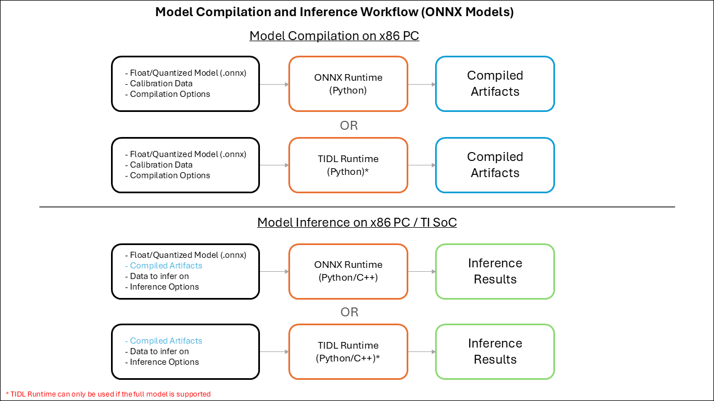
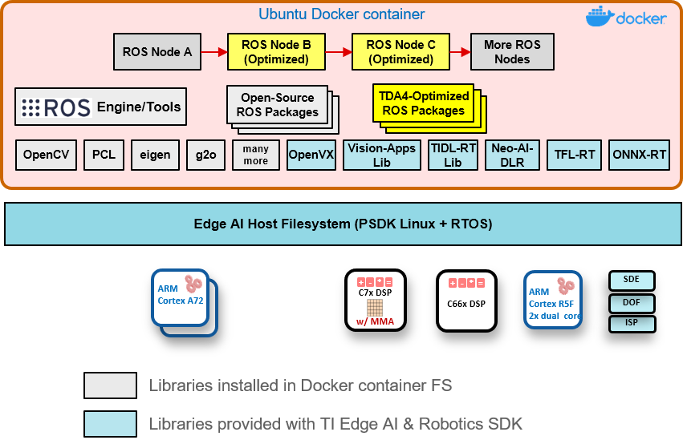

# 02E TI TIDL：校准、子图卸载与机器人软件接口

数据截止：2026-11-05。对象为edgeai-tidl-tools当前master、TI ORT fork的tidl-1.23分支，以及Robotics SDK10.1.0文档。未构建模型、运行host emulation或板卡。本次部分GitHub API未成功，源码按归档字节与SHA256冻结，未取得commit时不补造固定commit。

## 1. TIDL不是通用Arm NPU接口

TIDL经TI SDK提供，在Cortex-A、C7x及MMA之间组织推理。OSRT路线由ONNX Runtime/TFLite/TVM承担整图，TIDL卸载受支持子图，CPU执行其余算子；native TIDL-RT直接调用OpenVX/TIOVX层，适用于所有层均可卸载的模型。其“适合安全关键”定位不构成AM69A功能安全支持，01的料号限制仍适用。用户通过TI提供的运行时调用加速资源，不等于在AM69A C7/MMA上任意部署自定义裸程序。[S15](https://raw.githubusercontent.com/TexasInstruments/edgeai-tidl-tools/master/README.md) [S12](https://raw.githubusercontent.com/TexasInstruments/edgeai-tidl-tools/master/docs/tidlrt.md)

当前tools从11_02_04_00起重构目录，README列J721E/J784S4等家族对应RTOS11.02.02.04/Linux11.02.02.05，ORT1.23.0、TFLite2.12.0、TVM0.18.0。Robotics SDK README指向10_01_00文档；两套材料不能视为同一个已验证镜像。生产包应锁SDK、工具tag、运行时fork、编译binary与remote firmware，再验证ROS栈组合。[S15](https://raw.githubusercontent.com/TexasInstruments/edgeai-tidl-tools/master/README.md) [S04](https://raw.githubusercontent.com/TexasInstruments/edgeai-robotics-sdk/master/README.md) [S03](https://software-dl.ti.com/jacinto7/esd/robotics-sdk/10_01_00/AM69A/docs/index.html)

| 路径 | 输入与编译物 | 执行分工 | 关键条件 |
|---|---|---|---|
| ORT TIDL EP | ONNX及校准→子图net/io/metadata | Cortex-A整图、C7/MMA子图 | 使用TI fork，不是普通PyPI ORT |
| TFLite delegate | tflite→该runtime产物 | TFLite调度CPU/加速子图 | 不与ORT产物随意互换 |
| native TIDL-RT | 完整net/io→结果 | TIOVX及TI加速实现 | 全模型卸载，应用负责IO契约 |
| Robotics SDK节点 | camera/bag、模型→感知ROS输出 | capture、pre/infer/post、消息 | 固定SDK/相机/模型/配置，无整机保证 |

官方README明确`TIDLCompilationProvider`负责编译、`TIDLExecutionProvider`负责推理，上游ORT不包含它们。fork的构建还绑定--use_tidl及runtime/toolchain依赖。安装一个同版号的上游onnxruntime wheel不能证明有TI EP；应枚举实际provider并保存wheel构建身份。[S15](https://raw.githubusercontent.com/TexasInstruments/edgeai-tidl-tools/master/README.md) [S06](https://raw.githubusercontent.com/TexasInstruments/onnxruntime/tidl-1.23/onnxruntime/core/providers/tidl/README.md)

## 2. 编译与校准：产物不是单一权重文件

官方图把x86模型编译与x86/TI SoC推理分开，并标native TIDL仅在全模型受支持时可用。图中的x86 inference是host emulation入口，不能当芯片时延。当前文档规定Python编译、Python/C++推理，TI SoC不承担模型编译。[S15](https://raw.githubusercontent.com/TexasInstruments/edgeai-tidl-tools/master/README.md)

编译过程包含parse与子图识别、graph optimization、量化校准、memory planning。产物`*_net.bin`携带权重与执行指令，`*_io_1.bin`保存shape/type/layout/padding，metadata和visualization记录OSRT分区，layer_info支持对应源模型层。native全卸载应核可视化单块及net/io，并确认没有CPU残留，不能仅看生成文件就认定全图加速。[S05](https://raw.githubusercontent.com/TexasInstruments/edgeai-tidl-tools/master/docs/model_compilation.md)

默认tensor_bits=8，16有相应路径，32-bit浮点不用于目标执行；精度标签需结合实际量化。accuracy_level=1时，文档列20 calibration frames与50 iterations默认值，这不是任何机器人场景充分校准的证明。ONNX QDQ预量化可读取scale/zero-point并绕过再校准，TFLite对应配置另定。混合精度提高某些层到16-bit会改变速度/内存，不能只提高accuracy开关就承诺整机效果。[S05](https://raw.githubusercontent.com/TexasInstruments/edgeai-tidl-tools/master/docs/model_compilation.md) [S14](https://raw.githubusercontent.com/TexasInstruments/edgeai-tidl-tools/master/docs/quantization.md)

校准集需覆盖相机曝光、噪声、遮挡、距离和部署分布，固定源模型、预处理、labels及输入尺度。extended graph optimization在所引文档标实验性有限验证；partial_init_during_compile可把部分初始化前移，但启用后host emulation不工作。产物优化可能减少目标启动时间，却损失一种验证路径；应先建立未优化数值参考再核目标结果，不能把无法host执行误当坏模型，也不能省略板上校验。[S05](https://raw.githubusercontent.com/TexasInstruments/edgeai-tidl-tools/master/docs/model_compilation.md)

## 3. 数据布局、复制与可观测性

IO descriptor的inBufSize/outBufSize及padding决定实际分配，维度乘积不必等于buffer大小。TIDL-RT Tensor结构bufferSize以元素计，ptr指向buffer base，dataOffset也以元素计，pitch/layout/scale/zeroPoint明确传入；填充索引时须乘elemSize，不能混用byte与element。输入不匹配会出现内部重排/复制或错误，不能拿连续模型tensor布局替代编译IO描述。[S08](https://raw.githubusercontent.com/TexasInstruments/edgeai-tidl-tools/master/docs/io_tensors.md) [S12](https://raw.githubusercontent.com/TexasInstruments/edgeai-tidl-tools/master/docs/tidlrt.md)

所引IO文档区分shared memory与普通CPU heap：直接TIDL中，内存域和tensor属性都匹配才能避免复制；普通OSRT按自身未padding连续tensor分配，因此该实现至少进行一次输入和输出复制。它是当前TI文档对该路径的限制，不推广到所有未来allocator扩展。releaseIOTensorsAtCreate的交换要求shared pool，不正确的pool会报错；“同一DRAM”不代表任意malloc地址可直接DMA消费。[S08](https://raw.githubusercontent.com/TexasInstruments/edgeai-tidl-tools/master/docs/io_tensors.md) [S12](https://raw.githubusercontent.com/TexasInstruments/edgeai-tidl-tools/master/docs/tidlrt.md)

原生统计含cpIn/proc/cpOut起止纳秒时间戳，可分别观察复制和graph processing。TIDL_RT_DDR_STATS报告的是整个SoC DDR流量，不是TIDL独占读写；多个摄像头/ISP并发时不能把它当单模型带宽。debug级别还影响日志、trace和层级输出，性能测试需记录debug状态，并另测完整应用采集/预处理/消息时延。[S12](https://raw.githubusercontent.com/TexasInstruments/edgeai-tidl-tools/master/docs/tidlrt.md) [S09](https://raw.githubusercontent.com/TexasInstruments/edgeai-tidl-tools/master/docs/model_inference.md)

## 4. 多核与抢占不等于控制环保证

TIDL default为单核。high throughput模式让N个核处理N帧，batch数需是核数倍数且输入尺寸一致；low latency模式把单帧网络分到多个核，涉及batch/channel/spatial splitting及跨核数据传递。前者提高多相机吞吐，后者可能降低单帧时延，但资源争用、不能有效拆分的层和共享内存仍会限制收益。AM69A的32TOPS合计不是任一模型天然获得全部MMA。[S11](https://raw.githubusercontent.com/TexasInstruments/edgeai-tidl-tools/master/docs/multi_c7x.md)

抢占按数值更小的priority执行高优先网络，同priority顺序轮转。切换只在层完成边界；max_preempt_delay=0也必须等待当前层完成，FLT_MAX倾向效率更好的切换点。高优先级感知的响应上界还包括正在运行层、context保存/恢复、共享DMA和总线，不能从“0ms”配置推出零阻塞或硬实时保证。动作保护仍由独立控制链提供。[S13](https://raw.githubusercontent.com/TexasInstruments/edgeai-tidl-tools/master/docs/preemption.md)

## 5. 由感知样例连接ROS：哪里已经有证据

图为Robotics SDK官方软件栈，原PNG透明区已合成白背景以保持文字可读。下方A72/C66/R5F等属于代表硬件示意，README明确hardware diagram随platform变化；不能把图中R5F当AM69A用户控制权限，也不能把Neo-AI-DLR旧层名称直接当当前tools兼容表。[S04](https://raw.githubusercontent.com/TexasInstruments/edgeai-robotics-sdk/master/README.md)

官方对象检测节点ti_vision_cnn展示camera→预处理→TIDL→后处理→ROS/RViz链，支持ZED、IMX219、IMX390等样例入口；cam_id/subdev_id须用目标板脚本确认，IMX390还要求LDC LUT。所引ROS2段落的USB mono命令仍写roslaunch，属于文档残留，不直接提供为可运行ROS2命令。应核仓库实际launch文件、板型SDK与camera bridge，单个demo不证明多路并发或动作控制。[S01](https://raw.githubusercontent.com/TexasInstruments/edgeai-robotics-sdk/master/ros2/nodes/ti_vision_cnn/README_objdet.md)

本研究获得模型编译至runtime/感知消息的接口依据，尚未在同一目标镜像复建完整链。PoC放行需先核模型精度与卸载图，再验证目标SDK binary/firmware、tensor layout、复制耗时、共享内存和并发调度，最后把输出交给具备单位、frame、观测年龄与截止期的机器人节点。native模型完整卸载也不覆盖采集、后处理或总线执行的WCET。

TI tools LICENSE是TI Text File Limited License，源/二进制的使用及再分发限制到TI Devices，二进制禁止逆向，未义务提供对象码源码。不能把公开GitHub仓库称作Apache/MIT或跨芯片自由迁移的SDK。ORT/TVM/TFLite开源许可、TI二进制、模型权重和机器人SDK必须分别核；没有法律审计或商用支持合同。AM69A SDK入口本次是空正文，不进入有效引用，具体版本依据成功取得的tools矩阵；缺失依赖按表披露。[S10](https://raw.githubusercontent.com/TexasInstruments/edgeai-tidl-tools/master/LICENSE)

## 参考原件与版本边界

所有资料经项目统一下载器归档。网页静态依赖缺损按下表披露；动态交互不保证离线可用。本章采集窗口2026-11-04—11-05，各原件采集时间以registry为准，不能替代材料发布日期。

| ID/资料名 | 版本边界 | 官方原文 | 本地原件 | 归档状态 |
|---|---|---|---|---|
| S01 / TI_ROS_CNN | Robotics SDK10.1.0文档/仓库快照 | [原文](https://raw.githubusercontent.com/TexasInstruments/edgeai-robotics-sdk/master/ros2/nodes/ti_vision_cnn/README_objdet.md) | [归档](REFERENCES.md#ref-078e995881491710) | 原件与已识别静态依赖完整 |
| S02 / TI_ROS_Stack_Figure | Robotics SDK10.1.0文档/仓库快照 | [原文](https://raw.githubusercontent.com/TexasInstruments/edgeai-robotics-sdk/master/docs/tiovx_ros_sw_stack.png) | [归档](REFERENCES.md#ref-9686b997ed52b774) | 原件与已识别静态依赖完整 |
| S03 / TI_Robotics_10_01 | 2026-11-05采集；tools master/11_02_04_00新结构；非固定commit | [原文](https://software-dl.ti.com/jacinto7/esd/robotics-sdk/10_01_00/AM69A/docs/index.html) | [归档](REFERENCES.md#ref-6b341407bb64a76b) | 部分静态依赖缺失，13项 |
| S04 / TI_Robotics_Readme | 2026-11-05采集；tools master/11_02_04_00新结构；非固定commit | [原文](https://raw.githubusercontent.com/TexasInstruments/edgeai-robotics-sdk/master/README.md) | [归档](REFERENCES.md#ref-7a11ee72adf0c31b) | 原件与已识别静态依赖完整 |
| S05 / TI_TIDL_Compile | 2026-11-05采集；tools master/11_02_04_00新结构；非固定commit | [原文](https://raw.githubusercontent.com/TexasInstruments/edgeai-tidl-tools/master/docs/model_compilation.md) | [归档](REFERENCES.md#ref-214caa703dcf79bf) | 原件与已识别静态依赖完整 |
| S06 / TI_TIDL_EP | 2026-11-05采集；tools master/11_02_04_00新结构；非固定commit | [原文](https://raw.githubusercontent.com/TexasInstruments/onnxruntime/tidl-1.23/onnxruntime/core/providers/tidl/README.md) | [归档](REFERENCES.md#ref-7cba7d5cc50c98cd) | 原件与已识别静态依赖完整 |
| S07 / TI_TIDL_Figure | 2026-11-05采集；tools master/11_02_04_00新结构；非固定commit | [原文](https://raw.githubusercontent.com/TexasInstruments/edgeai-tidl-tools/master/docs/assets/onnxrt-workflow.png) | [归档](REFERENCES.md#ref-5c782054e2e47bf7) | 原件与已识别静态依赖完整 |
| S08 / TI_TIDL_IO | 2026-11-05采集；tools master/11_02_04_00新结构；非固定commit | [原文](https://raw.githubusercontent.com/TexasInstruments/edgeai-tidl-tools/master/docs/io_tensors.md) | [归档](REFERENCES.md#ref-51fc8f23c19fe47a) | 原件与已识别静态依赖完整 |
| S09 / TI_TIDL_Inference | 2026-11-05采集；tools master/11_02_04_00新结构；非固定commit | [原文](https://raw.githubusercontent.com/TexasInstruments/edgeai-tidl-tools/master/docs/model_inference.md) | [归档](REFERENCES.md#ref-e603362c3c8e12e6) | 原件与已识别静态依赖完整 |
| S10 / TI_TIDL_License | 2026-11-05采集；tools master/11_02_04_00新结构；非固定commit | [原文](https://raw.githubusercontent.com/TexasInstruments/edgeai-tidl-tools/master/LICENSE) | [归档](REFERENCES.md#ref-7ec7d53f062b7180) | 原件与已识别静态依赖完整 |
| S11 / TI_TIDL_Multicore | 2026-11-05采集；tools master/11_02_04_00新结构；非固定commit | [原文](https://raw.githubusercontent.com/TexasInstruments/edgeai-tidl-tools/master/docs/multi_c7x.md) | [归档](REFERENCES.md#ref-19c7f8e3075ae748) | 原件与已识别静态依赖完整 |
| S12 / TI_TIDL_Native | 2026-11-05采集；tools master/11_02_04_00新结构；非固定commit | [原文](https://raw.githubusercontent.com/TexasInstruments/edgeai-tidl-tools/master/docs/tidlrt.md) | [归档](REFERENCES.md#ref-61c3fca6611d52f7) | 原件与已识别静态依赖完整 |
| S13 / TI_TIDL_Preemption | 2026-11-05采集；tools master/11_02_04_00新结构；非固定commit | [原文](https://raw.githubusercontent.com/TexasInstruments/edgeai-tidl-tools/master/docs/preemption.md) | [归档](REFERENCES.md#ref-837491a4bac3ecc7) | 原件与已识别静态依赖完整 |
| S14 / TI_TIDL_Quantization | 2026-11-05采集；tools master/11_02_04_00新结构；非固定commit | [原文](https://raw.githubusercontent.com/TexasInstruments/edgeai-tidl-tools/master/docs/quantization.md) | [归档](REFERENCES.md#ref-9d7eeb75fed5ef54) | 原件与已识别静态依赖完整 |
| S15 / TI_TIDL_Tools | 2026-11-05采集；tools master/11_02_04_00新结构；非固定commit | [原文](https://raw.githubusercontent.com/TexasInstruments/edgeai-tidl-tools/master/README.md) | [归档](REFERENCES.md#ref-fa69bb6df8c7c61b) | 原件与已识别静态依赖完整 |

- [独立资料索引](REFERENCES.md)

- [主张与图源记录](research_state/evidence/02E_TI_TIDL.json)

- [开始前基线](research_state/baselines/02E_TI_TIDL_before.json)
