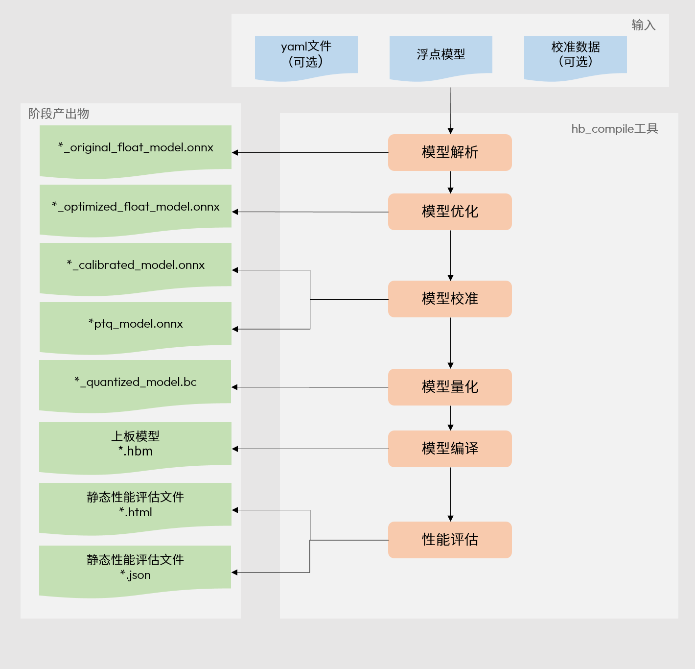
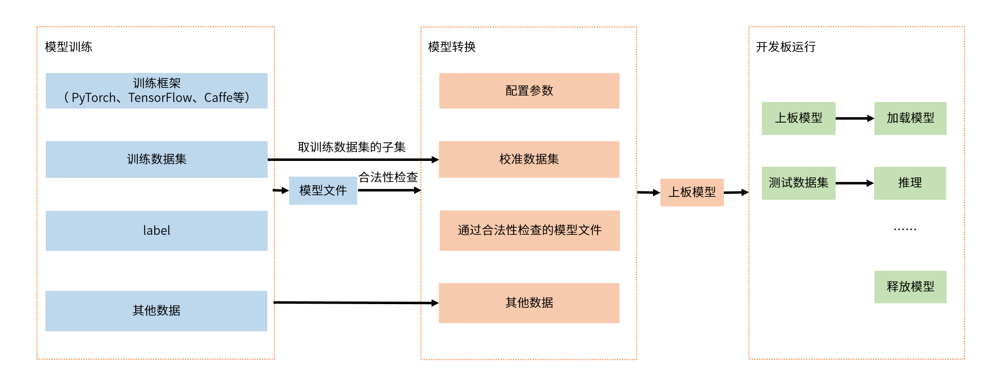

# 02F S100：Nash模型编译、UCP运行时与TROS/MCU移交

数据截止：2026-11-05；未取得板卡交付包、未构建模型或运行节点。对象为S100/S100P的Nash BPU路线。资料中心目前列S系列OE3.7.0与LLM2.0.0；旧rdk_doc的配置明确自2026-06-10归档不再维护。本文优先新资料与当前rdk_s源文档，不用旧X3/X5的Bernoulli示例代替S100实现。[S01](https://developer.d-robotics.cc/rdk_doc_center/) [S03](https://raw.githubusercontent.com/D-Robotics/rdk_doc/main/docusaurus.config.js)

## 1. 版本身份必须从内容而非URL判断

资料中心RDK S100链接携带4.0.5查询参数，但本次静态HTML中MCU页面头显示S600/5.1.1，TROS页面头显示X3/3.0.0，Model Zoo头显示S600/5.1.0。这说明页面有客户端版本选择，不能把查询参数等同已取得的4.0.5专属正文。本文只引用正文明确标S100或S系列的内容，并保留默认静态快照身份；未声称验证这几套软件的联合兼容性。Model Zoo正文明确rdk_s用于S100/S600且要求RDK OS>=4.0.5。[S06](https://developer.d-robotics.cc/model_zoo_doc/model_zoo_intro?v=4.0.5&p=RDK+S100) [S04](https://developer.d-robotics.cc/rdk_s_doc/Advanced_development/mcu_development/code_release?v=4.0.5&p=RDK+S100) [S15](https://developer.d-robotics.cc/tros_doc/tros?v=4.0.5&p=RDK+S100)

OE文档HTML仅有root容器，正文由Rspress异步JS模块加载。本研究沿已下载路由表及chunk映射，通过统一下载器保存实际正文模块，再读取字符串与代码示例；引用表链接原始模块，不将空外壳当有效文档。模块路径包含latest，因此3.7.0属于入口标签，模块自身未证明固定发布包hash；正文已冻结SHA256。抽取文本只是便于审阅，会丢失语法高亮拆分的数值/标点，重要API和数值条件以原始模块为准。

| 软件部分 | 输入/输出 | 已核职责 | 不应混用的边界 |
|---|---|---|---|
| OE PTQ/hb_compile | 浮点模型+yaml+校准→HBIR/中间ONNX/.hbm | 检查、优化、量化、编译 | .bc仿真中间物不等于板端.hbm |
| DNN/UCP C接口 | .hbm+tensor→task→输出 | 模型加载、任务提交/等待、共享内存 | 接口同名不证明跨BPU ABI相同 |
| hbm_runtime | HBM与Python输入→结果 | Python封装，底层依赖按平台变化 | S基于libhbucp，X5基于libdnn |
| TROS组件 | sensor/算法结果→ROS消息 | sensor/codec/CV/通信及算法包 | 功能列表不是本体闭环验收 |
| MCU社区/企业版 | IPC命令→外设/RT任务 | 社区可改部分任务，专有基础代码另交付 | 不等于MCU0全部源码公开 |

Model Zoo把rdk_s与旧rdk_model_zoo_s归档demo分开；当前README还有S600专属Pi0入口。目录存在VLA不能推出S100支持所有策略。S系列与X5虽都称hbm_runtime，官方总览明确底层分别libhbucp与libdnn；包名相同不免除BSP、wheel架构和模型编译物兼容检查。[S20](https://raw.githubusercontent.com/D-Robotics/rdk_model_zoo/rdk_s/README.md) [S06](https://developer.d-robotics.cc/model_zoo_doc/model_zoo_intro?v=4.0.5&p=RDK+S100)

仓库Python指南进一步说明hbm_runtime封装hb_dnn与hb_ucp：前者负责模型与张量，后者负责内存、任务和底层资源。YOLOv5目录提供conversion、evaluator、Python/C++ runtime、labels/test_data；run.sh会检查环境、安装包、下载HBM并运行，C++还构建工程。此链是可定位的官方开发入口，本文未执行脚本或下载权重，不能标为已复现demo；固定模型下载地址及hash、wheel和前后处理版本才可做部署回归。[S14](https://raw.githubusercontent.com/D-Robotics/rdk_model_zoo/rdk_s/docs/Python_API_User_Guide.md) [S16](https://raw.githubusercontent.com/D-Robotics/rdk_model_zoo/rdk_s/docs/UCP_User_Guide.md) [S18](https://raw.githubusercontent.com/D-Robotics/rdk_model_zoo/rdk_s/samples/vision/yolov5/README.md)

## 2. 编译通路与精度证据

图为官方hb_compile各阶段产物，浮点输入经检查/量化/编译形成板端.hbm。hb_compile支持浮点模型验证、量化编译，以及HBIR删节点/编译。它是模型映射与验证工具，OE流程原文明确工具链本身不提供训练相关库/工具；训练仍由PyTorch等上游负责。工具文档中的“后量化训练”不能解读为包含完整机器人模仿学习系统。[S08](https://developer.d-robotics.cc/oe_s_doc/static/js/async/70280.519d6c16.js) [S13](https://developer.d-robotics.cc/oe_s_doc/static/js/async/75396.00a138b7.js)

官方workflow把训练、转换与嵌入式应用开发分开。PTQ流程要求模型检查、优化/校准量化、性能与精度评估，示例校准图片为20—100张，推荐预处理后npy，需一致的BGR/RGB、NHWC/NCHW、resize/padding。数量是例程指导，不是机器人遮挡/光照/动作分布充分性的证据。工具生成的中间ONNX用于精度验证，原文不保证跨版本兼容；应使用该工具版本生成的中间文件。[S13](https://developer.d-robotics.cc/oe_s_doc/static/js/async/75396.00a138b7.js)

Quantized Cosine日志只对校准首张图片比较，不代表完整数据集任务精度。厂商“一般典型模型精度损失约1%”没有在本文目标机器人数据上复核，不能写成普遍保证。Model Zoo建议Transformer部分模型用int16，其示例cosine阈值仍不能代替检测mAP、姿态误差或动作任务成功。源模型、校准集和独立留出集必须固定身份，再核算子替换、每层/输出差异与最终任务指标。[S13](https://developer.d-robotics.cc/oe_s_doc/static/js/async/75396.00a138b7.js) [S20](https://raw.githubusercontent.com/D-Robotics/rdk_model_zoo/rdk_s/README.md)

## 3. C接口与内存/任务生命周期

hbDNNInitializeFromFiles/FromDDR建立packed模型handle，获取模型名及具体handle后读IO属性；hbDNNRelease释放模型。hbDNNTensorProperties给validShape、tensorType、量化scale/quantiType/quantizeAxis、alignedByteSize及stride。stride以byte计，不是维度元素数；alignedByteSize用于对齐空间分配，validShape只描述有效数据。若按紧凑validShape填输入，需要依约修改stride并由推理库padding。NV12输入H/W要求偶数，NV12/Y的stride特殊规则不应套普通featuremap。[S10](https://developer.d-robotics.cc/oe_s_doc/static/js/async/24212.7e8d3e6e.js) [S12](https://developer.d-robotics.cc/oe_s_doc/static/js/async/16976.afa8c624.js) [S07](https://developer.d-robotics.cc/oe_s_doc/static/js/async/61992.a97924b2.js)

所引Runtime示例经hbUCPMallocCached分配后，CPU写入要CACHE_CLEAN，设备完成后CPU读取输出要CACHE_INVALIDATE；共享物理内存与cache一致性是两个条件。输入是否需要量化/padding取决于模型属性，输出还要解padding与反量化。示例部分处理以注释省略，因此不能复制几行API就称完整可运行应用，本文亦未执行该示例。[S11](https://developer.d-robotics.cc/oe_s_doc/static/js/async/48.8e0c898e.js)

hbDNNInferV2的taskHandle传null指针走同步，返回即推理完成但同步不支持多核模型；传有效指针、其指向handle初始为null则创建异步任务。异步例程是create→hbUCPSubmitTask→hbUCPWaitTaskDone→读结果→hbUCPReleaseTask，再释放内存与模型。动态输出必须通过hbDNNGetTaskOutputTensorProperties取得本次任务属性，原文要求非同步方式以保留taskHandle。最多32个模型任务是该接口资源限制，不能当32模型实时并发性能。[S09](https://developer.d-robotics.cc/oe_s_doc/static/js/async/19841.bd884296.js) [S11](https://developer.d-robotics.cc/oe_s_doc/static/js/async/48.8e0c898e.js)

## 4. 软件抢占与吞吐优化的成立条件

BPU硬件本身没有任务抢占；Runtime依赖function-call边界软件切换，编译merge为一个大function-call时不能在内部抢占。QAT编译或PTQ yaml的compiler_parameters可配置max_time_per_fc拆分，单位微秒。所引例子10ms拆到1000us得到十段是机制示例，不是任何模型测量结果；额外切分可能改变开销，配置值也不是经认证WCET。[S11](https://developer.d-robotics.cc/oe_s_doc/static/js/async/48.8e0c898e.js)

hbUCPSchedParam.priority小于254为普通任务，254为high，255为urgent；抢占作用跨进程，x86模拟器不支持。该方向与TI“小数值更高”的priority规则不同，抽象调度层须显式映射，不能直接复制配置整数。要核低优任务最大不可抢占段、竞争与资源占用，独立保护控制链仍负责观测过期及执行失效。官方建议前处理/推理/后处理流水重叠，以及多任务共享主干，但图表示理想pipeline，不能据此计算实际FPS。[S11](https://developer.d-robotics.cc/oe_s_doc/static/js/async/48.8e0c898e.js)

README将benchmark标为pure forward，排除pre/post；Python与C++也非同口径。目标验收应分别测模型、全链感知及消息年龄，记录调频、功率、并发、样本、首帧与热稳定。hrt_model_exec的model_info/infer/perf、UCP Trace及hrt_ucp_monitor是可观测入口，取得工具文档不等于已执行性能测试。[S20](https://raw.githubusercontent.com/D-Robotics/rdk_model_zoo/rdk_s/README.md) [S11](https://developer.d-robotics.cc/oe_s_doc/static/js/async/48.8e0c898e.js)

## 5. TROS移交与MCU边界

TROS官方概述把通信组件、Boxs算法包与Apps示例分开，列sensor、codec、CV和进程间zero-copy等功能。S100表包含YOLO、BEV、CenterPoint、Navigation2等条目，只能证明官方功能支持声明；zero-copy没有在本文核到底层每一段allocator和跨设备数据路径，不能推断camera→BPU→ROS→MCU全程无复制。Apps用于演示输入/感知/策略链，机器人关节、frame、观测年龄、动作截止期与停机规则仍需项目实现。[S15](https://developer.d-robotics.cc/tros_doc/tros?v=4.0.5&p=RDK+S100)

MCU结构正文明确MCU0固件编译、McalCdd/Service/Platform代码为企业专有，社区含Build、头文件、静态Library、FreeRTOS源码、samples和Target。开放部分任务与例程不等于全部基础驱动源码；安全与商业交付仍按01保留NDA边界。该正文的静态页头为S600，因此不把它标为已核S1004.0.5独占release，只作为S系列共享文档中明确MCU0交付规则。[S04](https://developer.d-robotics.cc/rdk_s_doc/Advanced_development/mcu_development/code_release?v=4.0.5&p=RDK+S100)

IPC原文明确描述Acore与MCU之间中断callback→队列→常驻线程解析的IpcBox通路，MDMA SendMsg是同步API，Timeout单位us，并要求buffer首地址及size16字节对齐，存在remote-not-ready、timeout和no-memory等错误。IPC提供传输机制，接收端仍需消息schema、序号、时间有效性和降级；不能把中断到达当执行截止期满足。共享doc中的外设转发样例也不能直接声称任意CAN/EtherCAT伺服能力已验收。[S05](https://developer.d-robotics.cc/rdk_s_doc/Advanced_development/mcu_development/mcu_ipc?v=4.0.5&p=RDK+S100)

Model Zoo仓库LICENSE为Apache2.0；该源码许可不自动覆盖模型上游权重、OE compiler/runtime binary、BSP及企业MCU包。本文未取得完整二进制EULA或商业合同，不称整体SDK自由再分发。LLM2.0入口本次只获得动态外壳，未列入有效正文引用，其模型/KV cache/生成调度留为待核，不从入口版本号补写已验证能力。[S19](https://raw.githubusercontent.com/D-Robotics/rdk_model_zoo/rdk_s/LICENSE)

## 参考原件与版本边界

所有资料经项目统一下载器归档。本章采集窗口为2026-11-04—11-05，既有资料按registry实际时间复用；采集时间不能替代材料发布日期。网页静态依赖缺损按下表披露，动态交互不保证离线可用。

| ID/资料名 | 版本边界 | 官方原文 | 本地原件 | 归档状态 |
|---|---|---|---|---|
| S01 / S100_Center | 归档时间2026-11-04T16:19:08.609238+00:00；未明示版号/发布日期 | [原文](https://developer.d-robotics.cc/rdk_doc_center/) | [归档](REFERENCES.md#ref-5f40dbe3ad2cbbeb) | 原件与已识别静态依赖完整 |
| S02 / S100_Compile_Figure | 归档时间2026-11-04T16:25:27.365817+00:00；未明示版号/发布日期 | [原文](https://developer.d-robotics.cc/oe_s_doc/static/image/hb_compile_introduction.a01638c5.png) | [归档](REFERENCES.md#ref-3a1f74b5cac2779e) | 原件与已识别静态依赖完整 |
| S03 / S100_Docs_Config | 归档时间2026-11-04T16:18:32.408871+00:00；未明示版号/发布日期 | [原文](https://raw.githubusercontent.com/D-Robotics/rdk_doc/main/docusaurus.config.js) | [归档](REFERENCES.md#ref-c716a8e1f1c9546e) | 原件与已识别静态依赖完整 |
| S04 / S100_MCU_Code | 静态页头S600/5.1.1，S系列共享正文；非4.0.5专属快照 | [原文](https://developer.d-robotics.cc/rdk_s_doc/Advanced_development/mcu_development/code_release?v=4.0.5&p=RDK+S100) | [归档](REFERENCES.md#ref-38050a13459bb98f) | 原件与已识别静态依赖完整 |
| S05 / S100_MCU_IPC | 2026-11-04更新；静态页头S600/5.1.1，共享IPC正文 | [原文](https://developer.d-robotics.cc/rdk_s_doc/Advanced_development/mcu_development/mcu_ipc?v=4.0.5&p=RDK+S100) | [归档](REFERENCES.md#ref-1a5973c26269d2c0) | 原件与已识别静态依赖完整 |
| S06 / S100_ModelZoo | 2026-10-29更新；静态页头S600/5.1.0，正文rdk_s要求OS>=4.0.5 | [原文](https://developer.d-robotics.cc/model_zoo_doc/model_zoo_intro?v=4.0.5&p=RDK+S100) | [归档](REFERENCES.md#ref-57b99be401bef6b4) | 原件与已识别静态依赖完整 |
| S07 / S100_OE_Align | OE入口3.7.0；latest/zh正文JS模块，未取得固定发行包身份 | [原文](https://developer.d-robotics.cc/oe_s_doc/static/js/async/61992.a97924b2.js) | [归档](REFERENCES.md#ref-15ca59683e616760) | 原件与已识别静态依赖完整 |
| S08 / S100_OE_Compile | OE入口3.7.0；latest/zh正文JS模块，未取得固定发行包身份 | [原文](https://developer.d-robotics.cc/oe_s_doc/static/js/async/70280.519d6c16.js) | [归档](REFERENCES.md#ref-d8a18901f4b55f63) | 原件与已识别静态依赖完整 |
| S09 / S100_OE_Infer | OE入口3.7.0；latest/zh正文JS模块，未取得固定发行包身份 | [原文](https://developer.d-robotics.cc/oe_s_doc/static/js/async/19841.bd884296.js) | [归档](REFERENCES.md#ref-50c2b93d4591b6bf) | 原件与已识别静态依赖完整 |
| S10 / S100_OE_Load | OE入口3.7.0；latest/zh正文JS模块，未取得固定发行包身份 | [原文](https://developer.d-robotics.cc/oe_s_doc/static/js/async/24212.7e8d3e6e.js) | [归档](REFERENCES.md#ref-963f8390ef4c7b48) | 原件与已识别静态依赖完整 |
| S11 / S100_OE_Runtime | OE入口3.7.0；latest/zh正文JS模块，未取得固定发行包身份 | [原文](https://developer.d-robotics.cc/oe_s_doc/static/js/async/48.8e0c898e.js) | [归档](REFERENCES.md#ref-1d45d9ba1eb38d0f) | 原件与已识别静态依赖完整 |
| S12 / S100_OE_Tensor | OE入口3.7.0；latest/zh正文JS模块，未取得固定发行包身份 | [原文](https://developer.d-robotics.cc/oe_s_doc/static/js/async/16976.afa8c624.js) | [归档](REFERENCES.md#ref-160335ff3d308739) | 原件与已识别静态依赖完整 |
| S13 / S100_OE_Workflow | OE入口3.7.0；latest/zh正文JS模块，未取得固定发行包身份 | [原文](https://developer.d-robotics.cc/oe_s_doc/static/js/async/75396.00a138b7.js) | [归档](REFERENCES.md#ref-d3bc96d69673d609) | 原件与已识别静态依赖完整 |
| S14 / S100_Python_API | 2026-11-05采集；rdk_s分支源码快照，非固定commit | [原文](https://raw.githubusercontent.com/D-Robotics/rdk_model_zoo/rdk_s/docs/Python_API_User_Guide.md) | [归档](REFERENCES.md#ref-d3a2d731dd6aaf87) | 原件与已识别静态依赖完整 |
| S15 / S100_TROS | 2026-10-29更新；静态页头X3/3.0.0，正文单列S100 | [原文](https://developer.d-robotics.cc/tros_doc/tros?v=4.0.5&p=RDK+S100) | [归档](REFERENCES.md#ref-649cd36867bbc846) | 原件与已识别静态依赖完整 |
| S16 / S100_UCP_Guide | 2026-11-05采集；rdk_s分支源码快照，非固定commit | [原文](https://raw.githubusercontent.com/D-Robotics/rdk_model_zoo/rdk_s/docs/UCP_User_Guide.md) | [归档](REFERENCES.md#ref-c6f5661957d309b6) | 原件与已识别静态依赖完整 |
| S17 / S100_Workflow_Figure | 归档时间2026-11-04T16:25:30.531501+00:00；未明示版号/发布日期 | [原文](https://developer.d-robotics.cc/oe_s_doc/static/image/workflow.bbdde513.png) | [归档](REFERENCES.md#ref-6de252bffc43a886) | 原件与已识别静态依赖完整 |
| S18 / S100_Yolo_Readme | 2026-11-05采集；rdk_s分支源码快照，非固定commit | [原文](https://raw.githubusercontent.com/D-Robotics/rdk_model_zoo/rdk_s/samples/vision/yolov5/README.md) | [归档](REFERENCES.md#ref-23583f72ed9629c4) | 原件与已识别静态依赖完整 |
| S19 / S100_Zoo_License | 2026-11-05采集；rdk_s分支源码快照，非固定commit | [原文](https://raw.githubusercontent.com/D-Robotics/rdk_model_zoo/rdk_s/LICENSE) | [归档](REFERENCES.md#ref-3f7dab8469136665) | 原件与已识别静态依赖完整 |
| S20 / S100_Zoo_Readme | 2026-11-05采集；rdk_s分支源码快照，非固定commit | [原文](https://raw.githubusercontent.com/D-Robotics/rdk_model_zoo/rdk_s/README.md) | [归档](REFERENCES.md#ref-aee09ee32dc163d3) | 原件与已识别静态依赖完整 |

- [独立资料索引](REFERENCES.md)

- [主张与图源记录](research_state/evidence/02F_S100_BPU.json)

- [开始前基线](research_state/baselines/02F_S100_BPU_before.json)
