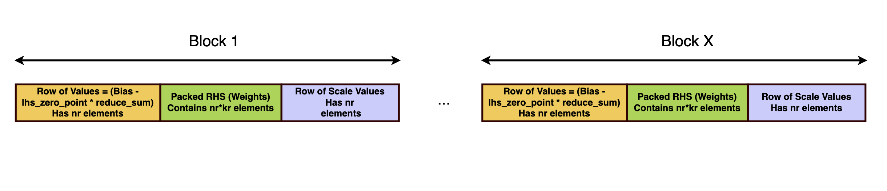
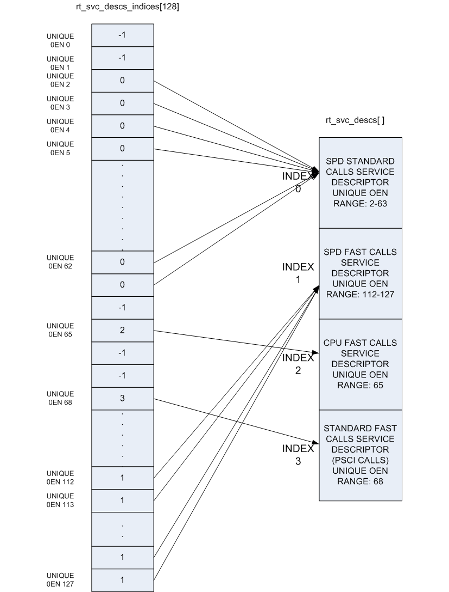

# 02 Arm具身智能软件栈：执行层、部署契约与交付边界

数据截止：2026-11-05（Asia/Shanghai）；本章采集窗口11-04—11-05，复用01原件的实际日期保留在registry。02包含六篇独立专题，所有判断来自已归档官方开发文档及源码；未编译SDK、运行FVP/模型/ROS节点或板卡。本章解释可部署软件链，模型能力、仿真质量与本体商业案例留待后续章节逐章调研。

## 1. Arm平台应当按执行责任理解

Arm提供ISA与CPU/NPU IP及部分计算库，具体SoC供应商提供启动、驱动、编译器和runtime，ROS及机器人应用再负责消息与任务。本章的重要结论是：Arm64可构建不代表一个ONNX模型能直接调用任意NPU；Cortex-R存在也不代表Linux应用自动拥有独立实时控制域。KleidiAI的microkernel不负责内存管理和调度，TI TIDL EP由TI fork提供，S100的软件交付也由地瓜定义。软件可移植性必须拆到源码、图语义、编译产物、buffer协议和目标镜像逐层判断。[S06](https://raw.githubusercontent.com/ARM-software/kleidiai/main/README.md) [S32](https://raw.githubusercontent.com/TexasInstruments/edgeai-tidl-tools/master/README.md)

| 层次/专题 | 实际输入→输出 | 执行与管理责任 | 成立条件 | 尚不能推出的结论 |
|---|---|---|---|---|
| 02A KleidiAI/ACL | packed tensor→CPU算子结果 | 应用/框架管理线程与内存，库选择内核 | ISA扩展、packing、精度和版本匹配 | 完整模型调度或机器人OS |
| 02B Ethos/CMSIS | Vela产物/command stream→NPU输出 | TFLM arena、custom op、driver；CMSIS CPU补充 | 编译器、硬件、delegate/firmware一致 | 所有模型全图加速、控制WCET |
| 02C BSP/多域 | 固件/共享内存消息→域间服务 | BSP、remoteproc/RPMsg、OpenAMP及RT内核 | 设备树、cache、资源表与故障规则 | 功能安全隔离与确定性自动成立 |
| 02D Jetson/ROS | ONNX→engine→TensorList/ROS | TensorRT及Isaac节点、buffer backend | JetPack/TRT/ROS、shape/profile、GPU匹配 | CUDA buffer互通等于零复制闭环 |
| 02E TI TIDL | 模型+校准→net/io/子图→ROS输出 | OSRT CPU调度与C7/MMA加速 | TI fork、padding/shared pool、SDK一致 | 层边界抢占等于立即响应 |
| 02F S100 BPU | 模型→Nash编译物→TROS消息 | OE/HBRT与目标BSP/TROS组件 | 版本和内存契约按专题核验 | 峰值TOPS等于策略吞吐 |

表是基于专题原文的机制比较，非同条件性能排行。不同产品的优势首先表现为减少哪一类工程工作：CPU内核降低算子实现成本，整图runtime降低分区调度成本，机器人节点降低capture/pre/post与消息封装成本，BSP负责启动和外设；这些收益都不能代替目标应用验收。

## 2. 模型移交需要哪些契约

训练侧给出的权重不能单独构成发布包。应一并保存源模型hash、ONNX/opset或原框架、输入尺寸/颜色空间/归一化、量化scale与校准集身份、后处理和labels、编译器选项、runtime版本及目标SKU。KleidiAI的RHS packing可对常量权重缓存，但LHS的动态量化仍要随输入执行；ACL的validate/configure/prepare/run把检查、准备和执行分开。把pack缓存遗漏于时延计量或者跨内核版本复用，会同时影响数值正确性与启动时间。[S04](https://raw.githubusercontent.com/ARM-software/kleidiai/ebe33865eb77addae5f5ea8d277ca0656e1d1be7/examples/matmul_clamp_f32_qsi8d32p_qsi4c32p/matmul_clamp_f32_qsi8d32p_qsi4c32p.cpp) [S01](https://raw.githubusercontent.com/ARM-software/ComputeLibrary/392d8863edeb45256887ae8bcf8de638dda23ad9/arm_compute/runtime/NEON/functions/NEGEMM.h)

Ethos路线依赖command stream及base-address与tensor arena对应，不能仅复制模型文件。当前U85示例明确绑定2025.12 BSP及26.06-rc1工具要求，旧Corstone300样例已弃用；示例生成的全零输入用于通路演示，不是机器人精度测量。Vela与core-driver本次原件取得受限，TFLM调用源码能证明reserve/invoke/release接口，不能补足编译器优化与驱动实现的全部核验。[S07](https://raw.githubusercontent.com/tensorflow/tflite-micro/main/tensorflow/lite/micro/kernels/ethos_u/ethosu.cc) [S10](https://raw.githubusercontent.com/ARM-software/ML-examples/main/ethos-u-corstone-1000/scripts/py/requirements.txt) [S09](https://raw.githubusercontent.com/ARM-software/ML-examples/main/ethos-u-corstone-1000/resources/model_manifest.json)

Jetson engine需要platform/GPU及兼容模式条件，动态shape由profile限定。Isaac当前节点源码只解析动态batch，拒绝动态非batch维度；通用TensorRT支持的动态C/H/W不等于该节点已经开放。TI则生成net、io、metadata等多个文件，native要求全模型卸载；CPU fallback路径对端到端耗时与依赖闭包都有影响。因此跨平台迁移先验证数值参考，再查看分区/不支持算子，最后比较实际运行路径，不能只比较“ONNX导入成功”。[S34](https://docs.nvidia.com/deeplearning/tensorrt/latest/getting-started/support-matrix.html) [S13](https://raw.githubusercontent.com/NVIDIA-ISAAC-ROS/isaac_ros_dnn_inference/release-5.0/isaac_ros_tensor_rt/src/tensor_rt_node.cpp) [S28](https://raw.githubusercontent.com/TexasInstruments/edgeai-tidl-tools/master/docs/model_compilation.md)

## 3. Buffer与消息移交是独立的优化问题

这是Arm官方KleidiAI packing图，展示微内核需要的输入重排。它支持“相同数学tensor与内核buffer格式不同”的结论；具体类型、block与缓存条件按02A固定源码核验，不能把这个CPU图当NPU、CUDA或整个机器人零复制通路。

模型输入shape相同，不意味着设备输入布局相同。packed矩阵、TFLM arena、CUDA device buffer及TI padding/shared memory各自有所有权、大小、对齐和寿命要求。TI原文特别区分元素数与byte数，并指出所述OSRT实现仍有输入及输出复制。TensorRT异步执行要求buffer在设备访问期间有效；Isaac新buffer层还涉及CPU默认backend及回退。某个节点保留handle至enqueue之后是源码依据，完整异步完成与跨节点释放仍需目标执行验证。[S29](https://raw.githubusercontent.com/TexasInstruments/edgeai-tidl-tools/master/docs/io_tensors.md) [S33](https://docs.nvidia.com/deeplearning/tensorrt/latest/inference-library/python-api-docs.html) [S11](https://nvidia-isaac-ros.github.io/concepts/rosidl_buffer/index.html)

由推理tensor转ROS检测/姿态/轨迹，应补足frame_id、单位、时间戳、观测年龄、置信度及错误状态。QoS reliability/depth/deadline用于通信契约，不能直接设定电机保护响应。executor可能受回调耗时及资源竞争影响；引述Jazzy官方文档只支持该文档描述，不能冒充已核Lyrical所有实现。所附官方executor图带历史timer顺序，专题已经用Eloquent修正说明边界。[S20](https://raw.githubusercontent.com/ros2/ros2_documentation/jazzy/source/Concepts/Intermediate/About-Quality-of-Service-Settings.rst) [S19](https://raw.githubusercontent.com/ros2/ros2_documentation/jazzy/source/Concepts/Intermediate/About-Executors.rst)

## 4. 版本组合、域间控制与更新

图为TF-A官方runtime service索引，帮助区分安全监控服务调用与上层模型推理/ROS任务。它只解释服务分派组织，不能证明目标SoC所有启动阶段、hypervisor及远端固件已认证；具体启动与guest限制见02C。[S25](https://raw.githubusercontent.com/ARM-software/arm-trusted-firmware/master/docs/design/firmware-design.rst)

| 软件链 | 本次核得的版本事实 | 冲突/工程影响 | 发布动作（分析建议） |
|---|---|---|---|
| CPU库 | KleidiAI/ACL固定源码身份；ACL旧latest与新文档版号不同 | 主分支build与旧安装命令不可混用 | 固定commit、toolchain和打包格式 |
| Ethos U85 | FVP案例有BSP及RC工具明确要求 | 板卡运行与FVP案例不能互相证明 | 锁编译器/driver/firmware并板上回归 |
| Jetson | 下载页7.2.1/TRT10.16.2；通用TRT11.4.1矩阵要求7.2.2+ | Isaac文档与下载页可用状态存在差异 | 从同一套件验证安装与节点构建 |
| TI | tools11.2与Robotics10.1材料同时存在 | 不是已经验证的联合镜像 | 获取vendor兼容矩阵并复建链 |
| S100 | 新入口明确按RDK与OE/LLM不同产品版本管理 | 旧手册不再更新，不能以URL最新推断包兼容 | 固定查询版本及binary/firmware身份 |

S100新资料中心列OE3.7.0和LLM2.0.0，但带RDK4.0.5查询的静态页面可能显示S600/5.1.1或X3/3.0.0默认头；02F明确区分入口、静态快照和正文单列的S100功能。当前rdk_s的Python接口与X5同名，底层依赖不同。OE当前运行接口为hbDNNInferV2/UCP，动态输出需保留异步taskHandle，模型抢占依赖编译时function-call拆分；这些条件不能由Arm ISA推出。[S21](https://developer.d-robotics.cc/rdk_doc_center/) [S22](https://developer.d-robotics.cc/model_zoo_doc/model_zoo_intro?v=4.0.5&p=RDK+S100) [S23](https://developer.d-robotics.cc/oe_s_doc/static/js/async/19841.bd884296.js) [S24](https://developer.d-robotics.cc/oe_s_doc/static/js/async/48.8e0c898e.js)

版本不是只写一个SDK名称。BSP/内核、设备树、secure boot组件、remote firmware、共享内存ABI、runtime二进制、ROS发行版、模型编译物及安全策略要作为发布集合。Linux remoteproc通过固件资源表组织共享资源，RPMsg发送可能等待buffer，OpenAMP与Linux的buffer大小特性还存在版本差异；接收器必须能辨识消息版本、长度和有效期。[S16](https://docs.kernel.org/staging/remoteproc.html) [S14](https://docs.kernel.org/staging/rpmsg.html) [S18](https://raw.githubusercontent.com/OpenAMP/open-amp/main/README.md)

PREEMPT_RT通过可睡眠锁与线程化中断改变调度机制，不能据此推出任意任务WCET。TI层边界抢占也会等待当前层完成。分析建议把感知/规划与保护执行拆成可测试责任域：应用过期、不再发送、远端重启、总线阻塞时，接收端有明确降级及停止规则。TF-A的启动服务和Xen的guest配置提供构建安全/隔离架构的机制证据，最终安全主张仍需要目标BSP配置、威胁模型及认证材料。[S15](https://docs.kernel.org/core-api/real-time/differences.html) [S31](https://raw.githubusercontent.com/TexasInstruments/edgeai-tidl-tools/master/docs/preemption.md) [S25](https://raw.githubusercontent.com/ARM-software/arm-trusted-firmware/master/docs/design/firmware-design.rst) [S35](https://raw.githubusercontent.com/xen-project/xen/master/docs/misc/arm/device-tree/booting.txt)

更新也不能只换权重。MCUboot的test/confirm/revert与防降级是不同机制；多域更新须定义匹配集合、断电恢复以及旧接收器是否接受新消息。分析建议将模型包与主域、MCU固件、安全策略分开签名，但通过明确的兼容清单联合放行。没有取得具体产品量产OTA方案时，不把这项架构建议描述为各供应商已交付功能。[S17](https://raw.githubusercontent.com/mcu-tools/mcuboot/main/docs/design.md)

## 5. 训练、仿真与任务验收的接口位置

本章已有host模型编译、FVP系统通路、camera/bag感知demo及ROS输出的证据。它们支持部署接口研究，尚不足以证明机器人训练框架、物理仿真与真实任务的闭环。FVP运行NPU示例不是接触物理仿真；x86 host emulation不是目标芯片耗时；感知ROS节点不是动作策略和伺服控制器。后续04—06将分别核模型与数据、仿真与sim-to-real、本体接口。本章只要求这些上游产物能携带上述版本、数值与时间契约，进入可回归的发布流水线。[S08](https://raw.githubusercontent.com/ARM-software/ML-examples/main/ethos-u-corstone-1000/README.md) [S27](https://raw.githubusercontent.com/TexasInstruments/edgeai-robotics-sdk/master/ros2/nodes/ti_vision_cnn/README_objdet.md)

可执行的验收顺序（分析建议）是：先在固定留出数据上对照浮点与目标精度；核编译分区及unsupported算子；确认IO与buffer寿命；在目标镜像测首帧、稳定运行、并发、热稳定和观测年龄分布；最后验证消息过期、节点崩溃、域重启和执行降级。记录warmup、样本数、batch/shape、功率与debug状态，分别给均值/P99、失败率和有方法支撑的最坏边界。不存在同条件实测时，本章不提供性能排序和机器人控制频率。

公开源码也不等于全交付开源。KleidiAI、ACL、CMSIS、TF-A、OpenAMP、Isaac代码许可各有边界，CUDA/TRT、TI binaries、模型权重、商业MCU和安全材料须另核。TI tools的设备范围限制是迁移与再分发条件；S100公开样例许可不能自动覆盖HBRT二进制与商业SDK。本章归档检查证明原件/引用/图源可追溯，不能代替法律审计、语义审计或硬件实测。[S30](https://raw.githubusercontent.com/TexasInstruments/edgeai-tidl-tools/master/LICENSE) [S12](https://raw.githubusercontent.com/NVIDIA-ISAAC-ROS/isaac_ros_dnn_inference/release-5.0/LICENSE) [S02](https://raw.githubusercontent.com/ARM-software/kleidiai/ebe33865eb77addae5f5ea8d277ca0656e1d1be7/LICENSES/Apache-2.0.txt) [S03](https://raw.githubusercontent.com/ARM-software/kleidiai/ebe33865eb77addae5f5ea8d277ca0656e1d1be7/LICENSES/BSD-3-Clause.txt)

## 参考原件与版本边界

所有资料经项目统一下载器归档。本章采集窗口为2026-11-04—11-05，既有资料按registry实际时间复用；采集时间不能替代材料发布日期。网页静态依赖缺损按下表披露，动态交互不保证离线可用。

| ID/资料名 | 版本边界 | 官方原文 | 本地原件 | 归档状态 |
|---|---|---|---|---|
| S01 / ARM_ACL_NEFunction | 固定commit 392d8863edeb45256887ae8bcf8de638dda23ad9 | [原文](https://raw.githubusercontent.com/ARM-software/ComputeLibrary/392d8863edeb45256887ae8bcf8de638dda23ad9/arm_compute/runtime/NEON/functions/NEGEMM.h) | [归档](REFERENCES.md#ref-b86b13162094677d) | 原件与已识别静态依赖完整 |
| S02 / ARM_KAI_Apache | 归档时间2026-11-04T15:47:26.876022+00:00；未明示版号/发布日期 | [原文](https://raw.githubusercontent.com/ARM-software/kleidiai/ebe33865eb77addae5f5ea8d277ca0656e1d1be7/LICENSES/Apache-2.0.txt) | [归档](REFERENCES.md#ref-4acfa876a5b163c1) | 原件与已识别静态依赖完整 |
| S03 / ARM_KAI_BSD | 归档时间2026-11-04T15:47:28.306916+00:00；未明示版号/发布日期 | [原文](https://raw.githubusercontent.com/ARM-software/kleidiai/ebe33865eb77addae5f5ea8d277ca0656e1d1be7/LICENSES/BSD-3-Clause.txt) | [归档](REFERENCES.md#ref-63be7633ac213fb6) | 原件与已识别静态依赖完整 |
| S04 / ARM_KAI_Example_Code | 同一固定KleidiAI commit | [原文](https://raw.githubusercontent.com/ARM-software/kleidiai/ebe33865eb77addae5f5ea8d277ca0656e1d1be7/examples/matmul_clamp_f32_qsi8d32p_qsi4c32p/matmul_clamp_f32_qsi8d32p_qsi4c32p.cpp) | [归档](REFERENCES.md#ref-36c503cbd9897c20) | 原件与已识别静态依赖完整 |
| S05 / ARM_KAI_Packing_Figure | 归档时间2026-11-04T15:48:19.687034+00:00；未明示版号/发布日期 | [原文](https://raw.githubusercontent.com/ARM-software/kleidiai/ebe33865eb77addae5f5ea8d277ca0656e1d1be7/docs/imgs/kai_rhs_packing_pattern_2.png) | [归档](REFERENCES.md#ref-49ce967ac4e8c6bd) | 原件与已识别静态依赖完整 |
| S06 / ARM_KleidiAI_Readme | 归档时间2026-11-04T15:46:02.595359+00:00；未明示版号/发布日期 | [原文](https://raw.githubusercontent.com/ARM-software/kleidiai/main/README.md) | [归档](REFERENCES.md#ref-76cf9034d5f688ad) | 原件与已识别静态依赖完整 |
| S07 / ARM_TFLM_Ethos_Kernel | 归档时间2026-11-04T15:52:07.663635+00:00；未明示版号/发布日期 | [原文](https://raw.githubusercontent.com/tensorflow/tflite-micro/main/tensorflow/lite/micro/kernels/ethos_u/ethosu.cc) | [归档](REFERENCES.md#ref-f453352ee1acb671) | 原件与已识别静态依赖完整 |
| S08 / ARM_U85_Direct | main参考实现，绑定2025.12 BSP/FVP | [原文](https://raw.githubusercontent.com/ARM-software/ML-examples/main/ethos-u-corstone-1000/README.md) | [归档](REFERENCES.md#ref-af97edcc6ae30f5d) | 原件与已识别静态依赖完整 |
| S09 / ARM_U85_Model_Manifest | 归档时间2026-11-04T15:53:39.001532+00:00；未明示版号/发布日期 | [原文](https://raw.githubusercontent.com/ARM-software/ML-examples/main/ethos-u-corstone-1000/resources/model_manifest.json) | [归档](REFERENCES.md#ref-8b2aeecf31f8c104) | 原件与已识别静态依赖完整 |
| S10 / ARM_U85_Requirements | MLEK 26.06-rc1，kas4.4 | [原文](https://raw.githubusercontent.com/ARM-software/ML-examples/main/ethos-u-corstone-1000/scripts/py/requirements.txt) | [归档](REFERENCES.md#ref-0f52b29e2e3f674a) | 原件与已识别静态依赖完整 |
| S11 / Isaac_Buffer | 归档时间2026-11-04T16:05:32.220235+00:00；未明示版号/发布日期 | [原文](https://nvidia-isaac-ros.github.io/concepts/rosidl_buffer/index.html) | [归档](REFERENCES.md#ref-e9167f78686d3ef7) | 部分静态依赖缺失，2项 |
| S12 / Isaac_DNN_License | 归档时间2026-11-04T16:06:28.443838+00:00；未明示版号/发布日期 | [原文](https://raw.githubusercontent.com/NVIDIA-ISAAC-ROS/isaac_ros_dnn_inference/release-5.0/LICENSE) | [归档](REFERENCES.md#ref-855ed4afdf73e0f3) | 原件与已识别静态依赖完整 |
| S13 / Isaac_TRT_Node_Code | release-5.0源码快照，非固定发行包哈希 | [原文](https://raw.githubusercontent.com/NVIDIA-ISAAC-ROS/isaac_ros_dnn_inference/release-5.0/isaac_ros_tensor_rt/src/tensor_rt_node.cpp) | [归档](REFERENCES.md#ref-64cdaa5bb99f217b) | 原件与已识别静态依赖完整 |
| S14 / Linux_RPMsg | Linux 7.4.0-rc1在线文档；非生产BSP绑定 | [原文](https://docs.kernel.org/staging/rpmsg.html) | [归档](REFERENCES.md#ref-4d2d7c913df4a462) | 原件与已识别静态依赖完整 |
| S15 / Linux_RT | Linux 7.4.0-rc1在线文档；非生产BSP绑定 | [原文](https://docs.kernel.org/core-api/real-time/differences.html) | [归档](REFERENCES.md#ref-74547944cdb4b513) | 原件与已识别静态依赖完整 |
| S16 / Linux_Remoteproc | Linux 7.4.0-rc1在线文档；非生产BSP绑定 | [原文](https://docs.kernel.org/staging/remoteproc.html) | [归档](REFERENCES.md#ref-c8e57b87341a5390) | 原件与已识别静态依赖完整 |
| S17 / MCUboot_Design | 归档时间2026-11-04T15:57:36.361319+00:00；未明示版号/发布日期 | [原文](https://raw.githubusercontent.com/mcu-tools/mcuboot/main/docs/design.md) | [归档](REFERENCES.md#ref-9f38724963631ae1) | 原件与已识别静态依赖完整 |
| S18 / OpenAMP_Readme | 归档时间2026-11-04T15:56:59.014002+00:00；未明示版号/发布日期 | [原文](https://raw.githubusercontent.com/OpenAMP/open-amp/main/README.md) | [归档](REFERENCES.md#ref-8a0e4078ea14861c) | 原件与已识别静态依赖完整 |
| S19 / ROS_Executors_Source | Jazzy分支原件，图保留历史timer顺序并附Eloquent修正 | [原文](https://raw.githubusercontent.com/ros2/ros2_documentation/jazzy/source/Concepts/Intermediate/About-Executors.rst) | [归档](REFERENCES.md#ref-3759b956cf598eb5) | 原件与已识别静态依赖完整 |
| S20 / ROS_QoS_Source | 归档时间2026-11-04T16:05:40.210908+00:00；未明示版号/发布日期 | [原文](https://raw.githubusercontent.com/ros2/ros2_documentation/jazzy/source/Concepts/Intermediate/About-Quality-of-Service-Settings.rst) | [归档](REFERENCES.md#ref-eeb1237343f7c813) | 原件与已识别静态依赖完整 |
| S21 / S100_Center | 归档时间2026-11-04T16:19:08.609238+00:00；未明示版号/发布日期 | [原文](https://developer.d-robotics.cc/rdk_doc_center/) | [归档](REFERENCES.md#ref-5f40dbe3ad2cbbeb) | 原件与已识别静态依赖完整 |
| S22 / S100_ModelZoo | 2026-10-29更新；静态页头S600/5.1.0，正文rdk_s要求OS>=4.0.5 | [原文](https://developer.d-robotics.cc/model_zoo_doc/model_zoo_intro?v=4.0.5&p=RDK+S100) | [归档](REFERENCES.md#ref-57b99be401bef6b4) | 原件与已识别静态依赖完整 |
| S23 / S100_OE_Infer | OE入口3.7.0；latest/zh正文JS模块，未取得固定发行包身份 | [原文](https://developer.d-robotics.cc/oe_s_doc/static/js/async/19841.bd884296.js) | [归档](REFERENCES.md#ref-50c2b93d4591b6bf) | 原件与已识别静态依赖完整 |
| S24 / S100_OE_Runtime | OE入口3.7.0；latest/zh正文JS模块，未取得固定发行包身份 | [原文](https://developer.d-robotics.cc/oe_s_doc/static/js/async/48.8e0c898e.js) | [归档](REFERENCES.md#ref-1d45d9ba1eb38d0f) | 原件与已识别静态依赖完整 |
| S25 / TFA_Design | 归档时间2026-11-04T15:57:34.643841+00:00；未明示版号/发布日期 | [原文](https://raw.githubusercontent.com/ARM-software/arm-trusted-firmware/master/docs/design/firmware-design.rst) | [归档](REFERENCES.md#ref-067af44d752ca91c) | 原件与已识别静态依赖完整 |
| S26 / TFA_Service_Figure | 归档时间2026-11-04T15:59:21.027823+00:00；未明示版号/发布日期 | [原文](https://raw.githubusercontent.com/ARM-software/arm-trusted-firmware/master/docs/resources/diagrams/rt-svc-descs-layout.png) | [归档](REFERENCES.md#ref-f6485f6dac51a10c) | 原件与已识别静态依赖完整 |
| S27 / TI_ROS_CNN | Robotics SDK10.1.0文档/仓库快照 | [原文](https://raw.githubusercontent.com/TexasInstruments/edgeai-robotics-sdk/master/ros2/nodes/ti_vision_cnn/README_objdet.md) | [归档](REFERENCES.md#ref-078e995881491710) | 原件与已识别静态依赖完整 |
| S28 / TI_TIDL_Compile | 2026-11-05采集；tools master/11_02_04_00新结构；非固定commit | [原文](https://raw.githubusercontent.com/TexasInstruments/edgeai-tidl-tools/master/docs/model_compilation.md) | [归档](REFERENCES.md#ref-214caa703dcf79bf) | 原件与已识别静态依赖完整 |
| S29 / TI_TIDL_IO | 2026-11-05采集；tools master/11_02_04_00新结构；非固定commit | [原文](https://raw.githubusercontent.com/TexasInstruments/edgeai-tidl-tools/master/docs/io_tensors.md) | [归档](REFERENCES.md#ref-51fc8f23c19fe47a) | 原件与已识别静态依赖完整 |
| S30 / TI_TIDL_License | 2026-11-05采集；tools master/11_02_04_00新结构；非固定commit | [原文](https://raw.githubusercontent.com/TexasInstruments/edgeai-tidl-tools/master/LICENSE) | [归档](REFERENCES.md#ref-7ec7d53f062b7180) | 原件与已识别静态依赖完整 |
| S31 / TI_TIDL_Preemption | 2026-11-05采集；tools master/11_02_04_00新结构；非固定commit | [原文](https://raw.githubusercontent.com/TexasInstruments/edgeai-tidl-tools/master/docs/preemption.md) | [归档](REFERENCES.md#ref-837491a4bac3ecc7) | 原件与已识别静态依赖完整 |
| S32 / TI_TIDL_Tools | 2026-11-05采集；tools master/11_02_04_00新结构；非固定commit | [原文](https://raw.githubusercontent.com/TexasInstruments/edgeai-tidl-tools/master/README.md) | [归档](REFERENCES.md#ref-fa69bb6df8c7c61b) | 原件与已识别静态依赖完整 |
| S33 / TRT_Runtime_API | TRT11.4.1文档；更新2026-10-28；非JetPack7.2.1绑定版本 | [原文](https://docs.nvidia.com/deeplearning/tensorrt/latest/inference-library/python-api-docs.html) | [归档](REFERENCES.md#ref-c92d10d3c41527ea) | 原件与已识别静态依赖完整 |
| S34 / TRT_Support | TRT11.4.1文档；更新2026-10-28；非JetPack7.2.1绑定版本 | [原文](https://docs.nvidia.com/deeplearning/tensorrt/latest/getting-started/support-matrix.html) | [归档](REFERENCES.md#ref-3b68f26af8646cbc) | 原件与已识别静态依赖完整 |
| S35 / Xen_ARM_Boot | 归档时间2026-11-04T15:58:48.103678+00:00；未明示版号/发布日期 | [原文](https://raw.githubusercontent.com/xen-project/xen/master/docs/misc/arm/device-tree/booting.txt) | [归档](REFERENCES.md#ref-b683d5b46bf0ed38) | 原件与已识别静态依赖完整 |

- [独立资料索引](REFERENCES.md)

- [主张与图源记录](research_state/evidence/02_Software_Stack.json)

- [开始前基线](research_state/baselines/02_Software_Stack_before.json)

## 专题、质量与续接

- [六篇独立专题索引](02_Topics_Index.md)
- [联合引用清单](research_state/manifests/ARM_02_Software_Depth_Union.json)

02完成后等待用户审阅；03—09仍为原有首轮内容，未开展下一章。Zena专有SDK/BSP交付与安全材料尚未取得，未以通用Arm库替代该产品实际支持；其软件承诺需供应商确认。
