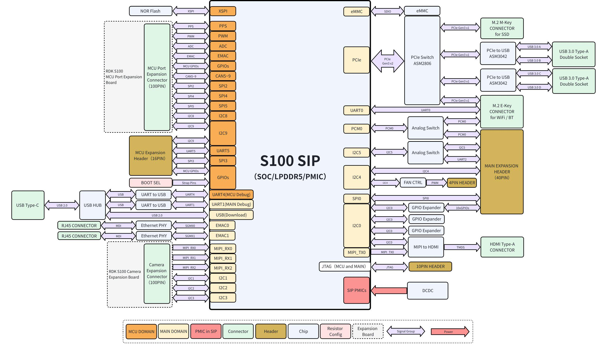
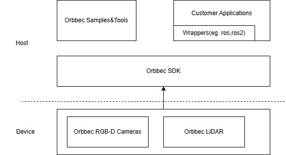

# 03 传感器接入：物理接口、buffer与时钟契约

资料截止2026-11-05。本章对象是01代表平台S100、Jetson、TI及第三方RGB-D/LiDAR SDK的接入机制，未接线、刷机或进行并发测量。Arm ISA可执行驱动/融合程序，连接器、ISP、串行解串器及同步电路由SoC/载板/传感器决定，不能按Arm品牌合并支持名单。

## 1. 接入矩阵与能力归属

这是S100官方拓扑原图，显示MIPI、USB、网络与MCU域的物理分工。图支持识别入口及主/MCU域，不证明具体相机驱动、时间同步精度或多路并发。01规格与02部署版本继续适用。[S01](https://raw.githubusercontent.com/D-Robotics/rdk_doc/main/docs_s/01_Quick_start/01_hardware_introduction/01_rdk_s100.md)

| 数据类别 | 可核入口/示例 | 真正负责者 | 需验证的边界 |
|---|---|---|---|
| RGB/MIPI | S100 MIPI streamer；TI IMX219/IMX390节点 | sensor配置、BSP/ISP、扩展板 | RAW位宽/lane/时钟与型号匹配 |
| RGB-D/USB或网络 | Orbbec SDK2列Jetson ARM64测试对象 | 相机firmware、SDK、主机USB/网络 | 每型号最低固件，不能推广所有Arm板 |
| LiDAR/IMU | Orbbec2.6.2+ Pulsar ME450/SL450 | LiDAR SDK/传输/时间戳 | 点云与IMU同步声明非其他设备通用 |
| Radar/ToF | 通过具体SoC外设与产品SDK接入 | 雷达/ToF模块、bridge和驱动 | 本文未取得通用Arm直接融合交付物 |
| 力矩/触觉/关节 | S100 MCU IPC及其外设通路 | 传感器ADC/总线协议、MCU控制应用 | 消息单位、校准、序号和保护规则 |

S100新MIPI正文列IMX219/SC230AI，同时静态版本合并另一组含shw3hstd的内容；页头为S600/5.1.1，不能把携带4.0.5查询的URL当S1004.0.5独占驱动证明。演示输出至HDMI验证的是capture/display链，尚不等于BPU推理或ROS融合链。TI对象检测README给ZED、USB、IMX219/IMX390入口，IMX390要求LDC LUT；本次更深gscam驱动README路径未取得，不补造FPD-Link serializer型号、配置或同步支持。[S12](https://developer.d-robotics.cc/rdk_s_doc/Basic_Application/Image/mipi_camera?v=4.0.5&p=RDK+S100) [S14](https://raw.githubusercontent.com/TexasInstruments/edgeai-robotics-sdk/master/ros2/nodes/ti_vision_cnn/README_objdet.md)

Orbbec ARM64测试名单明确是Jetson多款设备，SDK还按相机型号列最低及推荐firmware。Gemini2XL在所引v2表为不支持，不能按“Gemini系列”整体承诺。某些OpenNI到UVC升级改变firmware major与SDK要求，必须验证目标sensor型号和协议。当前LingBot增强深度滤波另绑定JetPack6.2，与02取得的新套件不能直接拼成兼容组合。[S08](https://raw.githubusercontent.com/orbbec/OrbbecSDK_v2/main/README.md)

## 2. 从采集格式走到加速器

Orbbec官方架构图描述设备、通信/数据处理和API封装的层次。图证明SDK存在跨平台设备接入与处理结构，不能证明DMA-BUF导出、每平台全链零复制或滤波数值收益。相机经SDK输出RGB-D后，应用还要将格式、stride、量化与所有权转换到目标runtime。[S08](https://raw.githubusercontent.com/orbbec/OrbbecSDK_v2/main/README.md)

Linux V4L2 v4l2_buffer区分length与bytesused，多planar还有data_offset；payload为bytesused减data_offset，不能按width×height直接读取整个映射空间。sequence可能包括主机丢失/重复帧，但某些USB设备内部丢失未被计入。格式或控制改变影响buffer大小时，streamoff、重新配置与buffer重分配有明确次序及EBUSY/EINVAL/ENOSPC条件；运行中直接改变分辨率可能破坏下游模型IO。[S05](https://www.kernel.org/doc/html/latest/userspace-api/media/v4l/buffer.html)

DMA-BUF把exporter的内存通过FD交给importer，设备映射须针对自身地址空间建立attachment，fence标设备异步完成，dma-resv组织隐式同步。CPU访问要begin/end_cpu_access处理cache，FD还需CLOEXEC。机制降低中间复制的条件是双方driver支持同一内存、格式/布局一致、正确同步和寿命；IOMMU可达性及allocation属性也要目标验证。不同加速器的“shared memory”不是自动互认协议。[S04](https://www.kernel.org/doc/html/latest/driver-api/dma-buf.html)

TI当前OSRT文档说明连续CPU tensor到带padding共享内存存在输入/输出复制；S100 UCP则要求按alignedByteSize/stride与cache操作准备IO。Jetson buffer backend与异步提交也有独立所有权。分析建议：把capture→ISP/decode→resize/color→模型→post→ROS各段分别标copy/import/CPU touch及fence，测实际字节、分配数和寿命，不用节点zero-copy标签代表整个流水线。[S15](https://raw.githubusercontent.com/TexasInstruments/edgeai-tidl-tools/master/docs/io_tensors.md) [S13](https://developer.d-robotics.cc/oe_s_doc/static/js/async/48.8e0c898e.js) [S03](https://nvidia-isaac-ros.github.io/concepts/rosidl_buffer/index.html)

## 3. 时间戳不是一个字段就能解决

V4L2的MONOTONIC标志描述时钟，SOE/EOF标志描述采样相对曝光的事件；需要同时解码。通用结构说明与驱动实际打点不同，EOF的软件读取还可能晚于最后像素。rolling shutter各行曝光存在偏移，单帧stamp不天然表示每个像素同时采集；本文未取得各目标sensor的逐行曝光标定，融合不能默认global shutter。[S05](https://www.kernel.org/doc/html/latest/userspace-api/media/v4l/buffer.html)

Orbbec文档明确frame是device时间（不支持时host fallback）、system是host接收、global是映射到host域且保留原曝光事件。所有API以us返回仍不能跨域相减；global为0表示不可用。Gemini330长基线默认曝光结束、短基线默认曝光中点，启用global不会改变这个起点。Linux/Android SDK monotonic用CLOCK_MONOTONIC_RAW，不能直接与任意steady_clock数值比较。[S09](https://raw.githubusercontent.com/orbbec/OrbbecSDK_v2/main/docs/tutorial/timestamp.md)

所引periodic sync可能使stream时间戳不连续，消费者需检测跳变、重置窗口或降级。system−global测曝光事件至SDK接收，包含设备处理和传输，并受clock mapping误差影响；它不是发布到控制器的全链延迟，更不是纯传输耗时。硬触发约束曝光，PTP约束时钟映射，软件stamp匹配约束消息组合，三者作用不同；没有目标PTP硬件和外部trigger接线证据，本文不声称同步精度或所有设备支持。[S09](https://raw.githubusercontent.com/orbbec/OrbbecSDK_v2/main/docs/tutorial/timestamp.md)

## 4. 融合、吞吐与异常恢复

message_filters ExactTime要求header stamp完全一致，ApproximateTime按时间匹配，allow_headerless使用当前ROS时间代替缺失stamp。后者解决消息字段缺失，无法重建真实采集时刻。队列越大/等待越长可能增加配对概率，却使观测过期；文档还警示订阅QoS与发布不匹配时callback不执行。跨设备融合必须有同域stamp、外参、单位和观测年龄预算，算法同步器不能弥补错误时间源。[S10](https://raw.githubusercontent.com/ros2/message_filters/rolling/doc/index.rst) [S11](https://raw.githubusercontent.com/ros2/ros2_documentation/jazzy/source/Concepts/Intermediate/About-Quality-of-Service-Settings.rst)

分析示例：1920×1080×30fps×12bit紧凑RAW每路为746,496,000bit/s，即93.312MB/s；四路373.248MB/s。若驱动解包到16bit，每路124.416MB/s，四路497.664MB/s；RGB8为186.624MB/s/路。这里MB为十进制，未含CSI包头、blanking、USB/以太协议或CPU/GPU读写次数，也没有sensor或BSP能实现该组合的实测。分辨率表、连接器路数和理想DDR带宽不能代替整机并发能力。

点云要保留点级/scan时间用于运动去畸变，IMU需bias/轴向/频率标定，力矩需零点、温漂、饱和和单位；这些是分析提出的验收契约，未声称平台预装对应融合算法。Orbbec LiDAR提供点云与同步IMU、录制回放入口，不能扩展到任意Radar/ToF。不同本体的关节顺序、触觉阵列和力传感器SDK仍需独立交付。[S06](https://raw.githubusercontent.com/orbbec/OrbbecSDK_v2/main/LiDAR_README.md)

最终验收应保存sensor/firmware、BSP、camera配置、曝光、同步参数、格式和标定hash；测多路稳定与热态、端到端观测年龄及丢帧，区分sensor内丢帧、采集queue、模型背压和DDS丢失。拔插、设备复位、时间跳变与下游迟滞时，停止消费无效旧buffer，重建配置并通知控制链。P99只描述分布，保护停止上界仍需方法和实机证据。SDK许可不覆盖所有相机firmware、标定数据或本体应用；本文无已接线/融合/性能验证声明。

## 参考原件与版本边界

所有资料经项目统一下载器归档。本章资料截止2026-11-05，既有资料按实际时间复用；本章采集日2026-11-05，既有资料按registry实际时间复用；采集时间不能替代材料发布日期。网页静态依赖缺损按下表披露，动态交互不保证离线可用。

| ID/资料名 | 版本边界 | 官方原文 | 本地原件 | 归档状态 |
|---|---|---|---|---|
| S01 / DROBOTICS_S100 | 归档时间2026-11-04T15:19:38.094090+00:00；未明示版号/发布日期 | [原文](https://raw.githubusercontent.com/D-Robotics/rdk_doc/main/docs_s/01_Quick_start/01_hardware_introduction/01_rdk_s100.md) | [归档](REFERENCES.md#ref-bbf00e131fb43c5c) | 原件与已识别静态依赖完整 |
| S02 / DROBOTICS_S100_Figure | 归档时间2026-11-04T15:28:03.564958+00:00；未明示版号/发布日期 | [原文](https://rdk-doc.oss-cn-beijing.aliyuncs.com/doc/img/01_Quick_start/image/hardware_interface/image-rdk_s100_architecture_diagram.png) | [归档](REFERENCES.md#ref-f3a9074b0c428e82) | 原件与已识别静态依赖完整 |
| S03 / Isaac_Buffer | 归档时间2026-11-04T16:05:32.220235+00:00；未明示版号/发布日期 | [原文](https://nvidia-isaac-ros.github.io/concepts/rosidl_buffer/index.html) | [归档](REFERENCES.md#ref-e9167f78686d3ef7) | 部分静态依赖缺失，2项 |
| S04 / Linux_DMABUF | Linux latest driver API快照 | [原文](https://www.kernel.org/doc/html/latest/driver-api/dma-buf.html) | [归档](REFERENCES.md#ref-36bb9f4e55cf47fb) | 原件与已识别静态依赖完整 |
| S05 / Linux_V4L2_Buffer | Linux latest在线文档快照，非目标BSP稳定版 | [原文](https://www.kernel.org/doc/html/latest/userspace-api/media/v4l/buffer.html) | [归档](REFERENCES.md#ref-2c26e34b1c9ad3dc) | 原件与已识别静态依赖完整 |
| S06 / Orbbec_Lidar | 归档时间2026-11-04T16:38:05.671626+00:00；未明示版号/发布日期 | [原文](https://raw.githubusercontent.com/orbbec/OrbbecSDK_v2/main/LiDAR_README.md) | [归档](REFERENCES.md#ref-dda18c83893abb5b) | 原件与已识别静态依赖完整 |
| S07 / Orbbec_Overview_Figure | 归档时间2026-11-04T16:38:06.913888+00:00；未明示版号/发布日期 | [原文](https://raw.githubusercontent.com/orbbec/OrbbecSDK_v2/main/docs/resource/Overview.jpg) | [归档](REFERENCES.md#ref-0c3171fa2989be6a) | 原件与已识别静态依赖完整 |
| S08 / Orbbec_SDK2 | main快照；LiDAR门槛2.6.2，滤波JetPack6.2 | [原文](https://raw.githubusercontent.com/orbbec/OrbbecSDK_v2/main/README.md) | [归档](REFERENCES.md#ref-96eb386e04fb724f) | 原件与已识别静态依赖完整 |
| S09 / Orbbec_Timestamp | 归档时间2026-11-04T16:38:03.373708+00:00；未明示版号/发布日期 | [原文](https://raw.githubusercontent.com/orbbec/OrbbecSDK_v2/main/docs/tutorial/timestamp.md) | [归档](REFERENCES.md#ref-6d698eb3dad5c80c) | 原件与已识别静态依赖完整 |
| S10 / ROS_MessageFilters | 归档时间2026-11-04T16:37:02.852740+00:00；未明示版号/发布日期 | [原文](https://raw.githubusercontent.com/ros2/message_filters/rolling/doc/index.rst) | [归档](REFERENCES.md#ref-d6369762debb3218) | 原件与已识别静态依赖完整 |
| S11 / ROS_QoS_Source | 归档时间2026-11-04T16:05:40.210908+00:00；未明示版号/发布日期 | [原文](https://raw.githubusercontent.com/ros2/ros2_documentation/jazzy/source/Concepts/Intermediate/About-Quality-of-Service-Settings.rst) | [归档](REFERENCES.md#ref-eeb1237343f7c813) | 原件与已识别静态依赖完整 |
| S12 / S100_Camera | 2026-11-04更新；静态S600/5.1.1头，query非专属快照 | [原文](https://developer.d-robotics.cc/rdk_s_doc/Basic_Application/Image/mipi_camera?v=4.0.5&p=RDK+S100) | [归档](REFERENCES.md#ref-32c165b12bc88e58) | 原件与已识别静态依赖完整 |
| S13 / S100_OE_Runtime | 归档时间2026-11-04T16:24:12.300751+00:00；未明示版号/发布日期 | [原文](https://developer.d-robotics.cc/oe_s_doc/static/js/async/48.8e0c898e.js) | [归档](REFERENCES.md#ref-1d45d9ba1eb38d0f) | 原件与已识别静态依赖完整 |
| S14 / TI_ROS_CNN | 归档时间2026-11-04T16:11:31.199469+00:00；未明示版号/发布日期 | [原文](https://raw.githubusercontent.com/TexasInstruments/edgeai-robotics-sdk/master/ros2/nodes/ti_vision_cnn/README_objdet.md) | [归档](REFERENCES.md#ref-078e995881491710) | 原件与已识别静态依赖完整 |
| S15 / TI_TIDL_IO | 归档时间2026-11-04T16:11:56.070091+00:00；未明示版号/发布日期 | [原文](https://raw.githubusercontent.com/TexasInstruments/edgeai-tidl-tools/master/docs/io_tensors.md) | [归档](REFERENCES.md#ref-51fc8f23c19fe47a) | 原件与已识别静态依赖完整 |

- [官方资料索引](REFERENCES.md)

- [主张与图源记录](research_state/evidence/03_Sensor_Integration.json)

- [开始前基线](research_state/baselines/03_Sensor_Integration_before.json)
