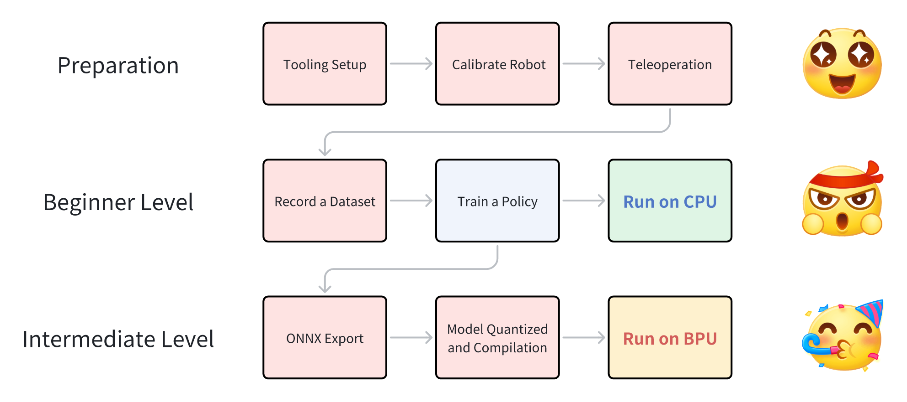
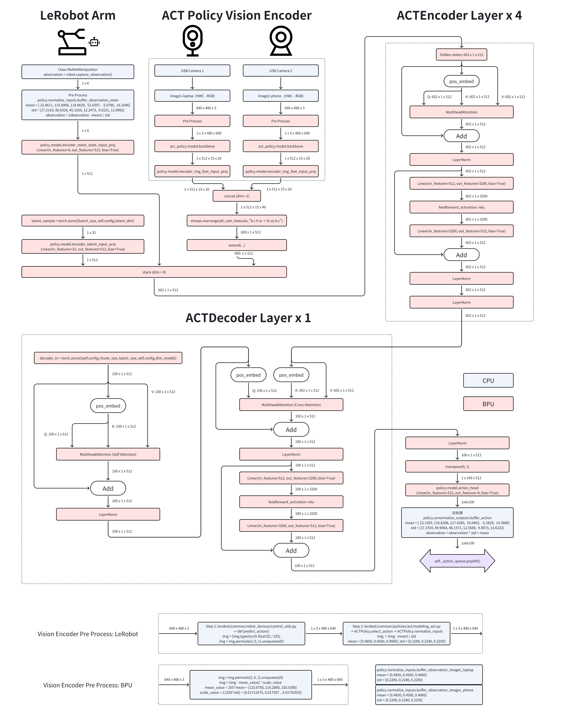

# 04｜Arm 的具身智能 AI 能力与模型地图

## 研究结论与证据等级

Arm 提供执行架构、CPU/NPU IP 与计算库；可部署模型的集合最终由具体 SoC、内存、编译器和本体适配共同决定。应分为 Arm 原生优化库、SoC 厂商部署示例、模型作者的训练/推理实现、框架兼容路线四层。地瓜 S100 的 ACT 有采集到 BPU 执行的官方教程；openpi 的参考硬件明确是 NVIDIA GPU，不能据此声称 π0 已在任意 Arm 端侧运行。HF 模型页面存在也不代表平台提供了算子覆盖、数值回归或时延承诺。[S16](https://raw.githubusercontent.com/D-Robotics/rdk_LeRobot_tools/main/README.md) [S12](https://raw.githubusercontent.com/Physical-Intelligence/openpi/main/README.md) [S04](https://raw.githubusercontent.com/ARM-software/kleidiai/main/README.md)

## 按任务建立模型地图

| 任务 | 模型/实际版本 | 模态与规模口径 | 官方入口 | Arm 证据等级 |
|---|---|---|---|---|
| 语言与任务推理 | Qwen3 / 2507 分支 | 4B、30B-A3B、235B-A22B 等；MoE 总量/激活量不同 | [S13](https://raw.githubusercontent.com/QwenLM/Qwen2.5/main/README.md) | CPU/GPU 工具路线；未取得目标板闭环测试 |
| 视觉/相对深度 | Depth Anything V2 | Small 24.8M、Base 97.5M、Large 335.3M；Giant 1.3B 在该 README 标 coming soon | [S06](https://raw.githubusercontent.com/DepthAnything/Depth-Anything-V2/main/README.md) | S100 model zoo 示例与上游实现分开 |
| 多模态视觉表征 | DINOv2、SigLIP | 相机编码器；参数依 checkpoint | [S18](https://raw.githubusercontent.com/D-Robotics/rdk_model_zoo/rdk_s/README.md) | 模型列表，不能推出完整 VLM 机器人问答 |
| 操作模仿学习 | ACT | 相机＋关节状态→动作 chunk | [S03](https://raw.githubusercontent.com/tonyzhaozh/act/main/README.md) [S16](https://raw.githubusercontent.com/D-Robotics/rdk_LeRobot_tools/main/README.md) | S100 官方部署教程 |
| 语言条件操作 | π0、π0-FAST、π0.5 | 图像、状态、语言→动作序列 | [S12](https://raw.githubusercontent.com/Physical-Intelligence/openpi/main/README.md) | 上游 GPU 实现；S100 与 S600 不互换 |

Qwen2.5 的旧仓库 URL 本次原件实际呈现 Qwen3 内容，报告按原件写 Qwen3，避免把 URL 名称当模型版本。可核验入口包括 HF 标识 `Qwen/Qwen3-4B-Instruct-2507`（入口由 README 确认，卡原件未取得）。Qwen2.5-0.5B 和 SmolVLA 模型卡本次被 robots 限制，未取得原件；不据印象补全权重许可。LeRobot 官方仓库作为模仿学习工具入口，有数据、机器人和策略组织，但不同策略的依赖和部署成熟度需分别核实。[S13](https://raw.githubusercontent.com/QwenLM/Qwen2.5/main/README.md) [S09](https://raw.githubusercontent.com/huggingface/lerobot/main/README.md)

| 任务 | 路线 | 已取得事实 | 未成立的推论 |
|---|---|---|---|
| 世界模型/强化学习 | DreamerV3 | 世界模型与想象轨迹训练 actor/critic；JAX GPU 默认，可选 CPU/TPU | 全部 Arm 板可高效训练，或真实接触准确 |
| 视频预测/生成 | Cosmos Predict2 | 2B/14B Video2World；README 要求 x86-64、Ampere+、CUDA12.6，指向迁移 Predict2.5 | 原生 Arm 推理、物理求解器或当前最新产品 |
| 定位、重建、导航 | 视觉/深度＋SLAM＋规划器 | 传感器与模型接口可以组合，需标定、地图和时钟契约 | 检测模型已有完整 AMR 泛化导航能力 |
| 全身运动与控制 | RL 策略、MPC、IK、轨迹优化 | 本研究未取得特定 Arm 本体完整实测组合 | 把 MPC/IK 称为基础模型，或直接复用操作策略 |
| 自动化 agent | LLM＋工具/任务编排 | 上游工具调用路线 | 语言回答正确等于机械执行安全、任务成功 |

世界模型两条路线原件分别见 [S07](https://raw.githubusercontent.com/danijar/dreamerv3/main/README.md) [S05](https://raw.githubusercontent.com/nvidia-cosmos/cosmos-predict2/main/README.md)。任务缺口是研究结论的一部分：没有依据把通用语言榜单、仿真奖励或视频清晰度换算为本体操作成功率。

## ACT：完整部署链比模型名字更有意义

ACT 的 policy 源码对图像执行 ImageNet 归一化；训练使用带 padding 掩码的 L1 与 KL 项，推理生成动作序列。原始教程的 chunk_size=100、hidden_dim=512 等是特定实验配置，约 90% TransferCube、约 50% BimanualInsertion 是 MuJoCo 仿真任务预期，不能移植成 S100 实机数据。temporal_agg 属动作聚合选项，训练损失平稳也不证明任务成功。[S02](https://raw.githubusercontent.com/tonyzhaozh/act/main/policy.py) [S03](https://raw.githubusercontent.com/tonyzhaozh/act/main/README.md)

官方流程图表明标定、遥操作、数据集、训练、CPU 基线、ONNX、量化编译、BPU 是连续交付物。S100 教程两台 USB 相机使用 640×480、30fps，并将相机名称、关节键和统计量绑定到策略；训练示例在 TITAN Xp 工作站，batch=8、5万次迭代、50组约60秒数据，约4小时是教程条件下的训练声明，不是板端训练能力。[S16](https://raw.githubusercontent.com/D-Robotics/rdk_LeRobot_tools/main/README.md)

第二张原图可追到两路视觉 backbone、状态投影、潜变量投影、4层 encoder 与1层 decoder，并用颜色区分 CPU/BPU。图中100动作的 decoder shape 与 README 中“约50ms生成50动作”的描述不是相同固定配置；需保存各自 checkpoint、chunk_size 和编译清单，不能拼成统一 benchmark。图中 CPU 负责状态/图像预处理及动作反归一化，BPU 并非整个机器人程序。

实际导出按视觉编码器和 Transformer 拆分 ONNX，校准数据来自本体采集集，编译生成两个 HBM，并保存 action/camera mean/std 等 `.npy`。部署必须交付整个配置目录；仅替换 HBM 而遗漏统计量会改变关节目标。S100 的 PTQ GPU Docker 用于加速校准，不表示 NVIDIA GPU 是板端运行依赖。教程称 BPU 100% 时约50ms生成50动作、执行 chunk 时占用降到0%；没有功耗、采样数、P99及相机/RPC计时范围，不可推导1000Hz电机伺服。[S16](https://raw.githubusercontent.com/D-Robotics/rdk_LeRobot_tools/main/README.md)

## π 系列：计算与动作边界

openpi 提供 flow matching 的 π0/π0.5 与 FAST 自回归路线；当前 PyTorch 实现不覆盖 π0-FAST 全部功能。配置默认 `dtype=bfloat16`、`paligemma_variant=gemma_2b`、`action_expert_variant=gemma_300m`、`action_dim=32`、`action_horizon=50`；π0.5 的默认 token 长度200，其他默认48。variant 名不是精确总参数计数，32维也不是目标机器人必然有32个关节。默认三个相机键包含 base 与双 wrist，换成本体两相机时必须同时调整观测转换和训练/归一化。[S10](https://raw.githubusercontent.com/Physical-Intelligence/openpi/main/src/openpi/models/pi0_config.py)

官方 README 给推理显存大于8GB、LoRA大于22.5GB、全量训练大于70GB的参考条件，测试 Ubuntu22.04；不能把这些 NVIDIA GPU 显存数字视为任意共享内存 SoC 的最低 RAM。远程 websocket policy server 可把计算卸载到工作站，但相机压缩、RPC、队列等待和动作年龄必须纳入截止期；断网后已缓存动作能否继续，属于本体控制契约。归一化 std 过小、相机位置改变、坐标轴或末端姿态表示改变，会产生比算子误差更大的分布偏移。[S12](https://raw.githubusercontent.com/Physical-Intelligence/openpi/main/README.md)

## 精度、许可、数据与放行

Depth Anything V2 默认相对深度不提供米制尺度；仓库另列 metric depth 与低分辨率 LiDAR 提示路线。相对深度的排序可以用于视觉理解，却不能未经尺度验证直接成为碰撞距离。Small 的权重采用 Apache2.0，Base/Large/Giant 标为 CC-BY-NC4.0，须按 checkpoint 区分商业使用。openpi 源码 Apache2.0、LeRobot 源码 Apache2.0、ACT 源码 MIT、地瓜工具源码 Apache2.0；这些源码许可不能自动覆盖全部下载权重、数据集、固件和本体 SDK。[S06](https://raw.githubusercontent.com/DepthAnything/Depth-Anything-V2/main/README.md) [S11](https://raw.githubusercontent.com/Physical-Intelligence/openpi/main/LICENSE) [S08](https://raw.githubusercontent.com/huggingface/lerobot/main/LICENSE) [S01](https://raw.githubusercontent.com/tonyzhaozh/act/main/LICENSE) [S17](https://raw.githubusercontent.com/D-Robotics/rdk_LeRobot_tools/main/LICENSE)

工程放行应将 episode 按物体/场景/日期留出，记录失败和人工介入而非只保留成功录像；校准集覆盖暗光、遮挡、关节极值，比较 FP 与量化后的动作偏差及闭环成功率。并发评估同时运行采集、推理、日志和控制，记录首帧、稳态、热降频、P99、内存峰值与队列长度。策略回退须一并版本化模型、统计量、相机标定、控制限制和 runtime。以上为可复建验证方案，本研究未运行 SDK、模型或机器人，未取得 Arm 通用 VLA 性能、物理泛化或安全认证证据。

## 参考原件与版本边界

所有资料经项目统一下载器归档。本章资料截止2026-11-05，既有资料按实际时间复用；本章采集日2026-11-05，既有资料按registry实际时间复用；采集时间不能替代材料发布日期。网页静态依赖缺损按下表披露，动态交互不保证离线可用。

| ID/资料名 | 版本边界 | 官方原文 | 本地原件 | 归档状态 |
|---|---|---|---|---|
| S01 / ACT_License | 归档时间2026-11-04T16:41:23.669229+00:00；未明示版号/发布日期 | [原文](https://raw.githubusercontent.com/tonyzhaozh/act/main/LICENSE) | [归档](REFERENCES.md#ref-47db94ffa041b092) | 原件与已识别静态依赖完整 |
| S02 / ACT_Policy_Code | 归档时间2026-11-04T16:41:17.209340+00:00；未明示版号/发布日期 | [原文](https://raw.githubusercontent.com/tonyzhaozh/act/main/policy.py) | [归档](REFERENCES.md#ref-23574ad40b7e29e1) | 原件与已识别静态依赖完整 |
| S03 / ACT_Readme | 教程MuJoCo2.3.7，非最新依赖 | [原文](https://raw.githubusercontent.com/tonyzhaozh/act/main/README.md) | [归档](REFERENCES.md#ref-1b21ddbac18a2bb3) | 原件与已识别静态依赖完整 |
| S04 / ARM_KleidiAI_Readme | 归档时间2026-11-04T15:46:02.595359+00:00；未明示版号/发布日期 | [原文](https://raw.githubusercontent.com/ARM-software/kleidiai/main/README.md) | [归档](REFERENCES.md#ref-76cf9034d5f688ad) | 原件与已识别静态依赖完整 |
| S05 / CosmosPredict2_Readme | 归档时间2026-11-04T16:40:40.797166+00:00；未明示版号/发布日期 | [原文](https://raw.githubusercontent.com/nvidia-cosmos/cosmos-predict2/main/README.md) | [归档](REFERENCES.md#ref-cc635995e0a98fda) | 原件与已识别静态依赖完整 |
| S06 / DepthAnything2_Readme | 归档时间2026-11-04T16:40:38.119416+00:00；未明示版号/发布日期 | [原文](https://raw.githubusercontent.com/DepthAnything/Depth-Anything-V2/main/README.md) | [归档](REFERENCES.md#ref-c1030fccd8827de2) | 原件与已识别静态依赖完整 |
| S07 / Dreamer3_Readme | 归档时间2026-11-04T16:40:39.448084+00:00；未明示版号/发布日期 | [原文](https://raw.githubusercontent.com/danijar/dreamerv3/main/README.md) | [归档](REFERENCES.md#ref-34e289c45c06c883) | 原件与已识别静态依赖完整 |
| S08 / LeRobot_License | 归档时间2026-11-04T16:41:22.139053+00:00；未明示版号/发布日期 | [原文](https://raw.githubusercontent.com/huggingface/lerobot/main/LICENSE) | [归档](REFERENCES.md#ref-b31a4316deb136be) | 原件与已识别静态依赖完整 |
| S09 / LeRobot_Readme | 归档时间2026-11-04T16:40:33.359326+00:00；未明示版号/发布日期 | [原文](https://raw.githubusercontent.com/huggingface/lerobot/main/README.md) | [归档](REFERENCES.md#ref-ff1eedfea7364372) | 原件与已识别静态依赖完整 |
| S10 / OpenPI_Config | main快照，配置默认值 | [原文](https://raw.githubusercontent.com/Physical-Intelligence/openpi/main/src/openpi/models/pi0_config.py) | [归档](REFERENCES.md#ref-baf8f866abcf634f) | 原件与已识别静态依赖完整 |
| S11 / OpenPI_License | 归档时间2026-11-04T16:41:19.955760+00:00；未明示版号/发布日期 | [原文](https://raw.githubusercontent.com/Physical-Intelligence/openpi/main/LICENSE) | [归档](REFERENCES.md#ref-e7710e649d1b8e41) | 原件与已识别静态依赖完整 |
| S12 / OpenPI_Readme | 归档时间2026-11-04T16:40:31.002550+00:00；未明示版号/发布日期 | [原文](https://raw.githubusercontent.com/Physical-Intelligence/openpi/main/README.md) | [归档](REFERENCES.md#ref-93ae0cec36eeb1cd) | 原件与已识别静态依赖完整 |
| S13 / Qwen25_Readme | 旧URL本次实际内容Qwen3/2507；不作为Qwen2.5卡 | [原文](https://raw.githubusercontent.com/QwenLM/Qwen2.5/main/README.md) | [归档](REFERENCES.md#ref-38a2cea1b0eedc71) | 原件与已识别静态依赖完整 |
| S14 / S100_ACT_BPU_Figure | 归档时间2026-11-04T16:45:01.533828+00:00；未明示版号/发布日期 | [原文](https://raw.githubusercontent.com/D-Robotics/rdk_LeRobot_tools/main/imgs/BPU_deploy_analysis.png) | [归档](REFERENCES.md#ref-b60f73ac22e0ab86) | 原件与已识别静态依赖完整 |
| S15 / S100_ACT_Whole_Figure | 归档时间2026-11-04T16:44:48.802042+00:00；未明示版号/发布日期 | [原文](https://raw.githubusercontent.com/D-Robotics/rdk_LeRobot_tools/main/imgs/Overview_of_the_whole_process.png) | [归档](REFERENCES.md#ref-5e173d77c7606ef5) | 原件与已识别静态依赖完整 |
| S16 / S100_LeRobot | 归档时间2026-11-04T16:40:34.619562+00:00；未明示版号/发布日期 | [原文](https://raw.githubusercontent.com/D-Robotics/rdk_LeRobot_tools/main/README.md) | [归档](REFERENCES.md#ref-6bda06b018c27f9c) | 原件与已识别静态依赖完整 |
| S17 / S100_LeRobot_License | 归档时间2026-11-04T16:45:04.407700+00:00；未明示版号/发布日期 | [原文](https://raw.githubusercontent.com/D-Robotics/rdk_LeRobot_tools/main/LICENSE) | [归档](REFERENCES.md#ref-37afc35370e19359) | 原件与已识别静态依赖完整 |
| S18 / S100_Zoo_Readme | 归档时间2026-11-04T16:23:41.555353+00:00；未明示版号/发布日期 | [原文](https://raw.githubusercontent.com/D-Robotics/rdk_model_zoo/rdk_s/README.md) | [归档](REFERENCES.md#ref-aee09ee32dc163d3) | 原件与已识别静态依赖完整 |

- [官方资料索引](REFERENCES.md)

- [主张与图源记录](research_state/evidence/04_AI_Capabilities.json)

- [开始前基线](research_state/baselines/04_AI_Capabilities_before.json)
