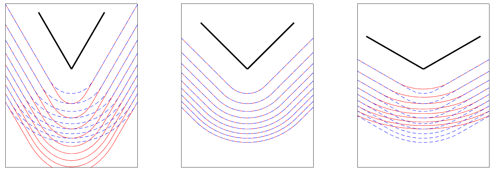

# 05｜Arm 平台的仿真路线与虚实验证

## 平台关系和交付边界

Arm 的虚拟硬件路线用于在硅片可用前验证指令、固件和软件；机器人物理环境主要来自第三方引擎。两者可以通过接口联调，却解决不同的问题。Zena 官方材料列出 Cadence、Siemens、Synopsys 的 CSS 级虚拟平台合作，并宣称可提前开展软硬件共同开发；这是汽车开发场景的时间优势声明，没有证明任意机器人接触动力学或真实传感器误差。U85 示例绑定 FVP/BSP/tool 版本，模型中的虚拟加速器也不能提供目标芯片电源、散热或总线争用的最终证据。[S03](https://newsroom.arm.com/blog/arm-zena-css-ai-defined-vehicle-compute-platform) [S02](https://raw.githubusercontent.com/ARM-software/ML-examples/main/ethos-u-corstone-1000/README.md)

| 路线 | 关系 | 场景与执行资产 | 支持证据及边界 |
|---|---|---|---|
| Arm FVP/虚拟平台 | Arm 工具与合作平台 | 虚拟 CPU/IP、固件、目标镜像 | 功能开发；非物理本体数字孪生 |
| MuJoCo C 引擎 | 可兼容第三方 | MJCF/URDF→mjModel，mjData 动态状态 | 官方 Linux x86-64/AArch64 预编译版本 |
| MJX-JAX | 第三方加速后端 | JAX arrays、JIT、批量环境 | Apple Silicon/XLA 支持路线；不是所有 Arm NPU |
| MJX-Warp | 第三方 GPU 后端 | Warp/JAX FFI、批量渲染 | NVIDIA 加速路线；后端特性与 JAX 不相同 |
| Gazebo Jetty | 第三方 ROS 仿真 | SDF、physics/render/sensor 插件、ros_gz | 官方教程；本文未验证目标 Arm 板安装矩阵 |
| ACT 仿真环境 | 模型作者实验 | TransferCube、BimanualInsertion | 固定旧 MuJoCo2.3.7/dm_control1.0.14 依赖 |

来源分别见 [S10](https://raw.githubusercontent.com/google-deepmind/mujoco/main/README.md) [S08](https://mujoco.readthedocs.io/en/stable/mjx.html) [S04](https://gazebosim.org/docs/latest/ros2_integration/) [S01](https://raw.githubusercontent.com/tonyzhaozh/act/main/README.md)。预编译 AArch64 引擎不代表所有板卡驱动支持 OpenGL 离屏渲染；CPU 物理、显示和 Python binding 应分别验收。当前 stable 文档与 main README 是2026-11-05取得的快照，不能直接用于重现旧 ACT 的依赖环境。

## MuJoCo 的状态、接触和时间步

MJCF 的关节、惯量、geom、actuator 和传感器由 XML 编译器组成 mjModel；mjData 保存位置、速度、控制、接触及工作内存。文档说明初始化后运行时工作内存预分配，单步默认单线程，可通过独立 constraint islands 或多个 mjData 并行。共享只读 model 并为每条轨迹提供独立 data，可减少重复静态资产；仍要防止用户 callback 修改共享状态造成竞态。MJB 是版本相关的二进制，不能反向还原模型，应保留 MJCF/XML 或 MJZ 源资产。[S09](https://mujoco.readthedocs.io/en/stable/overview.html)

```c
// 官方 API 组织的分析示意，未在本项目执行
mjModel* m = mj_loadXML("robot.xml", NULL, error, sizeof(error));
mjData* d = mj_makeData(m);
// 用本体契约写入 d->ctrl；每步前处理观测和限幅
mj_step(m, d); // 推进 mjModel.opt.timestep
```

连续动力学为 M·v_dot+c=τ+Jᵀf，关节惯性、被动力和约束力共同决定加速度。接触采用软约束/凸优化近似；真实摩擦、形变和冲击也只是在模型假设内表达。`solref` 与 `solimp` 调整响应和阻抗，contact margin/gap 决定检测及有效力的区间。调大步长并提高刚度可能使系统出现弹跳或数值不稳定；因此要先匹配硬件采样与动力学，再选 solver/积分器，而不是用渲染是否顺滑判断物理正确。[S06](https://mujoco.readthedocs.io/en/stable/computation/index.html)



图来自官方 Computation 的软接触讨论，三幅曲线展示软约束下的接触解行为。它帮助解释接触近似，不是特定机械臂材料的实测曲线，也没有提供平台算力排名。图像原件及文档依赖均保留，正文说明不跨本体套参数。

`mj_step1`/`mj_step2` 可以在位置/速度相关计算后插入控制，再完成力和积分，但该分步路径不支持 Runge-Kutta。要把控制周期与物理步分开：例如分析设物理步1ms、控制5ms、相机33.3ms，则一次控制跨5个物理tick；相机采样要明确采第几个tick、曝光时间和输出延迟。该例是时间预算示意，不是官方参数或本研究实测。暂停、重置和录制回放都会改变仿真时钟，接口层必须阻止旧动作跨 reset 继续执行。[S06](https://mujoco.readthedocs.io/en/stable/computation/index.html)

## MJX 吞吐为什么不能当 Arm 排名

`mjx.put_model`/`put_data` 将模型和状态传到设备，JAX 数组可增加 batch 维度实现域随机化；结构性 numpy 字段变化会触发重新 JIT，而运行时数组变化不一定重编译。原件以 `jnt_limited` 与 `jnt_range` 区分这两种对象。shape、碰撞拓扑、批量数量和 host/device 同步决定编译与稳态开销；不能只计 kernel，然后声称训练整体加速。[S08](https://mujoco.readthedocs.io/en/stable/mjx.html)

文档比较 CPU Apple M3 Max、64核 AMD3995WX，以及 A100 batch8192、8芯片 v5 TPU batch16384，并说明纵轴对数及接触增加后吞吐变化。硬件、batch和并行条件不同，所以这些图支持选择后端及场景规模，不能成为 Arm 对 x86 的同条件排名。Warp FFI 示例 Humanoid 从2.96M SPS降到反复图捕获的0.80M，展示执行图生命周期成本；未给足条件时只按原文机制解释，不作为本项目重现值。批量渲染固定 nworld、分配缓冲，并通过 refit_bvh→render 的 token 防止执行重排；改 world 数量需重新处理上下文，不能无限扩 batch。[S08](https://mujoco.readthedocs.io/en/stable/mjx.html)

## Gazebo：消息桥不等于物理和时钟一致

本次 latest URL 实际呈现 Jetty LTS（2025年9月至2031年5月）。`ros_gz_bridge` 只支持一定消息类型，`@`双向、`[` Gazebo→ROS、`]` ROS→Gazebo，YAML 可设 topic/type、direction、queue 与 lazy。需要逐项匹配 joint states、TF、相机、LiDAR和控制命令，而非把插件加载成功当完整 ROS 适配。ROS 仿真时间应贯穿状态、观测与控制；本文没有运行 `/clock` 联调，须在复建时查明时间跳变、deadline与QoS行为。[S04](https://gazebosim.org/docs/latest/ros2_integration/)

传感器教程给 IMU update_rate=1、GPU LiDAR=10Hz、640条水平 ray，LiDAR 插件使用 ogre2；这些是教学参数。碰撞后发布零速度只是软件演示，不是实机安全停止保证。真实相机需加入畸变、运动模糊、rolling shutter和曝光；LiDAR需加入遮挡、反射、缺测；可见材质不能替代雷达回波模型。物理世界、渲染和传感器生成频率必须分别记录，GUI FPS不能代表政策训练采样吞吐。[S05](https://gazebosim.org/docs/latest/sensors/)

## sim-to-real 的验证资产与许可

工程验证先用 CAD/标定形成坐标、质量、惯量、关节轴和传动模型，再用阶跃/扫频及自由衰减数据辨识延迟、摩擦和阻尼。对质量、摩擦、负载、光照与相机外参做有测量范围的随机化，并留出真实物体、地面和操作日期。仿真策略成功、真机单任务完成、陌生场景泛化分别记录分母和人工介入，避免只用演示录像支持泛化。并行训练还应计奖励计算、reset、渲染、数据传输和优化器，而不是将物理 steps/s作为训练完成时间。

MuJoCo 源码 Apache2.0，doc 内图文/视频 CC-BY4.0；Gazebo 网页也是 CC-BY4.0，但引擎组件、插件与 Fuel/第三方模型需按各自许可核实。机器人 mesh、纹理、数据集和权重不能由引擎许可证覆盖。[S10](https://raw.githubusercontent.com/google-deepmind/mujoco/main/README.md) [S07](https://raw.githubusercontent.com/google-deepmind/mujoco/main/LICENSE) [S05](https://gazebosim.org/docs/latest/sensors/) 本章提供可复建的接口及验证方案，未运行 FVP、MuJoCo、Gazebo 或训练；目标板 GPU 驱动、完整世界资产许可、硬件在环的尾延迟与热稳定仍属待验证项。

## 参考原件与版本边界

所有资料经项目统一下载器归档。本章资料截止2026-11-05，既有资料按实际时间复用；本章采集日2026-11-05，既有资料按registry实际时间复用；采集时间不能替代材料发布日期。网页静态依赖缺损按下表披露，动态交互不保证离线可用。

| ID/资料名 | 版本边界 | 官方原文 | 本地原件 | 归档状态 |
|---|---|---|---|---|
| S01 / ACT_Readme | MuJoCo2.3.7历史实验依赖 | [原文](https://raw.githubusercontent.com/tonyzhaozh/act/main/README.md) | [归档](REFERENCES.md#ref-1b21ddbac18a2bb3) | 原件与已识别静态依赖完整 |
| S02 / ARM_U85_Direct | 归档时间2026-11-04T15:52:49.364824+00:00；未明示版号/发布日期 | [原文](https://raw.githubusercontent.com/ARM-software/ML-examples/main/ethos-u-corstone-1000/README.md) | [归档](REFERENCES.md#ref-af97edcc6ae30f5d) | 原件与已识别静态依赖完整 |
| S03 / ARM_Zena_Blog | 归档时间2026-11-04T15:32:36.834463+00:00；未明示版号/发布日期 | [原文](https://newsroom.arm.com/blog/arm-zena-css-ai-defined-vehicle-compute-platform) | [归档](REFERENCES.md#ref-b4187a50990d4cca) | 部分静态依赖缺失，13项 |
| S04 / Gazebo_ROS2 | latest实际Jetty LTS | [原文](https://gazebosim.org/docs/latest/ros2_integration/) | [归档](REFERENCES.md#ref-73621aeeb998893f) | 原件与已识别静态依赖完整 |
| S05 / Gazebo_Sensors | 归档时间2026-11-04T16:49:21.527024+00:00；未明示版号/发布日期 | [原文](https://gazebosim.org/docs/latest/sensors/) | [归档](REFERENCES.md#ref-809fd0e6cec9687c) | 原件与已识别静态依赖完整 |
| S06 / MuJoCo_Computation | stable在线快照2026-11-05 | [原文](https://mujoco.readthedocs.io/en/stable/computation/index.html) | [归档](REFERENCES.md#ref-50bc861c2b70fd1e) | 部分静态依赖缺失，1项 |
| S07 / MuJoCo_License | 归档时间2026-11-04T16:48:59.278267+00:00；未明示版号/发布日期 | [原文](https://raw.githubusercontent.com/google-deepmind/mujoco/main/LICENSE) | [归档](REFERENCES.md#ref-cee9684c68f37452) | 原件与已识别静态依赖完整 |
| S08 / MuJoCo_MJX | 归档时间2026-11-04T16:48:45.645565+00:00；未明示版号/发布日期 | [原文](https://mujoco.readthedocs.io/en/stable/mjx.html) | [归档](REFERENCES.md#ref-63a58dbcc0c84e67) | 部分静态依赖缺失，2项 |
| S09 / MuJoCo_Overview | 归档时间2026-11-04T16:47:57.217892+00:00；未明示版号/发布日期 | [原文](https://mujoco.readthedocs.io/en/stable/overview.html) | [归档](REFERENCES.md#ref-745c39f10cd62e88) | 部分静态依赖缺失，1项 |
| S10 / MuJoCo_Readme | 归档时间2026-11-04T16:48:57.394652+00:00；未明示版号/发布日期 | [原文](https://raw.githubusercontent.com/google-deepmind/mujoco/main/README.md) | [归档](REFERENCES.md#ref-256fd316f8826a33) | 原件与已识别静态依赖完整 |

- [官方资料索引](REFERENCES.md)

- [主张与图源记录](research_state/evidence/05_Simulation_Environment.json)

- [开始前基线](research_state/baselines/05_Simulation_Environment_before.json)
