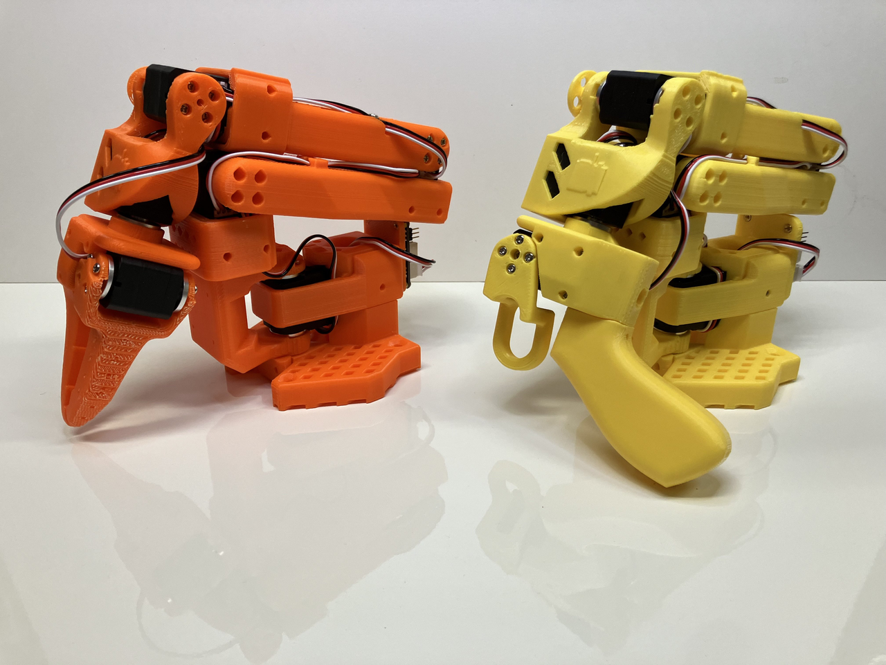

# 06｜本体适配、执行契约与实际收益

## 案例分层：产品使用与部署闭环各有证据

Arm 的价值跨越主计算、实时控制与末端微控制器，不能将本体内某个 Arm 核的存在等同整机都由同一平台提供。本文以官方客户案例解释真实对象，以可读部署源码解释动作路径；缺少芯片/BSP/控制器版本的客户故事只能支持架构采用，不补写已量产性能。当前案例页多未明示发布日期，按2026-11-05归档内容记载，不以页面版权年份推断首发时间。[S05](https://www.arm.com/markets/robotics)

| 本体与公司 | 任务 | 状态/证据 | 可追到的硬件与软件 | 仍缺的数据 |
|---|---|---|---|---|
| 地瓜 RDK S100＋SO100 | 遥操作、采集、ACT 单/双臂操作 | 官方教程/源码及演示 | STS3215、USB相机、LeRobot fork、ONNX/HBM、BPU_ACTPolicy | 实机P99、成功分母、停机测试 |
| PSYONIC Ability Hand | 假肢/机器人触觉抓取 | 客户案例称已有用户使用 | 每手12个Arm处理器，Cortex-M分布控制 | 精确MCU、bus、功率、反馈频率 |
| AGIBOT A2/X2/D1 | 人形操作、研究、配送 | Arm客户产品案例 | Cortex-A/R与Mali技术类别 | 精确SoC、BSP、闭环成功率和运营收益 |
| ROBOTIS DYNAMIXEL/GAEMI | 执行器、LiDAR配送 | Arm客户产品案例 | Cortex系列、相机/LiDAR | 具体代际芯片、SDK矩阵、部署台时 |
| Unitree 等 Total Design 成员 | 具身生态合作 | 2026-09-08合作名单 | 联合技术栈倡议 | 不能由入会推导特定机器人芯片或交付 |

上述对象和状态分别见 [S09](https://raw.githubusercontent.com/D-Robotics/rdk_LeRobot_tools/main/README.md) [S02](https://www.arm.com/company/success-library/psyonic) [S01](https://www.arm.com/company/success-library/agibot-intelligent-robots) [S04](https://www.arm.com/company/success-library/made-possible/robotis) [S03](https://newsroom.arm.com/news/arm-total-design-and-robotics-capability-framework-for-physical-ai)。商业使用、科研组织采用与公开教程应保持不同标签，避免将全部平台称为已验证商业机器人方案。

## S100/SO100：从关节标定到动作发送



官方教程照片展示 leader/follower 本体形态，支持接线和采集关系的理解；不是工厂在岗运营图片，也不提供负载或安全认证。单套两臂各6个 Feetech STS3215，教程串口设1,000,000 baud；双臂工作站变为两leader、两follower与4块驱动板。相机固定640×480、30fps并建议MJPG，关节名称与相机phone/laptop键进入训练观测。串口波特率是传输配置，不是伺服闭环频率。[S09](https://raw.githubusercontent.com/D-Robotics/rdk_LeRobot_tools/main/README.md)

数据采集前需要标定电机零点、方向、行程和机械安装；训练学习的目标来自 follower 数据，换夹爪、镜头或关节偏置都改变分布。输出 action 不能只凭张量长度对应关节：应保存 joint_name→index、位置/速度/力矩模式、单位、绝对/增量、frame与夹爪映射。教程的动作统计量必须与同一 dataset/checkpoint 共存，量化后的 HBM 和两个相机的预处理也要一致。该链条比“支持ACT”更具体，但不自动覆盖其他本体或另一代 BPU。

控制脚本 `make_robot("so100")`→connect→capture_observation→predict_action→send_action→busy_wait→disconnect。默认fps=30、n_action_steps=50；一次循环包含采集、CPU格式转换、推理或取队列、动作发送。`perf_counter()`用于循环时间预算，BPU打印时间使用`time.time()`且位于归一化之后、反归一化之前，不能当从曝光到电机执行的端到端时间。脚本仍含 `.numpy().copy()`，因此不能把它写成全链零拷贝。[S08](https://raw.githubusercontent.com/D-Robotics/rdk_LeRobot_tools/main/bpu_act_control_robot.py)

```python
# 官方源码关键行为摘录；本文未执行
if len(self._action_queue) == 0:
    actions = self.bpu_model(batch)[:, :self.n_action_steps]
    actions = self.unnormalize_outputs({"action": actions})["action"]
    self._action_queue.extend(actions.transpose(0, 1))
return self._action_queue.popleft()
```

队列尚有动作时，循环仍采集观测，但此实现不使用新观测刷新策略；因此当前相机帧新鲜不等于当前动作基于新帧。按默认30fps、50动作，分析理想消费窗口约1.67秒，未计推理阻塞、串口或超时。动作队列中没有显式采集时间/有效期限，也没有在该脚本中实现新障碍触发的队列清空；底层驱动可能有其他保护，但本研究没有取得其完整安全契约，不能宣称全系统没有保护或已经满足安全要求。[S08](https://raw.githubusercontent.com/D-Robotics/rdk_LeRobot_tools/main/bpu_act_control_robot.py)

工程上应给每批动作绑定 episode、观测时间、模型版本和截止期；新障碍、关节失配、温度异常或任务取消时明确是清队列、保持位置还是受控制动。`busy_wait(1/fps-dt)`只做等待预算，超期需要单独计数/降级，不能补偿已错过的tick。代码检查统计量文件存在及inf，不等于已完成NaN、关节限幅、误差/通信重试和异常退出的完整验证。必须查清退出或停止上层写入后，电机是否保持上次目标、是否有 watchdog，以及独立停机路径。[S08](https://raw.githubusercontent.com/D-Robotics/rdk_LeRobot_tools/main/bpu_act_control_robot.py)

## PSYONIC：分布式末端控制的实际边界

Ability Hand 客户页称每手12个 Arm 处理器、超过300名假肢用户与90家机器人组织使用，并列小于200ms手指闭合速度；正文另称输入响应小于200ms。两种指标措辞不能合并成严格的传感→力矩P99，更不能倒数成为5Hz或更高伺服频率。它证明 Arm 微控制器可参与触觉、运动、反馈与通信的分布控制，并且产品有使用规模声明；这些数字来自厂商客户故事，非独立运营审计。[S02](https://www.arm.com/company/success-library/psyonic)

机制上将局部反馈放到末端，可缩短往返主计算的路径，并使组件模块化维护；成立条件是本地采样、控制和保护真正闭合，通信丢包时有清晰失效行为。缺少 MCU型号、固件、触觉量程、功率和长期可靠性测试，本文不推导单芯片速度提升、抓取成功率或能耗收益。假肢用户数据也不等同机器人训练数据可自由获取，采集授权和数据许可另行验证。

## AGIBOT 与 ROBOTIS：从架构采用到采购验证

AGIBOT 页分别描述 A2 的视觉/规划/板载AI、X2 的研究和传感融合、D1 的建图/避障/机队连接，列出 Cortex-A/R/Mali 类别。没有给这些产品的精确SoC、模型、旧新功耗、续航或任务分母，所以只支持该产品家族采用Arm计算的客户声明，不把一款的硬件归因其他代际，也不能根据“更长运行”补出百分比。采购应要求产品SKU和序列号范围对应的硬件/固件清单，再用实际负载、地图和电池条件测量。[S01](https://www.arm.com/company/success-library/agibot-intelligent-robots)

ROBOTIS 页介绍 DYNAMIXEL 执行器及配相机/LiDAR的GAEMI配送机器人；其 Cortex使用说明不能证明GAEMI具体CPU主脑与电机控制器同型号。执行器集成要单独检查协议寄存器、ID、同步读写、总线线缆、电流/温度/位置返回和错误处理，ROS joint顺序不能代替硬件ID。现行 ROBOTIS Docs 已取得并与旧页核对广播应答限制；页内注明 MX(2.0)需要特殊固件。串行字节间延迟超过1.5ms会触发重新找包头，说明主机调度抖动也能导致协议故障，而非只有推理算力影响执行。[S07](https://docs.robotis.com/docs/dxl/protocol/protocol2/) 不由通用Arm ISA推导任何总线兼容性。[S04](https://www.arm.com/company/success-library/made-possible/robotis)

已取得的 ROBOTIS Protocol2 原件说明广播ID0xFE下，除Ping、Sync Read、Bulk Read外通常不返回状态包；发送完成不代表执行成功。Reg Write＋Action用于多设备同步启动，CRC验证通信完整性，仍需读回位置/误差。Fast Sync Read要求特定系列与固件版本，不能把新版协议扩展视为所有DYNAMIXEL固件自动支持。该 e-Manual 页提示迁往 ROBOTIS Docs且计划移除，归档内容按历史快照使用；也不将 DYNAMIXEL 协议套给 SO100 的 Feetech 舵机。[S06](https://emanual.robotis.com/docs/en/dxl/protocol2/)

对 AMR，机体frame、传感器外参、轮径/轮距、地图版本、定位置信度与制动距离必须闭合；对机械臂，IK可达性、碰撞模型、轨迹时间参数和控制器限幅必须闭合。policy-call、controller、总线和内部servo是四层指标。放行需有真实任务次数、暴露小时、成功/人工介入、失效恢复和电池热稳定；本研究没有本体实测或正式交付包，公开案例也没有足够信息计算ROI。LeRobot、地瓜工具源码许可不覆盖商业本体SDK、数据或BPU二进制交付责任。[S10](https://raw.githubusercontent.com/D-Robotics/rdk_LeRobot_tools/main/LICENSE)

## 参考原件与版本边界

所有资料经项目统一下载器归档。本章资料截止2026-11-05，既有资料按实际时间复用；本章采集日2026-11-05，既有资料按registry实际时间复用；采集时间不能替代材料发布日期。网页静态依赖缺损按下表披露，动态交互不保证离线可用。

| ID/资料名 | 版本边界 | 官方原文 | 本地原件 | 归档状态 |
|---|---|---|---|---|
| S01 / ARM_AGIBOT_Case | 归档时间2026-11-04T16:52:13.313256+00:00；未明示版号/发布日期 | [原文](https://www.arm.com/company/success-library/agibot-intelligent-robots) | [归档](REFERENCES.md#ref-8f9bd644cb3469e4) | 部分静态依赖缺失，14项 |
| S02 / ARM_PSYONIC_Case | 未明示发布日期，2026-11-05取得客户页 | [原文](https://www.arm.com/company/success-library/psyonic) | [归档](REFERENCES.md#ref-d35285b5a0fa85e2) | 部分静态依赖缺失，14项 |
| S03 / ARM_Physical_AI_News | 归档时间2026-11-04T15:25:39.647573+00:00；未明示版号/发布日期 | [原文](https://newsroom.arm.com/news/arm-total-design-and-robotics-capability-framework-for-physical-ai) | [归档](REFERENCES.md#ref-3c6e029813d18cf4) | 部分静态依赖缺失，13项 |
| S04 / ARM_ROBOTIS_Case | 归档时间2026-11-04T16:52:27.451970+00:00；未明示版号/发布日期 | [原文](https://www.arm.com/company/success-library/made-possible/robotis) | [归档](REFERENCES.md#ref-1212e2efaf2bbcf2) | 部分静态依赖缺失，14项 |
| S05 / ARM_Robotics | 归档时间2026-11-04T15:20:03.486765+00:00；未明示版号/发布日期 | [原文](https://www.arm.com/markets/robotics) | [归档](REFERENCES.md#ref-2b837178f45bd201) | 部分静态依赖缺失，14项 |
| S06 / ROBOTIS_Protocol2 | e-Manual历史快照，提示迁移ROBOTIS Docs | [原文](https://emanual.robotis.com/docs/en/dxl/protocol2/) | [归档](REFERENCES.md#ref-0ecbf1f74b7c3d45) | 部分静态依赖缺失，5项 |
| S07 / ROBOTIS_Protocol2_Current | 归档时间2026-11-04T16:56:02.857447+00:00；未明示版号/发布日期 | [原文](https://docs.robotis.com/docs/dxl/protocol/protocol2/) | [归档](REFERENCES.md#ref-9f667a0c3736835c) | 部分静态依赖缺失，5项 |
| S08 / S100_ACT_Control | main快照；默认fps30/n_action_steps50 | [原文](https://raw.githubusercontent.com/D-Robotics/rdk_LeRobot_tools/main/bpu_act_control_robot.py) | [归档](REFERENCES.md#ref-4b066331e7364227) | 原件与已识别静态依赖完整 |
| S09 / S100_LeRobot | 归档时间2026-11-04T16:40:34.619562+00:00；未明示版号/发布日期 | [原文](https://raw.githubusercontent.com/D-Robotics/rdk_LeRobot_tools/main/README.md) | [归档](REFERENCES.md#ref-6bda06b018c27f9c) | 原件与已识别静态依赖完整 |
| S10 / S100_LeRobot_License | 归档时间2026-11-04T16:45:04.407700+00:00；未明示版号/发布日期 | [原文](https://raw.githubusercontent.com/D-Robotics/rdk_LeRobot_tools/main/LICENSE) | [归档](REFERENCES.md#ref-37afc35370e19359) | 原件与已识别静态依赖完整 |
| S11 / S100_SO100_Figure | 归档时间2026-11-04T16:52:46.634561+00:00；未明示版号/发布日期 | [原文](https://raw.githubusercontent.com/D-Robotics/rdk_LeRobot_tools/main/imgs/so100.png) | [归档](REFERENCES.md#ref-e1f4260f5ccce918) | 原件与已识别静态依赖完整 |

- [官方资料索引](REFERENCES.md)

- [主张与图源记录](research_state/evidence/06_Robot_Integration.json)

- [开始前基线](research_state/baselines/06_Robot_Integration_before.json)
