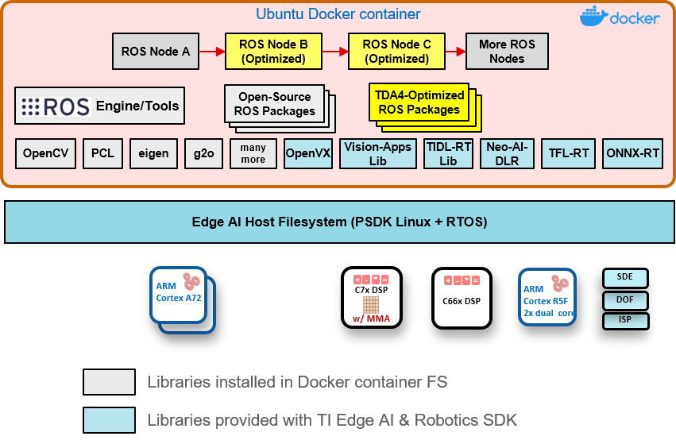

# 07｜Arm 生态的角色、交付资产与量产责任

## 三类生态不能相互替代

Arm 生态涵盖 IP/架构、开源与标准协作、具体 SoC/模组/整机供应商。Arm Total Design for Physical AI 是跨技术栈合作；CoreCollective 是 Arm 软件生态的开放协作平台；SOAFEE 当前是其中的汽车软件工作组。2026-07-21公告称 SOAFEE 保留治理机构、技术委员会和 Blueprint 项目，Arm继续技术贡献与治理成员角色。它不是一个统一机器人 BSP，也不是每个成员都承担产品售后。[S04](https://corecollective.dev/) [S05](https://corecollective.dev/blog/soafee-announcement/) [S14](https://www.soafee.io/)

2026-09-08 Arm称超过80家公司加入 Physical AI Total Design，列AWS、ECARX、Hugging Face、Liquid AI、NXP、PlusAI、PSYONIC、QNX、Qwen、Siemens、Unitree等。公告中“2030年代每年2000亿美元compute机会”注明基于Arm估计；既非已签订单，也非现有机器人芯片市场份额。SOAFEE超过150个组织同样是组织规模声明，不能与80个合作成员相加得出独立厂商数量或量产认证数量。[S02](https://newsroom.arm.com/news/arm-total-design-and-robotics-capability-framework-for-physical-ai) [S05](https://corecollective.dev/blog/soafee-announcement/)

## 代表伙伴与实际分工

| 伙伴/层次 | 价值及实际资产 | 与机器人系统交接 | 需采购验证 |
|---|---|---|---|
| Arm | Cortex/IP、计算库、参考固件、标准工具 | ISA、驱动/固件接口、RTL授权 | 具体IP包与SoC实现，不是整机质保 |
| NVIDIA Jetson | SoC/SOM、JetPack、CUDA/TensorRT、ROS生态 | engine、GPU tensor、载板接口 | 模组SKU、BSP、热/电源/PCN |
| TI | Arm CPU＋DSP/MMA、多域Linux/RTOS、TIDL | 编译产物、共享buffer、ROS消息 | SoC/工具/RoboticsSDK版本组合 |
| 地瓜 | RDK/BPU、模型工具、LeRobot教程 | ONNX/HBM、校准/统计量、执行器 | S100与S600边界、二进制/商业MCU |
| Orbbec | RGB-D/LiDAR、SDK、同步/时间戳 | 深度/图像、timestamp domain、标定 | 传感器型号/固件、目标BSP |
| PSYONIC/ROBOTIS | 末端手/执行器/整机 | 关节/触觉/协议与保护 | 精确硬件/固件、错误处理和备件 |
| Hugging Face/模型作者 | LeRobot、数据与策略工具 | episode/schema、checkpoint、动作 | 权重/数据许可、目标推理实现 |
| Linaro/CoreCollective | 标准、开源治理与协作 | 工具和共享规范 | 交付包/支持合同不自动附带 |

上述软件路径已在02、04、06深挖，本章复用原件而不复制整篇技术内容。资料见 [S16](https://raw.githubusercontent.com/TexasInstruments/edgeai-robotics-sdk/master/README.md) [S12](https://raw.githubusercontent.com/D-Robotics/rdk_LeRobot_tools/main/README.md) [S08](https://raw.githubusercontent.com/orbbec/OrbbecSDK_v2/main/README.md) [S06](https://raw.githubusercontent.com/huggingface/lerobot/main/README.md) [S01](https://www.arm.com/company/success-library/psyonic) [S03](https://www.arm.com/company/success-library/made-possible/robotis)。模型作者、整机厂、算力模组厂和传感器厂交付不同类型资产，集成者必须明确哪个组织负责版本兼容与现场故障。

TI 官方图将 ROS/OpenCV 等容器文件系统与底层 Linux/RTOS、Arm A72/R5F及DSP/MMA分开。图支持“开源ROS节点＋厂商优化库＋专用硬件”的分工；它是图中TDA4代际，不可套为AM69全部硬件，更不能证明任意容器绕过底层驱动即可运行。容器包含用户空间，设备节点、固件、内核ABI与DMA可达性依然来自目标BSP。[S15](https://raw.githubusercontent.com/TexasInstruments/edgeai-robotics-sdk/master/docs/tiovx_ros_sw_stack.png)

## 从原型到量产需要哪些交付物

开发阶段以开发板、标准传感器和公开demo快速确认接口；量产阶段需冻结SoC/SOM/载板/电源/散热/线缆与传感器型号。硬件供应合同应说明数量、地区、币种、税费、备件和替代料，软件合同应说明BSP版本、漏洞修复、升级/回退、支持工时和现场责任。下载中心存在不代表维护到某年，更不代表第三方载板完成工业温度、EMC或关节控制验收。

NVIDIA 生命周期页对商业 Orin系列模组列至2032年1月、Orin Industrial至2033年7月，T4000至2036年1月、T5000至2035年8月；开发套件明确不规定生命周期、用途是软件开发和原型。页中PCN与EOL流程也与软件支持独立。因此选用相同Arm架构不能获得同样供货承诺；应查具体供应商/模组，而非要求Arm为所有SoC保证同一寿命。[S07](https://developer.nvidia.com/embedded/lifecycle)

生产镜像要包含bootloader、设备树、kernel、固件、用户空间runtime与模型版本；产测需覆盖存储、相机/总线、热、电源和烧录结果，校准文件与序列号对应。替换DDR/eMMC或sensor可触发驱动、标定或性能差异，PCN评审需重跑相关链路。供货期限不能代替现货交期；公开材料未取得地区批量报价、返修周期或所有伙伴的维护SLA，这些留给具体采购而不虚构数字。

## 以 RAUC 说明维护接口，避免把 OTA 当按钮

RAUC 是独立开源嵌入式Linux更新组件，不是Arm专属服务，也未证明已经集成进本文所有RDK/Jetson/TI产品。官方README支持签名bundle、对称A/B或recovery方案、多个slot组、D-Bus及bootloader后端。目标需要可持久化boot state、启动目标选择及足够存储；建议watchdog。host生成更新包，target验证并安装；这条路径适合解释量产集成者必须承担的工作。[S11](https://raw.githubusercontent.com/rauc/rauc/master/README.rst)

Integration 文档当前标题为1.15.1.544-b852开发快照，要求存储、bootloader、kernel、init和工具配置协调。`system.conf`中 `[slot.rootfs.0]`、`device/type/bootname`绑定实际分区，appfs可用parent关联rootfs。分区布局通常很难现场改变，所以A/B空间与boot state要在设计阶段预留；文档提醒文件系统UUID/label会随更新改变或在A/B中不唯一，路径选择需根据目标枚举和分区表确定，不能将一个开发板样例无条件部署到其他设备。[S09](https://rauc.readthedocs.io/en/latest/integration.html)

机器人升级的健康条件应包括runtime能载模型、相机/本体可连接、标定与关节契约一致、保护路径可用；进程启动并不充分。模型与统计量、地图、控制限制可能跨rootfs/appfs，更新包应绑定兼容版本。签名验证只证明来源和完整性，不证明动作质量；断电、空间不足、boot失败、升级中断和旧模型回退都要做目标硬件测试。源码LGPL2.1或后续版本，依赖OpenSSL、glib、libcurl等各有许可，商业部署需保留相应义务。[S10](https://raw.githubusercontent.com/rauc/rauc/master/COPYING) [S11](https://raw.githubusercontent.com/rauc/rauc/master/README.rst)

## 培训、开放性与供应依赖

Arm官网提供learning paths、社区、产品支持与培训入口；开源仓库提供可读API和教程，但公开论坛答案不同于有时限的支持合同。本研究未用Stars排名，也没有把仓库存在当维护承诺。对合作案例应要求release/tag、依赖清单、可复建工具链与升级记录；浮动main文档可定位机制，却不能成为生产冻结版本。

“自主可控”应拆解架构/IP授权、制造封装、底层固件源码、NPU编译器、模型/训练数据、更新签名与本地备件。地瓜本地工具和示例增加集成便利，但BPU、商业MCU包及权重许可仍需分项确认；海外品牌的开源库也不意味着其硬件生产完全透明。[S13](https://raw.githubusercontent.com/D-Robotics/rdk_LeRobot_tools/main/LICENSE) [S17](https://raw.githubusercontent.com/TexasInstruments/edgeai-tidl-tools/master/LICENSE) 平台选型应以团队能获得并维护的完整交付链作依据，避免由企业所在地推出国产化比例。本研究的生态证据为官方文献核验，未完成产测、OTA或实机维护演练。

## 参考原件与版本边界

所有资料经项目统一下载器归档。本章资料截止2026-11-05，既有资料按实际时间复用；本章采集日2026-11-05，既有资料按registry实际时间复用；采集时间不能替代材料发布日期。网页静态依赖缺损按下表披露，动态交互不保证离线可用。

| ID/资料名 | 版本边界 | 官方原文 | 本地原件 | 归档状态 |
|---|---|---|---|---|
| S01 / ARM_PSYONIC_Case | 归档时间2026-11-04T16:52:03.104756+00:00；未明示版号/发布日期 | [原文](https://www.arm.com/company/success-library/psyonic) | [归档](REFERENCES.md#ref-d35285b5a0fa85e2) | 部分静态依赖缺失，14项 |
| S02 / ARM_Physical_AI_News | 归档时间2026-11-04T15:25:39.647573+00:00；未明示版号/发布日期 | [原文](https://newsroom.arm.com/news/arm-total-design-and-robotics-capability-framework-for-physical-ai) | [归档](REFERENCES.md#ref-3c6e029813d18cf4) | 部分静态依赖缺失，13项 |
| S03 / ARM_ROBOTIS_Case | 归档时间2026-11-04T16:52:27.451970+00:00；未明示版号/发布日期 | [原文](https://www.arm.com/company/success-library/made-possible/robotis) | [归档](REFERENCES.md#ref-1212e2efaf2bbcf2) | 部分静态依赖缺失，14项 |
| S04 / CoreCollective_Home | 归档时间2026-11-04T16:58:25.429891+00:00；未明示版号/发布日期 | [原文](https://corecollective.dev/) | [归档](REFERENCES.md#ref-a29d85cbdbe40feb) | 原件与已识别静态依赖完整 |
| S05 / CoreCollective_SOAFEE | 2026-07-21公告 | [原文](https://corecollective.dev/blog/soafee-announcement/) | [归档](REFERENCES.md#ref-fc212ffdc999ed3b) | 原件与已识别静态依赖完整 |
| S06 / LeRobot_Readme | 归档时间2026-11-04T16:40:33.359326+00:00；未明示版号/发布日期 | [原文](https://raw.githubusercontent.com/huggingface/lerobot/main/README.md) | [归档](REFERENCES.md#ref-ff1eedfea7364372) | 原件与已识别静态依赖完整 |
| S07 / NVIDIA_Lifecycle | 2026-11-04采集的具体模组规划 | [原文](https://developer.nvidia.com/embedded/lifecycle) | [归档](REFERENCES.md#ref-782c8ca091275c8c) | 部分静态依赖缺失，142项 |
| S08 / Orbbec_SDK2 | 归档时间2026-11-04T16:37:00.501861+00:00；未明示版号/发布日期 | [原文](https://raw.githubusercontent.com/orbbec/OrbbecSDK_v2/main/README.md) | [归档](REFERENCES.md#ref-96eb386e04fb724f) | 原件与已识别静态依赖完整 |
| S09 / RAUC_Integration | 1.15.1.544-b852开发文档快照 | [原文](https://rauc.readthedocs.io/en/latest/integration.html) | [归档](REFERENCES.md#ref-674732b55cafae79) | 原件与已识别静态依赖完整 |
| S10 / RAUC_License | 归档时间2026-11-04T16:57:22.250863+00:00；未明示版号/发布日期 | [原文](https://raw.githubusercontent.com/rauc/rauc/master/COPYING) | [归档](REFERENCES.md#ref-c4809ad1c6a8a682) | 原件与已识别静态依赖完整 |
| S11 / RAUC_Readme | 归档时间2026-11-04T16:57:20.301990+00:00；未明示版号/发布日期 | [原文](https://raw.githubusercontent.com/rauc/rauc/master/README.rst) | [归档](REFERENCES.md#ref-ce94073d8d95234e) | 原件与已识别静态依赖完整 |
| S12 / S100_LeRobot | 归档时间2026-11-04T16:40:34.619562+00:00；未明示版号/发布日期 | [原文](https://raw.githubusercontent.com/D-Robotics/rdk_LeRobot_tools/main/README.md) | [归档](REFERENCES.md#ref-6bda06b018c27f9c) | 原件与已识别静态依赖完整 |
| S13 / S100_LeRobot_License | 归档时间2026-11-04T16:45:04.407700+00:00；未明示版号/发布日期 | [原文](https://raw.githubusercontent.com/D-Robotics/rdk_LeRobot_tools/main/LICENSE) | [归档](REFERENCES.md#ref-37afc35370e19359) | 原件与已识别静态依赖完整 |
| S14 / SOAFEE_Home | 归档时间2026-11-04T15:57:38.094626+00:00；未明示版号/发布日期 | [原文](https://www.soafee.io/) | [归档](REFERENCES.md#ref-885a355c76bf9924) | 部分静态依赖缺失，2项 |
| S15 / TI_ROS_Stack_Figure | 归档时间2026-11-04T16:11:33.884207+00:00；未明示版号/发布日期 | [原文](https://raw.githubusercontent.com/TexasInstruments/edgeai-robotics-sdk/master/docs/tiovx_ros_sw_stack.png) | [归档](REFERENCES.md#ref-9686b997ed52b774) | 原件与已识别静态依赖完整 |
| S16 / TI_Robotics_Readme | 归档时间2026-11-04T16:10:31.600740+00:00；未明示版号/发布日期 | [原文](https://raw.githubusercontent.com/TexasInstruments/edgeai-robotics-sdk/master/README.md) | [归档](REFERENCES.md#ref-7a11ee72adf0c31b) | 原件与已识别静态依赖完整 |
| S17 / TI_TIDL_License | 归档时间2026-11-04T16:11:35.529889+00:00；未明示版号/发布日期 | [原文](https://raw.githubusercontent.com/TexasInstruments/edgeai-tidl-tools/master/LICENSE) | [归档](REFERENCES.md#ref-7ec7d53f062b7180) | 原件与已识别静态依赖完整 |

- [官方资料索引](REFERENCES.md)

- [主张与图源记录](research_state/evidence/07_Ecosystem.json)

- [开始前基线](research_state/baselines/07_Ecosystem_before.json)
