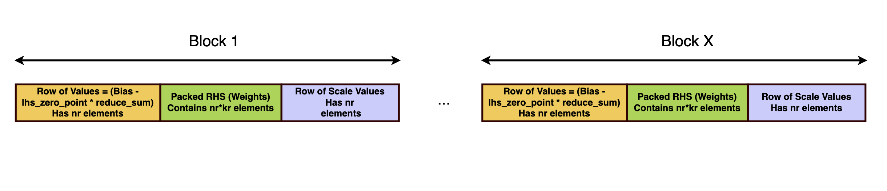

# 08A｜数值、执行格式与编译资产迁移的护城河

## 痛点：同为 Arm，为什么部署资产仍需重建

机器人团队通常保留 PyTorch checkpoint、ONNX 和校准集，希望换板后直接执行。但 Arm ISA 只描述处理器执行基础，不规定 SoC 的专用加速器图格式、内存拓扑或模型 runtime。CPU 内核 packing、Ethos命令流、TI网络产物、地瓜HBM和TensorRT engine处在不同层。Arm的可复用优势首先是软件架构和CPU生态；厂商部署栈形成另外一层工程资产积累。两层需要分别评估，不能把“统一架构”解释成所有二进制可跨设备。[S05](https://raw.githubusercontent.com/ARM-software/kleidiai/main/README.md) [S06](https://raw.githubusercontent.com/tensorflow/tflite-micro/main/tensorflow/lite/micro/kernels/ethos_u/ethosu.cc) [S08](https://raw.githubusercontent.com/D-Robotics/rdk_LeRobot_tools/main/README.md)

本专题沿量化值→布局→执行内核→图/runtime→本体契约研究，关注迁移时必须重建的资产。02已解释各软件栈的API；这里比较接口之间为什么有边界以及迁移成本从何而来，不用TOPS排名替代部署验证。

## packing 是数值与执行指令的共同契约

官方图的每块由bias补偿、权重与scale组成：补偿值为 Bias−lhs_zero_point×reduce_sum，scale为rhs_scale×lhs_scale/dst_scale。它展示非对称量化零点如何进入整数矩阵乘法，以及元数据与权重共同存储的原因。nr/kr决定每块列数和归约结构，边缘维度可能padding；图不是通用权重容器，也没有证明任何模型已获得性能收益。[S03](https://raw.githubusercontent.com/ARM-software/kleidiai/ebe33865eb77addae5f5ea8d277ca0656e1d1be7/kai/ukernels/matmul/pack/README.md)

int4路线也不是简单将两个连续数塞入字节即可。原文区分s16s0输入：低nibble对应K+0，高nibble对应K+16，FP16 scale位于输入块起始；输出格式可能把scale放块末尾。另一种s1s0则对应K+0/K+1。两种都称int4，布局却不同；误选packer或误读符号/scale会产生数值错误，而非只是速度下降。LHS动态量化为int8并携带按block或row的scale/offset，完整执行成本还包括动态量化和packing。[S03](https://raw.githubusercontent.com/ARM-software/kleidiai/ebe33865eb77addae5f5ea8d277ca0656e1d1be7/kai/ukernels/matmul/pack/README.md)

KleidiAI的示例通过kernel匹配的size、offset、pack与run函数组织调用；mr/nr/kr/sr与支持的指令共同决定布局。SME标记的函数要求对应硬件特性，不能在只有NEON的CPU上调用，也不能仅按AArch64判断可用。框架应做特性探测与fallback，并保存具体内核选择、输入shape和packing版本。首次权重packing可能摊销到多次执行；动作策略频繁换shape或只执行一次时，初始化成本则会抵消内核收益。[S02](https://raw.githubusercontent.com/ARM-software/kleidiai/ebe33865eb77addae5f5ea8d277ca0656e1d1be7/examples/matmul_clamp_f32_qsi8d32p_qsi4c32p/matmul_clamp_f32_qsi8d32p_qsi4c32p.cpp) [S03](https://raw.githubusercontent.com/ARM-software/kleidiai/ebe33865eb77addae5f5ea8d277ca0656e1d1be7/kai/ukernels/matmul/pack/README.md)

分析完整时间可以写为读取/转换＋LHS量化pack＋RHS初始化摊销＋matmul＋后处理；各项需在目标平台测量。若模型受访存、相机处理或RPC约束，整数乘法峰值不会线性提高任务吞吐。共享内存容量也不能保证权重、KV cache、图像与控制程序同时满足带宽和热约束。数值优势成立条件是精度容许、内核/shape适配、工作集可控以及整体链路仍有足够计算占比。

## 图编译把可迁移源资产变成设备专用产物

TFLM Ethos源码中的输入0为command stream，其他输入关联model、arena、fast scratch与外部tensor；Eval按base address组织后调用`ethosu_invoke_v3`。代码注释把base address数量限制到8，并明确Vela生成的IFM/OFM访问使用arena的base1，不能随意把输入/输出搬到arena外。这说明编译产物包含内存布局假设，通用TFLite源文件与已编译custom op不是同一迁移层级。该结论只针对取得的实现；Vela/core driver原件受robots限制，不能推导未来所有版本都如此。[S06](https://raw.githubusercontent.com/tensorflow/tflite-micro/main/tensorflow/lite/micro/kernels/ethos_u/ethosu.cc)

TI量化指南以accuracy_level选择简单、bias或histogram校准，mixed_precision_factor定义T_MP/T_8，允许用性能代价换部分16bit层。原文明确不同层的输入/参数/输出精度传播限制，concat等可能由producer/consumer共同决定。连续深度或动作回归不能只看分类top1；细小误差经坐标转换和执行器积累可能改变抓取。QAT章节限定J721E/TDA4VM，不将其自动套到AM69或其他Arm NPU。[S11](https://raw.githubusercontent.com/TexasInstruments/edgeai-tidl-tools/master/docs/quantization.md)

地瓜ACT将vision与Transformer分段编译，再依赖HBM、统计量与libpycauchyS100tools。源码中S100读HBM，X5读bin且输入shape处理不同，说明相同策略逻辑仍有平台专用调用。新板不能只拷模型文件；应重建编译产物、校准和归一化一致性，并核runtime二进制ABI。模型源、校准数据、节点分区和本体action schema才是更持久的迁移资产。[S07](https://raw.githubusercontent.com/D-Robotics/rdk_LeRobot_tools/main/bpu_act_control_robot.py) [S08](https://raw.githubusercontent.com/D-Robotics/rdk_LeRobot_tools/main/README.md)

| 层次 | 可保留资产 | 换设备需要重核 | 失效机制 |
|---|---|---|---|
| 模型源 | checkpoint/ONNX、语义、数据 | opset/shape与算子覆盖 | 解析成功但fallback/动态shape不支持 |
| 数值格式 | 校准样本、误差目标 | scale/zero point、混合精度 | 相同int8标签但量化粒度不同 |
| CPU内核 | 调度策略、测试向量 | 特性、packer、tile参数 | ISA或packed layout不匹配 |
| NPU/GPU图 | 分区设计、benchmark脚本 | compiler/runtime/driver及目标SKU | 命令流/engine包含硬件假设 |
| 本体接口 | joint/frame/schema和数据 | 单位、相机、统计量、保护 | 推理正确但动作错误 |

## 对标、优势边界与可复建验证

KleidiAI和GPU/NPU编译器都能降低计算成本，但作用对象不同：前者是CPU微内核及packing，后者还决定图分区、融合、设备内存与运行调度。TI、地瓜专用加速器在Arm CPU旁运行，并不是Arm CPU优化的竞品替代关系。比较应在同一模型/shape、功耗、精度和输入链路下测量；本研究没有同条件结果，不给倍数或总排名。其护城河可检验部分是代码、算子覆盖、调优与既有部署资产，商业壁垒还依赖许可、支持和量产责任。

验证时先以FP参考保留层输出、最终深度/动作和真实任务指标；再做量化、packing、编译、目标执行分层回归。测首帧/稳态/P99、内存峰值、fallback比例、相机和控制并发，记录编译耗时与推理耗时。更新manifest绑定源hash、编译器、BSP、firmware、库、目标SKU、scale和本体配置，缓存命中也应验证这些键；任何变化触发对应重建和回归。没有精确版本组合时只能给路线证据，不写为已验证量产部署。

KleidiAI的公开代码及packing文档许可可查，TI工具源码与目标二进制义务不同，地瓜工具Apache2.0也不覆盖所有BPU工具或本体SDK。模型权重和数据许可另核。[S01](https://raw.githubusercontent.com/ARM-software/kleidiai/ebe33865eb77addae5f5ea8d277ca0656e1d1be7/LICENSES/Apache-2.0.txt) [S10](https://raw.githubusercontent.com/TexasInstruments/edgeai-tidl-tools/master/LICENSE) [S09](https://raw.githubusercontent.com/D-Robotics/rdk_LeRobot_tools/main/LICENSE) 本研究未运行内核、编译器或模型，所有性能条件来自原件；迁移路线的验证步骤为分析建议，不声称已证明模型精度或机器人安全。

## 参考原件与版本边界

所有资料经项目统一下载器归档。本章资料截止2026-11-05，既有资料按实际时间复用；本章采集日2026-11-05，既有资料按registry实际时间复用；采集时间不能替代材料发布日期。网页静态依赖缺损按下表披露，动态交互不保证离线可用。

| ID/资料名 | 版本边界 | 官方原文 | 本地原件 | 归档状态 |
|---|---|---|---|---|
| S01 / ARM_KAI_Apache | 归档时间2026-11-04T15:47:26.876022+00:00；未明示版号/发布日期 | [原文](https://raw.githubusercontent.com/ARM-software/kleidiai/ebe33865eb77addae5f5ea8d277ca0656e1d1be7/LICENSES/Apache-2.0.txt) | [归档](REFERENCES.md#ref-4acfa876a5b163c1) | 原件与已识别静态依赖完整 |
| S02 / ARM_KAI_Example_Code | 归档时间2026-11-04T15:47:25.367769+00:00；未明示版号/发布日期 | [原文](https://raw.githubusercontent.com/ARM-software/kleidiai/ebe33865eb77addae5f5ea8d277ca0656e1d1be7/examples/matmul_clamp_f32_qsi8d32p_qsi4c32p/matmul_clamp_f32_qsi8d32p_qsi4c32p.cpp) | [归档](REFERENCES.md#ref-36c503cbd9897c20) | 原件与已识别静态依赖完整 |
| S03 / ARM_KAI_Pack | main原件快照，非稳定 ABI 承诺 | [原文](https://raw.githubusercontent.com/ARM-software/kleidiai/ebe33865eb77addae5f5ea8d277ca0656e1d1be7/kai/ukernels/matmul/pack/README.md) | [归档](REFERENCES.md#ref-b271d6fef76ced02) | 原件与已识别静态依赖完整 |
| S04 / ARM_KAI_Packing_Figure | 归档时间2026-11-04T15:48:19.687034+00:00；未明示版号/发布日期 | [原文](https://raw.githubusercontent.com/ARM-software/kleidiai/ebe33865eb77addae5f5ea8d277ca0656e1d1be7/docs/imgs/kai_rhs_packing_pattern_2.png) | [归档](REFERENCES.md#ref-49ce967ac4e8c6bd) | 原件与已识别静态依赖完整 |
| S05 / ARM_KleidiAI_Readme | 归档时间2026-11-04T15:46:02.595359+00:00；未明示版号/发布日期 | [原文](https://raw.githubusercontent.com/ARM-software/kleidiai/main/README.md) | [归档](REFERENCES.md#ref-76cf9034d5f688ad) | 原件与已识别静态依赖完整 |
| S06 / ARM_TFLM_Ethos_Kernel | TFLM取得的Ethos kernel实现 | [原文](https://raw.githubusercontent.com/tensorflow/tflite-micro/main/tensorflow/lite/micro/kernels/ethos_u/ethosu.cc) | [归档](REFERENCES.md#ref-f453352ee1acb671) | 原件与已识别静态依赖完整 |
| S07 / S100_ACT_Control | 归档时间2026-11-04T16:52:35.486035+00:00；未明示版号/发布日期 | [原文](https://raw.githubusercontent.com/D-Robotics/rdk_LeRobot_tools/main/bpu_act_control_robot.py) | [归档](REFERENCES.md#ref-4b066331e7364227) | 原件与已识别静态依赖完整 |
| S08 / S100_LeRobot | 归档时间2026-11-04T16:40:34.619562+00:00；未明示版号/发布日期 | [原文](https://raw.githubusercontent.com/D-Robotics/rdk_LeRobot_tools/main/README.md) | [归档](REFERENCES.md#ref-6bda06b018c27f9c) | 原件与已识别静态依赖完整 |
| S09 / S100_LeRobot_License | 归档时间2026-11-04T16:45:04.407700+00:00；未明示版号/发布日期 | [原文](https://raw.githubusercontent.com/D-Robotics/rdk_LeRobot_tools/main/LICENSE) | [归档](REFERENCES.md#ref-37afc35370e19359) | 原件与已识别静态依赖完整 |
| S10 / TI_TIDL_License | 归档时间2026-11-04T16:11:35.529889+00:00；未明示版号/发布日期 | [原文](https://raw.githubusercontent.com/TexasInstruments/edgeai-tidl-tools/master/LICENSE) | [归档](REFERENCES.md#ref-7ec7d53f062b7180) | 原件与已识别静态依赖完整 |
| S11 / TI_TIDL_Quantization | 11.2工具文档上下文，QAT仅J721E/TDA4VM | [原文](https://raw.githubusercontent.com/TexasInstruments/edgeai-tidl-tools/master/docs/quantization.md) | [归档](REFERENCES.md#ref-9d7eeb75fed5ef54) | 原件与已识别静态依赖完整 |

- [官方资料索引](REFERENCES.md)

- [主张与图源记录](research_state/evidence/08A_Compute_Asset_Portability.json)

- [开始前基线](research_state/baselines/08A_Compute_Asset_Portability_before.json)
