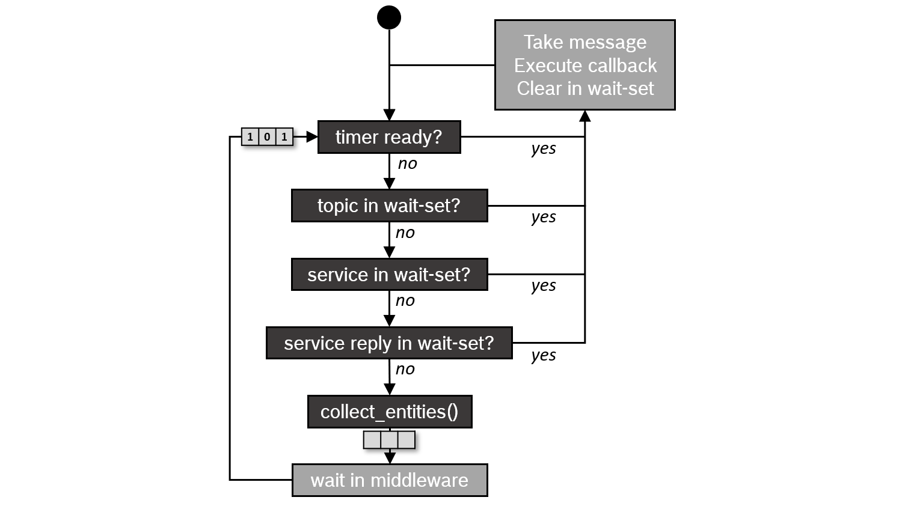

# 08B｜共享内存、时间契约与可观测性的系统价值

## 痛点：算力足够，闭环为何仍使用旧观测

多路相机、推理、定位和控制共享CPU、内存与I/O时，真正瓶颈可能是格式转换、缓存同步、队列或调度。Arm生态可以组织多个执行域与标准接口，但“共享DDR”只说明存储资源，不证明DMA能访问所有buffer，更不证明处理结果对应当前曝光。本专题以Linux内存和时钟API、ROS执行器及S100实际源码建立可检验的系统契约，区分跨平台标准能力与具体SoC实现。[S01](https://www.kernel.org/doc/html/latest/driver-api/dma-buf.html) [S03](https://www.kernel.org/doc/html/latest/userspace-api/media/v4l/buffer.html) [S08](https://raw.githubusercontent.com/D-Robotics/rdk_LeRobot_tools/main/bpu_act_control_robot.py)

## DMA-BUF：共享对象、映射与完成是不同阶段

exporter用dma_buf_export包装存储，通过FD交给其他驱动；importer用dma_buf_get、attach和map建立设备访问。attach之前exporter仍可迁移或重新分配后端存储，映射后设备得到自身地址域中的scatter-gather映射，而不是把CPU虚拟指针直接交给NPU。设备地址位宽、IOMMU、对齐和缓存属性都需匹配；失败时可能需要额外copy或返回错误。FD应设CLOEXEC，避免跨exec泄露buffer访问权限。[S01](https://www.kernel.org/doc/html/latest/driver-api/dma-buf.html)

共享buffer的生命周期需要明确producer完成写入、consumer开始读、所有consumer完成、pool才允许复用。dma_fence描述完成，dma_resv组织隐式同步；poll的EPOLLIN观察最近写fence，EPOLLOUT观察所附fence集合。官方明确这些只表示传输完成，CPU开始访问前仍需处理cache flush等准备，不能把“poll ready”当CPU看到新数据。多个异步consumer中最慢的一方会延长buffer占用，若pool过小就引起背压；若提前复用会出现偶发混帧。[S01](https://www.kernel.org/doc/html/latest/driver-api/dma-buf.html)

CPU mmap访问应以DMA_BUF_IOCTL_SYNC的START/END包围；内核内部使用begin_cpu_access/end_cpu_access。SYNC遇EAGAIN/EINTR需要重试；即使平台看似cache coherent也不能跳过该契约。SYNC本身不能阻止另一设备同时覆盖，设备同步和缓存同步是两个问题。SoC的coherent互联有助减少一致性处理成本，但无法自动解决所有外设属性、用户空间runtime和动作队列的数据竞争。

| 环节 | 必须保存的对象/条件 | 常见错误 | 验证方式 |
|---|---|---|---|
| 采集 | bufferID、plane、format、有效载荷 | 用分配length当图像长度 | 核bytesused/data_offset/stride |
| 设备交接 | FD、attachment、map、fence | CPU指针误作设备地址 | 目标driver实际导入/同步测试 |
| CPU访问 | SYNC_START/END、读写方向 | fence完成后忽略cache | 校验帧内容和并发读写 |
| runtime | tensor layout、owner、完成事件 | 有中间numpy copy却宣称零拷贝 | 追踪copy与allocation |
| pool回收 | 所有consumer完成、generation | buffer提前覆盖 | 压力测试混帧/泄漏/背压 |

## 时间戳必须同时说明时钟与物理事件

V4L2的MONOTONIC flag规定时钟，SOE/EOF flag规定曝光开始或最后像素接收事件，两者彼此独立。mem2mem COPY时间戳来自对应OUTPUT，不是重新采集。多plane的有效payload不能用length替代，错误payload或格式会导致后续模型读到未初始化区。相机曝光、解码/ISP完成、DDS发布、策略开始、动作发送和驱动执行应分列测量点，避免平均推理时间遮蔽观测年龄。[S03](https://www.kernel.org/doc/html/latest/userspace-api/media/v4l/buffer.html)

Orbbec原件区分device/system/global域，global映射不改变曝光发生瞬间，Linux延迟示例采用CLOCK_MONOTONIC_RAW。单位相同不代表时钟域相同，RAW也不能直接与任意steady_clock或ROS仿真时钟相减。设备同步重置或时钟校正会改变映射，需记录epoch/generation和同步状态；0时间戳属于不可用情况。ROS message_filters按header做exact/approximate配对，只是消息算法，不能制造硬件同步，也不能弥补外参或曝光偏移。[S04](https://raw.githubusercontent.com/orbbec/OrbbecSDK_v2/main/docs/tutorial/timestamp.md) [S07](https://raw.githubusercontent.com/ros2/message_filters/rolling/doc/index.rst)

在S100 ACT脚本中，相机每循环更新，但动作队列非空时不重新推理，这说明“当前帧采集成功”与“当前动作依据当前帧”是不同事实。应给动作块绑定观测时间、有效期限、模型和frame版本，并在障碍/状态变化时决定刷新或停机。该实现的CPU numpy copy与预处理存在，完整延迟需包含在闭环预算中；共享内存宣传不能抹去这些软件层工作。[S08](https://raw.githubusercontent.com/D-Robotics/rdk_LeRobot_tools/main/bpu_act_control_robot.py)

## 执行器、队列与trace如何关联

官方ROS执行器图展示ready检查、take、callback和wait-set循环。它支持消息就绪与callback执行之间存在调度路径，不能单凭接收时间判断计算已开始；图中流程属于该来源版本，不是每种executor都满足严格FIFO。callback group、线程、DDS队列与共享锁会影响控制回调等待；多线程并不自动解决同组互斥和优先级倒置。[S06](https://raw.githubusercontent.com/ros2/ros2_documentation/jazzy/source/Concepts/Intermediate/About-Executors.rst)

Linux ftrace文档说明默认local时钟快但跨CPU未必同步，global跨CPU同步但可能稍慢；counter只是顺序计数而非时间。切换trace_clock会清空ring buffer和snapshot，应在采样开始前冻结时钟选择。buffer_size_kb是每CPU缓冲大小而非总量，overrun表示因覆盖丢事件。若忽略丢事件和时钟，trace中缺少一次唤醒可能被误读为异常长阻塞，甚至得出负延迟。[S02](https://www.kernel.org/doc/html/latest/trace/ftrace.html)

复建可用trace_marker把frameID/动作批次和用户空间阶段关联到内核调度事件，结合sched_switch/wakeup分析等待，按需function_graph研究驱动路径；事件类型需目标内核启用，特权和记录开销也需评估。标记应包含同一generation，不把重复frame编号当同一次任务。采样开始/结束、时钟、buffer配置、overrun、事件过滤和CPU拓扑随结果保存；对日志开关做扰动比较，避免测量工具本身改变P99。

## 优势、竞品机制和失效条件

DMA-BUF、ROS和ftrace均为跨厂商标准/开源能力，不是Arm独占IP。Arm互联和多核执行可配合这些机制形成高效系统；Jetson的GPU事件/适配层、TI共享pool、地瓜runtime也解决类似buffer交接问题，但支持范围、地址空间和模型布局不同。迁移成本不止代码编译，还包括重新验证驱动导入、缓存属性、tensor格式和时钟；本研究不凭不同demo给平台零拷贝速度排名。

优势成立条件是从采集到控制完整保留owner/fence/time契约，且目标SKU及BSP提供实际路径。格式改变、跨进程序列化、fallback、热降频、日志与CPU争用均可使收益失效。测量应记录稳态与首帧、观测年龄、P99、丢帧、队列长度、内存峰值及并发任务；P99不等于WCET，deadline hint在Linux文档中只是hint，驱动可能改变频率/调度或完全不响应，不能写成硬实时保证。[S01](https://www.kernel.org/doc/html/latest/driver-api/dma-buf.html)

本章引用latest内核文档与rolling ROS源码快照，目标BSP旧内核可能缺少相关API，应建立符号与配置矩阵。SDK、传感器固件、runtime与驱动许可仍分别核实，不由开源接口推出二进制开放。本研究没有开展trace、DMA或本体测试，所列验证链是可执行的分析方案；未取得同条件端到端性能，也不能由API存在证明物理平台已经满足延迟或安全目标。

## 参考原件与版本边界

所有资料经项目统一下载器归档。本章资料截止2026-11-05，既有资料按实际时间复用；本章采集日2026-11-05，既有资料按registry实际时间复用；采集时间不能替代材料发布日期。网页静态依赖缺损按下表披露，动态交互不保证离线可用。

| ID/资料名 | 版本边界 | 官方原文 | 本地原件 | 归档状态 |
|---|---|---|---|---|
| S01 / Linux_DMABUF | 归档时间2026-11-04T16:36:57.320054+00:00；未明示版号/发布日期 | [原文](https://www.kernel.org/doc/html/latest/driver-api/dma-buf.html) | [归档](REFERENCES.md#ref-36bb9f4e55cf47fb) | 原件与已识别静态依赖完整 |
| S02 / Linux_Ftrace | Linux latest在线快照，非目标BSP稳定API矩阵 | [原文](https://www.kernel.org/doc/html/latest/trace/ftrace.html) | [归档](REFERENCES.md#ref-85520aa69b9b5cc6) | 原件与已识别静态依赖完整 |
| S03 / Linux_V4L2_Buffer | 归档时间2026-11-04T16:36:38.080039+00:00；未明示版号/发布日期 | [原文](https://www.kernel.org/doc/html/latest/userspace-api/media/v4l/buffer.html) | [归档](REFERENCES.md#ref-2c26e34b1c9ad3dc) | 原件与已识别静态依赖完整 |
| S04 / Orbbec_Timestamp | SDK main时间域文档 | [原文](https://raw.githubusercontent.com/orbbec/OrbbecSDK_v2/main/docs/tutorial/timestamp.md) | [归档](REFERENCES.md#ref-6d698eb3dad5c80c) | 原件与已识别静态依赖完整 |
| S05 / ROS_Executor_Figure | 归档时间2026-11-04T16:07:24.360102+00:00；未明示版号/发布日期 | [原文](https://raw.githubusercontent.com/ros2/ros2_documentation/jazzy/source/Concepts/images/executors_scheduling_semantics.png) | [归档](REFERENCES.md#ref-ac52a46ce41c6428) | 原件与已识别静态依赖完整 |
| S06 / ROS_Executors_Source | rolling源码文档快照 | [原文](https://raw.githubusercontent.com/ros2/ros2_documentation/jazzy/source/Concepts/Intermediate/About-Executors.rst) | [归档](REFERENCES.md#ref-3759b956cf598eb5) | 原件与已识别静态依赖完整 |
| S07 / ROS_MessageFilters | 归档时间2026-11-04T16:37:02.852740+00:00；未明示版号/发布日期 | [原文](https://raw.githubusercontent.com/ros2/message_filters/rolling/doc/index.rst) | [归档](REFERENCES.md#ref-d6369762debb3218) | 原件与已识别静态依赖完整 |
| S08 / S100_ACT_Control | 归档时间2026-11-04T16:52:35.486035+00:00；未明示版号/发布日期 | [原文](https://raw.githubusercontent.com/D-Robotics/rdk_LeRobot_tools/main/bpu_act_control_robot.py) | [归档](REFERENCES.md#ref-4b066331e7364227) | 原件与已识别静态依赖完整 |

- [官方资料索引](REFERENCES.md)

- [主张与图源记录](research_state/evidence/08B_Memory_Time_Observability.json)

- [开始前基线](research_state/baselines/08B_Memory_Time_Observability_before.json)
