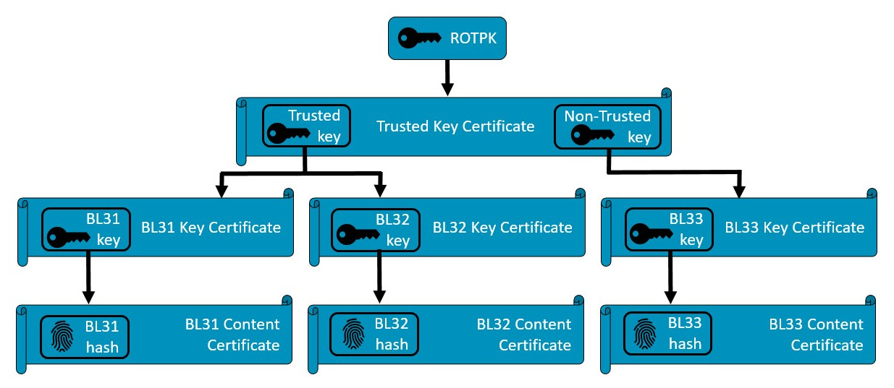

# 08C｜混合关键性、可信启动与可恢复更新

## 三个目标：故障隔离、来源可信与物理安全

机器人既要运行易变化的AI和网络服务，也要维持关节保护与故障响应。隔离减少错误传播，可信启动阻止未授权固件，功能安全处理危险失效；三者不能互相替代。Arm Zena官方将A720AE主计算、R82AE Safety Island、Runtime Security Engine和TrustZone组合，但这是特定CSS的集成设计，不代表每款Arm SoC都有安全岛或同等认证。型号配置冲突及授权交付包尚待厂商确认，不能将产品页功能声明当完整本体安全证据。[S01](https://newsroom.arm.com/blog/arm-zena-css-ai-defined-vehicle-compute-platform)

本专题用TF-A可信启动和Xen设备树配置等primary源码文档说明机制；商业安全岛诊断覆盖、FMEDA与认证包未取得，明确作为缺口。Arm的体系化接口有利于集成，能否形成可交付安全系统仍取决于具体芯片、firmware、系统资源及独立停止路径。

## 从执行域到混合关键性

主计算域运行Linux/ROS/AI，实时域运行本体状态与保护，安全管理域负责可信密钥和启动。CPU内存隔离需要页表/MPU，DMA隔离还需设备访问控制/IOMMU；只隔离进程不能阻止错误DMA覆盖。共享buffer、mailbox或事件通道是跨域协作入口，应限定容量、权限、动作有效期限和异常超时，保护域不因AI队列积压而失去响应。

Xen Arm boot文档用`xen,domain`节点描述guest、memory/cpus、kernel/ramdisk模块地址，支持static-mem、cpupool及设备passthrough配置；硬件设备交给guest还要匹配device-tree fragment与IOMMU映射。静态内存需要与memory数值一致，原件说明不能混用静态内存和heap分配。域配置可以减少运行时资源波动，但不自动隔离共享cache、DDR带宽、热功率和中断干扰。[S09](https://raw.githubusercontent.com/xen-project/xen/master/docs/misc/arm/device-tree/booting.txt)

Dom0less文档称启动时直接创建多个domain可缩短等待控制域的路径，同时列无法通过xl正确关闭/重启等限制，崩溃可能需整平台重启。其关于无控制域vCPU pinning的文字，与更详细booting文档已出现hard-affinity配置存在差异；二者都是本次取得的master快照，没有明确release矩阵，不能择一句当通用保证。复建须冻结commit和guest kernel，实际验证domain管理、PV接口与恢复行为。[S10](https://raw.githubusercontent.com/xen-project/xen/master/docs/features/dom0less.pandoc) [S09](https://raw.githubusercontent.com/xen-project/xen/master/docs/misc/arm/device-tree/booting.txt)

安全岛和lockstep也需分层：双通道比对可检测某些硬件执行故障，却不能识别两个通道共享的错误策略/训练数据。隔离只减少干扰，不规定控制任务WCET；P99测量不能作为硬截止期证明。应基于危险分析给出保护动作、故障检测时间、制动距离及电源独立性，核定哪些总线和执行器能在主域崩溃后停止。这里是系统分析，本文没有商业安全包或本体故障注入结果。

## TF-A：信任链的密钥、证书与镜像对象

TF-A Firmware Design描述AArch64典型BL1、BL2、BL31、可选BL32和BL33：BL1从平台复位路径开始，BL2加载后续镜像，BL31提供EL3运行服务，BL33为normal-world bootloader。PSCI/SMC涉及CPU电源与运行服务，不是机器人伺服接口；实际ROM和加载地址由平台决定，不能把参考FVP布局套到任意SoC。[S06](https://raw.githubusercontent.com/ARM-software/arm-trusted-firmware/master/docs/design/firmware-design.rst)

官方CoT图从ROTPK到Trusted Key Certificate，再到BL31/BL32/BL33 Key Certificate与Content Certificate。Key证书验证后续公钥，Content证书携带镜像hash，BL2核对镜像内容后才继续。该图为TBBR默认信任模型的简图，未显示SCP、debug、配置等全部对象，不说明目标板已烧录生产key或完成每条验证。[S08](https://raw.githubusercontent.com/ARM-software/arm-trusted-firmware/master/docs/design/trusted-board-boot.rst)

信任锚由ROTPK或hash和假定不可篡改ROM中的BL1构成。原文把开发ROTPK/hash内嵌BL1/BL2明确限于开发用途；证书是self-signed，信任通过扩展字段建立，不依赖普通CA发行人校验。cert_create在GENERATE_COT=1时由host生成DER证书，密钥可来自PEM或PKCS11/HSM，fiptool封装证书与镜像。制造时谁持有root key、谁可签normal-world固件、密钥如何轮换决定供应责任，代码开源本身不能证明生产key安全。[S08](https://raw.githubusercontent.com/ARM-software/arm-trusted-firmware/master/docs/design/trusted-board-boot.rst)

同一文档还说明dualroot将Secure/Normal World签名责任分开，CCA模型可有三条root供应链，但不能由这种可选设计推导目标机器人SoC支持CCA。尤其可信启动序列的ROTPK匹配处明确注明平台相关且在Arm development platforms尚未实现；参考代码功能必须与实际移植配置区分。应对错误签名、镜像篡改、配置文件不匹配和key轮换做目标测试，不能只看“secure boot”选项被勾选。

## 更新：签名与可恢复性仍需组成完整链

可信启动验证到normal-world bootloader，不自动涵盖OS、容器、模型、统计量、地图和本体配置。RAUC官方提供X.509签名bundle、slot及bootloader接口，是独立Linux更新工具；需要与目标启动验证、存储、kernel、init及健康检查衔接。它不能替代Safety Island保护，也未证明已经集成进Zena/S100产品。[S04](https://raw.githubusercontent.com/rauc/rauc/master/README.rst) [S02](https://rauc.readthedocs.io/en/latest/integration.html)

| 层次 | 保护对象 | 成立条件 | 不能替代 |
|---|---|---|---|
| TF-A CoT | firmware与配置来源/完整性 | 可信锚、制造key、认证链及移植正确 | 模型任务成功与伺服安全 |
| hypervisor/MPU/IOMMU | 域内存、设备访问 | 权限、资源与所有DMA入口匹配 | 共享带宽尾延迟与WCET |
| Safety Island/诊断 | 特定危险故障 | 完整安全包与系统危险分析 | 不正确AI行为识别 |
| RAUC A/B | Linux/rootfs/app资产更新 | 分区、boot state与健康放行 | 防降级策略和业务验证自动完成 |

更新时固件、OS、runtime、模型及统计量应绑定兼容清单。新版本签名有效但动作质量下降仍应回退；回退到旧版本又需防止已知漏洞被恶意恢复，因此“故障回退”和“安全反降级”要由产品策略区分，不能把A/B当已经实现两者。可信启动文档未提供本体anti-rollback实现，FWU候选路径404，目录API受robots限制，本次未取得该独立FWU原件，相关细节不补写为已核功能。

升级放行不能仅检查进程启动：需要相机、模型、标定、关节接口和独立保护的健康状态；在断电、写满、主域崩溃与异常DMA情况下验证恢复。用户数据/地图迁移也需后向兼容，否则旧rootfs启动成功却无法读新数据。签名提供真实性和完整性，固件加密是另一个可选框架；可信boot不等于全部文件保密，HSM支持也不意味着实际项目已配置HSM。[S08](https://raw.githubusercontent.com/ARM-software/arm-trusted-firmware/master/docs/design/trusted-board-boot.rst)

## 护城河与迁移成本

Arm AE/Safety Island与参考固件集成可减少SoC设计者的整合工作，优势在复用硬件接口、安全论证资产与软件生态，成立条件是取得对应授权包并采用匹配配置。Xen/TF-A/RAUC是可复用软件而非Arm独占；x86/GPU/专用NPU系统也可提供隔离和签名机制，比较应基于危险故障、DMA权限、更新时间与交付责任，而不是品牌数量或CPU峰值。商业迁移成本往往来自key所有权、认证/诊断包、boot链和控制器重新验证。

TF-A的BSD许可与RAUC的LGPL义务分别可查，硬件IP、安全包、Xen及第三方组件仍按各自交付物确认。[S07](https://raw.githubusercontent.com/ARM-software/arm-trusted-firmware/master/docs/license.rst) [S03](https://raw.githubusercontent.com/rauc/rauc/master/COPYING) 本研究未运行固件、hypervisor或OTA，也未开展安全认证；文献与图源核验只能说明机制和可复建路径，不能证明任意目标板或整机满足实时、网络安全及功能安全要求。

## 参考原件与版本边界

所有资料经项目统一下载器归档。本章资料截止2026-11-05，既有资料按实际时间复用；本章采集日2026-11-05，既有资料按registry实际时间复用；采集时间不能替代材料发布日期。网页静态依赖缺损按下表披露，动态交互不保证离线可用。

| ID/资料名 | 版本边界 | 官方原文 | 本地原件 | 归档状态 |
|---|---|---|---|---|
| S01 / ARM_Zena_Blog | 2025-06-04汽车CSS材料，不能推导所有机器人SoC | [原文](https://newsroom.arm.com/blog/arm-zena-css-ai-defined-vehicle-compute-platform) | [归档](REFERENCES.md#ref-b4187a50990d4cca) | 部分静态依赖缺失，13项 |
| S02 / RAUC_Integration | 归档时间2026-11-04T16:57:23.659495+00:00；未明示版号/发布日期 | [原文](https://rauc.readthedocs.io/en/latest/integration.html) | [归档](REFERENCES.md#ref-674732b55cafae79) | 原件与已识别静态依赖完整 |
| S03 / RAUC_License | 归档时间2026-11-04T16:57:22.250863+00:00；未明示版号/发布日期 | [原文](https://raw.githubusercontent.com/rauc/rauc/master/COPYING) | [归档](REFERENCES.md#ref-c4809ad1c6a8a682) | 原件与已识别静态依赖完整 |
| S04 / RAUC_Readme | 归档时间2026-11-04T16:57:20.301990+00:00；未明示版号/发布日期 | [原文](https://raw.githubusercontent.com/rauc/rauc/master/README.rst) | [归档](REFERENCES.md#ref-ce94073d8d95234e) | 原件与已识别静态依赖完整 |
| S05 / TFA_CoT_Figure | 归档时间2026-11-04T17:06:15.872133+00:00；未明示版号/发布日期 | [原文](https://raw.githubusercontent.com/ARM-software/arm-trusted-firmware/master/docs/resources/diagrams/cot-tbbr.jpg) | [归档](REFERENCES.md#ref-3fb109a69d7f5689) | 原件与已识别静态依赖完整 |
| S06 / TFA_Design | 归档时间2026-11-04T15:57:34.643841+00:00；未明示版号/发布日期 | [原文](https://raw.githubusercontent.com/ARM-software/arm-trusted-firmware/master/docs/design/firmware-design.rst) | [归档](REFERENCES.md#ref-067af44d752ca91c) | 原件与已识别静态依赖完整 |
| S07 / TFA_License | 归档时间2026-11-04T15:59:00.266726+00:00；未明示版号/发布日期 | [原文](https://raw.githubusercontent.com/ARM-software/arm-trusted-firmware/master/docs/license.rst) | [归档](REFERENCES.md#ref-f72f07c401f91a18) | 原件与已识别静态依赖完整 |
| S08 / TFA_Trusted_Boot | master快照，实现TBBR Arm DEN0006D语境 | [原文](https://raw.githubusercontent.com/ARM-software/arm-trusted-firmware/master/docs/design/trusted-board-boot.rst) | [归档](REFERENCES.md#ref-2306aefffa749e17) | 原件与已识别静态依赖完整 |
| S09 / Xen_ARM_Boot | 归档时间2026-11-04T15:58:48.103678+00:00；未明示版号/发布日期 | [原文](https://raw.githubusercontent.com/xen-project/xen/master/docs/misc/arm/device-tree/booting.txt) | [归档](REFERENCES.md#ref-b683d5b46bf0ed38) | 原件与已识别静态依赖完整 |
| S10 / Xen_ARM_Dom0less | master文字与booting部分配置存在差异，未建立release矩阵 | [原文](https://raw.githubusercontent.com/xen-project/xen/master/docs/features/dom0less.pandoc) | [归档](REFERENCES.md#ref-a1448f3e26978f9d) | 原件与已识别静态依赖完整 |

- [官方资料索引](REFERENCES.md)

- [主张与图源记录](research_state/evidence/08C_Isolation_Trust_Update.json)

- [开始前基线](research_state/baselines/08C_Isolation_Trust_Update_before.json)
