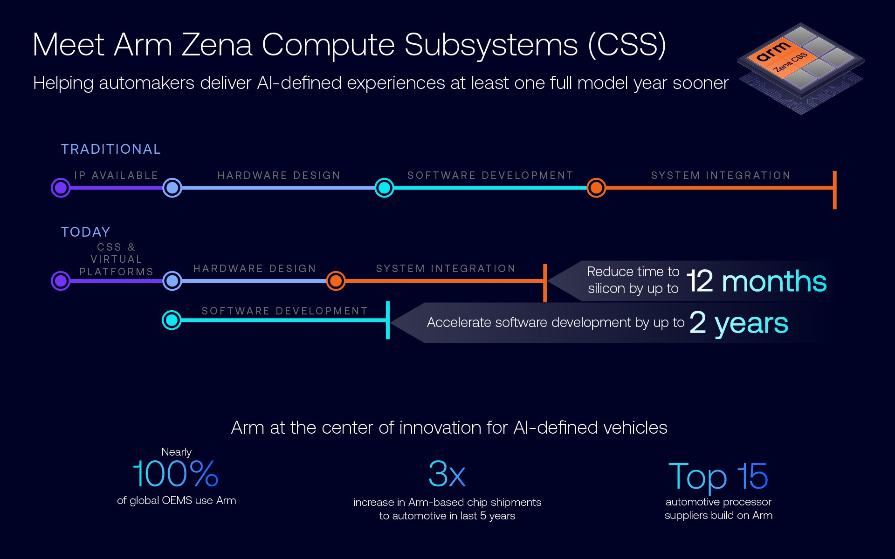

# 08｜Arm 具身智能核心技术护城河总览

## 结论：可复用架构与可交付系统要分别估值

Arm 的核心价值是从嵌入式控制到高性能计算的架构和软件基础，以及为SoC设计者提供CPU/互联、安全与参考固件等整合资产。机器人购买者最终得到的却是具体SoC/SOM/BSP、本体和维护链。因此护城河不能只用CPU代际、TOPS或伙伴数衡量，应检查哪些代码和数据可以复用、哪些设备编译产物要重建、哪些安全/交付责任由供应商承诺。Linux/ROS/TF-A等开放机制的价值来自兼容与集成积累，不是Arm独占。[S03](https://newsroom.arm.com/blog/arm-zena-css-ai-defined-vehicle-compute-platform) [S02](https://raw.githubusercontent.com/ARM-software/kleidiai/main/README.md) [S10](https://raw.githubusercontent.com/ARM-software/arm-trusted-firmware/master/docs/design/trusted-board-boot.rst)

本章总览将三个已完成专题串成同一系统评估方法；02专题负责各软件栈部署细节，08解释这些机制为什么形成长期资产、何时失效以及如何比较。保留旧08_Proprietary_Technologies.md作为历史材料，当前研究入口使用本文件；历史内容不作为新增主张的证据。

## 技术与证据地图

| 能力 | 可核机制 | 价值成立条件 | 限制/归属 | 深度专题 |
|---|---|---|---|---|
| 数值与CPU优化 | zero point补偿、scale、int4顺序、packing/tile | 精度与ISA/shape匹配、packing可摊销 | 微内核非完整调度器 | 08A |
| 图与专用加速器 | command stream/base address、量化/分段、runtime | compiler、BSP、target、buffer一致 | SoC厂栈，非Arm统一图格式 | 08A |
| 传感到推理内存 | DMA-BUF、attachment/map、fence、cache SYNC | 所有设备与buffer生命周期闭合 | Linux标准，目标驱动须实现 | 08B |
| 闭环时间与观测 | SOE/EOF、时钟域、queue、trace clock | 同域时间、同一frame/动作generation | ROS/SDK功能不等于硬同步 | 08B |
| 隔离/安全/更新 | 域资源、IOMMU、CoT证书、slot/boot state | 生产key、安全包与故障验证 | 可信来源不等于物理动作安全 | 08C |

专题文件均保存官方原件、精确主张、图源哈希、基线、检查和零请求去重记录。08联合资料集合最终覆盖全部专题，不以最后一篇下载视图替代联合清单。图和结构检查通过不表示已执行SDK或实机benchmark。

## Arm 自身集成资产与生态资产的边界

Zena官方图把传统离散IP后的串行流程，与CSS/virtual platforms提前并行的软件开发对照，称time-to-silicon最多减12个月、软件开发可提前最多2年。它支持“预整合资产降低设计等待”的机制，数字属于2025年汽车CSS宣传条件；图中全球汽车OEM、出货增长或Top15厂商的口径不能转换成机器人份额。图也不是具体SOM供货合同，没有保证每个机器人项目都节省同样时间。[S03](https://newsroom.arm.com/blog/arm-zena-css-ai-defined-vehicle-compute-platform)

同一blog列16核A720AE、CMN S3AE、R82AE Safety Island、Runtime Security Engine、参考固件和可选GPU/ISP集成。这种整合对芯片设计团队有价值：已有子系统连接与验证资产减少自行拼接工作。但机器人团队通常通过SoC或模组供应商获得实现，其DDR/I/O、NPU、固件、温度和生命周期仍由具体产品决定。IP产品可扩展性不能替代已售芯片的现实接口，更不能由架构规划直接推出量产时间。01已保留Zena来源配置差异，正式冻结时需确认授权包而非只采用网页列表。

开放生态能降低某些迁移成本，却不消除设备依赖。KleidiAI的数值packing可在匹配CPU特性上复用，上层框架仍负责内存、调度和特性选择；TI和地瓜专用NPU/DSP有自己的编译图与runtime。S100 ACT源码直接展示HBM与X5 bin及shape处理差异，说明同属Arm的CPU架构不让不同加速器二进制兼容。持久资产更可能是模型源、校准数据、算子/数值回归、frame/joint契约及自动构建清单。[S01](https://raw.githubusercontent.com/ARM-software/kleidiai/ebe33865eb77addae5f5ea8d277ca0656e1d1be7/kai/ukernels/matmul/pack/README.md) [S08](https://raw.githubusercontent.com/D-Robotics/rdk_LeRobot_tools/main/bpu_act_control_robot.py)

## 把护城河落到一个闭环任务

以两相机操作为分析案例：传感器给曝光事件与buffer；CPU/ISP或视觉编码器转换；加速器图产生动作chunk；CPU反归一化并向本体发送。计算层要核dtype、shape、scale和分区；内存层要核owner、stride、map和fence；时间层要核曝光、推理排队和动作年龄；保护层要核限幅、watchdog、独立停止与异常恢复。任何一层未衔接都只能称组件demo，不能称平台已完成闭环。[S09](https://raw.githubusercontent.com/D-Robotics/rdk_LeRobot_tools/main/README.md) [S05](https://www.kernel.org/doc/html/latest/driver-api/dma-buf.html) [S06](https://www.kernel.org/doc/html/latest/userspace-api/media/v4l/buffer.html)

S100脚本在队列空时才推理，所以不断采新相机帧并不意味着不断生成最新动作。kernel变快可能缩短补队列时间，却不改变整块动作执行期间的观测滞后。应先确定任务容许的horizon和重规划触发，再决定优化视觉、Transformer或通讯；只比较模型毫秒可能优化了错误瓶颈。内存“共享”也不能掩盖脚本numpy copy，fence完成更不等于CPU缓存准备完毕。[S08](https://raw.githubusercontent.com/D-Robotics/rdk_LeRobot_tools/main/bpu_act_control_robot.py) [S05](https://www.kernel.org/doc/html/latest/driver-api/dma-buf.html)

对移动机器人同样要先规定地图/定位时效、感知年龄与制动距离，才评估模型吞吐。真实环境的关键失败来自传感缺测、热/电源、坐标标定、网络延迟和状态分布变化，单一神经网络分类分数无法覆盖这些条件。CPU、NPU、实时域和更新域协作的价值，是让上述条件可控制、可记录、可恢复；没有同条件验证时不写成“整体更快/更安全”。

## 对标与采购的可检验问题

| 比较对象 | 同类痛点 | 应比较资产/指标 | 本研究边界 |
|---|---|---|---|
| CPU微内核与GPU/NPU图 | 推理成本 | 完整前后处理、shape、精度、功耗 | 执行层不同，不输出倍数排名 |
| SoC异构共享与标准DMA | 数据移动 | driver导入、cache、copy、pool背压 | API存在不能证明整链零拷贝 |
| 安全岛与虚拟化隔离 | 错误传播与保护 | 故障域、DMA权限、诊断、恢复 | 不把进程/域隔离当WCET或认证 |
| 可信启动与A/B维护 | 未授权代码及更新失败 | key/证书、兼容、boot状态、健康回退 | 来源可信不证明模型质量 |

竞争优势可以是既有部署代码、调优经验、开放社区和供应商交付责任，也可能因专用工具、授权二进制和数据权利形成迁移锁定。应要求可复建源版本、产物hash与依赖矩阵，再看现场故障能由谁修复；若只有浮动main、视频和未知BSP，即使峰值高也不能估计维护成本。CoreCollective/SOAFEE的协作可形成共同规范，但治理成员数量不代表目标载板认证或工厂订单。[S04](https://corecollective.dev/blog/soafee-announcement/)

## 放行证据与缺口

技术放行分四层：算子/数值回归；完整目标模型和并发热测试；真实任务/故障恢复；产测与长期维护。每层保存失败样本及明确分母，平均/P99与WCET区分，首帧与稳态区分，策略频率与伺服频率区分。更新manifest绑定模型、统计量、标定、控制限制、compiler、runtime、firmware和SKU；镜像签名与业务回退都要目标测试，开发key不得作为生产证据。[S10](https://raw.githubusercontent.com/ARM-software/arm-trusted-firmware/master/docs/design/trusted-board-boot.rst) [S07](https://rauc.readthedocs.io/en/latest/integration.html)

现有证据缺口包括Vela/core driver访问限制、Zena交付包配置、商业MCU/安全包、同条件端到端实测与地区价格/SLA。模型作者GPU示例、FVP功能验证和厂商客户案例分别有价值，却不能互相拼成已经完成的机器人系统。各类源码、权重、训练数据、二进制及IP许可需分别核查。最终选型应把未知项转成合同交付或实测动作；本研究完成文献与归档核验，未开展硬件、安全认证或机器人运行。

## 参考原件与版本边界

所有资料经项目统一下载器归档。本章资料截止2026-11-05，既有资料按实际时间复用；本章采集日2026-11-05，既有资料按registry实际时间复用；采集时间不能替代材料发布日期。网页静态依赖缺损按下表披露，动态交互不保证离线可用。

| ID/资料名 | 版本边界 | 官方原文 | 本地原件 | 归档状态 |
|---|---|---|---|---|
| S01 / ARM_KAI_Pack | 归档时间2026-11-04T15:47:21.882054+00:00；未明示版号/发布日期 | [原文](https://raw.githubusercontent.com/ARM-software/kleidiai/ebe33865eb77addae5f5ea8d277ca0656e1d1be7/kai/ukernels/matmul/pack/README.md) | [归档](REFERENCES.md#ref-b271d6fef76ced02) | 原件与已识别静态依赖完整 |
| S02 / ARM_KleidiAI_Readme | 归档时间2026-11-04T15:46:02.595359+00:00；未明示版号/发布日期 | [原文](https://raw.githubusercontent.com/ARM-software/kleidiai/main/README.md) | [归档](REFERENCES.md#ref-76cf9034d5f688ad) | 原件与已识别静态依赖完整 |
| S03 / ARM_Zena_Blog | 2025-06-04，汽车宣传条件，保留官网配置冲突 | [原文](https://newsroom.arm.com/blog/arm-zena-css-ai-defined-vehicle-compute-platform) | [归档](REFERENCES.md#ref-b4187a50990d4cca) | 部分静态依赖缺失，13项 |
| S04 / CoreCollective_SOAFEE | 归档时间2026-11-04T16:58:43.232293+00:00；未明示版号/发布日期 | [原文](https://corecollective.dev/blog/soafee-announcement/) | [归档](REFERENCES.md#ref-fc212ffdc999ed3b) | 原件与已识别静态依赖完整 |
| S05 / Linux_DMABUF | 归档时间2026-11-04T16:36:57.320054+00:00；未明示版号/发布日期 | [原文](https://www.kernel.org/doc/html/latest/driver-api/dma-buf.html) | [归档](REFERENCES.md#ref-36bb9f4e55cf47fb) | 原件与已识别静态依赖完整 |
| S06 / Linux_V4L2_Buffer | 归档时间2026-11-04T16:36:38.080039+00:00；未明示版号/发布日期 | [原文](https://www.kernel.org/doc/html/latest/userspace-api/media/v4l/buffer.html) | [归档](REFERENCES.md#ref-2c26e34b1c9ad3dc) | 原件与已识别静态依赖完整 |
| S07 / RAUC_Integration | 归档时间2026-11-04T16:57:23.659495+00:00；未明示版号/发布日期 | [原文](https://rauc.readthedocs.io/en/latest/integration.html) | [归档](REFERENCES.md#ref-674732b55cafae79) | 原件与已识别静态依赖完整 |
| S08 / S100_ACT_Control | 归档时间2026-11-04T16:52:35.486035+00:00；未明示版号/发布日期 | [原文](https://raw.githubusercontent.com/D-Robotics/rdk_LeRobot_tools/main/bpu_act_control_robot.py) | [归档](REFERENCES.md#ref-4b066331e7364227) | 原件与已识别静态依赖完整 |
| S09 / S100_LeRobot | 归档时间2026-11-04T16:40:34.619562+00:00；未明示版号/发布日期 | [原文](https://raw.githubusercontent.com/D-Robotics/rdk_LeRobot_tools/main/README.md) | [归档](REFERENCES.md#ref-6bda06b018c27f9c) | 原件与已识别静态依赖完整 |
| S10 / TFA_Trusted_Boot | 归档时间2026-11-04T17:05:28.077190+00:00；未明示版号/发布日期 | [原文](https://raw.githubusercontent.com/ARM-software/arm-trusted-firmware/master/docs/design/trusted-board-boot.rst) | [归档](REFERENCES.md#ref-2306aefffa749e17) | 原件与已识别静态依赖完整 |

- [官方资料索引](REFERENCES.md)

- [主张与图源记录](research_state/evidence/08_Core_Technology_Moat.json)

- [开始前基线](research_state/baselines/08_Core_Technology_Moat_before.json)
