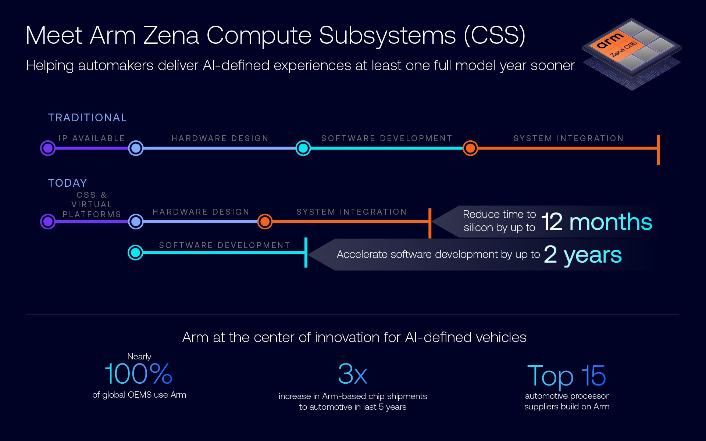

# 09｜Arm 具身智能平台 SWOT 与条件选型

## 决策对象与市场分母

Arm 可作为架构/IP选择，也可通过具体SoC/SOM进入机器人BOM；两种采购对象、成本和支持责任不同。2026-03-24公告将Arm AGI CPU作为AI数据中心硅片产品，列服务器合作及计划部署，说明Arm业务不宜再一概归为纯IP，但该服务器CPU也不能直接充当机器人端侧方案。其商业进展不是本体机队运营证据。[S02](https://newsroom.arm.com/news/arm-agi-cpu-launch)

SEC官方Submissions记录确认2026财年20-F在2026-05-26提交、报告期截至2026-03-31；年报正文与IR入口受robots限制，本文未取得年报全文。独立取得的SEC CompanyFacts机器可读XBRL中，`us-gaap:RevenueFromContractWithCustomerExcludingAssessedTax`、USD、2025-04-01至2026-03-31、accn=0001973239-26-000097、form=20-F对应4,920,000,000美元，即49.2亿美元。该数字是公司整体合同收入，不是具身、机器人或端侧业务分项；frame字段不能替代起止日期，本研究不据它计算机器人份额。[S08](https://data.sec.gov/submissions/CIK0001973239.json) [S07](https://data.sec.gov/api/xbrl/companyfacts/CIK0001973239.json)

Arm2026-09-08公告将Physical AI描述为2030年代每年2000亿美元compute机会，并注明Arm估计；范围包含车辆、机器人和其他物理行业，不是当前全球机器人芯片市场。超过80家公司参与Total Design是伙伴计数，不是订单量、安装量或销量分母。本文未取得可比较的机器人芯片收入、市占率、机队存量及地区分母，因此不输出市场排名。[S05](https://newsroom.arm.com/news/arm-total-design-and-robotics-capability-framework-for-physical-ai)

## SWOT：事实、机制、条件与动作

| 类型 | 已核事实/情景 | 影响机制 | 成立/失效条件 | 选型动作 |
|---|---|---|---|---|
| 优势 | Cortex/多执行域与计算库生态 | 重用CPU软件和部分调优资产 | ISA、ABI与目标驱动匹配；加速器产物仍专用 | 保留源模型/数据与版本清单，先选具体SoC |
| 优势 | CSS预整合与参考固件 | 减少SoC设计等待与拼接 | 面向芯片设计团队，需对应授权包 | 取得交付物与差异表，再估NRE |
| 优势 | 客户末端/本体采用 | 可利用已有接口和供应经验 | 案例不能自动覆盖新代际 | 用同SKU任务与维护测试确认 |
| 短板 | Arm64不统一BPU/DSP/GPU图 | 迁移需重编译/校准/回归 | 模型/shape/precision与runtime变化 | 分层计算迁移工时和重验证成本 |
| 短板 | 公开demo缺闭环/维护分母 | 实际收益和风险难量化 | 无P99、成功/人工介入、SLA | 将未知项转成放行测试与采购交付 |
| 机会 | Physical AI和开放协作扩张情景 | 标准/共享工具减少重复适配 | 工作组成果落到产品与兼容矩阵 | 跟踪实际release/Blueprint，勿用成员数估销量 |
| 威胁 | 多供应商版本/生命周期差异 | 工程锁定、升级和备件成本 | runtime、IP、安全包或key不可迁移 | 约定源码/构建/升级、退出和替代供应条件 |
| 威胁 | 区域限制、权重/数据许可情景 | 可供货或业务使用受限 | 依具体SKU/地区/用途/日期 | 获取分类与许可，确认权重/二进制义务 |

机制证据来自 [S03](https://raw.githubusercontent.com/ARM-software/kleidiai/ebe33865eb77addae5f5ea8d277ca0656e1d1be7/kai/ukernels/matmul/pack/README.md) [S15](https://raw.githubusercontent.com/D-Robotics/rdk_LeRobot_tools/main/bpu_act_control_robot.py) [S09](https://newsroom.arm.com/blog/arm-zena-css-ai-defined-vehicle-compute-platform) [S11](https://corecollective.dev/blog/soafee-announcement/)。表中机会与威胁为条件情景，不是已发生损失或未来收益保证。所谓高能效需要同负载与整机功耗测量；主CPU节能不一定显著改变执行器占主导的电池续航。

Zena官方图给最多12个月time-to-silicon缩短与最多2年软件提前开发的声明，同时列汽车OEM/供应商生态口径。可将它用于询问CSS如何减少芯片设计工时，但不能将这些数值套到机器人模组采购、项目回本或机队续航。开发提前、设计投入减少与本体商业运营是三个不同结果，数字只按原图精度和条件保留。[S09](https://newsroom.arm.com/blog/arm-zena-css-ai-defined-vehicle-compute-platform)

## 商业案例：采用规模不等于 ROI

PSYONIC Ability Hand官方客户页称超过300名假肢用户和90家机器人组织使用，每手12个Arm处理器，并有小于200ms闭合/响应措辞。它支持产品使用和分布控制的客户声明，却没有提供机器人工作地点、任务尝试、暴露小时、人工介入或利润；假肢人数与机器人组织数不同，不能相加成机器人装机量。ROI需要具体替代任务、工时和费用，本文不从“动作快”推断省人效果。[S04](https://www.arm.com/company/success-library/psyonic)

AGIBOT A2/X2/D1案例分别关联人形、研究和配送，ROBOTIS关联DYNAMIXEL/GAEMI；公开文本提供架构/产品任务，不提供精确芯片代际、机队台时或旧新耗电。S100/SO100有可读部署源码及演示，适合低成本研究闭环和转换验证，但训练在工作站、运行在目标板的条件要保留，不能称量产商业运营案例。[S01](https://www.arm.com/company/success-library/agibot-intelligent-robots) [S06](https://www.arm.com/company/success-library/made-possible/robotis) [S16](https://raw.githubusercontent.com/D-Robotics/rdk_LeRobot_tools/main/README.md)

对客户采购，应要求公司/地点/机器人代际/任务/状态、交付台数、运行小时、成功/人工介入及费用分母对应同一配置。若某一代机器人已运营，下一代芯片还在计划采用，累计运营成果不能归因计划芯片。本研究没有这些同条件业务数据，商业结论止于证据等级和需补齐的验证动作。

## 透明 TCO 模型：先列输入再算敏感性

以N台机器人、T年、每年H运行小时、单价及工时为输入：总成本包括研发集成、整机采购、计算/通信能源、软件/云、现场维护、备件、停机及更新/重新认证；残值与退出成本按实际合同处理。芯片或模组单价只覆盖一部分BOM，CSS/IP设计成本又不同于买板成本。公开材料没有完整地区批量报价、税费、SLA和人工替代收入，因此此处提供核算结构，不给真实ROI或平台价格排名。

| 输入 | 单位/口径 | 应取得来源 | 当前状态 |
|---|---|---|---|
| N、T、H | 台、年、小时/年 | 机队计划与排班/日志 | 项目未指定 |
| 计算/整机采购 | 元/台，地区、税费、数量、日期 | 正式报价与BOM | 不能以开发套件价代替 |
| 集成/迁移投入 | 工时×元/小时、一次性NRE | 版本差异与工程估算 | 需目标方案测算 |
| 平均功率与电价 | W、元/kWh | 实际负载功率与电费 | 无同条件机器人数据 |
| 维护/备件/停机 | 元/年或元/小时 | 合同、维修记录、损失口径 | 未取得 |
| 模型/云/认证/退出 | 元/年或一次性 | 许可、接口流量、安全/迁移包 | 需分项核验 |

分析敏感性：能源差额=N×ΔP/1000×H×T×C_e。若仅为示例假设ΔP=10W、H=4000h/年、T=5年、C_e=1元/kWh，则每台5年能源差额200元；它不是任何Arm板实测节能，也未含电池、空调或执行器。说明小幅计算功率差未必覆盖一次迁移工时，应先量化真实系统占比。一次性迁移成本摊销到N台后比较，规模小的科研项目可能更重视现有工具与人力，量产机队则需计长期供货/维护和更新成本。

生命周期页对具体Jetson模组列供货规划，但开发套件不承诺同样周期；供货结束、软件漏洞支持与现货交期仍是不同输入。[S13](https://developer.nvidia.com/embedded/lifecycle) RAUC可提供更新机制却需boot state和存储设计，更新失败成本与回退工时不能省略。[S14](https://rauc.readthedocs.io/en/latest/integration.html)

## 区域政策与使用权的具体核查范围

BIS EAR入口涵盖15 CFR730—774，并提供CCL/ECCN、Country Chart和最终用户/用途等导航，同时注明该资源并非正式法律版，应确认官方法规版本。它支持需要按物项、目的地和用途分类的核查路径，本研究没有取得各目标SKU的正式ECCN或许可证，不宣称Thor、S100、MCU或全部Arm产品自动受同一限制。[S10](https://www.bis.gov/regulations/ear)

GDPR两个官方候选页在本次采集可见正文为空，已排除有效引用；本文未取得适用地区数据处理/跨境条款原件，不能作法律适用结论。生产部署还应确认图像、遥操作及客户数据的存储/用途/传输边界，这属于后续具体项目核查。代码、权重、训练数据、runtime和本体SDK分别核许可；Depth Anything V2不同权重许可不同，不能由Small的Apache许可推导Large可商用。[S12](https://raw.githubusercontent.com/DepthAnything/Depth-Anything-V2/main/README.md)

## 条件选型与放行矩阵

| 场景 | 优先评估路线 | 选择成立条件 | 放行证据 |
|---|---|---|---|
| 科研/模型快速迭代 | Arm端侧＋上游GPU工作站 | 框架/相机/本体易复建，允许RPC | 模型到动作契约、断网/旧动作处理 |
| 低成本固定操作 | S100 ACT等厂商具体示例 | 固定数据分布、量化精度可接受 | 留出任务成功、队列年龄、独立停止 |
| 大型VLA操作 | 有明确显存/runtime的具体平台 | 实际模型可部署及并发热预算满足 | 精确模型/shape、内存、P99与本体闭环 |
| 物流AMR | SoC/SOM＋感知/定位/控制域 | 地图/观测时效、制动、传感覆盖 | 长期运行、丢帧/定位失效与人工介入 |
| 固定视觉/消费端侧 | CPU/NPU及MCU分工 | 场景明确、功耗/价格/工具匹配 | 整链性能/精度、维护和权重许可 |
| 工业/安全相关 | 具备正式安全与维护交付的具体产品 | 诊断/保护/供应与认证链完整 | WCET/故障响应、安全包、产测与OTA |
| 自研SoC | Arm IP/CSS＋差异化加速器 | 规模/NRE和设计能力支持 | RTL/firmware交付、量产/验证和许可合同 |

先冻结任务与动作/传感契约，再在目标SKU上做并发、热稳定与尾延迟，再做真实任务/失效恢复，最后核量产供货和维护。峰值算力、单模型平均时间、合作名单或厂商宣称不能替代这四层证据。本研究01—09及软件/核心技术专题完成文献深挖和官方原件归档，未安装运行SDK/模型，也未开展实机、法律适用或安全认证验收。

## 参考原件与版本边界

所有资料经项目统一下载器归档。本章资料截止2026-11-05，既有资料按实际时间复用；本章采集日2026-11-05，既有资料按registry实际时间复用；采集时间不能替代材料发布日期。网页静态依赖缺损按下表披露，动态交互不保证离线可用。

| ID/资料名 | 版本边界 | 官方原文 | 本地原件 | 归档状态 |
|---|---|---|---|---|
| S01 / ARM_AGIBOT_Case | 归档时间2026-11-04T16:52:13.313256+00:00；未明示版号/发布日期 | [原文](https://www.arm.com/company/success-library/agibot-intelligent-robots) | [归档](REFERENCES.md#ref-8f9bd644cb3469e4) | 部分静态依赖缺失，14项 |
| S02 / ARM_AGI_Launch | 归档时间2026-11-04T15:33:01.438578+00:00；未明示版号/发布日期 | [原文](https://newsroom.arm.com/news/arm-agi-cpu-launch) | [归档](REFERENCES.md#ref-060845566203ff83) | 部分静态依赖缺失，13项 |
| S03 / ARM_KAI_Pack | 归档时间2026-11-04T15:47:21.882054+00:00；未明示版号/发布日期 | [原文](https://raw.githubusercontent.com/ARM-software/kleidiai/ebe33865eb77addae5f5ea8d277ca0656e1d1be7/kai/ukernels/matmul/pack/README.md) | [归档](REFERENCES.md#ref-b271d6fef76ced02) | 原件与已识别静态依赖完整 |
| S04 / ARM_PSYONIC_Case | 归档时间2026-11-04T16:52:03.104756+00:00；未明示版号/发布日期 | [原文](https://www.arm.com/company/success-library/psyonic) | [归档](REFERENCES.md#ref-d35285b5a0fa85e2) | 部分静态依赖缺失，14项 |
| S05 / ARM_Physical_AI_News | 归档时间2026-11-04T15:25:39.647573+00:00；未明示版号/发布日期 | [原文](https://newsroom.arm.com/news/arm-total-design-and-robotics-capability-framework-for-physical-ai) | [归档](REFERENCES.md#ref-3c6e029813d18cf4) | 部分静态依赖缺失，13项 |
| S06 / ARM_ROBOTIS_Case | 归档时间2026-11-04T16:52:27.451970+00:00；未明示版号/发布日期 | [原文](https://www.arm.com/company/success-library/made-possible/robotis) | [归档](REFERENCES.md#ref-1212e2efaf2bbcf2) | 部分静态依赖缺失，14项 |
| S07 / ARM_SEC_CompanyFacts | 2026-11-05取得SEC XBRL API，年报accn2026-000097、FY2026日期字段 | [原文](https://data.sec.gov/api/xbrl/companyfacts/CIK0001973239.json) | [归档](REFERENCES.md#ref-ab3de83a626d5b7c) | 原件与已识别静态依赖完整 |
| S08 / ARM_SEC_Submissions | 2026-11-05取得，确认20-F提交记录 | [原文](https://data.sec.gov/submissions/CIK0001973239.json) | [归档](REFERENCES.md#ref-22bdde922de706ee) | 原件与已识别静态依赖完整 |
| S09 / ARM_Zena_Blog | 归档时间2026-11-04T15:32:36.834463+00:00；未明示版号/发布日期 | [原文](https://newsroom.arm.com/blog/arm-zena-css-ai-defined-vehicle-compute-platform) | [归档](REFERENCES.md#ref-b4187a50990d4cca) | 部分静态依赖缺失，13项 |
| S10 / BIS_EAR | 2026-11-05入口快照，非逐SKU法律适用 | [原文](https://www.bis.gov/regulations/ear) | [归档](REFERENCES.md#ref-eb1db390c7ea5ba9) | 部分静态依赖缺失，1项 |
| S11 / CoreCollective_SOAFEE | 归档时间2026-11-04T16:58:43.232293+00:00；未明示版号/发布日期 | [原文](https://corecollective.dev/blog/soafee-announcement/) | [归档](REFERENCES.md#ref-fc212ffdc999ed3b) | 原件与已识别静态依赖完整 |
| S12 / DepthAnything2_Readme | 归档时间2026-11-04T16:40:38.119416+00:00；未明示版号/发布日期 | [原文](https://raw.githubusercontent.com/DepthAnything/Depth-Anything-V2/main/README.md) | [归档](REFERENCES.md#ref-c1030fccd8827de2) | 原件与已识别静态依赖完整 |
| S13 / NVIDIA_Lifecycle | 归档时间2026-11-04T15:28:01.234094+00:00；未明示版号/发布日期 | [原文](https://developer.nvidia.com/embedded/lifecycle) | [归档](REFERENCES.md#ref-782c8ca091275c8c) | 部分静态依赖缺失，142项 |
| S14 / RAUC_Integration | 归档时间2026-11-04T16:57:23.659495+00:00；未明示版号/发布日期 | [原文](https://rauc.readthedocs.io/en/latest/integration.html) | [归档](REFERENCES.md#ref-674732b55cafae79) | 原件与已识别静态依赖完整 |
| S15 / S100_ACT_Control | 归档时间2026-11-04T16:52:35.486035+00:00；未明示版号/发布日期 | [原文](https://raw.githubusercontent.com/D-Robotics/rdk_LeRobot_tools/main/bpu_act_control_robot.py) | [归档](REFERENCES.md#ref-4b066331e7364227) | 原件与已识别静态依赖完整 |
| S16 / S100_LeRobot | 归档时间2026-11-04T16:40:34.619562+00:00；未明示版号/发布日期 | [原文](https://raw.githubusercontent.com/D-Robotics/rdk_LeRobot_tools/main/README.md) | [归档](REFERENCES.md#ref-6bda06b018c27f9c) | 原件与已识别静态依赖完整 |

- [官方资料索引](REFERENCES.md)

- [主张与图源记录](research_state/evidence/09_SWOT_Analysis.json)

- [开始前基线](research_state/baselines/09_SWOT_Analysis_before.json)
