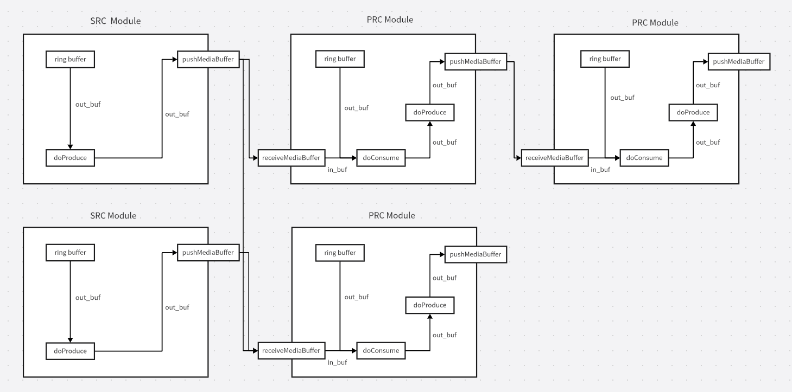

# 02A｜BSP、GPU 与多媒体缓冲区：先建立可维护的数据底座

本专题面向 RK3588/S/S2、RK3576 及其伙伴开发板，区分瑞芯微 MPP/librga、板卡厂商系统镜像与 FFMedia、Mesa 社区驱动。软件版本核验截止 2026-11-05；没有取得某块量产载板的完整 BSP manifest，因此这里给出公开交付路径和验收要求，不能将通用文档的版本组合称为该载板已认证组合。

## 1. 系统镜像是驱动和 ABI 的组合

机器人常同时运行相机、视频回传、推理和 ROS，安装一个能启动的 Debian 系统只解决了用户态环境，不能证明 ISP、GPU、RGA 和 NPU 驱动可以一起工作。Radxa 明确将 Radxa OS 定义为其团队基于 Debian 开发的系统，并配有 Rsetup；Firefly 的 Buildroot 固件示例默认提供 Wayland 与 Qt 应用。这是两家伙伴的交付路线，不是瑞芯微对所有开发板统一承诺一个操作系统发行版。Buildroot 桌面页的更新时刻为 2026-08-27，示例 qcamera 能拍照录像，不能由此推导任意传感器驱动、同步或多路实时上限。[RK02_Radxa_OS](https://docs.radxa.com/en/rock5/rock5b/radxa-os)（[本地原件](REFERENCES.md#ref-8e081a5d0b4a4372)) [RK02_Firefly_Buildroot](https://community.t-firefly.com/en/docs/software/os-guide/Buildroot/buildroot-desktop)（[本地原件](REFERENCES.md#ref-7e1f75ba825a6ee6))

| 层级 | 此次取得的交付物 | 关键匹配关系 | 具身项目放行前还需取得 |
| --- | --- | --- | --- |
| 板卡 BSP | Radxa OS、Firefly Linux/Buildroot 文档 | bootloader、DTB、kernel、载板版本 | 镜像哈希、源码 manifest、补丁集、恢复流程 |
| GPU | Mali DDK 或 Mesa Panfrost/Panthor 路线 | kernel DRM/kbase、Mesa/libmali、窗口系统 | 目标 API/扩展、显示与计算并发验证 |
| 多媒体 | Rockchip MPP、librga | 编解码/RGA 驱动、DMA 分配器、格式 | 真实输入、队列深度、超时与热稳定数据 |
| 管线封装 | Firefly FFMedia | 发布 SDK ABI、libstdc++、模块依赖 | 库与头文件配套、部署许可、重启恢复 |

建议将启动链、根文件系统和应用分开追踪，但把它们作为同一个发布组合验收。记录 SoC/SOM/载板修订、启动存储与分区、U-Boot 和内核 commit、DTB 哈希、设备树 overlay、驱动版本和固件、libc 与 C++ ABI、每个动态库的哈希。刷写失败、overlay 选错、内核升级后设备节点消失，都可能使上层模型正常加载却收不到有效帧。这些是架构推导的失效路径，不是本文已观察到的板卡事故。

## 2. GPU 驱动能力不能跨镜像套用

Firefly 的 GPU 环境页表示 Kernel 6.1 SDK 中 RK3588/RK3576 可使用 Mesa 25.0.7 的 Panthor/Panfrost 栈，并要求按实际 SDK、镜像和驱动确认。Radxa Bookworm 切换页又给出一张不同粒度的能力表：Mali 支持 OpenCL、Vulkan、8K HDMI，而该页 Panthor 栏将这些标为不支持。两者不能拼成“所有 Panthor 都没有 Vulkan”或“Bookworm 开箱即可 OpenCL”。前者是特定伙伴 SDK 的能力说明，后者是 Radxa 当页发行组合，存在更新与集成条件差异。[RK02_Firefly_GPU](https://community.t-firefly.com/en/docs/software/graphics/GPU/gpu-driver)（[本地原件](REFERENCES.md#ref-b36bb9db39317e75)) [RK02_Radxa_GPU](https://docs.radxa.com/en/rock5/rock5b/radxa-os/mali-gpu)（[本地原件](REFERENCES.md#ref-abcb164c839d7a31))

Radxa 提供的具体步骤说明了依赖为何成组：替换 xorg-xserver 软件源优先级，安装 RK3588 的 `libmali-valhall-g610-g24p0-x11-wayland-gbm` 或其他对应包，启用 Mali overlay，修改 Panfrost/kbase 黑名单，然后重启并检查内核模块和用户态库。这不是“换一个 .so”即可迁移的操作。OpenGL 渲染、OpenCL 计算、Vulkan、HDMI 输出是不同能力，必须逐项验证；某个推理编译器在 GPU 上执行算子还要看其后端支持，GPU 驱动 API 存在并不自动提供模型部署能力。[RK02_Radxa_GPU](https://docs.radxa.com/en/rock5/rock5b/radxa-os/mali-gpu)（[本地原件](REFERENCES.md#ref-abcb164c839d7a31))

对照 NVIDIA JetPack 的机制，其下载页以 Jetson Linux、CUDA、TensorRT 等组成发行组合。Rockchip 的公开资料更多由芯片 SDK 与各伙伴镜像共同构成；工程收益是板级适配选择多，代价是应用团队要自行固定组合及支持责任。这里只比较发行和接口组织机制，不以包数量或页面版本号作性能排名。[RK02_JetPack_Compare](https://developer.nvidia.com/embedded/jetpack/downloads)（[本地原件](REFERENCES.md#ref-a226cd46c59f27f9))

## 3. MPP：压缩流、帧与缓冲区的生命周期

MPP README 的官方架构把上层 OpenMAX/GStreamer/libva、MPI 缓冲队列、codec/parser、HAL 寄存器生成与内核接口分开。它承担编码/解码，不是通用神经网络编译器。源码目录中的 codec 解析压缩码流语法，HAL 将协议结构转换为芯片寄存器任务，OSAL 抽象分配器和操作系统。README 支持列表包括 RK3588，但旧 API 头注释中的芯片列表较早，不能依据头文件注释遗漏就否定新平台，也不能将 README 的“格式由硬件决定”当成所有 SKU 都具有相同编码规格。[RK02_MPP_Readme](https://raw.githubusercontent.com/rockchip-linux/mpp/develop/readme.txt)（[本地原件](REFERENCES.md#ref-f7d16c51152e1c0a)) [RK02_MPP_API](https://raw.githubusercontent.com/rockchip-linux/mpp/develop/inc/rk_mpi.h)（[本地原件](REFERENCES.md#ref-95242b697e7098d7))

`mpp_create(&ctx,&mpi)` 创建上下文和函数表，`mpp_init(ctx,MPP_CTX_DEC,coding)` 选择解码器与格式。`MppPacket` 是压缩数据对象，`MppFrame` 描述解码后的图像，二者关联 `MppBuffer`，而不是把一个 CPU 地址同时当成所有对象。API 同时提供合并式 decode/encode、异步 `decode_put_packet/decode_get_frame`，以及高级 `poll/dequeue/enqueue` 任务队列；control 用于配置，reset 会丢弃已有流和帧并恢复初始状态。reset 不是保留任务顺序的无损恢复。[RK02_MPP_API](https://raw.githubusercontent.com/rockchip-linux/mpp/develop/inc/rk_mpi.h)（[本地原件](REFERENCES.md#ref-95242b697e7098d7))

已读 `mpi_dec_test.c` 的关键分支：送包成功后继续取出可用帧，遇到 info_change 读取 width、height、hor_stride、ver_stride、buf_size，配置新的缓冲组后发送 `MPP_DEC_SET_INFO_CHANGE_READY`，随后才继续解码。示例对超时有重试，内部队列满时等待；这个等待策略适合解释背压，但源码注释中的“1080p 通常 2ms”缺少测试型号、编码配置和统计，不作为本项目时延基准。机器人适配应在码流分辨率变化时同时更新 RGA 视图和模型预处理，不能继续用旧 stride 读取新帧。[RK02_MPP_Decode](https://raw.githubusercontent.com/rockchip-linux/mpp/develop/test/mpi_dec_test.c)（[本地原件](REFERENCES.md#ref-4421778d858cc320))

MPP README 区分内部、半内部、全外部三种分配模式。内部模式最容易跑通，却难控制内存与零拷贝显示；半内部模式由调用者按 info_change 建立缓冲组，并可用 `mpp_buffer_group_limit_config` 限制；外部模式由外部分配器创建 DMA 对象并导入 group，便于共享显示内存，但调用者必须获得正确的尺寸和生命周期。`mpp_buffer.h` 还提供引用计数、import/get/put 及 cache 同步接口。必须等最后一个使用者完成后再归还帧，解码器“返回了 frame”不表示应用可以覆盖其底层 buffer。[RK02_MPP_Readme](https://raw.githubusercontent.com/rockchip-linux/mpp/develop/readme.txt)（[本地原件](REFERENCES.md#ref-f7d16c51152e1c0a)) [RK02_MPP_Buffer](https://raw.githubusercontent.com/rockchip-linux/mpp/develop/inc/mpp_buffer.h)（[本地原件](REFERENCES.md#ref-f11d6a939222b38e))

## 4. RGA：共享内存仍需要格式和同步契约

librga README 快照 API 版本为 1.10.6，开发指南为 RK-KF-YF-403、V2.2.10、2026-05-13，这两个版本号分别属于库 API 与文档。README 给出 multicore 驱动最低 1.2.4、推荐 1.3.13 及以上；旧 RGA/RGA2 驱动进入兼容模式，API 1.3.2 之后新增接口不能照搬。适用芯片列表与仓库预编译平台列表也不同：前者包含 RK1820，后者未列 RK1820，不能据此承诺此仓库二进制可在协处理器中直接部署。[RK02_RGA_Readme](https://raw.githubusercontent.com/airockchip/librga/main/README.md)（[本地原件](REFERENCES.md#ref-6da06769921f5c55)) [RK02_RGA_Guide](https://raw.githubusercontent.com/airockchip/librga/main/docs/Rockchip_Developer_Guide_RGA_CN.md)（[本地原件](REFERENCES.md#ref-b175c5e9893e4e95))

RGA 的核心是二维硬件变换，适合 resize、crop、旋转和色彩转换。`importbuffer_fd` 将外部 DMA 缓冲映射进驱动，返回可重复使用的 handle；`wrapbuffer_handle` 再附加 width、height、format、wstride、hstride 组成 `rga_buffer_t`。handle 生命周期宜与缓冲池一致，将映射成本收敛到初始化和销毁；每帧重新 import/release 会放大分配器差异。开发阶段用 `imcheck` 检查格式、矩形与对齐，再调用 `imresize/imcvtcolor` 等，不能把 imcheck 当成处理完成或缓存同步。[RK02_RGA_Guide](https://raw.githubusercontent.com/airockchip/librga/main/docs/Rockchip_Developer_Guide_RGA_CN.md)（[本地原件](REFERENCES.md#ref-b175c5e9893e4e95)) [RK02_RGA_FAQ](https://raw.githubusercontent.com/airockchip/librga/main/docs/Rockchip_FAQ_RGA_CN.md)（[本地原件](REFERENCES.md#ref-a2e0e8f0ba8423e2))

颜色同样是模型契约。指南说明 YUV/RGB 默认采用 BT.601 limited range；相机或网络流实际使用 BT.709/full range 时，要显式设置并用色卡和数值比较检查。裁剪、letterbox 与缩放改变像素到原图坐标映射，目标框回投必须携带比例、padding 和原始尺寸。RGA 一次变换可减少 CPU 负担，但依然读写 DDR；不保证归一化、任意 tensor layout 和模型后处理都被硬件完成。

异步调用返回 release_fence 后必须等待相应完成，`imsync(fence_fd)` 或依赖传递应在消费者读取之前建立顺序。CPU 读写 cacheable DMA 缓冲还需要分配器/驱动对应的 cache 同步。FAQ 区分旧驱动等待整个进程设备 fd 与 multicore 驱动按请求 fence 的行为；异步不是天然低时延。RK3588 同时有 RGA2 与两颗 RGA3，缩放取数行为可能导致画面抖动，应在一致性敏感场景固定核心并测精度。部分 RGA2 的 32 位寻址要求低 4GB 内存；新驱动可直接拒绝不满足条件的任务，旧路径可能经 swiotlb 复制。这里限制的是特定引擎可达物理地址，不是整块板只能装 4GB。[RK02_RGA_Guide](https://raw.githubusercontent.com/airockchip/librga/main/docs/Rockchip_Developer_Guide_RGA_CN.md)（[本地原件](REFERENCES.md#ref-b175c5e9893e4e95)) [RK02_RGA_FAQ](https://raw.githubusercontent.com/airockchip/librga/main/docs/Rockchip_FAQ_RGA_CN.md)（[本地原件](REFERENCES.md#ref-a2e0e8f0ba8423e2))

## 5. 伙伴管线 FFMedia：封装降低集成量，也保留底层条件

图为 Firefly 仓库的官方软件框架原图。图中处理模块还画有 doProduce 的内部阶段，图的独立版本未标明；扩展实现以此次 module_media 文档的 doConsume/output 契约为准。它支持 Producer/Consumer 模块化连接的解释，不能证明任意模块组合都零拷贝或具有确定时延。FFMedia 将 VI 输入、VP 处理、VO 输出组织成有向图，`connectProducer()` 按 `MediaChannelInfo` 的媒体类型、编码、格式与通道连接。数据通过 `std::shared_ptr<MediaBuffer>` 传递，包含 payload、timestamp、状态，底层 DMA-BUF 共享只在设备和模块支持时成立。共享指针避免 payload 的软件复制并延长对象生命，并不保证硬件没有中间变换缓冲。[RK02_FFMedia_Architecture](https://community.t-firefly.com/en/docs/software/multimedia/FFMedia/ffmedia-architecture)（[本地原件](REFERENCES.md#ref-30a2599d3b6b9bee)) [RK02_FFMedia_API](https://raw.githubusercontent.com/Firefly-rk-linux-utils/ffmedia_release/master/docs/module_media.md)（[本地原件](REFERENCES.md#ref-05b9158609f4a460))

Firefly 页面示例显示 v2.6.2，发布日期没有由此确定。其发布目录提供预编译核心 `.so`、公共头文件、Python wheel 和可构建示例；根 CMake 主要构建示例和扩展，不是核心库的完整源码重建入口。ABI 政策要求 C++17、AArch64 ELF、匹配 libstdc++ C++11 ABI，并分别维护 SDK 语义版本与 Module ABI/SONAME；修改类布局或虚函数等必须递增 Module ABI。二者需要与公共头和外部模块一起固定。公开仓库中 MPP 头文件为 Apache-2.0，librga COPYING 为 Apache-2.0；这不能覆盖 Mali DDK、镜像里的固件、FFMedia 核心二进制和全部第三方媒体插件。本轮未取得 FFMedia 核心明确再分发许可，量产前应取得完整 SBOM 与逐组件授权。[RK02_Firefly_FFMedia](https://community.t-firefly.com/en/docs/software/multimedia/FFMedia/ffmedia-core)（[本地原件](REFERENCES.md#ref-87cebb99de413dde)) [RK02_FFMedia_ABI](https://raw.githubusercontent.com/Firefly-rk-linux-utils/ffmedia_release/master/ABI_POLICY.md)（[本地原件](REFERENCES.md#ref-bcb72eb558720fd4)) [RK02_RGA_Copying](https://raw.githubusercontent.com/airockchip/librga/main/COPYING)（[本地原件](REFERENCES.md#ref-58f474938d8b0545)) [RK02_MPP_API](https://raw.githubusercontent.com/rockchip-linux/mpp/develop/inc/rk_mpi.h)（[本地原件](REFERENCES.md#ref-95242b697e7098d7))

| 官方示例/数据 | 条件 | 支持的结论 | 不能推出 |
| --- | --- | --- | --- |
| RGA 1080p 拷贝：理论 3456us、Drm cache 实际 4420us | FAQ：RK3566/RGA2、Android11、300MHz、空载；其他频率见原表 | 缓冲类型和软件成本影响实际耗时 | RK3588 并发相机中的拷贝时延 |
| FFMedia Camera 转发显示平均 19ms | 仓库：两块 RK3588，LED/Camera、编码推流、解码显示；屏幕部分按平均10ms估算 | 伙伴给出低延迟管线及测量拆分 | 实测P99、功耗、NPU并发、控制反馈时延 |
| FFMedia HDMI 转发显示平均 29ms | 同上，输入链不同；分辨率/帧率和完整SDK版本未齐 | 输入链会影响总体延迟 | 任意摄像头固定19ms或29ms |

上述 RGA 数字是官方旧平台空载测量，FFMedia 数字含显示估算。它们用于识别成本项，不做跨平台速度排序。FAQ 还指出带宽紧张、多路 ISP 及任务超过硬件核心数都会增加等待；机器人更关心观测年龄和长尾，不能只观察平均吞吐。[RK02_RGA_FAQ](https://raw.githubusercontent.com/airockchip/librga/main/docs/Rockchip_FAQ_RGA_CN.md)（[本地原件](REFERENCES.md#ref-a2e0e8f0ba8423e2)) [RK02_FFMedia_Repo](https://github.com/Firefly-rk-linux-utils/ffmedia_release)（[本地原件](REFERENCES.md#ref-bac2a2703967a2b0))

## 6. 可复建验证和交接

建议先使用供应商推荐镜像建立基线，记录包版本及 SHA256，再在相同目标板上按 MPP decode → RGA resize/颜色转换 → 输出校验逐层推进。对固定视频、真实相机、分辨率变化、断流重连和 EOS 分别核验；比较处理后图像的像素、颜色、stride 与 CPU 参考实现。预分配有限缓冲池，记录每帧采集时刻、入队、硬件完成、模型消费和最终归还，测试消费者慢、队列满、fd 泄漏与取消退出。之后才并发启用 NPU、录制和 ROS，采集功率、温度、丢帧、最大队列和 P50/P95/P99；这些步骤是待执行验证方案。

交给 02B 的不是一张“RGB图片”，而是明确的尺寸、色域、通道顺序、stride、DMA fd/offset、所有权、fence、时间戳与模型输入契约。没有取得一个贯穿相机、MPP/RGA、RKNN 和机器人控制的公开统一实现，因此不能将单独媒体 demo 与模型 demo 拼成已验证闭环。完整板级 BSP 源码 manifest、ISP tuning 交付、GPU 扩展与二进制许可仍是实质缺口；GitHub API/tree 访问受限已保留失败记录，正文有效引用仅使用成功取得的源码和页面。

## 参考资料与本地原文

采集时间逐项列出；移动分支及无版本网页仅代表此次快照。HTML 保留正文与可取得静态依赖，动态交互、视频及缺失依赖不保证完整。未进行目标板安装或实机性能验证。

| 来源 | 原 URL | 本地原件 | 采集 UTC | 归档状态 |
| --- | --- | --- | --- | --- |
| RK02_Radxa_OS | [原文](https://docs.radxa.com/en/rock5/rock5b/radxa-os) | [归档](REFERENCES.md#ref-8e081a5d0b4a4372) | 2026-11-04T16:06:14.431397+00:00 | partial_static；缺失依赖 5 |
| RK02_Firefly_Buildroot | [原文](https://community.t-firefly.com/en/docs/software/os-guide/Buildroot/buildroot-desktop) | [归档](REFERENCES.md#ref-7e1f75ba825a6ee6) | 2026-11-04T16:06:15.917416+00:00 | partial_static；缺失依赖 2 |
| RK02_Firefly_GPU | [原文](https://community.t-firefly.com/en/docs/software/graphics/GPU/gpu-driver) | [归档](REFERENCES.md#ref-b36bb9db39317e75) | 2026-11-04T16:09:34.109770+00:00 | partial_static；缺失依赖 2 |
| RK02_Radxa_GPU | [原文](https://docs.radxa.com/en/rock5/rock5b/radxa-os/mali-gpu) | [归档](REFERENCES.md#ref-abcb164c839d7a31) | 2026-11-04T16:12:03.742697+00:00 | partial_static；缺失依赖 5 |
| RK02_JetPack_Compare | [原文](https://developer.nvidia.com/embedded/jetpack/downloads) | [归档](REFERENCES.md#ref-a226cd46c59f27f9) | 2026-11-04T16:13:04.613313+00:00 | partial_static；缺失依赖 85 |
| RK02_MPP_Readme | [原文](https://raw.githubusercontent.com/rockchip-linux/mpp/develop/readme.txt) | [归档](REFERENCES.md#ref-f7d16c51152e1c0a) | 2026-11-04T16:09:42.183440+00:00 | complete_static；缺失依赖 0 |
| RK02_MPP_API | [原文](https://raw.githubusercontent.com/rockchip-linux/mpp/develop/inc/rk_mpi.h) | [归档](REFERENCES.md#ref-95242b697e7098d7) | 2026-11-04T16:10:42.916100+00:00 | complete_static；缺失依赖 0 |
| RK02_MPP_Decode | [原文](https://raw.githubusercontent.com/rockchip-linux/mpp/develop/test/mpi_dec_test.c) | [归档](REFERENCES.md#ref-4421778d858cc320) | 2026-11-04T16:10:45.862778+00:00 | complete_static；缺失依赖 0 |
| RK02_MPP_Buffer | [原文](https://raw.githubusercontent.com/rockchip-linux/mpp/develop/inc/mpp_buffer.h) | [归档](REFERENCES.md#ref-f11d6a939222b38e) | 2026-11-04T16:10:44.795533+00:00 | complete_static；缺失依赖 0 |
| RK02_RGA_Readme | [原文](https://raw.githubusercontent.com/airockchip/librga/main/README.md) | [归档](REFERENCES.md#ref-6da06769921f5c55) | 2026-11-04T16:10:03.858111+00:00 | complete_static；缺失依赖 0 |
| RK02_RGA_Guide | [原文](https://raw.githubusercontent.com/airockchip/librga/main/docs/Rockchip_Developer_Guide_RGA_CN.md) | [归档](REFERENCES.md#ref-b175c5e9893e4e95) | 2026-11-04T16:10:46.889750+00:00 | complete_static；缺失依赖 0 |
| RK02_RGA_FAQ | [原文](https://raw.githubusercontent.com/airockchip/librga/main/docs/Rockchip_FAQ_RGA_CN.md) | [归档](REFERENCES.md#ref-a2e0e8f0ba8423e2) | 2026-11-04T16:10:48.443208+00:00 | complete_static；缺失依赖 0 |
| RK02_FFMedia_Architecture | [原文](https://community.t-firefly.com/en/docs/software/multimedia/FFMedia/ffmedia-architecture) | [归档](REFERENCES.md#ref-30a2599d3b6b9bee) | 2026-11-04T16:12:01.295844+00:00 | partial_static；缺失依赖 2 |
| RK02_FFMedia_API | [原文](https://raw.githubusercontent.com/Firefly-rk-linux-utils/ffmedia_release/master/docs/module_media.md) | [归档](REFERENCES.md#ref-05b9158609f4a460) | 2026-11-04T16:16:33.658093+00:00 | complete_static；缺失依赖 0 |
| RK02_Firefly_FFMedia | [原文](https://community.t-firefly.com/en/docs/software/multimedia/FFMedia/ffmedia-core) | [归档](REFERENCES.md#ref-87cebb99de413dde) | 2026-11-04T16:09:35.939553+00:00 | partial_static；缺失依赖 2 |
| RK02_FFMedia_ABI | [原文](https://raw.githubusercontent.com/Firefly-rk-linux-utils/ffmedia_release/master/ABI_POLICY.md) | [归档](REFERENCES.md#ref-bcb72eb558720fd4) | 2026-11-04T16:16:45.341190+00:00 | complete_static；缺失依赖 0 |
| RK02_RGA_Copying | [原文](https://raw.githubusercontent.com/airockchip/librga/main/COPYING) | [归档](REFERENCES.md#ref-58f474938d8b0545) | 2026-11-04T16:12:53.497540+00:00 | complete_static；缺失依赖 0 |
| RK02_FFMedia_Repo | [原文](https://github.com/Firefly-rk-linux-utils/ffmedia_release) | [归档](REFERENCES.md#ref-bac2a2703967a2b0) | 2026-11-04T16:13:00.788314+00:00 | partial_static；缺失依赖 3 |
| RK02_FFMedia_Figure | [原文](https://raw.githubusercontent.com/Firefly-rk-linux-utils/ffmedia_release/master/docs/img/p1.png) | [归档](REFERENCES.md#ref-59ab2fb2a9df0d76) | 2026-11-04T16:16:46.361374+00:00 | complete_static；缺失依赖 0 |

[证据记录](research_state/evidence/02A_BSP_Multimedia.json)；[本章开始前哈希基线](research_state/baselines/02A_BSP_Multimedia_before.json)。检查和去重记录由专题索引汇总。
