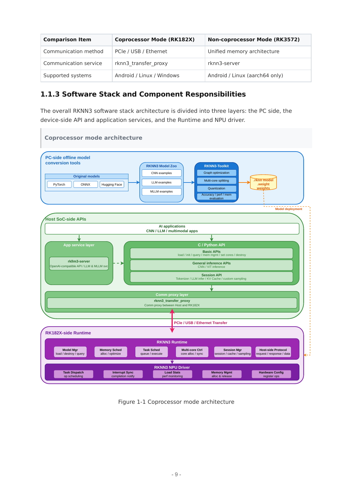

# 02D RKNN3 与 RK182X：协处理器编译、传输、会话和多卡

研究截止：2026-11-05。本文基于官方 V1.2.0（2026-10-22）手册与 Firefly 部署文档快照，属于文献/API 核验，未安装 SDK、运行开发板或测量机器人。RKNN3 是第三代目标体系，不能把 Toolkit2 的模型文件、运行库或 RKLLM 的支持名单直接搬过来。官方同时列 RK1820/RK1828 协处理器与 RK3572 集成 SoC；后者是软件手册中的支持对象，不据此补造完整硬件规格。[RK02_RKNN3_Readme](https://raw.githubusercontent.com/airockchip/rknn3-toolkit/main/README.md)（[本地原件](REFERENCES.md#ref-f132b85162ebf4e6))

## 一、部署对象和版本闭环

| 层 | RK182X 协处理器 | RK3572 集成模式 | 验收边界 |
| --- | --- | --- | --- |
| 运行位置 | 主机应用＋独立设备 Runtime | 本机应用＋集成 NPU | 不能混用统一内存假设 |
| 通信 | transfer_proxy，经 PCIe/USB/Ethernet | rknn3-server | 按实际 BSP 支持的链路验收 |
| 后端 | librknn3_api_rkcp.so | librknn3_api_native.so | 与 API、固件版本一致 |
| 产物 | .rknn＋.weight，语言模型另有 tokenizer/embed | 同一产物家族但目标相关 | 不能视为跨芯片通用文件 |
| 文档快照 | 上游 SDK1.2.0 | 上游 SDK1.2.0 | 与供应商 BSP 分开 |

官方架构把离线编译、主机 API/应用服务、通信代理和设备 Runtime/驱动分层。图支持“图优化与权重部署跨主机和协处理器”的结论，不能证明传输免拷贝、端到端时延或实时性。[RK02_02_RKNN3_SDK_Development_Guide_V1.2.0](https://raw.githubusercontent.com/airockchip/rknn3-toolkit/main/doc/EN/02_RKNN3_SDK_Development_Guide_V1.2.0.pdf)（[本地原件](REFERENCES.md#ref-9d498a30029e5731))

Firefly 的 RK182X 入门页更新于 2026-11-03，仍以 SDK1.1.0 示例演示安装。完整 Linux SDK 需联系销售；示例解包基包与 .repo 后执行 repo sync -l，选 EVB/SODIMM/USB/M2 配置，生成安装包，在主机安装并重启。Firefly 因镜像已带 rkep 驱动而调整原始驱动编译步骤。这说明“公开 Toolkit”与“可复建整板 BSP”不是同一交付物。示例 rknn-smi1.3.0、PCIe driver3.3.1、RC3.3.2、EP0.0.2、firmware/API1.1.0 是文档样例，不称当前全套版本。页面明确硬件功率查询不支持，软件状态输出不能当功耗计量。rknn3.service 的初始化时序及 FAQ 中 sleep3s 是工程线索，应检验依赖/重试/健康检查，不能把固定等待当确定性启动证明。[RK02_RK182X_Started](https://community.t-firefly.com/en/docs/products/accessories/RK182x/started)（[本地原件](REFERENCES.md#ref-a2dd36cd401ab3f5))

## 二、量化、产物与精度检查

编译链为源模型/配置→ONNX 导出→量化→图优化与分核→.rknn 和 .weight→目标 Runtime。LLM 还需配套 config.pkl、tokenizer.gguf、embed.bin；多段模型需要一致分段和词表。Python3.10/3.12 属官方支持环境，Toolkit、Lite、Runtime、代理/Server 与固件要一致；不兼容返回版本错误，而不是依靠文件扩展名猜兼容。[RK02_05_RKNN3_Runtime_C_API_Reference_V1.2.0](https://raw.githubusercontent.com/airockchip/rknn3-toolkit/main/doc/EN/05_RKNN3_Runtime_C_API_Reference_V1.2.0.pdf)（[本地原件](REFERENCES.md#ref-53befa7d6c4b804a))

开发指南的 RKQuantizer GRQ 通过反向传播最小化模块输出均方误差，普通量化与这种校准不等价。混合层配置与 auto_hybrid_rate 不能同时使用；PyTorch 层到 ONNX 的映射需针对同一导出图生成。若 ONNX 已 fake-quant，后续按相同 dtype/group 配置转换，而非再次运行 GRQ。W4A16 G32 表示沿输入通道每32权重一组的4位非对称权重量化、16位浮点激活；权重压缩收益仍要扣除 scale/元数据和 KV、激活空间。官方 gsm8k/MMbench 精度只是相应数据集结果，不能替代抓取成功或危险动作概率。应先比较浮点与量化中间层误差，再在真实相机、长上下文和动作分布上做留出验证。[RK02_02_RKNN3_SDK_Development_Guide_V1.2.0](https://raw.githubusercontent.com/airockchip/rknn3-toolkit/main/doc/EN/02_RKNN3_SDK_Development_Guide_V1.2.0.pdf)（[本地原件](REFERENCES.md#ref-9d498a30029e5731)) [RK02_00_RKNN3_SDK_Release_Notes_V1.2.0](https://raw.githubusercontent.com/airockchip/rknn3-toolkit/main/doc/EN/00_RKNN3_SDK_Release_Notes_V1.2.0.pdf)（[本地原件](REFERENCES.md#ref-f422f7a4bad78537))

## 三、对象生命周期、内存与图外处理

rknn3_init→load_model_from_path→model_init 建立上下文；普通模型运行张量，LLM 另建 session。多个 session 共享权重/内部内存，却保留独立 KV/LoRA；同一 context 同时只能运行一个 session。张量绑定 mem 时按 aligned_size 与 core_id 分配，不能拿逻辑元素数代替物理容量。create_mem_from_fd 可以包装外部分配内存，但包装对象仍需 destroy_mem；它不消除跨 PCIe 的设备传输。create_mem_from_phys 当前开发指南标未实现。CPU 写输入后 TO_DEVICE，设备写输出后 FROM_DEVICE；范围同步检查 offset+length，FROM_DEVICE 分块默认2MiB。漏同步可能得到旧数据，而非简单变慢。回调指针由 Runtime 管理，异步消费者要复制或建立经确认的所有权，不得回调返回后继续引用。[RK02_05_RKNN3_Runtime_C_API_Reference_V1.2.0](https://raw.githubusercontent.com/airockchip/rknn3-toolkit/main/doc/EN/05_RKNN3_Runtime_C_API_Reference_V1.2.0.pdf)（[本地原件](REFERENCES.md#ref-53befa7d6c4b804a))

对检测网络，大量候选框回传可能比计算更占主机资源。V1.2.0 插件把解码/NMS 移至协处理器 CPU，init/deinit 管理私有状态，get_output_num/get_attrs 定义输出，compute 执行，注册后编译为 .so。示例输出 [N,256,6] 含 score/class/坐标；阈值0.45/0.25是示例配置，不替代任务标定。图中间 Custom CPU Operator 则按图属性读 get_param，可能需 NC1HWC2 FP16 与 NCHW FP32 转换。两类插件解决不同位置问题，也会引入 CPU 时间、布局转换和 ABI 维护；不能宣称所有不支持算子自动高效回退。当前 MatMul C API 尚不支持 RK182X，手册的 RK3572 能力必须保持目标边界。[RK02_02_RKNN3_SDK_Development_Guide_V1.2.0](https://raw.githubusercontent.com/airockchip/rknn3-toolkit/main/doc/EN/02_RKNN3_SDK_Development_Guide_V1.2.0.pdf)（[本地原件](REFERENCES.md#ref-9d498a30029e5731))

## 四、多卡流水、缓存与服务调度

多卡按连续 Transformer 模块离线切段，stage_count 对应分段/卡数，device_id 映射各 stage，coremask 是单卡内编译匹配。主机为每卡建立 context/session，通过有界队列传递隐藏状态；官方建议在回调复制后入队，下游以 EMBED 和实际 n_token 输入。预填充可用 bucket128 起步，中间段禁采样，末段末桶才采样；解码每步仍遍历全部 stage，不能以卡数相乘得到单请求 token 速度。失败、队列关闭、唤醒和 join 必须先于资源销毁；清 KV 要覆盖所有段。负载均衡需重新切分和编译，没有自动跨卡迁移承诺。[RK02_02_RKNN3_SDK_Development_Guide_V1.2.0](https://raw.githubusercontent.com/airockchip/rknn3-toolkit/main/doc/EN/02_RKNN3_SDK_Development_Guide_V1.2.0.pdf)（[本地原件](REFERENCES.md#ref-9d498a30029e5731))

Paged Attention 在转换时 tokens_per_page>0 启用，建议64倍数；以页而非预留整个最大上下文分配。当前 request_num 只支持1，不能从通用分页原理推出连续批处理能力；Sliding Attention 等情况可能退回连续缓存。绑定只在空闲会话进行，先成功解除再销毁；KV 文件强绑定模型和 Runtime，更新后不可盲目复用。RKLLM3 Server 的 HTTP 接收并发，推理 FIFO 串行，多个 slot 只隔离上下文；队列没有超时机制，需要客户端超时与过期请求处置。暂停/中断 API 控制生成，不是电机急停接口。[RK02_06_RKLLM3_Server_User_Guide_V1.2.0](https://raw.githubusercontent.com/airockchip/rknn3-toolkit/main/doc/EN/06_RKLLM3_Server_User_Guide_V1.2.0.pdf)（[本地原件](REFERENCES.md#ref-35c26847abdacb11))

XGrammar 把 JSON Schema/Regex/EBNF 编成 token 掩码，使非法 token logits 为负无穷，约束从第一个生成 token 起生效。若启用 thinking，语法需覆盖思考、标记和答案全段。它改善结构有效性，不能检查世界状态、轨迹可行性或力矩限制。与 TensorRT 类图编译/显式内存相比，RKNN3 的共同迁移资产是模型图、校准和张量契约，专用图、后端与固件仍要重建；没有同条件跨平台测量，本文不作加速排名。

## 五、官方基准读法及可复建验证

| 官方测试 | 条件 | 指标 | 可得结论/缺口 |
| --- | --- | --- | --- |
| Qwen2.5-7B | RK3588性能模式＋PCIe RK1828，NPU1GHz，输入/输出128 | TTFT157.59ms，decode70.14TPS | 语言阶段；非机器人响应 |
| Qwen2.5-VL-3B | 392×392，RK1828 | vision216.74ms，TTFT83.95ms，decode104.21TPS | 两阶段独立测试，不能直接合成闭环 |
| Qwen2.5-VL-3B | RK1820，LMHead在RK3588 | vision230.76ms，decode50.90TPS | 不同执行方案，不能只归因内存容量 |
| YOLOv8s | 640×640，RK182X | 单核34.73FPS，多batch多核232.61FPS | 后者吞吐口径，不是单帧时延 |
| Gemma-4-31B | RK3588＋4×RK1828，输入5120/输出128 | TTFT9153.38ms，decode13.82TPS | 证明文档测试的容量扩展；非线性加速 |

上述值来自发行说明第12—15页；精度表另外给 W4A16 G32/W8A8，不能无额外测试配置就为每个性能行补齐精度、功耗、warmup、样本或 P99。语言与视觉独立测试，吞吐不含已证实的采集、ROS、规划和执行计时。[RK02_00_RKNN3_SDK_Release_Notes_V1.2.0](https://raw.githubusercontent.com/airockchip/rknn3-toolkit/main/doc/EN/00_RKNN3_SDK_Release_Notes_V1.2.0.pdf)（[本地原件](REFERENCES.md#ref-f422f7a4bad78537))

复建应冻结源码 commit（本次移动分支未取得完整 commit）、环境锁、导出配置、量化样本哈希、产物/词表哈希，以及全套 API/驱动/代理/固件。先验证模拟器精度，再连板核对 query 属性/内存同步，最后测单卡与多卡首帧、队列等待、长上下文内存、卡断连和恢复；加入真实相机数据年龄与控制超时。本次只核验文档与接口，不能把这套验证计划写成已通过。

根 LICENSE 为 RKNN SDK 专用协议，授权限定 Rockchip 兼容应用设计开发测试；文档复制限内部合理数量，禁止未授权逆向，支持无强制义务。Model Zoo 的独立代码许可不能替代 Toolkit、固件、第三方组件和权重许可。商业再分发需逐包确认；本文不以公开下载推导完整开源或量产维护承诺。[RK02_RKNN3_License](https://raw.githubusercontent.com/airockchip/rknn3-toolkit/main/LICENSE)（[本地原件](REFERENCES.md#ref-e0d48d173b53dd02)) [RK02_RKNN3_ZooLicense](https://raw.githubusercontent.com/airockchip/rknn3-model-zoo/main/LICENSE)（[本地原件](REFERENCES.md#ref-9f9248451a473206))

## 参考资料与本地原文

采集时间逐项列出；移动分支及无版本网页仅代表此次快照。HTML 保留正文与可取得静态依赖，动态交互、视频及缺失依赖不保证完整。未进行目标板安装或实机性能验证。

| 来源 | 原 URL | 本地原件 | 采集 UTC | 归档状态 |
| --- | --- | --- | --- | --- |
| RK02_RKNN3_Readme | [原文](https://raw.githubusercontent.com/airockchip/rknn3-toolkit/main/README.md) | [归档](REFERENCES.md#ref-f132b85162ebf4e6) | 2026-11-04T16:32:33.513636+00:00 | complete_static；缺失依赖 0 |
| RK02_02_RKNN3_SDK_Development_Guide_V1.2.0 | [原文](https://raw.githubusercontent.com/airockchip/rknn3-toolkit/main/doc/EN/02_RKNN3_SDK_Development_Guide_V1.2.0.pdf) | [归档](REFERENCES.md#ref-9d498a30029e5731) | 2026-11-04T16:32:54.533544+00:00 | complete_static；缺失依赖 0 |
| RK02_RK182X_Started | [原文](https://community.t-firefly.com/en/docs/products/accessories/RK182x/started) | [归档](REFERENCES.md#ref-a2dd36cd401ab3f5) | 2026-11-04T16:31:04.987368+00:00 | partial_static；缺失依赖 2 |
| RK02_05_RKNN3_Runtime_C_API_Reference_V1.2.0 | [原文](https://raw.githubusercontent.com/airockchip/rknn3-toolkit/main/doc/EN/05_RKNN3_Runtime_C_API_Reference_V1.2.0.pdf) | [归档](REFERENCES.md#ref-53befa7d6c4b804a) | 2026-11-04T16:33:02.285496+00:00 | complete_static；缺失依赖 0 |
| RK02_00_RKNN3_SDK_Release_Notes_V1.2.0 | [原文](https://raw.githubusercontent.com/airockchip/rknn3-toolkit/main/doc/EN/00_RKNN3_SDK_Release_Notes_V1.2.0.pdf) | [归档](REFERENCES.md#ref-f422f7a4bad78537) | 2026-11-04T16:32:49.070460+00:00 | complete_static；缺失依赖 0 |
| RK02_06_RKLLM3_Server_User_Guide_V1.2.0 | [原文](https://raw.githubusercontent.com/airockchip/rknn3-toolkit/main/doc/EN/06_RKLLM3_Server_User_Guide_V1.2.0.pdf) | [归档](REFERENCES.md#ref-35c26847abdacb11) | 2026-11-04T16:33:04.621902+00:00 | complete_static；缺失依赖 0 |
| RK02_RKNN3_License | [原文](https://raw.githubusercontent.com/airockchip/rknn3-toolkit/main/LICENSE) | [归档](REFERENCES.md#ref-e0d48d173b53dd02) | 2026-11-04T16:32:45.776051+00:00 | complete_static；缺失依赖 0 |
| RK02_RKNN3_ZooLicense | [原文](https://raw.githubusercontent.com/airockchip/rknn3-model-zoo/main/LICENSE) | [归档](REFERENCES.md#ref-9f9248451a473206) | 2026-11-04T16:38:02.161696+00:00 | complete_static；缺失依赖 0 |

[证据记录](research_state/evidence/02D_RKNN3_RK182X.json)；[本章开始前哈希基线](research_state/baselines/02D_RKNN3_RK182X_before.json)。检查和去重记录由专题索引汇总。
