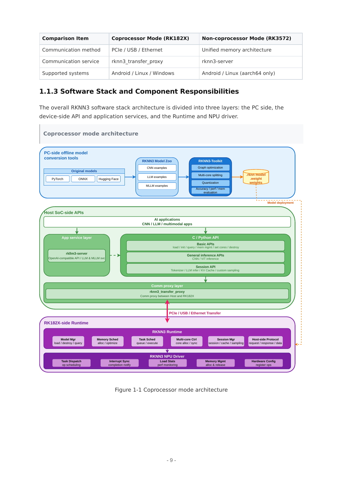

# 02 Rockchip 具身智能软件栈总览

研究截止2026-11-05；用户已授权连续完成后续章节。第2章由本总览与02A—02E五篇独立专题组成。已核验的主线是 Linux/BSP与多媒体→RKNN2视觉或RKLLM语言→RKNN3协处理器→ROS/实时执行与OTA。厂商提供芯片SDK与模型示例，Firefly/Radxa提供整板适配，上层机器人任务、标定、控制契约和量产验证仍由集成方完成。公开文档足以研究机制，不足以证明某一机器人已有完整可复建量产软件包。

## 一、能力与交接地图

| 栈 | 主要对象 | 输入/产物 | 下层依赖 | 覆盖与边界 |
| --- | --- | --- | --- | --- |
| BSP/多媒体 | kernel、DTS、MPP/RGA、GPU | 固件、dma-buf、图像布局 | 载板/驱动/桥接器 | 02A；GPU可视化不等于AI加速 |
| RKNN Toolkit2 | 图转换、校准、Runtime | ONNX→.rknn→tensor | 对应SoC NPU/driver | 02B；旧Toolkit1目标分开 |
| RKLLM | 语言转换、会话、特征输入 | .rkllm、文本/embedding | RK3588等支持目标 | 02C；不覆盖RK182X |
| RKNN3 | GRQ、图分核、多卡/session | .rknn＋.weight＋词表/embed | 代理/后端/固件一致 | 02D；RK182X与RK3572模式分开 |
| ROS/控制运维 | topic/frame、AMP、EtherCAT、OTA | 消息/动作、远端固件、升级包 | BSP/网卡/从站/本体 | 02E；通信验证不等于闭环验收 |

官方 RKNN3 架构提供本章最完整的离线与板端分层图，可查看02D的原页。它不代表Toolkit2/RKLLM共用同一运行库。上游RKNN2与Model Zoo2.5.0、RKLLM1.3.1、RKNN3文档1.2.0属于不同版本家族；Firefly RK182X部署样例仍为1.1.0，软件最新文档与实际BSP包需建立兼容矩阵。[RK02_RKNN2_Readme](https://raw.githubusercontent.com/airockchip/rknn-toolkit2/master/README.md)（[本地原件](REFERENCES.md#ref-15f0b493e9150c73)) [RK02_RKLLM_Readme](https://raw.githubusercontent.com/airockchip/rknn-llm/main/README.md)（[本地原件](REFERENCES.md#ref-5b6e59180a191ea7)) [RK02_RKNN3_Readme](https://raw.githubusercontent.com/airockchip/rknn3-toolkit/main/README.md)（[本地原件](REFERENCES.md#ref-f132b85162ebf4e6)) [RK02_RK182X_Started](https://community.t-firefly.com/en/docs/products/accessories/RK182x/started)（[本地原件](REFERENCES.md#ref-a2dd36cd401ab3f5))

## 二、一条可追踪而未闭环验证的模型链

以YOLOv8为例，官方Zoo的优化图采用三尺度box/classes/sum输出，不能用原始ONNX单张量后处理直接套用。离线config设置mean/std和目标，load_onnx→build校准→export；目标C++示例做RGB/letterbox、inputs_set/run/outputs_get、NMS再释放。这个普通内存示例证明视觉部署接口，不证明相机零拷贝或实时机器人识别。若接MPP/RGA采集预处理，要核对NV12/RGB、stride、DMA可达性、同步与帧身份；若发ROS，需携带采集时间、坐标/类别含义，若触发动作，需检查对象与控制器契约。当前文档最后一段没有指定本体工程，明确标为待集成。[RK02_YOLO8_Guide](https://raw.githubusercontent.com/airockchip/rknn_model_zoo/main/examples/yolov8/README.md)（[本地原件](REFERENCES.md#ref-29dcf40a79c11e95))

RKLLM的多模态示例走RKNN编码器→浮点embedding→语言模型；示例文件图像先编码再交互，keep_history0，与实时连续相机不同。RKNN3则把大模型权重放在协处理器，经代理传输；多卡需离线切段、context/session和隐藏状态队列。它们可分担视觉、语义和大模型容量压力，但并发会争用CPU、DDR、PCIe与散热，必须测实际任务组合。不能把每个独立demo的最快结果叠加成完整系统能力。[RK02_RKLLM_MMRuntime](https://raw.githubusercontent.com/airockchip/rknn-llm/main/examples/multimodal_model_demo/deploy/src/main.cpp)（[本地原件](REFERENCES.md#ref-9021068f56956d85)) [RK02_02_RKNN3_SDK_Development_Guide_V1.2.0](https://raw.githubusercontent.com/airockchip/rknn3-toolkit/main/doc/EN/02_RKNN3_SDK_Development_Guide_V1.2.0.pdf)（[本地原件](REFERENCES.md#ref-9d498a30029e5731))

## 三、决定可用性的机制

模型编译物是硬件/运行库相关文件。即使同为.rknn，Toolkit2与RKNN3也不是可互换的二进制；词表、embedding、量化配置、核心映射和分段必须与图一致。图外预后处理需要匹配输出布局，量化的scale/zero point与原图精度要分开验收。benchmark只覆盖相应模型和执行段；最高NPU频率下单核FPS不能转换成全负载端到端P99，语言decodeTPS不能当抓取policy或电机伺服频率。

缓存和异步接口有生命周期成本。fd不是完整buffer所有权，引用计数、缓存同步、fence和stride缺一可能导致旧帧、损坏或内存泄漏。RKNN3回调数据异步传递需复制/所有权保证；同context多session不并行，Server多slot隔离上下文而推理FIFO串行，队列请求无内建超时。这使“吞吐看起来充足、观测却过期”成为具体失效模式。实时路径应在入队前定义deadline/取消机制，并让执行端拒收过期动作。[RK02_06_RKLLM3_Server_User_Guide_V1.2.0](https://raw.githubusercontent.com/airockchip/rknn3-toolkit/main/doc/EN/06_RKLLM3_Server_User_Guide_V1.2.0.pdf)（[本地原件](REFERENCES.md#ref-35c26847abdacb11))

Linux侧PREEMPT_RT减少不可抢占段，AMP划分CPU/内存/IRQ/外设，但共享DDR、电源/时钟仍需管理。cyclictest的-p99是优先级，不是P99统计；文档例程没有给出目标机器人WCET。EtherCAT通过专用网口、PDO和DC形成周期链，驱动器状态与急停需独立核对；ROS安装和talker/listener仅验证环境。把AI和执行放在同一SoC的收益是接口和物料整合，代价是要做资源隔离与整机失效验证。[RK02_RT_Preempt](https://community.t-firefly.com/en/docs/software/industry-robot/RT-Linux/rtlinux-preempt-rt)（[本地原件](REFERENCES.md#ref-38c6142c135a686a)) [RK02_AMP_Prereq](https://community.t-firefly.com/en/docs/software/industry-robot/AMP/amp-prerequisites)（[本地原件](REFERENCES.md#ref-7859770da31383a7)) [RK02_EtherCAT](https://community.t-firefly.com/en/docs/software/industry-robot/EtherCAT/ethercat-overview-2)（[本地原件](REFERENCES.md#ref-6a7a5c1a9d8cffba))

## 四、版本、许可与量产交付

| 交付层 | 应冻结的内容 | 已取得 | 尚需补齐 |
| --- | --- | --- | --- |
| 整板 | SKU/revision、DTS、kernel、boot/firmware | 官方/伙伴网页与配置 | 完整BSP仓库、PCN及维护合同 |
| AI构建 | 图/权重/样本哈希、工具环境、编译选项 | 官方源码示例/API/手册 | 完整commit、特定模型权重许可 |
| 运行 | driver/runtime/代理、内存和核配置 | API与版本约束 | 板端并发/热稳定/P99 |
| 任务 | 传感器标定、frames、关节/动作单位 | 单栈输入输出线索 | 指定本体闭环工程/成功率 |
| 升级 | 系统＋模型＋词表＋标定版本事务 | Recovery/A-B配置 | 断电回退/安全静止健康检查 |

MPP/RGA的开源许可与Toolkit专用协议分开，RKLLM、Zoo、固件、Mali组件、模型和训练数据还需各自审查。公开仓库不等于全栈源码可得，Root LICENSE也不自动覆盖权重。SecureBoot配置能提供签名验证路径，但伙伴说明rollback-index不支持，不能称完整防回滚；A/B系统槽回退也不保证模型/标定同步回退。[RK02_RKNN3_License](https://raw.githubusercontent.com/airockchip/rknn3-toolkit/main/LICENSE)（[本地原件](REFERENCES.md#ref-e0d48d173b53dd02)) [RK02_SecureBoot](https://community.t-firefly.com/en/docs/software/other/SecureBoot/secureboot-overview)（[本地原件](REFERENCES.md#ref-6a0f17927bb8ae3c)) [RK02_OTA_Linux](https://community.t-firefly.com/en/docs/software/other/OTA/ota-linux)（[本地原件](REFERENCES.md#ref-ccf3f3086d29b250))

本章未取得厂商独立仿真、机器人资产/训练编排/数据闭环全套交付物。可使用第三方ROS/训练环境，但框架兼容需要依赖与硬件逐项验证，不能从Linux/ARM支持推出NPU训练或官方sim-to-real。仿真与模型地图将在05、04按真实证据独立展开。对标时可以比较离线编译、显式内存、设备分工和迁移成本；没有同条件测试不输出平台排名。

## 五、复建与放行流程

研究结果支持先选择硬件目标和BSP，再冻结工具/模型/产物，单栈验精度与API，随后连传感器测数据年龄，再联调控制和异常，最后测并发热稳定与升级回退。最低日志应含frame_id、采集/推理/接收/执行时间、模型/固件哈希、温度频率、队列等待和错误码。策略失败、驱动失联、传感器冻结和OTA中断应分别注入，验证下层进入定义的降级状态；这套流程是本文分析建议，尚未运行。

资料已归档HTML/PDF/源码和可取得依赖，每篇有证据JSON、哈希基线、结构检查及去重记录。完整联合资料集由02专题索引提供。结构检查只确认字数、链接、原件/图源与其他报告保护，人工静态核查只支持文献结论；两者不替代硬件、模型或客户验收。

## 参考资料与本地原文

采集时间逐项列出；移动分支及无版本网页仅代表此次快照。HTML 保留正文与可取得静态依赖，动态交互、视频及缺失依赖不保证完整。未进行目标板安装或实机性能验证。

| 来源 | 原 URL | 本地原件 | 采集 UTC | 归档状态 |
| --- | --- | --- | --- | --- |
| RK02_RKNN2_Readme | [原文](https://raw.githubusercontent.com/airockchip/rknn-toolkit2/master/README.md) | [归档](REFERENCES.md#ref-15f0b493e9150c73) | 2026-11-04T16:10:04.951084+00:00 | complete_static；缺失依赖 0 |
| RK02_RKLLM_Readme | [原文](https://raw.githubusercontent.com/airockchip/rknn-llm/main/README.md) | [归档](REFERENCES.md#ref-5b6e59180a191ea7) | 2026-11-04T16:10:05.951168+00:00 | complete_static；缺失依赖 0 |
| RK02_RKNN3_Readme | [原文](https://raw.githubusercontent.com/airockchip/rknn3-toolkit/main/README.md) | [归档](REFERENCES.md#ref-f132b85162ebf4e6) | 2026-11-04T16:32:33.513636+00:00 | complete_static；缺失依赖 0 |
| RK02_RK182X_Started | [原文](https://community.t-firefly.com/en/docs/products/accessories/RK182x/started) | [归档](REFERENCES.md#ref-a2dd36cd401ab3f5) | 2026-11-04T16:31:04.987368+00:00 | partial_static；缺失依赖 2 |
| RK02_YOLO8_Guide | [原文](https://raw.githubusercontent.com/airockchip/rknn_model_zoo/main/examples/yolov8/README.md) | [归档](REFERENCES.md#ref-29dcf40a79c11e95) | 2026-11-04T16:20:25.106486+00:00 | complete_static；缺失依赖 0 |
| RK02_RKLLM_MMRuntime | [原文](https://raw.githubusercontent.com/airockchip/rknn-llm/main/examples/multimodal_model_demo/deploy/src/main.cpp) | [归档](REFERENCES.md#ref-9021068f56956d85) | 2026-11-04T16:26:06.276144+00:00 | complete_static；缺失依赖 0 |
| RK02_02_RKNN3_SDK_Development_Guide_V1.2.0 | [原文](https://raw.githubusercontent.com/airockchip/rknn3-toolkit/main/doc/EN/02_RKNN3_SDK_Development_Guide_V1.2.0.pdf) | [归档](REFERENCES.md#ref-9d498a30029e5731) | 2026-11-04T16:32:54.533544+00:00 | complete_static；缺失依赖 0 |
| RK02_06_RKLLM3_Server_User_Guide_V1.2.0 | [原文](https://raw.githubusercontent.com/airockchip/rknn3-toolkit/main/doc/EN/06_RKLLM3_Server_User_Guide_V1.2.0.pdf) | [归档](REFERENCES.md#ref-35c26847abdacb11) | 2026-11-04T16:33:04.621902+00:00 | complete_static；缺失依赖 0 |
| RK02_RT_Preempt | [原文](https://community.t-firefly.com/en/docs/software/industry-robot/RT-Linux/rtlinux-preempt-rt) | [归档](REFERENCES.md#ref-38c6142c135a686a) | 2026-11-04T16:40:23.281062+00:00 | partial_static；缺失依赖 2 |
| RK02_AMP_Prereq | [原文](https://community.t-firefly.com/en/docs/software/industry-robot/AMP/amp-prerequisites) | [归档](REFERENCES.md#ref-7859770da31383a7) | 2026-11-04T16:41:47.418007+00:00 | partial_static；缺失依赖 2 |
| RK02_EtherCAT | [原文](https://community.t-firefly.com/en/docs/software/industry-robot/EtherCAT/ethercat-overview-2) | [归档](REFERENCES.md#ref-6a7a5c1a9d8cffba) | 2026-11-04T16:37:44.948392+00:00 | partial_static；缺失依赖 2 |
| RK02_RKNN3_License | [原文](https://raw.githubusercontent.com/airockchip/rknn3-toolkit/main/LICENSE) | [归档](REFERENCES.md#ref-e0d48d173b53dd02) | 2026-11-04T16:32:45.776051+00:00 | complete_static；缺失依赖 0 |
| RK02_SecureBoot | [原文](https://community.t-firefly.com/en/docs/software/other/SecureBoot/secureboot-overview) | [归档](REFERENCES.md#ref-6a0f17927bb8ae3c) | 2026-11-04T16:37:50.466010+00:00 | partial_static；缺失依赖 2 |
| RK02_OTA_Linux | [原文](https://community.t-firefly.com/en/docs/software/other/OTA/ota-linux) | [归档](REFERENCES.md#ref-ccf3f3086d29b250) | 2026-11-04T16:41:38.657971+00:00 | partial_static；缺失依赖 2 |

[证据记录](research_state/evidence/02_Software_Stack.json)；[本章开始前哈希基线](research_state/baselines/02_Software_Stack_before.json)。检查和去重记录由专题索引汇总。
